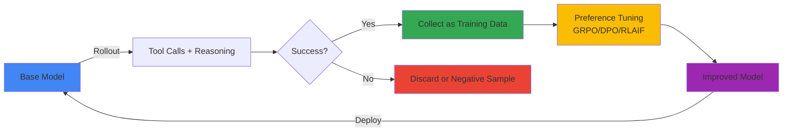
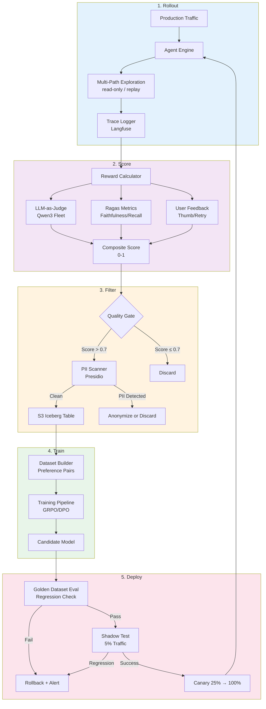
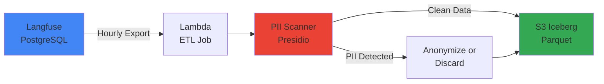

:::warning self-hosted 오픈웨이트 모델 전용
본 루프는 사용자가 가중치를 직접 수정·호스팅할 라이선스를 가진 모델(예: Qwen3, Llama 4, GLM-5 — 파인튜닝·재배포 조건은 각 모델 라이선스를 확인)에만 적용됩니다. Amazon Bedrock의 관리형 서비스로 소비하는 모델(Anthropic Claude, Amazon Nova 등)에는 적용되지 않습니다. 호스팅하지 않는 가중치는 재학습할 수 없기 때문입니다. Amazon Bedrock AgentCore는 에이전트 **런타임**(세션·메모리·도구·identity)이며, AgentCore 에이전트가 사용하는 모델은 별도 선택 사항이므로 "AgentCore에서 실행"과 "self-hosted 오픈웨이트"는 서로 독립적인 결정입니다. 또한 상주 GPU 메모리를 고려해야 합니다. Llama 4·GLM-5 같은 대형 오픈웨이트 모델도 학습·서빙 하드웨어에 적재되어야 합니다.
:::

:::info ADR 선행 필요
실 운영 적용 전에 스코프·자동화 경계·데이터 거버넌스·롤백 기준에 대한 합의가 필요합니다. 자세한 합의 대상은 [ADR — Self-Improving Agent Loop 도입 의사결정](./adr-self-improving-loop.md)을 참조합니다.
:::

## Autoresearch 담론과 엔터프라이즈 해석

### Karpathy의 핵심 주장

Andrej Karpathy는 2026년 3월 [autoresearch](https://github.com/karpathy/autoresearch) 프로젝트를 공개했습니다. 이 프로젝트는 AI 에이전트에게 소규모이지만 실제로 동작하는 단일 GPU LLM 학습 환경(간소화한 [nanochat](https://github.com/karpathy/nanochat))을 주고, 에이전트가 학습 파일 `train.py`를 직접 수정 → **고정 5분 예산**으로 학습 → 검증 지표 `val_bpb`(bits per byte) 개선 여부 확인 → 유지/폐기 → 반복하도록 자율 실험시키는 구조입니다. 프로젝트 자체는 토이 모델에 대한 연구용 학습 루프이지 프로덕션 서빙 시스템이 아닙니다. 본 문서는 이 개념을 출발점으로만 차용하고, 아래의 엔터프라이즈 환경에 맞게 추가 통제를 더해 변형합니다. 차용하는 아이디어:

1. **Tool-use Rollout**: 에이전트가 여러 후보 경로(여기서는 코드 실행·웹 검색·계산기 등 도구를 사용한 후보 응답)를 탐색
2. **Success as Signal**: 성공으로 판정된 경로가 다음 학습의 시그널이 됨
3. **Self-Supervised Loop**: 에이전트 자체 성공·실패 데이터를 축적하고 재학습하여 매 iteration의 신규 인간 라벨링 의존도를 낮춤
4. **Compound Growth(보장이 아니라 기대)**: 더 강해진 모델이 더 유용한 trace를 생성해 더 강한 모델을 학습시키기를 기대하는 것이며, 특정 배포에서 실제로 선순환이 성립하는지는 가정이 아니라 측정으로 확인해야 하는 문제입니다

**그림 1. autoresearch 루프의 rollout·성공 판정·선호 학습·재배포 순환**



**예시**: 수학 문제 해결 Agent
- **Rollout**: "53 × 47 = ?"에 대해 5가지 접근(직접 계산, Python 실행, Wolfram Alpha, 근사 추정, 분해 계산)
- **Success**: Python 실행과 분해 계산이 정답 2491에 도달
- **Training**: 성공 경로를 preferred 샘플로, 실패 경로를 rejected 샘플로 DPO 학습
- **Next Iteration**: 모델이 복잡한 계산 시 Python 실행을 먼저 시도하도록 bias 증가

### 엔터프라이즈 환경의 제약

Karpathy의 이상론을 기업 환경에 적용하려면 다음 제약을 고려해야 합니다:

**표 1. 엔터프라이즈 환경에서 self-improving loop 적용 시 제약과 해결 방향**

| 제약 | 설명 | 해결 방향 |
|------|------|----------|
| **데이터 거버넌스** | 프로덕션 trace에 PII, 기밀 정보 포함 가능 | Presidio PII 스캐너, k-anonymity, consent 추적 |
| **비용** | Rollout마다 LLM 호출 N배 증가 (N=탐색 경로 수) | 비용·품질 trade-off 최적화, 저비용 모델 우선 사용 |
| **Reward 모델링** | "성공"의 정의가 모호(고객 만족? 정확도? latency?) | 복합 reward: LLM-as-judge + Ragas + 유저 피드백 |
| **Mode Collapse** | 특정 패턴만 반복 생성 (diversity 손실) | Entropy regularization, diverse sampling |
| **Regulatory** | 모델 변경마다 감사 로그, 모델 카드 업데이트 필요 | 버전 관리, audit trail, [Agent 버전관리](../../../aidlc/enterprise/agent-versioning/index.md) 연동 |

:::tip 엔터프라이즈 인사이트
Self-improving loop는 **"완전 자동화"가 아니라 "인간 감독 하의 자동 강화"**로 해석해야 합니다. 매 iteration마다 품질 게이트와 휴먼-인-루프 검증이 필수입니다.
:::

---

## 5-Stage Loop 아키텍처

### 전체 아키텍처 다이어그램

**그림 2. 5-stage 루프의 Rollout·Score·Filter·Train·Deploy 단계 구성**



:::danger Multi-path 탐색 중 부작용
동일한 라이브 요청에 대해 여러 후보 응답을 생성하는 것은 추가 경로가 **read-only**일 때만 안전합니다. 상태를 변경하는 도구 호출(이메일 발송, 주문 생성, 시스템 of record 쓰기)은 **요청당 최대 1회**, 사용자에게 반환되는 단일 승인 경로에서만 실행되어야 합니다. baseline 응답만 반환한다고 해서 후보 경로의 쓰기가 저절로 막히는 것은 **아닙니다**. 프로덕션 트래픽에 탐색을 적용하기 전에, 후보 경로가 read-only 도구 스텁이나 idempotency key를 사용하거나 로깅된 trace를 오프라인으로 replay하도록 요구하고 부작용이 0임을 입증해야 합니다. 본 문서 뒤에 나오는 `shadow=True`는 애플리케이션 레벨 표시일 뿐이며 도구 부작용을 자동으로 샌드박싱하지 않습니다.
:::

### Stage 1: Rollout — 프로덕션 트래픽 수집

**목표**: 실제 사용자 요청에 대한 Agent 실행 trace를 수집합니다.

**실행 주기**: 연속(Real-time)

**입력**: 사용자 요청, 컨텍스트, Agent 상태  
**출력**: Trace (프롬프트, 도구 호출, 중간 추론, 최종 응답, latency, 토큰 수)

**수집 메커니즘** (예시 — Langfuse SDK 버전 고정 필요):

Langfuse SDK API는 메이저 버전 간에 다릅니다(v2의 `langfuse.trace()`/`span()` 클라이언트 객체 API는 v3+의 OpenTelemetry 기반 observe/context API로 대체됨). 배포하는 SDK 버전을 고정하고 해당 버전의 문서화된 데코레이터/컨텍스트 매니저를 사용하십시오. 아래 `@trace_agent_call`은 SDK 심볼이 아니라 **애플리케이션 정의 헬퍼**입니다. Trace export는 절대 요청을 중단시키면 안 됩니다. 추적 실패는 로깅하되 사용자 응답은 반환되도록 격리하고, 실제 에이전트 오류까지 삼키지 않도록 합니다.

```python
# 예시. 고정한 Langfuse SDK의 데코레이터/컨텍스트 API로 교체하십시오(v2와 v3+가 다름).
from langfuse import Langfuse  # 예: langfuse==2.x 또는 3.x로 명시 고정

langfuse = Langfuse()

def execute_agent(user_query: str, context: dict):
    # 실제 에이전트 작업은 추적 성공 여부와 무관하게 실행됩니다.
    docs = vector_db.search(user_query)
    response = llm.generate(prompt=build_prompt(user_query, docs))
    if response.requires_tool:
        response.tool_result = execute_tool(response.tool_name, response.tool_args)

    try:
        # SDK의 문서화된 API로 trace/span 트리를 기록합니다.
        _record_trace(langfuse, user_query, context, response)
    except Exception:  # 추적 실패가 사용자 응답을 깨뜨리면 안 됩니다.
        logger.exception("trace export failed")  # 격리됨. 에이전트 오류는 여기서 잡지 않습니다.
    return response
```

**다양성 확보**: 동일 요청에 대해 temperature 변화(예: 0.7/0.9/1.1)로 여러 응답을 생성하면 후보 diversity를 높일 수 있습니다. 다만 이것이 학습된 모델을 실제로 개선하는지는 보장이 아니라 측정으로 확인할 문제입니다.

**실패 격리**: 위 코드처럼 trace export를 가드 블록에 두어 수집이 실패해도 사용자 응답은 반환됩니다. 가능하면 비동기로 export 합니다.

---

### Stage 2: Score — Reward 계산

**목표**: 각 trace에 0-1 점수를 부여하여 "얼마나 좋은 응답인가"를 정량화합니다.

**실행 주기**: 시간별(Hourly) 배치

**입력**: Langfuse trace ID 배치  
**출력**: `{trace_id: reward_score}` 테이블

**복합 Reward 공식**:

```python
# 긍정 품질 시그널은 볼록 결합(가중치 합 = 1.0)으로 [0, 1] 범위의 base score를 만듭니다.
# Latency는 가중치 항이 아니라 이후 별도 bounded penalty로 적용합니다(아래 compute_reward 참조).
base_score = (
    w1 * llm_judge_score +      # LLM-as-Judge (0-1)
    w2 * ragas_faithfulness +   # Ragas faithfulness (0-1)
    w3 * ragas_context_recall + # Ragas context recall (0-1, reference 없으면 제외/renormalize)
    w4 * user_feedback_score    # Thumbs up=1, down=0, neutral=0.5
)

# 기본 가중치(튜닝 대상 가설). 합은 1.0이어야 함
w1, w2, w3, w4 = 0.35, 0.25, 0.20, 0.20
```

**LLM-as-Judge 프롬프트**:

```python
judge_prompt = f"""
다음 Agent 응답을 평가하세요:

**질문**: {question}
**컨텍스트**: {context}
**응답**: {answer}

평가 기준:
1. 정확성: 컨텍스트 기반 사실 정확성
2. 완전성: 질문의 모든 측면을 다루는가
3. 명확성: 사용자가 이해하기 쉬운가
4. 간결성: 불필요한 정보 없이 핵심만 전달하는가

0-1 사이 점수와 근거를 JSON으로 반환하세요.
{{"score": 0.85, "reasoning": "정확하고 완전하나 약간 장황함"}}
"""

judge_response = cheap_llm.generate(judge_prompt)  # Qwen3-8B 사용 (비용 절감)
```

**Ragas 평가**:

`context_recall`은 비교 대상인 `reference`(ground truth)가 항상 필요하므로 ground truth가 없으면 계산할 수 없습니다. `None`을 넘기지 말고 해당 메트릭을 건너뛴 뒤 나머지 가중치를 renormalize 합니다. 데이터셋은 실제 리스트(컬럼당 항목 1개)로 구성하고, 입력이 존재하는 메트릭만 포함합니다.

```python
from ragas import evaluate
from ragas.metrics import Faithfulness, LLMContextRecall
from datasets import Dataset

columns = {"question": [question], "answer": [answer], "contexts": [contexts]}
metrics = [Faithfulness()]
if ground_truth is not None:  # context_recall은 reference 필요. 없으면 제외
    columns["ground_truth"] = [ground_truth]
    metrics.append(LLMContextRecall())

ragas_result = evaluate(Dataset.from_dict(columns), metrics=metrics)
```

**User Feedback 통합**:

```python
# 고정한 Langfuse SDK의 문서화된 scores API로 피드백 조회
# (메서드명/반환 형태가 SDK 버전마다 다르므로 배포 버전 기준으로 확인).
scores = get_feedback_scores(trace_id=trace_id, name="user-feedback")  # 앱 레벨 어댑터
# 점수가 0개/여러 개일 때 동작 정의(여기서는 없으면 중립 0.5).
if not scores:
    user_score = 0.5
else:
    latest = scores[-1].value  # 또는 정책에 따라 집계
    user_score = 1.0 if latest == "positive" else 0.0 if latest == "negative" else 0.5
```

**비용 최적화**:
- LLM-as-Judge는 저비용 모델(예: Qwen3-8B, Llama 4 Scout) 사용
- Ragas 결과는 question+context만이 아니라 **모든 채점 입력과 버전**(question + contexts + answer + metric version)을 키로 캐싱 — 그렇지 않으면 다른 답변이 다른 응답의 점수를 재사용할 수 있습니다
- 유저 피드백 우선 — 피드백 점수가 이미 있으면 LLM-as-Judge 스킵

---

### Stage 3: Filter — 데이터 큐레이션 & PII 게이트

**목표**: 고품질 trace만 학습 데이터로 선별하고, 민감 정보를 제거합니다.

**실행 주기**: 시간별(Hourly) 배치

**입력**: Scored traces  
**출력**: Clean training dataset (S3 Iceberg 테이블)

**품질 게이트**:

이 단계는 혼동하면 안 되는 **별개의** 두 작업을 수행합니다. (a) **안전/동의 필터**는 품질과 무관하게 절대 사용할 수 없는 trace(익명화 불가 PII, 학습 동의 누락, 정책 위반 등)를 제거합니다. (b) **Preference pair 적격성**은 trace를 어떻게 사용할지 결정합니다. 낮은 점수나 실패한 답변이 반드시 폐기되는 것은 아니며, 바로 preference pair의 `rejected` 쪽이 되기 때문입니다. 적격한 저품질 답변을 pairing 전에 버리지 마십시오(Stage 4 참조).

```python
def partition_traces(scored_traces):
    """안전 필터 먼저. 품질 시그널은 이후 pairing을 위해 보존."""
    eligible = []
    for trace in scored_traces:
        # 안전/동의 게이트 — 하드 제외만.
        if not trace.training_consent or trace.unresolvable_pii:
            continue

        # 요청별 지연 이상치(초). 모집단에 대한 P99 백분위가 아니라
        # 단일 요청의 지연입니다.
        if trace.latency_seconds > 30:
            continue

        # 동일 (question, answer) 중복 제거.
        if is_duplicate(trace):
            continue

        eligible.append(trace)  # 낮은 reward_score / 에러는 후보 negative로 보존

    return eligible
```

**PII 스캐닝 (Presidio)** (presidio-analyzer 버전 고정, 예: 2.2.360):

기본 `AnalyzerEngine()`는 **영어** spaCy 파이프라인을 로드하므로 `analyze(language='ko')` 호출은 잘못된 구성입니다. 한국어 엔진을 하나 구성하고 아래 ETL job을 포함해 **동일한 구성 인스턴스를 모든 곳에서 재사용**하십시오. Presidio는 한국 특화 recognizer를 제공하지 않으므로 주민등록번호·계좌번호 커스텀 패턴 recognizer를 추가합니다. 빈 결과는 "구성된 recognizer가 아무것도 매칭하지 못함"을 뜻할 뿐 텍스트에 PII가 없다는 **증거가 아닙니다**. 패턴/NLP recognizer에는 false negative가 있으며, 전달한 필드(여기서는 `question`, `answer`)만 스캔합니다. context·도구 인자·로그는 별도로 스캔하지 않으면 커버되지 않습니다.

```python
from presidio_analyzer import AnalyzerEngine, PatternRecognizer, Pattern
from presidio_analyzer.nlp_engine import NlpEngineProvider
from presidio_anonymizer import AnonymizerEngine

# 한국어 NLP 모델 구성 (기본 AnalyzerEngine은 영어만 지원하므로 한국어 엔진 필요)
nlp_config = {
    "nlp_engine_name": "spacy",
    "models": [{"lang_code": "ko", "model_name": "ko_core_news_lg"}]
}
nlp_engine_provider = NlpEngineProvider(nlp_configuration=nlp_config)

analyzer = AnalyzerEngine(
    nlp_engine=nlp_engine_provider.create_engine(),
    supported_languages=["ko"]
)

# 한국어 주민등록번호 커스텀 인식기 (Presidio는 한국 특화 recognizer 미제공)
rrn_recognizer = PatternRecognizer(
    supported_entity="KR_RRN",
    patterns=[Pattern("rrn", r"\d{6}-\d{7}", 0.85)],
    supported_language="ko"
)
analyzer.registry.add_recognizer(rrn_recognizer)

# 한국 계좌번호 커스텀 인식기
account_recognizer = PatternRecognizer(
    supported_entity="KR_ACCOUNT",
    patterns=[Pattern("account", r"\d{3}-\d{2,6}-\d{2,7}", 0.8)],
    supported_language="ko"
)
analyzer.registry.add_recognizer(account_recognizer)

anonymizer = AnonymizerEngine()

def scan_and_anonymize(text: str) -> tuple[str, bool]:
    """PII 탐지 후 익명화. (익명화된 텍스트, PII 매칭 여부) 반환"""
    results = analyzer.analyze(text=text, language='ko')

    if not results:
        return text, False  # recognizer 미매칭 — PII 부재 보장 아님

    # PII 발견 → 익명화
    anonymized = anonymizer.anonymize(text=text, analyzer_results=results)
    return anonymized.text, True

# Trace 처리 (여기서는 question, answer만 스캔)
for trace in eligible_traces:
    trace.question, q_has_pii = scan_and_anonymize(trace.question)
    trace.answer, a_has_pii = scan_and_anonymize(trace.answer)

    if q_has_pii or a_has_pii:
        trace.metadata["pii_detected"] = True
```

**질의 빈도 필터**(희소 query 패턴 제거. k-anonymity 보장이 **아님**):

아래 체크는 정규화된 query 패턴을 공유하는 **레코드 수**를 셀 뿐 **고유 인원 수**가 아니며, 공개되는 모든 quasi-identifier가 아니라 query 패턴만 봅니다. 한 사람이 던진 5개의 질의도 통과합니다. 진정한 k-anonymity는 공개 레코드가 모든 quasi-identifier에 걸쳐 최소 k−1명의 *다른 개인*과 구분 불가능해야 합니다. 이것은 희소 패턴을 걸러내는 거친 필터로만 사용하고, 출력을 익명화되었다고 설명하지 마십시오.

```python
def filter_rare_query_patterns(traces, min_count=5):
    """정규화 query 패턴 출현 수가 min_count 미만이면 제거.
    주의: 고유 주체가 아니라 레코드 수를 셈 — k-anonymity 보장 아님."""
    pattern_counts = defaultdict(int)
    for trace in traces:
        pattern_counts[extract_pattern(trace.question)] += 1  # 엔티티 제거 후 패턴

    return [t for t in traces if pattern_counts[extract_pattern(t.question)] >= min_count]
```

**저장소 — S3 + Iceberg** (어댑터 경계 — append 전 Arrow로 변환):

PyIceberg `table.append()`는 dict 리스트가 아니라 Iceberg 테이블 스키마에 맞는 **PyArrow `Table`**을 기대합니다. **구성된** catalog(이름 + 속성)를 로드하고, **namespace로 한정된** 식별자로 테이블을 참조하며, 검증된 타입(타임존 포함 timestamp 등)으로 Arrow 테이블을 구성하십시오. dict→Arrow 매핑은 명시적 어댑터로 다룹니다.

```python
import pyarrow as pa
from pyiceberg.catalog import load_catalog

# 구성된 catalog(이름 + 연결 속성), namespace로 한정된 테이블 id.
catalog = load_catalog("training_data")  # config/env에서 속성 해석
table = catalog.load_table("agent.training_traces")  # namespace.table

# 어댑터: dict → Iceberg 테이블 스키마에 맞춘 Arrow 테이블.
arrow = pa.Table.from_pylist(
    [{"trace_id": t.id, "question": t.question, "answer": t.answer,
      "reward": float(t.reward_score), "ts": t.timestamp}  # tz-aware timestamp
     for t in eligible_traces],
    schema=pa.schema([
        ("trace_id", pa.string()), ("question", pa.string()), ("answer", pa.string()),
        ("reward", pa.float64()), ("ts", pa.timestamp("us", tz="UTC")),
    ]),
)
table.append(arrow)
```

**규제 준수** (설계 정책 — 법무 검토 필요):
- **GDPR/PIPA**: 본 설계는 trace를 학습에 사용하기 전 **opt-in 동의**를 사용합니다(아래 동의 확인과 일관). 확인된 적법 근거 없이는 trace를 사용하지 않습니다
- **데이터 보관**: 설정한 보관 기간(예: 90일) 이후 원본 trace 삭제를 선택 정책으로 적용
- **Audit Log**: 모든 PII 탐지·익명화 이벤트를 CloudTrail/Audit DB에 기록

---

### Stage 4: Train — Preference Tuning

**목표**: 고품질 trace를 사용해 모델을 강화학습으로 재학습합니다.

**실행 주기**: 주간(Weekly) 또는 월간(Monthly)

**입력**: S3 Iceberg 테이블 (preference pairs)  
**출력**: Candidate 모델 체크포인트

**Preference Pair 구성**:

Self-improving loop는 **동일한 요청**에 대한 응답들 중 reward가 높은 것을 `preferred`, 낮은 것을 `rejected`로 사용합니다. 질문 텍스트만으로 묶는 것은 잘못입니다. 같은 문구라도 테넌트·시스템 프롬프트·검색 컨텍스트·도구 상태·모델 버전이 다르면 두 응답은 **비교 가능하지 않으며**, 이를 pairing하면 잘못된 선호가 생기고 한 테넌트의 내용이 다른 테넌트의 학습 시그널로 유출될 수 있습니다. 복합 식별 키로 묶고, 전체 직렬화 프롬프트를 보존하며, 프라이버시/동의 적격성은 reward 랭킹과 분리하십시오.

```python
def identity_key(trace):
    # 두 응답이 비교 가능하려면 일치해야 하는 모든 요소.
    return (trace.tenant_id, trace.model_version, trace.system_prompt_hash,
            trace.question, trace.context_hash, trace.tool_state_hash)

def build_preference_pairs(traces):
    """동일 컨텍스트 응답만 묶어 유효한 pair 생성."""
    grouped = defaultdict(list)
    for trace in traces:
        if not trace.training_consent:   # 적격성은 랭킹과 별개
            continue
        grouped[identity_key(trace)].append(trace)

    pairs = []
    for key, trace_list in grouped.items():
        if len(trace_list) < 2:
            continue  # pair 불가

        sorted_traces = sorted(trace_list, key=lambda t: t.reward_score, reverse=True)
        preferred, rejected = sorted_traces[0], sorted_traces[-1]

        # Reward 차이가 충분히 커야 유의미한 pair
        if preferred.reward_score - rejected.reward_score < 0.2:
            continue

        pairs.append({
            "prompt": preferred.serialized_prompt,  # 질문 텍스트가 아니라 전체 프롬프트
            "chosen": preferred.answer,
            "rejected": rejected.answer,
            "reward_diff": preferred.reward_score - rejected.reward_score,
        })

    return pairs
```

**학습 방법 선택 가이드**:

수렴 안정성 등급(매우 높음/높음/중간/낮음)은 측정값이 아니라 작성자의 질적 평가입니다.

**표 2. 선호 학습 방법별 데이터 요구량·연산량·수렴 안정성 비교**

| 방법 | 데이터 요구량 | GPU-hours (대략적 범위) | 수렴 안정성 | 적합 시나리오 |
|------|-------------|---------------------|------------|-------------|
| **GRPO** | 1k+ pairs | 수십 GPU-hours | 중간 | 초기 self-improvement, 빠른 iteration |
| **DPO** | 5k+ pairs | 수~수십 GPU-hours | 높음 | 충분한 데이터 확보 후, 안정적 학습 |
| **RLAIF** | 10k+ pairs + reward model | 수십~수백 GPU-hours | 낮음 | 복잡한 reward 모델링 필요 시 |
| **RFT** | 10k+ high-quality traces | 최저 (SFT 수준) | 매우 높음 | Supervised 학습 가능한 golden dataset 확보 시 |

:::note GPU-hours 수치는 환경 의존적
위 범위는 7B-8B 모델 기준 대략적 추정입니다. 실제 소요 시간은 모델 크기, 데이터셋 크기, 하드웨어 구성, 하이퍼파라미터에 따라 크게 달라집니다. DPO 7B 전체 파인튜닝은 16×A100에서 2-4시간(Zephyr-7B 실측) 수준이며, 이는 약 32-64 GPU-hours에 해당합니다.
:::

:::tip 선택 가이드
아래 단계별 임계값은 제안 계획 가정이며 검증된 최적값이 아닙니다.
- **초기 (데이터 &lt;2k pairs)**: GRPO — 적은 데이터로 빠르게 시작
- **중기 (데이터 5k-10k pairs)**: DPO — 안정성과 효과의 균형
- **성숙기 (데이터 >10k)**: RLAIF 또는 RFT — 복잡한 reward 모델링
:::

**GRPO 학습 예시 (NeMo-RL, 개념용)**:

NeMo-Aligner는 2025-11-19 아카이브되었고 GRPO는 NeMo-RL로 이전되었습니다. 실제 NeMo-RL의 `grpo` 모듈은 `setup(master_config, tokenizer, dataset, val_dataset, processor=None)` 진입점을 제공하며, `master_config`는 `policy`·`loss_fn`·`env`·`data`·`grpo`·`logger`·`cluster`·`checkpointing` 섹션으로 구성된 `MasterConfig`입니다. 또한 GRPO는 on-policy 알고리즘이므로 미리 만들어 둔 preference pair를 소비하는 것이 아니라 학습 중 프롬프트로부터 응답 그룹을 새로 생성합니다. 아래 코드는 노브(knob)만 보여주는 **개념용 의사코드**이며 그대로 실행되지 않습니다. 실행 전에 NeMo-RL 예제를 참고해 전체 `MasterConfig`와 Ray 클러스터를 구성해야 합니다.

```python
# 개념용 — 실제 계약은 NeMo-RL v0.4.0 nemo_rl/algorithms/grpo.py의 MasterConfig/setup 참조.
grpo_section = {
    "num_prompts_per_step": 64,       # step당 샘플링하는 프롬프트 수
    "num_generations_per_prompt": 4,  # 프롬프트당 생성하는 on-policy rollout 수
    "normalize_rewards": True,
    # kl_coef / clipping은 이 섹션이 아니라 loss_fn(ClippedPGLoss) 섹션에 둡니다.
}
# master_config = {"policy": ..., "loss_fn": ..., "env": ..., "data": ...,
#                  "grpo": grpo_section, "logger": ..., "cluster": ..., "checkpointing": ...}
# policy, generation, clusters, dataloaders, loss_fn, logger, ckpt, state, cfg = setup(
#     master_config, tokenizer, dataset, val_dataset)
# grpo_train(policy, generation, dataloaders, ..., master_config)
```

**DPO 학습 예시 (TRL)**:

```python
from transformers import AutoModelForCausalLM, AutoTokenizer
from trl import DPOTrainer, DPOConfig

model = AutoModelForCausalLM.from_pretrained("Qwen/Qwen3-8B")
tokenizer = AutoTokenizer.from_pretrained("Qwen/Qwen3-8B")

dpo_config = DPOConfig(
    beta=0.1,  # Temperature for DPO loss
    learning_rate=5e-7,
    per_device_train_batch_size=2,
    gradient_accumulation_steps=8,
    max_length=2048,
    num_train_epochs=1,
)

trainer = DPOTrainer(
    model=model,
    args=dpo_config,
    train_dataset=preference_dataset,
    processing_class=tokenizer,
)

trainer.train()
model.save_pretrained("qwen3-8b-dpo-2026-04-18")
```

**학습 모니터링**:

```python
# Wandb 연동으로 실시간 메트릭 추적
import wandb

wandb.init(project="self-improving-agent", name="grpo-2026-04-18")
# ... 학습 루프 내부에서 메트릭 로깅, 예: wandb.log({"reward_mean": r, "kl": kl, ...})
```

추적 메트릭 (코드가 아닌 설명):
- Reward mean/std (배치별)
- KL divergence (base model 대비 policy drift)
- Loss curve
- Validation accuracy (golden dataset)
- Training time per epoch

**비용 추정 (가정: Qwen3-8B, 5k pairs, DPO)**:
- GPU: 8× H100(p5.48xlarge 1대) × 25시간 = 25 instance-hours = 200 GPU-hours
- 클라우드 비용: 25 instance-hours × $55.04/hr (p5.48xlarge 온디맨드, 2025-06-01 발효 약 44% 인하 반영. 리전·약정별 현재 요금 확인) ≈ run당 $1,376
- 이 run당 비용 기준: 매주 학습 ≈ $1,376 × 4 ≈ 월 $5.5k, 월간 학습 ≈ 월 $1.4k
- 위 수치는 단일 run에 대한 계획용 추정치이며 실측 벤치마크가 아닙니다. 앞의 광범위한 GPU-hour 표와 Zephyr-7B 타이밍은 이 특정 실험의 실측이 아닙니다.

---

### Stage 5: Deploy — 회귀 검증 & 점진 배포

**목표**: 새로 학습된 모델이 기존 대비 퇴화하지 않았는지 검증 후 프로덕션에 배포합니다.

**실행 주기**: 학습 완료 후 1회

**입력**: Candidate 모델 체크포인트  
**출력**: 프로덕션 배포 또는 롤백

**Golden Dataset 평가**:

```python
from ragas import evaluate
from datasets import Dataset

# Golden Dataset (도메인 전문가가 검증한 100-200개 QA)
golden_data = load_golden_dataset("s3://golden-eval/agent-qa-v2.jsonl")

# Baseline 모델 평가
baseline_results = evaluate_model(baseline_model, golden_data)

# Candidate 모델 평가
candidate_results = evaluate_model(candidate_model, golden_data)

# 통계 비교
from scipy.stats import ttest_rel

t_stat, p_value = ttest_rel(baseline_results, candidate_results)

if p_value < 0.05 and mean(candidate_results) > mean(baseline_results):
    print("✅ Candidate 모델이 통계적으로 유의하게 우수")
    decision = "PROCEED_TO_SHADOW"
elif mean(candidate_results) < mean(baseline_results) * 0.95:
    print("❌ 5% 이상 퇴화 감지 → 롤백")
    decision = "ROLLBACK"
else:
    print("⚠️ 유의미한 차이 없음 → 추가 검증 필요")
    decision = "MANUAL_REVIEW"
```

**Shadow Test (5% 트래픽)**:

```python
# Inference Gateway 설정 (LiteLLM + LaunchDarkly feature flag)
import asyncio
from ldclient import LDClient, Config, Context

ld_client = LDClient(Config(sdk_key="sdk-key"))  # LDClient는 sdk_key=가 아니라 Config를 받음

def select_model(user_id: str) -> str:
    context = Context.builder(user_id).kind("user").build()
    # variation(flag_key, context, default) — SDK에 get_variant는 없음.
    # 5% 샘플링은 flag의 타게팅 규칙이 수행하고, default는 안전 폴백.
    variant = ld_client.variation("agent-model-shadow-test", context, "control")
    return "qwen3-8b-baseline" if variant == "control" else "qwen3-8b-candidate"

# 적격 5%만 candidate를 실행하며, baseline이 항상 권위 응답.
async def execute_with_shadow(query: str, user_id: str):
    baseline_resp = await agent_call(model="qwen3-8b-baseline", query=query)

    if select_model(user_id) == "qwen3-8b-candidate":
        # Shadow 경로는 read-only이며 사용자 응답에 영향을 주면 안 됨.
        try:
            candidate_resp = await asyncio.wait_for(
                agent_call(model="qwen3-8b-candidate", query=query, shadow=True),
                timeout=SHADOW_TIMEOUT_SECONDS,
            )
            log_shadow_comparison(query, baseline_resp, candidate_resp)
        except Exception:
            logger.exception("shadow candidate failed")  # 격리됨. baseline_resp에 영향 없음

    return baseline_resp  # Shadow 결과와 무관하게 사용자에게는 baseline 반환
```

**회귀 모니터링 (24시간)**:

아래는 **별도** 쿼리로 실행하고 결과를 대시보드나 알림 레이어에서 비교합니다 — `vs`는 PromQL이 아닙니다. `sum by (model)`로 pod/instance 라벨을 집계해 candidate와 baseline 시리즈를 비교 가능하게 만들고, 분모가 0(트래픽 없음)일 때의 동작을 정의하십시오.

```promql
# Candidate 에러율 (pod 집계. 0으로 나누기는 알림 레이어에서 가드)
sum by (model) (rate(agent_errors_total{model="candidate"}[1h]))
  / sum by (model) (rate(agent_requests_total{model="candidate"}[1h]))

# Baseline 에러율 (같은 형태, 라벨 값만 다름)
sum by (model) (rate(agent_errors_total{model="baseline"}[1h]))
  / sum by (model) (rate(agent_requests_total{model="baseline"}[1h]))

# 모델별 Latency P99
histogram_quantile(0.99, sum by (model, le) (rate(agent_latency_bucket{model="candidate"}[1h])))
histogram_quantile(0.99, sum by (model, le) (rate(agent_latency_bucket{model="baseline"}[1h])))

# User feedback 긍정 비율 (candidate)
sum(rate(user_feedback_positive{model="candidate"}[1h]))
  / sum(rate(user_feedback_total{model="candidate"}[1h]))
```

**자동 롤백 트리거** (유효한 Prometheus rule 파일. 롤백 자체는 외부 어댑터):

```yaml
# prometheus-rules.yaml — Alertmanager 설정이 아니라 Prometheus rule group.
groups:
  - name: self-improving-agent
    rules:
      - alert: CandidateModelRegression
        # 최소 요청 하한을 두어 작은 분모가 알림을 트리거하지 못하게 함.
        expr: |
          (
            sum(rate(agent_errors_total{model="candidate"}[30m]))
              / sum(rate(agent_requests_total{model="candidate"}[30m]))
          )
          > 1.5 *
          (
            sum(rate(agent_errors_total{model="baseline"}[30m]))
              / sum(rate(agent_requests_total{model="baseline"}[30m]))
          )
          and sum(rate(agent_requests_total{model="candidate"}[30m])) > 0.1
        for: 30m
        labels:
          severity: critical
        annotations:
          summary: "Candidate 에러율 baseline의 1.5배 초과 → 롤백 트리거"
```

롤백은 Prometheus가 수행하지 **않습니다**. 알림을 Alertmanager → 웹훅으로 라우팅하여 인증·멱등 롤백 어댑터(예: LaunchDarkly flag의 candidate rollout을 0%로 설정하는 Lambda)를 호출합니다. 이 어댑터는 명시적으로 구현해야 하며, 위 YAML은 조건 탐지만 합니다.

**Canary 배포 (Shadow 성공 시)**:

```python
# LaunchDarkly 콘솔에서 점진적 비율 증가
# Day 1: 5% (shadow) → 5% (live)
# Day 2: 25%
# Day 3: 50%
# Day 4: 100%

# 각 단계마다 24시간 모니터링 → 회귀 없으면 다음 단계
```

---

## Reward 설계

### LLM-as-Judge + Ragas + User Feedback 가중치

**기본 가중치**(튜닝 대상 가설이며 검증된 최적값이 아님):

```python
# 긍정 가중치는 볼록 결합(합 = 1.0). Latency는 base score 이후 적용하는
# 별도 bounded penalty이므로 여기 가중치에 포함하지 않습니다.
REWARD_WEIGHTS = {
    "llm_judge": 0.35,        # LLM-as-Judge 평가
    "faithfulness": 0.25,     # Ragas faithfulness (환각 방지)
    "context_recall": 0.20,   # Ragas context recall (검색 품질)
    "user_feedback": 0.20,    # Thumbs up/down
}
LATENCY_PENALTY_MAX = 0.05    # base score 이후 차감하는 별도 상한

def compute_reward(trace):
    score = 0.0

    # 1. LLM-as-Judge
    judge_score = llm_judge_evaluate(trace.question, trace.answer, trace.context)
    score += REWARD_WEIGHTS["llm_judge"] * judge_score

    # 2. Ragas faithfulness
    faith_score = ragas_faithfulness_score(trace.answer, trace.context)
    score += REWARD_WEIGHTS["faithfulness"] * faith_score

    # 3. Ragas context recall — reference 필요. 없으면 renormalize
    if trace.ground_truth is not None:
        recall_score = ragas_context_recall_score(trace.context, trace.ground_truth)
        score += REWARD_WEIGHTS["context_recall"] * recall_score
    else:
        # recall 가중치를 나머지 긍정 시그널에 재분배
        score /= (1.0 - REWARD_WEIGHTS["context_recall"])

    # 4. User feedback (결측 정책: 중립 0.5)
    feedback_score = 1.0 if trace.user_feedback == "positive" else \
                     0.0 if trace.user_feedback == "negative" else 0.5
    score += REWARD_WEIGHTS["user_feedback"] * feedback_score

    # 5. Latency penalty — 요청별 응답 지연(초). P99 백분위가 아님
    if trace.latency_seconds > 10:
        penalty = min(LATENCY_PENALTY_MAX, (trace.latency_seconds - 10) / 100)
        score -= penalty

    return max(0.0, min(1.0, score))  # 0-1 범위로 clamp
```

### 가중치 조정 실험

**A/B Test로 최적 가중치 탐색**:

```python
# 실험군 정의 (가중치 전체 표기. 각 dict 합은 1.0)
experiments = [
    {"name": "baseline",
     "weights": {"llm_judge": 0.35, "faithfulness": 0.25, "context_recall": 0.20, "user_feedback": 0.20}},
    {"name": "user-first",
     "weights": {"llm_judge": 0.20, "faithfulness": 0.20, "context_recall": 0.20, "user_feedback": 0.40}},
    {"name": "quality-first",
     "weights": {"llm_judge": 0.10, "faithfulness": 0.40, "context_recall": 0.30, "user_feedback": 0.20}},
]

# 각 실험군에 대해 별도 학습 파이프라인 실행
for exp in experiments:
    model = train_with_rewards(base_model, preference_pairs, reward_weights=exp["weights"])

    # Golden dataset 평가
    results = evaluate(model, golden_dataset)

    # 프로덕션 테스트 (Canary 5%)
    production_metrics = deploy_canary(model, traffic_pct=0.05, duration_hours=24)

    # 비즈니스 메트릭 추적
    print(f"{exp['name']}: Accuracy={results.accuracy}, User Satisfaction={production_metrics.satisfaction}")
```

**반복 최적화**:
1. 초기 가중치로 모델 학습
2. 프로덕션 배포 후 비즈니스 메트릭 수집 (user satisfaction, task completion rate)
3. 가중치 조정 후 재학습
4. 2-3회 iteration 후 최적 조합 확정

---

## 데이터 큐레이션 & PII 게이트

### Langfuse Trace → S3 Iceberg 테이블

**데이터 플로우**:

**그림 3. Langfuse trace를 S3 Iceberg 테이블로 적재하는 ETL·PII 게이트 흐름**



**Lambda ETL Job** (어댑터 스케치 — Langfuse 버전·스키마 기준으로 확인):

여기서 중요한 계약이 여럿입니다. (1) psycopg2는 **커서**로 실행하며(`cur = conn.cursor(); cur.execute(...)`), 기본 row는 dict가 아니라 **튜플**입니다 — `RealDictCursor`를 쓰거나 위치로 인덱싱합니다. (2) 최신 Langfuse(v3+)는 이 Postgres `traces` 테이블을 그대로 노출하지 않습니다 — 버전화된 export API나 직접 소유한 스키마 어댑터를 사용하십시오. (3) 기본 `AnalyzerEngine()`이 아니라 Filter 단계에서 **구성한 한국어** Presidio 엔진을 사용합니다. (4) PyIceberg는 리스트가 아니라 Arrow 테이블이 필요합니다. (5) 지속 watermark 없는 "지난 1시간" 쿼리는 run 간에 유실/중복을 일으킬 수 있습니다 — 영속 high-water mark를 추적하고 trace id로 dedupe 하십시오. 오프라인/어댑터 테스트가 이 경로를 커버하기 전까지는 결과를 미검증으로 간주합니다.

```python
import os
import psycopg2
from psycopg2.extras import RealDictCursor
import pyarrow as pa
from pyiceberg.catalog import load_catalog
# analyzer는 Filter 단계에서 구성한 바로 그 한국어 엔진.

def lambda_handler(event, context):
    # 1. 영속 watermark로 윈도우를 한정. 반열림 [since, until)로 공백/중복 방지.
    since, until = load_watermark(), now_utc()
    conn = psycopg2.connect(os.environ["LANGFUSE_DB_URL"])
    with conn.cursor(cursor_factory=RealDictCursor) as cur:  # row를 dict로
        cur.execute(
            """
            SELECT id, input, output, metadata, score
            FROM traces
            WHERE created_at >= %(since)s AND created_at < %(until)s
              AND score > 0.7
            """,
            {"since": since, "until": until},
        )
        rows = cur.fetchall()

    # 2. 구성된 한국어 엔진으로 PII 스캐닝
    clean = []
    for row in rows:
        hits = analyzer.analyze(text=row["input"], language="ko") \
             + analyzer.analyze(text=row["output"], language="ko")
        if hits:
            if should_anonymize(row):
                row = anonymize_row(row, hits)
            else:
                continue  # 폐기
        clean.append(row)

    # 3. trace id로 dedupe 후 Arrow 테이블을 Iceberg에 기록
    clean = dedupe_by_id(clean)
    arrow = pa.Table.from_pylist(clean, schema=TRACES_SCHEMA)
    catalog = load_catalog("glue")
    catalog.load_table("training_data.agent_traces").append(arrow)

    commit_watermark(until)  # 쓰기 성공 후에만 watermark 전진
    return {"status": "success", "traces_processed": len(clean)}
```

### Presidio PII 스캐너

**지원 엔티티** (한국어):
- 이름, 이메일, 전화번호, 주민등록번호, 신용카드 번호, 주소, IP 주소

**커스텀 인식기 추가**:

```python
from presidio_analyzer import Pattern, PatternRecognizer

# 한국 계좌번호 패턴 (한국어 엔진에 바인딩되도록 언어 지정)
account_number_recognizer = PatternRecognizer(
    supported_entity="KR_ACCOUNT_NUMBER",
    patterns=[Pattern("account", r"\d{3}-\d{2}-\d{6}", 0.8)],
    supported_language="ko",
)

analyzer.registry.add_recognizer(account_number_recognizer)
```

### 질의 빈도 필터 (k-anonymity 아님) {#k-anonymity}

**개념**: 출현 수가 `min_count` 미만인 query 패턴을 제거합니다. 이것은 거친 희소 패턴 필터이지 k-anonymity 보장이 **아닙니다**. query 패턴만으로 레코드 수(고유 인원 아님)를 세므로 quasi-identifier 전반의 구분 불가능성을 성립시키지 않습니다. 출력을 익명화되었다고 표기하지 마십시오.

**구현**:

```python
from collections import defaultdict

def filter_rare_query_patterns(traces, min_count=5):
    """정규화 query 패턴이 min_count 미만이면 제거.
    고유 주체가 아니라 레코드 수를 셈 — k-anonymity 보장 아님."""

    # 1. Query 패턴 추출 (named entity 제거)
    pattern_groups = defaultdict(list)
    for trace in traces:
        pattern = extract_pattern(trace.question)  # "홍길동" → "[NAME]", "2026-04-18" → "[DATE]"
        pattern_groups[pattern].append(trace)

    # 2. min_count 미만 그룹 제거
    filtered = []
    for pattern, group in pattern_groups.items():
        if len(group) >= min_count:
            filtered.extend(group)
        else:
            print(f"⚠️ 패턴 '{pattern}' 제거 (count={len(group)} < {min_count})")

    return filtered

def extract_pattern(text: str) -> str:
    """Named entity를 placeholder로 치환"""
    # NER 모델로 엔티티 추출 후 치환
    entities = ner_model.predict(text)
    for entity in entities:
        text = text.replace(entity.text, f"[{entity.label}]")
    return text
```

### 약관 & 지역 저장 요건

:::warning 법무 검토가 필요한 설계 선택이며 법률 자문이 아닙니다
아래 항목은 (a) **본 설계가 제안하는 정책**(SLA, 보관 기간, 선택한 저장 리전 등)과 (b) **적용 법률과 구체적 처리에 따라 달라지는 의무**가 섞여 있습니다. 특정 일수나 opt-in/opt-out 선택을 확정된 법적 요건으로 간주하지 마십시오. 적법 근거·동의 모델·보관 기간·이전 메커니즘은 관할·데이터 유형·목적에 대해 전문 법무가 확인해야 합니다.
:::

**한국 PIPA (개인정보보호법)** — 법무와 확인할 고려사항:
- 자동화된 결정·프로파일링은 적법 근거와 정보주체 권리 처리가 필요할 수 있습니다. 본 설계는 학습 사용에 대해 **opt-in 동의를 정책으로 선택**합니다(아래 수집 확인에도 동일 선택을 적용하여 일관).
- 국외 이전에는 별도 조건이 있습니다. 본 설계는 이전 메커니즘 의존을 피하기 위해 **국내 리전(ap-northeast-2) 저장을 선택**하며, 이는 유일한 적법 수단이 아니라 설계 결정입니다.

**GDPR** — 법무와 확인할 고려사항:
- 정보주체 권리(삭제 포함)를 보장해야 합니다. 본 설계는 **설정한 SLA 내 삭제**(예: 7일)를 목표로 하며, 이는 운영 SLA이지 고정된 법정 기한이 아닙니다.
- 데이터 최소화를 위해 학습 후 원본 trace 삭제를 지향하며, 본 설계는 **90일 보관 기간을 정책으로 선택**합니다. 철회/삭제는 question/answer 필드뿐 아니라 모든 사본(원본 trace, context, 로그, 파생 데이터셋)에 전파해야 합니다.

**Consent 추적** (위에서 선택한 정책: 학습 사용 전 opt-in):

```python
# User consent 테이블
consent_table = {
    "user_id": "u123",
    "consent_to_training": True,
    "consent_date": "2026-04-01",
    "withdraw_date": None,
}

# Trace 수집 시 consent 확인 (opt-in: 동의 없으면 사용하지 않음)
if not user_consents[trace.user_id].consent_to_training:
    continue  # 학습 데이터로 사용 불가
```

---

## Preference Tuning 선택 가이드

### GRPO (Group Relative Policy Optimization)

**원리**: 동일 프롬프트에 대한 여러 응답(rollout)의 상대적 reward를 기준으로 policy 업데이트. PPO의 변형이지만 Critic(Value) model을 제거하여 메모리를 절약합니다. Reference model은 KL divergence penalty 계산에 여전히 사용됩니다(DeepSeekMath 원 논문 β=0.04).

**장점**:
- 적은 데이터로도 효과 (1k pairs부터)
- 빠른 수렴
- Critic(Value) model 불필요 → 메모리 절약

**단점**:
- 수렴 불안정 (learning rate 조정 민감)
- 복잡한 reward 함수 대응 어려움

**사용 예시** (개념용):

```python
# 개념용 — 실제 계약은 NeMo-RL v0.4.0 nemo_rl/algorithms/grpo.py 참조.
# GRPO는 on-policy이므로 학습 중 프롬프트에서 응답 그룹을 새로 생성합니다.
grpo_section = {
    "num_prompts_per_step": 64,
    "num_generations_per_prompt": 4,  # 프롬프트당 rollout 수
    "normalize_rewards": True,
    # kl_coef는 loss_fn(ClippedPGLoss) 섹션에 둡니다.
}
# setup(master_config, tokenizer, dataset, val_dataset) → grpo_train(...)
```

**적합 시나리오**: 초기 self-improvement, 빠른 iteration 필요 시

---

### DPO (Direct Preference Optimization)

**원리**: Preferred/rejected pair를 직접 사용하여 implicit reward 학습. Reward model 없이 policy 직접 최적화.

**장점**:
- 안정적 수렴
- Reference model과의 KL divergence 자동 제어
- 구현 단순 (TRL 라이브러리)

**단점**:
- 충분한 데이터 필요 (5k+ pairs)
- 학습 시간 김 (200 GPU-hours)

**사용 예시**:

```python
from trl import DPOTrainer, DPOConfig

config = DPOConfig(
    beta=0.1,                 # DPO temperature
    learning_rate=5e-7,
    max_length=2048,
    num_train_epochs=1,
)

trainer = DPOTrainer(
    model=base_model,
    args=config,
    train_dataset=preference_dataset,  # {"prompt", "chosen", "rejected"} 형식
    processing_class=tokenizer,
)

trainer.train()
```

**적합 시나리오**: 충분한 데이터 확보 후 안정적 학습

---

### RLAIF (Reinforcement Learning from AI Feedback)

**원리**: AI가 생성한 피드백으로 reward model 학습 → PPO로 policy 최적화. RLHF의 "Human" → "AI" 변형.

**장점**:
- 복잡한 reward 함수 표현 가능
- 대규모 학습에 유리

**단점**:
- Reward model 학습 오버헤드 (추가 GPU-hours)
- 수렴 불안정 (hyperparameter 민감)
- 구현 복잡도 높음

**사용 예시** (개념용 — 그대로 실행되지 않음):

Reward model은 *pairwise* 비교에 ranking loss로 학습하므로, pairwise reward 목적함수가 없는 일반 `transformers.Trainer` 대신 TRL의 `RewardTrainer`(+`RewardConfig`)를 사용합니다. TRL v0.19.1의 `PPOTrainer`는 `args`(`PPOConfig`)·`processing_class`·`value_model`·`reward_model`·`train_dataset`·reference/policy 모델을 요구하며, `config=` 키워드만으로는 호출할 수 없습니다. 아래는 구성 요소를 나열한 의사코드로 간주하십시오.

```python
# 개념용 — 정확한 시그니처는 TRL v0.19.1 trl/trainer/reward_trainer.py, ppo_trainer.py 참조.
# 1. Reward model (pairwise ranking 목적)
from trl import RewardTrainer, RewardConfig
from transformers import AutoModelForSequenceClassification, AutoTokenizer

reward_model = AutoModelForSequenceClassification.from_pretrained("Qwen/Qwen3-8B", num_labels=1)
tokenizer = AutoTokenizer.from_pretrained("Qwen/Qwen3-8B")
# RewardTrainer는 4-튜플 비교 레코드가 아니라 {"chosen", "rejected"} pair를 기대합니다.
# reward_trainer = RewardTrainer(model=reward_model, args=RewardConfig(...),
#                                train_dataset=paired_comparisons, processing_class=tokenizer)

# 2. PPO policy 최적화
from trl import PPOTrainer, PPOConfig
# ppo_trainer = PPOTrainer(args=PPOConfig(...), processing_class=tokenizer,
#                          model=policy_model, ref_model=reference_model,
#                          value_model=value_model, reward_model=reward_model,
#                          train_dataset=prompt_dataset)
```

**적합 시나리오**: 복잡한 reward 모델링 필요 시 (예: 다단계 추론, 창의성 평가)

---

### RFT (Rejection Sampling Fine-Tuning)

**원리**: 다수 rollout 중 high-reward 응답만 선별 → supervised fine-tuning. RL 없이 SFT로 강화.

**장점**:
- 가장 안정적 수렴
- 구현 단순 (SFT와 동일)
- High-quality dataset 확보 시 최고 효율

**단점**:
- Golden dataset 필요 (10k+ high-quality traces)
- Exploration 부족 (선별된 응답만 학습)

**사용 예시** (개념용 — 그대로 실행되지 않음):

원시 `{"prompt", "completion"}` dict는 학습 준비가 되지 않은 상태입니다. causal-LM SFT에는 tokenization, label 구성(보통 prompt 토큰을 마스킹해 completion에만 loss를 계산), data collator가 필요합니다. 챗 템플릿/토크나이즈를 처리하는 TRL `SFTTrainer`를 사용하거나 `transformers.Trainer` 전에 명시적으로 토크나이즈합니다. 또한 golden 평가셋은 SFT 학습셋과 분리해야 합니다 — 회귀를 측정하는 데이터로 학습하지 않습니다.

```python
# 개념용 — tokenization/label/collator 생략.
# 1. 학습용 high-reward trace 선별 (golden 평가셋이 아님)
high_quality_traces = [t for t in training_traces if t.reward_score > 0.9]

# 2. SFT 데이터셋 구성 후 모델 챗 템플릿으로 토크나이즈
sft_records = [{"prompt": t.question, "completion": t.answer} for t in high_quality_traces]

# 3. TRL SFTTrainer로 SFT (템플릿/토크나이즈/label 처리)
from trl import SFTTrainer, SFTConfig
# trainer = SFTTrainer(model=base_model, args=SFTConfig(learning_rate=2e-5, num_train_epochs=3),
#                      train_dataset=sft_records, processing_class=tokenizer)
# trainer.train()
```

**적합 시나리오**: 도메인 전문가가 검증한 golden dataset 확보 시

---

### 실전 비교 — 결과표가 아닌 비교 차원 {#실전-비교-qwen3-8b-5k-pairs-기준}

아래 표는 비교할 **차원**과 질적 경향을 나열한 것이며 실측 결과가 아닙니다. 이전 초안이 여기에 넣었던 GPU-hour·비용 수치는 출처가 없고 내부적으로 모순되었습니다(예: "5k pairs 기준"과 RLAIF/RFT의 10k 최소 데이터 병기, RFT가 "최저"이면서 DPO보다 비싼 표기). 정량적 랭킹을 공개하기 전에 자체 데이터·하드웨어로 각 방법을 실행하고 run·config·데이터셋·하드웨어를 보고하십시오.

**표 3. 선호 학습 방법별 비교 차원과 질적 경향 (실측 결과 아님)**

| 차원 | GRPO | DPO | RLAIF | RFT |
|--------|------|-----|-------|-----|
| **최소 데이터(계획 가정)** | ~1k pairs | ~5k pairs | ~10k pairs + reward model | ~10k high-quality traces |
| **수렴 안정성(경향)** | 중 | 높음 | 낮음 | 높음 |
| **구현 복잡도** | 중 | 낮 | 높 | 낮 |
| **Reward 유연성** | 낮 | 중 | 높 | 낮 |
| **상대 연산량(경향, 실측 아님)** | 낮음 | 중 | 최고 | SFT 수준 |

**권장 로드맵**(제안 순서, 각 단계에서 검증):
1. **Phase 1 (1-2개월)**: GRPO로 빠른 proof-of-concept
2. **Phase 2 (3-6개월)**: 데이터 축적 후 DPO 전환
3. **Phase 3 (6개월+)**: 복잡한 reward 필요 시 RLAIF 도입, 또는 golden dataset 확보 시 RFT 병행

---

## Safety — Reward Hacking 탐지 및 방어

### Reward Hacking이란?

모델이 "진짜 좋은 응답"이 아니라 "reward를 높게 받는 응답"만 학습하는 현상.

**예시**:
- **과도한 장황함**: 길게 쓰면 completeness 점수 ↑ → 불필요하게 긴 답변 생성
- **템플릿 반복**: "다음 단계를 따르세요: 1) ... 2) ..." 패턴이 높은 점수 → 모든 답변이 동일 형식
- **확신 과잉**: "절대 확실합니다" 같은 단정적 표현이 LLM-as-Judge 점수 ↑ → 환각도 자신있게 답변

### Diverse Rollout 샘플링

**전략**: 동일 질문에 대해 다양한 응답 생성 → diversity 확보.

```python
def diverse_rollout(prompt: str, n=4):
    """다양성 확보를 위한 샘플링"""
    responses = []

    for i in range(n):
        # Temperature, top_p 변화
        temp = 0.7 + i * 0.1  # 0.7, 0.8, 0.9, 1.0
        top_p = 0.9 - i * 0.05  # 0.9, 0.85, 0.8, 0.75

        response = llm.generate(
            prompt=prompt,
            temperature=temp,
            top_p=top_p,
            max_tokens=512,
        )
        responses.append(response)

    return responses
```

**Diversity 메트릭 모니터링**:

```python
from sentence_transformers import SentenceTransformer
from sklearn.metrics.pairwise import cosine_similarity

embedder = SentenceTransformer("sentence-transformers/paraphrase-multilingual-mpnet-base-v2")

def measure_diversity(responses: list[str]) -> float:
    """응답 간 cosine similarity 평균 (낮을수록 diverse)"""
    embeddings = embedder.encode(responses)
    similarities = cosine_similarity(embeddings)

    # 대각선 제외 (자기 자신과의 유사도)
    avg_sim = (similarities.sum() - len(responses)) / (len(responses) * (len(responses) - 1))

    return 1 - avg_sim  # diversity score (높을수록 diverse)

# 알림 설정
if measure_diversity(batch_responses) < 0.3:
    alert("⚠️ 응답 diversity 부족 → mode collapse 가능성")
```

### Entropy Regularization

**목적**: 모델이 특정 패턴에 과도하게 치우치지 않도록 출력 분포의 entropy를 유지.

```python
import torch
import torch.nn.functional as F

def entropy_regularized_loss(logits, labels, attention_mask, entropy_coef=0.01):
    """Causal LM용 Cross-entropy + entropy regularization.

    Shape: logits [B, T, V], labels [B, T]. Causal LM이므로 position t가 t+1을
    예측하도록 shift하고, F.cross_entropy(클래스 축이 dim 1)에 맞게 2D로 flatten하며,
    padding을 마스킹해 두 항 모두에서 제외합니다.
    """
    # Causal shift
    shift_logits = logits[:, :-1, :].contiguous()  # [B, T-1, V]
    shift_labels = labels[:, 1:].contiguous()      # [B, T-1]
    shift_mask = attention_mask[:, 1:].contiguous().bool()

    # cross_entropy용 flatten: [N, V] vs [N]; padding 위치 무시
    flat_logits = shift_logits.view(-1, shift_logits.size(-1))
    flat_labels = shift_labels.view(-1).masked_fill(~shift_mask.view(-1), -100)
    ce_loss = F.cross_entropy(flat_logits, flat_labels, ignore_index=-100)

    # 비패딩 위치별 vocab entropy를 실제 토큰에 대해 평균
    log_probs = F.log_softmax(shift_logits, dim=-1)
    per_pos_entropy = -(log_probs.exp() * log_probs).sum(dim=-1)  # [B, T-1]
    entropy = per_pos_entropy[shift_mask].mean()

    # 높은 entropy를 선호하도록 차감. entropy_coef는 보정이 필요하며
    # 이것만으로 mode collapse를 막지는 못합니다.
    return ce_loss - entropy_coef * entropy
```

**Entropy 모니터링**:

```python
# 학습 중 batch별 entropy 추적
wandb.log({"output_entropy": entropy.item()})

# Entropy가 급감하면 mode collapse 경고
if entropy < 2.0:  # threshold는 vocab size에 따라 조정
    alert("⚠️ Low entropy detected → mode collapse 가능성")
```

### Policy Drift 모니터링 (KL Divergence)

**목적**: 재학습 후 모델이 base model과 너무 멀어지지 않도록 KL divergence 추적.

```python
import torch
import torch.nn.functional as F

def compute_kl_divergence(base_model, new_model, tokenizer, test_prompts, device):
    """비패딩 토큰 위치에 대한 평균 KL(new || base).

    두 모델은 **동일 tokenizer**를 쓰고 eval() + no_grad에서 실행하며, 원시 문자열이
    아니라 토크나이즈된 텐서를 입력합니다. F.kl_div(input, target)은
    sum(target * (log target - input)) = KL(target || input)을 계산하므로,
    KL(new||base)를 얻으려면 input=base_log_probs, target=new_probs를 넘깁니다.
    """
    base_model.eval(); new_model.eval()
    kl_values = []
    with torch.no_grad():
        for prompt in test_prompts:
            enc = tokenizer(prompt, return_tensors="pt", padding=True).to(device)
            mask = enc["attention_mask"].bool()  # [B, T]

            base_logp = F.log_softmax(base_model(**enc).logits, dim=-1)  # [B, T, V]
            new_logp = F.log_softmax(new_model(**enc).logits, dim=-1)
            new_p = new_logp.exp()

            # 위치별 KL(new || base) = sum_v new_p * (log new_p - log base_p)
            per_pos_kl = (new_p * (new_logp - base_logp)).sum(dim=-1)  # [B, T]
            kl_values.append(per_pos_kl[mask].mean().item())  # mask로 padding 제외

    return sum(kl_values) / len(kl_values)

# 배포 전 체크 (threshold는 가정이 아니라 보정 필요)
kl_threshold = 0.5
avg_kl = compute_kl_divergence(base_model, candidate_model, tokenizer, golden_prompts, device)

if avg_kl > kl_threshold:
    alert(f"⚠️ KL divergence {avg_kl:.3f} > {kl_threshold} → policy drift 과도")
    decision = "ROLLBACK"
```

### 휴먼-인-루프 검증

**전략**: 전체 학습 데이터의 1-2%를 주간 인간 검토로 품질 확인.

```python
import math
import random

def sample_for_human_review(traces, sample_rate=0.02, min_sample=20):
    """랜덤 + edge case 샘플. 중복 제거 + 최소 하한."""
    if not traces:
        return []
    target = max(min_sample, int(len(traces) * sample_rate))

    # Edge case 우선: reward와 user feedback 차이가 큰 것.
    ranked = sorted(traces, key=lambda t: abs(t.reward_score - t.user_feedback_score),
                    reverse=True)
    selected = {t.id: t for t in ranked[: target // 2]}

    # 나머지는 아직 선택되지 않은 trace에서 랜덤 샘플(중복 없음).
    remaining = [t for t in traces if t.id not in selected]
    k = min(target - len(selected), len(remaining))
    for t in random.sample(remaining, k):
        selected[t.id] = t

    return list(selected.values())

# Weekly review
review_batch = sample_for_human_review(last_week_traces)
for trace in review_batch:
    send_to_labeling_ui(trace, reviewer="domain_expert")
```

**검토 결과 피드백**:

```python
import math
from scipy.stats import spearmanr

human_labels = load_human_reviews("s3://reviews/week-2026-04-18.json")
reward = [h.reward_score for h in human_labels]
human = [h.human_score for h in human_labels]

# 어느 한 시리즈가 상수이거나 표본이 너무 적으면 Spearman은 정의되지 않고 NaN을 반환합니다.
# NaN/표본 부족 결과는 게이트 통과가 아니라 "판단 불가"로 처리합니다.
if len(human_labels) < 30 or len(set(reward)) < 2 or len(set(human)) < 2:
    alert("⚠️ 상관계수 계산 불가(표본 부족 또는 상수) → 판단 불가")
else:
    corr, p_value = spearmanr(reward, human)
    if math.isnan(corr):
        alert("⚠️ 상관계수 NaN → 판단 불가")
    elif corr < 0.7:
        alert(f"⚠️ Reward-human 상관계수 {corr:.2f} < 0.7 → reward 함수 재조정")
```

:::note 홀드아웃과 다중 비교
동일 golden set을 reward 함수 튜닝에 쓰고 다시 그 상관계수를 보고하면 유의성이 부풀려집니다. 튜닝 루프가 보지 않는 홀드아웃을 따로 두고, p-value를 읽기 전에 다중 비교/군집 의존 보정을 적용하십시오. 0.7 임계값은 제안 게이트이며 검증된 컷오프가 아닙니다.
:::

---

## 조직 의사결정 체크리스트

### 비용 손익 분석

**투자 비용 (월간, 가정 — 모든 수치는 검증 대상 계획 추정치)**:

**표 4. 월간 투자 비용 항목별 추정치 (검증 대상 계획 가정)**

| 항목 | 비용 (USD) | 비고 |
|------|-----------|------|
| **GPU 학습** | $5,500 | 주간 DPO 학습 ≈ run당 $1,376 × 4 (위 비용 추정 참조) |
| **Trace 저장** | $300 | S3 + Iceberg (1TB) |
| **LLM-as-Judge 추론** | $500 | Qwen3-8B, 시간당 약 10k 평가 |
| **Ragas 평가** | $200 | 캐싱 활용 |
| **인프라 운영** | $500 | Lambda, Glue, Athena |
| **총계** | **$7,000** | 월간 운영 비용 (위 행 합계) |

**예상 효과 (예시 목표치, 실측 결과 아님)**:

**표 5. 메트릭별 Before/After 예시 목표치 (실측 결과 아님)**

| 메트릭 | Before | After | 변화 |
|--------|--------|-------|--------|
| **Exact Match** | 0.78 | 0.85 | +7%p |
| **User Satisfaction** | 3.5/5 | 4.2/5 | +0.7 (≈+20%) |
| **Task Completion** | 72% | 83% | +11%p |
| **Escalation Rate** | 15% | 9% | −6%p (상대 ≈−40%) |

**ROI 계산 (예시)**:
- 월 운영 비용: $7,000
- 루프 덕분에 상담원 1명 채용($60k/년)을 피한다고 가정한 월 총 절감: ≈ 월 $5,000
- 이 가정에서는 반복 비용($7,000)이 반복 절감($5,000)을 초과하므로 인력 대체만으로는 **반복 ROI가 양(+)이 아닙니다** — 근거는 측정한 품질/처리량 개선에 두어야 합니다. "Payback period"는 일회성 투자가 양의 반복 순이익으로 회수되는 기간을 뜻하며, 반복 비용 대 반복 절감의 비율이 아닙니다.

### 거버넌스

**모델 카드 업데이트** (예시 — 아래 이름·날짜·지표·승인자는 실제 모델 기록이 아니라 예시 placeholder 값입니다):

```yaml
# model-card.yaml (예시 값)
model_name: "qwen3-8b-agent-v2"
version: "2.0"
training_date: "2026-04-18"
base_model: "Qwen/Qwen3-8B"

training_data:
  source: "Production traces (2026-01 ~ 2026-03)"
  size: "5,247 preference pairs"
  pii_filtered: true
  consent_verified: true

training_method:
  algorithm: "DPO"
  hyperparameters:
    beta: 0.1
    learning_rate: 5e-7
    epochs: 1

evaluation:
  golden_dataset: "agent-qa-v2 (150 samples)"
  exact_match: 0.85
  faithfulness: 0.88
  user_satisfaction: 4.2/5

safety:
  pii_scanning: "Presidio v2.2"
  k_anonymity: 5
  human_review_rate: 0.02

approval:
  approved_by: "Jane Doe (Lead ML Engineer)"
  approval_date: "2026-04-18"
  deployment_stage: "Canary 5%"
```

**감사 로그**:

```sql
-- 모든 학습 이벤트 기록
CREATE TABLE training_audit_log (
    id UUID PRIMARY KEY,
    event_type VARCHAR(50),  -- 'training_started', 'model_deployed', 'rollback'
    model_version VARCHAR(50),
    triggered_by VARCHAR(100),
    timestamp TIMESTAMP,
    metadata JSONB
);

-- 예시 쿼리: "2026년 4월에 누가 모델을 배포했는가?"
-- 마지막 날 전체를 포함하도록 반열림 범위 [시작, 다음달-시작)를 사용합니다.
-- BETWEEN '2026-04-01' AND '2026-04-30'은 2026-04-30 00:00:00에서 끊겨 4/30 대부분을 놓칩니다.
-- 경계는 감사 로그의 저장 타임존으로 해석합니다(타임스탬프는 UTC / timestamptz로 저장).
SELECT * FROM training_audit_log
WHERE event_type = 'model_deployed'
  AND timestamp >= TIMESTAMPTZ '2026-04-01 00:00:00+00'
  AND timestamp <  TIMESTAMPTZ '2026-05-01 00:00:00+00';
```

### 팀 역량 체크

**필요 역량**:

필수도 등급(매우 높음/높음/중간)은 측정값이 아니라 작성자의 질적 평가입니다.

**표 6. self-improving loop 운영에 필요한 역량별 필수도와 격차 해소 방안**

| 역량 | 필수도 | 현재 수준 | 격차 해소 방안 |
|------|--------|----------|--------------|
| **RL 전문성** | 중간 | - | 외부 컨설팅 or 채용 |
| **MLOps 성숙도** | 높음 | - | CI/CD 파이프라인 구축 |
| **LLM 평가 경험** | 중간 | - | Ragas/Langfuse 교육 |
| **프로덕션 운영** | 매우 높음 | - | SRE 팀 협업 |
| **데이터 거버넌스** | 높음 | - | Legal/Compliance 팀 연계 |

**최소 팀 구성**:
- ML Engineer (RL 경험) × 1
- MLOps Engineer × 1
- Data Engineer × 1
- SRE × 0.5 (part-time)
- Domain Expert (labeling) × 1

### Go/No-Go 기준

**Go (진행) 조건**:
- 월 $4k 예산 확보
- 최소 3개월 production trace 축적 (>2k traces)
- Golden dataset 준비 (>100 samples)
- MLOps 파이프라인 구축 (CI/CD, monitoring)
- Legal/Compliance 승인 (PII 처리, consent)
- RL/MLOps 전문성 확보 (내부 or 외부)

**No-Go (중단) 조건**:
- 데이터 부족 (&lt;1k traces)
- 팀 역량 부족 (RL 전문성 없음)
- Compliance 미해결 (PII 처리 방안 없음)
- ROI 부정적 (비용 > 예상 효과)

**Phase별 의사결정**:

1. **Phase 0 (Pilot, 1개월)**: GRPO로 소규모 실험, 500 traces, $500 예산
   - **Go 기준**: Exact Match +3%p 이상 개선
2. **Phase 1 (PoC, 3개월)**: DPO로 확장, 5k traces, $12k 예산
   - **Go 기준**: User Satisfaction +10% 이상, 회귀 없음
3. **Phase 2 (Production, 6개월+)**: 정기 학습 루프 확립
   - **Go 기준**: ROI > 1.5, 품질 게이트 통과율 >95%

---

## 참고 자료

### 공식 문서

- [TRL (Transformer Reinforcement Learning)](https://github.com/huggingface/trl) — HuggingFace RL 라이브러리
- [NeMo-RL](https://github.com/NVIDIA/NeMo-RL) — NVIDIA 강화학습 도구 (아카이브된 NeMo-Aligner의 후속)
- [Presidio PII Scanner](https://microsoft.github.io/presidio/) — Microsoft PII 탐지
- [Ragas Documentation](https://docs.ragas.io/) — RAG 평가 프레임워크

### 논문 / 기술 블로그

- [DPO: Direct Preference Optimization (NeurIPS 2023)](https://arxiv.org/abs/2305.18290) — DPO 논문
- [DeepSeekMath: GRPO (2024)](https://arxiv.org/abs/2402.03300) — GRPO 원 논문
- [DeepSeek-R1: Incentivizing Reasoning Capability in LLMs (2025)](https://arxiv.org/abs/2501.12948) — DeepSeek-R1 강화학습 기반 추론 능력 향상
- [Constitutional AI: RLAIF (Anthropic 2022)](https://arxiv.org/abs/2212.08073) — RLAIF 논문
- [Andrej Karpathy — autoresearch (2026년 3월)](https://github.com/karpathy/autoresearch) — 자율 ML 연구 루프 프로젝트

### 관련 문서 (내부)

- [Agent 버전 관리](../../../aidlc/enterprise/agent-versioning/index.md) — 모델 버전 관리
- [Agent 모니터링](../../operations-mlops/observability/agent-monitoring.md) — Langfuse 트레이싱
- [Ragas 평가](../../operations-mlops/governance/ragas-evaluation.md) — RAG 품질 평가
- [Cascade Routing 튜닝](../../model-serving/inference-routing/cascade-routing-tuning.md) — 라우팅 최적화

:::danger Reward Hacking 디스클레이머
Self-improving loop는 **"완전 자동화"가 불가능**합니다. Reward hacking, mode collapse, policy drift는 언제든 발생할 수 있으며, 휴먼-인-루프 검증과 통계적 모니터링이 **필수**입니다. 맹목적 자동화는 모델 품질 퇴화로 이어질 수 있습니다.
:::

---

## 다음 단계

Self-improving loop 도입을 검토 중이라면:

1. **[Cascade Routing 튜닝](../../model-serving/inference-routing/cascade-routing-tuning.md)** — 저비용 모델 우선 시도로 학습 데이터 다양성 확보
2. **[Continuous Training Pipeline](../../reference-architecture/model-lifecycle/continuous-training/index.md)** — 정기 학습 자동화 파이프라인 설계
3. **[Agent 변경 관리](../../../aidlc/enterprise/agent-versioning/index.md)** — 모델 버전 관리 및 점진 배포 전략
4. **[Agent 모니터링](../../operations-mlops/observability/agent-monitoring.md)** — Langfuse 기반 trace 수집 및 비용 추적
