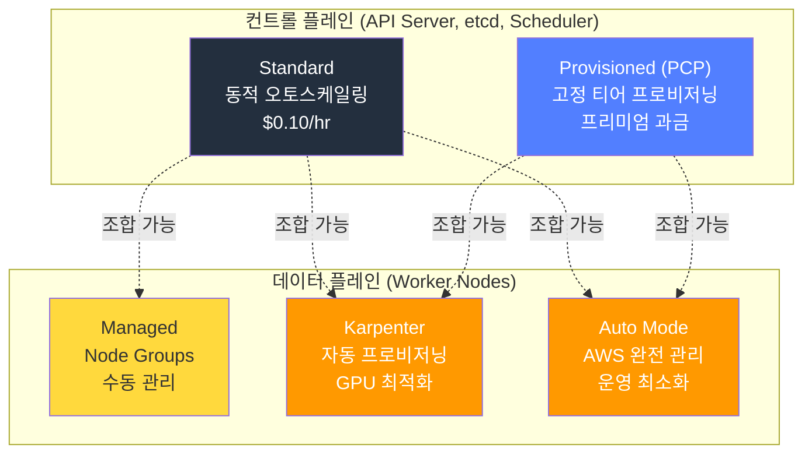
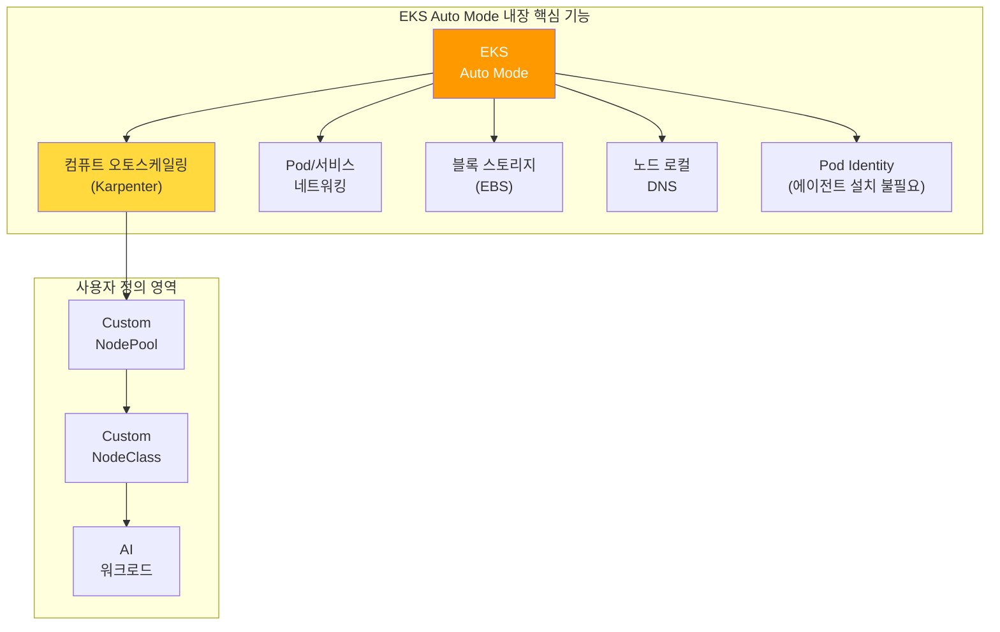
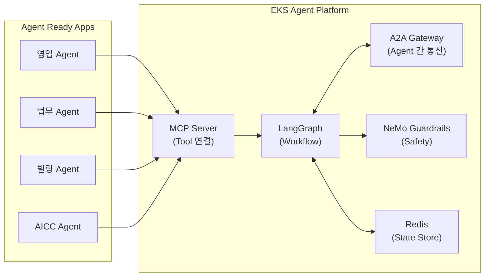
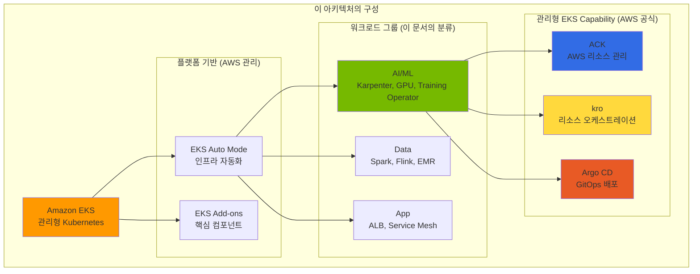
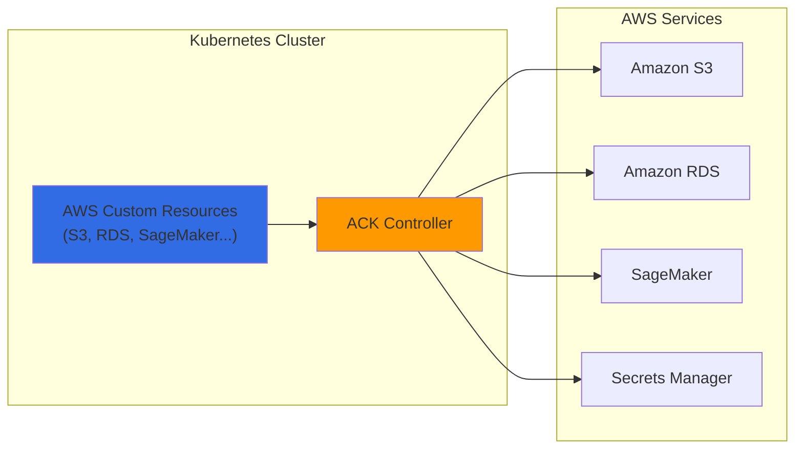
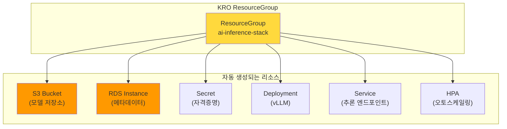
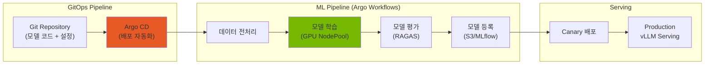
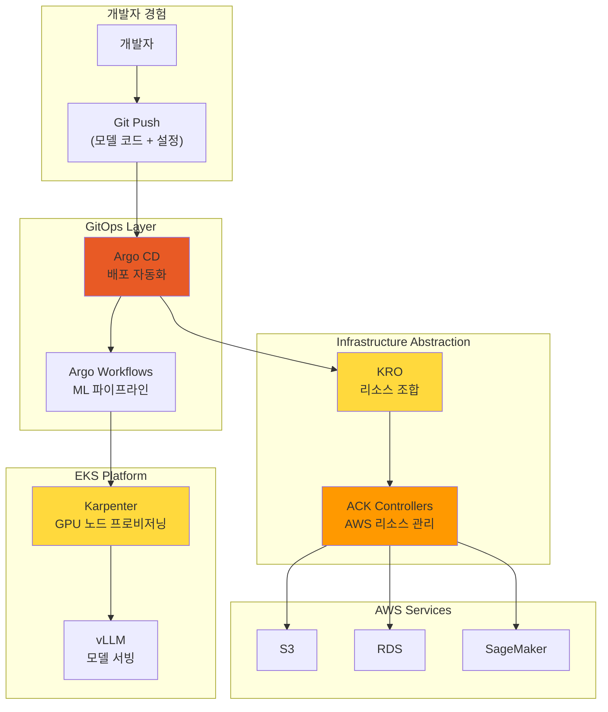
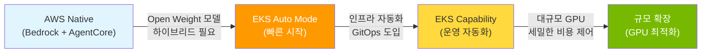

import Tabs from '@theme/Tabs';
import TabItem from '@theme/TabItem';
import {
  EksKarpenterLayers,
  ClusterAutoscalerVsKarpenter,
  KarpenterKeyFeatures,
  EksAutoModeVsStandard,
  DeploymentTimeComparison,
  EksIntegrationBenefits,
  EksCapabilities,
  AckControllers,
  AutomationComponents,
  EksAutoModeBenefits,
  ChallengeSolutionsSummary,
  EksClusterConfiguration
} from '@site/src/components/AgenticSolutionsTables';

:::info 선행 문서
이 문서를 읽기 전에 다음 문서를 먼저 참조하세요:
- [플랫폼 아키텍처](../foundations/agentic-platform-architecture.md) — Agentic AI Platform의 구조와 주요 레이어
- [기술적 도전과제](../foundations/agentic-ai-challenges.md) — 5가지 주요 도전과제
- [AI 플랫폼 선택 가이드](./ai-platform-decision-framework.md) — 매니지드 vs 오픈소스 의사결정
- [AWS Native 플랫폼](./aws-native-agentic-platform.md) — 매니지드 서비스 기반 대안 접근 (비교 참고)
:::

---

## 왜 EKS 기반 오픈 아키텍처인가

[AWS Native 플랫폼](./aws-native-agentic-platform.md)은 빠르게 시작할 수 있는 강력한 접근입니다. 커스텀 Agent 워크플로우(LangGraph, MCP/A2A), 멀티 프로바이더 라우팅, 오픈 웨이트 모델 활용은 AWS Native 서비스(예: Bedrock AgentCore Runtime, AgentCore Gateway)로도 구현할 수 있으므로, 아래 항목은 EKS가 유일한 선택지라는 뜻이 아니라 이 문서가 **EKS 기반 오픈 아키텍처**를 선택하게 만드는 구체적인 제어·배치 요구사항입니다:

- **모델 가중치와 런타임을 직접 제어**: 오픈 웨이트 모델(Llama, Qwen, DeepSeek 등)을 자체 컨테이너·GPU 노드에서 호스팅하여 추론 엔진 버전, 양자화, 배치 전략을 직접 관리
- **하이브리드 배치**: 온프레미스 GPU와 클라우드를 하나의 Kubernetes 클러스터로 통합 (EKS Hybrid Nodes)
- **Kubernetes 네이티브 커스텀 워크플로우**: LangGraph·MCP·A2A 구성 요소를 Pod·CRD 수준에서 세밀하게 배치·확장
- **멀티 프로바이더 라우팅의 자체 운영**: Bifrost 2-Tier Gateway 등 게이트웨이를 클러스터 내에서 직접 운영
- **세밀한 GPU 비용 최적화**: Spot, MIG, Consolidation을 워크로드 특성에 맞게 직접 조정

:::tip 플랫폼 비교
AWS Native, SageMaker Unified Studio, EKS 오픈 아키텍처, 하이브리드의 5축 비교는 [AI 플랫폼 선택 가이드](./ai-platform-decision-framework.md#플랫폼-비교-매트릭스)를 참조하세요.
:::

**요점: AWS Native → EKS는 보완 관계입니다.** 현실적인 접근은 **AWS Native로 시작하고, 필요에 따라 EKS로 확장**하는 것입니다. 두 접근은 동일한 VPC 내에서 공존할 수 있습니다.

---

## EKS Auto Mode로 빠르게 시작

### EKS 클러스터 구성 옵션: 컨트롤 플레인과 데이터 플레인

EKS 클러스터 구성은 **두 개의 독립된 레이어**로 나뉩니다.



### Provisioned Control Plane (PCP)

**PCP**는 컨트롤 플레인 용량을 사전에 고정 티어로 프로비저닝하여, API 서버 성능의 일관성을 보장하는 프리미엄 옵션입니다. 아래 표의 seat·Pod 스케줄링·etcd 값은 각 티어에 **구성(provision)되는 용량 상한**이며, 특정 애플리케이션의 실측 처리량이나 응답 지연을 보장하는 수치가 아닙니다.

#### PCP 티어 스펙 (K8s v1.30–v1.33 기준) {#pcp-티어-스펙}

| Tier | API 동시성 (seats) | Pod 스케줄링 | etcd DB | SLA | 티어 추가 비용 |
|------|:-----------------:|:----------:|:------:|:---:|-----:|
| **Standard** | 동적 (AWS 자동 조정) | 동적 | 8GB | 99.95% (5분 간격) | 티어 추가 비용 없음 |
| **XL** | 1,700 | 167/sec | 16GB | 99.99% (1분 간격) | $1.65/hr |
| **2XL** | 3,400 | 283/sec | 16GB | 99.99% (1분 간격) | $3.40/hr |
| **4XL** | 6,800 | 400/sec | 16GB | 99.99% (1분 간격) | $6.90/hr |
| **8XL** | 13,600 | 400/sec | 16GB | 99.99% (1분 간격) | $13.90/hr |

> 출처: [AWS EKS Provisioned Control Plane 공식 문서](https://docs.aws.amazon.com/eks/latest/userguide/eks-provisioned-control-plane.html), [Amazon EKS 요금](https://aws.amazon.com/eks/pricing/) (조회 시점의 가격 기준). 위 seat·Pod 스케줄링 수치는 K8s v1.30–v1.33 기준이며, v1.34 이상에서는 티어별 용량이 증가하므로 공식 문서의 해당 버전 표를 확인하세요. **PCP 티어 비용은 표준 EKS 클러스터 요금($0.10/cluster-hr, 표준 지원 기준 약 $73/월)에 더해 부과**되며, Standard 모드에서는 이 티어 추가 비용이 없습니다.

#### 티어 선택 기준: 메트릭 기반 판단

:::warning 워커 노드 수는 PCP 티어 선택 기준이 아닙니다
PCP 티어는 **Kubernetes 컨트롤 플레인 메트릭**을 기반으로 선택해야 합니다.
:::

**주요 모니터링 메트릭** (아래 임계값은 각 티어 상한에 여유(headroom)를 둔 **예시 운영 정책**이며, 워크로드로 검증한 뒤 조정해야 합니다):

| 메트릭 | Prometheus 쿼리 | 예시 판단 기준 |
|--------|----------------|----------|
| **API Inflight Seats** (가장 중요) | `apiserver_flowcontrol_current_executing_seats` | XL 상한(1,700 seats)의 약 70%인 1,200 seats를 지속 초과 → 상위 티어 검토 |
| **Pod Scheduling Rate** | `rate(scheduler_schedule_attempts_total{result="scheduled"}[5m])` | 100/sec 이상 지속 → XL 검토, 200/sec 이상 → 2XL 검토 |
| **etcd DB Size** | `apiserver_storage_size_bytes` | Standard etcd 상한은 8GB이므로 6GB(약 75%) 초과 시 16GB를 제공하는 PCP 티어 검토 |

:::info PCP vs Auto Mode — 서로 다른 레이어
**PCP**는 컨트롤 플레인 용량 옵션이고, **Auto Mode**는 데이터 플레인 관리 옵션입니다. 두 기능은 **조합하여 사용할 수 있습니다**.
:::

### 컨트롤 플레인 × 데이터 플레인 비교 및 조합

<EksClusterConfiguration />

:::tip AI 플랫폼 규모별 권장 구성
- **소규모 (PoC/데모)**: Standard + Auto Mode — 최소 운영 부담, 99.95% SLA
- **중규모 (프로덕션 추론)**: Standard + Karpenter — GPU 비용 최적화, 99.95% SLA
- **대규모 (엔터프라이즈 AI)**: PCP XL + Auto Mode — API seats ≤ 1,700, 99.99% SLA
- **초대규모 (학습 클러스터)**: PCP 4XL+ + Karpenter — API seats ≤ 6,800+, GPU 세밀 제어
:::

---

### Amazon EKS와 Karpenter: Kubernetes의 장점 극대화

Amazon EKS에서 Karpenter는 배치할 노드가 없는 Pod의 자원 요청과 스케줄링 조건을 보고 노드를 프로비저닝합니다. 운영자는 NodePool의 허용 인스턴스·배치 조건과 NodeClass의 노드 구성을 정하고, GPU 워크로드에 필요한 드라이버와 device plugin을 확인합니다. Karpenter가 늘리는 것은 노드 용량이며, 애플리케이션의 복제본 수는 별도로 조정합니다. Cluster Autoscaler와 비교할 때는 같은 워크로드에서 노드 준비 시간, 인스턴스 선택 범위와 비용을 측정하세요.

:::info Karpenter 상세 가이드
Karpenter v1.10+ (GA since v1.0, 2024-08), NodePool 설정, GPU 인스턴스 비교, 비용 최적화 전략은 [GPU 리소스 관리](../../model-serving/gpu-infrastructure/gpu-resource-management.md)를 참조하세요.
:::

<EksKarpenterLayers />

### EKS Auto Mode: 자동화 범위

**EKS Auto Mode**는 Karpenter(컴퓨트 오토스케일링), Pod·서비스 네트워킹, 로컬 DNS, 블록 스토리지, GPU 지원 등을 **별도 설치하는 애드온이 아니라 핵심(core) 구성 요소로 내장**하여 관리합니다. 아래 다이어그램의 각 항목은 사용자가 개별 애드온으로 설치·업그레이드하는 대상이 아니라 Auto Mode가 노드 수준에서 제공하는 기능입니다.



:::warning Auto Mode와 비-Auto Mode 노드 혼합 시 CoreDNS
Auto Mode 노드는 전통적인 CoreDNS **Deployment** 대신 각 노드에서 시스템 서비스로 실행되는 노드 로컬 DNS를 사용합니다. Auto Mode 노드와 비-Auto Mode 노드를 한 클러스터에서 함께 운영하는 경우, 비-Auto Mode 노드는 노드 로컬 DNS에 접근할 수 없으므로 **기존 CoreDNS Deployment를 반드시 유지**해야 합니다. 출처: [EKS Auto Mode 네트워킹](https://docs.aws.amazon.com/eks/latest/userguide/auto-networking.html).
:::

#### EKS Auto Mode vs 수동 구성 비교

<EksAutoModeVsStandard />

#### GPU 워크로드를 위한 EKS Auto Mode 설정

EKS Auto Mode는 Karpenter를 자동으로 구성하고 관리합니다. GPU NodePool과 워크로드의 스케줄링 제약(인스턴스 패밀리, GPU 메모리, `nvidia.com/gpu` 요청 등)을 정의하면 Auto Mode가 조건에 맞는 가속 인스턴스를 프로비저닝하여 AI 워크로드를 배포할 수 있습니다. 실제 배포에는 모델에 맞는 인스턴스 패밀리 선택, 리전별 GPU 쿼터, 컨테이너 이미지가 필요합니다.

:::tip NodePool 설정 상세
GPU NodePool 구성, Spot/On-Demand 전략, Consolidation 정책 등 상세 설정은 [GPU 리소스 관리](../../model-serving/gpu-infrastructure/gpu-resource-management.md)를 참조하세요.
:::

:::info EKS Auto Mode와 GPU 지원
EKS Auto Mode는 NVIDIA GPU 및 AWS Trainium/Inferentia 등 선택된 가속 컴퓨팅(accelerated compute) 인스턴스를 지원하며, 해당 인스턴스에 필요한 **커널 드라이버와 device plugin(NVIDIA/Neuron)을 노드 수준에서 자동 관리**합니다. 이 자동 관리 범위는 드라이버와 device plugin까지이며, 애플리케이션이 사용하는 Neuron SDK·프레임워크·추론 런타임은 사용자가 컨테이너에 포함해 관리합니다. 지원 인스턴스와 예시 NodePool은 [가속 워크로드 배포 문서](https://docs.aws.amazon.com/eks/latest/userguide/auto-accelerated.html)를 참조하세요.

**re:Invent 2024 신규 기능:**
- **EKS Hybrid Nodes (GA 2024-12)**: 온프레미스 GPU 인프라를 EKS 클러스터에 통합
- **Native Inferentia/Trainium Support**: Neuron 드라이버/device plugin 자동 구성 (애플리케이션 Neuron SDK는 별도)
- **Provisioned Control Plane**: 대규모 AI 학습 워크로드를 위한 사전 프로비저닝

**2025년 신규 기능:**
- **EKS Pod Identity Target IAM Roles (2025-06)**: 크로스 계정 IAM 역할 체이닝 지원
:::

---

### Auto Mode에서 배포 가능한 Agentic AI 컴포넌트

EKS Auto Mode 위에서 Agentic AI 플랫폼의 모든 주요 컴포넌트를 배포할 수 있습니다.

#### 추론: vLLM + llm-d

**vLLM**은 오픈 웨이트 LLM 추론 엔진이며, **llm-d**는 KV cache 상태를 고려한 지능형 라우팅을 제공합니다.

:::info 모델 서빙 스택 구성
- **vLLM**: Hugging Face에 공개된 오픈 웨이트 모델 아키텍처(Llama, Qwen, DeepSeek, Mistral 등)를 자체 호스팅하는 추론 엔진으로, 텍스트 생성뿐 아니라 임베딩·리랭킹·분류 같은 pooling 작업도 지원합니다 — PagedAttention 기반 KV cache 최적화. GPT·Claude 같은 상용 API는 가중치가 공개되지 않아 vLLM으로 호스팅할 수 없으며, 이들은 Bifrost 게이트웨이를 통해 외부 API로 프록시합니다.
- **Triton Inference Server**: 다양한 백엔드(TensorRT, ONNX, PyTorch 등)로 임베딩·리랭킹·Whisper STT 등 비-LLM 추론과 LLM 추론을 함께 처리할 수 있는 범용 서빙 서버
- **llm-d**: KV Cache-aware 라우팅으로 prefix cache 히트율 극대화

상세 설정은 [vLLM 모델 서빙](../../model-serving/inference-frameworks/vllm-model-serving.md) 및 [llm-d 분산 추론](../../model-serving/inference-frameworks/llm-d-eks-automode.md)을 참조하세요.
:::

#### 게이트웨이: kgateway + Bifrost (2-Tier Gateway)

2-Tier Gateway 아키텍처로 트래픽 관리와 모델 라우팅을 분리합니다:
- **Tier 1 (kgateway)**: Gateway API 기반 인증, Rate Limiting, 트래픽 관리
- **Tier 2 (Bifrost)**: 모델 추상화, Fallback, 비용 추적, Cascade Routing

> 상세 아키텍처는 [Inference Gateway 라우팅](../../model-serving/inference-routing/routing-strategy.md)을 참조하세요.

#### Agent: LangGraph + NeMo Guardrails + MCP/A2A

EKS에서 Agent 워크플로우는 다음으로 구성됩니다:



- **LangGraph**: 멀티스텝 Agent 워크플로우 정의, 조건부 분기, 병렬 실행
- **NeMo Guardrails**: 프롬프트 인젝션 완화, PII 유출 완화, 출력 검증을 수행하는 **콘텐츠 수준의 방어(defense-in-depth)** 계층입니다. 자체적으로 인증·인가·TLS·요청 제한(rate limiting) 기능을 제공하지 않으므로, 접근 제어는 앞단의 API 게이트웨이·리버스 프록시·사이드카가 담당해야 합니다(출처: [NeMo Guardrails SECURITY](https://github.com/NVIDIA/NeMo-Guardrails/blob/develop/SECURITY.md)). 도구 비교와 구현 상세는 [AI Gateway Guardrails](../../operations-mlops/governance/ai-gateway-guardrails.md) 참조
- **MCP**: Agent Ready 앱이 표준화된 방식으로 Tool 제공
- **A2A**: Agent 간 통신 프로토콜 (전송 보안·인증은 배포 환경에서 별도 구성)
- **Redis (ElastiCache)**: LangGraph checkpointer로 Agent **상태(state)** 관리 — 작업 큐가 아닌 상태 저장소입니다.

Agent Pod 오토스케일링은 상태 저장소와 별개로, Redis List 등 **실제 작업 큐**를 KEDA의 Redis Lists 스케일러(`listName`, `listLength` 기준)로 모니터링하여 큐 길이 기반으로 수행합니다. checkpointer용 Key-Value 저장소 자체는 큐 길이 신호를 제공하지 않습니다.

> 상세 내용은 [Kagent Agent 관리](../../operations-mlops/observability/kagent-kubernetes-agents.md) 및 [AWS Native 플랫폼 — AgentCore & MCP](./aws-native-agentic-platform.md#mcp-프로토콜과-eks-통합)를 참조하세요. Guardrails 기술 스택(Input/Output Guard, Tool Allow-list, kgateway/Bifrost 통합)은 [AI Gateway Guardrails](../../operations-mlops/governance/ai-gateway-guardrails.md)를 참조하세요.

#### RAG + 옵저버빌리티

- **Milvus**: 벡터 DB — RAG 시스템 핵심 ([상세](../../operations-mlops/data-infrastructure/milvus-vector-database.md))
- **Langfuse**: 프로덕션 LLM 트레이싱, 토큰 비용 추적 ([아키텍처](../../operations-mlops/observability/agent-monitoring.md), [배포 가이드](../../reference-architecture/integrations/monitoring-observability-setup.md))
- **Prometheus + Grafana**: 인프라 메트릭 모니터링

---

### EKS 기반 간편 배포

<DeploymentTimeComparison />

#### 솔루션별 EKS 배포 방법

<EksIntegrationBenefits />

#### 간편 배포 예시

배포 가이드는 [Reference Architecture](../../reference-architecture/) 참조하세요.

:::info GPU 비용 최적화 상세
Spot 인스턴스 활용, Consolidation, 시간대별 스케줄 기반 비용 관리 등 GPU 비용 최적화 전략은 [GPU 리소스 관리](../../model-serving/gpu-infrastructure/gpu-resource-management.md) 문서를 참조하세요.
:::

:::info GPU 보안 및 트러블슈팅
GPU Pod 보안 정책, Network Policy, IAM, MIG 격리 및 GPU 트러블슈팅 가이드는 [EKS GPU 노드 전략](../../model-serving/gpu-infrastructure/eks-gpu-node-strategy.md) 문서를 참조하세요.
:::

---

## EKS Capability로 인프라 운영 부담 최소화

### EKS Capability란?

**EKS Capability**는 AWS가 제공하는 **완전관리형 클러스터 기능**으로, 선언적 지속 배포(Argo CD), AWS 리소스 관리(ACK), Kubernetes 리소스 오케스트레이션(kro)을 제공합니다. 이 기능들은 워커 노드가 아니라 EKS 내부에서 실행되며, 서로 독립적으로 선택해 활성화할 수 있는 클라우드 리소스입니다(출처: [EKS Capabilities](https://docs.aws.amazon.com/eks/latest/userguide/capabilities.html)).

아래 다이어그램에서 **"관리형 EKS Capability"** 블록(ACK·kro·Argo CD)만 AWS 공식 EKS Capability이며, AI/Data/App 그룹은 이 아키텍처가 워크로드를 설명하기 위해 구성한 자체 분류로 공식 Capability가 아닙니다.



### Agentic AI를 위한 주요 EKS Capability

<EksCapabilities />

:::warning Argo Workflows는 별도 설치 필요
**Argo Workflows**는 EKS Capability로 공식 지원되지 않으므로 **직접 설치가 필요**합니다.

배포 가이드는 [Argo Workflows 공식 문서](https://argoproj.github.io/argo-workflows/installation/)를 참조하세요.
:::

---

### ACK (AWS Controllers for Kubernetes)

**ACK**는 Kubernetes Custom Resource를 통해 AWS 서비스를 직접 프로비저닝하고 관리합니다. **EKS Capability로 완전관리형으로 활성화**하거나 Helm 차트로 직접 설치할 수 있습니다.



**AI 플랫폼에서 ACK 활용 사례:**

<AckControllers />

**ACK를 이용한 S3 버킷 생성 예시:**

```yaml
apiVersion: s3.services.k8s.aws/v1alpha1
kind: Bucket
metadata:
  name: agentic-ai-models
  namespace: ai-platform
spec:
  name: agentic-ai-models-prod
  versioning:
    status: Enabled
  encryption:
    rules:
    - applyServerSideEncryptionByDefault:
        sseAlgorithm: aws:kms
  tags:
  - key: Project
    value: agentic-ai
```

### KRO (Kubernetes Resource Orchestrator)

**KRO**는 여러 Kubernetes 리소스와 AWS 리소스를 **하나의 추상화된 단위로 조합**하여 복잡한 인프라를 단순하게 배포합니다.



**kro로 AI 추론 스택을 단일 리소스로 배포:**

아래는 플랫폼 팀이 먼저 `ResourceGraphDefinition`(RGD)으로 정의한 `AIInferenceStack` API의 **인스턴스 예시**입니다. kro 인스턴스의 `apiVersion`은 `kro.run/v1alpha1`이고, `kind`(`AIInferenceStack`)와 `spec` 스키마는 그 RGD에서 생성됩니다. 즉, 이 매니페스트만으로는 배포되지 않으며 **대응하는 RGD가 클러스터에 먼저 적용되어 있어야** 합니다.

```yaml
# AIInferenceStack 인스턴스 예시 (대응 RGD가 선행되어야 함)
apiVersion: kro.run/v1alpha1
kind: AIInferenceStack       # RGD에서 정의한 커스텀 kind
metadata:
  name: llama-inference
  namespace: ai-platform
spec:
  modelName: llama-3-70b
  # 70B 모델은 정밀도·텐서 병렬도에 따라 GPU 메모리 요구량이 달라집니다.
  # 예: FP16(약 140GB 가중치)은 단일 g5.12xlarge(A10G 24GB×4=96GB)에 적재 불가하므로
  #     양자화(예: INT8/FP8)나 다중 GPU 노드/텐서 병렬이 필요합니다.
  gpuType: g5.12xlarge
  minReplicas: 2
  maxReplicas: 20
```

> RGD 작성 방법과 인스턴스 생성 흐름은 [kro ResourceGraphDefinition 배포 가이드](https://kro.run/docs/getting-started/deploy-a-resource-graph-definition/)를 참조하세요.

### Argo 기반 ML 파이프라인 자동화

**Argo Workflows**와 **Argo CD**를 결합하면 AI 모델의 학습, 평가, 배포까지 **전체 MLOps 파이프라인을 GitOps 방식으로 자동화**할 수 있습니다.



### ACK + KRO + ArgoCD 통합 아키텍처



<AutomationComponents />

:::info 자동화의 이점 — 인프라 운영을 EKS에 위임하고 Agent 개발에 집중
- **개발자**: Git push만으로 모델 배포
- **플랫폼 팀**: 인프라 관리 부담 최소화
- **비용 최적화**: 필요한 리소스만 동적 프로비저닝
- **일관성**: 모든 환경에서 동일한 배포 방식
:::

---

## 결론 및 다음 단계

### 점진적 여정: AWS Native → Auto Mode → EKS Capability



### EKS Auto Mode: 권장 시작점

<EksAutoModeBenefits />

### 도전과제별 해결 방안 요약

<ChallengeSolutionsSummary />

### EKS Auto Mode GPU 제약사항과 하이브리드 전략

EKS Auto Mode는 일반 워크로드와 기본 GPU 추론에 최적이지만, GPU 고급 기능에는 제약이 있습니다.

| 워크로드 유형 | Auto Mode 적합성 | 이유 |
|---|---|---|
| API Gateway, Agent Framework | 적합 | Non-GPU, 자동 스케일링 충분 |
| Observability Stack | 적합 | Non-GPU, 관리 부담 최소화 |
| 기본 GPU 추론 (전체 GPU) | 적합 | AWS 관리 GPU 스택으로 충분 |
| MIG 파티셔닝 필요 | **부적합** | Auto Mode는 노드 AMI를 불변(immutable)으로 관리하여 MIG 분할에 필요한 노드 수준 설정을 적용할 수 없음 (NodeClass로 네트워킹·스토리지 등은 조정 가능하나 OS/AMI는 변경 불가). GPU Operator 자체는 설치 가능 |
| Run:ai GPU 스케줄링 | **부적합** | Run:ai는 EKS에서 Bottlerocket/Amazon Linux를 지원하지 않으므로, 지원 OS를 쓰는 Karpenter 자체 관리 노드에서 GPU Operator 전체 스택과 함께 운영해야 함. 벤더 지원 매트릭스로 모드별 호환성을 확인한 뒤 채택 |

**권장 하이브리드 구성**: Auto Mode(일반 워크로드) + Karpenter(GPU 고급 기능)를 하나의 클러스터에서 운영합니다. 상세 구성은 [EKS GPU 노드 전략](../../model-serving/gpu-infrastructure/eks-gpu-node-strategy.md)을 참조하세요.

### Gateway API 제약 및 우회

EKS Auto Mode의 빌트인 로드밸런서는 Kubernetes Gateway API를 직접 지원하지 않습니다. kgateway를 사용하려면 kgateway 프록시를 가리키는 별도의 Service (type: LoadBalancer)로 NLB를 프로비저닝합니다. Auto Mode에서는 `loadBalancerClass: eks.amazonaws.com/nlb`가 기본값으로 설정되며, 새 배포에는 `aws-load-balancer-type: external`을 사용합니다.

```yaml
apiVersion: v1
kind: Service
metadata:
  name: kgateway-proxy
  namespace: kgateway-system
  annotations:
    service.beta.kubernetes.io/aws-load-balancer-type: "external"
    service.beta.kubernetes.io/aws-load-balancer-nlb-target-type: "ip"
    service.beta.kubernetes.io/aws-load-balancer-scheme: "internet-facing"
    # TLS 종단: 포트 이름이 아니라 아래 두 어노테이션으로 구성합니다.
    service.beta.kubernetes.io/aws-load-balancer-ssl-cert: "arn:aws:acm:<region>:<account>:certificate/<cert-id>"
    service.beta.kubernetes.io/aws-load-balancer-ssl-ports: "443"
spec:
  type: LoadBalancer
  loadBalancerClass: eks.amazonaws.com/nlb   # Auto Mode 기본값 (생략 가능)
  selector:
    # kgateway 프록시 Pod의 실제 레이블로 교체하세요 (아래는 예시).
    app.kubernetes.io/name: kgateway
  ports:
    - name: https
      port: 443
      targetPort: 8443
```

:::warning TLS와 셀렉터 확인 필요
포트 이름을 `https`로 지정하는 것은 **TLS를 구성하지 않습니다**. NLB에서 TLS를 종단하려면 위의 `aws-load-balancer-ssl-cert`(ACM 인증서 ARN)와 `aws-load-balancer-ssl-ports`를 사용해야 합니다. `selector`는 실제 kgateway 프록시 Pod의 레이블과 일치해야 하며, 포트·대상 매핑은 배포한 kgateway 버전에서 확인하세요. 공식 어노테이션 문서는 레거시 `type` 값에 대해 내부적으로 상충되는 설명이 있으므로, 단정하기보다 실제 클러스터에서 어노테이션 적용 결과를 검증하는 것을 권장합니다(출처: [EKS Auto Mode NLB 어노테이션](https://docs.aws.amazon.com/eks/latest/userguide/auto-configure-nlb.html)).
:::

> 2-Tier Gateway 아키텍처의 전체 설계는 [LLM Gateway 2-Tier 아키텍처](../../model-serving/inference-routing/routing-strategy.md)를 참조하세요.

### 주요 권장사항

1. **EKS Auto Mode로 시작**: 새 클러스터는 Auto Mode로 생성하여 Karpenter 자동 구성 활용
2. **GPU 고급 기능은 Karpenter 노드**: MIG, Run:ai 등 GPU Operator 필요 시 Karpenter NodePool 추가
3. **GPU NodePool 커스텀 정의**: 워크로드 특성에 맞는 GPU NodePool 추가 (추론/학습/실험 분리)
4. **Spot 인스턴스는 중단 허용 워크로드에 활용**: Spot 비중은 고정값이 아니라 중단 허용도·체크포인트/복구 능력·가용 용량에 따라 워크로드별로 결정합니다. 상태 비저장 또는 체크포인트 가능한 배치 추론처럼 중단을 감내할 수 있는 워크로드에 적용하고, On-Demand 폴백을 함께 구성하세요.
5. **Consolidation 기본 활성화**: EKS Auto Mode에서 자동 활성화된 Consolidation 활용
6. **KEDA 연동**: 메트릭 기반 Pod 스케일링과 Karpenter 노드 프로비저닝 연계

### 배포 경로 선택하기

<Tabs>
<TabItem value="auto-mode" label="EKS Auto Mode (대부분에게 권장)">

**적합한 경우:**
- 스타트업 및 소규모 팀
- Kubernetes 초보 팀
- 표준 Agentic AI 워크로드

**시작하기:**

배포 가이드는 [EKS Auto Mode 공식 문서](https://docs.aws.amazon.com/eks/latest/userguide/automode.html)를 참조하세요.

**장점:** AWS가 노드 프로비저닝·업그레이드·보안 패치를 관리하여 인프라 운영 부담을 크게 줄입니다. 단, 애플리케이션·NodePool·비용은 여전히 사용자가 관리하며, Auto Mode 관리 수수료가 EC2 비용에 더해 부과됩니다.

</TabItem>
<TabItem value="karpenter" label="EKS + Karpenter (최대 제어)">

**적합한 경우:**
- 대규모 프로덕션 워크로드
- 복잡한 GPU 요구사항 (혼합 인스턴스 타입)
- 비용 최적화가 최우선

**시작하기:**

배포 가이드는 [Karpenter 공식 문서](https://karpenter.sh/docs/getting-started/)를 참조하세요.

**장점:** 세밀한 인스턴스 제어, 커스텀 AMI. 비용 절감 폭은 On-Demand 대비 Spot·Consolidation 적용 범위에 따라 달라지므로, 실제 워크로드의 사용량·중단율·총소유비용(TCO)으로 측정해 판단하세요.

</TabItem>
<TabItem value="hybrid" label="하이브리드 (두 방식의 장점 결합)">

**적합한 경우:**
- 성장하는 플랫폼 (단순하게 시작, 복잡하게 확장)
- 혼합 워크로드 타입 (CPU 에이전트 + GPU LLM)

**시작하기:**

배포 가이드는 [Reference Architecture](../../reference-architecture/)를 참조하세요.

**장점:** 점진적 복잡도 증가, GPU 비용 최적화, AWS 관리형 + 커스텀 조합

</TabItem>
</Tabs>

### 규모 확장 시 참고 문서

| 영역 | 문서 | 내용 |
|------|------|------|
| GPU 노드 전략 | [EKS GPU 노드 전략](../../model-serving/gpu-infrastructure/eks-gpu-node-strategy.md) | Auto Mode + Karpenter + Hybrid Node + 보안/트러블슈팅 |
| GPU 리소스 관리 | [GPU 리소스 관리](../../model-serving/gpu-infrastructure/gpu-resource-management.md) | Karpenter 스케일링, KEDA, DRA, 비용 최적화 |
| NVIDIA GPU 스택 | [NVIDIA GPU 스택](../../model-serving/gpu-infrastructure/nvidia-gpu-stack.md) | GPU Operator, DCGM, MIG, Time-Slicing |
| 모델 서빙 | [vLLM 모델 서빙](../../model-serving/inference-frameworks/vllm-model-serving.md) | vLLM 설정, 성능 최적화 |
| 분산 추론 | [llm-d 분산 추론](../../model-serving/inference-frameworks/llm-d-eks-automode.md) | KV Cache-aware 라우팅 |
| 학습 인프라 | [NeMo 프레임워크](../../model-serving/inference-frameworks/nemo-framework.md) | 분산 학습, EFA 네트워크 |

---

## 참고 자료

### 공식 문서

- [Amazon EKS Documentation](https://docs.aws.amazon.com/eks/) — EKS 공식 문서
- [EKS Auto Mode](https://docs.aws.amazon.com/eks/latest/userguide/automode.html) — Auto Mode 가이드
- [Karpenter Documentation](https://karpenter.sh/docs/) — Karpenter 공식 문서
- [KEDA - Kubernetes Event-driven Autoscaling](https://keda.sh/) — 이벤트 기반 오토스케일링

### 논문 / 기술 블로그

- [vLLM: Easy, Fast, and Cheap LLM Serving](https://blog.vllm.ai/) — vLLM 공식 블로그
- [Efficient Memory Management for LLM Serving](https://arxiv.org/abs/2309.06180) — PagedAttention 논문
- [NVIDIA Developer Blog: AI on Kubernetes](https://developer.nvidia.com/blog/) — GPU 워크로드 최적화

### 관련 문서 (내부)

- [플랫폼 아키텍처](../foundations/agentic-platform-architecture.md) — 전체 시스템 설계
- [기술적 도전과제](../foundations/agentic-ai-challenges.md) — 5가지 주요 과제
- [GPU 리소스 관리](../../model-serving/gpu-infrastructure/gpu-resource-management.md) — Karpenter, KEDA, DRA
- [vLLM 모델 서빙](../../model-serving/inference-frameworks/vllm-model-serving.md) — vLLM 배포 가이드
