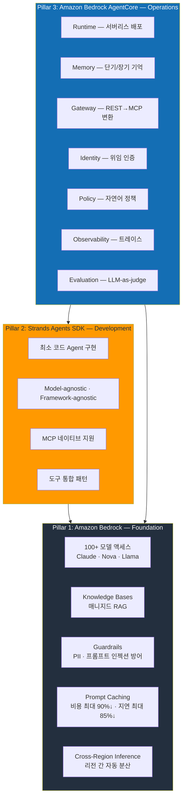
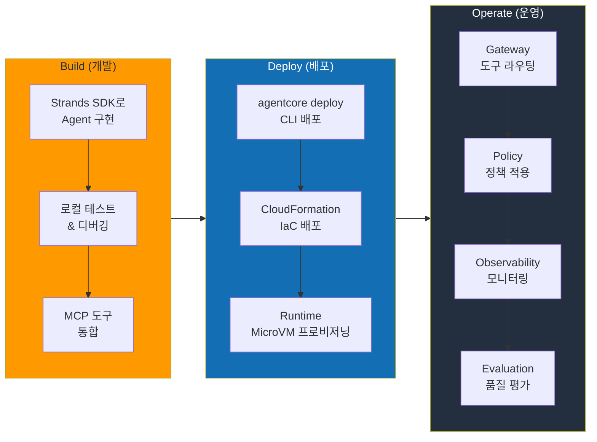
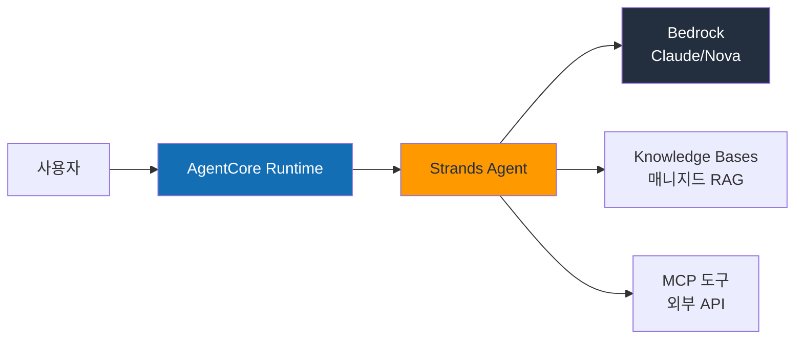
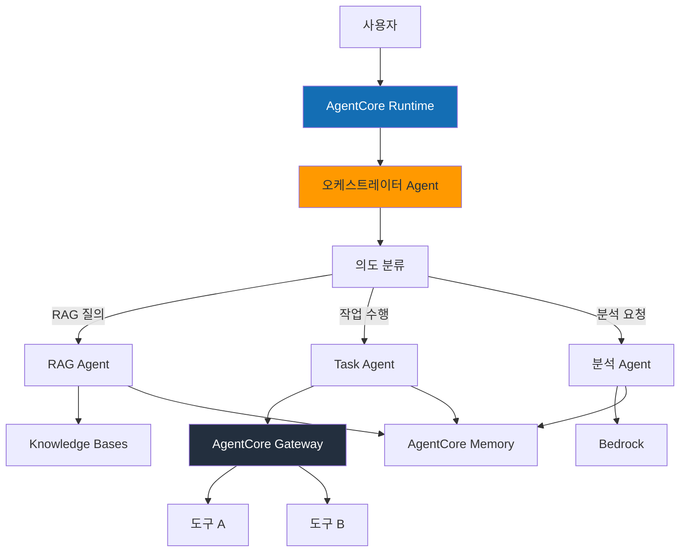
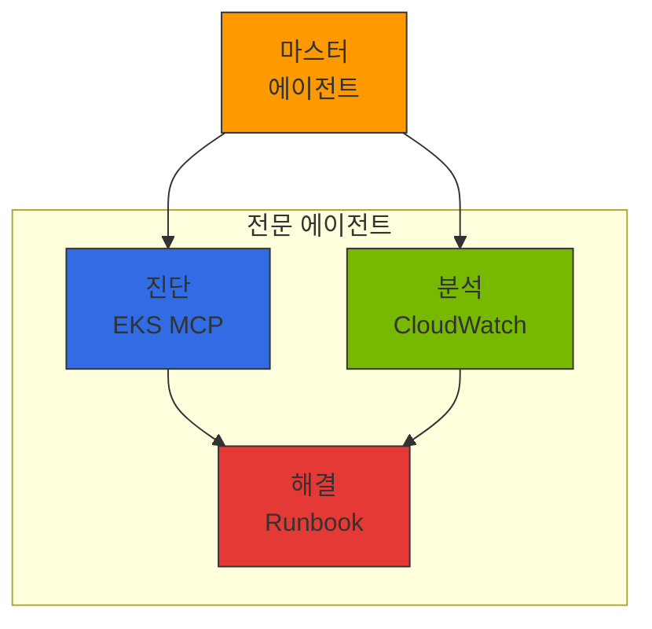

import { EKSMCPFeatures, KagentVsAgentCore, MultiAgentPatterns, MCPServerEcosystem } from '@site/src/components/BedrockMcpTables';

## 개요

AWS 관리형 서비스를 사용하면 팀이 직접 운영해야 하는 인프라의 범위를 줄일 수 있습니다. 먼저 각 서비스가 맡는 GPU 관리, 확장, 가용성, 보안 기능의 범위를 확인합니다. 개발팀은 에이전트가 해결할 문제와 모델·도구의 연결 방식, 접근 권한, 데이터 처리 정책, 응답 품질 기준을 정하고 검증합니다.

AWS Agentic AI 스택은 세 개의 축(Pillar)으로 구성됩니다.

| Pillar | 서비스 | 역할 |
|--------|--------|------|
| **기반(Foundation)** | Amazon Bedrock | 모델 액세스, RAG, 가드레일, 프롬프트 캐싱 |
| **개발(Development)** | Strands Agents SDK | 에이전트 프레임워크, MCP 네이티브, 도구 통합 |
| **운영(Operations)** | Amazon Bedrock AgentCore | 서버리스 배포, 메모리, 게이트웨이, 정책, 평가 |

:::info 핵심 관점
이 문서는 AWS 매니지드 서비스가 제공하는 **Agent 개발 최적화 접근**을 다룹니다. 매니지드 서비스로 충분한 영역은 AWS에 맡기고, 팀의 역량을 Agent 비즈니스 로직에 집중하는 전략입니다. 다만 이 접근은 다중 모델 여정의 **첫 단계**입니다. 트래픽 증가에 따른 비용 압박, 도메인 특화 SLM 필요성, 데이터 주권 요구가 생기면 [EKS 기반 오픈 아키텍처](./agentic-ai-solutions-eks.md)로 확장하여 자체 호스팅 모델과 Bedrock을 **하이브리드로 조합**하는 것이 현실적 최적해입니다.
:::

### 도전과제 해결 매핑

[기술적 도전과제](../foundations/agentic-ai-challenges.md)에서 다룬 5가지 핵심 과제를 AWS Native 접근으로 해결하는 방법:

| 도전과제 | AWS Native 해결 방안 |
|---------|---------------------|
| GPU 리소스 관리 및 비용 최적화 | Bedrock 서버리스 추론 — GPU 관리 불필요 |
| 지능형 추론 라우팅 및 게이트웨이 | Bedrock Cross-Region Inference + AgentCore Gateway |
| LLMOps 관찰성 및 비용 거버넌스 | AgentCore Observability + CloudWatch |
| Agent 오케스트레이션 및 안전성 | Strands SDK + Bedrock Guardrails + AgentCore Policy |
| 모델 공급망 관리 | Bedrock Model Evaluation + Prompt Management |

:::tip AWS Native의 핵심 가치
관리형 서비스가 맡는 운영 범위와 팀이 맡을 권한·데이터·애플리케이션 검증을 구분하세요. Strands 같은 SDK를 직접 호스팅한다면 실행 환경의 운영 책임도 남습니다. 책임 범위는 [Amazon Bedrock](https://docs.aws.amazon.com/bedrock/latest/userguide/security.html)과 [AgentCore](https://docs.aws.amazon.com/bedrock-agentcore/latest/devguide/security.html)의 보안 문서에서 확인할 수 있습니다. 더 세밀한 제어가 필요한 구성은 [EKS 기반 오픈 아키텍처](./agentic-ai-solutions-eks.md)와 함께 비교하세요.
:::

---

## AWS Agentic AI 서비스 아키텍처

### 3-Pillar 아키텍처



---

## Amazon Bedrock: 기반 레이어

Amazon Bedrock은 Agentic AI 플랫폼의 **기반 인프라**를 제공합니다. 100개 이상의 파운데이션 모델에 단일 API로 접근하고, RAG, 가드레일, 프롬프트 캐싱까지 매니지드로 지원합니다.

### 핵심 기능

| 기능 | 설명 | 범위와 전제조건 |
|------|------|----------|
| **모델 액세스** | Claude, Nova, Llama, Mistral 등 100+ 모델 | 단일 Converse/Invoke API에서 모델 ID로 모델을 전환하지만, 모델마다 컨텍스트 길이·모달리티·도구 사용 지원·리전/쿼터가 달라 프롬프트와 파라미터 조정이 필요할 수 있습니다. 모델별로 액세스를 먼저 활성화해야 합니다. |
| **Knowledge Bases** | 문서 파싱 → 청킹 → 임베딩 → 인덱싱 → 검색 | 데이터 소스(예: S3 버킷), 임베딩 모델, 벡터 스토어를 구성한 뒤 인제스천을 실행합니다. IAM 역할에는 소스 읽기 권한과 벡터 스토어 쓰기 권한이 필요합니다. "원클릭"은 매니지드 파이프라인을 뜻하며 무설정을 의미하지 않습니다. |
| **Guardrails** | PII 필터링, 프롬프트 인젝션 방어, 토픽 제한 | 콘솔 또는 API로 정책을 정의한 뒤 각 모델 호출에 연결(`guardrailIdentifier`)해야 하며, 연결된 경로에서만 적용됩니다. |
| **Prompt Caching** | 반복 컨텍스트 캐싱 | Bedrock의 Claude 기준 공급사 발표 상한은 캐시 히트 시 **입력 토큰 비용 최대 약 90%**, **지연 최대 약 85%** 절감입니다. 실제 절감폭은 캐시 히트율·프롬프트 구조·모델에 따라 다르며 캐시된 입력 토큰에만 할인이 적용됩니다. [Anthropic 프롬프트 캐싱 가이드](https://platform.claude.com/docs/en/build-with-claude/prompt-caching)를 참고하세요. |
| **Cross-Region Inference** | 리전 간 자동 트래픽 분산 | 소스 리전의 용량이 한계일 때 프로파일에 정의된 다른 리전으로 요청을 라우팅합니다. 재해 복구나 가용성 보장은 아닙니다. |
| **Prompt Management** | 프롬프트 버전 관리, A/B 테스트 | 프롬프트 이력 추적, 롤백 지원 |
| **Model Evaluation** | 자동화된 모델 평가, 배치 처리 | LLM-as-a-judge, 사람 평가 워크플로우 |

:::tip Prompt Caching 활용
긴 시스템 프롬프트나 반복적인 도구 정의를 사용하는 Agent는 위에 적은 모델별 상한 범위 내에서 Prompt Caching으로 비용과 지연을 줄일 수 있습니다. 효과는 캐시 히트율에 비례하므로, 재사용되는 RAG 컨텍스트나 도구 정의처럼 큰 컨텍스트 프리픽스가 요청마다 반복될 때 가장 효과적입니다.
:::

---

## Strands Agents SDK: 개발 프레임워크

**Strands Agents SDK**는 AWS가 Apache 2.0으로 공개한 오픈소스 에이전트 프레임워크입니다. 최소한의 코드로 프로덕션급 Agent를 구현하며, Model-agnostic 설계로 Bedrock 외에도 다양한 모델 프로바이더를 지원합니다.

### 최소 코드 Agent 구현

아래 예시는 **Strands Agents SDK(`strands-agents`) 1.x**를 기준으로 합니다. `calculator`, `web_search`는 사용자가 제공하는 도구의 자리표시자이며, `@tool` 데코레이터로 정의한 함수(아래 [커스텀 도구 정의](#커스텀-도구-정의) 참고)이거나 `strands-agents-tools` 같은 패키지에서 임포트한 도구입니다. 문자열 이름만으로 해석되는 내장 도구가 아닙니다.

```python
from strands import Agent
from strands.models import BedrockModel
from strands_tools import calculator  # strands-agents-tools 패키지에서 제공

# 최소 Agent — 모델과 직접 제공한 도구
agent = Agent(
    model=BedrockModel(model_id="anthropic.claude-sonnet-4-20250514-v1:0"),
    tools=[calculator],
)
result = agent("서울의 현재 기온을 섭씨와 화씨로 변환해줘")
```

### MCP 네이티브 지원

`MCPClient`는 transport 콜러블(또는 streamable HTTP용 `url=`)을 받습니다. `server_url` 파라미터는 없습니다. 컨텍스트 매니저이므로 연결이 열려 있는 동안 Agent를 사용해야 합니다.

```python
from strands import Agent
from strands.models import BedrockModel
from strands.tools.mcp import MCPClient
from mcp.client.streamable_http import streamablehttp_client

# streamable HTTP로 MCP 서버 연결 — 서버에서 도구를 탐색
mcp_client = MCPClient(lambda: streamablehttp_client("http://mcp-server:8080/mcp"))

with mcp_client:
    tools = mcp_client.list_tools_sync()  # 서버의 도구 탐색
    agent = Agent(
        model=BedrockModel(model_id="anthropic.claude-sonnet-4-20250514-v1:0"),
        tools=tools,
    )
    result = agent("최근 주문 내역을 조회하고 배송 상태를 확인해줘")
```

### 커스텀 도구 정의

```python
from strands import Agent, tool

@tool
def lookup_customer(customer_id: str) -> dict:
    """고객 정보를 조회합니다."""
    # 비즈니스 로직 구현
    return {"name": "홍길동", "tier": "GOLD", "since": "2023-01"}

@tool
def create_ticket(title: str, priority: str, description: str) -> dict:
    """고객 문의 티켓을 생성합니다."""
    return {"ticket_id": "TK-2026-0042", "status": "OPEN"}

agent = Agent(
    model=BedrockModel(model_id="anthropic.claude-sonnet-4-20250514-v1:0"),
    tools=[lookup_customer, create_ticket],
    system_prompt="당신은 고객 서비스 Agent입니다. 고객 정보를 조회하고 필요 시 티켓을 생성합니다.",
)
```

### Strands SDK 핵심 특성

| 특성 | 설명 |
|------|------|
| **Apache 2.0** | 상업적 사용 자유, 포크 가능 |
| **Model-agnostic** | Bedrock, OpenAI, Anthropic API, Ollama 등 다양한 백엔드 지원 |
| **Framework-agnostic** | FastAPI, Flask, Lambda 등 어떤 런타임에서든 실행 |
| **MCP 네이티브** | Model Context Protocol 빌트인 지원, 별도 어댑터 불필요 |
| **AgentCore 통합** | `agentcore` CLI(`configure` 후 `deploy`)로 AgentCore Runtime에 패키징하며, 관련 리소스는 별도로 연결 |
| **스트리밍 응답** | 토큰 단위 스트리밍, 실시간 UX 지원 |

---

## Amazon Bedrock AgentCore: 운영 플랫폼

AgentCore는 **Agent의 프로덕션 운영에 필요한 모든 것**을 매니지드로 제공하는 플랫폼입니다. 2025년 10월 13일 GA(General Availability)로 출시되었으며, 모듈형 서비스 구성으로 제공됩니다. GA 출시 시점의 핵심 서비스는 Runtime, Memory, Gateway, Identity, Observability(+빌트인 도구 Code Interpreter, Browser)였으며, 이후 Policy와 Evaluations가 2025년 12월 re:Invent에서 preview로 추가되었습니다.

### 핵심 서비스

#### 1. Runtime — 서버리스 Agent 배포

AgentCore Runtime은 격리된 실행 환경을 제공합니다. 기본 서버리스 컴퓨트 유형에서는 각 세션을 **Firecracker MicroVM**으로 실행하며, 계정 내에 매니지드 EC2 용량을 프로비저닝하는 **Instances** 컴퓨트 유형(capacity provider 사용)으로도 실행할 수 있는데 이 유형은 격리·과금 모델이 다릅니다.

| 항목 | 사양 |
|------|------|
| 격리 수준 | 서버리스 컴퓨트 유형은 Firecracker MicroVM(하드웨어 수준 격리), Instances 컴퓨트 유형은 프로비저닝된 EC2 용량에서 실행 |
| 세션 지속 | 서버리스 컴퓨트 유형에서 세션당 최대 8시간 |
| 스케일링 | 서버리스 컴퓨트 유형은 0에서 자동 확장하고 유휴 시 0으로 축소, Instances 컴퓨트 유형은 프로비저닝된 용량 유지 |
| 배포 | `agentcore` CLI(`configure` 후 `deploy`) 또는 CloudFormation |
| 콜드 스타트 | 서버리스 컴퓨트 유형에서 보통 수 초 이내 — 관측된 동작이며 공식 SLA는 아님 |

```bash
# Strands Agent를 AgentCore에 배포
# 1. 에이전트 생성 (이름, 엔트리포인트, 메모리 설정)
agentcore add agent --name customer-service --entrypoint agent.py --memory longAndShortTerm

# 2. 배포
agentcore deploy --target default -y
```

#### 2. Memory — 단기/장기 기억 관리

Agent가 대화 컨텍스트와 사용자 선호를 기억하도록 하는 매니지드 메모리 서비스입니다.

| 메모리 유형 | 설명 | 활용 예시 |
|------------|------|----------|
| **단기 메모리** | 세션 내 대화 기록 | 멀티턴 대화에서 이전 질문 참조 |
| **장기 메모리** | 세션 간 지속 정보 | 사용자 선호, 과거 상호작용 패턴 |
| **자동 요약** | 긴 대화를 자동 요약하여 저장 | 컨텍스트 윈도우 초과 시 핵심 정보 유지 |
| **사용자 프로파일** | 개인화 정보 학습 | "이 사용자는 간결한 답변을 선호" |

#### 3. Gateway — 지능형 도구 라우팅

AgentCore Gateway는 **REST API를 MCP 프로토콜로 자동 변환**하고, 시맨틱 도구 검색으로 수백 개의 도구 중 관련 있는 도구만 선별합니다.

:::info 시맨틱 도구 검색
Agent에 300개의 도구가 등록되어 있어도 Gateway가 사용자 요청을 분석하여 관련 있는 4개 도구만 Agent에 전달합니다. 이를 통해 LLM 컨텍스트 윈도우를 절약하고 도구 선택 정확도를 높입니다.
:::

| 기능 | 설명 |
|------|------|
| **REST → MCP 변환** | 기존 REST API를 MCP 도구로 자동 래핑 |
| **시맨틱 검색** | 300개 도구 → 관련 4개 자동 필터링 |
| **도구 레지스트리** | 중앙 집중식 도구 등록 및 버전 관리 |
| **인증 전파** | 사용자 인증 정보를 도구까지 안전하게 전달 |

#### 4. Identity — 위임 인증

| 기능 | 설명 |
|------|------|
| **IdP 통합** | Okta, Amazon Cognito, OIDC 호환 프로바이더 |
| **위임 인증** | Agent가 사용자 대신 도구에 인증 (OAuth 2.0 토큰 교환) |
| **세분화된 권한** | 도구별, 리소스별 접근 제어 |
| **감사 로그** | 모든 인증 이벤트 CloudTrail 기록 |

#### 5. Policy — 자연어 정책 정의

AgentCore Policy는 런타임이 컴파일하여 결정론적으로 허용/거부(permit/forbid)를 판단하는 **인가(authorization)** 규칙을 표현합니다. 인가 판단은 allow/deny를 반환할 뿐, 그 자체로 페이로드를 변형하거나 마스킹하지 않습니다.

```text
# 인가 정책 예시 (허용/거부)
정책: "골드 등급 이상 고객만 환불 처리를 허용한다"
→ 컴파일 → 요청 시점에 결정론적 allow/deny 판단 (LLM 호출 없이)
```

PII 마스킹·레다크션은 **페이로드 변형**으로 별개의 관심사입니다. 모델 호출에 연결된 Guardrail(민감정보 필터) 또는 데이터 경로의 인터셉터(예: Gateway)가 수행합니다. Policy로 이런 제어가 존재하도록 요구할 수는 있지만, 변형 자체는 Guardrail이나 인터셉터가 수행하며 해당 제어가 연결된 경로에서만 적용되므로 그 경로를 우회하는 직접 호출은 보호되지 않습니다. [AgentCore Policy](https://docs.aws.amazon.com/bedrock-agentcore/latest/devguide/policy.html)와 [Bedrock Guardrails](https://docs.aws.amazon.com/bedrock/latest/userguide/guardrails-use.html)를 참고하세요.

```text
# PII 처리 (인가 규칙이 아님)
요구사항: "외부 API 호출 전 PII를 마스킹한다"
→ 송신 경로에 Guardrail / Gateway 인터셉터를 구성하여 PII를 레다크션
→ Gateway를 거치지 않는 경로를 포함해 레다크션을 테스트로 검증
```

| 특성 | 설명 |
|------|------|
| **자연어 입력** | 비개발자도 인가 규칙 초안 작성 가능 |
| **결정론적 실행** | 컴파일된 인가 정책은 LLM 없이 allow/deny를 산출 |
| **실시간 강제** | 런타임에서 매 요청마다 정책 검증 |
| **감사 추적** | 정책 적용/거부 이력 전체 기록 |

#### 6. Observability — 통합 모니터링

| 기능 | 설명 |
|------|------|
| **CloudWatch 통합** | AgentCore는 기본 서비스 메트릭을 CloudWatch로 전송합니다. 에이전트/도구/토큰 트레이스 전체를 수집하려면 CloudWatch Transaction Search를 활성화하고 스팬을 계측(예: ADOT 계측)해야 하며, 알람은 메트릭별로 구성합니다. |
| **OpenTelemetry** | OTel 호환 계측 — 스팬을 생성하려면 에이전트에 계측을 추가합니다 |
| **스텝별 트레이스** | 트레이싱을 활성화하고 스팬을 계측하면 Agent 추론 → 도구 호출 → 응답 과정을 추적 |
| **비용 대시보드** | 전송된 텔레메트리로 구성한 모델별·Agent별·세션별 비용 뷰 |

#### 7. Evaluation — 지속적 품질 모니터링

| 기능 | 설명 |
|------|------|
| **LLM-as-judge** | LLM이 구성된 평가자에 따라 Agent 응답 품질을 평가 |
| **빌트인 평가자** | 정확성·관련성·유해성·일관성 등 매니지드 빌트인 평가자 집합. 현재 목록과 개수는 [AgentCore 개발자 가이드](https://docs.aws.amazon.com/bedrock-agentcore/latest/devguide/observability-configure.html)에서 확인하세요 |
| **A/B 테스트** | 제공한 평가 데이터셋으로 프롬프트/모델 변경의 품질 영향을 정량 측정 |
| **지속적 모니터링** | 평가를 구성하면 프로덕션 트래픽에서 품질 추적 |
| **사람 평가 워크플로우** | 검토 워크플로우를 구성하면 자동 평가와 전문가 평가를 병행 |

---

## 아키텍처 패턴

### Build → Deploy → Operate 워크플로우



### 단순 Agent 패턴

FAQ, 빌링 조회, 상태 확인 등 단일 작업을 수행하는 Agent에 적합합니다.



### 복잡 Agent 패턴 (멀티스텝)

여러 도구를 순차/병렬로 호출하고, 중간 결과에 따라 분기하는 Agent에 적합합니다.



### 멀티 에이전트 패턴

독립적인 Agent들이 협업하여 복잡한 비즈니스 프로세스를 처리합니다. Strands는 에이전트 노드로 이뤄진 유향 그래프를 구성하는 `GraphBuilder`를 제공합니다. `add_node(executor, node_id)`와 `add_edge(from_id, to_id)`로 그래프를 구성하고 `build()`를 호출한 뒤, 반환된 `Graph`를 호출(또는 `await graph.invoke_async(task)`)하면 `GraphResult`를 반환합니다. `add_node`는 노드 ID가 아니라 executor를 먼저 받으며, 반환값을 체이닝하지 않습니다. 아래 코드는 **Strands Agents SDK 1.x** 기준이고 도구 이름은 사용자가 제공하는 자리표시자입니다.

```python
from strands import Agent
from strands.models import BedrockModel
from strands.multiagent import GraphBuilder

# 전문 Agent 정의 (도구는 사용자가 제공하는 자리표시자)
research_agent = Agent(
    model=BedrockModel(model_id="anthropic.claude-sonnet-4-20250514-v1:0"),
    system_prompt="당신은 리서치 전문가입니다.",
)

analysis_agent = Agent(
    model=BedrockModel(model_id="anthropic.claude-sonnet-4-20250514-v1:0"),
    system_prompt="당신은 데이터 분석 전문가입니다.",
)

writer_agent = Agent(
    model=BedrockModel(model_id="anthropic.claude-sonnet-4-20250514-v1:0"),
    system_prompt="당신은 보고서 작성 전문가입니다.",
)

# 멀티 에이전트 그래프 구성 — 순차 실행: 리서치 → 분석 → 작성
builder = GraphBuilder()
builder.add_node(research_agent, "research")
builder.add_node(analysis_agent, "analysis")
builder.add_node(writer_agent, "writer")
builder.add_edge("research", "analysis")
builder.add_edge("analysis", "writer")
builder.set_entry_point("research")
graph = builder.build()

result = graph("2026년 1분기 시장 동향 보고서를 작성해줘")  # GraphResult 반환
```

---

## 배포 가이드

AWS Native Agentic AI Platform의 실전 배포 방법은 다음 세 가지 접근으로 구성됩니다:

### 배포 방법 개요

| 접근 | 도구 | 적합 시나리오 |
|------|------|--------------|
| **CLI 배포** | `agentcore deploy` | 빠른 프로토타입, 단일 Agent 배포 |
| **IaC 배포** | CloudFormation / CDK | 프로덕션 환경, 재현 가능한 인프라 |
| **풀스택 템플릿** | FAST 템플릿 | 전체 스택 (Agent + API + UI) 부트스트랩 |

### Strands + AgentCore 개념

**Strands Agent 구조 (개념):**

아래 코드는 Agent 객체만 보여줍니다. 에이전트 결과를 반환하는 Lambda `handler`는 그 자체로 AgentCore Runtime 애플리케이션 계약이 **아닙니다**. Runtime 엔트리포인트는 AgentCore 런타임 어댑터(예: Runtime이 호출하는 HTTP 계약을 노출하는 `BedrockAgentCoreApp` 래퍼)로 정의하며, 임의의 Lambda 핸들러가 아닙니다.

```python
from strands import Agent
from strands.models import BedrockModel
from strands_tools import calculator  # 사용자가 제공하는 자리표시자 도구

# Agent 정의 (Runtime 엔트리포인트 패키징은 이 핸들러가 아니라 어댑터로 수행)
agent = Agent(
    model=BedrockModel(model_id="anthropic.claude-sonnet-4-20250514-v1:0"),
    tools=[calculator],
    system_prompt="당신은 수학 도우미입니다.",
)
```

**AgentCore 배포 워크플로우:**
1. Agent 코드(Python)를 작성하고 AgentCore 런타임 어댑터로 Runtime 엔트리포인트에 래핑
2. `agentcore configure` 후 `agentcore deploy` → 아티팩트를 빌드하고 Runtime 생성
3. 엔드포인트 생성 → Runtime의 HTTP/invoke 계약으로 Agent 호출 가능
4. Memory/Gateway/Policy는 **각자 IAM 권한을 갖는 별도 리소스로 직접 생성·연결**해야 하며, `deploy`가 자동 연결하지 않습니다

### CloudFormation IaC 패턴

AWS CloudFormation을 사용하면 Agent와 관련 리소스(Knowledge Base, Guardrails 등)를 선언적으로 관리할 수 있습니다. 아래 템플릿은 **의도적으로 일부만** 담았습니다. 필수 필드는 표시했고, `# ...` 주석이 붙은 구성 블록은 배포 전에 현재 스키마를 보고 채워야 합니다. 필드 이름과 ARN 속성은 [AWS::BedrockAgentCore::Runtime 레퍼런스](https://docs.aws.amazon.com/AWSCloudFormation/latest/TemplateReference/aws-resource-bedrockagentcore-runtime.html)를 따릅니다.

```yaml
Resources:
  CustomerServiceRuntime:
    Type: AWS::BedrockAgentCore::Runtime
    Properties:
      AgentRuntimeName: customer_service_runtime   # 필수; 패턴 [a-zA-Z][a-zA-Z0-9_]{0,47} (하이픈 불가)
      AgentRuntimeArtifact:                        # 필수
        # ContainerConfiguration 지정 (예: 패키징한 에이전트의 ECR 이미지 URI)
        {}
      RoleArn: !GetAtt AgentRuntimeRole.Arn        # 필수; 런타임 실행 역할
      NetworkConfiguration:
        # NetworkMode 및 VPC 접근이 필요하면 VPC 구성 지정
        {}
      ProtocolConfiguration: HTTP                  # MCP | HTTP | A2A | AGUI 중 하나

  CustomerServiceEndpoint:
    Type: AWS::BedrockAgentCore::RuntimeEndpoint
    Properties:
      Name: default
      AgentRuntimeArn: !GetAtt CustomerServiceRuntime.AgentRuntimeArn  # GetAtt 속성은 Arn이 아니라 AgentRuntimeArn

  KnowledgeBase:
    Type: AWS::Bedrock::KnowledgeBase
    Properties:
      Name: customer-faq
      RoleArn: !GetAtt KnowledgeBaseRole.Arn       # 필수; 데이터 소스와 벡터 스토어 접근 권한을 가진 역할
      KnowledgeBaseConfiguration:                  # 필수; 예: 임베딩 모델 ARN을 갖는 VECTOR
        # Type과 임베딩/모델 구성 지정
        {}
      StorageConfiguration:
        Type: OPENSEARCH_SERVERLESS                # 지원 백엔드 중 하나이며 다른 백엔드도 선택 가능
        # 백엔드별 구성 지정 (예: OpenSearchServerlessConfiguration)
```

:::note 생략된 선행 조건
`AgentRuntimeRole`·`KnowledgeBaseRole` IAM 역할, `AgentRuntimeArtifact`의 컨테이너 이미지, 임베딩 모델과 벡터 스토어 구성, (사용 시) VPC 네트워킹은 표시하지 않았습니다. 배포 전에 먼저 생성하세요. 이 템플릿은 구조 예시이며 완전한 스택이 아닙니다.
:::

:::info 실전 배포 가이드
상세한 kubectl/helm 명령어, 전체 YAML 매니페스트, Python boto3 배포 스크립트는 [Reference Architecture](../../reference-architecture/) 섹션을 참조하세요. 이 문서는 AWS Native 접근의 **개념과 패턴**에 집중합니다.
:::

---

## 엔터프라이즈 적용 사례

### 야놀자: AIOps 자동화

| 항목 | 내용 |
|------|------|
| **과제** | 인프라 운영 이슈 자동 분석 및 해결 |
| **구성** | Strands + AgentCore + Bedrock Knowledge Bases |
| **성과** | 수동 업무 **50% 절감**, 장애 대응 시간 단축 |
| **핵심 가치** | 로그·메트릭 분석 Agent가 자동으로 이슈 트리아지 및 대응 추천 |
| **참고** | [AWS 기술 블로그](https://aws.amazon.com/ko/blogs/tech/yanolja-aiops-strands-agent-on-agentcore/) |

### Amazon Devices: 제조 Agent (예시) {#amazon-devices-제조-agent}

| 항목 | 내용 |
|------|------|
| **과제** | 제조 라인 품질 검사 모델 파인튜닝 자동화 |
| **구성** | Strands Agent + Bedrock Fine-tuning + AgentCore |
| **성과** | 이 문서에서는 별도 출처로 인용하지 않았습니다. 구체적인 시간 단축 수치는 측정 결과가 아니라 검증이 필요한 목표로 보십시오 |
| **핵심 가치** | Agent가 데이터 전처리 → 파인튜닝 → 평가를 오케스트레이션 |

---

## 비용 구조

AgentCore 기반 플랫폼의 비용은 **사용한 만큼만 과금**되는 서버리스 모델을 따릅니다.

### 과금 체계

| 서비스 | 과금 기준 | 특징 |
|--------|----------|------|
| **Bedrock 추론** | 입력/출력 토큰 수 | 온디맨드, 프로비저닝 처리량 선택 가능 |
| **AgentCore Runtime** | 서버리스 컴퓨트 유형: 세션이 활성인 동안 소비한 CPU·메모리. 따라서 메모리를 보유한 유휴 세션은 해제 전까지 메모리 과금이 발생. Instances 컴퓨트 유형은 프로비저닝된 EC2 용량에 과금 | 세션 길이에 상한이 있고(서버리스 유형 최대 8시간), "유휴 시 0 과금"은 서버리스 유형에서 용량이 해제된 뒤에만 적용 |
| **Knowledge Bases** | 스토리지 + 쿼리 수 | OpenSearch Serverless는 지원되는 벡터 스토어 중 하나이며, 다른 백엔드도 별도 요금으로 선택 가능 |
| **Guardrails** | 처리된 텍스트 단위 | 입력/출력 각각 과금 |
| **Prompt Caching** | 캐시 읽기는 할인, 캐시 쓰기는 과금될 수 있음 | Bedrock의 Claude 기준 캐시 읽기 할인은 캐시된 입력 토큰에 대해 **최대 약 90%**이며, 정확한 비율은 모델에 따라 다르고 모든 요청이 아니라 캐시 히트에만 적용 |

### 운영 비용 절감 포인트

| 영역 | 절감 요소 |
|------|----------|
| **GPU 관리** | GPU 인스턴스 프로비저닝, 패치, 스케일링 운영 인력 불필요 |
| **인프라 운영** | 서버리스 아키텍처로 클러스터 관리 부담 제거 |
| **보안 컴플라이언스** | AWS는 공동 책임 모델 아래 자사 서비스에 대해 SOC 2, HIPAA, ISO 27001 인증을 보유합니다. 애플리케이션에는 별도의 통제와 인증이 여전히 필요합니다 |
| **가용성 관리** | 리전 내 멀티 AZ 배치. Cross-Region Inference는 리전 용량이 한계일 때 모델 호출을 다른 리전으로 라우팅하지만, 에이전트·데이터·의존성 전체의 재해 복구는 아닙니다 |
| **모니터링 구축** | CloudWatch 네이티브 통합으로 기본 수준을 제공하지만, 트레이스 전체는 위 Observability에서 설명한 구성이 필요합니다 |

:::info 비용 최적화 팁
- **Prompt Caching**: 긴 프롬프트 프리픽스가 반복되는 Agent에서 활성화를 검토하세요. 효과는 캐시 히트율에 따라 달라지므로 가정하기 전에 측정하세요
- **프로비저닝 처리량**: 지속적이고 예측 가능한 트래픽에서는 온디맨드보다 저렴할 수 있지만, 절감 여부와 폭은 사용률과 약정 기간에 달려 있으므로 고정 비율을 가정하지 말고 실측 사용량과 비교하세요
- **Cross-Region Inference**: 소스 리전 용량이 한계일 때 프로파일 내 다른 리전으로 라우팅하여 throttling을 줄이지만 완전히 제거를 보장하지는 않으며, 리전별 쿼터의 영향을 받습니다
- **Batch Inference**: 실시간이 불필요한 평가/분석 작업은 배치 모드로 비용을 절감하세요
:::

---

## MCP 프로토콜과 EKS 통합

### MCP (Model Context Protocol) 개요

MCP는 AI 에이전트(클라이언트)와 도구/리소스(서버) 사이의 **표준 프로토콜**입니다:

- **도구 검색**: 에이전트가 서버가 노출하는 도구를 동적으로 검색
- **컨텍스트 전달**: 실행 컨텍스트와 상태를 표준화된 형식으로 전달
- **결과 반환**: 도구 실행 결과를 구조화된 형식으로 반환

에이전트 간 협업은 MCP의 기능이 **아니며**, 별도의 **A2A 프로토콜**이 담당합니다. MCP는 에이전트를 도구·리소스에 연결하고, A2A는 에이전트끼리 연결합니다. [MCP 도구 사양](https://modelcontextprotocol.io/specification/2025-06-18/server/tools)과 [A2A 프로젝트](https://github.com/a2aproject/A2A)를 참고하세요.

:::info MCP 토큰 비용 관점
MCP 서버 연결 수가 늘어나면 툴 정의의 업프론트 로딩이 컨텍스트 윈도우와 입력 토큰 비용을 잠식합니다. Progressive Discovery, 툴 압축 프록시, Code Execution 등 토큰 최적화 기법은 [MCP 툴 토큰 최적화 패턴](../advanced-patterns/mcp-token-optimization.md)을 참조하세요. 본 문서는 통합 방법에 집중합니다.
:::

### EKS MCP 서버 통합

AWS Labs는 Kubernetes 클러스터와 AI 에이전트를 통합하기 위한 EKS 전용 MCP 서버(에이전트가 로컬에서 실행)를 제공합니다:

<EKSMCPFeatures />

**EKS MCP 서버 설정:**

EKS MCP 서버는 AWS Labs가 [awslabs/mcp](https://github.com/awslabs/mcp) 저장소(`src/eks-mcp-server`)에 `awslabs.eks-mcp-server` 패키지로 공개합니다. 에이전트가 stdio/서브프로세스 MCP 도구 제공자로 실행하는 **로컬 실행 MCP 서버**이며, 호스팅형 AWS 엔드포인트가 아니고 이 저장소가 클러스터 내 워크로드로 배포하지도 않습니다. MCP 클라이언트 구성에 등록합니다:

```json
{
  "mcpServers": {
    "awslabs.eks-mcp-server": {
      "command": "uvx",
      "args": ["awslabs.eks-mcp-server@latest", "--allow-write"],
      "env": { "AWS_PROFILE": "your-profile", "AWS_REGION": "us-east-1" }
    }
  }
}
```

권한 범위와 선행 조건:
- 서버는 사용자의 AWS 자격 증명(`AWS_PROFILE`/역할)과 대상 클러스터의 Kubernetes RBAC를 사용하므로, 에이전트는 그 자격이 허용하는 작업만 수행할 수 있습니다.
- 기본은 읽기 전용입니다. `--allow-write`(및 `--allow-sensitive-data-access`)는 변경/민감 작업을 활성화하므로 필요할 때만 부여하고 IAM 역할과 RBAC 범위를 그에 맞게 제한하세요.
- 정확한 패키지 이름·플래그·필요 권한은 [eks-mcp-server README](https://github.com/awslabs/mcp/blob/main/src/eks-mcp-server/README.md)에서 확인하세요.

**AgentCore + MCP 통합 패턴:**

AgentCore 에이전트가 MCP 서버를 사용하려면 서버를 **AgentCore Gateway의 MCP 타깃**으로 등록합니다. Gateway가 MCP 도구를 에이전트에 노출합니다. 이는 Amazon Bedrock Agents와는 다른 서비스입니다. `bedrock-agent`의 `create_agent`/`create_agent_action_group` API는 Bedrock Agents(Action Group)에 속하며 MCP 서버를 AgentCore에 연결하지 **않습니다**. Gateway와 MCP 타깃은 [AgentCore Gateway 가이드](https://docs.aws.amazon.com/bedrock-agentcore/latest/devguide/gateway.html)에 따라 구성하세요:

```text
# MCP 타깃을 가진 AgentCore Gateway (개념; AgentCore 컨트롤 플레인 API/CLI 사용)
1. Gateway 생성 (authorizer / IAM 구성 포함)
2. EKS MCP 서버를 가리키는 MCP 타깃 추가
3. 에이전트를 Gateway 엔드포인트로 연결 — 에이전트가 Gateway를 통해 MCP 도구를 탐색
```

AgentCore가 아니라 **Amazon Bedrock Agents**를 사용한다면 도구를 Action Group으로 통합합니다. 이 모델에서 `apiSchema.payload`는 Python dict가 아니라 **직렬화된 OpenAPI 문자열**이어야 하고, 각 operation에는 `responses`가 필요하며, `actionGroupExecutor={'customControl': 'RETURN_CONTROL'}`은 애플리케이션이 호출을 받아 직접 디스패치하고 결과를 반환해야 함을 뜻합니다(서비스가 도구를 대신 호출하지 않습니다). 형식은 [bedrock-agent API 모델](https://raw.githubusercontent.com/boto/botocore/develop/botocore/data/bedrock-agent/2023-06-05/service-2.json)로 확인하세요.

```python
import json
import boto3

bedrock_agent = boto3.client("bedrock-agent")  # AgentCore가 아니라 Bedrock Agents

response = bedrock_agent.create_agent(
    agentName="sre-agent",
    foundationModel="anthropic.claude-sonnet-4-20250514-v1:0",
    instruction="You are an SRE agent for Kubernetes troubleshooting.",
    agentResourceRoleArn="arn:aws:iam::ACCOUNT:role/BedrockAgentRole",
)

openapi_schema = {
    "openapi": "3.0.0",
    "info": {"title": "EKS MCP Tools", "version": "1.0"},
    "paths": {
        "/pod-logs": {
            "post": {
                "description": "Get pod logs",
                "responses": {"200": {"description": "Pod logs"}},
            }
        },
    },
}

bedrock_agent.create_agent_action_group(
    agentId=response["agent"]["agentId"],
    agentVersion="DRAFT",
    actionGroupName="eks-tools",
    actionGroupExecutor={"customControl": "RETURN_CONTROL"},  # 앱이 직접 디스패치하고 결과 반환
    apiSchema={"payload": json.dumps(openapi_schema)},        # dict가 아니라 직렬화된 OpenAPI 문자열
)
```

:::info 실전 배포 상세
완전한 boto3 스크립트, IAM 정책, YAML 매니페스트는 [Reference Architecture](../../reference-architecture/) 섹션을 참조하세요.
:::

### Self-hosted Agent와의 하이브리드 전략

EKS 기반 Self-hosted Agent와 Bedrock AgentCore를 함께 활용할 수 있습니다:

<KagentVsAgentCore />

**하이브리드 접근**: 에이전트를 어디서 실행할지(EKS Self-hosted vs Bedrock AgentCore)는 호스팅·운영 책임·컴퓨트 과금에 대한 결정이며, 모델의 역량 선택과는 다릅니다. 두 런타임 모두 동일한 모델 공급자(Bedrock 모델 포함)를 호출할 수 있으므로 "복잡한 추론은 AgentCore, 저빈도·저비용 호출은 EKS"는 실행 위치와 모델 선택을 혼동한 것입니다. 런타임 배치는 워크로드에서 측정한 운영·총비용 요구사항으로 정하고, 모델과 라우팅은 별도로 결정하세요.

### 멀티 에이전트 오케스트레이션

AgentCore는 MCP/A2A를 통한 에이전트 간 협업을 지원합니다:

<MultiAgentPatterns />



### AWS MCP 서버 에코시스템

AWS는 공식 MCP 서버를 오픈소스로 제공합니다 ([github.com/awslabs/mcp](https://github.com/awslabs/mcp)):

<MCPServerEcosystem />

### CloudWatch Gen AI Observability 통합

:::tip CloudWatch Gen AI Observability GA
CloudWatch Generative AI Observability는 **2025년 10월 13일 GA**되었으며 AgentCore의 Runtime·빌트인 도구·Gateway·Memory·Identity 전반과 네이티브로 통합됩니다. 에이전트·도구·토큰 텔레메트리 수집은 **무설정이 아닙니다**. CloudWatch Transaction Search를 활성화하고 스팬을 계측(예: ADOT 계측)하며 필요한 권한을 부여해야 합니다. Strands Agents, LangChain, LangGraph 같은 프레임워크와 호환되고 특정 리전 집합에서 제공되며, 기능 자체에는 추가 요금이 없고 표준 CloudWatch 텔레메트리 요금이 적용됩니다. [GA 발표](https://aws.amazon.com/about-aws/whats-new/2025/10/generative-ai-observability-amazon-cloudwatch/)와 [구성 가이드](https://docs.aws.amazon.com/bedrock-agentcore/latest/devguide/observability-configure.html)를 참고하세요.
:::

- **에이전트 실행 추적**: 트레이싱을 활성화하면 엔드투엔드 트레이싱으로 전체 추론 흐름 가시화
- **도구 호출 모니터링**: MCP 서버별 호출 횟수, 지연, 오류율 추적
- **토큰 소비 분석**: 모델별 입출력 토큰 사용량 및 비용 추적
- **이상 탐지**: CloudWatch에서 비정상 패턴을 표면화하며 Application Signals·Alarms와 연동

---

## 다음 단계

- 매니지드 vs 오픈소스 vs 하이브리드 중 최적 접근 선택 → [AI 플랫폼 선택 가이드](./ai-platform-decision-framework.md)
- EKS 기반 오픈소스 아키텍처가 필요하다면 → [EKS 기반 오픈 아키텍처](./agentic-ai-solutions-eks.md)
- 전체 플랫폼 설계 → [플랫폼 아키텍처](../foundations/agentic-platform-architecture.md)

## 참고 자료

### 공식 문서

- [Amazon Bedrock AgentCore 개발자 가이드](https://docs.aws.amazon.com/bedrock-agentcore/latest/devguide/agents-tools-runtime.html) — AgentCore Runtime 및 서비스 가이드
- [Strands Agents SDK (GitHub)](https://github.com/strands-agents/harness-sdk) — 오픈소스 Agent 프레임워크
- [Model Context Protocol 사양](https://modelcontextprotocol.io/) — MCP 프로토콜 명세
- [AWS MCP Servers (GitHub)](https://github.com/awslabs/mcp) — AWS 공식 MCP 서버

### 논문 / 기술 블로그

- [CloudWatch Generative AI Observability — GA 발표 (2025년 10월 13일)](https://aws.amazon.com/about-aws/whats-new/2025/10/generative-ai-observability-amazon-cloudwatch/) — 관측성 정식 출시
- [Yanolja AIOps with Strands Agents on AgentCore](https://aws.amazon.com/ko/blogs/tech/yanolja-aiops-strands-agent-on-agentcore/) — 프로덕션 Agent 사례
- [CNS421: Streamline EKS Operations with Agentic AI](https://www.youtube.com/watch?v=4s-a0jY4kSE) — re:Invent 2025 세션
- [Agent-to-Agent Protocol Deep Dive](https://a2a-protocol.org/latest/) — 멀티 에이전트 통신

### 관련 문서 (내부)

- [플랫폼 아키텍처](../foundations/agentic-platform-architecture.md) — 6 레이어 + 3 플레인
- [기술적 도전과제](../foundations/agentic-ai-challenges.md) — 5가지 핵심 과제
- [AI 플랫폼 선택 가이드](./ai-platform-decision-framework.md) — 매니지드 vs 오픈소스
- [MCP 툴 토큰 최적화 패턴](../advanced-patterns/mcp-token-optimization.md) — 툴 정의 업프론트 로딩 비용과 4가지 절감 기법
- [EKS 기반 오픈 아키텍처](./agentic-ai-solutions-eks.md) — 자체 호스팅 비교
