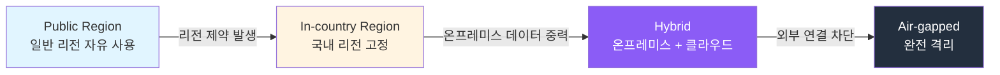
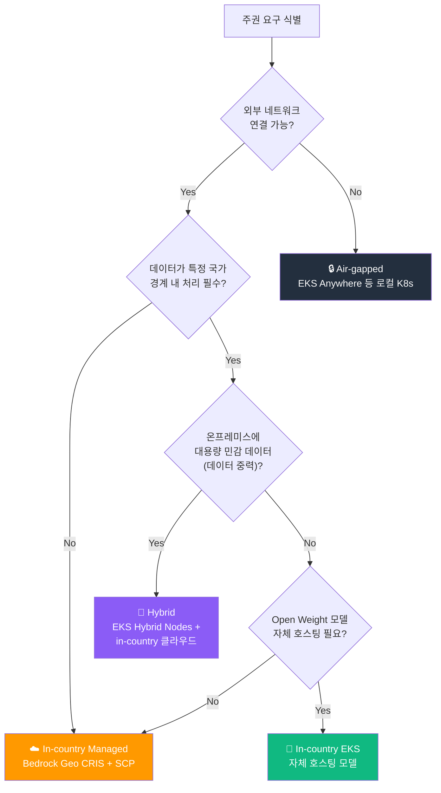
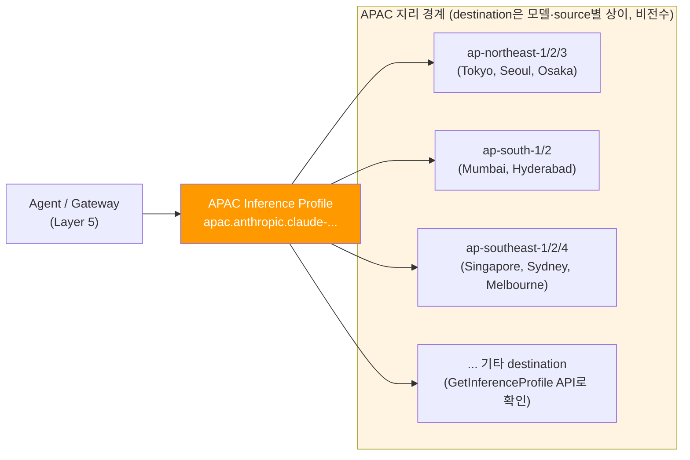
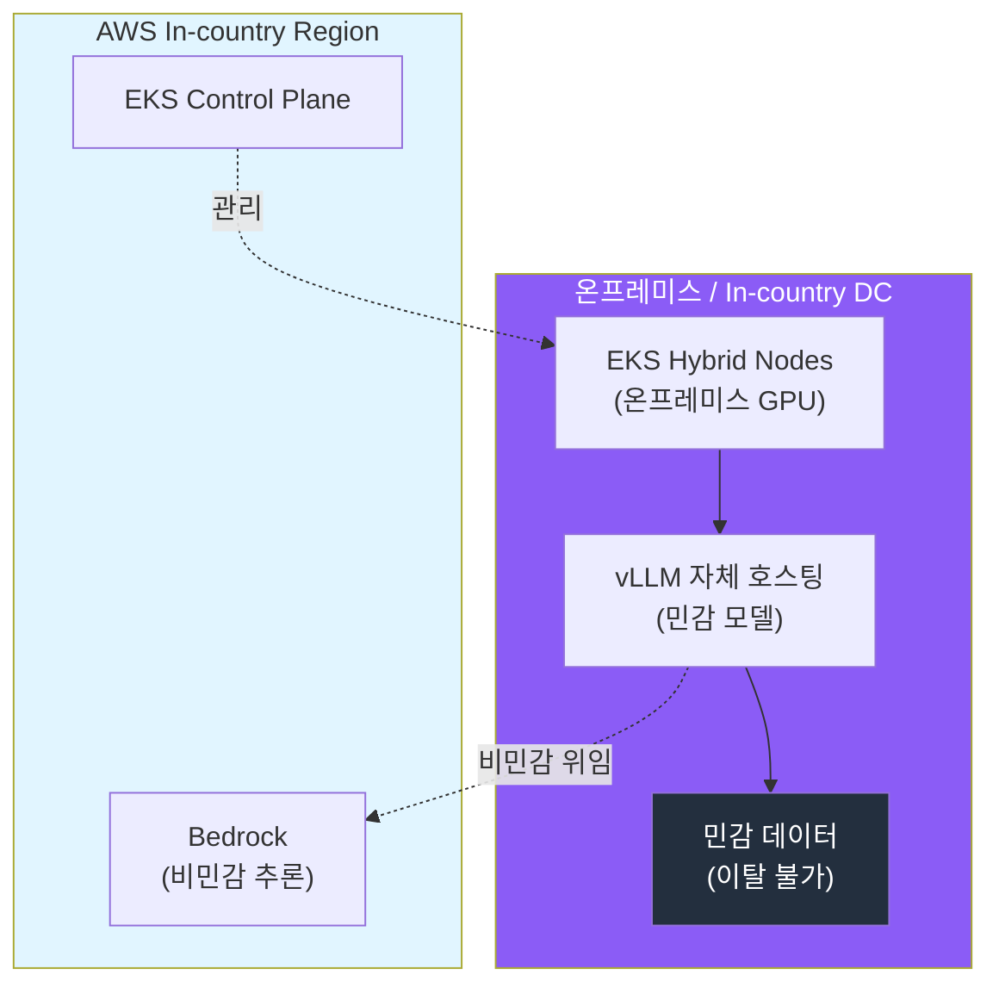

import { SovereigntySpectrum } from '@site/src/components/DecisionFrameworkTables';

## 개요

금융, 공공, 의료, 자율주행 등 규제 산업에서 Agentic AI를 도입할 때 가장 강한 제약은 **데이터 주권(Data Sovereignty)**입니다. 추론 입출력, 학습 데이터, 모델 가중치가 특정 국가·지리 경계를 벗어나면 안 되는 요구가 하드 제약으로 작용합니다. 이 문서는 데이터 주권 요구를 **AWS Native, EKS 자체 호스팅, 하이브리드** 중 어떤 조합으로 충족할지 의사결정 프레임워크를 제공하고, **SCP 리전 강제**, **Bedrock Geographic cross-Region inference**, **EKS Hybrid Nodes** 기반 구현 패턴을 정리합니다.

:::info 선행 문서
이 문서를 읽기 전에 다음 문서를 먼저 참조하세요:
- [플랫폼 아키텍처](../foundations/agentic-platform-architecture.md) — 거버넌스·안전·주권 플레인
- [AI 플랫폼 선택 가이드](./ai-platform-decision-framework.md) — 매니지드 vs 오픈소스 의사결정
- [EKS 기반 오픈 아키텍처](./agentic-ai-solutions-eks.md) — Self-hosted 스택, EKS Hybrid Nodes
:::

---

## 데이터 주권 스펙트럼

데이터 주권 요구는 단일 기준이 아니라 **연속적인 스펙트럼**입니다. 요구 강도가 높아질수록 매니지드 서비스 의존도는 낮아지고 자체 호스팅·온프레미스 비중이 커집니다.

<SovereigntySpectrum />

:::note 위 표의 "운영 부담"은 상대적 설계 판단입니다
위 스펙트럼 표에서 In-country 수준을 "낮음(Geo CRIS + SCP)"으로 표기한 것은 수준 간 상대적 운영 부담에 대한 **설계 판단**입니다. 다만 지리(Geo) CRIS는 요청이 지리 경계 내 다른 국가 리전으로도 라우팅될 수 있으므로, 국내 금융·공공처럼 **국가 단위 residency**가 필요한 경우에는 Geo CRIS만으로 충족되지 않습니다. 사용하려는 모델과 source 리전에 맞는 **국가 프로파일 또는 국내 단일 리전 엔드포인트의 destination·데이터 흐름을 검증**한 뒤 적용하세요(수단 2 참조).
:::



아래 표는 네 가지 대표 패턴을 비교한 것으로, 서로 수렴해 가는 단계가 아니라 요구에 따라 선택하는 설계 **선택지**입니다. "권장 접근"은 이 가이드가 제안하는 조합이며, 실제 적용 가능 여부는 각 수단의 전제조건(아래 수단 1~3)과 조직의 규제 범위를 검증한 뒤 결정해야 합니다.

| 수준 | 데이터 경계 | 제안 접근 | 대표 사례 |
|------|-----------|----------|----------|
| **Public** | 리전 제약 없음 | AWS Native (Bedrock + AgentCore) | 일반 SaaS, 내부 생산성 도구 |
| **In-country** | 국내 리전 내 처리·저장 (관리형) | 국가 프로파일(예: `jp.*`) 또는 국내 단일 리전 엔드포인트 + SCP 리전 강제. 지리(Geo) CRIS는 요청이 국경을 넘는 다른 국가 리전으로도 라우팅될 수 있어 "국내 처리·저장" 요구를 그대로 충족하지 않습니다(수단 2 참조) | 국내 금융, 공공 클라우드 |
| **Hybrid** | 온프레미스 + in-country 클라우드 | EKS Hybrid Nodes + 자체 호스팅 모델 (AWS 리전에 대한 상시 연결 필요) | 데이터 중력이 큰 제조·자율주행 |
| **Air-gapped** | 외부 네트워크 완전 차단 | EKS Anywhere 등 **로컬 컨트롤 플레인을 갖춘 자체 운영 Kubernetes** + 오프라인 레지스트리·아티팩트 + 자체 호스팅. EKS Hybrid Nodes는 AWS 리전 연결이 필수여서 air-gapped에 적합하지 않습니다(수단 3·요약표 참조) | 국방, 기밀 연구 |

:::tip 많은 조직이 In-country 또는 Hybrid를 선택하는 경향
완전 Air-gapped는 운영 부담이 커서 선택하는 조직이 상대적으로 적고, 많은 규제 산업 조직은 **In-country 리전 고정 + 민감 워크로드만 온프레미스 자체 호스팅**하는 Hybrid를 택하는 경향이 있습니다(이 가이드의 설계 판단이며, 특정 집계로 검증된 수치는 아닙니다). 자율주행 비전 데이터처럼 대용량·고민감 데이터를 다루는 조직은 데이터 중력 때문에 온프레미스 GPU를 두고, 일반 추론은 in-country 리전의 Bedrock/EKS와 조합하는 것이 한 가지 방법입니다.
:::

---

## 의사결정 플로우차트



---

## 수단 1: SCP 기반 리전 강제

데이터 주권의 기본적인 기술 통제 중 하나는 **승인되지 않은 리전에서의 AWS API 호출을 조직 수준에서 차단**하는 것입니다. AWS Organizations의 Service Control Policy(SCP)로 구현합니다. SCP는 권한을 **부여하지 않고 최대 권한의 상한(가드레일)만 설정**하므로, SCP가 리전을 허용하더라도 각 계정의 IAM 정책이 별도로 권한을 부여해야 실제 호출이 가능합니다.

SCP의 적용 범위와 한계를 함께 이해해야 합니다.

- **적용 대상**: SCP는 조직 내 **멤버 계정**의 IAM 사용자·역할에 적용되며, 조직 관리 계정(management account)에는 적용되지 않습니다. 따라서 관리 계정에서의 리전 외 호출은 이 통제로 막히지 않습니다.
- **원칙(principal) 예외**: 서비스 연결 역할(service-linked role), 다른 계정·서비스가 떠맡는 역할, 조직 외부 주체가 호출하는 교차 계정 접근 등은 `aws:RequestedRegion` 평가 맥락이 달라 의도대로 차단되지 않을 수 있습니다. 긴급 운영용 break-glass 역할도 명시적으로 예외 처리합니다.
- **차단 대상의 한계**: 이 통제는 **API 요청이 향하는 리전**만 제어합니다. 이미 승인 리전 안에서 일어나는 데이터 이동(예: 리전 간 복제, 매니지드 서비스가 백그라운드로 수행하는 교차 리전 처리·저장)은 SCP만으로 막을 수 없으므로, 서비스별 설정(S3 복제 비활성화, CRIS destination 통제 등)과 네트워크 통제를 함께 적용해야 합니다.

### 리전 거부 SCP 패턴

핵심은 `Deny` 효과에 `aws:RequestedRegion` 조건을 걸되, 리전 개념이 없는 **글로벌 서비스(IAM, Organizations, CloudFront, Route 53 등)는 `NotAction`으로 예외 처리**하는 것입니다. 예외하지 않으면 글로벌 서비스 호출까지 막혀 계정이 정상 동작하지 않습니다.

```json
{
    "Version": "2012-10-17",
    "Statement": [
        {
            "Sid": "DenyOutsideApprovedRegions",
            "Effect": "Deny",
            "NotAction": [
                "iam:*",
                "organizations:*",
                "kms:*",
                "cloudfront:*",
                "route53:*",
                "sts:*",
                "support:*",
                "globalaccelerator:*",
                "budgets:*",
                "ce:*",
                "health:*",
                "ec2:DescribeRegions"
            ],
            "Resource": "*",
            "Condition": {
                "StringNotEquals": {
                    "aws:RequestedRegion": [
                        "ap-northeast-2",
                        "ap-northeast-1"
                    ]
                },
                "ArnNotLike": {
                    "aws:PrincipalARN": [
                        "arn:aws:iam::*:role/RegionBypassBreakGlassRole"
                    ]
                }
            }
        }
    ]
}
```

아래는 **승인 리전을 2개(`ap-northeast-2` 서울, `ap-northeast-1` 도쿄)로 둔 예시 정책**이며, 조직마다 승인 리전·예외 서비스·예외 역할을 다르게 설정해야 합니다. 그대로 복사하지 말고 각 요소를 조직 요구에 맞게 검증하세요.

| 요소 | 역할 | 주의 |
|------|------|------|
| `Effect: Deny` + `aws:RequestedRegion` | 승인 리전 외로 향하는 요청 거부 | Deny가 걸리지 않는다고 해서 자동으로 허용되는 것은 아닙니다. 실제 허용은 각 계정 IAM 정책이 결정합니다 |
| `NotAction` 목록 | 리전 개념이 약한 글로벌 서비스를 Deny에서 제외 | 이 예시의 `kms:*`는 **모든 KMS 작업을 리전 통제에서 제외**합니다. 그러나 KMS 키는 리전 리소스이고 멀티 리전 키도 리전마다 독립적으로 관리됩니다. 데이터 residency가 중요하면 KMS를 통째로 예외하지 말고 필요한 작업만 좁혀 예외하세요 |
| `aws:RequestedRegion` 값 | 승인 리전 목록 | 이 예시의 서울·도쿄는 **서로 다른 국가**입니다. 단일 국가 residency가 필요하면 국내 단일 리전만 남기세요 |
| `ArnNotLike` (break-glass) | 긴급 운영용 예외 역할 지정 (감사 추적 필수) | `arn:aws:iam::*:role/...`의 `*`는 **조건에 맞는 모든 계정의 동명 역할**을 예외합니다. 특정 계정 ID로 좁히고, break-glass 역할 자체는 별도 통제(MFA, 승인 워크플로)로 보호하세요 |

:::warning 이 예시로 "국내 처리·저장"이 보장되지는 않습니다
이 SCP는 리전 외 API 호출을 줄이는 가드레일 예시일 뿐입니다. (1) 서울·도쿄를 함께 허용하면 데이터가 두 국가에 분산될 수 있고, (2) `kms:*`·`sts:*` 등 통째 예외는 해당 서비스의 리전 통제를 비활성화하며, (3) SCP는 Deny의 **부재**를 Allow로 바꾸지 않습니다. 단일 국가 residency가 목표라면 승인 리전·예외 서비스·예외 원칙을 명시적으로 좁히고, break-glass 역할을 독립적으로 보호해야 합니다.
:::

:::warning Bedrock 사용 시 SCP와 cross-Region inference 충돌 주의
Bedrock Geographic cross-Region inference를 사용하는 경우, 소스 리전만 허용하면 추론이 **실패**합니다. 두 가지 방법 중 하나로 해결합니다.

1. **destination 리전 허용**: inference profile이 라우팅하는 **모든 destination 리전을 SCP 허용 목록에 포함**합니다.
2. **프로파일 범위 예외**: destination 리전을 다른 서비스·작업까지 전부 열지 않고, Region 거부 SCP에서 `bedrock:InferenceProfileArn` 조건으로 **해당 inference profile에 한해서만** cross-Region 라우팅을 예외합니다. 공식 문서가 설명하는 방식으로, foundation model 리소스 평가에만 destination 리전이 실리고 `bedrock:InferenceProfileArn` 조건 키가 채워지므로, 특정 프로파일로 예외 범위를 좁힐 수 있습니다(단, 최초 호출을 거는 소스 리전 제한은 이 예외로 우회되지 않습니다).

**중요**: APAC 프로파일(예: `apac.anthropic.claude-sonnet-4`)의 destination은 모델과 source 리전에 따라 **여러 리전**(ap-northeast-1/2/3, ap-south-1/2, ap-southeast-1/2/4 등)으로 달라집니다. 특정 리전 목록을 하드코딩하지 말고, **GetInferenceProfile API 또는 모델별 상세 페이지**에서 source 리전별 destination 전체를 확인 후 SCP에 반영하세요. 데이터가 의도하지 않은 리전(인도·호주 등)으로 이동할 수 있습니다.

국가 단위 data residency가 필요하면 지리 프로파일(`apac.*`) 대신 **국가 프로파일**(`jp.*` Tokyo/Osaka, `au.*` Sydney/Melbourne)을 사용하되, 각 프로파일이 실제로 지원하는 모델·source·destination을 공식 문서에서 확인하세요(프로파일 접두사만으로 국내 처리를 단정하지 않습니다).
:::

### Control Tower Region Deny Control

AWS Control Tower를 사용하는 조직은 직접 SCP를 작성하는 대신 **Region deny control**(landing zone 수준)을 활성화할 수 있습니다. 다만 이 관리형 컨트롤은 위의 수작업 SCP와 **동일하지 않으며**, 다음 특성을 이해하고 적용 효과를 비교해야 합니다.

- **예외 목록이 다릅니다**: 관리형 컨트롤은 사전 정의된 글로벌 서비스 예외 목록을 사용하며, 그 범위가 위 예시 SCP보다 훨씬 넓습니다(수십 개 서비스·세부 작업 포함). 유지보수는 간편하지만 어떤 서비스가 리전 통제에서 빠지는지는 조직이 직접 확인해야 합니다.
- **거버넌스 리전만 적용됩니다**: Landing zone 설정에서 **Governed** 상태인 리전에서만 작업이 허용되고, Control Tower 미지원 리전이나 거버넌스에 포함하지 않은 리전은 차단됩니다. **홈 리전은 제외할 수 없습니다.**
- **실행 역할 예외**: 이 컨트롤은 `AWSControlTowerExecution` 역할을 `aws:PrincipalARN` 조건으로 예외합니다. 위 예시의 break-glass 역할과는 다른 주체이므로, 두 방식의 예외 원칙을 혼동하지 마세요.
- **목록에 없는 작업은 거부됩니다**: 예외 목록(`NotAction`)에 명시되지 않은 작업은 거버넌스 리전 밖에서 허용되지 않습니다.

---

## 수단 2: Bedrock Geographic Cross-Region Inference

매니지드 모델(Bedrock)을 쓰면서도 데이터 residency를 **지리 경계 수준에서** 지키려면 **Geographic cross-Region inference(CRIS)**를 사용합니다. 요청을 단일 리전이 아니라 **지정된 지리 경계(US, EU, APAC 등) 내 리전들로** 분산하여 처리량을 높입니다. 공식 문서에 따르면 데이터는 원래 상주하던 리전에 남지만, **입력 프롬프트와 출력 결과가 추론 중 소스 리전 밖(같은 지리 경계 내 destination 리전)으로 이동할 수 있고, 남용 탐지(abuse detection)를 위해 저장되는 범위에서는 destination 리전에 저장**됩니다. 따라서 "지리 경계를 벗어나지 않음"은 **국가 단위 residency와 다릅니다**. 리전 간 전송은 AWS 보안 네트워크에서 암호화됩니다.



| 특성 | 설명 |
|------|------|
| **데이터 경계** | 지리(US/EU/APAC) 내 리전으로 라우팅. 데이터는 원 상주 리전에 남지만 입출력이 같은 지리 내 destination 리전으로 이동·(남용 탐지 범위 내) 저장될 수 있음 → **국가 단위 residency와 구분** |
| **처리량** | 단일 리전 대비 burst 트래픽 흡수, throttling 완화. 지리 프로파일별 cross-region RPM·TPM 쿼터는 Bedrock 서비스 쿼터 문서에서 확인 |
| **전송 암호화** | 리전 간 트래픽은 AWS 보안 네트워크에서 암호화 전송 |
| **IAM 요구** | inference profile ARN + 소스 리전 + 모든 destination 리전의 foundation model에 대한 호출 권한 필요 |

:::info IAM·SCP 동시 설정 필요
Geographic CRIS는 ① inference profile ARN, ② 소스 리전의 foundation model, ③ **모든 destination 리전의 foundation model**에 대해 호출 API(`bedrock:InvokeModel`, 스트리밍 사용 시 `bedrock:InvokeModelWithResponseStream`, Converse 사용 시 `bedrock:Converse`/`bedrock:ConverseStream`) 권한이 있어야 동작합니다. 조직에 리전 거부 SCP가 있다면 destination 리전을 허용하거나 `bedrock:InferenceProfileArn` 조건으로 프로파일 범위 예외를 설정해야 합니다. (위 [수단 1](#수단-1-scp-기반-리전-강제) 경고 참조)
:::

---

## 수단 3: EKS Hybrid Nodes 기반 하이브리드·자체 호스팅

데이터 중력이 크거나(대용량 비전·로그 데이터) 민감 모델을 온프레미스에 고정해야 하는 경우, **온프레미스 또는 in-country 데이터센터의 GPU를 EKS 클러스터에 편입**하는 EKS Hybrid Nodes로 자체 호스팅합니다. 컨트롤 플레인은 AWS 리전에, 데이터 플레인(GPU 노드)은 온프레미스에 두어 단일 Kubernetes 운영 모델을 유지합니다.

:::warning 전제: AWS 리전에 대한 상시 연결이 허용되어야 합니다
EKS Hybrid Nodes는 컨트롤 플레인이 AWS 리전에 있고, 노드와 컨트롤 플레인 사이에 **신뢰할 수 있는 상시 네트워크 연결(Site-to-Site VPN, Direct Connect 등)**이 필요합니다. 공식 문서는 Hybrid Nodes가 **단절·간헐(DDIL) 환경에는 적합하지 않다**고 명시하므로, in-country 클라우드 연결조차 허용되지 않는(air-gapped) 요구에는 Hybrid Nodes가 아니라 로컬 컨트롤 플레인 방식(수단 요약표 참조)을 사용하세요. 또한 온프레미스에 GPU를 둔다는 사실만으로 입출력이 경계를 벗어나지 않음이 보장되지는 않습니다. 아래 표의 egress 항목을 함께 통제해야 합니다.
:::



| 구성 요소 | 배치 | 이유 |
|----------|------|------|
| EKS Control Plane | AWS in-country 리전 | 관리형 운영, 패치·HA 위임 (리전 연결 필요) |
| GPU 데이터 플레인 | 온프레미스 (Hybrid Nodes) | 민감 데이터 이탈 방지, 데이터 중력 |
| 민감 모델 추론 | 온프레미스 vLLM | 모델 입출력을 온프레미스에 유지 |
| 비민감 추론 | in-country Bedrock | 운영 부담 절감, Cascade 위임 |
| **egress 통제** | 경계 전반 | 노드 메타데이터·로그·메트릭·tool 호출·Bedrock 위임 요청은 경계를 넘어 AWS·외부로 나갈 수 있으므로, 어떤 데이터가 어디로 나가는지 식별하고 승인된 **마스킹·분류·redaction** 규칙과 네트워크 통제를 적용해야 함 |

**자율주행 비전 데이터 시나리오(설계 예시)**: 차량 카메라 원본 데이터는 용량이 크고 민감하여 온프레미스에 고정하고, 어노테이션·전처리 추론은 온프레미스 GPU(Hybrid Nodes)에서 자체 호스팅 모델로 처리하며, 일반 텍스트 요약·리포팅 같은 비민감 작업만 in-country 리전의 매니지드 서비스로 위임하는 구성입니다. 이는 하나의 **설계 방향**이며, 실제 비용 절감이나 residency 충족 여부는 위임 경로로 나가는 데이터, 로그·텔레메트리 egress, tool 호출을 모두 통제하고 검증한 뒤에야 판단할 수 있습니다(검증 전 확정된 결과로 보지 마세요).

:::info EKS Hybrid Nodes 상세
EKS Hybrid Nodes 구성, 온프레미스 GPU 편입, 네트워킹 요구사항은 [EKS 기반 오픈 아키텍처](./agentic-ai-solutions-eks.md#eks-auto-mode로-빠르게-시작)를 참조하세요.
:::

---

## 주권 수준별 권장 구성 요약

| 주권 수준 | 추론 | 데이터·모델 | 리전 통제 | 핵심 수단 |
|----------|------|-----------|----------|----------|
| **Public** | Bedrock (글로벌/지리 CRIS) | 리전 제약 없음 | 선택 | AWS Native |
| **In-country (Managed)** | Bedrock Geographic CRIS | in-country 리전 | SCP 리전 강제 | 수단 1 + 2 |
| **In-country (Self-hosted)** | in-country EKS + vLLM | in-country 리전 | SCP 리전 강제 | 수단 1 + 3 |
| **Hybrid** | 온프레미스 vLLM + in-country Bedrock | 온프레미스 + 리전 | SCP + 네트워크 격리 | 수단 1 + 2 + 3 |
| **Air-gapped** | 로컬 자체 호스팅 전용 | 온프레미스 전용 | 물리·네트워크 격리 | EKS Anywhere 등 로컬 컨트롤 플레인 K8s + 오프라인 레지스트리·아티팩트 (Hybrid Nodes 연결 차단이 아님) |

---

## 컴플라이언스 매핑

데이터 주권 수단은 규제 요구와 직접 연결됩니다.

| 규제 | 핵심 요구 | 대응 수단 |
|------|----------|----------|
| **전자금융감독규정** | 국내 데이터 처리·보관(적용 범위·세부 조항은 미검증) | SCP in-country 리전 강제, 자체 호스팅 |
| **ISMS-P** | 데이터 위치·접근 통제, 감사 추적(세부 인증 기준은 미검증) | SCP + CloudTrail, RBAC |
| **GDPR** | EEA 밖으로의 개인정보 **이전**을 제한(역내 처리 의무가 아님). 적정성 결정(adequacy)·적절한 안전장치(SCC·BCR 등)·예외 중 하나를 갖추면 역외 이전 가능(Chapter V) | EU 데이터는 EU Geographic CRIS로 역내 유지 가능. 단 CRIS만으로 GDPR 준수가 입증되지 않으며, 역외 이전 시 Chapter V 메커니즘 필요 |
| **개인정보보호법(한국)** | 국외 이전 요건(동의·고지 등). 세부 조항·적용 범위는 미검증 | 리전 거부 SCP, 온프레미스 격리 |

:::note 규제 매핑은 설계 참고용입니다
위 "대응 수단"은 각 규제가 통상 요구하는 바에 기술 통제를 연결한 **설계 참고**이며, 특정 조문·적용 범위·실제 준수 여부를 법적으로 확정한 것이 아닙니다. 한국 규제(전자금융감독규정·ISMS-P·개인정보보호법)의 구체 조항과 적용 대상은 원문 검토 전까지 **미검증**으로 두었습니다. GDPR과 관련해 대한민국은 EU 집행위의 **적정성 결정 대상국**이므로, EU→한국 이전이 반드시 금지되는 것은 아닙니다. 실제 적용은 법무·컴플라이언스 검토가 필요합니다.
:::

:::info 컴플라이언스 상세
SOC2·ISMS-P 통제 항목과 플랫폼 컴포넌트 매핑은 [컴플라이언스 프레임워크](../../operations-mlops/governance/compliance-framework.md)를 참조하세요.
:::

---

## 결론

데이터 주권은 단일 스위치가 아니라 Public → In-country → Hybrid → Air-gapped로 이어지는 스펙트럼이며, 요구에 따라 SCP 리전 강제, Bedrock Geographic cross-Region inference, EKS Hybrid Nodes·EKS Anywhere 자체 호스팅을 **조합해 제안**할 수 있습니다. 많은 규제 산업 조직은 **in-country 리전 고정 + 민감 워크로드 온프레미스 자체 호스팅**의 Hybrid를 택하는 경향이 있으며, 비민감 작업은 매니지드 서비스로 위임해 비용·운영 부담을 낮추는 설계를 고려합니다.

다만 이 통제들을 조합한다고 해서 각 수준의 주권 요구가 자동으로 충족되는 것은 아닙니다. 실제 적용 전에 최소한 다음을 검증해야 합니다.

- **아이덴티티·접근**: SCP가 멤버 계정·원칙 예외·관리 계정을 의도대로 포괄하는지
- **로그·백업·모델 아티팩트**: CloudTrail·백업·모델 가중치가 승인 경계 밖(예: CRIS destination, 리전 간 복제)으로 이동하지 않는지
- **tool 호출·위임 경로**: 에이전트의 tool 호출과 Bedrock 위임이 어떤 데이터를 어디로 내보내는지, 마스킹·분류 규칙이 적용되는지
- **CRIS destination**: 지리 프로파일의 destination 리전과 남용 탐지 저장 범위가 residency 요구와 상충하지 않는지
- **단절 환경 수명주기**: air-gapped의 경우 오프라인 레지스트리·아티팩트 갱신과 로컬 컨트롤 플레인 운영이 가능한지

즉, 이 문서는 주권 수준별 **제안 통제**와 **남은 검증 항목**을 제시하며, 특정 규제 준수는 위 항목을 설계·검증한 뒤 법무·컴플라이언스 검토로 확정해야 합니다.

---

## 참고 자료

### 공식 문서

- [Service Control Policies (SCP)](https://docs.aws.amazon.com/organizations/latest/userguide/orgs_manage_policies_scps.html) — AWS Organizations SCP 가이드
- [Region deny control - AWS Control Tower](https://docs.aws.amazon.com/controltower/latest/controlreference/primary-region-deny-policy.html) — 리전 거부 컨트롤 SCP
- [Geographic cross-Region inference - Amazon Bedrock](https://docs.aws.amazon.com/bedrock/latest/userguide/geographic-cross-region-inference.html) — 지리 경계 추론, IAM·SCP 요구사항
- [Restrict data transfers across AWS Regions](https://docs.aws.amazon.com/prescriptive-guidance/latest/privacy-reference-architecture/restrict-data-transfers-across-regions.html) — 리전 간 데이터 전송 제한 SCP 샘플

### 논문 / 기술 블로그

- [AWS Well-Architected Generative AI Lens](https://docs.aws.amazon.com/wellarchitected/latest/generative-ai-lens/generative-ai-lens.html) — 생성형 AI 설계 원칙, 데이터 거버넌스
- [Financial Services Industry Lens](https://docs.aws.amazon.com/wellarchitected/latest/financial-services-industry-lens/) — 금융 서비스 Well-Architected 렌즈 (데이터 residency 포함)
- [Amazon EKS Hybrid Nodes](https://docs.aws.amazon.com/eks/latest/userguide/hybrid-nodes-overview.html) — 온프레미스 노드 편입

### 관련 문서 (내부)

- [플랫폼 아키텍처](../foundations/agentic-platform-architecture.md) — 거버넌스·안전·주권 플레인
- [AI 플랫폼 선택 가이드](./ai-platform-decision-framework.md) — 매니지드 vs 오픈소스 vs 하이브리드
- [EKS 기반 오픈 아키텍처](./agentic-ai-solutions-eks.md) — EKS Hybrid Nodes 자체 호스팅
- [컴플라이언스 프레임워크](../../operations-mlops/governance/compliance-framework.md) — SOC2·ISMS-P 매핑
