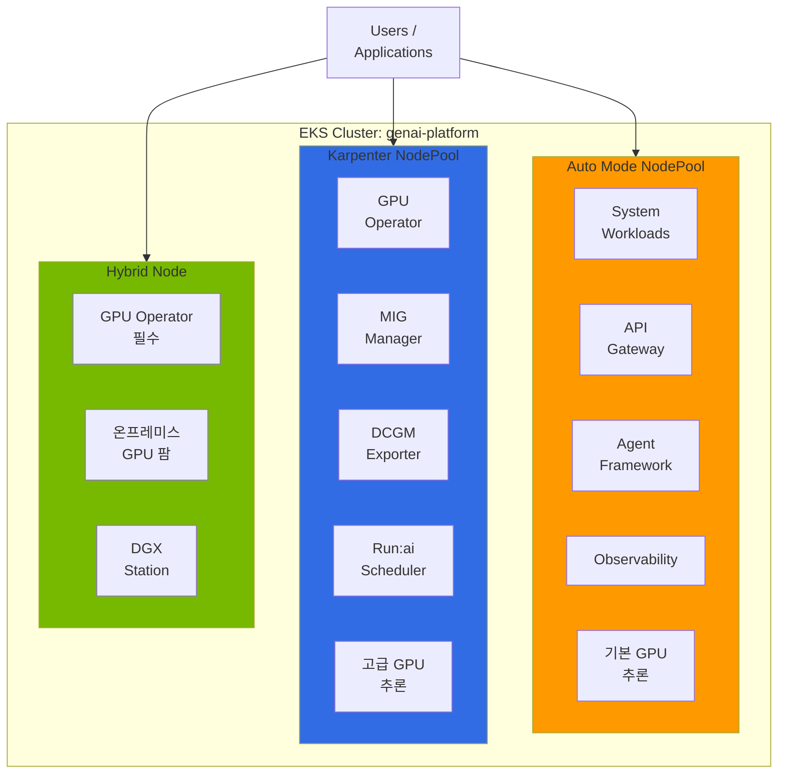
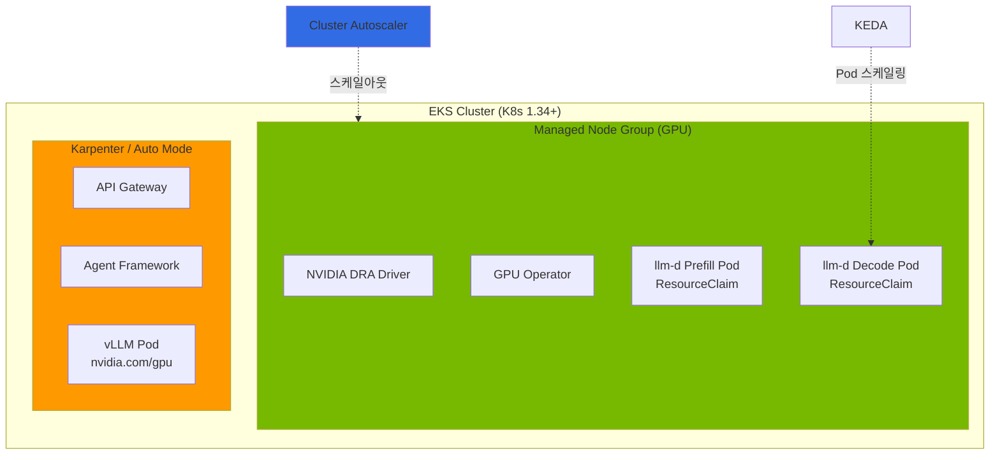
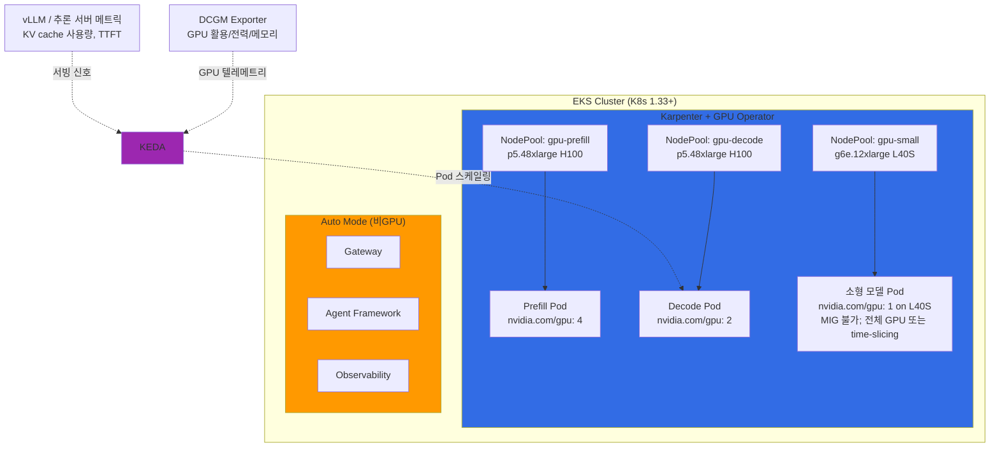
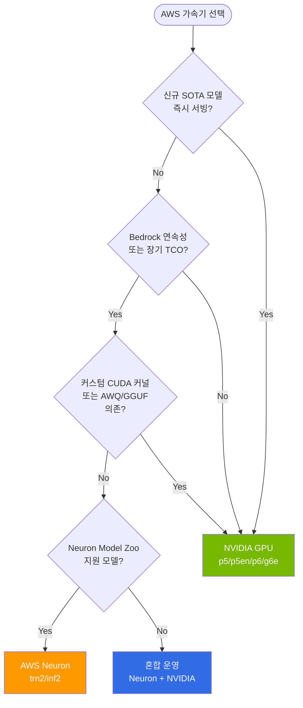
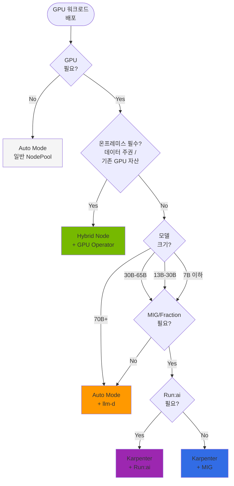

## 개요

EKS에서 GPU 워크로드를 운영할 때 노드 타입 선택은 운영 복잡도, 비용, 기능 활용도에 직접적인 영향을 미칩니다. GPU 추론과 훈련 워크로드는 일반 컨테이너 워크로드와 달리 다음과 같은 특수한 요구사항을 가집니다:

- **드라이버 의존성**: NVIDIA GPU 드라이버, Container Toolkit, Device Plugin
- **고급 기능**: MIG (Multi-Instance GPU), Time-Slicing, Fractional GPU
- **모니터링**: DCGM (Data Center GPU Manager) 기반 메트릭
- **스케줄링**: Topology-Aware Placement, Gang Scheduling

AWS EKS는 GPU 워크로드를 위해 4가지 노드 타입을 제공합니다:

**표 1. EKS GPU 워크로드용 4가지 노드 타입**

| 노드 타입 | 설명 |
|-----------|------|
| **EKS Auto Mode** | AWS가 전체 노드 라이프사이클을 관리 (GPU 드라이버 사전 설치) |
| **Karpenter** | 자동 스케일링 + Custom AMI, MIG 등 완전한 사용자 정의 |
| **Managed Node Group** | AWS 관리 노드 그룹, self-managed 노드 및 정적(static) 용량 프로비저닝 Karpenter와 함께 DRA(Dynamic Resource Allocation)를 지원하는 용량 유형 중 하나 |
| **Hybrid Node** | 온프레미스 GPU 서버를 EKS 클러스터에 연결 |

:::tip 기본 원칙
하나의 EKS 클러스터에서 여러 노드 타입을 **동시에** 운영할 수 있습니다. 워크로드 특성에 맞는 최적의 노드 조합을 구성하세요.
:::

### 이 문서의 범위

이 문서는 **노드 타입 선택과 하이브리드 아키텍처 설계**에 집중합니다. GPU Operator/DCGM/Dynamo 등 NVIDIA 소프트웨어 스택 상세, GPU 오토스케일링, llm-d 분산 추론, 보안/트러블슈팅은 각 전문 문서에서 다룹니다 (문서 하단 "관련 문서" 참조).

---

## 노드 타입별 특성 비교

### 기능 비교 테이블

**표 2. 노드 타입별 기능 비교**

| 특성 | Auto Mode | Karpenter | Managed Node Group | Hybrid Node |
|------|-----------|-----------|-------------------|-------------|
| **관리 주체** | AWS 완전 관리 | Self-Managed | AWS 관리 | On-Premises |
| **자동 스케일링** | 자동 (AWS 제어) | 자동 (NodePool 기반) | 수동/제한적 | 수동 |
| **Custom AMI** | 불가 | 가능 | 가능 | 가능 |
| **SSH 접근** | 불가 | 가능 | 가능 | 가능 |
| **GPU 드라이버** | 사전 설치 (AWS 관리 AMI) | AMI에 따라 다름 (EKS GPU 최적화 AMI는 드라이버 포함, 기본 AMI는 사용자 설치) | AMI에 따라 다름 (Karpenter와 동일) | 사용자 설치 |
| **GPU Operator** | **가능** (Device Plugin 레이블 비활성화) | **가능** | 가능 | 가능 |
| **Root Filesystem** | 관리 AMI 기본값 (사용자 변경 불가) | AMI/OS에 따라 다름 | AMI/OS에 따라 다름 | AMI/OS에 따라 다름 |
| **MIG 지원** | 불가 (관리 AMI/OS에서 MIG Manager 실행 불가) | 가능 (MIG 지원 GPU에서) | 가능 (MIG 지원 GPU에서) | 가능 (MIG 지원 GPU에서) |
| **DRA 호환** | **미지원** (EKS 문서 기준 DRA는 EKS Auto Mode와 현재 비호환, 2026-09 기준) | **정적(static) 용량 프로비저닝에서만 지원**, 동적 프로비저닝 Karpenter 용량에서는 미지원. 업스트림 Karpenter는 provider [v1.14.0](https://github.com/kubernetes-sigs/karpenter/pull/2384)부터 DRA 요청 처리 추가 | **지원** | **지원** |
| **DCGM Exporter** | GPU Operator로 설치 | GPU Operator 포함 | 수동 설치 | GPU Operator 포함 |
| **Run:ai 호환** | **가능** (Device Plugin 비활성화) | **가능** | 가능 | 가능 |
| **운영 부담** | 가장 낮음 (AWS가 라이프사이클 관리) | 중간 | 중간 | 높음 (온프레미스 소유) |
| **청구 컴퓨팅 비용** | EC2 온디맨드/Spot 인스턴스-시간당 표준 요금 | EC2 온디맨드/Spot 인스턴스-시간당 표준 요금 | EC2 온디맨드/Spot 인스턴스-시간당 표준 요금 | Capex (소유 하드웨어) + Hybrid Node vCPU당 요금 |
| **적합 워크로드** | 단순 추론 | 고급 GPU 기능 | DRA 워크로드 | 온프레미스 통합 |

### 워크로드별 노드 선택 가이드

**Auto Mode를 선택하는 경우:**
- GPU 드라이버 관리 부담 없이 빠르게 추론 서비스를 시작하고 싶을 때
- MIG, Fractional GPU가 불필요한 대형 모델 (70B+) 서빙
- 시스템/비GPU 워크로드 (API Gateway, Agent, Observability)

**Karpenter를 선택하는 경우:**
- MIG 파티셔닝, Custom AMI, Spot Instance 유연한 제어가 필요할 때
- Run:ai, KAI Scheduler 등 GPU Operator ClusterPolicy 의존 프로젝트 사용
- 중소형 모델의 GPU 활용률 최적화 (MIG 분할)

**Managed Node Group을 선택하는 경우:**
- DRA(Dynamic Resource Allocation) 기반 GPU 관리가 필요할 때
- P6e-GB200 UltraServer 등 DRA 전용 인스턴스 사용

**Hybrid Node를 선택하는 경우:**
- 기존 온프레미스 GPU 서버 자산을 EKS에 통합할 때
- 데이터 주권 (Data Residency) 요구사항

---

## EKS Auto Mode GPU 지원과 제약

### Auto Mode 기본 GPU 스택

EKS Auto Mode는 GPU 인스턴스에서 다음을 사전 설치합니다:

1. **NVIDIA GPU 드라이버** - AWS 관리 버전, `/dev/nvidia*` 디바이스 자동 생성
2. **NVIDIA Container Toolkit** - containerd 플러그인 자동 구성
3. **NVIDIA Device Plugin** - `nvidia.com/gpu` 리소스 자동 등록
4. **GPU 리소스 등록** - GPU 노드가 기동된 후 Pod에서 `nvidia.com/gpu: 1`을 요청할 수 있습니다

`nvidia.com/gpu`를 요청하는 Pod는 적격한 GPU NodePool이 매칭되는 GPU 노드를 기동할 수 있거나 이미 기동된 경우에만 스케줄됩니다. EKS Auto Mode에서는 GPU 인스턴스 패밀리를 선택하고 GPU taint를 tolerate하는 NodePool이 필요하며, 기본 범용 NodePool은 GPU 용량을 프로비저닝하지 않습니다. 이미지 태그, GPU taint/toleration, 대상 인스턴스 타입의 가용 용량은 별도로 확인하세요. 아래 매니페스트는 완전한 배포가 아니라 워크로드 조각(fragment)입니다:

```yaml
# Fragment: 적격한 GPU NodePool이 존재하고 용량을 기동할 수 있다고 가정합니다.
apiVersion: v1
kind: Pod
metadata:
  name: gpu-test
spec:
  # 실제 클러스터에서는 GPU taint에 대한 tolerations와
  # GPU NodePool을 선택하는 nodeSelector/affinity가 필요하며, 여기서는 간결성을 위해 생략했습니다.
  containers:
  - name: cuda-test
    image: nvidia/cuda:12.2.0-runtime-ubuntu22.04
    command: ["nvidia-smi"]
    resources:
      limits:
        nvidia.com/gpu: 1
```

### Auto Mode에서 GPU Operator 설치 — Device Plugin 비활성화 패턴

GPU Operator는 Auto Mode에서 **설치 가능**하지만, 검증된 구성은 Device Plugin만 비활성화하지 않습니다. [awslabs/ai-on-eks PR #288](https://github.com/awslabs/ai-on-eks/pull/288)(2026-09 검토)에서는 EKS 관리 AMI가 이미 드라이버와 Container Toolkit을 제공하므로 GPU Operator Helm values에서 `driver.enabled=false`와 `toolkit.enabled=false`를 설정하며, Device Plugin은 Auto Mode 노드에서 NodePool 레이블 `nvidia.com/gpu.deploy.device-plugin: "false"`로 비활성화합니다. 해당 구성에서 NFD(Node Feature Discovery), GFD(GPU Feature Discovery), DCGM Exporter, MIG Manager는 그대로 활성화됩니다. 이는 드라이버/Toolkit/Device Plugin을 EKS가 소유한 상태로 GPU Operator가 Auto Mode에서 동작할 수 있음을 보여줄 뿐, Auto Mode에서의 GPU Operator 전체 기능 동등성이나 Run:ai 호환성을 그 자체로 입증하지는 않습니다. 이들은 대상 버전에서 별도 검증이 필요한 컴포넌트(MIG Manager, ClusterPolicy 소비자)에 의존합니다.

**왜 GPU Operator가 필요한가?** KAI Scheduler, Run:ai 등 여러 프로젝트는 GPU Operator의 **ClusterPolicy CRD**에 의존합니다. ClusterPolicy 없이는 이들 프로젝트가 시작조차 하지 못합니다. Auto Mode에서도 GPU Operator를 설치해야 하는 핵심 이유입니다.

```
ClusterPolicy CRD (GPU Operator)
  ↓ depends on
KAI Scheduler (GPU-aware Pod 배치)
Run:ai (Fractional GPU, Gang Scheduling)
  ↓ reads
DCGM Exporter (GPU 메트릭)
NFD/GFD (하드웨어 레이블)
```

컴포넌트별 활성화 기준(환경별 매트릭스), Device Plugin 비활성화 NodePool 레이블, Auto Mode용/Karpenter용 Helm values 전체는 [NVIDIA GPU 스택 — EKS 환경별 GPU Operator 구성](./nvidia-gpu-stack.md#eks-환경별-gpu-operator-구성)을 참조하세요.

:::caution Auto Mode의 실제 제약
GPU Operator 설치는 가능하지만, Auto Mode의 **관리형 AMI와 OS는 사용자가 변경할 수 없으므로** 커스텀 NodeClass로 인프라 설정(서브넷, 보안 그룹, ephemeral storage, 네트워킹)을 조정할 수 있더라도 다음은 불가합니다:
- **MIG 파티셔닝**: 관리형 AMI/OS에서 MIG Manager가 실행되지 않아 Auto Mode 노드에서 MIG 프로파일을 설정할 수 없습니다
- **Custom AMI**: 특정 AMI나 드라이버 버전을 핀할 수 없습니다 (AMI는 AWS 관리)
- **SSH/SSM 접근**: 노드에 직접 로그인해 디버깅할 수 없습니다

커스텀 NodeClass(`kind: NodeClass`, `eks.amazonaws.com/v1`) 자체는 설정 가능합니다 — "read-only" 제약은 NodeClass 객체 전체가 아니라 AMI/OS 이미지에 적용됩니다. MIG 기반 GPU 분할이 필요하면 Karpenter + GPU Operator로 전환하세요.
:::

### 대형 GPU 인스턴스 지원 현황 (2026-04 검증 시점 기준, 재검증 필요)

2026년 4월 초 GLM-5 (744B MoE) 배포 과정에서 관측한 Auto Mode의 대형 GPU 인스턴스 지원 현황이며, 저장된 로그가 없으므로 활용하기 전에 재검증해야 합니다. 당시 p5.48xlarge는 Spot 프로비저닝이 확인되었으나, p5en/p6는 사용할 수 없었습니다. [EKS Auto Mode 변경 기록](https://docs.aws.amazon.com/eks/latest/userguide/auto-change.html)은 p5e, p5en, p6-b200, p6-b300 등을 2026-04-10부터 지원하는 인스턴스 유형으로 기록하므로, 4월의 제약은 현재의 공식 지원 범위를 나타내지 않습니다. 리전별 용량에 따라 프로비저닝은 여전히 제한될 수 있습니다.

**상세 지원 현황**: [EKS Auto Mode GPU 인스턴스 지원 현황](../inference-frameworks/llm-d-eks-automode.md#eks-auto-mode-gpu-인스턴스-지원-현황-202604-검증) 참조

### Auto Mode + MNG 하이브리드 제약

EKS Auto Mode와 Managed Node Group은 모두 지원되는 용량 유형이며, AWS 문서는 두 유형이 하나의 클러스터에서 공존할 수 있다고 설명합니다. 기록된 한 번의 시도에서는 p5en/p6 사용을 위해 Auto Mode 클러스터에 MNG를 추가하는 작업이 완료되지 않았고, 다음 증상이 **관찰되었으나 독립적으로 재현되지는 않았습니다**:

- MNG 생성이 `CREATING` 상태에서 30분 이상 지속됨
- 백킹 CloudFormation 스택의 `Resources` 필드가 `null`로 유지됨

이는 한 번의 프로비저닝 실패 증상이지 문서화된 플랫폼 제약이 아닙니다. 근본 원인이 규명되지 않았고 동작이 재현되지 않았으므로, 하이브리드 패턴이 불가능하다는 증거가 아니라 조사(CloudFormation 이벤트, 서비스 할당량, 용량 오류 수집)가 필요한 인시던트로 다루어야 합니다.

**권장**: 대형 GPU(H200+, B200)에는 오늘날 잘 알려진 구성인 **EKS Standard Mode + Karpenter + MNG**가 적합합니다. Auto Mode와 MNG를 함께 사용해야 한다면 먼저 해당 계정에서 조합을 검증하세요.

### Device Plugin 충돌 해결

Auto Mode 노드에서 GPU Operator를 `devicePlugin.enabled=true`로 설치하면 내장 Device Plugin과 충돌합니다.

```bash
kubectl describe node <gpu-node> | grep nvidia.com/gpu
# Allocatable: nvidia.com/gpu: 0  (예상: 8)
```

**해결**: NodePool에 `nvidia.com/gpu.deploy.device-plugin: "false"` 레이블 추가 (위 "Device Plugin 비활성화 패턴" 섹션 참조)

### 노드 강제 종료 제약

Auto Mode가 관리하는 EC2 인스턴스는 직접 `ec2:TerminateInstances` 호출을 차단하므로, 인스턴스를 종료하는 대신 Karpenter/NodeClaim 라이프사이클을 통해 비정상 노드를 복구합니다. 복구 절차:

1. **워크로드의 수요를 유지하세요.** Deployment/StatefulSet을 삭제하지 마세요 — 워크로드를 삭제하면 교체 노드를 유발하는 수요가 사라집니다. 드레인이 필요하면 워크로드 컨트롤러가 Pod를 재스케줄하도록(예: `kubectl rollout restart`) 하여 replica 수를 유지하세요.
2. **비정상 노드의 NodeClaim(또는 노드)을 삭제하세요:** `kubectl delete nodeclaim <nodeclaim-name>`. 노드와 NodeClaim 중 하나를 삭제하면 다른 하나로 cascade 삭제되며, Karpenter는 finalizer를 설정하고 Termination Controller가 노드를 taint한 뒤 graceful하게 드레인한 다음 제거합니다.
3. **Karpenter는 대기 중인 Pod가 여전히 용량을 필요로 할 때만 교체 노드를 프로비저닝합니다.** 교체 노드의 사전 기동(pre-spin)은 드레인 중 스케줄링 시뮬레이션이 필요한 Pod를 찾을 때 일어나며, 고정된 시간 간격은 없습니다. 교체 소요 시간은 인스턴스 가용성과 이미지 pull에 따라 달라지며 5~10분으로 보장되지 않습니다.
4. **복구를 확인하고 실패를 처리하세요.** 새 노드가 `Ready`가 되고 Pod가 `Running`인지 확인하세요. 교체 노드를 기동할 수 없으면(예: `InsufficientInstanceCapacity`, 적격 NodePool 없음) Karpenter는 taint를 해제하고 재시도하며, 용량이 확보될 때까지 워크로드는 pending 상태로 남습니다.

### Consolidation과 단일 Replica 서비스 가용성 (2026-07 검증) {#consolidation과-단일-replica-서비스-가용성-202607-검증}

Auto Mode의 내장 Karpenter는 비용 최적화를 위해 노드 consolidation(통합·회수)을 상시 수행합니다. 이 과정에서 **replica 1개로 운영되는 서비스는 Pod 재배치 동안 짧게 `Ready` Pod가 없을 수 있습니다.** 해당 서비스가 ALB 뒤에 있고 타깃그룹에 healthy한 등록 타깃이 하나도 남지 않으면 ALB는 `503 Service Unavailable`을 반환합니다. 응답 헤더가 `server: awselb/2.0`이면 애플리케이션이 아닌 ALB가 직접 생성한 503입니다.

단, 이 finding이 지적하는 구분에 유의하세요: **등록 타깃이 없거나**(또는 모두 `initial`/`draining`) 하면 ALB는 503을 반환하지만, 타깃이 모두 **unhealthy**인 경우에는 fail-open으로 설정되어 트래픽을 계속 라우팅할 수 있습니다. 특정 503을 consolidation 탓으로 귀속하려면 타깃이 없었다는 관찰만으로는 부족하며, ALB 액세스 로그와 타깃그룹의 타깃 상태 이력이 필요합니다.

운영 중 관찰(독립적으로 재현된 벤치마크 아님): Langfuse(replica 1)를 Auto Mode 클러스터에서 운영할 때 consolidation이 하루 수차례 노드를 교체했고, 타깃 `DeregisterTargets` → 신규 Pod 기동 → `RegisterTargets` 사이의 공백에서 503이 나타났습니다. 이 패턴은 CloudTrail에서 `eks-auto-mode-compute` 역할의 `TerminateInstances`와 타깃그룹 `DeregisterTargets`/`RegisterTargets` 이벤트가 반복되는 형태로 보이지만, 그 자체로 인과를 증명하지 않으므로 조사가 필요한 상관관계로 다루세요.

**해결 — 4가지를 세트로 적용해야 합니다. replicas 증설만으로는 불충분합니다:**

1. **replicas 2 + PodDisruptionBudget**: Karpenter는 PDB를 존중하므로 `minAvailable: 1` PDB가 있어야 순차 evict가 강제됩니다. PDB 없이 replicas만 늘리면 두 Pod가 연달아 evict될 수 있습니다.

```yaml
apiVersion: policy/v1
kind: PodDisruptionBudget
metadata:
  name: langfuse-web
spec:
  minAvailable: 1
  selector:
    matchLabels:
      app: langfuse-web
```

2. **노드 분산**: 두 replica가 같은 노드에 스케줄되면 노드 1개 회수로 동시에 중단됩니다. `topologySpreadConstraints` 또는 hostname 기준 `podAntiAffinity`로 분산합니다. 단, `maxSkew: 1` + `whenUnsatisfiable: DoNotSchedule`은 *존재하는 도메인 간의 불균형만 제한*합니다. 적격한 hostname 도메인이 하나뿐이면 두 replica가 모두 그 도메인에 배치될 수 있습니다. Pod를 서로 다른 노드로 강제하려면 적격 도메인이 최소 2개임을 보장해야 합니다 — 예를 들어 `minDomains: 2`를 설정하거나(두 번째 도메인이 생길 때까지 `DoNotSchedule`이 Pod를 pending으로 유지하며, 용량을 대가로 함) 필수(required) hostname `podAntiAffinity`를 사용합니다:

```yaml
topologySpreadConstraints:
  - maxSkew: 1
    minDomains: 2
    topologyKey: kubernetes.io/hostname
    whenUnsatisfiable: DoNotSchedule
    labelSelector:
      matchLabels:
        app: langfuse-web
```

3. **ALB Pod Readiness Gate**: Pod가 Ready여도 ALB 타깃은 아직 `initial` 상태일 수 있습니다. AWS Load Balancer Controller는 Pod의 ALB 타깃이 `Healthy`가 될 때까지 Pod를 Ready로 간주하지 않도록 readiness gate를 주입하여 "신규 타깃 healthy 확인 → 기존 타깃 제거" 순서를 강제합니다. 이는 다음을 전제로 합니다: AWS Load Balancer Controller 설치(mutating webhook로 주입), `target-type: ip`(`instance` 타깃에서는 동작하지 않음), 네임스페이스에 이미 존재하는 매칭 Service와 TargetGroupBinding. 또한 gate는 네임스페이스에 라벨을 지정한 **이후 생성된** Pod에만 주입됩니다:

```bash
kubectl label namespace <ns> elbv2.k8s.aws/pod-readiness-gate-inject=enabled
```

4. **(대안) Disruption 제외**: replica를 늘릴 수 없는 워크로드는 Pod에 `karpenter.sh/do-not-disrupt: "true"` 어노테이션을 추가해 consolidation 대상에서 제외합니다. 단, 해당 노드는 비용 최적화 대상에서도 제외됩니다.

### Auto Mode 인스턴스 지원 확인 방법

`--dry-run=server` apply는 서버 사이드 **admission 및 스키마 검증**만 수행합니다. 영속되지 않으며 Karpenter 재조정(reconciliation)이나 인스턴스 기동을 **트리거하지 않습니다**. 따라서 NodePool 매니페스트가 유효한지는 알려주지만, 특정 인스턴스 타입을 실제로 프로비저닝할 수 있는지는 알려주지 않습니다. 아래 매니페스트는 검증하거나 적용할 객체입니다:

```yaml
apiVersion: karpenter.sh/v1
kind: NodePool
metadata:
  name: gpu-test-dryrun
spec:
  template:
    spec:
      requirements:
        - key: node.kubernetes.io/instance-type
          operator: In
          values: ["p5en.48xlarge"]
      nodeClassRef:
        group: eks.amazonaws.com
        kind: NodeClass
        name: default
  limits:
    nvidia.com/gpu: "8"
```

지원 여부를 실제로 테스트하려면 NodePool을 실제로 적용하고(명시적으로 승인된 프로비저닝 테스트), 해당 인스턴스 타입을 요청하는 Pod를 생성한 뒤, **그 테스트로 생성된 NodeClaim**을 확인하세요: 이벤트에 `NoCompatibleInstanceTypes`가 나타나거나 Pod가 그 사유로 pending에 머물면 해당 인스턴스 타입은 그 클러스터/리전의 Auto Mode에서 사용할 수 없습니다. 무관한 기존 NodeClaim으로 지원 여부를 추론하지 말고, 테스트 후 NodePool/Pod를 삭제하세요.

---

## Karpenter GPU NodePool 구성

### Karpenter 선택 기준

Karpenter는 Auto Mode의 자동 스케일링 장점을 유지하면서, GPU Operator를 완전히 활용할 수 있는 최적의 균형점입니다. Auto Mode와의 항목별 차이는 위 [기능 비교 테이블](#기능-비교-테이블)을 참조하세요. 요약하면 Custom AMI·MIG·Spot 완전 지원이 Karpenter를 선택하는 결정 요인입니다.

### NodePool·비용 구성 참조

추론/훈련 NodePool YAML, EC2NodeClass, Spot + On-Demand fallback, 토폴로지·Gang Scheduling, Spot 가격 비교와 비용 최적화 전략은 [GPU 리소스 관리](./gpu-resource-management.md)에서 다룹니다. Karpenter 노드 전용 GPU Operator Helm values는 [NVIDIA GPU 스택 — EKS 환경별 GPU Operator 구성](./nvidia-gpu-stack.md#eks-환경별-gpu-operator-구성)을 참조하세요.

노드 전략 관점의 요점은 다음과 같습니다.

- **추론 NodePool**: On-Demand 우선, `consolidationPolicy: WhenEmpty`로 서빙 중단 최소화
- **훈련 NodePool**: `capacity-type: [spot, on-demand]`로 Spot 우선 + fallback. `consolidateAfter: 30m`은 Karpenter의 **자발적(voluntary)** consolidation 시점만 지연시킬 뿐, EC2 Spot 중단(2분 통지 후 언제든 회수)을 막지 못합니다. 따라서 Spot 기반 훈련은 회수를 견디기 위한 체크포인트와 중단 처리가 여전히 필요합니다.
- **Spot 절감률**: Spot 할인율은 인스턴스 타입·리전·가용 영역에 따라 지속적으로 변동하며, p5/p5en/p6의 할인율은 고정된 범위가 아닙니다. 수치를 제시하기 전에 대상 인스턴스 타입과 리전의 현재 Spot 가격(예: EC2 Spot 가격 이력, Spot Instance advisor)을 확인하고, 지연에 민감한 서빙보다는 중단 허용 가능한 PoC/훈련 워크로드에 Spot을 활용하세요.

---

## 권장 하이브리드 아키텍처

### 3-노드 타입 공존 아키텍처

하나의 EKS 클러스터에서 Auto Mode + Karpenter + Hybrid Node를 동시에 운영합니다.

**그림 1. Auto Mode·Karpenter·Hybrid Node 3-노드 타입 공존 아키텍처**



### 워크로드별 노드 배치 전략

**표 3. 워크로드 유형별 노드 배치와 GPU Operator 필요 여부**

| 워크로드 유형 | 노드 타입 (예시) | GPU Operator | 이유 |
|--------------|-----------|--------------|------|
| **시스템 컴포넌트** | Auto Mode | 불필요 | CPU 전용, GPU 스택 없음 |
| **API Gateway / Agent** | Auto Mode | 불필요 | CPU 워크로드 |
| **간단한 GPU 추론 (70B+)** | Auto Mode | 선택 | Device Plugin이 기본 `nvidia.com/gpu` 처리, DCGM/MIG가 필요할 때만 GPU Operator 추가 |
| **MIG 기반 추론** | Karpenter 또는 MNG (MIG 지원 GPU) | MIG Manager에 필요 | MIG 파티셔닝은 GPU Operator의 MIG Manager가 수행 |
| **Fractional GPU** | Karpenter / Auto Mode | 공유 방식에 따라 다름 | Time-slicing은 Device Plugin 설정으로 가능, Run:ai/KAI는 GPU Operator ClusterPolicy 필요 |
| **모델 훈련** | Karpenter 또는 MNG | 선택 | Gang 스케줄링(예: Kueue/Volcano)과 Spot 자체는 GPU Operator를 요구하지 않음 |
| **DRA 워크로드** | MNG, self-managed, 또는 Karpenter 정적(static) 용량 | NVIDIA DRA 드라이버 (Operator 아님) | DRA는 Auto Mode와 동적 프로비저닝 Karpenter 용량에서 미지원 |
| **온프레미스 GPU** | Hybrid Node | 필요 | 온프레미스에 AWS 관리 GPU 스택 없음 |

### DRA 워크로드를 위한 MNG 하이브리드

DRA(Dynamic Resource Allocation)는 Kubernetes 1.34에서 GA가 되었으며, Device Plugin을 넘어서는 속성 기반 디바이스 선택, 토폴로지 인식 할당, 디바이스 공유를 제공합니다. EKS 문서 기준(2026-09), **EKS에서 DRA는 EKS managed node group, self-managed 노드, 그리고 정적(static) 용량 프로비저닝을 사용하는 Karpenter에서 지원됩니다(K8s 1.33+, 1.34+ 권장). EKS Auto Mode나 동적 프로비저닝 Karpenter 용량에서는 현재 미지원입니다.** 업스트림 Karpenter는 provider v1.14.0부터 DRA 요청 처리(`ignoreDRARequests`)를 추가했지만, 이는 Karpenter가 DRA 클레임을 어떻게 스케줄링하는지를 다룰 뿐 동적 Karpenter 프로비저닝을 EKS에서 지원되는 DRA 용량 유형으로 만들지는 않습니다. DRA 디바이스는 GPU Operator와 별개인 NVIDIA DRA 드라이버가 게시합니다. 프로비저닝 방식별 호환성 표와 활성화 파라미터는 [GPU 리소스 관리 — 노드 프로비저닝 호환성](./gpu-resource-management.md#노드-프로비저닝-호환성)을 참조하세요.

**그림 2. DRA 워크로드를 위한 MNG 하이브리드 구성**



**표 4. DRA·일반 GPU·비GPU 워크로드별 할당 방식과 스케일링**

| 워크로드 | 노드 타입 | GPU 할당 방식 | 스케일링 |
|---|---|---|---|
| DRA 워크로드 (llm-d, P6e-GB200) | **Managed Node Group** | ResourceClaim (DRA) | Cluster Autoscaler |
| 일반 GPU 추론 (vLLM 단독) | Karpenter / Auto Mode | `nvidia.com/gpu` (Device Plugin) | Karpenter |
| 비GPU 워크로드 | Karpenter / Auto Mode | - | Karpenter |

상세 DRA 스케일아웃 전략은 [GPU 리소스 관리](./gpu-resource-management.md#dra-워크로드의-스케일아웃)를 참조하세요.

### 모델 크기별 권장 노드 전략

아래 표는 측정된 사이징이 아니라 **출발점 추정치**입니다. 실제 GPU 메모리와 활용률은 가중치 dtype(FP16/FP8/INT4), 컨텍스트 길이, 배치 크기, 동시성에 따라 달라지므로 운영 전 서빙 엔진으로 검증하세요. 참고로 Meta Llama 3 공식 패밀리는 8B와 70B 크기로 제공되며(공식 "Llama 3 13B"는 없음), 13B–30B 행에는 해당 범위의 다른 모델을 사용합니다.

**표 5. 모델 크기별 후보 노드와 근거**

| 모델 크기 | 예시 | 후보 노드 | 근거 (측정으로 검증) |
|---|---|---|---|
| **70B+** | Qwen2.5-72B, Llama-3.3-70B | Auto Mode + llm-d | FP16에서 GPU 대부분 사용, 관리 편의성 |
| **30B-65B** | Qwen3-32B | Auto Mode 또는 Karpenter | FP16에서 보통 GPU 50%+ 사용, 운영 상황에 따라 선택 |
| **13B-30B** | Qwen2.5-14B, phi-3-medium-14B | Karpenter + MIG 2분할 | 대형 GPU 전체가 과소 사용될 수 있어 MIG로 활용률 향상 |
| **7B 이하** | Llama-3-8B, Mistral-7B | Karpenter + MIG 4-7분할 | 대형 GPU 전체가 대개 과소 사용되어 MIG 분할이 유리 |
| **멀티 모델** | 여러 모델 동시 운영 | Karpenter + MIG | 모델별 MIG 파티션 분리 |
| **개발/테스트** | 모델 무관 | Auto Mode | 빠른 시작 |

### 모델 크기별 비용 영향

아래는 측정 결과가 아니라 **가정적 할당 예시**입니다. 금액은 p5.48xlarge(H100 ×8) On-Demand 약 $55.04/hr(인스턴스당 월 ~$40,000)를 가정하며, 리전별 현재 가격을 확인하세요(AWS는 GPU 가격을 시기에 따라 조정합니다). 핵심 교정: 비용은 GPU 단위가 아니라 **EC2 인스턴스-시간** 단위로 청구되므로, 절감은 **동일한 서비스 목표**(동일 모델 수·요청률·SLO)를 더 적은 수의 청구 인스턴스로 처리할 때만 발생합니다.

7B 모델 8개 복제본 서빙을 목표로 가정하면:

**표 6. 7B 모델 8개 복제본의 전체 GPU 대 MIG 4분할 청구 비교 (가정 예시)**

| 구성 | 7B 모델 복제본 | 사용 GPU | 청구 p5.48xlarge 인스턴스 | 월 청구 비용 |
|---|---|---|---|---|
| 전체 GPU 할당 (복제본당 GPU 1개) | 8 | 1 인스턴스의 8개 중 8개 | 1 | ~$40,000 |
| MIG 4분할 (복제본당 MIG 슬라이스 1개) | 8 | 1 인스턴스의 8개 중 2개 | 1 | ~$40,000 |

이 단일 인스턴스 예시에서 두 배치 모두 **동일한 1개 인스턴스**로 청구되므로, MIG는 복제본당 GPU *활용률*을 높이고 같은 인스턴스에 ~24개 복제본을 더 수용할 여유를 남길 뿐 그 자체로 비용을 줄이지 않습니다. 실제 비용 절감은 높은 밀도 덕분에 같은 총수요를 **더 적은 청구 인스턴스**로 서빙할 때(예: 두 번째 인스턴스가 필요했을 복제본을 통합)만 나타납니다. 활용률과 청구 인스턴스 수를 분리해 보고하고, 절감 주장은 측정된 점유율에 근거하세요.

:::warning 모델 크기와 GPU 활용률
작은 모델이 대형 GPU 전체를 차지하면 그 GPU의 상당 부분이 유휴 상태로 남습니다. MIG(A100/H100/H200/B200 등 MIG 지원 GPU에서 가능 — L40S는 불가)나 time-slicing은 GPU당 복제본 밀도를 높여 활용률을 올립니다. 그것이 비용을 낮추는지는 높은 밀도가 실제로 청구 인스턴스를 줄이는지에 달려 있으며, 이는 측정이 필요합니다.
:::

### 현시점 최적 구성 (2026-04)

대부분의 LLM 서빙 환경에서는 DRA가 아직 필수가 아닙니다. Device Plugin + MIG 조합으로 GPU 분할과 토폴로지 배치를 충분히 커버할 수 있으며, Karpenter의 빠른 스케일아웃이 MNG + Cluster Autoscaler보다 LLM 서빙 SLO에 유리합니다.

**그림 3. Karpenter + GPU Operator 기반 현시점 최적 구성 (2026-04)**



소형 모델 NodePool은 g6e(NVIDIA L40S)를 사용합니다. L40S는 MIG 지원 GPU가 **아니므로**(MIG는 A100/H100/H200/B200 등 Ampere 이상 데이터센터 GPU에서만 지원), `nvidia.com/mig-3g.40gb` 같은 MIG 리소스를 요청할 수 없고 전체 L40S GPU나 time-slicing을 사용합니다. 또한 KV cache 점유율과 TTFT는 DCGM 카운터가 아니라 **추론 서버**(예: vLLM) 메트릭이며, DCGM은 GPU 수준 텔레메트리(활용률, 전력, 프레임버퍼 메모리)를 노출합니다. KEDA는 두 신호원을 각각의 exporter로부터 받아 스케일링합니다.

**표 7. Karpenter + Device Plugin과 MNG + DRA 비교**

| 기준 | Karpenter + Device Plugin | MNG + DRA |
|---|---|---|
| **스케일아웃 속도** | 빠름 (Karpenter) | 느림 (Cluster Autoscaler) |
| **GPU 분할** | MIG 지원 (GPU Operator) | DRA 네이티브 |
| **운영 복잡도** | 단일 스택 | MNG + Karpenter 혼용 |
| **K8s 버전** | 1.32+ | 1.34+ (DRA GA) |
| **생태계 성숙도** | 프로덕션 검증 | 초기 단계 |

### 규모별 권장 구성

아래는 **배포 가능한 매니페스트가 아니라 개념적 시나리오 개요**이며, 비용 범위는 측정 근거가 없는 대략적 자릿수 수치입니다 — 계획용 예시로 보고, 실제 워크로드와 현재 가격 기준으로 산정하세요.

**소규모 (< 32 GPU)**

```text
시나리오: Auto Mode + Karpenter (GPU 전용)
  - Auto Mode: 일반 워크로드
  - Karpenter: GPU 추론 (Device Plugin)
  - GPU Operator: DCGM 모니터링
참고 비용: $5,000 - $15,000/월 (미측정)
```

**중규모 (32 - 128 GPU)**

```text
시나리오: Karpenter + GPU Operator + KEDA
  - Karpenter NodePool: Prefill / Decode / 소형 모델 분리
  - GPU Operator: MIG, DCGM, NFD/GFD
  - KEDA: KV Cache / TTFT 기반 Pod 스케일링
참고 비용: $15,000 - $80,000/월 (미측정)
```

**대규모 (> 128 GPU)**

```text
시나리오: Karpenter + GPU Operator + Run:ai + Hybrid Node
  - Karpenter: GPU Operator + Run:ai
  - Hybrid Node: 온프레미스 GPU 팜 통합
  - P6e-GB200 도입 시: MNG + DRA 추가
참고 비용: $80,000 - $500,000/월 클라우드 (미측정) + Capex (온프레미스)
```

### DRA 전환 시점

**표 8. DRA 전환이 필요한 조건**

| 조건 | 전환 필요 |
|---|---|
| P6e-GB200 UltraServer 도입 | Multi-Node NVLink(MNNVL) ComputeDomain에 필요 (DRA 전용); GB200에서의 일반 GPU 할당 자체는 DRA를 요구하지 않음 |
| Multi-Node NVLink / IMEX 필요 | 필수 (ComputeDomain은 DRA 전용 리소스) |
| CEL 기반 세밀한 GPU 속성 선택 | 권장 (DRA 기능) |
| GPU 공유 (MPS) | 선택 (MPS/time-slicing은 Device Plugin으로도 가능) |
| 정적(static) 용량에서의 DRA (MNG, self-managed, 또는 Karpenter 정적 NodePool) | DRA가 필요해지면 지원되는 경로; Auto Mode나 동적 Karpenter 용량에서는 불가 |

:::tip 전환 전략
**지금**: Karpenter + GPU Operator (Device Plugin + MIG) — DRA가 필요 없는 GPU 할당에 대해 빠르고 운영 검증된 프로덕션 구성.

**P6e-GB200 + Multi-Node NVLink 도입 시**: ComputeDomain을 위해 DRA 지원 용량 유형(MNG, self-managed 노드, 또는 Karpenter 정적 용량)에 NVIDIA DRA 드라이버를 사용하고, 비GPU·비DRA 워크로드는 Karpenter/Auto Mode에 유지할 수 있습니다.

**EKS에서 DRA 일반**: DRA는 EKS managed node group, self-managed 노드, Karpenter 정적 용량에서 지원됩니다(K8s 1.33+, 1.34+ 권장). EKS Auto Mode나 동적 프로비저닝 Karpenter 용량에서는 현재 미지원이므로, "Karpenter + DRA"는 동적 프로비저닝이 아니라 Karpenter 정적 용량을 의미합니다.
:::

---

## AWS 가속기 선택 가이드 — NVIDIA vs Neuron

EKS GPU 노드 전략은 전통적으로 NVIDIA GPU (p/g 시리즈) 중심으로 설계되어 왔지만, 2026년 시점에는 **Trainium2/Inferentia2** 기반 AWS 커스텀 가속기가 프로덕션 대안으로 성숙했습니다. Neuron 스택의 상세는 [AWS Neuron Stack](./aws-neuron-stack.md) 에서 다루며, 이 절은 노드 전략 수립 단계에서의 선택 기준만 정리합니다.

### NVIDIA GPU vs AWS Neuron 의사결정 표

아래 비교는 측정된 벤치마크가 아니라 **방향성 가이드**입니다. "Day-1"과 "포팅 지연"은 특정 모델에 대한 보장이 아니라 일반적 생태계 패턴을 설명하며, TCO/토큰당 비용 행은 모델·활용률·현재 가격에 따라 달라지므로 자신의 워크로드에 대해 검증할 가설로 다루세요.

**표 9. NVIDIA GPU와 AWS Neuron 선택 기준 비교**

| 기준 | NVIDIA GPU (p5/p5en/p6/g6e) | AWS Neuron (trn2/inf2) |
|------|---------------------------|---------------------|
| **모델 생태계 최신성** | 신규 오픈 모델은 대개 CUDA에서 먼저 동작하나, 모델별로 호환 서빙 백엔드/커널이 여전히 필요 | AWS 포팅 주기 지연 가능 (몇 주~몇 달); 특정 모델의 Neuron 지원 확인 필요 |
| **장기 운영 TCO** | 활용률과 현재 Spot/On-Demand 가격에 따라 다름; H100/H200/B200은 상대적으로 고가 | AWS는 Neuron을 토큰당 비용 유리로 포지셔닝(AWS 자료 기준); 모델·부하별 검증 필요 |
| **Capacity 가용성** | 리전·시기에 따라 타이트 | 상대적으로 확보 용이, 단 리전 의존 |
| **커스텀 CUDA 커널** | 전면 지원 | 지원 불가 (Neuron 컴파일러로 NEFF 컴파일 필요) |
| **양자화 포맷** | 광범위 (백엔드가 지원하는 AWQ/GPTQ/GGUF) | BF16/FP16/FP8; AWQ/GPTQ 지원은 더 제한적 |
| **관측 생태계** | GPU Operator + DCGM 성숙 | neuron-monitor + OSS exporter |
| **오픈소스 서빙** | vLLM, SGLang, TRT-LLM | NxD Inference / vLLM Neuron / TGI Neuron |
| **Bedrock 연속성** | 무관 | Bedrock 스택 일부가 사용하는 가속기 경로를 공유 |
| **하이브리드(온프레미스)** | Hybrid Node 로 가능 | EC2 전용 (온프레미스 옵션 없음) |

### 선택 플로우

**그림 4. NVIDIA GPU와 AWS Neuron 선택 플로우**



### 권장 혼합 운영 패턴

- **Frontier (최신 모델) 레이어**: NVIDIA GPU (p5en/p6) — 신규 모델을 빠르게 도입
- **Volume (고빈도 추론) 레이어**: Neuron (trn2/inf2) — 안정 모델을 저비용으로 대량 서빙
- **Edge/온프레미스**: Hybrid Node + NVIDIA GPU — Neuron 은 EC2 전용

상세한 Neuron SDK, Device Plugin, Karpenter NodePool, 추론 프레임워크(NxD Inference / vLLM Neuron / TGI Neuron) 선택은 [AWS Neuron Stack](./aws-neuron-stack.md) 문서를 참조하세요.

---

## 노드 전략 의사결정 플로우차트

**그림 5. GPU 워크로드 노드 타입 의사결정 플로우차트**



지역성/소유권 확인(`Q0`)은 대형 모델뿐 아니라 모든 GPU 워크로드에 대해 평가합니다: 데이터 주권 요구나 기존 온프레미스 GPU 자산이 있으면 모델 크기와 무관하게 Hybrid Node를 가리킵니다. 이후 모델 크기 분기는 전체 범위(70B+, 30B–65B, 13B–30B, 7B 이하)를 다루며, 70B 미만의 모든 크기에서는 크기별로 단일 노드 타입을 가정하지 않고 MIG/fractional 공유가 필요한지에 따라 결정합니다.

### 의사결정 요약 테이블

**표 10. 질문별 권장 노드 타입과 GPU Operator 필요 여부**

| 질문 | 권장 노드 타입 | GPU Operator |
|------|---------------|--------------|
| GPU 불필요 | Auto Mode | 불필요 |
| 간단한 GPU 추론 (MIG 불필요) | Auto Mode GPU | 선택 (Device Plugin이면 충분, DCGM 시 추가) |
| MIG 필요 (MIG 지원 GPU) | Karpenter 또는 MNG | MIG Manager에 필요 |
| DRA 필요 | MNG, self-managed, 또는 Karpenter **정적(static)** 용량 | NVIDIA DRA 드라이버 (Operator 아님); Auto Mode·동적 Karpenter 불가 |
| Fractional GPU / Run:ai | Karpenter / Auto Mode | Run:ai/KAI ClusterPolicy에 필요; time-slicing은 Device Plugin으로 가능 |
| 온프레미스 GPU | Hybrid Node | 필요 |
| 비용 최소화 (Spot 허용) | Karpenter Spot | 선택 |
| 대규모 훈련 (Gang Scheduling) | Karpenter 또는 MNG | 선택 |
| P6e-GB200 + Multi-Node NVLink | DRA 지원 용량 (MNG / self-managed / Karpenter 정적) | NVIDIA DRA 드라이버 |

---

## 관련 문서

### GPU 스택 및 모니터링

GPU Operator, DCGM, MIG, Time-Slicing, KAI Scheduler, Dynamo 등 NVIDIA GPU 소프트웨어 스택의 상세 내용은 별도 문서를 참조하세요.

- **[NVIDIA GPU 스택](./nvidia-gpu-stack.md)** - GPU Operator, DCGM Exporter, MIG Manager, Dynamo, KAI Scheduler

### GPU 리소스 관리

Karpenter, KEDA, DRA 기반 GPU 오토스케일링 전략은 다음을 참조하세요.

- **[GPU 리소스 관리](./gpu-resource-management.md)** - Karpenter NodePool, KEDA 스케일링, DRA 스케일아웃 전략

### 추론 엔진

- **[llm-d EKS Auto Mode](../inference-frameworks/llm-d-eks-automode.md)** - llm-d 분산 추론, KV-cache 인식 라우팅, Auto Mode/Karpenter 노드 전략
- **[vLLM 모델 서빙](../inference-frameworks/vllm-model-serving.md)** - vLLM 배포 및 최적화

### 하이브리드 인프라

온프레미스 GPU 서버의 EKS Hybrid Node 등록, VPN/Direct Connect 구성, GPU Operator 설치는 다음을 참조하세요.

- **[EKS Hybrid Nodes](/docs/eks-hybrid-nodes)** - 온프레미스 + 클라우드 하이브리드 아키텍처

### 배포 및 보안

GPU 워크로드의 실전 배포 YAML, 보안 정책 (Pod Security Standards, NetworkPolicy, IAM), 트러블슈팅 가이드는 Reference Architecture를 참조하세요.

- **[Reference Architecture: GPU 인프라](../../reference-architecture/model-lifecycle/custom-model-deployment.md)** - GPU 보안, 트러블슈팅, 배포 가이드

### 플랫폼 아키텍처

- **[EKS 기반 오픈 아키텍처](../../design-architecture/platform-selection/agentic-ai-solutions-eks.md)** - 전체 Agentic AI 플랫폼 아키텍처

