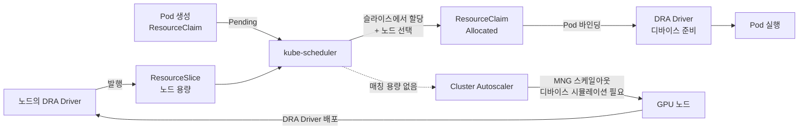
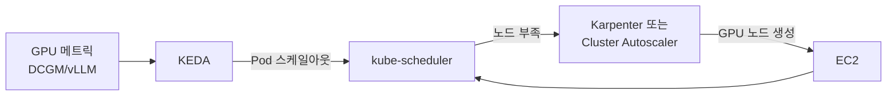
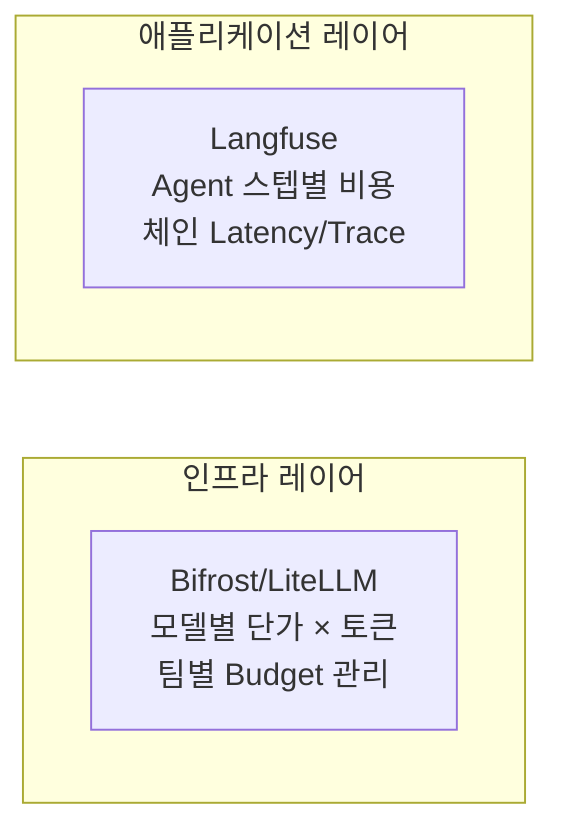

import Tabs from '@theme/Tabs';
import TabItem from '@theme/TabItem';
import { SpecificationTable, ComparisonTable } from '@site/src/components/tables';
import { DraLimitationsTable, ScalingDecisionTable } from '@site/src/components/GpuResourceTables';
import {
  SpotInstancePricingInference,
  SavingsPlansPricingTraining,
  CostOptimizationStrategies,
  KarpenterGpuOptimization
} from '@site/src/components/AgenticSolutionsTables';

EKS 환경에서 GPU 리소스를 관리하는 전략은 크게 세 가지 축으로 구성됩니다.

| 축 | 핵심 질문 | 주요 기술 |
|---|---|---|
| **프로비저닝** | 어떤 GPU 노드를 언제 생성하는가? | Karpenter, EKS Auto Mode, Managed Node Group |
| **스케줄링** | GPU Pod를 어떤 노드에 배치하는가? | Device Plugin, DRA, Topology-Aware Routing |
| **스케일링** | 트래픽 변화에 어떻게 대응하는가? | KEDA, HPA, Cluster Autoscaler |

이 문서는 각 축의 아키텍처와 설계 판단 기준을 다룹니다. GPU Operator 상세(ClusterPolicy, DCGM, MIG, Time-Slicing, Dynamo, KAI Scheduler 등 NVIDIA 소프트웨어 스택)는 [NVIDIA GPU 스택](./nvidia-gpu-stack.md)을 참조하세요.

---

## Karpenter GPU NodePool

:::info Karpenter GA (v1.0+)
Karpenter는 v1.0부터 GA 상태이며, 본 문서의 모든 예제는 `karpenter.sh/v1` API를 사용합니다. DRA allocator는 코어(`kubernetes-sigs/karpenter`) v1.14.0에 추가되었고, 이를 포함한 AWS Provider(`karpenter-provider-aws`) **v1.14.0**도 2026-07-11에 릴리스되었습니다. `ignoreDRARequests`를 `false`로 설정하면 self-managed Karpenter v1.14.0+는 이미 존재하는 GPU 노드로 Pod를 스케줄링할 때 DRA 요청을 **반영(account for)** 합니다. 이 컨트롤러 설정 `ignoreDRARequests`는 **기본값 `true`(DRA 요청 무시)** 이므로, DRA 스케줄링이 동작하려면 반드시 `false`로 바꿔야 합니다. DRA 요청만으로 새 GPU 노드를 직접 프로비저닝하는 것은 AWS에서 아직 검증되지 않은 별개의 경로입니다(아래 [노드 프로비저닝 호환성](#노드-프로비저닝-호환성)과 [Karpenter DRA 활성화 파라미터](#karpenter-dra-활성화-파라미터-v1140) 참조).
:::

### GPU 노드 자동 프로비저닝 개념

Karpenter는 Pending Pod의 리소스 요청(`nvidia.com/gpu`, 메모리, CPU)을 분석하여 최적의 EC2 인스턴스를 자동으로 프로비저닝합니다. GPU 워크로드에서 Karpenter의 핵심 가치는 다음과 같습니다.

- **인스턴스 다양성**: 단일 NodePool에서 p4d, p5, g5, g6e 등 다양한 GPU 인스턴스를 지원
- **Spot/On-Demand 혼합**: capacity-type으로 비용과 안정성 균형 조절
- **Consolidation**: 유휴 GPU 노드를 자동으로 정리하여 비용 절감
- **Taint 기반 격리**: GPU 노드에 `nvidia.com/gpu` taint를 설정하여 비GPU 워크로드 배제

### NodePool 설정 예시

```yaml
apiVersion: karpenter.sh/v1
kind: NodePool
metadata:
  name: gpu-inference-pool
spec:
  template:
    metadata:
      labels:
        node-type: gpu-inference
        workload: genai
    spec:
      requirements:
        - key: kubernetes.io/arch
          operator: In
          values: ["amd64"]
        - key: karpenter.sh/capacity-type
          operator: In
          values: ["on-demand", "spot"]
        - key: node.kubernetes.io/instance-type
          operator: In
          values:
            - p4d.24xlarge    # 8x A100 40GB
            - p5.48xlarge     # 8x H100 80GB
            - g5.48xlarge     # 8x A10G 24GB
        - key: karpenter.k8s.aws/instance-gpu-count
          operator: Gt
          values: ["0"]
      nodeClassRef:
        group: karpenter.k8s.aws
        kind: EC2NodeClass
        name: gpu-nodeclass
      taints:
        - key: nvidia.com/gpu
          value: "true"
          effect: NoSchedule
  limits:
    cpu: 1000
    memory: 4000Gi
    nvidia.com/gpu: 64
  disruption:
    consolidationPolicy: WhenEmptyOrUnderutilized
    consolidateAfter: 30s
  weight: 100
```

**설계 포인트:**

- `limits.nvidia.com/gpu: 64` — **이 NodePool** 단위의 리소스 상한입니다. `limits`는 클러스터 전체가 아니라 해당 NodePool이 프로비저닝하는 리소스 총량을 제한하므로, 클러스터 전체 상한이 필요하면 모든 GPU NodePool에 같은 상한을 두거나 별도 `ResourceQuota`를 사용해야 합니다. 풀의 총량이 상한을 넘게 되는 시점부터 Karpenter는 프로비저닝을 멈춥니다.
- `disruption.consolidateAfter: 30s` — Karpenter가 비었거나 저활용으로 판단한 노드를 **자발적으로(voluntary)** 통합하기까지의 지연입니다. 이는 자발적 중단에만 적용되며, EC2가 2분 알림과 함께 독립적으로 수행하는 **비자발적(involuntary)** Spot 회수에는 영향을 주지 않습니다. 값이 짧으면 유휴 GPU 비용을 빠르게 회수하지만 노드 교체(churn)가 늘어납니다.
- `weight: 100` — 여러 NodePool이 같은 Pod를 만족할 수 있을 때의 상대 우선순위이며, 값이 클수록 먼저 선택됩니다.
- 워크로드별 분리: 추론은 On-Demand + `WhenEmpty`(완전히 빈 노드만 통합), 훈련은 `[spot, on-demand]` + `consolidateAfter: 30m`으로 장시간 작업 중 자발적 교체를 줄입니다. 어느 설정도 비자발적 Spot 중단 자체를 막지는 못하므로, 훈련은 체크포인트와 재개가 여전히 필요합니다(회수된 노드의 Pod는 다른 곳에서 재시작됩니다).

### EC2NodeClass 설정 예시

```yaml
apiVersion: karpenter.k8s.aws/v1
kind: EC2NodeClass
metadata:
  name: gpu-nodeclass
spec:
  amiSelectorTerms:
    - alias: al2023@latest   # family@version 형식 필수. 맨 "al2023"은 CRD 검증에서 거부됨
  role: KarpenterNodeRole-eks-genai-cluster
  subnetSelectorTerms:
    - tags:
        karpenter.sh/discovery: eks-genai-cluster
        subnet-type: private
  securityGroupSelectorTerms:
    - tags:
        karpenter.sh/discovery: eks-genai-cluster
  blockDeviceMappings:
    - deviceName: /dev/xvda
      ebs:
        volumeSize: 200Gi
        volumeType: gp3
        iops: 16000
        throughput: 1000
        encrypted: true
        deleteOnTermination: true
  metadataOptions:
    httpEndpoint: enabled
    httpPutResponseHopLimit: 2
    httpTokens: required  # IMDSv2
  tags:
    Environment: production
    ManagedBy: karpenter
```

### GPU 인스턴스 타입 비교

<ComparisonTable
  headers={['인스턴스 타입', 'GPU', 'GPU 메모리', 'vCPU', '메모리', '네트워크', '용도']}
  rows={[
    { id: '1', cells: ['p4d.24xlarge', '8x A100', '40GB x 8', '96', '1152 GiB', '400 Gbps EFA', '대규모 LLM 추론'], recommended: true },
    { id: '2', cells: ['p5.48xlarge', '8x H100', '80GB x 8', '192', '2048 GiB', '3200 Gbps EFA', '초대규모 모델, 학습'] },
    { id: '3', cells: ['p5e.48xlarge', '8x H200', '141GB x 8', '192', '2048 GiB', '3200 Gbps EFA', '대규모 모델 학습/추론'] },
    { id: '4', cells: ['g5.48xlarge', '8x A10G', '24GB x 8', '192', '768 GiB', '100 Gbps', '중소규모 모델 추론'] },
    { id: '5', cells: ['g6e.xlarge ~ g6e.48xlarge', 'NVIDIA L40S', '최대 8x48GB', '최대 192', '최대 768 GiB', '최대 100 Gbps', '비용 효율적 추론'] },
    { id: '6', cells: ['trn2.48xlarge', '16x Trainium2', '-', '192', '2048 GiB', '3200 Gbps', 'AWS 네이티브 학습'] }
  ]}
/>

:::tip 인스턴스 선택 가이드
- **p5e.48xlarge**: 100B+ 파라미터 모델, H200의 최대 메모리 활용
- **p5.48xlarge**: 70B+ 파라미터 모델, 최고 성능 요구 시
- **p4d.24xlarge**: 13B-70B 파라미터 모델, 비용 대비 성능 균형
- **g6e**: 13B-70B 모델, L40S의 비용 효율적 추론
- **g5.48xlarge**: 7B 이하 모델, 비용 효율적인 추론
- **trn2.48xlarge**: AWS 네이티브 학습 워크로드
:::

:::tip EKS Auto Mode
EKS Auto Mode는 노드 프로비저닝을 관리하지만, **기본 제공(built-in)** NodePool 두 개(`general-purpose`, `system`)는 가속(GPU) 인스턴스 패밀리를 제외하므로 GPU 노드를 띄우지 않습니다. Auto Mode에서 GPU 워크로드를 실행하려면 GPU 인스턴스를 선택하고(예: `karpenter.k8s.aws/instance-gpu-count` 요구사항) Auto Mode가 GPU 노드에 적용하는 `nvidia.com/gpu` taint를 toleration으로 허용하는 **사용자 정의 NodePool**을 만들어야 합니다. 적격한 GPU NodePool이 있어야 Auto Mode가 Pod의 리소스 요청에 따라 인스턴스를 프로비저닝합니다. EKS 문서의 [기본 노드 풀](https://docs.aws.amazon.com/eks/latest/userguide/set-builtin-node-pools.html)과 [Auto Mode 가속 워크로드](https://docs.aws.amazon.com/eks/latest/userguide/auto-accelerated.html)를 참조하세요.
:::

---

## Kubernetes GPU 스케줄링

### Device Plugin 모델

Kubernetes에서 GPU를 사용하는 기본 방식은 NVIDIA Device Plugin입니다. kubelet에 `nvidia.com/gpu` 확장 리소스를 등록하고, Pod는 `resources.requests`에 GPU 수를 지정합니다.

```yaml
resources:
  requests:
    nvidia.com/gpu: 1
  limits:
    nvidia.com/gpu: 1
```

Device Plugin은 단순하고 안정적입니다. NVIDIA Device Plugin의 공유 GPU 구성을 사용하면 전체 GPU뿐 아니라 **GPU 하위 단위** — MIG 파티션, Time-Slicing 복제본, MPS 슬라이스 — 도 노출할 수 있습니다. 한계는 리소스를 *어떻게* 선택·바인딩하는가에 있습니다. 각 공유 모드는 노드 시작 시 고정되는 정적으로 명명된 `nvidia.com/gpu` 형태의 리소스이므로, Pod가 속성 기반 요구사항(예: "20GB 이상인 MIG 프로필", "특정 GPU 모델")을 표현할 수 없고, 플러그인이 스케줄링 시점에 여러 리소스 타입에 걸쳐 선택을 조율하지도 못합니다. 아래에서 다루는 DRA는 이 속성 기반·Pod 시점 선택을 추가합니다.

### Topology-Aware Routing

`trafficDistribution: PreferSameZone`는 Kubernetes **Service**가 준비된(ready) 엔드포인트 중에서 선택하는 방식을 제어합니다. kube-proxy가 클라이언트와 같은 가용 영역의 엔드포인트를 우선하고, 해당 영역에 준비된 엔드포인트가 없으면 다른 영역으로 폴백합니다. 즉 **클라이언트→Service** 요청 라우팅에 영향을 주며(예: 게이트웨이가 vLLM Service를 호출하는 홉), 그 홉의 교차 AZ 데이터 전송 비용과 지연을 줄일 수 있습니다. 멀티 노드 텐서 병렬화 트래픽의 전송 경로는 **아닙니다**. GPU 워커 간 집합 통신(collective)은 NCCL/EFA/RDMA로 Pod 간 직접 이뤄지며, Service 엔드포인트 선택이 아니라 스케줄링(노드 어피니티, 토폴로지 인식 스케줄링, Gang Scheduling)으로 배치가 결정됩니다. `PreferSameZone`은 Kubernetes 1.33부터 제공되는 Service 스펙 필드이며(stable; 기존 `topology.kubernetes.io/zone` 기반 어노테이션 방식을 대체), 분산 워크로드의 지연 개선은 결국 워커 자체의 co-location에 달려 있으므로 처리량 향상을 보장하는 기능이 아니라 요청 라우팅의 지역성(locality)으로 이해해야 합니다.

```yaml
apiVersion: v1
kind: Service
metadata:
  name: vllm-inference
spec:
  selector:
    app: vllm
  ports:
    - port: 8000
  trafficDistribution: PreferSameZone
```

:::caution trafficDistribution 필드 사용
- `PreferSameZone`이 표준입니다 (`PreferClose`는 deprecated alias).
- 어노테이션 `service.kubernetes.io/topology-mode: Auto`를 함께 사용하면 어노테이션이 `trafficDistribution` 필드보다 우선하므로 필드가 무시됩니다. 어노테이션은 향후 deprecated 예정이므로 `trafficDistribution` 필드만 사용하세요.
:::

### Gang Scheduling

대규모 LLM 학습이나 텐서 병렬화 추론에서는 여러 GPU Pod가 **동시에** 스케줄링되어야 합니다. 일부만 배치되면 나머지가 Pending 상태로 리소스를 점유하는 교착 상태가 발생합니다.

**해결 방법:**
- **Coscheduling Plugin** (scheduler-plugins): PodGroup CRD로 최소 Pod 수를 지정하여 all-or-nothing 스케줄링
- **Volcano**: 배치 스케줄러로 Gang Scheduling 네이티브 지원
- **KAI Scheduler**: NVIDIA의 GPU-aware 스케줄러로 GPU 토폴로지 인식 Gang Scheduling (상세는 [NVIDIA GPU 스택](./nvidia-gpu-stack.md#kai-scheduler) 참조)

---

## DRA (Dynamic Resource Allocation)

### 개념과 필요성

DRA는 Device Plugin의 한계를 극복하는 Kubernetes의 리소스 할당 패러다임입니다. DRA 자체는 GPU 전용이 아니라 NIC·인터커넥트·FPGA 등 특수 디바이스 전반을 다루는 범용 프레임워크이며, 핵심 API 모델(DeviceClass·ResourceClaim·ResourceSlice)과 리소스 유형별 드라이버 생태계는 [Kubernetes DRA](../../../eks-best-practices/resource-cost/kubernetes-dra.md)에서 다룹니다. 본 섹션은 **EKS GPU 환경의 DRA 운영** 관점에 집중합니다.

<DraLimitationsTable />

:::info DRA 성숙도
DRA 코어는 K8s 1.34에서 GA(`resource.k8s.io/v1`, 기본 활성화)되었고 1.35에서 locked-to-default입니다. 버전 히스토리와 기능별 성숙도는 [Kubernetes DRA — 버전 히스토리](../../../eks-best-practices/resource-cost/kubernetes-dra.md#버전-히스토리)를 참조하세요.
:::

### GPU 할당 흐름

DRA는 **선언적 리소스 요청**(ResourceClaim)과 **할당 결정**을 분리하며, 할당 결정은 드라이버가 아니라 `kube-scheduler`가 내립니다. DRA 드라이버의 역할은 각 노드가 제공하는 것을 ResourceSlice로 **발행(publish)**하고, Pod가 바인딩된 뒤 노드에서 디바이스를 **준비(prepare)**하는 것입니다. 스케줄러는 Pod의 ResourceClaim(예: "H100 GPU 1개, MIG 3g.20gb 프로필")을 발행된 슬라이스와 CEL로 평가해 할당을 ResourceClaim status에 기록합니다. API 오브젝트 모델과 CEL 매칭의 일반 원리는 [Kubernetes DRA — 핵심 모델](../../../eks-best-practices/resource-cost/kubernetes-dra.md#dra-핵심-모델)을 참조하세요. 아래는 EKS에서 노드 스케일아웃이 결합된 이 순서를 보여줍니다. 0에서의 스케일아웃은 아직 생성되지 않은 노드가 발행할 디바이스를 오토스케일러가 시뮬레이션할 수 있는지에 추가로 의존합니다([노드 프로비저닝 호환성](#노드-프로비저닝-호환성) 참조).



### DRA vs Device Plugin 비교

<ComparisonTable
  headers={['항목', 'Device Plugin', 'DRA']}
  rows={[
    { id: '1', cells: ['리소스 할당', '노드 시작 시 정적 등록', 'Pod 스케줄링 시 동적 할당'] },
    { id: '2', cells: ['할당 단위', '전체 GPU, 또는 정적으로 사전 구성한 MIG / Time-Slicing / MPS 단위', 'Pod별로 동적 요청하는 GPU 분할 (MIG, Time-Slicing)'] },
    { id: '3', cells: ['속성 기반 선택', '불가 (고정된 리소스 이름)', 'CEL 표현식으로 GPU 속성 매칭'] },
    { id: '4', cells: ['멀티 리소스 조율', '불가', 'Pod 수준에서 여러 리소스 동시 조율'] },
    { id: '5', cells: ['Karpenter 호환', '완전 지원', 'v1.14.0+에서 기존 노드로의 스케줄링 지원(ignoreDRARequests=false). AWS에서 DRA 기반 0→스케일아웃은 미검증, v1.13 이하 미지원'] },
    { id: '6', cells: ['성숙도', '프로덕션', 'K8s 1.34+ GA'], recommended: true }
  ]}
/>

### 노드 프로비저닝 호환성

:::warning DRA 노드 프로비저닝 호환성 (2026-08-03로 고정한 AWS EKS 가이드 기준)

AWS의 EKS 디바이스 관리 가이드는 **정적으로 프로비저닝된(static)** 용량(이미 존재하는 노드)과 **동적으로 프로비저닝된(dynamic)** 용량(요청 시 생성되는 노드)을 구분합니다. 고정한 날짜 기준으로, DRA는 정적 용량에서는 동작하지만 동적 Karpenter 생성 용량이나 EKS Auto Mode에서는 동작하지 않는다고 명시합니다.

| 노드 프로비저닝 | 기존(정적) 노드에서의 DRA | DRA 기반 스케일업(새 노드) | 비고 |
|---|---|---|---|
| **Managed Node Group** | ✅ 지원 | ⚠️ DRA 시뮬레이션을 갖춘 Cluster Autoscaler(CA 1.34+)로만 가능. DRA 드라이버 설치와 ResourceSlice 시뮬레이션 가능 여부 필요 | Pod는 기존 적격 노드에 배치됨. 0→스케일업은 새 노드가 발행할 디바이스를 오토스케일러가 시뮬레이션할 수 있어야 함 |
| **Self-Managed Node Group** | ✅ 지원 | ⚠️ MNG와 동일한 CA 의존성 | 노드·드라이버 수동 구성 필요 |
| **Self-managed Karpenter v1.14.0+** | ✅ `ignoreDRARequests=false`로 기존 노드에 스케줄링 | ❌ AWS에서 0→스케일아웃은 아직 검증된 경로 아님 | 코어 v1.14.0이 DRA allocator 포함([PR #3113](https://github.com/kubernetes-sigs/karpenter/pull/3113))하지만, AWS provider가 아직 생성되지 않은 인스턴스의 template device를 채우지 않으므로 DRA 요청만으로 새 GPU 노드를 프로비저닝하는 것은 미검증. [Karpenter DRA 범위](#karpenter-dra-활성화-파라미터-v1140) 참조 |
| **Self-managed Karpenter v1.13 이하** | ❌ 미지원 | ❌ 미지원 | `spec.resourceClaims` 있는 Pod를 skip ([PR #2384](https://github.com/kubernetes-sigs/karpenter/pull/2384)) |
| **EKS Auto Mode** | ❌ 미지원 | ❌ 미지원 | AWS 현행 가이드가 Auto Mode의 DRA 미지원을 명시. AWS가 내부 Karpenter 버전을 공개하지 않으므로, 추정된 버전 임계값이 아니라 AWS의 지원 명시로 이해해야 함 |
:::

**버전별 동작 차이:**

DRA allocator는 코어 Karpenter v1.14.0에 병합되었고, 이를 포함한 AWS Provider v1.14.0은 2026-07-11에 릴리스되었습니다. self-managed Karpenter v1.14.0+를 `ignoreDRARequests=false`로 설치하면, 이미 존재하는 노드로 스케줄링할 때 Karpenter가 DRA 요청을 **반영**합니다. **새** GPU 노드를 DRA 요청으로부터 직접 프로비저닝하는 것은 다음 구조적 제약 때문에 더 어려운 문제입니다.

1. **ResourceSlice는 노드 존재 후 생성**: DRA 드라이버는 실행 중인 노드에서 GPU를 탐지한 후에야 ResourceSlice를 발행하는데, 프로비저너는 노드 생성 *전에* 이 정보가 필요합니다 (닭과 달걀 문제)
2. **정적 인스턴스→ResourceSlice 매핑 부재**: Device Plugin에서는 `p5.48xlarge → nvidia.com/gpu: 8`을 정적으로 알 수 있지만, DRA에서는 발행 내용이 드라이버 구현에 따라 달라집니다
3. **시뮬레이션에 template device 필요**: 노드 생성 전에 CEL 표현식을 평가하려면 프로비저너가 새 노드가 발행할 디바이스를 합성해야 합니다

코어 v1.14.0 allocator는 이 시뮬레이션 장치를 추가하지만, AWS에서는 provider의 InstanceType 구성이 아직 그 template device를 채우지 않으므로, Karpenter에서의 DRA 기반 0→스케일아웃은 고정한 날짜 기준으로 **검증된 경로가 아닙니다**. 오늘 0에서 스케일해야 하는 용량에는 **MNG + Cluster Autoscaler(CA 1.34+)** 가 문서화된 방식입니다. CA 1.34는 DRA 인식 시뮬레이터(`simulator/dynamicresources/provider`)를 포함하므로, Pending Pod에 맹목적으로 반응하는 것이 아니라 ResourceClaim을 실제로 평가합니다. 다만 fit 검사가 성공하려면 DRA 드라이버와 시뮬레이션 가능한 ResourceSlice가 갖춰져 있어야 합니다. **EKS Auto Mode**는 현행 AWS 가이드 기준 DRA를 지원하지 않습니다.

### Karpenter DRA 활성화 파라미터 (v1.14.0+)

Karpenter v1.14.0+는 DRA allocator 코드를 내장하지만, **컨트롤러가 기본적으로 DRA 요청을 무시**하도록 배포됩니다. self-managed Karpenter가 GPU 노드로 스케줄링할 때 DRA 요청을 반영하게 하려면 아래 파라미터를 명시적으로 설정해야 합니다. 이는 DRA 인식 **스케줄링**을 켜는 것이며, AWS에서 DRA 요청만으로 새 GPU 노드를 직접 프로비저닝할 수 있는지는 별개의 현재 미검증 기능입니다(AWS provider가 노드 생성 전 시뮬레이션에 필요한 template device를 채우지 않습니다).

| 계층 | 파라미터 | 기본값 | DRA 사용 시 설정 |
|---|---|---|---|
| **Karpenter 컨트롤러** | `settings.ignoreDRARequests` (env `IGNORE_DRA_REQUESTS`) | `true` (DRA 요청 무시) | **`false`** — 스케줄링 시뮬레이션에서 Pod의 DRA 요청을 반영 |
| **Karpenter 버전** | core + provider-aws | — | **v1.14.0+** (v1.13 이하는 `spec.resourceClaims` Pod skip) |

```yaml
# Karpenter Helm values (karpenter-provider-aws v1.14.0+)
settings:
  # 기본값 true(DRA 요청 무시)를 false로 전환해야 DRA 스케줄링 시뮬레이션이 동작
  ignoreDRARequests: false
```

```bash
# 기존 설치 업그레이드 시
helm upgrade karpenter oci://public.ecr.aws/karpenter/karpenter \
  --version "1.14.0" \
  --namespace kube-system \
  --reuse-values \
  --set settings.ignoreDRARequests=false
```

:::caution `ignoreDRARequests`는 임시 플래그
Karpenter 공식 문서는 이 플래그에 대해 "**정식 DRA 지원이 GA되면 제거될 예정**"이라고 명시합니다. 즉 현재(v1.14.x)의 DRA 지원은 초기 단계이며, 향후 버전에서 기본 활성화되면서 플래그 자체가 사라질 수 있습니다. 업그레이드 시 릴리스 노트를 확인하세요.
:::

:::info NodePool 스펙은 변경 불필요
Karpenter 업그레이드 가이드의 "DRA는 additive하며 기존 NodePool 설정 변경이 필요 없다"는 문구는 **NodePool CRD 스펙**에 관한 것입니다. 위 `ignoreDRARequests`는 **컨트롤러 전역 설정**으로 별개이며, DRA를 쓰려면 반드시 전환해야 합니다.
:::

이 Karpenter 설정만으로는 GPU가 할당되지 않습니다. DRA로 GPU를 실제 광고·할당하는 주체는 **NVIDIA DRA 드라이버**이므로, 아래 클러스터·드라이버 계층 파라미터도 함께 갖춰져야 합니다.

### DRA 스택 전체 파라미터 (3계층)

DRA로 GPU를 사용하려면 **노드 프로비저닝(Karpenter) + 클러스터 DRA 활성화 + NVIDIA DRA 드라이버** 세 계층의 파라미터가 모두 충족되어야 합니다.

| 계층 | 파라미터 | 기본값 | DRA 사용 시 설정 |
|---|---|---|---|
| **1. K8s 피처게이트** | `DynamicResourceAllocation` | K8s 1.34+ 기본 on | on (1.33 이하는 kube-apiserver·scheduler·controller-manager·kubelet 전부 `--feature-gates=DynamicResourceAllocation=true`) |
| **1. K8s API 그룹** | `--runtime-config=resource.k8s.io/v1=true` | 1.34+ 기본 서빙 | 서빙 (EKS는 컨트롤 플레인 관리 — 클러스터 1.34/1.35면 자동) |
| **2. 노드 프로비저닝** | Karpenter `ignoreDRARequests` | `true` | **`false`** (위 표 참조) |
| **3. NVIDIA DRA 드라이버 GPU 할당** | 오버라이드 게이트 `gpuResourcesEnabledOverride` (최상위) | **`false`** | **`true`** — GPU 할당 서브시스템을 켬. 서브시스템 필드 `resources.gpus.enabled` 자체는 기본 `true`(차트 v25.12.0) |
| **3. Device Plugin 비활성화** | GPU Operator `devicePlugin.enabled` | `true` | **`false`** (DRA 드라이버와 충돌 방지) |
| **3. 컨테이너 런타임 CDI** | containerd/CRI-O CDI | GPU Operator v25.10+ 기본 on | enabled (호환되는 NVIDIA 드라이버 필요 — 정확한 최소 버전은 드라이버 릴리스 노트 확인) |

```bash
# NVIDIA DRA 드라이버 설치 (차트 v25.12.0) — GPU 할당을 여는 오버라이드 게이트 설정
helm install nvidia-dra-driver-gpu nvidia/nvidia-dra-driver-gpu \
  --version 25.12.0 \
  --namespace nvidia-dra-driver-gpu --create-namespace \
  --set gpuResourcesEnabledOverride=true \
  --set nvidiaDriverRoot=/run/nvidia/driver   # 호스트 설치 드라이버는 "/", GPU Driver Container는 "/run/nvidia/driver"

# GPU Operator는 Device Plugin을 끄고 배포 (DRA 드라이버와 GPU 할당 충돌 방지)
helm upgrade -i gpu-operator nvidia/gpu-operator \
  --namespace gpu-operator --create-namespace \
  --set devicePlugin.enabled=false
```

:::warning GPU 할당 서브시스템은 오버라이드로 가려져 있고 초기 단계입니다
NVIDIA DRA 드라이버(`nvidia-dra-driver-gpu`)는 **GPU 할당**(`resources.gpus.enabled`)과 **ComputeDomain**/Multi-Node NVLink(`resources.computeDomains.enabled`) 두 서브시스템으로 구성됩니다. 차트 v25.12.0에서 두 서브시스템 필드는 모두 기본 `true`지만, **GPU 할당은 별도 최상위 게이트 `gpuResourcesEnabledOverride` 뒤에 가려져 있고 그 기본값이 `false`** 이므로, 이 오버라이드를 `true`로 설정하기 전까지 GPU 할당은 꺼진 상태입니다. DRA를 통한 GPU 할당은 (오래 안정화된 ComputeDomain 경로와 구별되는) 드라이버의 비교적 새로운 기능이므로, 프로덕션에 쓰기 전에 차트 버전을 고정하고 해당 버전의 README·values를 확인하세요. `nvidiaDriverRoot`는 드라이버가 실제 위치하는 곳에 맞춰 설정합니다(호스트 설치 드라이버는 `/`, GPU Driver Container는 `/run/nvidia/driver`).
:::

### DRA 선택 가이드

:::tip 언제 DRA를 사용하는가
**DRA가 더 적합한 경우:**
- **속성 기반·Pod별** GPU 선택이 필요할 때 — 예: 멀티 테넌트 클러스터에서 GPU 모델이나 MIG 프로필을 CEL로 매칭. (MIG·Time-Slicing·MPS 자체는 Device Plugin의 공유 GPU 구성으로도 사용 가능하며, DRA는 이를 동적·표현식 기반으로 선택하는 기능을 더합니다.)
- 여러 디바이스 타입을 Pod 수준에서 조율하거나, 토폴로지 인식 배치(NVLink, NUMA)를 claim 제약으로 표현해야 할 때.
- 플랫폼이 **요구**할 때: 예를 들어 P6e-GB200 UltraServer의 GPU 할당은 DRA 기반으로 문서화되어 있습니다.

**Device Plugin으로 충분한 경우:**
- 전체 GPU, 또는 노드 설정 시 결정한 고정 MIG/Time-Slicing 레이아웃을 Pod별 속성 선택 없이 할당할 때.
- EKS Auto Mode를 쓰거나, DRA가 지원되는 프로비저닝 경로가 아닌 Karpenter/K8s 조합일 때.

**Kubernetes 버전은 의무가 아니라 자격의 문제입니다:** DRA 코어는 K8s 1.34에서 GA되었으므로 1.34+는 DRA를 *허용*하지만, 전체 GPU 요구만 있는 1.34 클러스터는 Device Plugin을 계속 쓸 수 있습니다. 마찬가지로 K8s 1.33 이하는 DRA를 쓸 수 없다는 뜻이지, 필수 기능을 놓치고 있다는 뜻은 아닙니다.
:::

---

## KEDA GPU 기반 오토스케일링

### 스케일링 아키텍처

GPU 워크로드의 오토스케일링은 **2단계 체인**으로 동작합니다.



1. **워크로드 스케일링 (KEDA/HPA)**: GPU 메트릭을 기반으로 Pod 수를 조정
2. **노드 스케일링 (Karpenter/CA)**: Pending Pod 발생 시 GPU 노드 자동 프로비저닝

### LLM 서빙 메트릭 기반 ScaledObject

LLM 서빙에서는 단순 GPU 사용률보다 **KV cache 포화율**, **TTFT**, **대기 큐 길이**가 더 민감한 스케일링 시그널입니다.

```yaml
apiVersion: keda.sh/v1alpha1
kind: ScaledObject
metadata:
  name: llm-serving-scaler
spec:
  scaleTargetRef:
    name: llm-serving
  minReplicaCount: 2
  maxReplicaCount: 10
  triggers:
    # KV Cache 포화 — LLM 서빙의 가장 민감한 시그널
    - type: prometheus
      metadata:
        query: avg(vllm:kv_cache_usage_perc{model="exaone"})
        threshold: "80"
    # 대기 중인 요청 수
    - type: prometheus
      metadata:
        query: sum(vllm:num_requests_waiting{model="exaone"})
        threshold: "10"
    # TTFT SLO 위반 근접
    - type: prometheus
      metadata:
        query: |
          histogram_quantile(0.95,
            rate(vllm_time_to_first_token_seconds_bucket[5m]))
        threshold: "2"
```

### Disaggregated Serving 스케일링 기준

Prefill과 Decode를 분리 운영하는 경우, 각 역할의 병목 시그널이 다릅니다.

| | Prefill | Decode |
|---|---|---|
| **병목 시그널** | TTFT 증가, 입력 큐 적체 | TPS 감소, KV Cache 포화 |
| **스케일 기준** | 입력 토큰 처리 대기시간 | 동시 생성 세션 수 |
| **스케일 단위** | GPU compute 집약 | GPU memory 집약 |

### 스케일링 임계값 권장

<SpecificationTable
  headers={['워크로드 유형', 'Scale Up 임계값', 'Scale Down 임계값', 'Cooldown']}
  rows={[
    { id: '1', cells: ['실시간 추론', 'GPU 70%', 'GPU 30%', '60초'] },
    { id: '2', cells: ['배치 처리', 'GPU 85%', 'GPU 40%', '300초'] },
    { id: '3', cells: ['대화형 서비스', 'GPU 60%', 'GPU 25%', '30초'] }
  ]}
/>

### DRA 워크로드의 스케일아웃

DRA 워크로드의 노드 스케일아웃은 **self-managed Karpenter v1.14.0+(`ignoreDRARequests=false`)** 또는 **MNG + Cluster Autoscaler**로 구성합니다. EKS Auto Mode는 내부 Karpenter 버전을 올릴 수 없어 후자가 필요합니다. 아래는 MNG + Cluster Autoscaler + KEDA 조합의 흐름입니다.

```
LLM 메트릭 (KV Cache, TTFT, Queue)
  → KEDA: Pod 스케일아웃
    → kube-scheduler: ResourceClaim 매칭 시도
      ├─ 성공 → 기존 노드에 배치
      └─ 실패 → Pod Pending
           → Cluster Autoscaler: MNG +1
             → 새 GPU 노드 → DRA Driver 설치
               → ResourceSlice 생성 → Pod 배치
```

---

## 비용 최적화 전략

### GPU 워크로드 비용 비교

아래 가격은 실시간 견적이 아니라 **예시용 참고치**입니다. On-Demand·Spot 가격은 리전과 시점에 따라 달라지고, Spot은 고정 요율이 아니라 변동하는 평균이며, Savings Plans 할인은 약정 기간과 결제 옵션에 따라 다릅니다. 최신 수치는 [EC2 가격 페이지](https://aws.amazon.com/ec2/pricing/)와 사용 계정에서 확인하세요.

#### 추론 워크로드 (시간당)

<SpotInstancePricingInference />

#### 학습 워크로드 (시간당)

<SavingsPlansPricingTraining />

### 비용 최적화 전략별 효과

<CostOptimizationStrategies />

### Karpenter 기반 4대 비용 최적화 전략

<KarpenterGpuOptimization />

아래 범위는 **측정값이 아니라 계획용 참고치**입니다. 실제 절감은 기준 인스턴스 구성, 활용률, 리전, 약정 조건에 따라 달라지므로, "어디를 볼지"의 출발점으로 삼고 자신의 On-Demand 기준선과 비교해 측정하세요.

| 전략 | 핵심 메커니즘 | On-Demand 대비 참고 절감 | 적용 대상 |
|------|-------------|----------|----------|
| **Spot 인스턴스 우선** | `capacity-type: spot` + 다양한 인스턴스 타입 지정 | Spot 비중에 대해 최대 ~60-90% (리전/용량에 따라 변동) | 중단 허용 추론(stateless) 워크로드 |
| **시간대별 Disruption Budget** | 업무 시간 `nodes: 10%`, 비업무 시간 `nodes: 50%` | 비업무 시간에 실제로 유휴인 용량 규모에 따라 다름 | 업무 시간 패턴이 뚜렷한 서비스 |
| **Consolidation** | `WhenEmptyOrUnderutilized` + `consolidateAfter: 30s` | 유휴 노드 비용 회수. 크기는 단편화 정도에 따라 다름 | 모든 GPU 워크로드 |
| **워크로드별 인스턴스 최적화** | 소형 모델→g5, 대형 모델→p5, weight로 우선순위 | 과다 프로비저닝 방지. 크기는 현재 낭비 정도에 따라 다름 | 다양한 모델 크기 운영 |

`disruption.budgets`의 `nodes: 10%` 같은 항목은 **자발적 중단의 상한**입니다 — Karpenter가 한 번에 통합할 수 있는 노드 수를 제한할 뿐, 그 자체로 스케줄에 맞춰 용량을 줄이지는 않습니다. 비업무 시간에 용량을 줄이려면 워크로드(그리고 그것이 요구하는 노드)의 스케줄 기반 스케일링과 결합해야 합니다.

:::tip 비용 최적화 조합 (예시 계산, 보장 아님)
아래 조합 수치는 가상의 기준선에 대한 **산술 예시**이며 측정되거나 보장된 결과가 아닙니다. 또한 각 전략의 백분율은 서로 다른 겹치는 비용 기준에 적용되므로 **단순 합산할 수 없습니다**. 수치를 인용하기 전에 실제 청구 데이터로 검증하세요.

**추론 예시:** 추론 용량의 약 70%가 Spot에서 실행되어 그 부분에서 ~70%를 절감하고, Consolidation과 비업무 시간 스케일링이 남은 On-Demand 기준을 줄인다면 *혼합* 절감률은 전부 On-Demand로 쓰는 청구액의 큰 비율에 근접할 수 있습니다 — 백분율을 더하지 말고 실제 분배 비율로 계산하세요.

**학습 예시:** 안정적인 학습 용량에 1년 Savings Plan 약정을 적용하고, 중단 허용 실험에는 Spot(체크포인트/재개 포함)을 쓰면 약정 할인과 Spot 가격이 혼합됩니다. 순효과는 약정 대 Spot 비율에 따라 달라집니다.
:::

### LLMOps 비용 거버넌스

인프라 비용과 함께 **토큰 레벨 비용**도 추적해야 완전한 비용 가시성을 확보할 수 있습니다.



- **인프라 레이어** (Bifrost/LiteLLM): 모델별 토큰 단가, 팀/프로젝트별 예산 할당, 월간 비용 리포트
- **애플리케이션 레이어** (Langfuse): Agent 워크플로우 단계별 토큰 소비, end-to-end 비용, Trace 기반 병목 분석

:::warning Spot 인스턴스 주의사항
- **중단 처리**: EC2는 인스턴스 회수 **최대 2분 전**에 Spot 중단 알림을 보내지만, 이는 **best-effort**입니다 — 알림이 더 짧은 여유를 두고 오거나 드물게 오지 않을 수 있고, 2분은 그 이후 인스턴스가 강제 종료되는 하드 데드라인입니다. `terminationGracePeriodSeconds`와 `preStop` hook으로 드레이닝하되, kubelet이 데드라인 전에 끝낼 수 있도록 grace period를 2분보다 충분히 짧게 두세요.
- **워크로드 적합성**: "stateless"는 잃을 로컬 영속 상태가 없다는 뜻일 뿐, 진행 중인 요청을 보호하지는 **않습니다** — 회수된 노드에서 진행 중이던 토큰 생성은 중단됩니다. Spot은 요청 드레이닝(신규 요청 중단, 진행 중 요청 완료 또는 빠른 실패)과 클라이언트 측 재시도와 결합해 회수가 완만하게 degrade되도록 하세요.
- **가용성**: 특정 인스턴스 타입·리전의 Spot 가용성은 변동하므로, 다양한 인스턴스 타입을 지정하고 Spot 용량이 없을 때 Karpenter가 On-Demand로 폴백하도록 하세요.
:::

### 비용 최적화 체크리스트

<SpecificationTable
  headers={['항목', '설명', '예상 절감']}
  rows={[
    { id: '1', cells: ['Spot 인스턴스 활용', '비프로덕션 및 내결함성 워크로드', '60-90%'] },
    { id: '2', cells: ['Consolidation 활성화', '유휴 노드 자동 정리', '20-30%'] },
    { id: '3', cells: ['Right-sizing', '워크로드에 맞는 인스턴스 선택', '15-25%'] },
    { id: '4', cells: ['스케줄 기반 스케일링', '비업무 시간 리소스 축소', '30-40%'] }
  ]}
/>

---

## 관련 문서

- [Kubernetes DRA](../../../eks-best-practices/resource-cost/kubernetes-dra.md) — DRA 범용 프레임워크 — 핵심 모델, GPU 외 리소스 유형, 도입 판단
- [NVIDIA GPU 스택](./nvidia-gpu-stack.md) — GPU Operator, DCGM, MIG, Time-Slicing, Dynamo
- [EKS GPU 노드 전략](./eks-gpu-node-strategy.md) — Auto Mode + Karpenter + Hybrid Node 구성
- [vLLM 모델 서빙](../inference-frameworks/vllm-model-serving.md) — 추론 엔진 배포

## 참고 자료

- [Karpenter 공식 문서](https://karpenter.sh/)
- [KEDA 공식 문서](https://keda.sh/)
- [AWS GPU 인스턴스 가이드](https://aws.amazon.com/ec2/instance-types/#Accelerated_Computing)
- [Kubernetes DRA Documentation](https://kubernetes.io/docs/concepts/scheduling-eviction/dynamic-resource-allocation/)
