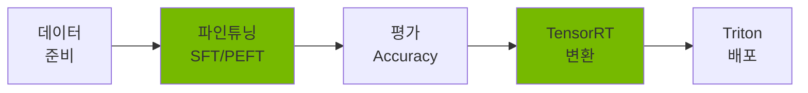
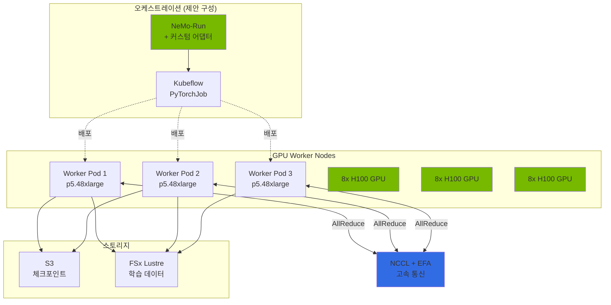
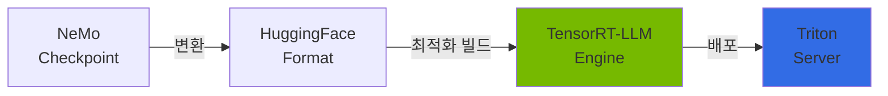
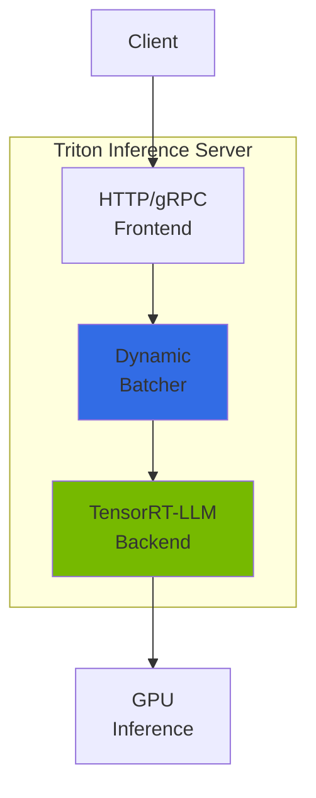
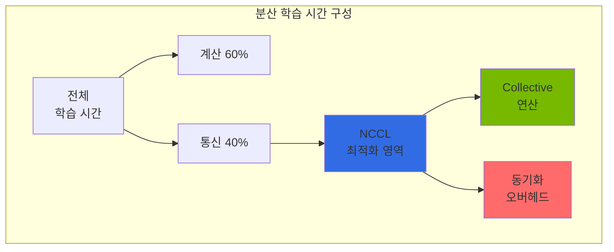
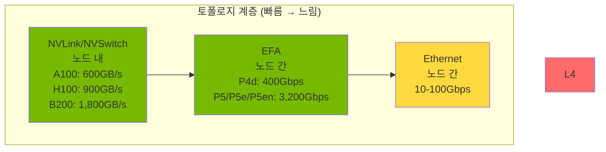

import { NemoComponents, GPURequirements, CheckpointSharding, MonitoringMetrics, NCCLImportance } from '@site/src/components/NemoTables';

NVIDIA NeMo는 대규모 언어 모델(LLM)의 학습, 파인튜닝, 최적화를 위한 엔드투엔드 프레임워크입니다. Kubernetes 환경에서 분산 학습과 효율적인 모델 배포를 지원합니다.

## 개요

### NeMo가 해결하는 문제

Agentic AI 플랫폼에서 범용 LLM(GPT-4, Claude 등)을 사용할 때 다음과 같은 한계가 있습니다:

- **도메인 지식 부족**: 특정 산업/기업의 전문 용어와 맥락 이해 부족
- **비용 문제**: 대규모 호출 시 API 비용 급증 (token-per-request 과금)
- **지연 시간**: 외부 API 호출로 인한 응답 지연
- **데이터 프라이버시**: 민감한 데이터를 외부 서비스로 전송 불가
- **온프레미스 요구사항**: 금융/의료 등 규제 산업의 자체 인프라 운영 필요

NeMo는 이러한 문제를 **도메인 특화 모델 파인튜닝**으로 해결합니다.

### NeMo 핵심 기능



<NemoComponents />

**주요 가치:**

- **효율적인 파인튜닝**: LoRA/QLoRA로 전체 파라미터의 0.1%만 학습
- **분산 학습**: Multi-node, Multi-GPU 자동 병렬화 (Tensor/Pipeline/Data Parallelism)
- **추론 최적화**: TensorRT-LLM 변환으로 2-4배 성능 향상
- **엔터프라이즈 지원**: 체크포인트 관리, 모니터링, 프로덕션 배포 파이프라인

---

## EKS 배포 아키텍처

### NeMo on EKS 구성



:::note 오케스트레이션 계층 범위

위 다이어그램의 오케스트레이션 계층은 이 가이드가 제안하는 구성이며, NVIDIA가 지원하는 기성 워크플로가 아닙니다. NeMo 2.0 이상에서 NVIDIA가 지원하는 런처는 [NeMo-Run](https://github.com/NVIDIA/NeMo-Run)이며, 레거시 [NeMo Framework Launcher](https://github.com/NVIDIA/NeMo-Framework-Launcher)는 README 기준 NeMo 1.0 기반 구성에 한정됩니다. NeMo 2.0 작업을 Kubeflow Training Operator의 PyTorchJob으로 실행하려면 NeMo-Run의 실행 결과(분산 실행 명령)를 PyTorchJob 매니페스트로 변환하는 **별도의 어댑터를 직접 구현**해야 하며, 2026-10-13 기준 NVIDIA가 제공하는 공식 통합은 확인되지 않았습니다.

:::

### 컨테이너 구성

**NeMo 컨테이너 이미지:**

```
nvcr.io/nvidia/nemo:25.02
├── PyTorch 2.6.0a0
├── CUDA 12.8
├── NCCL 2.25.x
├── Megatron-LM (NeMo 통합)
├── TensorRT-LLM 0.17.0
└── PyTriton (Triton 인터페이스)
```

:::note 컴포넌트 버전 출처

위 버전은 NeMo Framework 25.02 릴리스의 Software Component Versions 표(PyTorch 2.6.0a0, TensorRT-LLM 0.17.0)를 따릅니다. CUDA, NCCL, Triton 인터페이스 패키지는 동일 릴리스 컨테이너 기준이며, NVIDIA의 "latest" 컴포넌트 표에는 25.02 행이 더 이상 표시되지 않으므로 실제 pull한 이미지의 매니페스트(`docker inspect` / 레이어 내용)로 정확한 구성을 확인하세요.

:::

**주요 의존성:**

- **Kubeflow Training Operator**: PyTorchJob CRD로 분산 학습 오케스트레이션
- **GPU Operator**: NVIDIA 드라이버, Device Plugin, DCGM 자동 설치
- **EFA Device Plugin**: 노드 간 RDMA 통신 활성화
- **Karpenter**: GPU 노드 오토스케일링

<GPURequirements />

---

## 파인튜닝 가이드

### SFT (Supervised Fine-Tuning) 개념

**SFT란?**: 사전학습된 모델에 도메인별 instruction-response 데이터를 추가 학습시켜 특정 작업 성능을 향상시키는 방법입니다.

```
사전학습 모델 (범용) → SFT → 도메인 특화 모델
```

**언제 사용하는가?**

- 고객사 FAQ 챗봇: 특정 제품/서비스 관련 Q&A 학습
- 금융 보고서 생성: 금융 용어 및 포맷 학습
- 의료 진단 보조: 의학 용어 및 진단 패턴 학습

**데이터 형식:**

```json
{"input": "EKS Auto Mode란 무엇인가요?", "output": "EKS Auto Mode는 노드 프로비저닝, 스케일링, 보안 패치를 AWS가 자동으로 관리하는 완전 관리형 Kubernetes 컴퓨팅 옵션입니다."}
{"input": "Karpenter의 주요 기능은?", "output": "Karpenter는 자동 노드 프로비저닝, bin-packing 최적화, Spot 인스턴스 통합, drift 감지 기능을 제공합니다."}
```

### PEFT/LoRA: 효율적인 파인튜닝

**PEFT (Parameter-Efficient Fine-Tuning)**: 전체 모델 파라미터를 학습하는 대신 **일부 어댑터 레이어만 학습**하여 메모리와 시간을 절약하는 기법입니다.

**LoRA (Low-Rank Adaptation)**: PEFT의 대표적 방법으로, 원본 가중치는 동결(freeze)하고 **저차원 행렬 2개(A, B)만 학습**합니다.

```
원본 가중치 W (freeze) + LoRA 델타 (A × B) = 최종 가중치
```

**LoRA 핵심 파라미터:**

| 파라미터 | 설명 | 권장값 | 영향 |
|---------|------|--------|------|
| `dim` (랭크) | 저차원 행렬의 랭크. 원 논문의 `r`에 해당하며 NeMo 2.x `LoRA` 클래스에서는 `dim`으로 부릅니다 (기본값 32) | 8-64 | 클수록 표현력 ↑, 어댑터 파라미터·메모리 ↑ |
| `alpha` | 스케일링 계수. 어댑터 출력에 `alpha/dim` 배율로 적용 (기본값 32) | dim과 동일 수준 | LoRA 가중치 영향력 조절 |
| `dropout` | 드롭아웃 비율 (NeMo 2.x 기본값 0.0) | 0.0-0.1 | 과적합 방지 |
| `target_modules` | LoRA를 적용할 모듈. NeMo는 Megatron의 융합 레이어 이름을 사용 (기본값 `linear_qkv`, `linear_proj`, `linear_fc1`, `linear_fc2`) | 기본값 또는 Attention만 (`linear_qkv`, `linear_proj`) | 적용 레이어 선택 |

**메모리 절감 효과 (조건부 예시):**

아래 수치는 특정 조건에서의 예시이며, 모든 설정에 일반화되지 않습니다. 실제 절감률은 정밀도(BF16/FP16/4bit), `dim`(랭크), 배치 크기, 시퀀스 길이, 옵티마이저 상태 저장 방식에 따라 달라집니다. 아래는 7B 모델을 BF16으로 학습하고 Adam 옵티마이저 상태를 포함한다고 가정한 대략적인 예시입니다.

- **Full Fine-Tuning (7B, BF16, Adam)**: 가중치·그래디언트·옵티마이저 상태를 모두 학습하므로 수십~백 GB 이상 VRAM 필요 (예: A100 80GB 2장 수준)
- **LoRA Fine-Tuning (7B, BF16, 저랭크 어댑터만 학습)**: 원본 가중치를 동결하고 소수의 어댑터만 학습하므로 단일 A100 80GB에서도 가능한 수준으로 감소
- **차이의 원리**: LoRA는 학습 대상 파라미터와 그에 따른 옵티마이저 상태를 크게 줄입니다. 원 논문([LoRA, arXiv:2106.09685](https://arxiv.org/abs/2106.09685))은 GPT-3 175B에서 학습 가능한 파라미터를 약 10,000배, 옵티마이저 상태 VRAM을 약 3배 줄였다고 보고하며, 이 수치는 해당 논문의 설정에 한정됩니다.

### 파인튜닝 실행 예시

```python
# nemo_lora_finetune.py
import nemo_run as run
from nemo.collections import llm
from nemo import lightning as nl

# LoRA 설정 (NeMo 2.x: 랭크 인자는 r이 아니라 dim)
lora = llm.peft.LoRA(
    dim=32,        # 저차원 행렬의 랭크
    alpha=32,      # 스케일링 (어댑터 출력에 alpha/dim 배율)
    dropout=0.0,
    # NeMo는 Megatron 융합 레이어 이름을 사용 (q_proj/v_proj가 아님)
    target_modules=["linear_qkv", "linear_proj"],
)

# 모델·데이터·트레이너를 "객체"로 구성 (경로 문자열이 아님)
model = llm.LlamaModel(config=llm.Llama31Config8B())
data = llm.FineTuningDataModule(
    dataset_root="/data",       # train.jsonl 등을 포함한 디렉터리
    seq_length=4096,
    global_batch_size=16,
    micro_batch_size=1,
)
trainer = nl.Trainer(
    devices=8,                  # GPU 8장
    max_steps=1000,
    strategy=nl.MegatronStrategy(tensor_model_parallel_size=2),
    plugins=nl.MegatronMixedPrecision(precision="bf16-mixed"),
)

# 파인튜닝 실행: finetune(model, data, trainer, ..., peft=...)
llm.finetune(
    model=model,
    data=data,
    trainer=trainer,
    log=nl.NeMoLogger(log_dir="/output/llama-3.1-8b-finetuned"),
    peft=lora,
)
```

:::note API 범위

위 예시는 NeMo 2.2.0의 `nemo.collections.llm` API 형태를 보여줍니다. `finetune`은 경로 문자열(`model_path`/`data_path`/`output_path`)이 아니라 `LightningModule`·`LightningDataModule`·`Trainer` **객체**와 `peft` 인자를 받습니다. 모델 구성 클래스 이름(`Llama31Config8B` 등)과 데이터 모듈 인자는 사용하는 NeMo 버전과 모델에 맞게 확인하세요. 레시피 기반 실행은 [NeMo llama31_8b 레시피](https://github.com/NVIDIA/NeMo/blob/v2.2.0/nemo/collections/llm/recipes/llama31_8b.py)를 참고하세요.

:::

**상세 파이프라인**: 데이터 전처리, 멀티노드 분산 학습, 하이퍼파라미터 튜닝 등은 [커스텀 모델 파이프라인](../../reference-architecture/model-lifecycle/custom-model-pipeline.md) 문서를 참조하세요.

---

## 체크포인트 관리

### S3 기반 체크포인트 저장

NeMo는 학습 중 주기적으로 **체크포인트(모델 상태 스냅샷)**를 저장합니다. 이를 통해:

- **학습 재개**: 장애 발생 시 마지막 체크포인트부터 재시작
- **최적 모델 선택**: 검증 손실이 가장 낮은 체크포인트 선택
- **버전 관리**: 여러 실험의 체크포인트 비교

**S3 저장 구조:**

```
s3://nemo-checkpoints/
└── llama-3.1-8b-finetune/
    ├── checkpoint-epoch=1-step=500/
    │   ├── model_weights.ckpt
    │   ├── optimizer_states.ckpt
    │   └── metadata.yaml
    ├── checkpoint-epoch=2-step=1000/
    └── checkpoint-epoch=3-step=1500/
```

### 대규모 모델 체크포인트 샤딩

70B 이상의 대규모 모델은 체크포인트 전체 크기가 수백 GB에 달합니다. NeMo 2.x는 Megatron Core의 **분산 체크포인트(distributed checkpoint)** 형식으로 가중치와 옵티마이저 상태를 여러 파일(샤드)로 나누어 저장합니다. 분할 단위는 사용자가 지정하는 고정 "GB 크기"가 아니라 **텐서/파이프라인 병렬 랭크와 Megatron Core의 분산 저장 레이아웃**에 의해 결정됩니다.

<CheckpointSharding />

**체크포인트 설정 (NeMo 2.x):** 샤딩은 `MegatronStrategy`와 `ModelCheckpoint` 콜백으로 제어하며, 아래는 개념 예시입니다. 실제 인자 이름과 기본값은 사용하는 NeMo/Megatron Core 버전에서 확인하세요.

```python
from nemo import lightning as nl

strategy = nl.MegatronStrategy(
    tensor_model_parallel_size=4,
    pipeline_model_parallel_size=2,
    # 분산(샤딩) 체크포인트 포맷 사용
    ckpt_async_save=True,          # 비동기 저장으로 학습 중단 최소화
    ckpt_parallel_save=True,       # 랭크별 병렬 저장
)

checkpoint = nl.ModelCheckpoint(
    save_top_k=3,                  # 검증 손실 기준 상위 체크포인트 유지
    monitor="val_loss",
)
```

**샤딩 저장 구조 (개념도):**

실제 파일 수와 이름은 병렬화 구성과 Megatron Core 버전에 따라 다릅니다. 아래는 저장 레이아웃을 이해하기 위한 개념도입니다.

```
s3://checkpoints/llama-405b/
└── checkpoint-step=1000/
    ├── __0_0.distcp   # 랭크별 분산 체크포인트 샤드
    ├── __0_1.distcp
    ├── ...
    ├── metadata.json  # 샤드 매핑 메타데이터
    └── common.pt      # 공통(비분산) 상태
```

:::note 체크포인트 크기 계산

위 `<CheckpointSharding />` 표의 "예상 샤드 수"는 **체크포인트가 저장하는 바이트 수를 10GB 단위로 나눈 가정값**입니다. 저장 크기는 가중치 외에 **무엇을 함께 저장하는지**에 따라 크게 달라집니다.

- 405B 모델의 **BF16 가중치만** 저장: 405e9 × 2바이트 ≈ 810GB
- 405B 모델의 가중치 + Adam 옵티마이저 상태(FP32 모멘텀·분산 2개) + FP32 마스터 가중치까지 저장: 대략 405e9 × (2 + 4 + 4 + 4) ≈ 5.7TB 수준

즉 "하나의 체크포인트 ≈ 400GB" 같은 단일 값은 성립하지 않으며, 저장 정밀도와 옵티마이저 상태 포함 여부를 명시해야 합니다. 위 `<CheckpointSharding />` 표의 샤드 수는 "BF16 가중치만 저장(810GB)을 10GB로 나눈 ≈81 샤드" 같은 **명시적 가정**에 따른 값이며, 옵티마이저 상태까지 포함하면 샤드 수는 수 배로 늘어납니다.

:::

### 체크포인트 변환

```python
# NeMo 2.0 → HuggingFace 변환 (Python API, 검증된 경로)
from nemo.collections.llm import export_ckpt

# path: NeMo 체크포인트, target="hf": HuggingFace 포맷으로 내보내기
export_ckpt(
    path="/checkpoints/llama-finetuned",
    target="hf",
    output_path="/models/llama-finetuned-hf",
)
```

```bash
# 또는 CLI (nemo llm export)
# 인자 이름(path/target/output_path)은 사용하는 NeMo 버전의
# `nemo llm export --help` 출력으로 확인하세요.
nemo llm export \
  path=/checkpoints/llama-finetuned \
  target=hf \
  output_path=/models/llama-finetuned-hf
```

---

## TensorRT-LLM 변환

### TensorRT-LLM이란?

NVIDIA TensorRT-LLM은 LLM 추론을 위한 최적화 엔진입니다. PyTorch 모델을 **고도로 최적화된 실행 그래프**로 변환하여 추론 속도를 2-4배 향상시킵니다.



### 성능 향상 비교

| 최적화 기법 | 메모리 영향 | 속도 영향 | 설명 |
|------------|-----------|----------|------|
| **FP8 양자화** | 가중치 저장 절반(BF16→FP8) | 조건부 향상 | Hopper(SM90)·Ada Lovelace(SM89) 지원, Ampere(A100) 미지원 |
| **PagedAttention** | KV 캐시 단편화 감소 | - | KV Cache 동적 메모리 관리 |
| **In-flight Batching** | - | 처리량 향상 | 연속 배치 처리 |
| **Kernel Fusion** | - | 커널 호출 오버헤드 감소 | 연산 커널 융합 |

:::note 수치 범위

위 표는 각 기법의 **작동 원리**를 정리한 것입니다. "메모리 50% 절감", "속도 2-4배"와 같은 고정 수치는 측정 조건(모델, 시퀀스 길이, 배치 크기, GPU, 기준 백엔드)에 따라 달라지므로 포함하지 않았습니다. 특히 FP8은 **가중치·활성값 저장 정밀도**를 낮추는 것이며, KV 캐시·활성값·실행 그래프 등 전체 메모리 사용량을 일률적으로 절반으로 줄인다는 뜻이 아닙니다. 구체적 수치가 필요하면 자신의 워크로드에서 기준(baseline)과 함께 측정하세요.

:::

### 변환 개념

```python
from tensorrt_llm import LLM, BuildConfig
from tensorrt_llm.llmapi import QuantConfig, KvCacheConfig
from tensorrt_llm.quantization import QuantAlgo

# TensorRT-LLM 0.17: 길이·배치 한계는 BuildConfig,
# 양자화는 QuantConfig, KV 캐시는 KvCacheConfig로 전달
build_config = BuildConfig(
    max_input_len=4096,
    max_seq_len=6144,       # 입력 + 출력 길이 합
    max_batch_size=64,
)

# FP8은 Hopper(SM90)와 Ada Lovelace(SM89)에서 지원됩니다
quant_config = QuantConfig(quant_algo=QuantAlgo.FP8)

llm = LLM(
    model="/models/llama-finetuned-hf",
    build_config=build_config,
    quant_config=quant_config,
    kv_cache_config=KvCacheConfig(),   # PagedAttention(KV 캐시) 설정
    enable_chunked_prefill=True,       # 0.17의 올바른 인자 이름
)

# 엔진 저장
llm.save("/engines/llama-finetuned-trt")
```

:::note 지원 범위

위 인자 이름은 TensorRT-LLM 0.17 `LLM`/`BuildConfig`/`QuantConfig`/`KvCacheConfig` 기준입니다. 0.17에서는 `max_output_len`·`dtype="fp8"`·`enable_paged_kv_cache`·`enable_chunked_context` 같은 최상위 키워드를 받지 않습니다. FP8은 [지원 매트릭스](https://github.com/NVIDIA/TensorRT-LLM/blob/v0.17.0/docs/source/reference/support-matrix.md) 기준 Hopper(SM90)와 Ada Lovelace(SM89)에서 지원되며 A100(Ampere)은 FP8을 지원하지 않습니다. 변환 소요 시간은 모델·GPU·빌드 옵션에 따라 크게 달라지므로 측정 조건 없이는 수치를 제시하지 않습니다.

:::

---

## Triton Inference Server

### Triton과 NeMo의 관계

**Triton Inference Server**는 NVIDIA의 프로덕션 추론 서버로, TensorRT-LLM 엔진을 HTTP/gRPC API로 서빙합니다.

```
클라이언트 → Triton Server → TensorRT-LLM 백엔드 → GPU
```

### Triton 아키텍처 개념



**핵심 기능:**

- **동적 배칭**: 여러 요청을 자동으로 묶어 GPU 활용률 최적화
- **모델 앙상블**: 여러 모델을 파이프라인으로 연결 (예: Tokenizer → LLM → Detokenizer)
- **백엔드 지원**: TensorRT-LLM, PyTorch, ONNX, TensorFlow 등
- **메트릭 수집**: Prometheus 호환 메트릭 (처리량, 지연 시간, GPU 사용률)

### 모델 저장소 구조

```
/models/
└── llama-finetuned/
    ├── config.pbtxt  # Triton 설정 파일
    ├── 1/  # 버전 1
    │   └── engine/  # TensorRT-LLM 엔진 디렉터리 (단일 파일이 아님)
    │       ├── config.json          # 엔진 빌드 설정
    │       ├── rank0.engine          # 랭크별 엔진 (TP/PP 랭크 수만큼)
    │       └── ...                   # 추가 랭크 엔진
    └── tokenizer/
        ├── tokenizer.json
        └── tokenizer_config.json
```

:::note 엔진 번들

TensorRT-LLM 백엔드는 단일 `model.plan` 파일이 아니라 **엔진 디렉터리**(`config.json` + 랭크별 `rankN.engine`)를 로드합니다. 디렉터리 경로는 아래 `config.pbtxt`의 `gpt_model_path` 값으로 지정합니다.

:::

**config.pbtxt 핵심 설정:**

아래는 `tensorrtllm_backend` v0.17의 `config.pbtxt`에서 렌더링되는 실제 키입니다. `fill_template.py`의 변수 이름 `batching_strategy`는 템플릿에서 `gpt_model_type` 키 값으로 치환되며, 배치 스케줄러 정책은 별도의 `batch_scheduler_policy` 키로 지정합니다.

```protobuf
name: "llama-finetuned"
backend: "tensorrtllm"
max_batch_size: 64

parameters {
  key: "gpt_model_type"
  value: { string_value: "inflight_fused_batching" }  # 또는 "V1"
}

parameters {
  key: "gpt_model_path"
  value: { string_value: "/models/llama-finetuned/1/engine" }  # 엔진 디렉터리
}

parameters {
  key: "batch_scheduler_policy"
  value: { string_value: "max_utilization" }  # 또는 "guaranteed_no_evict"
}

parameters {
  key: "max_tokens_in_paged_kv_cache"
  value: { string_value: "8192" }
}
```

---

## NCCL 분산 통신

### NCCL의 역할

**NCCL (NVIDIA Collective Communication Library)**은 분산 GPU 학습에서 **multi-GPU 간 고속 통신**을 담당하는 핵심 라이브러리입니다.



**왜 중요한가?**

<NCCLImportance />

### Collective 연산 개념

#### 1. AllReduce (가장 중요)

모든 GPU의 데이터를 합산하고 결과를 모든 GPU에 배분합니다.

```
초기 상태:
GPU 0: [1, 2, 3]
GPU 1: [4, 5, 6]
GPU 2: [7, 8, 9]
GPU 3: [10, 11, 12]

AllReduce 후:
모든 GPU: [22, 26, 30]  # 각 원소별 합산
```

**사용 사례**: 분산 학습에서 각 GPU의 그래디언트를 평균화

#### 2. AllGather

모든 GPU의 데이터를 수집하여 각 GPU에 전체 데이터를 배분합니다.

```
초기 상태:
GPU 0: [1, 2]
GPU 1: [3, 4]

AllGather 후:
모든 GPU: [1, 2, 3, 4]
```

**사용 사례**: Tensor Parallelism에서 분산된 텐서를 모으기

#### 3. ReduceScatter

각 GPU가 가진 데이터를 원소별로 **합산(reduce)한 뒤, 그 결과를 분할(scatter)하여** 각 GPU가 결과의 서로 다른 부분만 보유하도록 합니다. AllGather가 "모으기"라면 ReduceScatter는 "합산 후 나누기"이며, **ReduceScatter 다음에 AllGather를 수행하면 AllReduce와 동일**합니다.

```
초기 상태:
GPU 0: [1, 2, 3, 4]
GPU 1: [5, 6, 7, 8]

ReduceScatter 후:
GPU 0: [6, 8]   # (1+5), (2+6)
GPU 1: [10, 12] # (3+7), (4+8)
```

**사용 사례**: Tensor Parallelism에서 부분합을 합산·분배하거나, AllReduce를 ReduceScatter + AllGather로 구현할 때 사용합니다. (Pipeline Parallelism의 레이어 간 활성값 전달은 collective가 아니라 **point-to-point send/recv** 통신으로 처리됩니다.)

#### 4. Broadcast

한 GPU의 데이터를 모든 GPU에 복사합니다.

```
초기 상태:
GPU 0: [1, 2, 3]
GPU 1: [0, 0, 0]

Broadcast 후:
모든 GPU: [1, 2, 3]
```

**사용 사례**: 마스터 GPU에서 모델 체크포인트 배포

### 네트워크 토폴로지 최적화

NCCL은 GPU 간 물리적 연결 토폴로지를 자동으로 감지하고 최적의 경로를 선택합니다.



**토폴로지별 알고리즘 선택:**

- **NVSwitch/NVLink (H100/A100 노드 내)**: Tree 알고리즘 (병렬 브로드캐스트) 또는 Ring 알고리즘 (순환 전달)
- **EFA 노드 간**: Hierarchical 알고리즘 (노드 내 Ring/Tree → 노드 간 Tree)
- **A100**: NVLink 600GB/s, **H100**: NVLink4 900GB/s, **B200**: NVLink5 1,800GB/s

### NCCL 튜닝 파라미터

NCCL은 기본적으로 토폴로지와 메시지 크기에 맞춰 알고리즘·프로토콜·채널 수를 **자동으로 선택**합니다. 따라서 아래 변수들은 **먼저 기본값으로 측정한 뒤**, 특정 구성에서 재현 가능한 성능 문제를 진단한 경우에만 재정의하세요. 값을 강제하면 오히려 성능이 떨어질 수 있습니다.

```bash
# AWS EFA 사용을 위한 설정 (일반적으로 필요)
export FI_PROVIDER=efa
export FI_EFA_USE_DEVICE_RDMA=1
# aws-ofi-nccl 플러그인이 설치되어 LD_LIBRARY_PATH에 포함되어야 합니다
# (EFA가 설치된 노드/AMI 또는 EKS node-efa 설정 참조)

# 진단용 로그 (성능 문제 분석 시)
export NCCL_DEBUG=INFO
```

```bash
# 아래는 "진단 후" 특정 사례에서만 적용하는 재정의 예시입니다.
# 기본 자동 선택을 신뢰하는 것이 먼저입니다.

# 알고리즘/프로토콜을 특정 사례에서 고정 (일반 권장값 아님)
export NCCL_ALGO=Ring     # 또는 Tree
export NCCL_PROTO=Simple  # Simple(throughput) 또는 LL(latency)
```

:::note 채널 수 변수 주의

`NCCL_MIN_NCHANNELS`/`NCCL_MAX_NCHANNELS`를 임의의 "권장값"으로 강제하는 것은 일반적으로 권장되지 않습니다. 채널 수의 최적값은 GPU 세대, 노드 수, 메시지 크기에 따라 달라지며 NCCL이 런타임에 조정합니다. 과거 가이드에서 쓰이던 고정 채널 수 권장값(예: "노드당 4-8채널")은 검증된 범용 기준이 아니므로, 변경이 필요하면 `NCCL_DEBUG=INFO` 로그로 선택된 채널 수를 확인하고 자신의 워크로드에서 A/B 측정하세요. EFA 설정은 [EKS EFA 노드 가이드](https://docs.aws.amazon.com/eks/latest/userguide/node-efa.html)와 `aws-ofi-nccl` 플러그인 설치를 함께 확인해야 합니다.

:::

---

## 모니터링

### 주요 메트릭

<MonitoringMetrics />

**모니터링 스택**: Prometheus + Grafana + DCGM Exporter

상세 모니터링 설정은 [모니터링 및 관찰성 설정](../../reference-architecture/integrations/monitoring-observability-setup.md)을 참조하세요.

---

## 관련 문서

- [GPU 리소스 관리](../gpu-infrastructure/gpu-resource-management.md) - Karpenter, KEDA, DRA 기반 GPU 오토스케일링
- [vLLM 모델 서빙](./vllm-model-serving.md) - 프로덕션 추론 서버
- [MoE 모델 서빙](./moe-model-serving.md) - Mixture of Experts 아키텍처
- [커스텀 모델 파이프라인](../../reference-architecture/model-lifecycle/custom-model-pipeline.md) - 데이터 준비부터 배포까지 전체 파이프라인

:::tip 권장 사항

- **파인튜닝 시작 전**: 기본 모델로 베이스라인 성능을 측정하세요
- **LoRA 우선 검토**: 학습 대상 파라미터와 옵티마이저 상태를 줄여 메모리를 절감할 수 있으나, 절감률은 정밀도·랭크·배치·시퀀스에 따라 다릅니다(위 "메모리 절감 효과" 참조)
- **TensorRT-LLM 적용 검토**: 추론 지연·처리량 개선 가능성이 있으나, 실제 향상 폭은 모델·GPU·배치·기준 백엔드에 따라 측정이 필요합니다
- **NCCL 튜닝**: 멀티노드 학습에서 기본 자동 선택으로 먼저 측정하고, 재현 가능한 병목이 확인될 때만 재정의하세요(강제 설정이 항상 개선을 보장하지는 않음)

:::

:::warning 주의사항

- **GPU 비용**: 대규모 다중 노드 학습은 비용이 빠르게 누적됩니다. 실제 비용은 인스턴스 유형·개수·리전·요금제(온디맨드/Spot/예약)·학습 시간에 따라 달라지므로, [EC2 요금 페이지](https://aws.amazon.com/ec2/pricing/)와 [AWS Pricing Calculator](https://calculator.aws/)로 자신의 구성에 맞춰 추정하세요. Spot 인스턴스와 체크포인트를 적극 활용하면 중단 비용을 줄일 수 있습니다
- **체크포인트 필수**: S3 등 영구 스토리지에 자동 저장 설정 (노드 장애 대비)
- **EFA 보안 그룹**: EFA 사용 시 모든 트래픽 허용 필요 (동일 보안 그룹 내)
- **메모리 오버플로**: OOM 발생 시 `micro_batch_size` 감소 또는 `gradient_checkpointing` 활성화

:::
