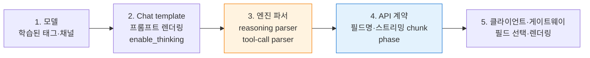

## 개요

추론(reasoning) 모델을 서빙하면 "답변에 생각하는 과정 같은 문장이 섞인다", "`<think>` 태그가 그대로 보인다", "도구 호출이 JSON 텍스트로 답변에 찍힌다"는 증상이 반복해서 보고됩니다. 대부분 모델 품질 문제가 아니라 모델이 학습한 출력 경계와 서빙 스택이 그 경계를 해석하는 방식이 어긋나서 생깁니다.

대상 독자는 EKS 위에서 vLLM·SGLang으로 오픈웨이트 LLM을 운영하는 플랫폼·MLOps 엔지니어입니다. 관리형 API(OpenAI Responses API, Claude Messages API)를 함께 쓰는 경우의 차이는 별도 절에서 짧게 다룹니다. 유해 출력 차단 같은 안전성 가드레일은 [AI Gateway Guardrails](../../operations-mlops/governance/ai-gateway-guardrails.md)에서 설명합니다.

버전에 따라 달라지는 사실은 2026-10-06에 vLLM v0.31.0(2026-10-05 릴리스)과 각 공식 문서를 기준으로 확인했습니다.

## 배경

### 증상 분류

출력 무결성 문제는 네 가지 증상으로 나눌 수 있습니다. 증상마다 원인이 놓인 층이 다르므로 먼저 어떤 증상인지 구분합니다.

- **추론 누출** — reasoning으로 분리돼야 할 텍스트가 `content`에 들어갑니다.
- **경계 토큰 노출** — `<think>`, `</think>`, harmony의 `<|channel|>` 같은 구분자가 답변에 보입니다.
- **도구 호출 원문 노출** — tool call이 구조화된 `tool_calls`로 파싱되지 않고 텍스트로 남거나, 인자가 스키마를 어깁니다.
- **preamble 혼입** — "먼저 자료를 찾아보겠습니다" 같은 중간 안내 문장이 최종 답변 앞에 붙습니다.

### 구조적 원인과 확률적 원인

같은 입력에서 매번 재현되거나 엔진·파서·템플릿 조합을 바꿨을 때 사라진다면 구조적 원인입니다. 구조적 원인은 설정과 코드로 없앨 수 있습니다. 구조적 원인을 모두 제거한 뒤에도 드물게 남는 누출은 모델의 확률적 생성에서 오며, 이 부분만 출력 교정 계층이 다룹니다. 교정 계층을 먼저 만들면 구조적 원인이 가려져 엔진·모델 업그레이드 때마다 누출률이 흔들립니다.

## 출력 경계를 결정하는 다섯 층

모델 출력이 사용자 화면에 도달하기까지 다섯 층이 각자 경계를 해석합니다. 한 층만 다른 층과 어긋나도 누출이 생깁니다.

**그림 1. 모델 출력이 사용자 화면에 도달하기까지 경계를 해석하는 다섯 층**



**표 1. 출력 경계를 정하는 다섯 층과 어긋날 때의 대표 증상**

| 층 | 경계를 정하는 요소 | 어긋날 때의 대표 증상 |
|---|---|---|
| 모델 | 학습된 `<think>` 태그, harmony 채널, 도구 호출 형식 | 모델 마이너 버전 변경 후 태그 형식이 달라져 파서가 인식하지 못함 |
| Chat template | thinking on/off 플래그, 시작 태그 prefill 여부 | 템플릿이 시작 태그를 미리 넣었는데 파서가 출력에서 시작 태그를 찾음 |
| 엔진 파서 | `--reasoning-parser`, `--tool-call-parser`, stop 처리 | 파서 미지정·불일치로 추론이 `content`에 합쳐짐 |
| API 계약 | `reasoning` 필드명, 스트리밍 delta 구성, `phase` | 옛 필드명을 읽어 빈 값을 받음 |
| 클라이언트 | 어떤 필드를 화면에 그릴지, 여러 메시지를 합치는 방식 | commentary 메시지를 최종 답변과 함께 렌더링 |

## 모델 계열별 출력 형식

아래 표는 vLLM [Reasoning Outputs](https://docs.vllm.ai/en/latest/features/reasoning_outputs.html)·[Tool Calling](https://docs.vllm.ai/en/latest/features/tool_calling.html) 문서와 SGLang [Reasoning Parser](https://docs.sglang.io/advanced_features/separate_reasoning.html) 문서를 기준으로 정리했습니다(2026-10-06 확인). 빈 칸(–)은 해당 문서 표에 항목이 없다는 뜻이며 지원하지 않는다는 뜻은 아닙니다.

**표 2. 모델 계열별 추론 경계 표기와 reasoning·tool-call 파서**

| 모델 계열 | 추론 경계 표기 | thinking 기본값과 전환 방법 | vLLM reasoning parser | SGLang reasoning parser | vLLM tool-call parser |
|---|---|---|---|---|---|
| Qwen3 | `<think>`…`</think>` | 기본 on, `enable_thinking=False`로 끔 | `qwen3` | `qwen3` | Qwen3-Coder는 `qwen3_xml` |
| DeepSeek-R1 | R1은 시작 태그 없이 추론 시작, R1-0528은 시작·종료 태그 모두 출력 | 항상 추론 | `deepseek_r1` | `deepseek-r1` | R1-0528은 `deepseek_v3` |
| DeepSeek-V3.1 | `<think>`…`</think>` | 기본 off, `thinking=True`로 켬(`enable_thinking` 아님) | `deepseek_v3` | `deepseek-v3` | `deepseek_v31`, 도구 호출은 non-thinking 모드에서만 |
| Gemma 4 | 모델 고유 채널 | 기본 off, `enable_thinking=True` 또는 `reasoning_effort`로 켬 | `gemma4` | – | – |
| GLM-4.5 | `<think>`…`</think>` | – | `glm45` | – | `glm45` |
| MiniMax-M2 | `<think>`…`</think>` | – | `minimax_m2_append_think` | – | – |
| Kimi K2 Thinking | `◁think▷`…`◁/think▷` | 항상 추론 | `kimi_k2` | `kimi_k2`, 도구 사용 시 `--tool-call-parser kimi_k2` 필수 | `kimi_k2` |
| gpt-oss | harmony 채널 `<\|channel\|>analysis<\|message\|>`…`<\|end\|>` | `reasoning_effort` | `openai_gptoss` | `gpt-oss` | `openai` |

vLLM의 `openai_gptoss`와 `kimi_k2` reasoning parser 이름은 문서 표가 아니라 소스 레지스트리(`vllm/reasoning/__init__.py`, 2026-10-06 main)에서 확인했습니다.

gpt-oss는 harmony 형식을 전제로 학습됐습니다. [OpenAI Harmony 가이드](https://cookbook.openai.com/articles/openai-harmony)는 세 채널을 구분합니다. `final`은 사용자에게 보여 줄 답변, `analysis`는 chain of thought로 안전 기준이 적용되지 않아 사용자에게 노출하면 안 되는 내용, `commentary`는 함수 호출과 때로 사용자용 preamble입니다. harmony 형식 없이 프롬프트를 렌더링하면 모델이 정상 동작하지 않습니다. 엔진의 `/generate` 같은 저수준 엔드포인트를 직접 쓰면 `openai-harmony` 라이브러리로 prefill 렌더링·stop token(`<|return|>`, `<|call|>`)·파싱을 직접 처리해야 합니다([How to run gpt-oss with vLLM](https://cookbook.openai.com/articles/gpt-oss/run-vllm)).

## 엔진 설정 기준

### reasoning parser와 tool-call parser를 짝으로 지정

추론 모델에 tool-call parser만 지정하고 reasoning parser를 빼면 추론 경계가 사라질 수 있습니다. vLLM 이슈 [#51679](https://github.com/vllm-project/vllm/issues/51679)는 `--tool-call-parser qwen3_xml`만 쓰면 `</think>`가 소비되어 추론이 경계 없이 `content`에 합쳐지는 문제를 보고합니다(2026-10-06 open). 워크어라운드는 `--reasoning-parser qwen3`를 함께 지정하는 것입니다. vLLM Tool Calling 문서도 Hunyuan·MiMo·Step-3.5 등은 두 파서를 함께 쓰는 플래그를 권장합니다. 반대로 `hf` tool parser는 다른 reasoning·tool parser와 결합할 수 없습니다.

```bash
vllm serve Qwen/Qwen3-Coder-30B-A3B-Instruct \
  --reasoning-parser qwen3 \
  --enable-auto-tool-choice \
  --tool-call-parser qwen3_xml \
  --default-chat-template-kwargs '{"enable_thinking": false}'
```

예전 문서에 나오는 `--enable-reasoning` 플래그는 현재 vLLM 문서에 없습니다. reasoning 분리는 `--reasoning-parser` 지정으로 활성화됩니다.

### 파서는 모델 마이너 버전과 chat template에 결합되어 있음

reasoning parser는 특정 chat template이 만드는 출력 형식을 전제로 작성됩니다. Qwen3에 `deepseek_r1` 파서를 쓰고 thinking을 끄면 최종 답이 `reasoning_content`로 들어간 사례가 있습니다([#17349](https://github.com/vllm-project/vllm/issues/17349)). MiniMax-M2.5에 M2용 파서를 쓰면 `<think>` 태그가 `content`로 새는 사례도 있습니다([#38212](https://github.com/vllm-project/vllm/issues/38212), 2026-06 closed). 모델의 마이너 버전이 바뀌면 같은 계열이라도 파서를 다시 검증합니다. chat template 파일은 모델 가중치와 함께 버전을 고정합니다.

### thinking on/off와 effort 매핑

vLLM은 `reasoning_effort`를 `enable_thinking`으로 자동 변환합니다. `low`·`medium`·`high`는 true, `none`은 false이고, 요청에 `enable_thinking`을 명시하면 그 값이 우선합니다. 서버 전체 기본값은 `--default-chat-template-kwargs`로 지정하며 요청 단위 `chat_template_kwargs`가 항상 우선합니다. effort 값의 의미는 엔진과 제공자마다 다르므로, 같은 effort 이름이 같은 동작을 보장한다고 가정하지 않고 실측합니다.

### 추론을 생성하되 응답에서 제외

`include_reasoning=false`는 추론 토큰을 생성하지만 응답에서 제외합니다. logprobs와 token ID에서도 추론 구간을 숨기므로 그 경로로 새지 않습니다. Chat Completions와 Responses API의 스트리밍·비스트리밍 모두에서 동작합니다. 이 설정을 쓰면 클라이언트가 읽는 `reasoning` 값은 항상 None입니다.

### thinking budget과 종료 문자열

`thinking_token_budget`은 `reasoning_start_str`부터 토큰을 세고, 예산에 도달하면 모델이 `reasoning_end_str`를 출력하도록 강제합니다. 경계 문자열은 `--reasoning-config`로 지정하며, 지정하지 않으면 reasoning parser에서 자동으로 가져옵니다. Qwen3.5에서 이 강제 종료 문자열이 `content`로 새는 문제가 보고되어 있습니다([#39697](https://github.com/vllm-project/vllm/issues/39697), 2026-10-06 open). budget을 쓰는 경우 종료 문자열이 답변에 남는지 회귀 테스트에 포함합니다.

### reasoning 분리가 동작하는 엔드포인트

vLLM의 reasoning 분리는 온라인 엔드포인트인 `/v1/chat/completions`, `/v1/messages`(Anthropic Messages 호환), `/v1/responses`에서만 동작합니다. 오프라인 `LLM.generate`나 텍스트 completion 경로로 서빙하면 파서가 적용되지 않으므로 애플리케이션이 직접 분리합니다. tool calling은 `content`에서만 함수를 파싱하고 `reasoning`에서는 파싱하지 않습니다.

## 스트리밍에서 생기는 누출

비스트리밍에서는 정상인데 스트리밍에서만 누출된다면 엔진의 스트리밍 경계 처리를 먼저 의심합니다.

### stop 지정 시 경계 비동기화

vLLM 이슈 [#38789](https://github.com/vllm-project/vllm/issues/38789)는 Qwen3 파서에서 `stop`을 지정하고 스트리밍하면 `</think>`와 추론 일부가 `content`로 새는 문제를 보고했습니다. 원인은 stop 문자열 검사를 위한 버퍼가 `delta_text`를 지연시키는데 파서가 보는 token ID는 지연되지 않아, 두 정보가 어긋나는 것입니다. 이 이슈는 2026-08에 닫혔지만, 같은 계열을 모든 thinking-token 파서(qwen3, deepseek_r1, nemotron, granite 등)와 Chat·Responses API 전반으로 일반화한 [#51641](https://github.com/vllm-project/vllm/issues/51641)과 수정 PR [#51669](https://github.com/vllm-project/vllm/pull/51669)는 2026-10-06 기준 열려 있습니다. MTP(Multi-Token Prediction)·speculative decoding·async output을 쓰면 한 스텝에 여러 토큰이 확정되어 발생 확률이 높아집니다. 관련해서, stop 문자열이 추론 구간 안에서 일치해 요청이 `content=null`로 끝나는 문제([#59515](https://github.com/vllm-project/vllm/issues/59515))는 2026-09-30에 닫혔습니다.

스트리밍과 `stop`을 함께 써야 한다면 다음 중 하나를 적용합니다.

1. stop 대신 모델의 EOS와 `max_tokens`로 종료를 제어합니다.
2. 사용하는 엔진 버전에 수정이 포함됐는지 릴리스 노트로 확인합니다.
3. 게이트웨이에서 `content` 스트림의 경계 토큰을 검사하는 규칙을 둡니다(아래 출력 교정 계층 참조).

### 한 chunk에 reasoning과 content가 함께 오는 경우

DeepSeek 파서는 하나의 스트리밍 chunk에 `reasoning`과 `content`를 동시에 채울 수 있습니다([#43933](https://github.com/vllm-project/vllm/issues/43933), 수정 PR [#43938](https://github.com/vllm-project/vllm/pull/43938), 2026-10-06 open). DeepSeek 공식 예제처럼 `if reasoning ... elif content ...`로 읽는 클라이언트는 이 chunk의 `content`를 버립니다. 클라이언트 쪽 해결 방법은 클라이언트·게이트웨이 계약 절에서 설명합니다.

## Structured output과 reasoning의 상호작용

### 문법 제한은 추론이 끝난 뒤부터 적용

vLLM과 SGLang은 reasoning 구간에는 문법 제한을 걸지 않고, 추론 종료 토큰 이후 구간에만 JSON 스키마·정규식 문법을 적용합니다([SGLang Structured Outputs for Reasoning Models](https://docs.sglang.io/advanced_features/structured_outputs_for_reasoning_models.html)). vLLM은 reasoner가 `end_token_id`로 추론 종료를 확인하고 그 전까지 구조화 출력을 건너뜁니다. 예외적으로 Qwen3 Coder처럼 추론 구간에도 제한이 필요한 모델은 `--structured-outputs-config.enable_in_reasoning=True`가 필요하며 기본값은 false입니다([vLLM Structured Outputs](https://docs.vllm.ai/en/latest/features/structured_outputs.html)).

### 경계 감지가 실패하면 제한 없이 HTTP 200

추론 종료 경계를 놓치면 문법 제한이 걸리지 않은 출력이 HTTP 200으로 정상 반환됩니다. vLLM에는 이 계열의 결함이 여러 모델·실행 모드에서 반복 보고되어 있습니다(상태는 2026-10-06 확인).

**표 3. 추론 종료 경계 감지 실패로 문법 제한이 누락된 vLLM 이슈**

| 이슈 | 현상 | 상태 |
|---|---|---|
| [#34650](https://github.com/vllm-project/vllm/issues/34650)·[#43388](https://github.com/vllm-project/vllm/issues/43388) | MTP·speculative decoding·async scheduling에서 `</think>`를 놓쳐 JSON 문법이 끝까지 적용되지 않음. 코드 펜스나 앞부분 잡음이 붙음 | 수정 PR #44297·#44993 머지, v0.27.0부터 포함 |
| [#39130](https://github.com/vllm-project/vllm/issues/39130) | Gemma 4에서 `enable_thinking=false`일 때 구조화 출력이 비활성화됨 | Gemma 4 파서 교체(PR #45588)로 해결, v0.27.0 포함 |
| [#37362](https://github.com/vllm-project/vllm/issues/37362) | 반대 방향: guidance 백엔드와 nemotron_v3에서 첫 토큰부터 문법 제한이 걸려 추론이 망가짐 | closed |
| [#51230](https://github.com/vllm-project/vllm/pull/51230) | MiniMax-M3에서 thinking을 켜면 구조화 출력이 조용히 무시됨 | 수정 PR open |
| [#50948](https://github.com/vllm-project/vllm/issues/50948) | Qwen 파서에 `enable_in_reasoning=true`를 주면 문법 제한을 받은 JSON이 `reasoning` 필드로 들어감 | open |

### 추론 중 `max_tokens`에 도달한 경우

vLLM 문서는 추론 도중 `max_tokens`에 도달했을 때의 구조화 출력 동작을 설명하지 않습니다. v0.31.0 소스(`vllm/v1/structured_output/__init__.py`, `vllm/reasoning/basic_parsers.py`)를 기준으로 보면 동작은 다음 순서로 결정됩니다.

1. 추론 종료가 감지되기 전에는 문법 제한 시작 위치가 생성 토큰 뒤로 잡혀 bitmask가 적용되지 않습니다.
2. 종료가 감지되는 시점에 `reasoning_ended`가 true로 고정되고, 그 이후 토큰부터 제한됩니다.
3. 절단을 따로 처리하는 경로는 없습니다.
4. 기본 thinking 파서는 출력에 종료 토큰이 없으면 전체 출력을 reasoning으로, `content`를 None으로 반환합니다.

결과적으로 추론 중 절단된 응답은 문법 제한이 한 번도 적용되지 않은 채 `content=None`, `finish_reason=length`로 반환됩니다. 이 분석은 기본 thinking 파서를 상속하는 파서에 해당하며, 모델 전용 엔진 파서는 동작이 다를 수 있습니다.

### 형식 보장의 범위

Structured outputs가 보장하는 것은 형식(스키마 준수, 필드 타입, 필수 키)이고 값의 내용은 보장하지 않습니다. 거부(refusal)와 `max_tokens` 도달은 형식 보장의 예외입니다. OpenAI와 Anthropic의 structured outputs 문서가 같은 범위를 명시합니다. 그래서 reasoning과 structured output을 함께 쓸 때는 다음 규칙을 둡니다.

- 응답 스키마 검증을 클라이언트나 게이트웨이에서 별도로 수행합니다.
- `finish_reason=length`이면서 `content`가 비어 있는 응답은 스키마 검증 실패로 처리합니다.
- 엔진 업그레이드 후 회귀 세트에 "추론 + 구조화 출력" 조합을 포함합니다.

```python
import json
from jsonschema import validate, ValidationError

def accept_structured(choice, schema) -> dict | None:
    """Return parsed JSON only when the response is complete and schema-valid."""
    if choice.finish_reason != "stop" or not choice.message.content:
        return None  # truncated, refused, or reasoning-only
    try:
        data = json.loads(choice.message.content)
        validate(data, schema)
        return data
    except (json.JSONDecodeError, ValidationError):
        return None
```

## 클라이언트·게이트웨이 계약

### 필드 이름: `reasoning`과 `reasoning_content`

vLLM은 추론 필드 이름을 `reasoning_content`에서 `reasoning`으로 바꿨습니다. 갱신하지 않은 클라이언트는 `reasoning`에 값이 있어도 `reasoning_content`를 빈 값으로 읽고, 오류도 나지 않습니다. 엔진 업그레이드 후 추론이 사라졌거나 반대로 화면에 추론이 섞였다면 클라이언트가 읽는 필드부터 확인합니다. 반면 SGLang 문서는 여전히 `reasoning_content`를 사용하므로, 두 엔진을 같은 게이트웨이 뒤에 두면 필드 이름이 섞입니다. OpenAI는 gpt-oss를 Chat Completions 호환 API로 제공하는 사업자에게 `reasoning` 필드를 권장하지만 커뮤니티 표준은 아직 없습니다([Verifying gpt-oss implementations](https://cookbook.openai.com/articles/gpt-oss/verifying-implementations)).

스트리밍에서 추론은 `delta.reasoning`으로 옵니다. OpenAI Python SDK는 이 속성을 타입으로 정의하지 않으므로 `getattr`로 읽습니다. 한 chunk에 두 필드가 함께 올 수 있으므로 `if/elif`가 아니라 두 필드를 각각 처리합니다.

```python
for chunk in stream:
    delta = chunk.choices[0].delta
    reasoning = getattr(delta, "reasoning", None) or getattr(delta, "reasoning_content", None)
    if reasoning:
        trace.append(reasoning)        # keep out of the user-visible stream
    if delta.content:
        visible.write(delta.content)   # do not use elif: both may be set
```

### 게이트웨이의 필드 변환

LLM API Gateway(Tier 2② — [Tiered Gateway 아키텍처](../inference-routing/tiered-gateway-architecture.md) 참조)가 여러 엔진과 제공자를 하나의 OpenAI 호환 API로 묶으면, 게이트웨이가 reasoning 필드를 어떤 이름으로 바꿔 내보내는지 확인합니다. 게이트웨이 버전에 따라 reasoning 필드를 버리거나 `content`에 합치는 동작이 있을 수 있으므로, 게이트웨이를 거친 응답과 엔진 직접 응답을 비교하는 테스트를 둡니다.

### 멀티턴에서 추론 되돌리기

gpt-oss는 도구 호출 사이의 추론을 다음 샘플링에 되돌려 줘야 하고, 최종 답변 이후에는 이전 턴의 `analysis`를 제거합니다([Verifying gpt-oss implementations](https://cookbook.openai.com/articles/gpt-oss/verifying-implementations)). 이 규칙을 어기면 다음 턴에서 모델이 앞 턴의 추론을 이어 쓰거나 답변 형식이 흐트러집니다. 다른 모델 계열도 멀티턴 히스토리에 추론을 넣을지 여부는 chat template이 정하므로, 템플릿이 기대하는 형태로 히스토리를 구성합니다.

## 출력 교정 계층

### 역할과 위치

출력 교정 계층(remediation layer)은 구조적 원인을 제거한 뒤 남는 확률적 누출을 처리합니다. 검증·복구·재시도를 맡는 프록시나 라이브러리는 오픈소스에서도 반복해서 등장하는 패턴입니다. 위치는 세 곳 중에서 고릅니다.

**표 4. 출력 교정 계층을 둘 수 있는 세 위치의 장점과 제약**

| 위치 | 장점 | 제약 |
|---|---|---|
| LLM API Gateway(Tier 2②) | 모든 애플리케이션에 일관 적용, 지표를 한곳에서 수집 | 애플리케이션별 스키마·도메인 규칙을 알기 어려움 |
| 애플리케이션 | 스키마와 화면 요구를 정확히 앎 | 서비스마다 중복 구현 |
| 엔진 옆 사이드카 | 엔진 버전과 함께 배포·검증 | 여러 엔진을 쓰면 사이드카도 여러 벌 |

게이트웨이는 경계 토큰·태그 탐지처럼 모델 공통 규칙을, 애플리케이션은 스키마 검증과 재생성 판단을 맡도록 나누는 구성이 일반적입니다. 안전성 필터(PII·유해성)를 담당하는 Output Guard와 같은 위치에 둘 수 있지만, 판정 기준과 지표는 분리합니다.

### 탐지

1. **규칙 기반** — `content`에 `<think>`, `</think>`, `<|channel|>`, `◁think▷` 같은 경계 토큰이 있는지, 응답이 스키마를 통과하는지, `tool_calls`가 비어 있는데 `content`가 함수 호출 형태 JSON인지 검사합니다.
2. **휴리스틱** — 답변 첫 문장이 "~해 보겠습니다", "Let me" 같은 진행 안내 형태인지 검사합니다. 언어와 도메인에 따라 오탐이 많으므로 차단 대신 표시·샘플링 용도로 시작합니다.
3. **소형 분류기** — 규칙으로 잡히지 않는 누출이 남으면 누출 샘플로 학습한 분류기를 붙입니다. 지연과 비용이 추가되므로 규칙의 미탐률을 측정한 뒤 도입합니다.

### 조치: 제거와 재생성

경계 토큰처럼 위치가 명확한 누출은 제거(strip)합니다. 추론 문장이 답변과 섞여 경계가 불명확하면 제거하면 답변 일부가 손상될 수 있으므로 재생성합니다. 재생성은 지연과 비용이 늘어나므로 횟수 상한을 두고, 상한을 넘으면 실패를 명시적으로 반환합니다. 도구 호출이 텍스트로 남은 경우에는 텍스트에서 호출을 복구하는 rescue 파싱을 먼저 시도하고, 실패하면 검증 오류를 모델에 알려 다시 생성하게 합니다(retry-with-feedback).

Claude에서는 JSON 스키마나 도구 입력에 `reasoning`, `thinking` 같은 필드를 두어 추론을 따로 받으려 하면 `reasoning_extraction` 거부가 발생할 수 있습니다([Refusals and fallback](https://platform.claude.com/docs/en/build-with-claude/refusals-and-fallback)). 추론 분리는 스키마 필드가 아니라 서빙 스택의 파서나 API의 블록 구조로 처리합니다.

### 스트리밍에서의 교정

스트리밍 응답은 이미 사용자에게 전송된 토큰을 되돌릴 수 없습니다. 경계 토큰 탐지는 토큰 단위 슬라이딩 버퍼로 가능하지만, 재생성이 필요한 판정은 응답 전체를 봐야 합니다. 구조화 출력처럼 화면에 바로 그리지 않는 응답은 스트리밍 대신 완료 후 검증을 쓰고, 대화형 응답은 첫 문장까지만 버퍼링해 preamble 여부를 판정하는 식으로 지연과 정확도를 맞춥니다.

## 관리형 API를 함께 쓰는 경우

셀프 서빙 모델과 관리형 API를 같은 애플리케이션에서 함께 쓰면, 관리형 API의 누출은 엔진 파서가 아니라 API 응답 구조를 클라이언트가 어떻게 렌더링하는지에서 생깁니다.

### OpenAI Responses API의 `phase`

GPT-5.4부터 Responses API의 assistant 메시지는 `phase` 값으로 중간 업데이트(`commentary`)와 최종 답변(`final_answer`)을 구분합니다([Prompt guidance](https://developers.openai.com/api/docs/guides/prompt-guidance)). commentary preamble은 reasoning 토큰이 아니라 출력 토큰이므로 reasoning effort를 낮추거나 끄더라도 나타날 수 있습니다. 필터와 히스토리 처리는 아래 기준으로 구성합니다.

- 필터 조건은 "`phase`가 `commentary`면 제외"로 씁니다. "`final_answer`만 표시"로 쓰지 않습니다. OpenAI는 최종 답변에 `final_answer`를 붙이지만, Responses 호환 API 중에는 최종 답변에 `phase`를 붙이지 않고 없으면 최종 답변으로 취급하라고 안내하는 곳이 있습니다([Meta Responses API](https://ai.developer.meta.com/docs/protocols/responses)).
- 히스토리를 직접 재전송한다면 각 assistant 항목의 `phase`를 바꾸지 않고 다시 보냅니다. `previous_response_id`를 쓰면 API가 이전 상태를 보존합니다.
- Chat Completions는 응답당 메시지 하나만 담으므로 `phase`를 표현하지 못합니다([OpenRouter 마이그레이션 가이드](https://openrouter.ai/docs/cookbook/evaluate-and-optimize/model-migrations/gpt-5-4)). preamble을 구분해야 하면 Responses API를 씁니다.
- `text.format`(structured outputs)을 쓸 때 commentary 메시지에도 스키마 형태 JSON이 담겨 왔다는 사용자 보고가 있습니다([langchain#36290](https://github.com/langchain-ai/langchain/issues/36290)). 공식 문서는 적용 범위를 명시하지 않습니다(2026-10-06 확인). 여러 메시지의 텍스트를 이어 붙여 파싱하지 말고, `phase`로 최종 답변 항목을 골라 파싱합니다.

```python
def visible_text(response) -> str:
    parts = []
    for item in response.output:
        if item.type != "message" or getattr(item, "phase", None) == "commentary":
            continue  # missing phase is treated as final answer
        parts += [c.text for c in item.content if c.type == "output_text"]
    return "".join(parts)
```

### Claude Messages API

Claude 응답은 `thinking` 블록과 `text` 블록으로 나뉘며, 어떤 `display` 설정에서도 원본 추론(raw chain of thought)은 반환되지 않습니다. 최신 모델의 기본값은 `"omitted"`이고 이때 thinking 블록 텍스트는 빈 문자열입니다. 스트리밍에서는 `content_block_start` 이벤트가 블록 타입을 알려 주고 추론은 `thinking_delta`로 오므로, 버퍼 없이 이벤트 타입만으로 걸러낼 수 있습니다([Extended thinking](https://platform.claude.com/docs/en/build-with-claude/thinking)). Claude의 structured outputs 문법 제한은 모델의 직접 출력에만 적용되고 도구 호출·도구 결과·thinking에는 적용되지 않으므로 thinking과 함께 쓸 수 있습니다. Citations와 함께 쓰면 400 오류가 나고 prefill과는 호환되지 않습니다([Structured outputs](https://platform.claude.com/docs/en/build-with-claude/structured-outputs)).

thinking을 끈 상태에서 `<thinking>` 같은 내부 XML 태그를 출력에 섞거나 도구 호출을 텍스트로 쓰는 현상은 공개 문서에서 Claude Opus 5에 대해 설명되어 있습니다. 문서가 제시하는 대응은 세 가지입니다. thinking을 켜고 effort를 낮추고, "생각하지 마라" 같은 지시는 누출을 늘리므로 삭제하고, 태그 이름을 직접 언급하는 대신 "Do not include internal or system XML tags in your response."처럼 일반적인 지시를 씁니다([Prompting Claude Opus 5](https://platform.claude.com/docs/en/build-with-claude/prompt-engineering/prompting-claude-opus-5)). 다른 모델 버전에 같은 현상과 대응이 적용되는지는 공개 문서로 확인되지 않았습니다.

## 진단 절차

누출 신고를 받으면 다음 순서로 원인 층을 좁힙니다.

1. **원본 수집** — 파서 적용 전 원문을 확보합니다. vLLM은 `skip_special_tokens=false`로 경계 토큰을 남기고, SGLang은 `/generate` 출력에 `/separate_reasoning` 엔드포인트를 적용해 사후 파싱 결과와 비교합니다.
2. **경계 토큰 존재 확인** — 원문에 종료 태그가 있는데 `content`에 추론이 들어갔다면 파서·템플릿 문제이고, 원문에 종료 태그가 없다면 모델이 경계를 출력하지 않은 것(확률적이거나 템플릿의 thinking 플래그 불일치)입니다.
3. **스트리밍·비스트리밍 비교** — 같은 요청을 두 방식으로 보내 스트리밍에서만 재현되는지 봅니다.
4. **stop 유무 비교** — `stop`을 빼고 재현되는지 봅니다.
5. **파서 조합 비교** — reasoning parser 지정 여부, tool-call parser와의 조합을 바꿔 봅니다.
6. **클라이언트 경로 확인** — 엔진 직접 응답과 게이트웨이·클라이언트 경유 응답을 비교해 필드 이름 변환이나 `if/elif` 처리로 손실·혼입되는지 봅니다.

## 트러블슈팅

**표 5. 출력 무결성 증상별 원인·조치·확인 방법**

| 증상 | 원인 | 조치 | 확인 방법 |
|---|---|---|---|
| `content`에 `</think>`와 추론 일부가 보이며 스트리밍에서만 발생 | stop 버퍼와 token ID 비동기화 | stop 대신 EOS·`max_tokens` 사용, 엔진 수정 포함 여부 확인 | 같은 요청을 비스트리밍·stop 제거로 재현 |
| 추론 전체가 `content`에 경계 없이 합쳐짐 | reasoning parser 미지정, tool-call parser 단독 사용 | `--reasoning-parser`를 tool-call parser와 함께 지정 | 원문에 종료 태그가 있는지 확인 |
| 최종 답이 `reasoning`에 들어가고 `content`가 비어 있음 | 모델과 다른 계열 파서 사용, thinking off인데 파서가 시작 태그를 전제 | 모델 계열에 맞는 파서로 교체 | 모델 카드의 권장 파서와 비교 |
| 엔진 업그레이드 후 추론이 사라짐 | 클라이언트가 `reasoning_content`를 읽음 | `reasoning` 필드로 변경, 두 필드 모두 처리 | 엔진 직접 응답의 필드 이름 확인 |
| 스트리밍 일부 chunk의 답변 글자가 빠짐 | 한 chunk에 reasoning·content 동시 존재, 클라이언트 `if/elif` | 두 필드를 각각 처리 | chunk 로그에서 두 필드가 함께 있는 chunk 확인 |
| JSON 앞에 코드 펜스·문장이 붙거나 스키마 위반, HTTP 200 | 추론 종료 경계 감지 실패로 문법 제한 미적용 | v0.27.0 이상 사용, 스키마 검증 계층 추가 | MTP·speculative decoding 끈 상태와 비교 |
| `content=None`, `finish_reason=length` | 추론 중 `max_tokens` 도달 | `max_tokens` 상향 또는 `thinking_token_budget` 설정, 검증 실패로 처리 | 응답의 reasoning 길이와 `max_tokens` 비교 |
| 도구 호출이 JSON 텍스트로 `content`에 남음 | tool-call parser 미지정·불일치, 추론 구간 안에서 호출 생성 | 모델에 맞는 tool-call parser 지정, rescue 파싱 | 원문에서 호출 위치가 추론 종료 전인지 확인 |
| 관리형 API 답변 앞에 "~해 보겠습니다" 문장 | `phase: commentary` 메시지를 함께 렌더링 | commentary 제외 필터, `phase` 보존 재전송 | 응답 output 항목별 `phase` 확인 |

## 측정과 회귀

누출은 측정하지 않으면 줄었는지 판단할 수 없습니다. 다음 지표를 게이트웨이나 애플리케이션에서 수집합니다.

- **추론 누출률** — 경계 토큰·추론 패턴이 탐지된 응답 수 / 전체 응답 수. 탐지 규칙별로 나눠 집계합니다.
- **tool-call 파싱 실패율** — 도구가 정의된 요청 중 `tool_calls`가 비어 있고 `content`가 호출 형태인 응답의 비율, 그리고 인자 스키마 검증 실패 비율.
- **구조화 출력 검증 실패율** — 스키마 검증 실패와 `finish_reason=length`를 구분해 집계합니다.
- **교정 조치 비율** — 제거·재생성·rescue 파싱이 일어난 비율과 재생성으로 늘어난 토큰.

누출 샘플은 원문과 엔진·모델·템플릿 버전을 함께 회귀 세트로 보관합니다. 엔진·모델·chat template·게이트웨이 중 하나라도 바뀌면 회귀 세트를 스트리밍·비스트리밍, stop 유무, 구조화 출력 유무 조합으로 실행하고, 누출률이 기준선을 넘으면 배포를 막습니다. 품질 게이트 구성은 [LLM 서빙 최적화 모니터링 전략](../../operations-mlops/observability/llm-serving-optimization-monitoring.md)의 "품질 게이트" 절과 동일한 접근을 씁니다.

## 체크리스트

- [ ] 모델 계열에 맞는 reasoning parser와 tool-call parser를 함께 지정했다.
- [ ] chat template과 모델 가중치의 버전을 고정했고, 모델 마이너 버전 변경 시 파서를 재검증한다.
- [ ] thinking 기본값과 `reasoning_effort` 매핑을 실측했다.
- [ ] 스트리밍과 `stop`을 함께 쓰는 경로를 회귀 테스트에 포함했다.
- [ ] 클라이언트가 `reasoning` 필드를 읽고, chunk의 두 필드를 각각 처리한다.
- [ ] 구조화 출력 응답을 스키마로 검증하고, `length` 절단을 실패로 처리한다.
- [ ] 관리형 API는 `phase == commentary` 제외 필터와 `phase` 보존 재전송을 적용했다.
- [ ] 누출률·파싱 실패율·검증 실패율을 수집하고 업그레이드 게이트에 연결했다.

## 결론

추론·도구 호출 누출의 대부분은 모델, chat template, 엔진 파서, API 계약, 클라이언트라는 다섯 층의 경계 해석이 어긋나서 생기며 설정과 코드로 제거할 수 있습니다. 특히 파서 조합, 스트리밍과 stop의 조합, 필드 이름 변경, 추론 종료 경계 감지 실패는 HTTP 200 응답 안에서 조용히 일어나므로 응답 검증과 회귀 세트 없이는 드러나지 않습니다. 출력 교정 계층은 구조적 원인을 제거한 뒤 남는 확률적 누출만 다루고, 누출률 지표로 효과를 측정합니다.

## 참고 자료

### 공식 문서
- [vLLM Reasoning Outputs](https://docs.vllm.ai/en/latest/features/reasoning_outputs.html) — reasoning parser 목록, `reasoning` 필드, `include_reasoning`, `thinking_token_budget`
- [vLLM Tool Calling](https://docs.vllm.ai/en/latest/features/tool_calling.html) — tool-call parser 목록과 플래그, 파싱 실패 시 동작
- [vLLM Structured Outputs](https://docs.vllm.ai/en/latest/features/structured_outputs.html) — `enable_in_reasoning` 설정
- [SGLang Reasoning Parser](https://docs.sglang.io/advanced_features/separate_reasoning.html) — 모델별 태그·파서, `separate_reasoning`, `/separate_reasoning` 엔드포인트
- [SGLang Structured Outputs for Reasoning Models](https://docs.sglang.io/advanced_features/structured_outputs_for_reasoning_models.html) — 추론 구간 이후에만 문법 적용
- [OpenAI Harmony 가이드](https://cookbook.openai.com/articles/openai-harmony) — gpt-oss 채널 구조와 stop token
- [Verifying gpt-oss implementations](https://cookbook.openai.com/articles/gpt-oss/verifying-implementations) — 제공자 구현 요건과 멀티턴 추론 처리
- [How to run gpt-oss with vLLM](https://cookbook.openai.com/articles/gpt-oss/run-vllm) — 직접 생성 시 harmony 렌더링
- [OpenAI Prompt guidance](https://developers.openai.com/api/docs/guides/prompt-guidance) — Responses API `phase` 파라미터
- [OpenAI Structured outputs](https://developers.openai.com/api/docs/guides/structured-outputs) — 형식 보장 범위와 예외
- [Claude Extended thinking](https://platform.claude.com/docs/en/build-with-claude/thinking) — thinking 블록, `display`, 스트리밍 이벤트
- [Claude Structured outputs](https://platform.claude.com/docs/en/build-with-claude/structured-outputs) — 보장 범위와 기능 호환성
- [Claude Refusals and fallback](https://platform.claude.com/docs/en/build-with-claude/refusals-and-fallback) — 추론 필드 강제 시 거부
- [Prompting Claude Opus 5](https://platform.claude.com/docs/en/build-with-claude/prompt-engineering/prompting-claude-opus-5) — thinking off 시 태그 누출과 대응
- [Meta Responses API](https://ai.developer.meta.com/docs/protocols/responses) — 최종 답변의 `phase` 생략 처리

### 이슈·코드 (2026-10-06 상태 확인)
- [vLLM #51641](https://github.com/vllm-project/vllm/issues/51641) — 스트리밍 + stop 시 추론이 content로 이동
- [vLLM #43933](https://github.com/vllm-project/vllm/issues/43933) — 한 chunk에 reasoning·content 동시 존재
- [vLLM #51679](https://github.com/vllm-project/vllm/issues/51679) — tool-call parser 단독 사용 시 추론 병합
- [vLLM #43388](https://github.com/vllm-project/vllm/issues/43388) — 추론 종료 누락으로 문법 제한 미적용
- [vLLM structured output 소스 (v0.31.0)](https://github.com/vllm-project/vllm/blob/v0.31.0/vllm/v1/structured_output/__init__.py) — 추론 종료 전 문법 제한 미적용 로직
- [OpenRouter GPT-5.4 마이그레이션 가이드](https://openrouter.ai/docs/cookbook/evaluate-and-optimize/model-migrations/gpt-5-4) — Chat Completions의 `phase` 표현 한계
- [langchain#36290](https://github.com/langchain-ai/langchain/issues/36290) — commentary 메시지의 구조화 출력 사례

### 관련 문서 (내부)
- [vLLM 모델 서빙](./vllm-model-serving.md) — vLLM 아키텍처와 주요 설정
- [AI Gateway Guardrails](../../operations-mlops/governance/ai-gateway-guardrails.md) — Output Guard와 안전성 필터
- [Tiered Gateway 아키텍처](../inference-routing/tiered-gateway-architecture.md) — LLM API Gateway(Tier 2②)의 위치
- [LLM 서빙 최적화 모니터링 전략](../../operations-mlops/observability/llm-serving-optimization-monitoring.md) — 출력 품질 프록시와 품질 게이트
