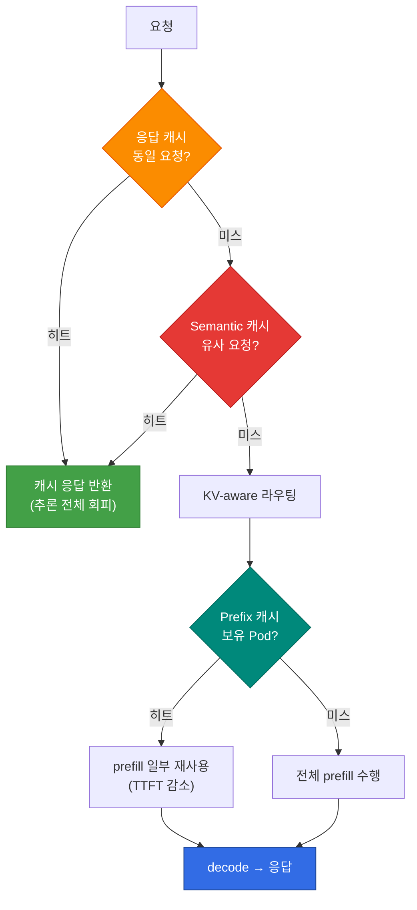

## 개요

추론 캐시는 단일 계층이 아니라 **서로 다른 적중 조건을 가진 세 계층**으로 구성됩니다. 각 계층은 회피하는 연산의 범위가 다르고, 히트율을 높이는 레버와 측정 지점도 다릅니다. 이 문서는 KV/prefix cache, 응답(exact-response) cache, semantic cache를 하나의 의사결정 프레임으로 통합하고, 계층별 히트율 목표와 튜닝 방법을 정리합니다.

각 계층의 상세 구현은 전용 문서에서 다룹니다. 이 문서는 **세 계층을 함께 보고 어디를 튜닝할지 판단**하는 지도 역할을 합니다. 추론 인프라 전체에서의 위치는 [추론 인프라 개요](../index.md)의 L5 캐시 계층에 해당합니다.

## 3계층 캐시 비교

**표 1. 추론 캐시 세 계층의 적중 조건·회피 연산·적중 단위 비교**

| 계층 | 적중 조건 | 회피하는 연산 | 적중 단위 | 상세 문서 |
|------|----------|-------------|----------|----------|
| **KV / Prefix Cache** | 동일 prefix(시스템 프롬프트·공통 컨텍스트) | prefill 일부 | Pod 또는 공유 KV 계층 | [KV Cache 최적화](./kv-cache-optimization.md) |
| **응답 캐시(Exact-Response Cache)** | 완전 동일 요청(정확 매칭) | 전체 추론 | 게이트웨이/앱 | [라우팅 전략](../inference-routing/routing-strategy.md) |
| **Semantic Cache** | 의미적으로 유사한 요청(임베딩 유사도) | 전체 추론 | 게이트웨이/앱 | [Semantic Caching 전략](./semantic-caching-strategy.md) |

:::note 용어: 이 문서의 "응답 캐시"와 공급자의 "prompt caching"은 다릅니다
이 문서에서 두 번째 계층으로 부르는 **응답 캐시**는 완전히 동일한 요청에 대해 **최종 응답 전체**를 재사용해 추론 전체를 회피하는 게이트웨이/앱 계층 캐시입니다. 반면 Amazon Bedrock 등 공급자가 제공하는 **prompt caching**은 요청의 **공통 prefix(접두부) 토큰**을 서빙 엔진에서 재사용해 prefill 일부만 줄이는 기능으로, 위 표의 KV / Prefix Cache 계층에 해당합니다. 공급자 prompt caching은 응답 전체가 아니라 prefix 토큰 재사용이며 캐시 적중이 보장되지 않습니다([AWS Bedrock prompt caching](https://docs.aws.amazon.com/bedrock/latest/userguide/prompt-caching.html)). 두 개념을 혼동하지 않도록 이 문서에서는 응답 전체 재사용 계층을 "응답 캐시"로 부릅니다.
:::

세 계층은 배타적이지 않습니다. 게이트웨이 레벨에서 semantic·응답 cache로 전체 추론을 회피하고, 캐시 미스 시 서빙 엔진 레벨에서 KV/prefix cache로 prefill을 줄이는 식으로 **중첩 적용**하는 것이 일반적입니다.

**그림 1. 응답 캐시·Semantic 캐시·KV/Prefix 캐시를 순서대로 조회하는 중첩 흐름**

위 순서는 이 문서가 선택한 설계입니다. 정확 매칭(응답 캐시)을 유사도 매칭(semantic 캐시)보다 **먼저** 조회하므로, 완전히 동일한 요청에 대해 저장된 정확한 응답이 있으면 근사(approximate) 응답이 그것을 덮어쓰지 못합니다. semantic 캐시를 먼저 두면 정확한 응답이 있는데도 임계값을 통과한 유사 응답을 반환할 수 있어, 품질 가드가 없는 한 권장하지 않습니다.

## 계층별 히트율 전략

### KV / Prefix Cache {#kv--prefix-캐시}

Prefix cache는 동일 시스템 프롬프트나 공통 컨텍스트를 가진 요청의 prefill을 재사용합니다. 히트율을 높이는 레버는 다음과 같습니다.

- **프롬프트 구조 정렬**: 변하지 않는 부분(시스템 프롬프트·few-shot 예시)을 요청 앞쪽에 고정하면 prefix 일치 구간이 길어집니다.
- **KV cache-aware 라우팅**: 같은 prefix를 가진 요청을 캐시 보유 Pod로 보냅니다. Round-Robin은 이 캐시를 무력화합니다([기존 L7 게이트웨이의 한계](../index.md#기존-l7-게이트웨이의-한계)).
- **공유 KV 계층(LMCache)**: GPU 밖으로 캐시를 확장해 Pod·노드를 넘어 재사용합니다([LMCache](./lmcache.md)).

상세 동작은 [KV Cache 최적화](./kv-cache-optimization.md)를 참조하세요.

### 응답 캐시 (정확 매칭) {#prompt-캐시-정확-매칭}

완전히 동일한 요청에 대해 저장된 응답을 반환합니다. 구현이 단순하고, 유사도 매칭과 달리 **근사 매칭에서 오는 오탐(의미는 다른데 유사하다고 판정)이 없습니다**. 다만 "오탐 위험이 없다"는 것은 근사 매칭 오류에 한정된 보장이며, 키 구성이 불충분하거나 캐시된 응답이 낡으면 잘못된 재사용이 발생할 수 있습니다. 따라서 재사용 적격성은 요청 텍스트뿐 아니라 **테넌트·인증 주체, 대상 모델/버전, 컨텍스트(도구·시스템 프롬프트), 신선도(TTL·무효화)** 를 캐시 키에 포함해 판단해야 합니다. 요청 텍스트가 한 글자라도 다르면 미스가 되므로, 정형화된 요청(고정 템플릿·배치 작업)에서 효과가 큽니다.

### Semantic Cache (유사도 매칭) {#semantic-캐시-유사도-매칭}

요청을 임베딩으로 변환해 **의미적으로 유사한** 과거 요청의 응답을 반환합니다. 히트율과 품질은 유사도 임계값에 좌우되는데, 임계값은 **정밀도(precision)와 재현율(recall)의 트레이드오프**를 조절하는 레버이지 응답의 정확성을 보장하는 값이 아닙니다. 임베딩 유사도가 높다는 것은 두 요청이 가깝다는 뜻일 뿐, 캐시된 응답이 새 요청에 대해 정답이라는 뜻은 아닙니다.

- **임계값이 높으면**: 수용되는 매칭이 줄어 오탐(의미가 다른데 반환)은 감소하지만 히트율이 낮아집니다(재현율↓).
- **임계값이 낮으면**: 히트율은 높아지지만 의미가 다른 요청에 과거 응답을 반환하는 오탐 위험이 커집니다(정밀도↓).

적정 임계값은 추론으로 정할 수 없고, 도메인별 **라벨링된 질의·응답 쌍**으로 오탐율을 측정해 검증해야 합니다.

임계값 설계, 캐시 키 구성, 멀티테넌시 처리는 [Semantic Caching 전략](./semantic-caching-strategy.md)에서 상세히 다룹니다.

## 히트율 목표와 측정

캐시 효과는 측정 없이는 관리할 수 없습니다. 계층별로 적중률을 분리해 측정하고, 게이트웨이·서빙 엔진의 메트릭을 함께 봐야 합니다. 이때 적중의 **단위가 계층마다 다르다**는 점에 주의해야 합니다. KV/Prefix 캐시의 적중률은 서빙 엔진이 보고하는 **토큰 단위 prefix 적중률**(vLLM은 prefix cache hit을 토큰 기준으로 집계합니다. [vLLM v1 metrics loggers.py](https://raw.githubusercontent.com/vllm-project/vllm/v0.23.0/vllm/v1/metrics/loggers.py))이고, 응답·semantic 캐시의 적중률은 게이트웨이가 보는 **요청 단위 응답 적중률**입니다. 두 값을 같은 축에서 비교하면 안 됩니다.

**표 2. 캐시 계층별 측정 지점·적중 단위와 제안 시작값**

| 지표 | 측정 지점 | 적중 단위 | 제안 시작값(측정 전) |
|------|----------|----------|----------|
| **KV Cache Hit Rate** | 서빙 엔진(vLLM 메트릭) | 토큰 단위 prefix | 공유 프롬프트 워크로드에서 60%(제안 목표) |
| **Semantic Cache Hit Rate** | LLM API Gateway | 요청 단위 응답 | 워크로드 특성에 따라 상이(제안 시작값 30%) |
| **오탐율(False Hit)** | Semantic 캐시 품질 검증 | 요청 단위 응답 | 임계값 튜닝으로 최소화 |

:::warning 위 수치는 측정값이 아니라 제안된 시작값입니다
표의 수치는 이 문서가 제안하는 **출발점**일 뿐 특정 워크로드·비용 모델에서 측정된 값이 아닙니다. 특히 "semantic 캐시 30% 이상이면 비용 효과가 뚜렷하다"는 임계값은 조직마다 다른 토큰 단가, 임베딩·벡터 검색 비용에 따라 달라지므로 검증 없이 일반화할 수 없습니다. semantic 캐시는 적중을 판정하기 위해 **매 요청마다 임베딩 생성과 벡터 검색 비용**이 들기 때문에, 순비용 이득은 (회피한 추론 비용) − (조회 비용)으로 평가해야 합니다. 공유 프롬프트·반복 질의가 많은 워크로드에서는 위 시작값이 참고가 되지만, 다양성이 높은 요청에서는 비현실적일 수 있으므로 **실제 트래픽으로 측정한 baseline에서 목표를 재설정**해야 합니다.
:::

관측 도구 연동(Langfuse OTel)과 대시보드 패널 구성은 [Semantic Caching 전략 — 관측성](./semantic-caching-strategy.md#6-관측성-langfuse-연동)과 [라우팅 전략 — 모니터링 & Observability](../inference-routing/routing-strategy.md#모니터링--observability)를 참조하세요.

## 참고 자료

### 공식 문서
- [vLLM Automatic Prefix Caching](https://docs.vllm.ai/en/latest/features/automatic_prefix_caching.html) — vLLM Prefix Caching 공식 문서
- [Langfuse Documentation](https://langfuse.com/docs) — 캐시 적중률 추적을 위한 관측성 도구

### 논문 / 기술 블로그
- [PagedAttention (SOSP 2023)](https://arxiv.org/abs/2309.06180) — KV cache 관리 기반 논문
- [GPTCache](https://github.com/zilliztech/GPTCache) — semantic cache 오픈소스 구현

### 관련 문서 (내부)
- [KV Cache 최적화](./kv-cache-optimization.md) — Prefix Caching과 KV Cache-Aware Routing
- [Semantic Caching 전략](./semantic-caching-strategy.md) — 유사도 임계값·캐시 키 설계
- [LMCache](./lmcache.md) — 공유 KV cache 계층