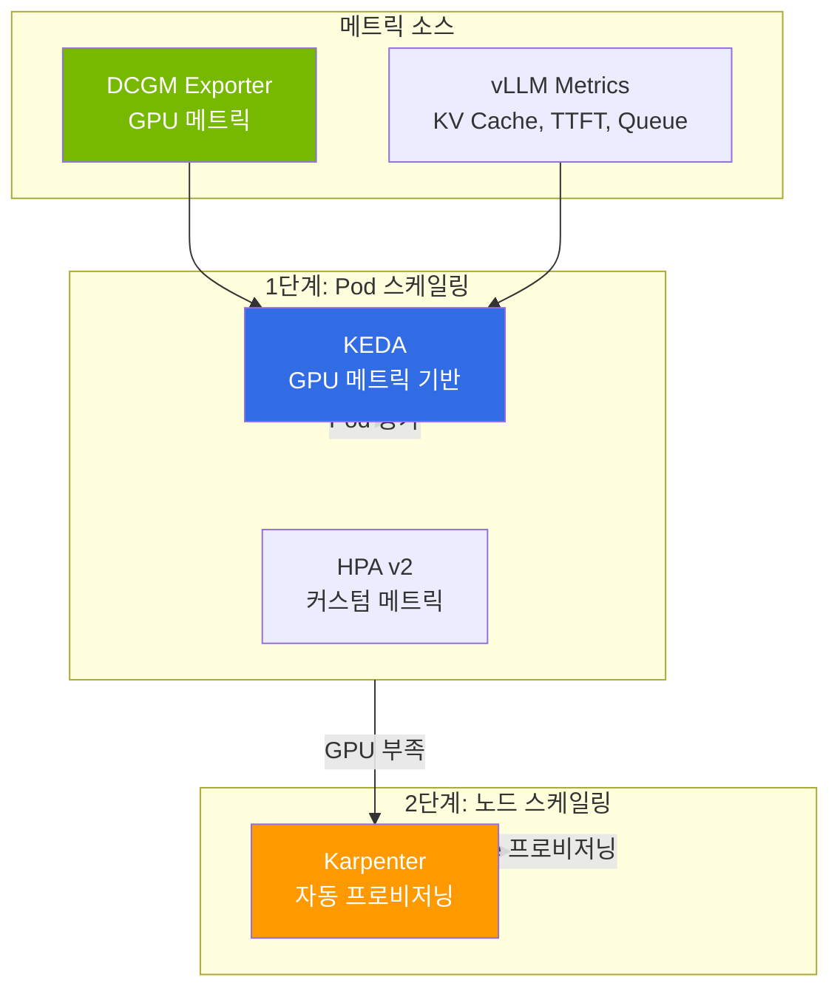

## 개요

LLM 서빙 운영에서 GPU 가동 시간은 비용과 직결되며, 트래픽 변동에 맞춰 자원을 탄력적으로 확장·축소하는 오토스케일링이 비용 효율을 좌우합니다. 본 문서는 LLM 서빙에 특화된 2-Tier 스케일링(Pod·노드), DRA(Dynamic Resource Allocation)의 현실적 제약, 그리고 GLM-5(744B), Kimi K2.5(1T) 등 대형 MoE 모델 배포 과정에서 축적된 실전 운영 교훈을 정리합니다.

:::info 관련 주제
GPU 비용 최적화(Spot·Consolidation·시간대별 스케줄링)는 [EKS 비용 관리](/docs/eks-best-practices/resource-cost/cost-management), GPU·vLLM 모니터링과 Cascade Fallback은 [Agent 모니터링 & 운영](../../operations-mlops/observability/agent-monitoring.md), 온프레미스 GPU 통합은 [하이브리드 GPU 워크로드와 SR-IOV 네트워킹](/docs/eks-hybrid-nodes/compute-gpu/gpu-sriov-networking)를 참조하세요.
:::

## GPU 리소스 관리 & 오토스케일링

### 2-Tier 스케일링 아키텍처

LLM 서빙에서는 Pod 스케일링과 노드 스케일링을 2단계로 구성합니다.

**그림 1. KEDA Pod 스케일링과 Karpenter 노드 스케일링의 2-Tier 구조**



### KEDA 스케일링 구성

LLM 서빙에서 사용하는 스케일링 시그널 3가지:

```yaml
apiVersion: keda.sh/v1alpha1
kind: ScaledObject
metadata:
  name: llm-inference-scaler
spec:
  scaleTargetRef:
    name: vllm-deployment
  minReplicaCount: 2
  maxReplicaCount: 8
  triggers:
    # 1. KV Cache 포화 — 가장 민감한 시그널
    - type: prometheus
      metadata:
        query: avg(vllm:kv_cache_usage_perc)
        threshold: "80"
    # 2. 대기 중인 요청 수
    - type: prometheus
      metadata:
        query: sum(vllm:num_requests_waiting)
        threshold: "10"
    # 3. TTFT SLO 위반 근접
    - type: prometheus
      metadata:
        query: |
          histogram_quantile(0.95,
            rate(vllm_time_to_first_token_seconds_bucket[5m]))
        threshold: "2"
```

### Disaggregated Serving 스케일링 기준

Prefill과 Decode의 병목 시그널이 다릅니다.

**표 1. Prefill/Decode 단계별 스케일 시그널과 GPU 특성**

| | Prefill | Decode |
|---|---|---|
| **병목 시그널** | TTFT 증가, 입력 큐 적체 | TPS 감소, KV Cache 포화 |
| **스케일 기준** | 입력 토큰 처리 대기시간 | 동시 생성 세션 수 |
| **GPU 특성** | Compute 집약 (연산 병목) | Memory 집약 (대역폭 병목) |

### DRA(Dynamic Resource Allocation) 현실

DRA는 Kubernetes 1.34에서 GA된 기능으로, DRA Driver가 `ResourceSlice`로 발행한 디바이스 속성을 바탕으로 CEL 기반 GPU 선택, 토폴로지 인식 스케줄링, MIG·타임슬라이싱을 통한 GPU 공유를 제공합니다. 다만 아래와 같이 **용량 프로비저닝 방식에 따라 호환성이 달라지므로** 사용 전에 조건을 확인해야 합니다(AWS EKS 사용자 가이드 「Manage hardware devices」 기준).

- **Karpenter 동적 프로비저닝과는 비호환**입니다. Karpenter는 노드 생성 전에 스케줄링 가능한 리소스를 시뮬레이션하지만, DRA의 `ResourceSlice`는 DRA Driver가 **노드 생성 후** 발행하므로 Karpenter가 해당 Pod를 배치할 노드를 산정하지 못합니다.
- **Karpenter 정적(static) 용량 프로비저닝, EKS 관리형 노드 그룹(MNG), 셀프 매니지드 노드에서는 지원**됩니다. 즉 DRA를 쓰려면 노드 용량이 사전에 확정되어 있어야 합니다.
- **EKS Auto Mode에서는 현재 미지원**입니다.
- 동일 노드에서 같은 디바이스 유형의 **DRA Driver와 device plugin을 동시에 실행하면 안 됩니다**(하드웨어 과다 할당(silent oversubscription) 위험). DRA Driver 설치 전에 해당 device plugin을 제거하거나 노드를 분리하세요.

:::info DRA 사용 판단
**DRA가 적합한 경우:** MIG 파티셔닝이나 GPU 공유, CEL 기반 속성 GPU 선택, 토폴로지 인식 배치가 필요하고, 노드 용량을 정적으로 확정할 수 있는 경우(Karpenter static·MNG·셀프 매니지드).

**Device Plugin이 충분한 경우:** 전체 GPU 단위 할당만 필요하거나, Karpenter 동적 프로비저닝 또는 Auto Mode를 사용하는 경우. MIG가 필요하면 NVIDIA device plugin의 MIG 전략(single/mixed)으로도 분할 GPU를 노출할 수 있습니다.
:::

GPU 스케일링·DRA의 기초 개념은 [GPU 리소스 관리](../gpu-infrastructure/gpu-resource-management.md)를 참조하세요.

## 실전 교훈: 대형 MoE 모델 배포

### 이미지/모델 다운로드 실패 대응

대형 모델(744GB+)의 가중치 다운로드는 LLM 서빙에서 빈번한 Cold Start 병목입니다. HuggingFace Hub에서 수백 GB를 다운로드할 때 네트워크 불안정, 타임아웃, 디스크 부족 등으로 자주 실패합니다.

#### 문제 유형과 대응

**표 2. 모델 다운로드 실패 유형별 증상과 대응**

| 문제 | 증상 | 대응 |
|------|------|------|
| **HF Hub 다운로드 타임아웃** | Pod CrashLoopBackOff, `ConnectionError` | `HF_HUB_DOWNLOAD_TIMEOUT` 상향 + 중단 지점부터 resume 재다운로드 |
| **대형 파일 부분 다운로드** | 모델 로딩 시 corruption 에러 | 체크섬 검증 + 재다운로드 |
| **컨테이너 이미지 Pull 느림** | `ImagePullBackOff`, 수 분 대기 | 이미지 사전 캐싱 (Bottlerocket 데이터 볼륨, SOCI) |
| **멀티노드 동시 다운로드** | 네트워크 대역폭 경합 | S3 캐싱 + init container 순차 로딩 |
| **EFS 느린 다운로드** | 로딩 시간 30분+ | NVMe emptyDir로 전환 |

#### 전략 1: HuggingFace Hub 고속 전송

HuggingFace Hub가 Xet 스토리지 백엔드로 전환되면서, `huggingface_hub` v0.32.0+에서는 `hf-xet`(Rust 기반 청크 dedup) 바이너리가 기본 포함되어 모든 전송에 사용됩니다. 과거의 `HF_HUB_ENABLE_HF_TRANSFER=1`(`hf_transfer`)은 공식 문서상 **deprecated**이며 더 이상 사용되지 않으므로, 처리량을 높이려면 `HF_XET_HIGH_PERFORMANCE=1`을 설정합니다(네트워크 대역폭과 CPU 코어를 최대한 활용). 속도 배수는 네트워크·파일 구성에 따라 달라지므로 환경에서 직접 측정하세요.

```yaml
env:
  - name: HF_XET_HIGH_PERFORMANCE
    value: "1"              # Xet 고성능 모드 (hf-xet)
  - name: HF_TOKEN
    valueFrom:
      secretKeyRef:
        name: hf-token
        key: token
  # 요청별 응답 대기 타임아웃(기본 10초). 재시도 횟수 설정이 아니라
  # 느린 연결에서 조기 실패를 막기 위한 값입니다.
  - name: HF_HUB_DOWNLOAD_TIMEOUT
    value: "600"
```

#### 전략 2: S3 사전 캐싱 + Init Container

네트워크 변동의 영향을 줄여 Cold Start 안정성을 높이는 방법입니다. 모델 가중치를 S3에 미리 업로드하고, init container에서 로컬 NVMe로 복사합니다. 아래 매니페스트는 하나의 완결된 예시로, S3 접근 권한은 IRSA(IAM Roles for Service Accounts)로 ServiceAccount에 부여합니다. NVMe 백업은 노드 쪽 설정에 의존하므로 「전략 3」과 「스토리지 전략」 절을 함께 참조하세요.

```yaml
apiVersion: apps/v1
kind: Deployment
metadata:
  name: vllm-with-s3-cache
  labels:
    app: vllm-with-s3-cache
spec:
  replicas: 1
  selector:
    matchLabels:
      app: vllm-with-s3-cache
  template:
    metadata:
      labels:
        app: vllm-with-s3-cache
    spec:
      # S3 읽기 권한을 가진 IAM 역할을 IRSA로 연결한 ServiceAccount
      serviceAccountName: vllm-s3-reader
      initContainers:
        # 1단계: S3에서 NVMe로 모델 다운로드 (staging 디렉터리에 받고 성공 시에만 확정)
        - name: model-downloader
          image: amazon/aws-cli:2.15.0
          command: ["/bin/sh", "-c"]
          args:
            - |
              set -euo pipefail
              DEST=/models
              STAGING=/models/.staging
              # 완료 마커가 있으면 이미 캐시된 것으로 보고 건너뜀
              if [ -f "$DEST/.download-complete" ]; then
                echo "Model already cached, skipping download"
                exit 0
              fi
              echo "Downloading model from S3 to staging..."
              rm -rf "$STAGING" && mkdir -p "$STAGING"
              # sync 실패(네트워크/권한 오류 등)는 set -e로 즉시 비정상 종료 → Pod 재시작
              aws s3 sync s3://model-cache/qwen3-32b-fp8/ "$STAGING/" --no-progress
              echo "Verifying downloaded shards..."
              # safetensors 인덱스가 선언한 모든 shard가 실제로 존재하고 크기가 0이 아닌지 확인
              INDEX="$STAGING/model.safetensors.index.json"
              test -s "$INDEX"
              python3 - "$INDEX" "$STAGING" <<'PY'
              import json, os, sys
              index_path, root = sys.argv[1], sys.argv[2]
              with open(index_path) as f:
                  shards = set(json.load(f)["weight_map"].values())
              for shard in sorted(shards):
                  p = os.path.join(root, shard)
                  if not os.path.isfile(p) or os.path.getsize(p) == 0:
                      sys.exit(f"missing or empty shard: {shard}")
              print(f"verified {len(shards)} shards")
              PY
              # 검증을 통과한 경우에만 최종 위치로 이동하고 완료 마커 기록
              mv "$STAGING"/* "$DEST"/
              rm -rf "$STAGING"
              touch "$DEST/.download-complete"
              echo "Model verified successfully"
          volumeMounts:
            - name: model-cache
              mountPath: /models
          resources:
            requests:
              cpu: "2"
              memory: 4Gi
      containers:
        - name: vllm
          # Qwen3 아키텍처를 지원하는 vLLM 버전 (vllm>=0.8.5)
          image: vllm/vllm-openai:v0.8.5
          args:
            - /models
            - "--gpu-memory-utilization=0.95"
          volumeMounts:
            - name: model-cache
              mountPath: /models
          resources:
            limits:
              nvidia.com/gpu: "1"   # GPU 요청(limits=requests로 자동 설정)
      volumes:
        - name: model-cache
          # emptyDir가 NVMe로 뒷받침되려면 노드가 instance-store 볼륨을 ephemeral
          # 스토리지로 사용해야 합니다(Karpenter EC2NodeClass의 instanceStorePolicy: RAID0).
          # 그렇지 않으면 루트 EBS 볼륨에 생성됩니다. sizeLimit는 상한일 뿐 용량 보장이 아닙니다.
          emptyDir:
            sizeLimit: 200Gi
```

#### 전략 3: 컨테이너 이미지 사전 캐싱

vLLM/SGLang 이미지(10-20GB)의 Pull 시간을 줄이는 방법입니다. Karpenter에는 이미지를 미리 당겨오는(pre-pull) 전용 기능이 없습니다. 아래 설정은 이미지 **가비지 컬렉션(GC) 임계값을 높여, 이미 받은 이미지가 노드에 오래 남아 재사용되도록 캐시 유지(retention)**를 돕는 것일 뿐, 신규 노드로의 사전 다운로드를 수행하지는 않습니다. 콜드 스타트 자체를 줄이려면 뒤의 SOCI(지연 로딩)를 함께 사용하세요.

kubelet 설정은 Karpenter v1에서 `NodePool`이 아니라 **`EC2NodeClass.spec.kubelet`**로 이동했으며, `NodePool`은 `nodeClassRef`로 해당 EC2NodeClass를 참조해야 합니다.

```yaml
apiVersion: karpenter.sh/v1
kind: NodePool
metadata:
  name: gpu-inference
spec:
  template:
    spec:
      # 필수: 사용할 EC2NodeClass 참조
      nodeClassRef:
        group: karpenter.k8s.aws
        kind: EC2NodeClass
        name: gpu-inference
---
apiVersion: karpenter.k8s.aws/v1
kind: EC2NodeClass
metadata:
  name: gpu-inference
spec:
  # kubelet 설정은 EC2NodeClass에 위치
  kubelet:
    # 이미지 GC 임계값을 높여 이미 받은 이미지의 캐시 유지(retention)를 늘림
    # (사전 Pull이 아니라, 디스크 압박 시 이미지 제거 시점을 늦추는 설정)
    imageGCHighThresholdPercent: 90
    imageGCLowThresholdPercent: 85
```

**SOCI (Seekable OCI) 인덱스 활용:**

SOCI는 이미지를 지연 로딩(lazy-loading)으로 Pull하여 컨테이너 시작 시간을 줄이는 기법으로, (1) 이미지에 대한 SOCI 인덱스를 ECR에 게시하고 (2) 노드의 containerd에 SOCI 스냅샷터를 proxy plugin으로 설정해야 동작합니다. 인덱스만 만든다고 자동으로 적용되지 않습니다. AWS 공식 자료의 개선 효과는 플랫폼과 이미지에 따라 달라지므로(예: Fargate 약 50%, SageMaker BYOI 이미지 크기별 30-70%) 보고된 수치는 측정 환경과 함께 해석하고, 운영 전 자체 이미지로 측정하세요. 효과는 압축 레이어가 큰 대형 이미지에서 두드러집니다.

```bash
# SOCI 인덱스 생성: awslabs/soci-snapshotter의 soci CLI 사용 (예: v0.16.1)
soci create 123456789012.dkr.ecr.us-east-2.amazonaws.com/vllm:v0.8.5
soci push  123456789012.dkr.ecr.us-east-2.amazonaws.com/vllm:v0.8.5

# 노드 요구 사항: containerd에 SOCI 스냅샷터를 proxy plugin으로 설정하고
#   [plugins."io.containerd.grpc.v1.cri".containerd] snapshotter = "soci" 로 지정해야 함
#   (EKS 관리형 노드 그룹은 launch template/userdata로 스냅샷터 설치·구성)
# 참고: Bottlerocket은 기본 overlayfs 스냅샷터를 사용하며, SOCI는 자동 적용되지 않음
#   — Auto Mode/Bottlerocket에서의 자동 지원은 별도 공식 근거 확인 필요
# CloudFormation SOCI Index Builder로 인덱스 생성을 자동화할 수 있음:
# https://github.com/awslabs/soci-snapshotter
```

#### 전략 4: 멀티노드 LWS의 모델 다운로드 조율

LWS로 멀티노드 배포 시, 각 Pod가 서로 다른 노드에 스케줄되고 모델 캐시로 노드 로컬 NVMe(`emptyDir`)를 쓰면 **노드 간 캐시 공유가 불가능**합니다. 따라서 Leader/Worker가 각자 S3에서 독립적으로 다운로드하는 것이 기본 동작이며, "Leader만 받고 Worker가 기다린다"는 조율은 노드 로컬 `emptyDir`만으로는 성립하지 않습니다. 아래는 두 개의 **독립적인** Pod 조각(fragment)으로, 각 노드가 S3에서 직접 받습니다. `set -e`로 다운로드 실패 시 init container가 비정상 종료되어 Pod가 재시작됩니다.

```yaml
# Leader Pod (LWS leaderTemplate의 일부). 노드 로컬 NVMe emptyDir에 받음
initContainers:
  - name: model-downloader
    image: amazon/aws-cli:2.15.0
    command: ["/bin/sh", "-c"]
    args:
      - |
        set -euo pipefail
        aws s3 sync s3://model-cache/glm5-fp8/ /models/ --no-progress
    volumeMounts:
      - name: model-cache
        mountPath: /models
```

```yaml
# Worker Pod (LWS workerTemplate의 일부). 다른 노드이므로 독립적으로 받음
initContainers:
  - name: model-downloader
    image: amazon/aws-cli:2.15.0
    command: ["/bin/sh", "-c"]
    args:
      - |
        set -euo pipefail
        # 노드 로컬 emptyDir는 노드별 독립이므로 Leader 캐시를 공유할 수 없음 → 각자 다운로드
        aws s3 sync s3://model-cache/glm5-fp8/ /models/ --no-progress
    volumeMounts:
      - name: model-cache
        mountPath: /models
```

진짜로 한 번만 받아 공유하려면 노드 로컬 `emptyDir`가 아니라 노드 간 공유 스토리지(EFS·FSx for Lustre 등 `ReadWriteMany`)에 받고, 완료 마커 파일이 생길 때까지 다른 Pod가 대기(폴링)하도록 구성해야 합니다.

:::tip 다운로드 방식 비교 (정성적)
아래 표는 측정된 벤치마크가 아니라 각 방식의 **설계상 특성**을 비교한 것입니다. 실제 소요 시간은 모델 크기, 인스턴스 네트워크 대역폭, 동시성, 캐시 상태(최초 다운로드인지 재기동인지)에 따라 크게 달라지므로, 운영 환경에서 직접 측정하세요. "비용" 열은 요금이 발생하는 항목만 표기했습니다(전송 자체는 무료라도 S3 저장·요청, EFS/FSx 프로비저닝, 인스턴스 가동 비용은 별도).

**표 3. 모델 다운로드 방식별 전송 경로·캐시 상태·발생 비용 비교**

| 방식 | 전송 경로 | 캐시 상태 | 발생 비용 항목 |
|------|----------|-----------|---------------|
| HF Hub 직접 | 외부 → Pod | 최초 다운로드 | 인스턴스 가동(전송 요금 없음), 타임아웃 리스크 큼 |
| HF Hub + `HF_XET_HIGH_PERFORMANCE` | 외부 → Pod (Xet 가속) | 최초 다운로드 | 인스턴스 가동 |
| S3 사전 캐싱 + init container | S3(동일 리전) → 노드 NVMe | 최초 다운로드 | S3 저장·요청, 인스턴스 가동 |
| FSx for Lustre | FSx → Pod (RWX 공유) | 최초/공유 | FSx 프로비저닝(상시), 인스턴스 가동 |
| NVMe 로컬 캐시 | 노드 로컬 디스크 읽기 | Pod가 **같은 노드**에서 재기동되어 캐시가 남아 있는 경우만 | 인스턴스 가동 |

NVMe 로컬 캐시의 "빠름"은 이미 받아 둔 가중치를 **같은 노드의 로컬 디스크에서 다시 읽는** 경우에 한합니다(「스토리지 전략」 표의 순차 읽기 대역폭 참조). `emptyDir`는 Pod 단위 수명이므로 Pod가 삭제·재생성되면 캐시도 사라지며, 다른 노드로 스케줄되면 다시 다운로드해야 합니다.
:::

### EKS Auto Mode GPU 제약 사항

GLM-5(744B MoE)와 Kimi K2.5(1T MoE) 배포 과정에서 확인된 제약사항입니다.

#### p6-b200 지원 추가

2026년 4월 초(2026-04-10 이전) 기준 EKS Auto Mode의 managed Karpenter는 p6-b200.48xlarge를 프로비저닝할 수 없었으나, **2026-04-10부터 지원이 추가되었습니다**. 현재 p6-b200, p6-b300, p5e, p5en, trn2 등이 공식 지원 인스턴스 목록에 포함되어 있습니다.

#### GPU 인스턴스 용량 확보

서울/도쿄 리전에서 p5.48xlarge는 InsufficientCapacity가 빈번합니다. **us-east-2 (Ohio) Spot에서 $13-15/hr로 확보 가능**합니다 (On-Demand $55.04/hr 대비 약 73-76% 절감, 2025년 6월 P5 가격 44% 인하 반영). 상세한 GPU 비용 절감 전략은 [EKS 비용 관리 — GPU 워크로드 비용 최적화](/docs/eks-best-practices/resource-cost/cost-management)를 참조하세요.

**표 4. 리전별 p5.48xlarge On-Demand/Spot 가격과 Spot 절감률**

| 리전 | p5.48xlarge On-Demand | p5.48xlarge Spot | Spot 절감률 |
|------|---------------------|-----------------|----------|
| ap-northeast-2 (서울) | InsufficientCapacity | 미확인 | — |
| ap-northeast-1 (도쿄) | InsufficientCapacity | 미확인 | — |
| **us-east-2 (Ohio)** | $55.04/hr | **$13~15/hr** | **약 73~76%** |

#### GPU Operator 충돌

Auto Mode는 GPU 노드에 Device Plugin을 내장 제공합니다. 그 위에 NVIDIA GPU Operator를 `devicePlugin.enabled=true`로 설치하면 **같은 노드에서 두 Device Plugin이 동일한 GPU를 중복 광고**하여, 관측된 사례에서는 노드의 `nvidia.com/gpu` allocatable이 비정상(예: `0`)으로 보고되었습니다. Auto Mode 노드에서는 NodePool 레이블 `nvidia.com/gpu.deploy.device-plugin: "false"`로 GPU Operator의 Device Plugin을 띄우지 않아, Auto Mode 내장 플러그인만 GPU를 광고하도록 합니다. GPU Operator는 `nvidia.com/gpu.deploy.*` 레이블이 없거나 값이 비어 있을 때만 레이블을 붙이므로 이 `false` 값을 그대로 둡니다([`addGPUStateLabels`](https://github.com/NVIDIA/gpu-operator/blob/fbe793082611bfdba1621b614edefdd3461bf14d/controllers/state_manager.go)). `devicePlugin.enabled=false`로도 충돌을 피할 수 있지만, 이 설정은 모든 노드에서 Device Plugin을 끕니다. Auto Mode 노드에서는 드라이버와 container toolkit도 AWS가 관리하므로, [awslabs/ai-on-eks PR #288](https://github.com/awslabs/ai-on-eks/pull/288)에서 검토된 구성은 GPU Operator를 `driver.enabled=false`, `toolkit.enabled=false`로 설치하고 DCGM Exporter, NFD, GFD를 유지합니다. `allocatable=0`은 관측된 사례이며, 모든 환경에서 동일하게 나타난다고 일반화할 수는 없습니다.

#### EC2 인스턴스 직접 종료 불가

Auto Mode가 프로비저닝한 노드는 EC2 **managed instance**로, 인스턴스 수명 주기(프로비저닝·교체·종료)를 서비스 공급자인 EKS(`Operator`/`Principal` = `eks.amazonaws.com`)가 소유합니다. 그 결과 사용자는 managed instance를 **직접 수정하거나 `ec2:TerminateInstances`로 종료할 수 없습니다**(AWS EC2 사용자 가이드 「Amazon EC2 managed instances」 기준). 특정 메커니즘(리소스 기반 정책, 루트 계정 우회 가능 여부 등)은 공식 문서에 명시돼 있지 않으므로 단정하지 않습니다.

노드 정리는 Karpenter를 통해 수행합니다.

- **특정 노드만** 교체·정리하려면 해당 노드의 `NodeClaim`을 삭제합니다(`kubectl delete nodeclaim <name>`). Karpenter가 drain 후 인스턴스를 정상 종료합니다.
- `NodePool`을 삭제하면 그 NodePool이 소유한 **모든 NodeClaim/노드가 함께 정리**되므로(플릿 전체 영향), 단일 노드 교체 용도로는 사용하지 마세요.

Karpenter의 drain·consolidation·종료 동작은 [Karpenter Disruption 문서](https://karpenter.sh/docs/concepts/disruption/)를 참조하세요.

### 서빙 프레임워크 호환성

**표 5. 모델별 vLLM·SGLang 지원 버전과 비고**

| 모델 | vLLM 지원 | SGLang 지원 | 비고 |
|------|---------|-----------|------|
| Qwen3-32B | 지원 (vllm≥0.8.5) | 지원 (sglang≥0.4.6.post1) | llm-d 기본 모델, Apache-2.0 |
| Kimi K2.5 (1T MoE) | 지원 | 지원 | INT4 W4A16 Marlin MoE, `gpu_memory_utilization=0.85` |
| GLM-5 (744B MoE, 40B active) | 지원 (vllm≥0.19.0) | 지원 (sglang≥0.5.10) | DeepSeek Sparse Attention(DSA), MIT 라이선스 |
| DeepSeek V3.2 | 지원 | 지원 | MoE, 671B total / 37B active |

:::warning GLM-5 배포 시 주의
GLM-5-FP8은 모델 카드 기준 vLLM(v0.19.0+)과 SGLang(v0.5.10+) 모두에서 지원됩니다. vLLM 단일 노드 예시는 `vllm serve zai-org/GLM-5-FP8 --tensor-parallel-size 8 --tool-call-parser glm47 --reasoning-parser glm45`이며, 토큰 수가 많은 경우 MTP 스펙 디코딩(`--speculative-config`) 옵션을 추가합니다. 노드당 GPU로 744B(40B active) 가중치를 담지 못해 멀티노드가 필요한 경우, 분산 실행 플래그와 토폴로지는 고정값이 아니라 vLLM/SGLang의 GLM-5 recipe(모델 카드가 링크하는 vLLM `recipes/GLM/GLM5.md`, SGLang cookbook)를 따르세요.
:::

### 스토리지 전략

대형 모델(수백 GB 규모)의 가중치 로딩 시간은 스토리지 성능에 좌우됩니다. 아래 순차 읽기 수치는 측정 환경에 따라 달라지는 **대략적인 관측값**이며, EFS처럼 서비스가 공시한 상한이 있는 경우 상한과 실제 처리량을 구분해 읽어야 합니다.

**표 6. 스토리지별 순차 읽기 성능·멀티노드 공유·권장 시나리오**

| 스토리지 | 순차 읽기(대략) | 멀티노드 공유 | 권장 시나리오 |
|---------|---------|------------|------------|
| **NVMe emptyDir** | ~3,500 MB/s (인스턴스별 상이) | 노드별 개별 | p5 내장 NVMe, 로컬 재읽기 시 최고 성능 |
| EFS | 공시 상한 최대 1,500 MiB/s(Elastic Throughput, **마운트 전체 합산·조건부**) | ReadWriteMany | 소형 모델, 노드 간 공유 필요 시 |
| S3 + init container | ~1,000 MB/s (동시성·인스턴스별 상이) | S3 공유 | 중간 성능, 비용 효율 |
| FSx for Lustre | ~1,000+ MB/s (프로비저닝 처리량에 비례) | ReadWriteMany | 학습 워크로드 |

:::tip 대형 모델 권장
GLM-5-FP8(FP8 가중치 수백 GB 규모), Kimi K2.5(수백 GB 규모) 같은 대형 모델은 노드 로컬 읽기 성능이 높은 **로컬 NVMe(emptyDir)**가 로딩에 유리합니다. 단, `emptyDir`는 Pod 단위 수명이라 **Pod가 재생성되면 캐시가 사라지고**, 가중치를 처음 받을 때는 다른 방식과 동일하게 HuggingFace Hub 직접 다운로드(네트워크·동시성에 따라 수십 분) 또는 S3 사전 캐싱이 필요합니다. p5.48xlarge는 8×3.84TB NVMe SSD를 내장하지만, 이를 ephemeral 스토리지로 쓰려면 노드 설정(Karpenter EC2NodeClass `instanceStorePolicy: RAID0`)이 필요합니다. 정확한 가중치 바이트 수는 사용하는 리비전(FP8/BF16 등)에 따라 다르므로 배포 전 체크포인트 크기를 확인하세요.
:::

### GPU 쿼터 함정

EC2 vCPU 쿼터가 인스턴스 버킷별로 분리되어 있어 주의가 필요합니다.

**표 7. GPU 인스턴스 vCPU 쿼터 종류와 기본값·주의사항**

| 쿼타 | 적용 인스턴스 | AWS 기본값 | 주의사항 |
|------|------------|--------|---------|
| Running On-Demand P instances | p4d, p5, p5en | 0 vCPU | 신규 계정은 0 — 사전 쿼터 증가 필요 (예: p5.48xlarge 2대 = 384 vCPU) |
| Running On-Demand G and VT instances | g5, g6, g6e | 0 vCPU | 신규 계정은 0 — 사전 쿼터 증가 필요 |

GPU NodePool에 `instance-category: [g, p]`를 함께 설정하면, Karpenter가 G 타입을 먼저 시도하여 G 쿼터(64 vCPU)에 걸릴 수 있습니다. P 타입만 필요하면 명시적으로 지정해야 합니다.

## 참고 자료

### 공식 문서
- [KEDA Documentation](https://keda.sh/docs/) — Kubernetes Event-driven Autoscaling
- [Karpenter Documentation](https://karpenter.sh/docs/) — 노드 오토프로비저닝, Disruption, Consolidation
- [NVIDIA DCGM Exporter](https://github.com/NVIDIA/dcgm-exporter) — GPU 센서 메트릭 수집

### 논문·기술 블로그
- [a16z "The Economics of AI"](https://a16z.com/navigating-the-high-cost-of-ai-compute/) — GPU 비용 구조 분석
- [SOCI Snapshotter](https://github.com/awslabs/soci-snapshotter) — 컨테이너 이미지 lazy-loading
- [Spot 인스턴스 운영 가이드 (AWS)](https://aws.amazon.com/ec2/spot/) — Karpenter Spot 중단 대응

### 관련 문서
- [Inference Optimization on EKS (개요)](./index.md) — 추론 최적화 카테고리 진입점
- [KV Cache 최적화 (vLLM Deep Dive + Cache-Aware Routing)](./kv-cache-optimization.md) — vLLM/llm-d/Dynamo 심화
- [Disaggregated Serving + LWS 멀티노드](./disaggregated-serving.md) — Prefill/Decode 분리, LWS 배포
- [GPU 리소스 관리](../gpu-infrastructure/gpu-resource-management.md) — GPU 스케일링, DRA
- [EKS 비용 관리](/docs/eks-best-practices/resource-cost/cost-management) — GPU 워크로드 비용 최적화(Spot·Consolidation)
- [Agent 모니터링 & 운영](../../operations-mlops/observability/agent-monitoring.md) — GPU/vLLM 모니터링, Cascade Fallback
- [하이브리드 GPU 워크로드와 SR-IOV 네트워킹](/docs/eks-hybrid-nodes/compute-gpu/gpu-sriov-networking) — 온프레미스 GPU 추론, 3-Tier Cascade
