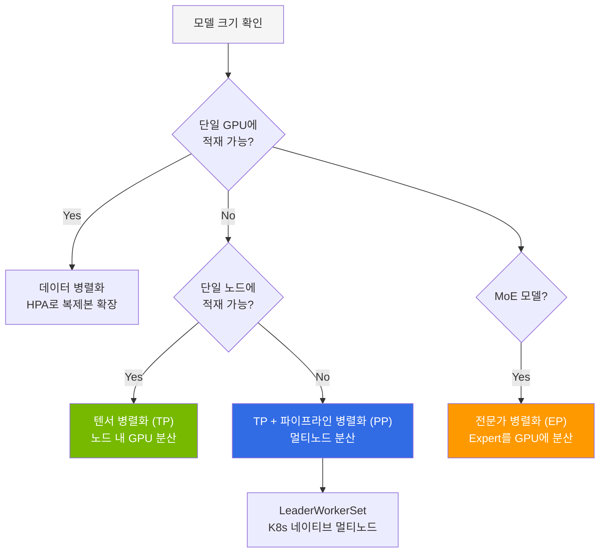
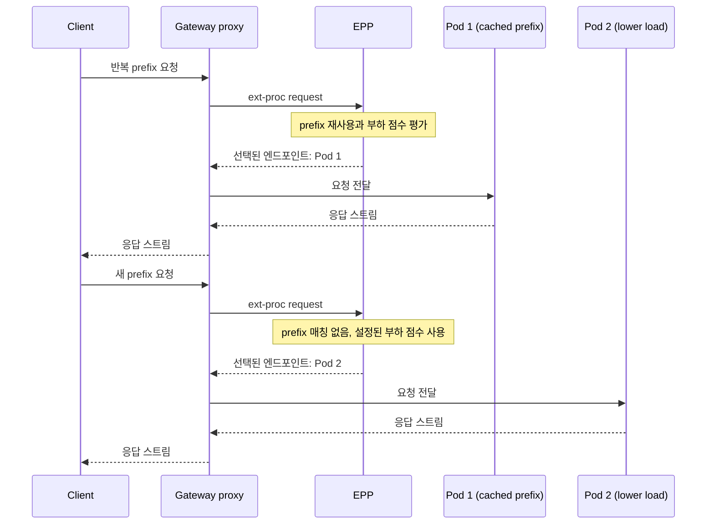
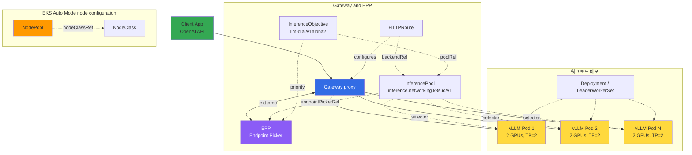

## 개요

LLM 추론 엔진의 성능은 대부분 KV cache(Key-Value Cache)를 얼마나 효율적으로 관리하느냐에 달려 있습니다. 본 문서는 vLLM의 기술 스택과 GPU 메모리 설계 원리, 그리고 여러 Pod 간 KV cache를 공유·재사용하는 **KV Cache-Aware Routing** 전략(llm-d vs NVIDIA Dynamo)을 다룹니다.

## vLLM Deep Dive

### 기술 스택

vLLM은 널리 사용되는 오픈소스 LLM 추론 엔진입니다. 아래 표의 "보고된 효과" 열은 각 수치가 측정된 출처와 조건을 함께 명시합니다. 효과의 크기는 모델·하드웨어·워크로드와 활성화한 기능 조합에 따라 달라지며, 각 수치는 서로 더할 수 없고 임의의 배포 환경에서 보장되지 않습니다.

**표 1. vLLM 기술별 보고된 효과와 동작 원리**

| 기술 | 보고된 효과 (출처·조건) | 동작 원리 |
|------|---------|------|
| **PagedAttention** | [vLLM 공개 발표](https://blog.vllm.ai/2023/06/20/vllm.html)는 기존 서빙 시스템이 단편화와 과다 예약으로 KV cache 메모리의 60–80%를 낭비하며 PagedAttention이 그 낭비를 4% 미만으로 줄인다고 보고합니다. 이는 전체 메모리를 60–80% 줄인다는 의미가 아니라 낭비분을 줄인다는 의미입니다. | 각 시퀀스의 KV cache를 고정 크기의 비연속 블록으로 저장하고 블록 테이블로 매핑하는, OS 가상 메모리 페이징과 유사한 방식 |
| **Continuous Batching** | 같은 발표는 LLaMA-7B/13B(A10G/A100, ShareGPT 트래픽) 기준으로 HuggingFace Transformers 대비 최대 24×, TGI 대비 2.2–3.5× 높은 종단 간 처리량을 보고합니다. 이는 배칭 단독 효과가 아니라 전체 시스템 결과입니다. | 배치 전체가 끝나기를 기다리지 않고 반복(iteration) 단위로 요청을 추가·제거 |
| **FP8 KV Cache** | KV cache를 FP8로 저장하면 KV cache 용량이 약 절반으로 줄어 더 많은 토큰을 담을 수 있습니다. 모델 가중치나 전체 GPU 메모리를 절반으로 줄이는 것은 아닙니다([vLLM Quantized KV Cache](https://docs.vllm.ai/en/latest/features/quantization/quantized_kvcache.html)). | KV cache 텐서를 FP8(`fp8_e4m3`/`fp8_e5m2`)로, per-tensor 또는 per-head 스케일로 저장 |
| **Prefix Caching** | 프롬프트 prefix를 공유하는 요청의 TTFT와 프리필 연산을 줄입니다. 개선 폭은 히트율과 prefix 길이에 따라 달라지며 고정 배수가 아닙니다. | 공유 prefix의 이미 계산된 KV cache 블록을 재사용(해시 기반, 전체 블록만) |
| **Speculative Decoding** | vLLM 문서는 이를 정성적 지연 최적화로 설명하며 그 효과가 "모델 계열·트래픽 패턴·하드웨어·샘플링 설정에 따라 달라진다"고 명시합니다([method-selection guide](https://docs.vllm.ai/en/latest/features/speculative_decoding/)). 고정 배수는 공표되지 않았습니다. | 드래프트 제안기가 여러 토큰을 예측하고 대상 모델이 한 스텝에서 검증 |
| **Chunked Prefill** | 프리필 지연과 디코드 처리량을 맞바꿉니다. 균형점은 청크 크기와 트래픽에 따라 달라집니다. | 긴 프리필을 청크로 나눠 동일 배치의 디코드 스텝과 혼합 |

### GPU 메모리 계산

모델 배포 전 GPU 메모리를 정확히 계획해야 합니다. 프로세스 전체 메모리는 모델 가중치, 프레임워크·활성화 오버헤드, 그리고 동시 처리 중인 모든 시퀀스를 담는 KV cache 풀의 합입니다.

```
프로세스 전체 GPU 메모리 ≈ 모델 가중치 + 비torch 메모리 + PyTorch 활성화 + KV cache 풀

토큰당 KV cache = 2(K·V) × 레이어 수 × num_kv_heads × head_dim × 요소당 바이트
KV cache 풀 ≈ 토큰당 KV cache × (실행 배치의 시퀀스 길이 총합)
```

KV cache 크기는 위 토큰당 항과 캐시된 전체 토큰 수(시퀀스 길이 × 동시성)에 비례하며, 고정된 "× 배치 크기" 배수가 아닙니다. GQA나 MLA(예: Kimi K2.5의 MLA)를 쓰는 모델은 `num_kv_heads` 항이 훨씬 작아, 전체 헤드 수만 보고 추정하는 것보다 KV cache가 작습니다.

**정밀도별 가중치 단독 추정치.** 아래 수치는 가중치만 계산한 추정치(`파라미터 수 × 파라미터당 바이트`)로, 전체 VRAM이 아니라 하한값입니다. 활성화·프레임워크 오버헤드·KV cache 풀이 그 위에 더해지기 때문입니다. MoE 모델은 토큰당 일부만 활성화되더라도 가중치 추정에는 총 파라미터 수를 사용합니다.

**표 2. 정밀도별 파라미터당 바이트와 70B·32B 가중치 추정치**

| 정밀도 | 파라미터당 바이트 | 70B 가중치만 | 32B 가중치만 |
|--------|---------------|---------|---------|
| FP32 | 4 | 280GB | 128GB |
| BF16/FP16 | 2 | 140GB | 64GB |
| INT8 | 1 | 70GB | 32GB |
| INT4 | 0.5 | 35GB | 16GB |

### 병렬화 전략 선택 기준

**그림 1. 모델 크기와 MoE 여부에 따른 병렬화 전략 선택 흐름**



**모델 크기별 구성 예시:**

아래 행은 검증된 용량 수치가 아니라 참고용 출발점입니다. 필요한 GPU 수는 정확한 체크포인트와 양자화, 목표로 하는 컨텍스트 길이·동시성(KV cache 풀을 결정), 남겨둘 여유 공간에 따라 달라집니다. 각 배포는 위 메모리 산식과 자체 벤치마크로 산정하십시오. Expert Parallelism(EP)은 vLLM의 실험적 기능으로 `--enable-expert-parallel`로 명시적으로 활성화해야 하며 보통 데이터 병렬화와 함께 사용합니다(`EP_SIZE = TP × DP`). MoE 모델이라고 자동 적용되지 않습니다([vLLM EP 배포 문서](https://docs.vllm.ai/en/latest/serving/expert_parallel_deployment.html)).

**표 3. 모델 크기별 GPU 구성과 병렬화 설정 예시**

| 모델 예시 | 총/활성 파라미터 | 정밀도 | GPU 구성 예시 | 병렬화(명시 설정 필요) |
|-----------|---------|--------|---------|--------|
| Qwen3-32B | 32B dense | FP8 | 1× H100 80GB (짧은 컨텍스트) | 없음 |
| Llama-3.3-70B | 70B dense | BF16 | 4× H100 (TP=4) | 텐서 병렬 |
| Kimi K2.5 | 1T 총 / 32B 활성 MoE (MLA, 전문가 384개 중 8개 활성) | native INT4 | 멀티 GPU 노드. [모델 카드](https://huggingface.co/moonshotai/Kimi-K2.5)는 vLLM/SGLang/KTransformers를 권장하나 GPU 수를 고정하지 않음 — 컨텍스트·여유 공간 기준으로 산정 | 텐서 병렬, 선택적으로 Expert Parallel(`--enable-expert-parallel`) |
| GLM-5 | 744B 총 / 40B 활성 MoE | FP8 | 멀티노드(예: 노드 간 PP + TP) | 파이프라인 + 텐서 병렬, 선택적으로 Expert Parallel |

### 성능 파라미터

```bash
vllm serve Qwen/Qwen3-32B-FP8 \
  --gpu-memory-utilization=0.95 \
  --max-model-len=32768 \
  --enable-prefix-caching \
  --kv-cache-dtype=fp8 \
  --enable-auto-tool-choice \
  --tool-call-parser=hermes
```

플래그 의미(주석을 명령 밖으로 빼내어, 각 백슬래시 뒤에 바로 개행이 오게 하여 라인 연속이 끊기지 않도록 합니다):

- `--gpu-memory-utilization=0.95` — vLLM이 각 GPU 메모리 중 **모델 실행기(executor) 전체**(가중치·활성화·KV cache 풀 합계)에 사용할 비율이며, KV cache 전용 비율이 아닙니다. 기본값은 v0.19에서 `0.9`, v0.24에서 `0.92`입니다([v0.19 `cache.py`](https://github.com/vllm-project/vllm/blob/v0.19.0/vllm/config/cache.py), [v0.24 `cache.py`](https://github.com/vllm-project/vllm/blob/v0.24.0/vllm/config/cache.py)). KV cache 풀은 가중치와 오버헤드를 제외한 나머지입니다.
- `--max-model-len=32768` — 최대 시퀀스 길이. 단일 시퀀스의 KV cache가 커질 수 있는 상한을 정합니다.
- `--enable-prefix-caching` — 공유 prefix의 KV cache 블록을 재사용(KV cache 설정상 기본 활성화).
- `--kv-cache-dtype=fp8` — **KV cache**를 FP8로 저장하여 KV cache 용량만 약 절반으로 줄입니다. 가중치 정밀도나 전체 메모리는 바꾸지 않습니다.
- `--enable-auto-tool-choice` / `--tool-call-parser=hermes` — Tool calling 자동 지원과 파서 선택.

### 양자화 전략 비교

양자화는 "모델 정밀도를 낮추는 대신 메모리 사용량을 줄이는" 기법입니다([vLLM 양자화 가이드](https://docs.vllm.ai/en/latest/features/quantization/)). 아래 절감치는 BF16/FP16 대비 가중치 비트 산술값(예: 8비트 ≈ 가중치 바이트 절반, 4비트 ≈ 1/4)이며, 활성화와 KV cache 풀을 포함한 전체 GPU 메모리의 실측 절감치가 아니고 고정된 품질·속도 순위도 아닙니다. 품질과 처리량은 구체적인 변형·모델·백엔드에 따라 달라지고, 각 형식은 특정 하드웨어에서만 지원됩니다. vLLM은 아키텍처별 지원 매트릭스(Volta/Turing/Ampere/Ada/Hopper, AMD, Intel, CPU)를 공개하므로 선택 전에 확인하십시오.

**표 4. 양자화 형식별 가중치 비트 용량과 도입 전 확인 사항**

| 양자화 | BF16 대비 가중치 비트 용량 | 도입 전 확인 사항 |
|--------|----------|------------|
| **FP8 (W8A8)** | 가중치 바이트 약 ½ | Ada/Hopper(및 AMD)부터 지원. 모델별로 품질 측정 필요 |
| **AWQ** | 4비트 가중치, 약 ¼ | Volta/AMD 미지원. weight-only라 활성화 중심 구간은 가속 폭이 작음 |
| **GPTQ** | 4비트 가중치, 약 ¼ | 오프라인 보정. GPU 지원 폭이 넓음. 모델별 정확도 검증 필요 |
| **GGUF** | 다중 비트 폭(2~8비트) | 혼합·오프라인 용도에 편리. 처리량은 비트 폭·커널에 따라 상이 |

고정 순위에 의존하지 말고, 목표 하드웨어를 vLLM 지원 매트릭스와 대조하고 자체 모델에서 품질·처리량을 벤치마크하여 변형을 선택하십시오.

## KV Cache-Aware Routing

### 기존 문제: Round-Robin의 한계

기존 vLLM 배포는 단순 Round-Robin 로드 밸런싱에 의존합니다. 동일한 시스템 프롬프트를 사용하는 요청이 매번 다른 Pod로 분산되면, 각 Pod에서 동일한 프리필 연산을 반복 수행합니다. 이는 GPU 연산 낭비이자 TTFT 증가의 원인입니다.

### 해결: KV cache 상태 인식 라우팅

llm-d와 NVIDIA Dynamo는 각 vLLM Pod의 KV cache 상태를 인식하여, 동일한 prefix를 가진 요청을 이미 해당 KV cache를 보유한 Pod로 라우팅합니다.

다음 흐름은 설정된 EPP 플러그인의 동작을 단순화한 예시입니다. 캐시가 있는 Pod도 부하에 따라 선택되지 않을 수 있습니다.

**그림 2. prefix 재사용과 부하 점수에 따른 KV cache 인지 라우팅 흐름**



:::note 라우팅 결정과 추론(inference)은 별개의 작업
KV cache 인지 라우팅에서 **라우팅 결정 자체는 모델 추론이 아닙니다.** 이 경로에는 서로 다른 세 가지 메커니즘이 관여하며, 하나의 컴포넌트가 전부 수행하지 않습니다.

- **토큰화와 블록 키 생성**: 프롬프트를 토큰화하고 고정 크기 블록 단위로 해시 키를 만듭니다. vLLM의 Automatic Prefix Caching은 `hash(부모 블록 해시, 블록 토큰, LoRA ID·멀티모달·cache salt 등 추가값)` 형태로 전체 블록에 대해서만 키를 계산하며, 모델 forward pass가 없습니다([vLLM Automatic Prefix Caching 설계](https://github.com/vllm-project/vllm/blob/v0.24.0/docs/design/prefix_caching.md)).
- **인덱스(producer) 유지**: Gateway API Inference Extension에서는 스케줄링 이전에 "approximate prefix cache data producer"가 어느 Pod가 어떤 prefix 블록을 캐시했는지에 대한 매칭 정보(`PrefixCacheMatchInfo`)를 준비합니다.
- **스코어러 평가**: `prefix-cache-scorer`는 **프롬프트를 해시하거나 캐시 상태를 유지하지 않습니다.** 이미 준비된 `PrefixCacheMatchInfo`를 받아 후보 엔드포인트별로 `score = matchBlocks / totalBlocks`를 계산할 뿐입니다([llm-d prefix-cache-scorer README](https://github.com/llm-d/llm-d-router/blob/v0.9.0/pkg/epp/framework/plugins/scheduling/scorer/prefix/README.md)). 즉 해싱·매칭은 producer가, 점수화는 scorer가 담당합니다.

**시맨틱(의미 기반) 라우팅**은 context-aware 라우팅의 한 가지 설정 방식으로, 전부가 아닙니다. 이 방식은 프롬프트를 인코더·분류 모델(BERT 계열)에 통과시켜 의도를 분류하므로 라우팅 경로에서 **경량 추론**이 한 번 발생합니다(vLLM Semantic Router). 반면 위의 prefix 해시 조회 방식은 모델 추론을 수행하지 않습니다.

두 경우 모두 라우팅으로 선택된 **Pod가 수행하는 최종 워크로드는 LLM 추론**입니다. 따라서 "라우팅 결정이 추론인가"와 "최종 워크로드가 추론인가"는 분리해서 판단해야 합니다.
:::

**KV Cache-Aware Routing의 효과(정성적):**

각 효과의 방향은 예측 가능하지만 크기는 prefix 히트율·prefix 길이·모델·하드웨어·부하에 따라 달라지므로, 아래 표는 보장된 백분율이 아니라 조건부 효과를 제시합니다. 공표된 단일 추정치는 llm-d의 것으로, prefix-cache 인지 라우팅이 round-robin 대비 **출력 처리량 3×, TTFT 2× 개선**을 보였고 이는 Llama 3.1 70B·4× AMD MI300X에서 측정되었습니다([llm-d README, Performance Highlights](https://github.com/llm-d/llm-d/blob/v0.8.1/README.md)). 그 밖의 수치는 워크로드별로 다르므로 직접 측정하십시오.

**표 5. 시나리오별 KV Cache-Aware Routing의 TTFT·프리필 연산·처리량 효과(정성적)**

| 시나리오 | TTFT | GPU 프리필 연산 | 처리량 | 유의점 |
|---------|----------|-------------|-----------|--------|
| 공유 시스템 프롬프트(높은 히트율) | 낮아짐(공유 prefix 프리필 생략) | 감소 | 증가 | 캐시 보유 Pod가 과부하가 아닐 때만 |
| RAG 반복 컨텍스트 | 재사용 구간에서 낮아짐 | 부분 재사용 | 증가 | 실제로 반복되는 컨텍스트 비율에 의존 |
| 대부분 고유한 요청 | 개선 없음. 라우팅의 소량 점수화 오버헤드만 추가 | 재사용 없음 | 로드 밸런싱으로 폴백 | 캐시 Pod에 과집중하면 해당 Pod의 큐 지연이 늘 수 있음 |

### llm-d vs NVIDIA Dynamo 비교

두 프로젝트 모두 KV Cache-aware 라우팅을 제공하지만 접근 방식이 다릅니다. llm-d는 [v0.8.1 (2026-06-26)](https://github.com/llm-d/llm-d/releases/tag/v0.8.1) 기준으로 검토했으며, 해당 태그의 README는 아직 v0.7 기능 셋을 설명합니다. Dynamo 열은 [v1.2.1](https://github.com/ai-dynamo/dynamo/tree/v1.2.1) 기준입니다. 캐시를 보유한 Pod로 요청을 보내는 동작과 Pod 간 KV 전송·오프로딩은 별도 설정입니다.

**표 6. llm-d v0.8.1과 NVIDIA Dynamo v1.2.x의 항목별 비교**

| 항목 | llm-d v0.8.1 | NVIDIA Dynamo v1.2.x |
|------|------------|-------------------|
| **거버넌스** | CNCF 샌드박스 프로젝트(Apache 2.0). Red Hat·Google Cloud·IBM Research·CoreWeave·NVIDIA가 공동 창립 | NVIDIA (Apache 2.0) |
| **KV cache 인덱싱** | Prefix-aware 라우팅 | Flash Indexer (radix tree) |
| **KV cache 전송** | NIXL | NIXL |
| **라우팅** | Gateway API + Envoy EPP | Dynamo Router + 자체 EPP |
| **Pod 스케줄링** | K8s 기본 스케줄러 | KAI Scheduler (GPU-aware) |
| **오토스케일링** | HPA/KEDA 연동 | Planner (SLO 기반 profiling) |
| **KV cache 계층화** | [HBM → CPU RAM → 파일시스템](https://github.com/llm-d/llm-d/blob/v0.8.1/docs/well-lit-paths/foundations/tiered-prefix-cache.md), connector·스토리지 설정 필요 | KVBM 통합 메모리 계층: GPU HBM, 호스트/원격 DRAM, 로컬 SSD, 원격 파일·오브젝트·클라우드 스토리지를 NIXL로 연결([KVBM README](https://github.com/ai-dynamo/dynamo/blob/v1.2.1/docs/components/kvbm/README.md)) |
| **복잡도** | 낮음(K8s 네이티브 스택) | 높음(운영 컴포넌트가 많음) |
| **공표된 벤치마크** | prefix-cache 라우팅이 round-robin 대비 출력 처리량 3×·TTFT 2×(Llama 3.1 70B, 4× MI300X), 계층형 KV 오프로딩이 250 동시 사용자에서 GPU-only 대비 13.9×(4× H100) — [README](https://github.com/llm-d/llm-d/blob/v0.8.1/README.md) 참조 | NVIDIA는 GB200 NVL72에서 disaggregation + wide EP로 최대 7×를 보고. 이는 NVIDIA 하드웨어에서의 NVIDIA 측 수치이며 llm-d와 동일 조건 비교가 아님 |

:::tip 선택 기준
아래는 출발점일 뿐 필수 전환 경로가 아니며, 자체 워크로드로 검증해야 합니다.
- **K8s 네이티브·Gateway API 중심 스택**: llm-d는 Gateway API, HPA/KEDA, 계층형 KV 오프로딩과 통합되며 운영 부담이 더 가볍습니다.
- **NVIDIA GB200/대규모 EP 토폴로지에서 최대 처리량**: Dynamo의 Flash Indexer, SLO 기반 Planner, KVBM 계층화가 이 경우를 겨냥합니다. 7× 수치는 NVIDIA 벤치마크 구성에 한정됩니다.
- **긴 컨텍스트 (128K+)**: 두 프로젝트 모두 CPU/스토리지 오프로딩을 제공하므로 워크로드별 용량·전송 비용을 평가하십시오.
- **소규모 시작**: 두 프로젝트 모두 단독 도입이 가능합니다. 둘 다 KV 전송에 NIXL을 쓰므로 추후 전환이 가능하지만, 규모가 커진다고 반드시 전환해야 하는 것은 아니며 측정된 필요에 따라 결정하십시오.
:::

### Gateway 아키텍처: llm-d 배포 구성

아래 구성은 [llm-d v0.8.1 Gateway Mode](https://github.com/llm-d/llm-d/blob/v0.8.1/docs/architecture/core/router/proxy.md)의 단일 Gateway 예시입니다. 실선은 트래픽·ext-proc 호출, 점선은 설정 참조입니다. InferencePool(`inference.networking.k8s.io/v1`)은 Pod 선택과 EPP 연결을, 선택적 InferenceObjective(`llm-d.ai/v1alpha2`)는 요청 우선순위를 정의합니다. 구 `InferenceModel`을 워크로드 정의로 사용하지 않습니다. 이미지·replica·GPU 요청은 워크로드에서 설정하며 수치는 설명용입니다.

**그림 3. llm-d v0.8.1 단일 Gateway·EPP·워크로드 배포 구성**



## 참고 자료

### 공식 문서
- [vLLM 공식 문서](https://docs.vllm.ai) — 최적화 및 튜닝 가이드
- [vLLM GitHub](https://github.com/vllm-project/vllm) — v0.23.x 릴리스 노트
- [llm-d GitHub](https://github.com/llm-d/llm-d) — K8s 네이티브 분산 추론
- [NVIDIA Dynamo](https://developer.nvidia.com/dynamo) — 분산 추론 프레임워크

### 논문·기술 블로그
- [PagedAttention 논문 (SOSP 2023)](https://arxiv.org/abs/2309.06180) — "Efficient Memory Management for Large Language Model Serving with PagedAttention"
- [Flash Indexer Design (NVIDIA)](https://developer.nvidia.com/blog/introducing-nvidia-dynamo-a-low-latency-distributed-inference-framework-for-scaling-reasoning-ai-models/) — radix tree 기반 KV Cache 인덱싱
- [Red Hat llm-d Blog](https://llm-d.ai/blog) — KV Cache-aware 라우팅 설계

### 관련 문서
- [Disaggregated Serving + LWS 멀티노드](./disaggregated-serving.md) — Prefill/Decode 분리, NIXL KV 전송
- [GPU 오토스케일링과 대형 모델 배포 운영](./gpu-autoscaling-operations.md) — KEDA 스케일링, 대형 모델 배포
- [vLLM 기반 FM 배포 및 성능 최적화](../inference-frameworks/vllm-model-serving.md) — vLLM 상세 가이드
- [llm-d 기반 EKS 분산 추론](../inference-frameworks/llm-d-eks-automode.md) — llm-d 배포 가이드
- [NVIDIA GPU 소프트웨어 스택](../gpu-infrastructure/nvidia-gpu-stack.md) — GPU Operator, DCGM, Dynamo
- [캐시 히트 전략](./cache-hit-strategy.md) — KV/Prompt/Semantic 3계층 캐시 통합 전략
- [Semantic Caching 전략](./semantic-caching-strategy.md) — 게이트웨이 레벨 의미 기반 캐싱 설계 원칙
