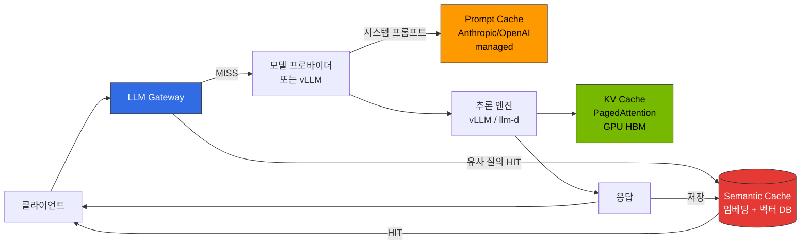
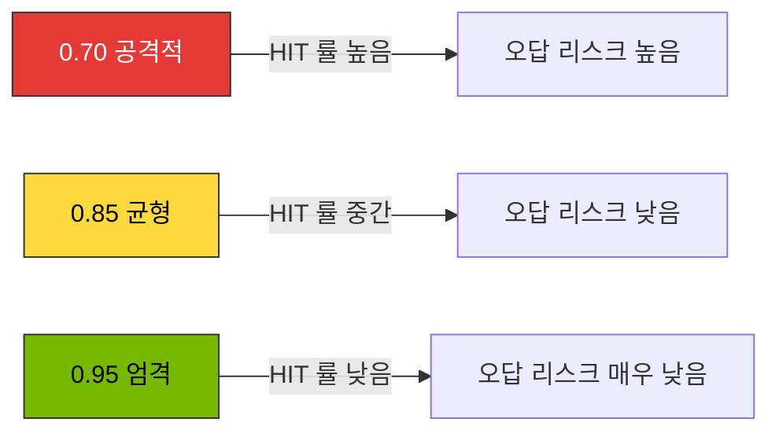

이 문서는 LLM 추론 파이프라인에서 **게이트웨이 레벨 의미 기반 캐싱(Semantic Caching)** 의 설계 원칙과 운영 고려사항을 다룹니다. 

**구현 가이드**: 도구 비교 표, Gateway별 통합 패턴, 설정 예시, 배포 스니펫은 [추론 게이트웨이 구성 가이드 — Semantic Caching 구현 옵션](../../reference-architecture/inference-gateway/setup/advanced-features)을 참조하세요.

## 1. 개요

### 왜 Semantic Cache가 필요한가

대규모 LLM 서비스에서 사용자 질의는 **표현만 다르고 의미가 같은** 경우가 많습니다. 문자열 단위로 정확히 일치하는 전통적 캐시(HTTP cache, Redis key-value)로는 이러한 중복을 제거할 수 없습니다. Semantic cache는 **임베딩 기반 유사도**로 의미가 유사한 요청을 탐지하여 이전 응답을 재사용함으로써 다음 3가지 문제를 동시에 개선합니다.

- **토큰 비용 감소**: 캐시 HIT 시 LLM 호출을 건너뛰어 API 비용·GPU 시간을 절약합니다.
- **지연시간 단축**: HIT 시 캐시 경로는 전체 생성(수백 ms ~ 수 초)을 질의 임베딩 + 벡터 유사도 조회로 대체합니다. 조회 자체는 보통 수 ms이지만, HIT의 종단 지연에는 임베딩 계산(로컬 모델 또는 임베딩 API 호출) 비용이 포함되므로 조회 시간만 가정하지 말고 사용하는 임베딩 모델로 실제 측정해야 합니다.
- **GPU 용량 확보**: 자체 호스팅 vLLM/llm-d 환경에서는 회피된 생성이 GPU 시간을 다른 요청에 돌려주며, 실제 처리량 이득은 HIT 률과 트래픽 구성에 따라 달라집니다.

### 예상 절감률 (임계값별)

절감률은 **사용자 질의의 반복성**, **도메인**(FAQ/고객 지원/코드 생성), **프롬프트 구조** 에 따라 크게 달라집니다. 아래 수치는 **특정 공개 벤치마크의 실측값이 아니라 설계 계획용 예시 범위입니다.** 공개 구현과 벤더 블로그는 서로 다른 모델·데이터셋·비용 산정 방식으로 각기 다른 수치를 보고하므로 하나의 공신력 있는 범위로 합칠 수 없습니다. 아래 값은 출발 가설로만 사용하고, 의존하기 전에 **점진적 롤아웃** 과 A/B 평가로 자사 수치를 확보하세요.

| 유사도 임계값 | 운영 정책 | 예시 절감 범위 | 특징 |
|--------------|----------|-------------------|------|
| **0.95 (엄격)** | 거의 동일한 질의만 캐시 | 낮음 | 오답 위험 매우 낮음, 엄격한 품질 요구 서비스 |
| **0.85 (균형)** | 의미 동일·표현 차이 허용 | 중간 | 일반 LLM 챗/어시스턴트 권장 기본값 |
| **0.75 (공격적)** | 관련 주제까지 묶음 | 높음(단, 거짓 긍정 위험도 함께 상승) | FAQ/정적 KB 등 반복률이 높은 워크로드 한정 |

여기서 "절감"은 캐시로 응답한 요청의 비율(그리고 해당 요청이 소비했을 토큰·API 비용)을 뜻하며, 절대 백분율은 워크로드마다 다릅니다. semantic cache 동작 원리 참고 자료: [Redis — Semantic caching (RedisVL)](https://redis.io/docs/latest/develop/ai/redisvl/user_guide/how_to_guides/llmcache/), [Portkey Semantic Cache 문서](https://docs.portkey.ai/docs/product/ai-gateway/cache-simple-and-semantic), [Helicone Caching 문서](https://docs.helicone.ai/features/advanced-usage/caching), [GPTCache README](https://github.com/zilliztech/GPTCache). 이 자료들은 캐시의 동작 방식을 설명할 뿐, 위 범위를 함께 입증하지는 않습니다.

:::warning 절감률 수치는 반드시 검증
위 숫자는 공개 자료 기반의 **대략적 범위** 입니다. 모든 도메인에서 동일한 HIT 률이 나오지 않습니다. 대시보드(§6)로 **자사 워크로드의 실제 HIT 률·false-positive 률** 을 측정한 후 임계값을 확정하세요.
:::

---

## 2. 캐시 계층 구분

LLM 추론 파이프라인에는 **3가지 서로 다른 캐시 계층** 이 존재합니다. 각각 동작 위치·저장 단위·비용 영향이 달라서, semantic cache는 다른 2계층을 **대체하지 않고 보완** 합니다.

### 3계층 캐시 흐름도

### 계층별 비교 표

| 항목 | KV Cache (vLLM PagedAttention) | Prompt Cache (Anthropic/OpenAI managed) | Semantic Cache (Gateway 레벨) |
|------|-------------------------------|----------------------------------------|-------------------------------|
| **동작 위치** | 추론 엔진 내부 (GPU HBM) | 모델 프로바이더 측 | Gateway (Bifrost/LiteLLM/Portkey) 앞단 |
| **저장 단위** | 토큰 단위 KV 블록 | Anthropic: `cache_control` 마커 구간 / OpenAI: 자동 prefix 캐싱 | 전체 응답 객체 (텍스트/JSON) |
| **매칭 방식** | **접두사(prefix) 완전 일치** | **접두사(prefix) 완전 일치** (프로바이더 내부; 렌더링된 접두사가 일치해야 재사용) | **임베딩 코사인 유사도** |
| **주 목적** | TTFT·throughput 개선 | 반복 시스템 프롬프트 비용 절감 | **중복 LLM 호출 자체를 제거** |
| **비용 영향** | GPU 시간 절감 (자체 호스팅) | 입력 토큰 단가 할인 (관리형) | API 호출 자체를 건너뜀 |
| **실패 시 영향** | 성능 저하만 | 캐시 미적용 시 일반 단가 | **응답 품질에 직접 영향** (오답 리스크) |
| **관련 문서** | [vLLM 모델 서빙](../../model-serving/inference-frameworks/vllm-model-serving.md) | 프로바이더 공식 문서 | 본 문서 |

:::tip 세 계층은 재사용 대상이 다르며 함께 쓸 수 있습니다
세 계층은 재사용하는 대상이 다릅니다. semantic cache는 유사 질의 간에 **완성된 이전 응답**을 재사용하고, 프로바이더 prompt cache와 vLLM prefix cache는 한 요청의 공유 **접두사(prefix)** 에 대한 연산을 재사용합니다. 서로 다른 단위를 다루므로 함께 활성화할 수 있고, MISS 시 프로바이더/엔진 호출은 접두사 재사용의 이득을 받을 수 있습니다. 다만 완전히 독립적이지는 않습니다. semantic cache HIT는 하위 호출 자체를 건너뛰므로 그 요청에는 prompt/KV 재사용이 애초에 일어나지 않고, 프로바이더 prompt cache와 자체 호스팅 prefix cache는 같은 요청에 대한 접두사 재사용의 **상호 대체 구현**이지 쌓아 올리는 두 단계가 아닙니다. 세 가지를 기본으로 모두 켜지 말고, 배포 환경이 실제로 제공하는 계층(관리형 프로바이더는 prompt caching, 자체 호스팅 vLLM/llm-d는 prefix caching)을 활성화하세요.
:::

### 적용 시점 비교

접두사 재사용은 두 형태로 존재합니다. **프로바이더 관리형**(OpenAI/Anthropic prompt caching — 해당 프로바이더를 호출할 때만 적용)과 **자체 호스팅**(vLLM/llm-d 자동 prefix caching — 해당 엔진을 운영할 때만 적용)입니다. 서빙 경로에 맞는 쪽만 적용되며, 같은 요청에 둘을 동시에 구성하지는 않습니다.

- **프로토타입/단일 모델**: 접두사 재사용(관리형 프로바이더 호출 시 prompt caching, 자체 호스팅 시 vLLM/llm-d prefix caching)이 초기 요구를 대개 충족합니다. semantic cache는 응답 캐시가 흡수할 만한, 의미가 유사한 질의의 반복이 관측된 뒤에만 추가하세요.
- **멀티테넌트/멀티 프로바이더**: Gateway 레벨 semantic cache는 여러 사용자에서 반복되는 동일 질의를 흡수합니다. 다만 그러한 반복이 트래픽에 실제로 존재하는지 측정한 뒤에 추가하고, 활성화 전에 키·namespace(§5)를 먼저 설계하세요.
- **FAQ/챗봇/고정 KB**: semantic cache 임계값을 낮추면(0.80~0.85) 더 적극적으로 재사용할 수 있으나, 낮추기 전에 거짓 긍정 률(§3, §6)을 검증하세요.
- **코드 생성/IDE 에이전트**: semantic cache를 **보수적으로 적용**(0.95)하거나 비활성화하세요. 유사 질의라도 파일 컨텍스트가 달라 응답 재사용이 오답으로 이어질 위험이 큽니다.

---

## 3. 유사도 임계값 설계

### 임계값별 트레이드오프

### 임계값 선택 기준

| 임계값 | 적합 워크로드 | 부적합 워크로드 | 비고 |
|--------|-------------|---------------|------|
| **0.95 이상** | 코드 생성, 법률·의료 어시스턴트, 금융 자문 | (광범위하게 적용 가능) | 표현 차이가 거의 없는 동일 질의만 HIT |
| **0.85-0.94 (권장)** | 일반 챗봇, 고객 지원, 문서 요약, 제품 Q&A | 코드 생성(컨텍스트 민감) | 의미 동일·표현 차이 허용. 대부분 서비스의 기본값 |
| **0.75-0.84** | FAQ, 정적 KB, 사내 문서 검색 결과 설명 | 대화형 추론, 다중 턴 | 거짓 긍정 증가 — 응답 검증 레이어 필요 |
| **0.70 이하** | 거의 사용 안 함 — 대량 FAQ 한정 | 모든 범용 서비스 | 무관한 질의끼리 묶일 위험 |

### 임계값 설정 시 고려 요소

유사도 점수는 임베딩 공간상의 근접도를 나타낼 뿐 **정답 일치를 보장하지 않습니다.** 두 질의가 임베딩상 가깝더라도 서로 다른 답이 필요할 수 있습니다(부정어로 극성이 반대, 수량이 다름, 개체가 다름, 신선도·시점 맥락이 다름). 어떤 고정 점수나 임베딩 모델 순위도 그 자체로 임계값을 "안전"하게 만들지 않으므로, 부정·수치 차이·개체 동일성·시점 민감 사례를 의도적으로 포함한 자사 모델·도메인용 레이블 평가셋으로 검증해야 합니다.

1. **사용자 허용 오차**: 근사적인 "가장 가까운 답"이 허용되는 경우(일부 고객 지원 흐름)에는 낮은 임계값이 용인될 수 있고, 코드·계산은 높은 임계값이 필요합니다. 이는 제품 차원의 판단이며 안전성 보장이 아닙니다.
2. **도메인 어휘**: 동의어가 많은 도메인(의료/법률)은 임베딩이 의미를 잘 묶는 것처럼 *보일* 수 있으나, 이들 도메인은 잘못된 재사용의 비용도 가장 큽니다. 동의어가 풍부하니 묶어도 안전하다고 가정해 임계값을 낮추지 말고, 레이블된 거짓 매칭으로 확인하세요.
3. **임베딩 모델 품질**: 품질이 높은 임베딩(예: `text-embedding-3-large`, `bge-m3`)은 검색 품질을 개선할 수 있지만, 그 자체로 낮은 임계값을 안전하게 만들지는 **않습니다.** 이들은 검색용 모델이지 정답 판별기가 아니며, 공식 문서에도 캐시 안전성 주장은 없습니다. 임베딩 모델을 바꿀 때마다 거짓 긍정 률을 다시 측정하세요.
4. **유사도 vs 거리**: 사용하는 캐시 라이브러리가 **유사도**(값이 클수록 가까움, 예: 코사인 유사도)를 비교하는지 **거리**(값이 작을수록 가까움, 예: RedisVL의 코사인 거리)를 비교하는지 확인하세요. 비교 방향이 반대이므로 어느 규약인지 모르면 임계값 자체가 무의미합니다.
5. **대화 컨텍스트**: 멀티 턴 대화는 이전 턴을 캐시 키에 포함해야 합니다(§5 참조).
6. **언어·로케일**: 다국어 서비스는 언어별 namespace를 분리하여 교차 오염을 방지합니다.

:::warning 임계값은 고정값이 아니라 관측 기반 튜닝 대상
초기에는 보수적으로(예: 사용 라이브러리의 유사도/거리 규약에 맞춘 0.90) 시작하고, **레이블 평가가 거짓 매칭을 늘리지 않음을 보여줄 때에만** 소폭씩 조정합니다. Langfuse/Grafana 대시보드의 **HIT 률, user dissatisfaction 지표(👎, regenerate 클릭 등)** 는 선행 지표로 모니터링하되, 레이블 평가를 대체하지는 않습니다.
:::

---

## 4. 구현 고려사항

Semantic cache를 구현할 때는 다음 요소를 고려하여 솔루션을 선택합니다.

### 주요 고려 요소

1. **기존 인프라 재사용 가능성**: Redis/Milvus 등 벡터 DB가 이미 있다면 추가 백엔드 없이 구현 가능
2. **게이트웨이 통합 필요성**: 라우팅·가드레일과 캐시를 통합 관리할지, 독립 레이어로 분리할지
3. **관리형 vs 셀프호스트**: 운영 부담·규정 준수·비용 트레이드오프
4. **관측성 요구사항**: 캐시 HIT/MISS 추적, false-positive 모니터링 수준
5. **벡터 검색 엔진 선호도**: Redis/Milvus/FAISS/Qdrant 등 조직의 표준 스택

### 구현 패턴

**패턴 A: Gateway 일체형** — 라우팅·캐시·관측성을 단일 제품에서 (예: Portkey)
- 장점: 통합 구성, 빠른 배포
- 단점: 벤더 락인, 고급 기능은 관리형 플랜 의존
- 캐시 유형 주의: 제품의 캐시가 **semantic**(임베딩 유사도)인지 **완전 일치 응답(exact-match response)** 캐시인지 확인한 뒤, 바꿔 말한 질의의 중복 제거에 의존하세요. Portkey는 semantic cache를 문서화합니다. Helicone이 문서화한 캐싱은 **완전 일치 응답 캐싱**(요청 본문을 해시해 완성 응답을 엣지 KV에 저장)이며 semantic 캐싱이 아닙니다. Helicone은 완전 일치 재사용·관측성 용도로 쓰고, 유사도 매칭이 필요하면 semantic 레이어와 함께 사용하세요.

**패턴 B: 모듈형** — 게이트웨이(Bifrost/LiteLLM) + 독립 캐시 레이어(RedisVL, GPTCache)
- 장점: 각 레이어 독립 교체 가능, 오픈소스 우선
- 단점: 통합 복잡도 증가

**패턴 C: 관리형** — Redis Enterprise LangCache, Portkey SaaS
- 장점: 운영 부담 최소, 벤더가 서비스를 운영
- 단점: 비용, 리전 제약. "인증됨"이라는 일반적 가정 대신 **각 벤더의 구체적 규정 준수 인증을 자사의 규제 요건과 대조해 확인**하세요. 적용 가능한 인증(예: SOC 2, ISO 27001, HIPAA 적격성)은 제품·플랜·리전마다 다릅니다.

구체적인 도구별 비교 표, 설정 예시, 배포 스니펫은 [Inference Gateway 구성 가이드 — Semantic Caching 구현 옵션](../../reference-architecture/inference-gateway/setup/advanced-features)을 참조하세요.

---

## 5. 캐시 키 설계와 멀티테넌시

Semantic cache는 **게이트웨이 앞단** 에 위치하여 LLM 호출 자체를 건너뛰기 때문에, 캐시 키 설계와 namespace 분리가 응답 품질·보안·멀티테넌시에 직접적인 영향을 줍니다.

### 캐시 키 구성 요소

가장 단순한 키는 `embedding(user_query)` 하나지만, 실제 서비스에서는 다음 요소를 **반드시** 함께 키에 포함해야 합니다.

**필수 포함 요소:**
- `model_id`: 모델 종류·버전 교차 오염 방지 (예: `glm-5` ≠ `qwen3-4b`)
- `system_prompt_hash`: 시스템 프롬프트가 다르면 완전히 다른 답
- `tenant_id | user_id`: 멀티테넌트/사용자별 격리
- `language | locale`: 언어 교차 오염 방지
- `tool_set_hash`: 에이전트의 사용 가능 도구 집합
- `embedding(user_query)`: 의미적 유사도 매칭 대상

답을 바꾸는 요청·인가 상태도 함께 키에 바인딩해야 합니다. 그러지 않으면 재사용하면 안 되는 응답이 재사용될 수 있습니다.
- **출력에 영향을 주는 디코딩 파라미터**(예: `temperature`, `top_p`, `max_tokens`, `seed`) — 서로 다른 디코딩 설정 간 재사용은 호출자가 요청하지 않은 답을 반환할 수 있음
- **응답 형식 / 구조화 출력 스키마**(예: OpenAI `text.format`, `response_format`) — JSON 스키마 요청이 자유 텍스트 응답을 재사용해서는 안 됨
- **검색된 컨텍스트 / 데이터 버전**(RAG·도구 기반 답변) — 오래된 문서에 근거한 응답은 원본 데이터가 바뀌면 만료되어야 함
- **인가 범위** — 조회하는 사용자의 권한. 캐시된 답은 그 답을 볼 수 있는 호출자에게만 제공되어야 함(§8 참조)

### 멀티테넌트 namespace 전략

| 계층 | namespace 패턴 예시 | 격리 목적 |
|------|-------------------|----------|
| **조직 / 테넌트** | `cache:{tenantId}:*` | 데이터 격리, 감사 경계 |
| **사용자** | `cache:{tenantId}:{userId}:*` | 개인정보 포함 질의의 사용자 간 누수 방지 |
| **언어** | `cache:{tenantId}:ko:*` / `:en:*` | 다국어 서비스에서 교차 오염 방지 |
| **도메인** | `cache:{tenantId}:support:*` / `:billing:*` | 컨텍스트가 다른 도메인 간 재사용 차단 |
| **모델 버전** | `cache:{...}:glm-5:v2026-03:*` | 모델 업그레이드 시 일괄 invalidation 가능 |

### 비-결정성(non-determinism) 처리

여기서는 서로 다른 두 가지가 자주 혼동됩니다. **샘플링 변동성**: `temperature > 0` 또는 `top_p < 1`이면 모델이 호출마다 다른 응답을 반환할 *수* 있으므로, 다양성을 기대한 사용자에게 하나의 샘플 응답을 재사용하면 의외의 결과가 될 수 있습니다. **재현 불가능한 실행**: 도구 호출·검색 등 변화하는 외부 상태를 읽는 단계는 "같은" 요청이라도 신선도에 따라 다른 답을 만들 수 있습니다. 둘 다 응답 재사용의 안전성을 낮추지만 이유가 다릅니다. 전자는 기대된 다양성의 문제이고, 후자는 현재 데이터에 대한 정확성의 문제입니다.

**권장 정책:**
- 스트리밍·에이전트형(도구 사용) 요청은 재사용을 평가하기 전까지 **기본 캐시 비활성**
- `/summarize`, `/classify` 같은 엔드포인트는 재현 가능성이 *더 높을* **후보**로 다루되 보장으로 보지 마세요. 엔드포인트 이름이 재현성을 입증하지 않으므로, 그 출력이 변화하는 데이터나 샘플링에 의존하지 않는지 확인한 뒤 캐시하세요.
- 결정적 설정으로 고정한 요청(예: `temperature=0`, 프로바이더가 지원하면 고정 `seed`)을 우선 캐시하고, 디코딩 파라미터는 위 설명대로 키에 바인딩하여 이후의 비결정적 요청이 결정적 엔트리를 재사용하지 않도록 하세요.

구체적인 Gateway별(kgateway, LiteLLM, Bifrost) 통합 패턴, 설정 예시, 코드 스니펫은 [Inference Gateway 구성 가이드 — Semantic Caching 구현 옵션](../../reference-architecture/inference-gateway/setup/advanced-features)을 참조하세요.

---

## 6. 관측성 (Langfuse 연동)

Semantic cache는 이전에 생성한 답변을 사용자에게 바로 반환합니다. 따라서 캐시 사용 빈도뿐 아니라 재사용한 답변이 현재 질문에도 적절한지 확인해야 합니다. Langfuse 또는 동급 관측 스택으로 다음 데이터를 수집하세요.

### Langfuse Trace 태그

각 요청 trace에 다음 속성을 attach 합니다. Langfuse에서 **tags**는 문자열 전용(각 최대 200자)이며 분류·필터 용도입니다. `similarity_score` 같은 타입/숫자 값은 tags가 아니라 **metadata**(구조화) 또는 숫자 score/observation에 넣어야 합니다. 카디널리티가 낮은 라벨(예: `cache_hit`, `cache_source`)은 tags로, 타입이 있는 필드는 metadata로 다루세요.

- `cache_hit`: `true` / `false` (tag 또는 boolean metadata)
- `similarity_score`: 예: `0.92` (숫자 metadata — HIT일 때 매칭된 최고 유사도; 유사도/거리 규약에 맞게 해석, §3)
- `cache_source`: `redis-semantic` / `portkey` / `helicone` 등 (tag)
- `cache_namespace`: `{tenant}:{lang}:{domain}` (metadata, PII 포함 금지)
- `cache_ttl_remaining_s`: 남은 TTL(초) (숫자 metadata, 디버그용)
- `cache_eviction_reason`: MISS 원인 (`below_threshold`, `namespace_miss`, `ttl_expired`) (tag 또는 metadata)

### 대시보드 권장 패널

Langfuse의 커스텀 대시보드 또는 Prometheus + Grafana로 다음을 시각화합니다. 아래 식은 **실행 가능한 PromQL이나 Langfuse 쿼리가 아니라 개념적 정의**이므로, 사용하는 백엔드의 메트릭 이름과 쿼리 언어로 옮기세요.

| 패널 | 개념(문자 그대로의 쿼리 아님) | 목표값 |
|------|------------|--------|
| **HIT 률 전체** | HIT ÷ 전체 캐시 조회 | 15-40% (워크로드별; 억지로 맞출 목표가 아님) |
| **HIT 률 (namespace별)** | `cache_namespace`별 HIT 률 | 테넌트 편차 모니터링 |
| **similarity_score 분포** | HIT 시 `similarity_score` 히스토그램 | 임계값 근처 bin 과도 주의 |
| **False-positive 프록시** | `cache_hit=true` 응답 중 👎 피드백 / regenerate 클릭 비율 | 베이스라인 대비 상승 없을 것 |
| **절감 토큰 합계** | HIT 시 `tokens_saved` 합계 | 비용 리포트 |
| **캐시 스토어 크기** | 캐시 인덱스/namespace의 엔트리 수(예: RedisVL 인덱스의 `FT.INFO`, 또는 namespace를 `SCAN`으로 집계)와 Redis 메모리 사용량 | TTL·eviction 정책 점검 |

`tokens_saved`는 리포트하기 전에 명시적으로 정의하세요. 이는 **추정값**으로, 보통 회피된 생성이 해당 요청에 대해 만들었을 입력+출력 토큰 수(예: 저장된 응답의 토큰 사용량, 또는 요청 프롬프트 토큰 + 저장된 완성 토큰)입니다. 어떤 산정 방식을 쓰는지 밝혀 비용 수치를 재현 가능하게 만드세요. 또한 Redis `DBSIZE`는 **데이터베이스 전체**의 키 수(O(1) 전체 DB 집계)를 반환하며 단일 캐시 namespace의 크기가 아닙니다. namespace별 크기를 보려면 인덱스 집계(`FT.INFO`)나 namespace 범위의 scan을 사용하세요.

### 알림 규칙

아래 임계값은 **검증된 한계선이 아니라 제안된 출발값입니다.** 알림을 걸기 전에 워크로드별 베이스라인을 세우고, 각 규칙을 트래픽 구성·요청 속도·메트릭의 표본 크기(분모)와 대조해 확인하세요. 조회 수가 적은 구간에서는 HIT 률 비교가 불안정합니다. 특히 높은 절대 HIT 률(예: 70%)은 **그 자체로는 비정상이 아닙니다.** 반복률이 높은 FAQ 트래픽에서는 오히려 자연스러운 값입니다. 아래 항목은 근본 원인의 직접 증거가 아니라, false-positive 프록시와 레이블된 품질 결과와 함께 **조사**를 시작하는 트리거로 다루세요.

| 알림 | 조건(출발값) | 심각도 | 조사 사항 |
|------|------|--------|--------|
| HIT 률 급락 | HIT 률이 이전 24h 평균의 50% 미만 (동일 워크로드, 충분한 표본) | Warning | 임베딩/Redis 장애 가능 — 단정 전 확인 |
| HIT 률 상승 + 품질 저하 동반 | HIT 률 상승 **과** false-positive 프록시 상승이 함께 발생 | Critical | 임계값 오설정 의심; 상승만으로는 부족 |
| similarity_score 편중 | 임계값 ±0.02 내 HIT 비율 > 40% | Warning | 경계선 매칭 과다 |
| Redis latency | P99 > 20ms (자사 SLO에 맞춰 조정) | Warning | 캐시가 병목 |

### Langfuse OTel 연동 참조

Bifrost/LiteLLM의 OTel 전송 설정은 기존 [LLMOps Observability](../../operations-mlops/observability/llmops-observability) 및 [추론 게이트웨이 구성 가이드](../../reference-architecture/inference-gateway/setup) 문서를 따릅니다. 캐시 관련 태그는 애플리케이션/게이트웨이 플러그인 레이어에서 span attribute로 추가합니다.

---

## 7. 실전 체크리스트

### 보안 & 프라이버시

- Guardrails를 semantic cache **앞**에 배치해 PII가 포함된 프롬프트가 저장소에 들어가지 않게 합니다. 다만 이는 **입력**만 보호합니다. **조회 시점에도 인가**(§8 참조: 볼 수 있는 호출자에게만 캐시 답 제공)하고 **저장된 응답을 검증**해야 합니다. 입력 필터는 이미 캐시된 답 안에 들어 있는 사용자 고유 내용을 제거하지 못하기 때문입니다.
- 프롬프트 인젝션 탐지 시 캐시 저장 금지
- 크로스 테넌트 누수 방지 (namespace 설계를 단위 테스트로 강제)
- **감사 로그 보존 기간은 자사의 규제·조직 정책으로 정합니다**(무엇을 기록할지 — HIT/MISS, namespace, similarity_score — 와 보존 기간). "90일"은 예시 출발값일 뿐이므로, 실제 규정 준수 의무가 요구하는 기간을 확인하세요.

### 운영 & 수명주기

- **TTL(예시, 데이터 변동성에 맞춰 조정)**: 정적 KB는 일~주 단위, 제품 정보는 시간 단위, 뉴스·시계열은 비활성. 고정 규칙이 아니라 출발값이며, 각 데이터 소스가 얼마나 빨리 바뀌는지에 따라 TTL을 설정하세요.
- **모델 버전 교체**: 키에 버전 포함 (`glm-5:v2026-03`) → 자연 만료
- **임베딩 모델 교체**: 인덱스를 임베딩 모델/버전별 namespace로 분리합니다. 구 모델로 임베딩된 엔트리는 신 모델 질의 벡터와 **비교 불가**이므로, 신규 트래픽을 새 namespace로 보내고 구 namespace는 TTL 만료 또는 백필 이후 폐기합니다. 즉시 전량 재구축은 한 가지 선택지(가장 단순하지만 비용 최대)이며, 버전별 namespace와 점진적 마이그레이션은 급격한 전환을 피합니다. 어느 방식을 쓰고 구 엔트리를 언제 폐기하는지 명시하세요.
- **장애 fallback**: Redis 장애 시 fail-open (원본 rate limit 사전 확보)
- **점진적 롤아웃**: 신규 정책은 A/B로 검증

### 품질 가드레일

- 큰 응답·도구 호출 결과는 캐시 금지 또는 짧은 TTL
- 사용자 👎 피드백 시 해당 entry 자동 eviction
- 캐시 HIT 샘플을 주간 평가 (Ragas/LLM-judge)

### 배포 전 점검

- [ ] 캐시 키에 `model_id`, `system_prompt_hash`, `tenant_id`, `language` 포함
- [ ] Guardrails가 캐시보다 앞단에 배치
- [ ] Langfuse 트레이스에 `cache_hit`, `similarity_score` 기록
- [ ] HIT 률 / false-positive 대시보드 구성
- [ ] Redis 장애 시 fail-open 시나리오 검증

---

## 8. 도메인별 적용 패턴

동일한 semantic cache 엔진이라도 도메인에 따라 **키 구성·임계값·TTL** 이 크게 다릅니다.

| 도메인 | 임계값 | TTL | 특성 |
|--------|--------|-----|------|
| **FAQ / 제품 Q&A** | 0.80-0.85 | 24-72h | 질의 반복적, 정답 고정적. 키: `tenant+language+product_version` |
| **사내 KB** | 0.85-0.90 | 1-7d | 권한별 격리 우선. 키: `tenant+role_hash+language` |
| **고객 지원** | 0.85 | 6-24h | **사용자 고유가 아닌 답변만 캐시합니다.** 개인화된 답변은 키에 `user_id`(또는 인가 범위)를 포함하고 조회 시 권한을 재확인하세요. 공개 답변 키: `tenant+intent+language`, 개인화 답변 키: `tenant+user_id+intent+language`. 입력에서 PII를 redact한다고 저장된 응답이 공유해도 안전해지는 것은 아닙니다. |
| **코드 생성/IDE** | 0.97+ 또는 비활성 | 30m-2h | 컨텍스트 의존성 높음. 리팩터링·디버깅은 비활성 권장 |

**주의사항:**
- FAQ/제품 Q&A: 제품 버전 변경 시 `product_version` 키로 자연 무효화
- 사내 KB: ACL 변경 시 해당 사용자 namespace flush, 그리고 조회 시 접근 필터 적용
- 고객 지원: 입력(이름, 주문번호)을 Guardrails로 redact하는 것만으로는 **충분하지 않습니다.** 한 사용자를 위해 생성된 응답에는 그 사용자의 계정 상태가 그대로 담길 수 있습니다. 명시적으로 공개·맥락 비의존인 답변만 공유 키로 캐시하고, 개인화된 답변은 검증된 `user_id`/인가 범위로 키를 구성하며 ACL 변경 시 재검증하세요.
- 코드 생성: 파일·리포 컨텍스트가 다르면 같은 질의라도 다른 답 필요

---

## 9. FAQ

**Q1. Semantic cache와 RAG는 어떻게 다른가요?**  
RAG는 새 응답 생성을 위한 컨텍스트를 벡터 DB에서 가져오는 것, semantic cache는 기존 완성 응답을 재사용하는 것입니다. RAG는 LLM 호출 전에 입력 보강, semantic cache는 LLM 호출 자체를 회피합니다.

**Q2. 스트리밍 응답도 캐시 가능한가요?**  
가능하지만 재조립·재현 복잡도가 높습니다. 초기엔 비스트리밍 엔드포인트부터 적용을 권장합니다.

**Q3. 임베딩 모델 선택 기준은?**  
다국어면 `bge-m3`, `text-embedding-3-large`. 영어 전용이면 `text-embedding-3-small`. 모델 교체 시 전체 캐시 무효화 필수입니다.

**Q4. `temperature > 0` 요청을 캐시하면 위험한 이유는?**  
사용자가 의도적으로 다양한 답을 원해 temperature를 높인 것인데 같은 답이 돌아오면 기대 위배입니다. 창의적 엔드포인트는 캐시 비활성이 기본입니다.

**Q5. 캐시 HIT 률이 낮으면 어떻게 하나요?**  
임계값을 낮추기 전에 먼저 원인을 진단하세요. 순서는 (1) **레이블된 거짓 매칭/품질** 문제 점검 — 이미 HIT가 오답을 내고 있다면 HIT 률을 올리는 것은 상황을 악화시킵니다; (2) **적격성·키** 점검 — namespace 과도 세분화나 변동성 큰 필드가 포함된 키는 정당한 재사용을 막습니다; (3) **임베딩 모델 품질**을 레이블셋으로 평가. 이후에만 유사도 임계값을 소폭씩 낮추되, 레이블 평가가 거짓 매칭이 늘지 않음을 보여줄 때에만 조정합니다. 반복률이 낮은 트래픽에서는 낮은 HIT 률이 *올바른* 결과일 수 있습니다. 보편적인 "정상" 값은 없으므로 고정 백분율이 아니라 자사 워크로드로 목표를 설정하세요.

**Q6. 캐시된 응답의 규정 준수 이슈는?**  
의료·금융·법률 도메인에서는 캐시 HIT도 감사 로그 기록 의무가 있을 수 있습니다. `cache_hit=true` 를 반드시 로깅하고 규제 보존 기간을 준수하세요.

---

## 10. 참고 자료

### 공식 문서 & 레포지토리

- [Redis — Semantic Caching (RedisVL)](https://redis.io/docs/latest/develop/ai/redisvl/user_guide/how_to_guides/llmcache/)
- [Redis LangCache (관리형)](https://redis.io/langcache/)
- [Portkey — Semantic Cache](https://docs.portkey.ai/docs/product/ai-gateway/cache-simple-and-semantic)
- [Helicone — Caching](https://docs.helicone.ai/features/advanced-usage/caching)
- [LiteLLM — Caching](https://docs.litellm.ai/docs/proxy/caching)
- [Bifrost 공식 문서](https://docs.getbifrost.ai)
- [GPTCache (Zilliz)](https://github.com/zilliztech/GPTCache)

### 관련 문서

- **구현 가이드**: [추론 게이트웨이 구성 가이드 — Semantic Caching 구현 옵션](../../reference-architecture/inference-gateway/setup/advanced-features) — 도구 비교 표, 설정 예시, 배포 스니펫
- [추론 게이트웨이 라우팅 전략](../../model-serving/inference-routing/routing-strategy)
- [OpenClaw AI Gateway 배포](../../model-serving/inference-routing/openclaw-example.md)
- [LLMOps Observability](../../operations-mlops/observability/llmops-observability)
- [Milvus 벡터 데이터베이스](../../operations-mlops/data-infrastructure/milvus-vector-database)
- [Ragas 평가](../../operations-mlops/governance/ragas-evaluation)

### 연구 & 배경

- [Anthropic — Prompt Caching](https://docs.anthropic.com/en/docs/build-with-claude/prompt-caching)
- [OpenAI — Prompt Caching](https://platform.openai.com/docs/guides/prompt-caching)
- [vLLM — PagedAttention (KV Cache)](https://docs.vllm.ai/en/latest/design/paged_attention.html)
