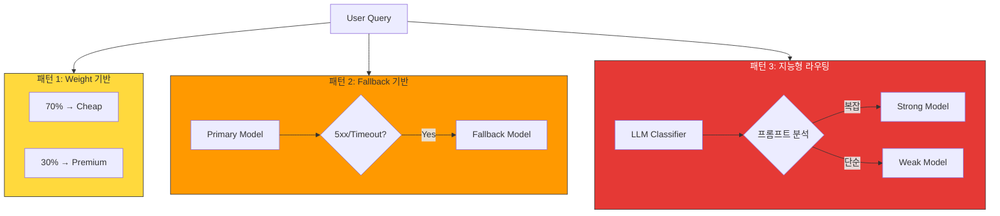
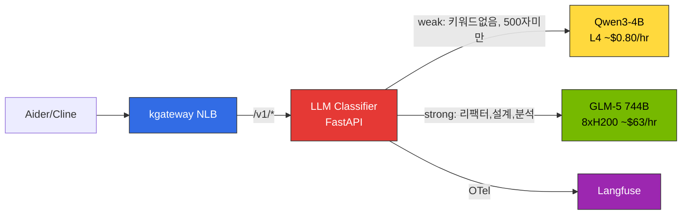
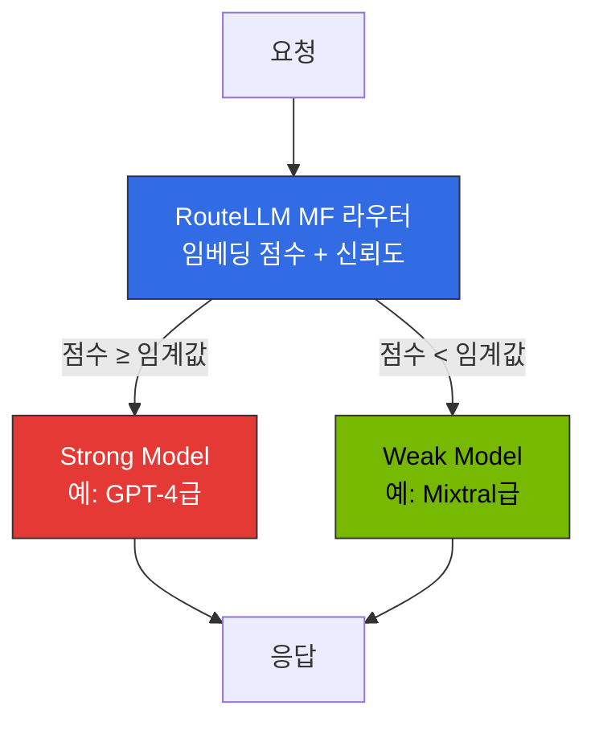

이 문서는 요청 복잡도를 분석해 적절한 모델로 자동 분배하는 **Request Cascading**의 구현 접근(LLM Classifier·LiteLLM·vLLM Semantic Router)과 선택 기준을 다룹니다. 2-Tier 게이트웨이 아키텍처와 전체 라우팅 전략은 [게이트웨이 라우팅 전략](./routing-strategy.md)을 참조하세요.

## Request Cascading: 지능형 모델 라우팅

### 개념

**Request Cascading**은 요청의 복잡도와 정해 둔 품질 기준에 따라 처리할 모델을 선택하는 방식입니다. 간단한 요청은 작은 모델로 보내고, 더 복잡한 추론이 필요한 요청은 성능이 높은 모델로 보내도록 구성합니다. 분류가 틀려 재시도가 늘면 비용이나 지연이 오히려 커질 수 있으므로, 요청별 품질과 전체 처리 비용을 함께 측정해야 합니다. IDE는 단일 엔드포인트를 사용하고, 모델 선택 규칙은 플랫폼에서 관리합니다.

### Cascading 패턴 3가지

**표 1. Cascading 3가지 패턴의 설명·구현·사용 사례**

| 패턴 | 설명 | 구현 | 사용 사례 |
|------|------|------|----------|
| **1. Weight 기반** | 고정 비율로 백엔드 간 트래픽 분배 | kgateway `backendRef weight` | A/B 테스트, 점진적 모델 마이그레이션 |
| **2. Fallback 기반** | 오류 시 프로바이더가 정의한 우선순위/failover 순서의 다음 백엔드로 재시도 | 프로바이더별 failover(예: LiteLLM `fallbacks`, Bifrost provider routing). Gateway API `backendRefs` weight와 HTTPRoute retry만으로는 cheap→frontier 모델 순서를 **정의하지 못함** | 가용성 향상, rate limit 회피 |
| **3. 지능형 라우팅** | 요청 분석 후 자동 모델 선택 | **LLM Classifier** / LiteLLM 커스텀 전략 / vLLM Semantic Router | 비용 최적화, 품질 유지 |

**그림 1. Cascading 3가지 패턴의 요청 흐름**



### Request Cascading 실전 구현

지능형 cascade routing은 요청 복잡도를 분석하여 적절한 모델로 자동 라우팅합니다. 이 절에서 제시하는 자체 호스팅 환경의 배포 선택과 가격은 외부에 공개·재현한 벤치마크가 아니라, 저자가 자체적으로 수행한 설계 평가 결과입니다.

#### 접근 A: LLM Classifier (자체 호스팅 vLLM에서 선택한 접근) {#접근-a-llm-classifier-권장--실전-검증}

**LLM Classifier**는 Python FastAPI 기반의 경량 라우터로, 프롬프트 내용을 직접 분석하여 SLM/LLM을 자동 선택합니다. kgateway 뒤에서 독립 HTTP 서비스로 동작하며 백엔드 vLLM 인스턴스로 프록시하고, 클라이언트는 단일 엔드포인트(`/v1`)만 사용합니다. 이 라우터는 OpenAI 호환 HTTP 프록시이며, Envoy External Processing(ext_proc) 프로세서가 **아닙니다**. Envoy `ext_proc`는 양방향 gRPC 스트림 프로토콜(`ProcessingRequest`/`ProcessingResponse`)이므로, 이 classifier를 ext_proc 필터로 연동하려면 REST 엔드포인트가 아니라 해당 gRPC 인터페이스를 구현해야 합니다.

**그림 2. LLM Classifier 기반 요청 라우팅 구조**



**표 2. LLM Classifier의 weak/strong 분류 기준**

| 기준 | weak (SLM) | strong (LLM) |
|------|-----------|-------------|
| **키워드** | 없음 | 리팩터, 아키텍처, 설계, 분석, 디버그, 최적화, 마이그레이션 등(영문·국문 형태 모두) |
| **입력 길이** | 500자 미만 | 500자 이상 |
| **사용자 턴 수** | user 메시지 5개 이하 | user 메시지 5개 초과 |

**핵심 분류 로직:**

OpenAI chat `content` 필드는 문자열이거나 콘텐츠 파트 배열(`{"type": "text", "text": ...}`, 이미지 파트 등)이므로, 그대로 join하면 배열 content에서 `TypeError`가 발생합니다. 아래 헬퍼는 text 파트만 추출합니다. 임계값은 토큰이 아니라 **문자 수**이며, 포함 경계는 표(`>= 500`)와 일치하고, "턴"은 `user` 역할 메시지 수로 셉니다(system/assistant/tool 메시지는 제외). 이미지·오디오 등 비텍스트 모달리티와 tool 메시지는 이 휴리스틱의 범위 밖입니다.

```python
STRONG_KEYWORDS = ["리팩터", "아키텍처", "설계", "분석", "최적화", "디버그",
                   "마이그레이션", "refactor", "architect", "design", "analyze",
                   "optimize", "debug", "migration", "complex"]
CHAR_THRESHOLD = 500  # 토큰이 아니라 문자 수

def _text(content) -> str:
    # content는 문자열이거나 콘텐츠 파트 배열일 수 있음
    if isinstance(content, str):
        return content
    if isinstance(content, list):
        return " ".join(
            part.get("text", "")
            for part in content
            if isinstance(part, dict) and part.get("type") == "text"
        )
    return ""

def classify(messages: list[dict]) -> str:
    text = " ".join(_text(m.get("content")) for m in messages)
    # 키워드 매칭
    if any(kw in text.lower() for kw in STRONG_KEYWORDS):
        return "strong"
    # 입력 길이(문자 수)
    if len(text) >= CHAR_THRESHOLD:
        return "strong"
    # 사용자 턴 수
    user_turns = sum(1 for m in messages if m.get("role") == "user")
    if user_turns > 5:
        return "strong"
    return "weak"
```

**장점**: 클라이언트 수정 불필요, 프롬프트 내용 직접 분석, Langfuse OTel 직접 전송, 배포 간단 (단일 Pod)
**단점**: 분류 정확도가 휴리스틱에 의존 (ML classifier로 점진적 개선 가능)

:::tip LLM Classifier가 최적인 이유
표준 OpenAI 호환 클라이언트(Aider, Cline 등)는 **단일 `base_url`만 설정**합니다. LLM Classifier는 이 단일 엔드포인트 뒤에서 프롬프트를 분석하고, 백엔드 vLLM 인스턴스로 직접 프록시합니다. 클라이언트는 모델 선택을 전혀 인식하지 못합니다.
:::

#### Bifrost 자체 호스팅 Cascade 한계

Bifrost를 자체 호스팅 vLLM cascade에 사용하려 했으나 **LLM Classifier로 전환**했습니다. 아래 한계는 pinned Bifrost 문서(routing-rules.mdx, 커밋 `a9937c9`)에 비추어 자체 환경에서 관찰한 배포 제약이며, Bifrost가 여러 자체 호스팅 백엔드를 제공할 수 없다는 뜻이 아닙니다(custom provider와 alias가 존재합니다).

**표 3. 자체 환경에서 관찰한 Bifrost cascade 배포 제약**

| 한계 (자체 환경 관찰) | 설명 |
|------|------|
| **요청의 provider/model 포맷** | 요청은 `openai/glm-5` 형태를 사용. 표준 OpenAI 클라이언트(Aider 등)는 `model: "auto"` 같은 단일 모델명을 보내므로, 둘을 잇는 클라이언트 alias나 앞단 프록시가 필요 |
| **provider 항목당 단일 base_url** | 하나의 provider 항목(예: `openai`)은 하나의 `network_config.base_url`을 가짐. SLM과 LLM이 다른 Service에 있으면 단일 provider 항목이 아니라 별도 provider 항목/custom provider가 필요 |
| **원시 프롬프트 텍스트 직접 매칭 제약** | CEL 라우팅 룰은 `model`·`provider`·`request_type`·`headers[...]`·`params[...]`·조직/용량 변수와 파생된 `complexity_tier`(`SIMPLE`/`MEDIUM`/`COMPLEX`)에는 접근하지만 원시 요청 본문에는 접근하지 않음. 키워드·정규식 등 원시 프롬프트 텍스트 분기는 별도 classifier가 필요 |
| **모델명 정규화 (관찰, 미검증)** | 자체 환경에서 vLLM `served-model-name`과 모델명 불일치를 관찰했으나, 문서화된 정규화 규칙으로 특정하지 못함. 재현 가능한 실패 요청/버전이 확보될 때까지 미검증 로컬 관찰로 간주 |

:::warning Bifrost는 외부 LLM 프로바이더 통합에 적합
Bifrost는 OpenAI/Anthropic/Bedrock 등 **외부 프로바이더 통합**과 **failover**에 최적화되어 있습니다. 원시 프롬프트 분기가 필요한 자체 호스팅 vLLM 간 지능형 cascade routing에는 자체 환경에서 LLM Classifier가 더 적합했습니다.
:::

#### RouteLLM 평가 결과

[RouteLLM](https://github.com/lm-sys/RouteLLM)은 LMSYS가 개발한 오픈소스 라우팅 프레임워크로, Matrix Factorization 라우터가 Chatbot Arena 선호 데이터로 학습되었으며, MT Bench에서 GPT-4와 Mixtral 8x7B 사이를 라우팅할 때 GPT-4 호출 26%만으로 GPT-4 성능의 95%를 유지함이 논문(arXiv:2406.18665)으로 검증되었습니다. Chatbot Arena 데이터는 라우터의 *학습* 데이터이지 정확도 벤치마크가 아니므로 "Arena 정확도 90%" 같은 수치는 존재하지 않습니다.

자체 K8s 시도에서는 다음 이슈를 겪었습니다(프레임워크 전반에 대한 판정이 아니라 로컬 관찰이며, 이미지 digest나 의존성 lockfile을 고정하지 않았으므로 재현 자료가 공개될 때까지 미검증으로 간주합니다):

- **의존성 충돌**: `torch`, `transformers`, `sentence-transformers` 등 대형 의존성 트리가 자체 vLLM 환경과 충돌
- **컨테이너 크기**: 분류 모델 포함 시 이미지가 10GB를 초과(경량 라우터에는 부담)
- **배포 불안정**: pip dependency resolution 실패를 자주 겪음
- **유지보수**: RouteLLM은 연구 프로젝트로 프로덕션 지원을 표방하지 않음

**결론**: RouteLLM의 MF classifier **개념**은 유효하며, 자체 프로덕션 배포에는 **LLM Classifier**(경량 휴리스틱) 또는 **LiteLLM complexity routing**(외부 프로바이더 환경)을 선택했습니다. 이는 자체 배포 선택이며 RouteLLM을 컨테이너화할 수 없다는 근거는 아닙니다.

#### 접근 B: LiteLLM 다전략 / 커스텀 라우팅 (외부 프로바이더 환경)

LiteLLM은 혼동하기 쉬운 두 가지를 구분합니다.

- **배포 로드 밸런싱**: *같은* 논리 모델의 여러 레플리카 사이 선택으로, `router_settings.routing_strategy`로 지정합니다. 문서화된 값은 `simple-shuffle`·`latency-based-routing`·`usage-based-routing-v2`·`least-busy`·`cost-based-routing`이며, `complexity-based` 값이나 `complexity_threshold` 키는 존재하지 않습니다.
- **복잡도 기반 모델 선택**: *서로 다른* 모델 사이 선택으로, **Auto Router**(beta)가 제공합니다. pinned `v1.101.0`에서는 `litellm_params.model`을 `auto_router/complexity_router`로 둔 모델로 구성하고, 각 tier를 모델(또는 풀)에 매핑합니다.

```yaml
model_list:
  - model_name: gpt-3.5-turbo
    litellm_params:
      model: gpt-3.5-turbo
      api_key: os.environ/OPENAI_API_KEY
  - model_name: gpt-4-turbo
    litellm_params:
      model: gpt-4-turbo-preview
      api_key: os.environ/OPENAI_API_KEY

  - model_name: smart-router
    litellm_params:
      model: auto_router/complexity_router   # Auto Router (beta), v1.101.0
      complexity_router_config:
        tiers:
          SIMPLE:    gpt-3.5-turbo
          MEDIUM:    gpt-3.5-turbo
          COMPLEX:   gpt-4-turbo
          REASONING: gpt-4-turbo
      complexity_router_default_model: gpt-3.5-turbo
```

클라이언트는 `smart-router` 모델명을 호출합니다. 기본 복잡도 분류기는 로컬(정규식/키워드, 1ms 미만)이며, `classifier_type: llm`로 설정하면 분류를 별도 모델에 맡겨 지연·비용을 감수하고 정확도를 높일 수 있습니다.

**장점**: pinned 버전에서 tier 기반 모델 선택 내장, 100+ 프로바이더, Langfuse 한 줄 연동, LangChain/LlamaIndex 통합
**단점**: Auto Router는 **beta**(릴리스마다 설정 키 변동 가능), Python 기반 낮은 throughput, 자체 호스팅 vLLM에서는 오버헤드
([LiteLLM Auto Routing 문서](https://docs.litellm.ai/docs/proxy/auto_routing), [LiteLLM routing 문서](https://docs.litellm.ai/docs/routing))

#### 접근 C: vLLM Semantic Router (vLLM 프로젝트)

[vLLM Semantic Router](https://github.com/vllm-project/semantic-router)는 `vllm`에서 import 하는 Python 클래스가 **아니라**(`vllm.SemanticRouter`는 존재하지 않음), 게이트웨이 앞단(Envoy `ext-proc`)에 배치하는 **독립 실행형 라우팅 서비스**입니다. Rust/Candle 기반 경량 BERT 분류기가 프롬프트를 카테고리로 분류해 적절한 백엔드 모델을 선택합니다. 구성은 코드가 아니라 카테고리·모델 매핑을 담은 **설정 파일(YAML)** 로 합니다.

```yaml
# vLLM Semantic Router — 개념 예시일 뿐입니다.
# 실제 v0.3 스키마(version/listeners/providers/routing/signals)는 다르므로
# pinned 설정을 기준 소스로 사용하세요:
# https://github.com/vllm-project/semantic-router/blob/v0.3.0/config/config.yaml
categories:
  simple:
    description: "basic question, quick answer, definition"
    model: qwen3-4b
  complex:
    description: "explain in detail, analyze, step by step"
    model: glm-5-744b
similarity_threshold: 0.85
```

서비스는 OpenAI 호환 요청을 받아 분류 결과에 따라 백엔드로 프록시합니다. 라우팅 *결정*은 게이트웨이에서 Envoy `ext-proc` gRPC 콜백으로 수행되고, 요청 *데이터 경로*는 선택된 백엔드로 프록시됩니다(별도 Pod/서비스로 배포, Envoy 계열 게이트웨이와 연동).

**장점**: vLLM 프로젝트 산하, 경량 분류(저지연), 게이트웨이 앞단 통합
**단점**: 독립 서비스 배포 필요, 카테고리 사전 정의 필요

### Cascade Routing 구현 방법 선택 가이드

**표 4. 환경별 권장 Cascade Routing 접근**

| 환경 | 권장 접근 | 이유 |
|------|----------|------|
| **자체 호스팅 vLLM (Aider/Cline)** | **LLM Classifier** | 프롬프트 직접 분석, 단일 엔드포인트, 클라이언트 수정 불필요 |
| **외부 프로바이더 (OpenAI/Anthropic)** | **LiteLLM** | 100+ 프로바이더, latency/usage/cost 내장 전략 + 커스텀 전략 |
| **vLLM 단독 + 분류 서비스 가용** | **vLLM Semantic Router** | vLLM 프로젝트 라우터(독립 ext-proc 서비스), 경량 |
| **하이브리드 (외부 + 자체)** | **LLM Classifier + LiteLLM** | 자체는 Classifier, 외부는 LiteLLM |

### Cascade Routing 전략 (Fallback 기반)

복잡도에 따라 **cheap -> balanced -> frontier** 모델을 단계적으로 시도합니다.

**복잡도 분류 기준** (예시용 모델·가격 매핑 — 아래 1M 토큰당 입력/출력 가격은 프로바이더 가격 페이지의 특정 시점 인용이 아니라 예시 placeholder입니다. 사용 전 현재 가격을 확인하세요):

**표 5. 복잡도별 조건·권장 모델·예시 가격**

| 복잡도 | 조건 | 권장 모델 | 입력 / 출력 ($/1M) |
|--------|------|----------|-----------|
| **Simple** | 토큰 < 200, 키워드 없음 | Haiku 4.5 / GPT-4.1 nano | $1.00 / $5.00 |
| **Medium** | 토큰 200-1000, 코드 포함 | Sonnet 4.6 / Gemini 2.5 Flash | $3.00 / $15.00 |
| **Complex** | 토큰 1000+, reasoning 키워드 | Opus 4.7 / GPT-4.1 | $5.00 / $25.00 |

**Fallback 조건**: HTTP 5xx, rate limit 초과, timeout, 그리고 선택적으로 Quality Score 0.7 미만. "Quality Score"는 프로바이더 응답 필드가 **아니라**, 응답에 대해 사용자가 별도로 실행하는 평가기(예: judge 모델이나 휴리스틱)가 산출하는 선택적 점수이며, 명시적 오류/재시도 예산 안에서 적용합니다. 스트리밍·tool-calling 응답은 사후 평가기가 검사할 수 있는 범위를 제한하므로, 활성화 전에 그 범위를 정의해야 합니다.

### 비용 절감 효과 (2026-07 기준)

일 10,000 요청 시나리오 (Haiku 4.5 $1.00/$5.00, Sonnet 4.6 $3.00/$15.00, Opus 4.7 $5.00/$25.00 per 1M tokens):
- Simple (50%): Haiku 4.5 — 50 tok in, 100 tok out → $2.75/일
- Medium (30%): Sonnet 4.6 — 500 tok in, 500 tok out → $27.00/일
- Complex (15%): Opus 4.7 — 1500 tok in, 1000 tok out → $48.75/일
- Very Complex (5%): Opus 4.7 — 3000 tok in, 2000 tok out → $32.50/일

**총 비용: $111.00/일 ($3,330/월)**

**동일 워크로드**(tier별 토큰 수 동일)를 모두 Opus 4.7로 처리하면 $140.00/일 ($4,200/월)이므로, 라우팅은 misroute 재시도를 고려하기 전 기준으로 약 **20.7%** 절감합니다. ("모든 요청을 Opus 4.7에서 평균 1K in/1K out으로 처리" 기준은 $300/일이지만, 이는 라우팅 시나리오보다 무거운 워크로드이므로 그 기준과 비교하면 절감률이 과대평가됩니다.)

**자체 호스팅 LLM Classifier 시나리오** (Spot 가격 기준, 가설적 추정 — 실측 청구액이 아니며 GLM 노드 비용은 autoscaling 스케줄을 가정합니다. 아래 주의 참조):
- Qwen3-4B weak tier (g6.xlarge L4 Spot ~$0.31/hr × 24h × 30d, 상시 가동) = 약 $223/월
- GLM-5 744B strong tier (p5en.48xlarge 8xH200 Spot ~$16/hr × 24h × 30d × **노드 가동 0.30**) = 약 $3,456/월
- Langfuse + AMP/AMG = $200/월

**총 비용: 약 $3,879/월** — 동일 노드를 상시 가동하는 GLM-5 단독(~$16/hr × 24h × 30d = 약 $11,520/월) 대비 **약 66% 절감**

:::warning 0.30은 청구 대상 노드 가동 시간이지 요청 비율이 아닙니다
GPU 노드는 요청의 30%를 처리하든 100%를 처리하든 노드 가동 시간 단위로 과금되므로, *요청*의 30%만 강한 모델로 보낸다고 해서 그 자체로 GPU 비용이 줄지 않습니다. 약 66%라는 수치는 GLM-5 노드가 실제로 전체 시간의 약 30%만 가동될 때, 즉 유휴 시 노드를 내리는 autoscaling/scale-to-zero 스케줄을 가정하고 cold-start 지연과 warm-standby 비용을 별도로 반영했을 때만 성립합니다. 실측 노드 가동 시간·사용률·기동 비용으로 검증해야 할 가설적 목표로 보아야 하며 보장된 절감이 아닙니다.

### 엔터프라이즈 모델 라우팅 패턴

**구현 위치 우선순위**: Gateway > IDE > 클라이언트

**표 6. 라우팅 구현 위치별 장점과 적합 환경**

| 위치 | 장점 | 적합 환경 |
|------|------|----------|
| **Gateway (LLM Classifier)** | 프롬프트 분석, 중앙 통제, 클라이언트 무수정 | 자체 호스팅 **(권장)** |
| **Gateway (LiteLLM/Bifrost)** | 멀티 프로바이더, 정책 일관성 | 외부 프로바이더 |
| **IDE (Claude Code)** | 컨텍스트 인식 | 개발 도구 벤더 |
| **클라이언트 (SDK)** | 유연성 높음 | 프로토타입 |

**실전 권장**: 자체 호스팅 환경에서는 **kgateway → LLM Classifier → vLLM** 구조로 배포하여 중앙에서 라우팅. 개발자는 단일 엔드포인트(`/v1`)만 사용하고, 플랫폼 팀이 분류 정책을 관리합니다. 상세 배포 가이드는 [추론 게이트웨이 배포: LLM Classifier](../../reference-architecture/inference-gateway/setup/advanced-features#llm-classifier-배포)를 참조하세요.

---

## 연구 참조: RouteLLM

**RouteLLM**은 LMSYS가 개발한 오픈소스 LLM 라우팅 프레임워크입니다. Matrix Factorization(MF) 라우터가 각 프롬프트를 학습된 모델 역량 임베딩에 대해 점수화하여 strong/weak 모델 사이를 라우팅합니다. 이는 규칙 기반 LLM Classifier(키워드 + 문자 길이 + 사용자 턴 수)와는 **다른 알고리즘**이며, 아래 표는 둘을 결합한 것이 아니라 비교한 것입니다.

**그림 3. RouteLLM Matrix Factorization 라우터의 분기 흐름**



**표 7. RouteLLM과 자체 LLM Classifier 비교**

| 항목 | RouteLLM (연구) | LLM Classifier (자체 규칙 기반) |
|------|----------------|---------------------|
| **분류 방식** | 학습된 임베딩 기반 Matrix Factorization | 키워드 + 문자 길이 + 사용자 턴 수 |
| **입력** | 사용자 프롬프트 + 대화 히스토리 | 사용자 프롬프트 + 대화 히스토리 |
| **출력** | Strong/Weak + 신뢰도 점수 | Strong/Weak |
| **추가 지연** | MF 점수화에 임베딩/네트워크 비용이 더해짐 — 환경에서 측정 필요(LMSYS 논문은 정확도·비용을 보고하며 서빙 지연 SLA가 아님) | 규칙 기반, 로컬에서 1ms 미만 |
| **의존성** | torch, transformers, sentence-transformers | FastAPI, httpx (경량) |
| **K8s 배포** | 자체 시도에서 불안정(의존성 충돌) — 미검증, 이미지 미고정 | 자체 환경에서 안정(~50MB 이미지) — 자체 실측 |

:::warning RouteLLM 프로덕션 배포 주의
RouteLLM은 연구 프로젝트입니다. 자체 시도에서는 의존성 충돌과 대형 이미지(10GB+)를 겪어 프로덕션으로 가져가지 않았으나, 이는 로컬 관찰이며 일반적 판정이 아니고 재현을 위한 이미지 digest를 고정하지 않았습니다. MF classifier **개념**은 유용하며, 실전에서는 **LLM Classifier**(자체 호스팅) 또는 **LiteLLM Auto Router / `complexity_router`**(외부 프로바이더 환경, 위 접근 B 참조, pinned v1.101.0, beta)를 선택했습니다.
:::

상세 배포 코드는 [추론 게이트웨이 배포: LLM Classifier](../../reference-architecture/inference-gateway/setup/advanced-features#llm-classifier-배포)를 참조하세요.

---

## 참고 자료

### 공식 문서
- [LiteLLM Routing](https://docs.litellm.ai/docs/routing) — LiteLLM 내장 라우팅 전략과 커스텀 전략
- [vLLM Semantic Router](https://github.com/vllm-project/semantic-router) — vLLM 프로젝트 독립 실행형 라우팅 서비스
- [RouteLLM](https://github.com/lm-sys/RouteLLM) — LMSYS 오픈소스 LLM 라우팅 프레임워크

### 관련 문서 (내부)
- [게이트웨이 라우팅 전략](./routing-strategy.md) — 2-Tier 아키텍처, Gateway API Inference Extension, 솔루션 비교
- [Cascade Routing 튜닝](./cascade-routing-tuning.md) — 분류 임계값·키워드 튜닝, misroute 탐지, 비용 드리프트 경보
- [추론 게이트웨이 배포: 고급 기능](../../reference-architecture/inference-gateway/setup/advanced-features.md) — LLM Classifier 배포 코드
