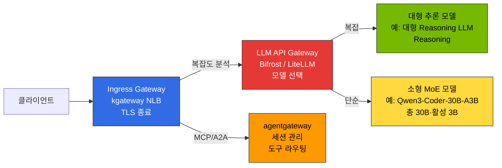
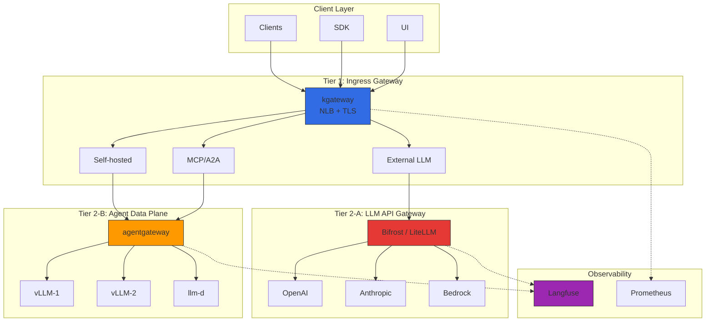
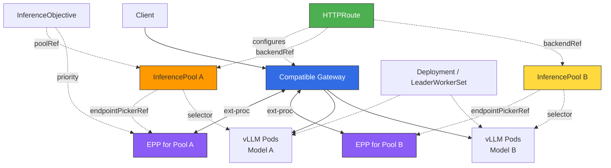
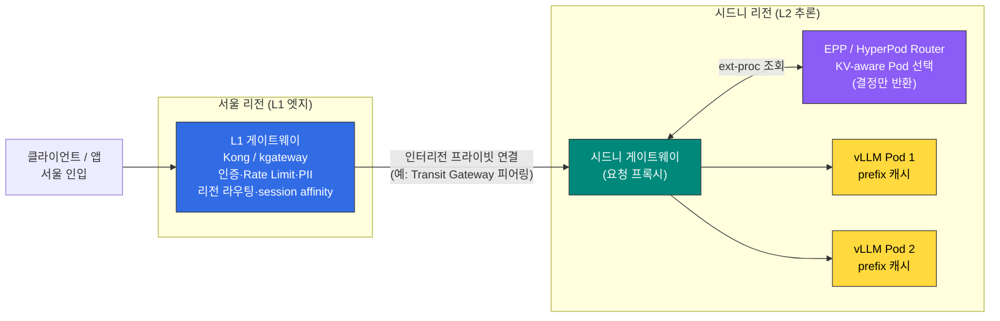

이 문서는 2-Tier 게이트웨이 아키텍처와 라우팅 전략(Cascade / Semantic Router / Hybrid)의 **설계 원칙**을 다룹니다. 실제 Helm 설치, HTTPRoute 매니페스트, OTel 연동 등 **배포 절차**는 [추론 게이트웨이 배포 가이드](../../reference-architecture/inference-gateway/setup/)를 참조하세요.

## 개요

대규모 AI 모델 서빙 환경에서 **인프라 트래픽 관리**와 **LLM 프로바이더 추상화**의 책임을 구분하면 운영에 도움이 됩니다. 아래 2-Tier 구성은 소유권·정책·스케일링을 분리하려는 설계 선택이며, 모든 llm-d 배포가 두 트래픽 게이트웨이를 요구하는 것은 아닙니다.

**2-Tier Gateway 아키텍처**:
- **L1 (Ingress Gateway)**: kgateway — Kubernetes Gateway API 표준, 트래픽 라우팅, mTLS, rate limiting
- **L2-A (Inference Gateway)**: Bifrost/LiteLLM — 프로바이더 통합, cascade routing, semantic caching
- **L2-B (Data Plane)**: agentgateway — MCP/A2A 프로토콜, stateful 세션 관리

각 티어는 독립적으로 관리되며, 인프라와 AI 워크로드를 분리합니다.

---

## 2-Tier Gateway 아키텍처

:::tip 게이트웨이 계층 정의는 별도 문서로 통일
플랫폼 전역의 게이트웨이 계층 용어·역할 정의는 [티어드 게이트웨이 아키텍처](./tiered-gateway-architecture.md)에 단일하게 정리되어 있습니다. 이 문서는 그중 **Tier 2-A(LLM API Gateway)** 의 라우팅 전략에 집중합니다. 클러스터 내 추론 Pod 라우팅(Tier 2 ① Inference Extension)은 아래 [Gateway API Inference Extension](#gateway-api-inference-extension) 섹션을 참조하세요.
:::

### Gateway 계층 구분

LLM 추론 플랫폼은 **3가지 서로 다른 Gateway 역할**을 명확히 구분해야 합니다. (전체 계층 정의는 [티어드 게이트웨이 아키텍처](./tiered-gateway-architecture.md) 참조)

**표 1. Gateway 유형별 역할·구현체·위치**

| Gateway 유형 | 역할 | 구현체 | 위치 |
|-------------|------|-------|------|
| **Ingress Gateway** | 외부 트래픽 수신, TLS 종료, 경로 기반 라우팅 | kgateway (NLB 연동) | Tier 1 |
| **LLM API Gateway** | 모델 선택, 지능형 라우팅, 요청 캐스케이딩 (외부/내부 모델 추상화) | Bifrost / LiteLLM | Tier 2-A |
| **Agent Data Plane** | MCP/A2A 프로토콜, stateful 세션, 도구 라우팅 | agentgateway | Tier 2-B |

> **용어 주의**: 여기서 **Tier 2-A "LLM API Gateway"** 는 모델 API를 추상화하는 프로바이더 프록시(Bifrost/LiteLLM)입니다. 클러스터 내 추론 Pod로 라우팅하는 **Gateway API Inference Extension**(Tier 2 ①, 본 문서 후반부)과는 용도가 다릅니다.

**그림 1. 2-Tier Gateway 계층별 요청 분배 구조**



**이 설계에서의 역할 배분:** (제품의 배타적 기능이 아니라 본 2-Tier 구성에서 각 컴포넌트에 부여한 책임입니다. 세 컴포넌트가 모두 필수인 것은 아닙니다.)
- **Ingress Gateway (kgateway)**: 본 설계에서는 네트워크 레벨 트래픽 제어만 담당하도록 배치합니다. 모델 선택 로직은 L2-A 게이트웨이에 위임합니다.
- **LLM API Gateway (Bifrost/LiteLLM)**: 요청을 분석해 모델을 선택하고 비용을 추적합니다. 이때 복잡도 기반 선택은 자동으로 켜지는 것이 아니라, LiteLLM의 `complexity_router`(classifier_type: heuristic/llm 등)나 Bifrost 라우팅 룰 같은 **classifier·정책을 명시적으로 구성**해야 동작합니다.
- **Agent Data Plane (agentgateway)**: 본 설계에서는 MCP/A2A 프로토콜 처리와 stateful 세션 유지를 맡깁니다. agentgateway 자체는 LLM 프로바이더·추론 엔드포인트 라우팅도 수행할 수 있으나, 여기서는 역할을 분리하기 위해 그 책임을 L2-A에 둡니다.

### 전체 구조

**그림 2. 2-Tier Gateway 전체 아키텍처와 관측성 연결**



### Tier별 역할 분리

**표 2. Tier별 컴포넌트·책임·프로토콜**

| Tier | 컴포넌트 | 책임 | 프로토콜 |
|------|----------|------|----------|
| **Tier 1** (Ingress Gateway) | kgateway (Envoy 기반) | 트래픽 라우팅, mTLS, rate limiting, 네트워크 정책 | HTTP/HTTPS, gRPC |
| **Tier 2-A** (LLM API Gateway) | Bifrost / LiteLLM | 지능형 모델 선택, 비용 추적, request cascading, semantic caching | OpenAI-compatible API |
| **Tier 2-B** (Agent Data Plane) | agentgateway | MCP/A2A 세션 관리, 자체 추론 인프라 라우팅, Tool Poisoning 방지 | HTTP, JSON-RPC, MCP, A2A |

### 트래픽 플로우

**외부 LLM**: Client → kgateway → Bifrost/LiteLLM (Cascade + Cache) → OpenAI → 응답 + 비용 기록
**자체 vLLM**: Client → kgateway → agentgateway → vLLM → 응답

---

## kgateway (L1 Inference Gateway)

### Gateway API 기반 라우팅

kgateway는 Kubernetes Gateway API 표준을 구현하여 벤더 중립적인 설정이 가능합니다.

import { ComponentStructureTable } from '@site/src/components/InferenceGatewayTables';

<ComponentStructureTable />

Gateway API v1.6.0은 2026-06-29에 released되어 UDPRoute·TCPRoute가 GA(standard 채널)로 승격되었습니다. kgateway의 Gateway API 지원 범위는 릴리스별로 고정되며 **standard 채널 기준**입니다: kgateway 2.4.x(2026-07-23 릴리스)는 Gateway API 1.4–1.6을, 2.3.x(2026-05-19 릴리스)는 1.3–1.5를, 2.2.x·2.1.x는 1.2–1.4를 지원합니다. 즉 v1.6은 "향후 추가 예정"이 아니라 kgateway 2.4.x에서 이미 지원되며, 특정 기능을 쓰기 전에는 실제 배포하려는 kgateway 버전과 Gateway API 채널(standard/experimental) 조합을 [kgateway 버전 지원표](https://kgateway.dev/docs/envoy/latest/reference/versions/)에서 확인해야 합니다.

### Dynamic Routing 개념

**표 3. 동적 라우팅 유형별 기준과 사용 사례**

| 라우팅 유형 | 기준 | 사용 사례 |
|------------|------|----------|
| **헤더 기반** | `x-model-id`, `x-provider` | 모델/프로바이더별 백엔드 선택 |
| **경로 기반** | `/v1/chat/completions`, `/v1/embeddings` | API 유형별 서비스 분리 |
| **가중치 기반** | backendRef weight | 카나리 배포, A/B 테스트 |
| **복합 조건** | 헤더 + 경로 + 티어 | 프리미엄/일반 고객별 백엔드 |

카나리 배포는 5-10% 트래픽으로 시작하여 점진적으로 증가시키며, 문제 발생 시 weight=0으로 즉시 롤백합니다.

### 로드 밸런싱 전략

**표 4. 로드 밸런싱 전략별 설명과 적합 시나리오**

| 전략 | 설명 | 적합 시나리오 |
|------|------|--------------|
| **Least Request** | 요청 수가 가장 적은 백엔드로 분배 (kgateway BackendConfigPolicy 미지정 시 기본값) | 처리 시간이 불균일한 일반 워크로드 |
| **Round Robin** | 순차적 분배 | 균일한 모델 인스턴스 |
| **Random** | 무작위 분배 | 대규모 백엔드 풀 |
| **Consistent Hash** | 동일 키 → 동일 백엔드 | KV Cache 재활용, 세션 유지 |

kgateway는 BackendConfigPolicy에서 로드 밸런싱 알고리즘을 지정하지 않으면 **least request**(요청 수가 가장 적은 인스턴스 선택)를 기본값으로 사용합니다(round robin이 아닙니다).

Consistent Hash는 LLM 추론에서 prefix 캐시 재활용에 **도움이 될 수 있습니다**. 다만 TTFT 개선은 보장된 효과가 아니라 조건부입니다: 동일 사용자의 요청이 **실제로 같은 prefix를 공유**하고, 그 prefix가 대상 vLLM 인스턴스에 **아직 상주(warm)** 하며, 해시 멤버십이 안정적일 때만 적중률이 올라갑니다. 백엔드 추가·제거로 해시 링이 바뀌거나 prefix가 다르면 이득이 사라지므로, 실제 워크로드로 적중률과 TTFT를 측정해 확인해야 합니다.

### Topology-Aware Routing (동일 AZ 우선) {#topology-aware-routing-kubernetes-133}

같은 AZ 내 Pod 간 통신을 우선시하면 크로스 AZ 데이터 전송 비용과 지연을 줄일 수 있습니다. 다만 이는 Kubernetes 버전만으로 자동 적용되는 것이 아니라, **어떤 메커니즘을 명시적으로 구성했는지**에 따라 달라지며 서로 다른 계층의 기능들을 구분해야 합니다.

- **Service `trafficDistribution: PreferClose`**(Kubernetes 1.31 GA): Service 수준에서 동일 존(zone) 엔드포인트를 우선하도록 kube-proxy/EndpointSlice에 힌트를 줍니다. 과거의 `service.kubernetes.io/topology-mode: Auto`(topology-aware hints)를 대체하는 상위 설정입니다.
- **게이트웨이/EPP 경로**: Gateway API 데이터 플레인이나 EPP(Inference Extension)가 Pod 주소로 직접 라우팅하는 경우 kube-proxy를 거치지 않을 수 있어, Service 수준 토폴로지 힌트가 그대로 적용되지 않습니다. 이 경로에서는 게이트웨이/스케줄러 자체의 locality·zone-aware 설정으로 제어해야 합니다.

따라서 "클러스터가 특정 버전 이상이므로 locality가 보장된다"고 추론하지 말고, 실제 트래픽을 처리하는 데이터 플레인(kube-proxy Service 경로인지, 게이트웨이/EPP 직접 라우팅인지)과 거기에 설정한 토폴로지 메커니즘을 명시해야 합니다.

import { TopologyEffectsTable } from '@site/src/components/InferenceGatewayTables';

<TopologyEffectsTable />

### 장애 대응 개념

**표 5. 장애 대응 메커니즘과 LLM 추론 고려사항**

| 메커니즘 | 설명 | LLM 추론 고려사항 |
|----------|------|-------------------|
| **타임아웃** | 요청별 최대 처리 시간 제한 | LLM 긴 응답 생성 시 수십 초 소요. 충분한 타임아웃 필요 (120s+) |
| **재시도** | 5xx, 타임아웃, 연결 실패 시 자동 재시도 | 최대 3회 제한. 무한 재시도는 시스템 과부하 유발 |
| **서킷 브레이커 / outlier detection** | 연속 실패 등 수동(passive) health 신호로 백엔드를 일시 제거 | `maxEjectionPercent`는 **동시에 제거되는 백엔드 비율의 상한**일 뿐, 가용 백엔드 수를 보장하지 않습니다. panic threshold(기본 50%)·active health check도 가용성에 영향을 주므로 "최소 절반 가용"은 성립하지 않습니다 |

Envoy outlier detection은 수동(passive) health checking으로, 요청 결과에서 관찰된 실패를 근거로 호스트를 제거합니다. `maxEjectionPercent`는 제거 가능한 호스트 비율의 상한을 둘 뿐 특정 수의 가용 호스트를 보장하지 않으며, 실제 가용성은 active health check와 panic threshold에도 좌우됩니다.

Gateway API 타임아웃에서 `backendRequest`는 **각 재시도(try)당 백엔드 응답 전체에 대한 타임아웃**이고 `request`는 재시도를 포함한 전체 요청 시간입니다. 즉 `backendRequest`는 "첫 바이트까지"가 아니라 해당 시도의 백엔드 응답 완료까지를 포괄하므로, 긴 SSE 스트리밍 응답은 이 값으로 중간에 끊길 수 있습니다. 스트리밍에서는 첫 바이트(TTFB)·idle·전체 스트림 타임아웃을 상황에 맞게 구분해 설정해야 합니다. POST 재시도는 멱등성 보장이 필요합니다(도구 호출 주의).

---

## LLM Gateway 솔루션 비교

### 주요 솔루션 비교 표

**표 6. LLM Gateway 솔루션별 특징·Cascade Routing·라이선스 비교**

| 솔루션 | 언어 | 주요 특징 | Cascade Routing | 라이선스 | 적합 환경 |
|--------|------|-----------|-----------------|----------|-----------|
| **Bifrost** | Go | 고성능 게이트웨이, 조건부 라우팅 룰(`complexity_tier`·model·params·budget), failover | 라우팅 룰(`complexity_tier`) + 외부 classifier | Apache 2.0 | 고성능, 저비용, 셀프호스트 |
| **LiteLLM** | Python | 100+ 프로바이더, 다전략 라우팅(latency/usage/cost/least-busy) + 네이티브 `complexity_router`(v1.101.0) + 커스텀 전략 | 네이티브 complexity_router(SIMPLE/MEDIUM/COMPLEX/REASONING) 또는 커스텀 전략 | MIT | Python 생태계, 빠른 프로토타이핑 |
| **vLLM Semantic Router** | 독립 서비스(Envoy ext_proc) | vLLM 프로젝트의 signal-driven 라우터로, OpenAI 호환 백엔드 앞단에 **독립 배포**(vLLM 전용 아님). 임베딩 유사도 기반 분류 | 임베딩 유사도 기반 | Apache 2.0 | vLLM 등 OpenAI 호환 백엔드 환경 |
| **Portkey** | TypeScript | SOC2 인증, semantic caching, Virtual Keys | 지원 | Proprietary + OSS | 엔터프라이즈, 규정 준수 |
| **Kong AI Gateway** | Lua/C | MCP 지원, 기존 Kong 인프라 활용. 단, 복잡도·의미 기반 라우팅을 하는 `ai-proxy-advanced`는 **Kong Enterprise(유료) 에디션** 플러그인이며 OSS `ai-proxy`와 기능이 다름 | 플러그인(에디션별 상이) | Apache 2.0(core) / Enterprise(고급 AI 플러그인) | 기존 Kong 사용자 |
| **Helicone** | Rust | Gateway + Observability 통합, 고성능 | 지원 | Apache 2.0 | 고성능 + 관측성 동시 필요 |
| **OpenRouter** | SaaS (호스티드) | 400+ 모델·70+ 프로바이더 통합 API, 프로바이더 폴백, OpenAI 호환 | 프로바이더 라우팅 지원 | SaaS (상용) | 멀티 프로바이더 빠른 통합, 프로토타이핑 |

:::note LiteLLM과 Kong을 함께 쓰지 않는 이유 (본 설계의 단순화)
본 설계에서는 LiteLLM과 Kong AI Gateway 중 **하나만** LLM API 게이트웨이(Tier 2-A)로 둡니다. 두 제품은 역할이 겹치므로 한쪽으로 통일해 운영 복잡도를 낮추려는 **설계상의 선택**이며, 두 제품을 조합(예: Kong 앞단 + LiteLLM 후단)하는 것이 기술적으로 불가능하거나 금지된다는 뜻은 아닙니다. 다만 그런 조합은 홉·설정·관측 포인트가 늘고 공개된 검증 레퍼런스를 찾기 어렵다는 트레이드오프가 있습니다. 테넌시 모델·예산 강제 관점의 선택 기준은 [AI Gateway 멀티테넌시 — 선택 기준](../../operations-mlops/governance/ai-gateway-multi-tenancy.md#4-선택-기준-litellm-vs-kong-택일)을 참조하세요.
:::

:::note 셀프호스트 vs SaaS
위 표에서 Bifrost·LiteLLM·Helicone·vLLM Semantic Router는 **셀프호스트**(클러스터 내 배포)이고, **OpenRouter는 호스티드 SaaS**입니다. SaaS는 즉시 400+ 모델에 접근하고 프로바이더 폴백·빌링을 위임할 수 있어 빠른 통합·프로토타이핑에 유리합니다. 단, 프롬프트가 외부 서비스로 전송되므로 데이터 주권·규제 요건이 있는 환경에서는 [거버넌스 주의점](../../operations-mlops/governance/ai-gateway-guardrails.md#openrouter-등-saas-게이트웨이-데이터-주권)을 검토하세요.
:::

### Bifrost vs LiteLLM

**Bifrost**: Go 기반 고성능 게이트웨이로 Python 대비 낮은 메모리 사용과 빠른 throughput을 제공합니다(공개 벤치 기준 ~11 µs(&lt;100 µs) 오버헤드 @ 5k RPS; "50x faster than LiteLLM"은 벤더 자체 head-to-head 벤치마크(공개, 단 제3자 검증 없음)의 수치(54x P99, 40x 오버헤드, 9.5x 처리량)를 요약한 태그라인). 성능 외에 **공급망·보안 관점**도 선택 요인이 됩니다. Python 기반 LLM 라우터(LiteLLM·LightLLM 등)는 광범위한 의존성 트리로 인해 보안 패치·취약점 대응 부담이 상대적으로 크며, 단일 정적 바이너리로 배포되는 Go 기반 Bifrost는 런타임 의존성과 공격 표면이 작습니다. 단, 이는 일반적 경향이며 실제 위험은 버전·구성별로 다르므로 도입 시점에 각 프로젝트의 보안 권고를 확인해야 합니다. 조건부 라우팅 룰은 CEL 식으로 `model`·`headers`·`params`·용량 지표(`budget_used`·`tokens_used`·`request`)와 함께, 프롬프트 임베딩을 가장 가까운 reference phrase에 매칭해 자동 분류한 **`complexity_tier`(SIMPLE/MEDIUM/COMPLEX — 이 세 값만, REASONING 티어는 없음)** 에 접근할 수 있어 프롬프트 기반 분기가 가능합니다. 분류가 불가능하면 `complexity_tier`는 unknown으로 간주되어 해당 룰은 매치되지 않습니다. Helm Chart 배포, OpenAI 호환 API. ([Bifrost routing rules](https://docs.getbifrost.ai/providers/routing-rules))

**LiteLLM**: 100+ 프로바이더 지원, **다전략 라우팅**(`simple-shuffle`·`latency-based-routing`·`usage-based-routing-v2`·`least-busy`·`cost-based-routing`)과 `CustomRoutingStrategyBase` 기반 **커스텀 전략**을 지원합니다. 복잡도 기반 라우팅은 v1.101.0 기준 **네이티브 `complexity_router`(auto-router)** 로 제공되며, 내장 티어 SIMPLE/MEDIUM/COMPLEX/REASONING과 `classifier_type`(heuristic·llm·heuristic_first·hybrid·custom·heuristic_v2)을 설정으로 구성합니다. `routing_strategy: complexity-based` 같은 한 줄 토글로 켜지는 것이 아니라 complexity_router 설정 블록을 명시해야 합니다. Langfuse 연동은 아래 "Langfuse 연동" 절 참고(한 줄 `success_callback: ["langfuse"]`는 SDK 콜백 경로). LangChain/LlamaIndex 직접 통합. 단, Python 기반으로 Go 대비 throughput이 낮고 메모리 사용량이 큽니다. ([LiteLLM routing](https://docs.litellm.ai/docs/routing), [complexity_router v1.101.0](https://github.com/BerriAI/litellm/blob/v1.101.0/litellm/router_strategy/complexity_router/complexity_router.py))

### 선택 기준

**표 7. 사용 사례별 권장 솔루션과 선택 이유**

| 사용 사례 | 권장 솔루션 | 이유 |
|-----------|-----------|------|
| 지능형 cascade (편의성 우선) | **LiteLLM** | 다전략/커스텀 라우팅 + 100+ 프로바이더, Python 생태계 통합 |
| 지능형 cascade (성능 우선) | **Bifrost** | 라우팅 룰(`complexity_tier`) + 외부 classifier, Go 저오버헤드 |
| vLLM 단독 환경 | **vLLM Semantic Router** | vLLM 프로젝트 라우터(독립 ext-proc 서비스), 경량 분류 |
| 고성능, 저비용 셀프호스트 | **Bifrost** | Go 기반 저오버헤드(~수십 µs)·저메모리 |
| Python 생태계 (LangChain) | **LiteLLM** | 네이티브 통합, 100+ 프로바이더 |
| 엔터프라이즈 규정 준수 | **Portkey** | SOC2/HIPAA/GDPR, Semantic Cache |
| 고성능 + 관측성 통합 | **Helicone** | Rust 기반 All-in-one |

### 시나리오별 추천 조합

**표 8. 운영 시나리오별 추천 게이트웨이 조합**

| 시나리오 | 추천 조합 | 이유 |
|----------|----------|------|
| **스타트업/PoC** | kgateway + LiteLLM | 저비용, 100+ 프로바이더 통합. 배포 소요 시간은 환경·기존 클러스터 준비 상태에 따라 다름(간단한 PoC는 수십 분 내 가능) |
| **셀프호스트 중심 (성능)** | kgateway + Bifrost (CEL 라우팅 룰) + agentgateway | 고성능, 외부+자체 풀 2-Tier |
| **엔터프라이즈 멀티 프로바이더** | kgateway + Portkey + Langfuse | 다수 프로바이더 통합·관측. 규정 준수는 통합만으로 달성되지 않으며, Portkey의 인증(SOC2 등) 범위와 자체 운영·심사 요건을 별도로 확인해야 함 |
| **하이브리드 (외부+자체)** | kgateway + Bifrost/LiteLLM + agentgateway | 외부는 Bifrost/LiteLLM, 자체는 agentgateway |
| **글로벌 배포** | Cloudflare AI Gateway + kgateway | Edge caching, DDoS 방어 |

> 위 "추천"은 각 조합의 전형적 적합성을 요약한 것입니다. 프로바이더 수·인증 범위는 제품·에디션·시점별로 바뀌므로 도입 시점의 각 벤더 문서로 확인하고, 배포 완료 여부는 "n분 배포" 같은 소요 시간이 아니라 헬스체크 통과·엔드투엔드 요청 성공 같은 수용 기준으로 판단하세요.

---

## Request Cascading: 지능형 모델 라우팅

**Request Cascading**은 요청 복잡도를 자동 분석하여 적절한 모델로 라우팅하는 지능형 최적화 기법입니다. Weight 기반·Fallback 기반·지능형 라우팅 3가지 패턴과 구현 접근(LLM Classifier·LiteLLM·vLLM Semantic Router) 비교, RouteLLM 연구 참조, 비용 절감 효과는 [Request Cascading — 지능형 모델 라우팅](./request-cascading.md)에서 상세히 다룹니다.

임계값·키워드 튜닝과 misroute 탐지 운영은 [Cascade Routing 튜닝](./cascade-routing-tuning.md)을 참조하세요.

---

## Gateway API Inference Extension

Kubernetes Gateway API는 **Inference Extension**을 통해 LLM 추론을 쿠버네티스 네이티브 리소스로 관리할 수 있게 합니다.

### 핵심 CRD (Custom Resource Definitions)

검토 기준은 llm-d v0.8.1(2026-06-26), router v0.9.0, GIE v1.5.0, Gateway API v1.5.1입니다. 1차 스키마: [llm-d v0.8.1](https://github.com/llm-d/llm-d/releases/tag/v0.8.1), [InferencePool v1](https://github.com/kubernetes-sigs/gateway-api-inference-extension/blob/v1.5.0/config/crd/bases/inference.networking.k8s.io_inferencepools.yaml), [InferenceObjective v1alpha2](https://github.com/llm-d/llm-d-router/blob/v0.9.0/config/crd/bases/llm-d.ai_inferenceobjectives.yaml), [HTTPRoute v1](https://github.com/kubernetes-sigs/gateway-api/blob/v1.5.1/config/crd/standard/gateway.networking.k8s.io_httproutes.yaml).

**표 9. Inference Extension 핵심 CRD의 소속·책임·예시**

| 리소스 | 소속 / API | 책임 | 예시 |
|--------|-----------|------|------|
| **Deployment / LeaderWorkerSet** | Kubernetes / 별도 워크로드 API | 이미지·모델 인수·Pod GPU 요청·replica 수 | 워크로드의 `replicas: 3`과 `nvidia.com/gpu` |
| **InferencePool** | GIE, `inference.networking.k8s.io/v1` | 같은 namespace의 Pod를 선택하고 포트·EPP 참조 정의 | `selector.matchLabels`, `targetPorts`, `endpointPickerRef` |
| **InferenceObjective** | llm-d, `llm-d.ai/v1alpha2` (alpha, 선택) | 특정 pool에 대한 요청 처리 우선순위 | `poolRef`, 정수 `priority: 10` |
| **HTTPRoute** | Gateway API, `gateway.networking.k8s.io/v1` | 경로·헤더·가중치로 pool 선택 | `backendRefs.kind: InferencePool` |

`InferenceModel`은 이전 정책 API의 역사적 이름입니다. 이 검토 기준에서는 llm-d의 InferenceObjective를 사용합니다. `criticality: high`, 모델 이미지, GPU 요청, replica 수는 InferenceObjective/InferencePool의 필드가 아닙니다. GIE v1 InferencePool과 llm-d alpha 정책 API의 안정성을 구분해야 합니다.

`LLMRoute`라는 kind는 검토한 GIE·llm-d Router CRD에 없습니다. router의 [`llmroute.yaml` 테스트 파일](https://github.com/llm-d/llm-d-router/blob/v0.9.0/test/sidecar/config/gateway/llmroute.yaml)도 `kind: HTTPRoute`입니다. 파일 이름을 API kind로 해석하거나 그 파일의 구 API 그룹을 그대로 복사하지 않습니다.

### Gateway API Inference Extension 통합

[Gateway Mode](https://github.com/llm-d/llm-d/blob/v0.8.1/docs/architecture/core/router/proxy.md)에서는 호환 Gateway 하나가 일반 Service와 InferencePool을 함께 처리할 수 있습니다. EPP는 선택 결과를 Gateway에 반환하며 직접 추론 트래픽을 프록시하지 않습니다. 별도 edge Gateway는 기존 ingress 유지나 보안·소유권 분리가 필요할 때 선택하고, 추가 홉·운영 비용과 timeout·retry·스트리밍·인증 헤더의 일관성을 검토합니다.

실선은 요청·응답과 EPP 호출, 점선은 설정 참조입니다.

**그림 3. Gateway API Inference Extension의 리소스·EPP 연결 구조**



이 예제는 라우팅 리소스만 정의합니다. `llm-d` namespace, `inference-gateway` Gateway, `inference-epp` Service(9002 포트의 EPP와 `gpu-pool` 연동 설정), `app: vllm` 레이블과 8000 포트를 가진 모델 서버 Pod가 이미 있어야 합니다. Gateway API v1.5.1, GIE v1.5.0의 InferencePool CRD, router v0.9.0의 InferenceObjective CRD와 호환 컨트롤러가 필요합니다.

```yaml
apiVersion: inference.networking.k8s.io/v1
kind: InferencePool
metadata:
  name: gpu-pool
  namespace: llm-d
spec:
  selector:
    matchLabels:
      app: vllm
  targetPorts:
    - number: 8000
  endpointPickerRef:
    name: inference-epp
    kind: Service
    port:
      number: 9002
    failureMode: FailClose
---
apiVersion: llm-d.ai/v1alpha2
kind: InferenceObjective
metadata:
  name: interactive
  namespace: llm-d
spec:
  poolRef:
    group: inference.networking.k8s.io
    kind: InferencePool
    name: gpu-pool
  priority: 10
---
apiVersion: gateway.networking.k8s.io/v1
kind: HTTPRoute
metadata:
  name: inference-route
  namespace: llm-d
spec:
  parentRefs:
    - name: inference-gateway
  rules:
    - matches:
        - path:
            type: PathPrefix
            value: /v1
      backendRefs:
        - group: inference.networking.k8s.io
          kind: InferencePool
          name: gpu-pool
          port: 8000
```

`priority: 10`은 같은 pool의 우선순위 0 요청보다 먼저 처리하도록 표현한 정책 예시입니다. [Flow control](https://github.com/llm-d/llm-d/blob/v0.8.1/docs/architecture/core/router/epp/flow-control.md)을 사용하는 경우 EPP에서 `flowControl` feature gate를 활성화하고, 신뢰할 수 있는 인증 계층이 `x-llm-d-inference-objective: interactive` 헤더를 설정해야 합니다. Objective를 만드는 것만으로 모든 요청에 자동 적용되지 않습니다. 외부 사용자가 우선순위를 임의로 올리지 못하도록 헤더를 검증·재설정합니다. 이 값은 전용 GPU 예약이나 Pod `PriorityClass`가 아닙니다.

### 두 개의 라우팅 레이어 — 반드시 구분

LLM 추론 플랫폼에서는 **모델/프로바이더 선택**과 **모델 내 Pod 선택**의 책임을 구분합니다. 논리적 역할의 차이가 곧 물리적인 두 게이트웨이 요구사항은 아닙니다. 지원되는 Gateway는 HTTPRoute와 EPP를 함께 사용해 두 역할을 연결할 수 있습니다.

**표 10. 두 라우팅 레이어(L1/L2)의 결정 질문·신호·구현체**

| 레이어 | 결정 질문 | 신호 | 단위 | 구현체 |
|--------|----------|------|------|--------|
| **L1 — LLM 프록시 / 엣지** | "어느 프로바이더/모델/리전?" | 비용·예산·프로바이더 health·인증·PII·semantic 유사도 | 모델/프로바이더 target | Kong, Bifrost, LiteLLM, Portkey, (kgateway) |
| **L2 — 추론 라우팅 (KV-aware)** | "어느 GPU Pod?" | vLLM 내부 메트릭(KV cache util·prefix 위치·queue depth) | 개별 Pod | **EPP(GIE)**, HyperPod router, Dynamo, vLLM production-stack |

> GIE 공식 문서는 EPP 위에 **LiteLLM·Solo AI Gateway·Apigee 같은 상위 AI Gateway**를 두는 조합을 (강제 권고가 아닌) 통합 예로 소개합니다. L1(across-model)과 L2(within-model)는 상호 보완 관계입니다.

:::info L1 예산 신호와 폴백 라우팅의 연결
L1 신호 중 **예산**은 거버넌스 정책과 직결됩니다. 테넌트 예산이 소진되면 L1 게이트웨이가 요청을 차단하거나(하드 예산) 저가 모델로 다운그레이드하는 폴백 경로를 태울 수 있습니다. 테넌트별 예산 계층·강제 방식은 [AI Gateway 멀티테넌시](../../operations-mlops/governance/ai-gateway-multi-tenancy.md), 예산 초과 시 차단/알림/폴백 정책 매트릭스는 [LLM FinOps Chargeback](../../operations-mlops/governance/llm-finops-chargeback.md)을 참조하세요. 이 정책 판단은 전부 L1에서 이루어지며, L2(KV-aware Pod 선택)는 예산 신호를 다루지 않습니다.
:::

:::note 라우팅 "결정"은 추론이 아니다 — KV-aware vs 컨텍스트 인지
L2의 KV-cache-aware(prefix-aware) 라우팅에서 **라우팅 결정 자체는 추론이 아닙니다.** prefix 블록 해시 + 인덱스 조회라는 기계적 연산이며 모델 forward pass가 없습니다. 반면 **컨텍스트 인지(시맨틱) 라우팅**은 인코더·분류 모델을 돌려 의도를 분류하므로 라우팅 경로에서 경량 추론이 발생합니다. 어느 경우든 선택된 Pod가 수행하는 **최종 워크로드는 LLM 추론**입니다. 상세 구분은 [KV Cache 최적화 — Cache-Aware Routing](../../model-serving/inference-optimization/kv-cache-optimization.md#kv-cache-aware-routing)을 참조하세요.
:::

:::note 용어 매핑 — L1/L2 ↔ Tier 2 ①/②
이 L1/L2는 **"라우팅 결정 레이어"** 관점이고, [티어드 게이트웨이 아키텍처](./tiered-gateway-architecture.md)의 Tier는 **"플랫폼 배치 계층"** 관점입니다. 대응 관계는:
- **L1**(across-model 프록시) ≈ **Tier 1**(Ingress) + **Tier 2 ②**(LLM API Gateway)
- **L2**(within-model KV-aware) = **Tier 2 ①**(Inference Routing = Gateway API Inference Extension / EPP)
:::

### EPP(Endpoint Picker) 정확한 정의

**EPP = GIE가 정의한, Envoy `ext-proc`(External Processing) gRPC 프로토콜을 구현한 추론 스케줄러 서비스.** 게이트웨이(Envoy)가 매 요청마다 EPP를 호출해 "InferencePool 안의 어느 Pod로 보낼지"를 위임받습니다.

**EPP를 EPP이게 만드는 3가지 사양:**
1. **ext-proc gRPC 구현** — ext-proc 스타일 external processing을 지원하는 게이트웨이가 EPP를 호스트할 수 있습니다 (Istio, kgateway, Envoy Gateway, GKE Gateway, agentgateway, NGINX Gateway Fabric 등)
2. **InferencePool selector로 개별 Pod 주소(`podIP:port`)를 다룸** — Kubernetes Service가 아니라 Pod 단위
3. **모델 서버 메트릭 기반 스케줄링** — 단순 LB가 아니라 KV-cache/load aware

**EPP 내부 파이프라인** (단일 함수가 아니라 레이어드 스케줄러):

> **게이트웨이 vs EPP 경계**: HTTPRoute의 pool 선택·가중치·경로 매칭은 **게이트웨이(Gateway API)** 가 수행하는 라우팅이며 EPP 파이프라인의 일부가 아닙니다. 게이트웨이가 어느 InferencePool로 보낼지 정한 뒤, 그 pool 안에서 "어느 Pod인지"만 EPP가 결정합니다.

**표 11. EPP 내부 파이프라인 레이어별 역할**

| 레이어 | 역할 |
|--------|------|
| Data Layer | InferencePool Pod 목록 + vLLM 메트릭 수집·가공, prefix 인덱스 등 조회용 데이터 준비 |
| Flow Control | InferenceObjective의 요청 우선순위, priority·fairness·queueing (Saturation Detector 과부하 방어) |
| Scheduling Layer | **scorer + picker** — pool 내 실제 Pod 선택 |

- **scorer**: `prefix-cache-scorer`는 **별도의 producer/indexer가 미리 산출해 둔 prefix 매칭 정보(PrefixCacheMatchInfo)를 소비**해 각 Pod를 점수화합니다. 즉 scorer 자체가 매 요청마다 프롬프트를 해싱·인덱싱하는 것이 아니라, 블록 해싱·인덱스 갱신은 데이터 계층의 producer가 담당하고 scorer는 그 결과를 읽어 점수를 매깁니다. 이 밖에 KV cache/부하 인지 scorer(load·queue-depth), LoRA affinity 등이 있습니다.
- **picker**: scorer 점수 종합 → 최종 Pod 선택(picker 미지정 시 기본 `max-score-picker`)
- 결정 전달: `x-gateway-destination-endpoint` HTTP 헤더 + `dynamic_metadata`(둘 다 일치 필수), fallback 1개 지정 가능

**EPP가 아닌 것**: 게이트웨이가 아닙니다(라우팅 결정만, 프록시는 게이트웨이가 수행). 모델 라우터가 아닙니다(within-model Pod 선택만). 레퍼런스 구현은 **llm-d Router**이며 EPP 코드는 llm-d로 통합되었고, GIE에는 InferencePool API와 Endpoint Picker Protocol만 남습니다. EPP 호스트 게이트웨이는 ext-proc 스타일 external processing을 지원하는 게이트웨이: **Istio, kgateway, Envoy Gateway, GKE Gateway, agentgateway, NGINX Gateway Fabric 등**.

### L2 옵션 비교: EPP vs HyperPod Inference Operator vs Dynamo

KV-aware routing(L2)을 무엇으로 구현하느냐의 비교입니다. 공통 제약은 InferencePool의 selector가 **같은 namespace의 Pod만** 선택한다는 점과, KV-aware 스케줄러가 vLLM worker의 실시간 메트릭에 의존한다는 점입니다. 따라서 L2 스케줄러와 vLLM은 **같은 클러스터**에 두는 것이 전제이고, 리전 locality(동일 리전 배치)는 메트릭 신선도·지연을 위한 **권장 사항**입니다(물리적으로 다른 리전이 금지된다기보다, 크로스리전 지연 때문에 권장되지 않음).

**표 12. L2 KV-aware 라우팅 옵션(EPP·HyperPod·Dynamo) 비교**

| 항목 | EPP(GIE) + Envoy 게이트웨이 | HyperPod Inference Operator | NVIDIA Dynamo |
|------|---------------------------|----------------------------|---------------|
| KV-aware 방식 | prefix-cache·kv-util scorer | kvaware/prefixaware (LMCache router) | KV router(Radix tree, KVPublisher/Indexer) |
| 관리 | self-managed (K8s 표준) | **AWS 관리형**(EKS add-on) | self-managed |
| 노드 자동복구 | NMA+Auto Repair 별도 | **딥헬스체크+스페어풀 통합** | 별도 |
| 분산추론 | llm-d 연계 | **DPD 관리형**(EFA/GPUDirect RDMA) | prefill/decode + 3-tier KV offload |
| 백엔드 엔진 | vLLM/TGI 등 | vLLM 전용(kvaware는 `/completions`만) | vLLM/SGLang/**TRT-LLM** |
| 비용 | EC2 단가 | EC2 대비 관리형 프리미엄이 있을 수 있음(과거 ml.p5 vs p5 비교에서 약 +15~20% 수준으로 관측된 예가 있으나, 인스턴스·리전·시점별로 달라지므로 도입 시점 [SageMaker 요금](https://aws.amazon.com/sagemaker/pricing/)으로 확인 필요) | EC2 단가 |
| 락인 | 낮음(Gateway API/GIE 표준 기반이나, 운영상 특정 컨트롤러·구현에 대한 의존은 남음) | 중간(SageMaker CRD, 단 vLLM/K8s 표준 위) | 없음 |
| 적합 | 표준·벤더중립·MCP 통합 | 운영 최소·자동복구·governance | 극한 성능·다중 엔진 |

> **Kong은 L2(EPP)를 갖지 않습니다.** Kong의 LB(consistent-hash·lowest-latency 등)는 **모델/프로바이더 레벨**이지 Pod 레벨 KV-aware 스케줄링이 아니며, Envoy 기반이 아니라 GIE/ext-proc/InferencePool을 구현하지 않습니다. KV-aware가 필요하면 Kong은 L1(엣지)로 두고 L2는 EPP/HyperPod/Dynamo를 사용합니다. (도입 시점 Kong 릴리스 노트 재확인 권장 — InferencePool은 게이트웨이 중립 표준이라 향후 지원 가능성 있음.)

:::caution Kong의 시맨틱 캐시 ≠ vLLM KV-cache-aware 라우팅
Kong AI Gateway의 `ai-semantic-cache` 플러그인은 **임베딩 코사인 유사도로 의미가 유사한 요청의 "전체 응답"을 재사용**하는 L1 응답 캐시입니다(중복 LLM 호출 자체를 제거). 이는 vLLM Pod의 prefix KV cache 위치를 인지해 Pod를 고르는 **L2 KV-cache-aware 라우팅과 다른 계층**입니다(세 캐시 계층 비교: [Semantic Caching 전략](../inference-optimization/semantic-caching-strategy.md#2-캐시-계층-구분)).

또한 Kong의 벡터 저장소는 **Kong 내부에 임베딩되는 것이 아니라 외부 Redis/Valkey/PGVector**에 연결하며(AWS에서는 IAM 인증 ElastiCache 등), 임베딩 자체도 외부 임베딩 API(OpenAI·Bedrock 등)를 호출해 생성합니다. AWS 통합은 Bedrock 프로바이더·`ai-aws-guardrails` 플러그인이 문서화되어 있으나, "AWS 관리형 KV cache"와의 직접 통합은 별도 개념입니다. (Kong 버전별 차이가 있으므로 적용 시점 [Kong AI Gateway 문서](https://developer.konghq.com/ai-gateway/) 확인 권장.)
:::

> **HyperPod의 관리형 DPD/KV-aware는 vLLM에 고정**됩니다. TensorRT-LLM 백엔드의 성능 천장이 필요하면 HyperPod EKS 위에 Dynamo를 직접 배포하고, HyperPod는 노드 복구·governance 레이어로만 활용하는 하이브리드가 가능합니다.

### 멀티리전 주의 (예: 서울 수신 → 호주 추론)

L2(KV-aware)는 vLLM worker의 실시간 메트릭(대체로 수백 ms~초 수준의 신선도)에 의존하고, InferencePool selector는 **같은 클러스터·namespace의 Pod만** 선택합니다. 따라서 L2 스케줄러는 vLLM과 같은 클러스터에 두는 것이 전제입니다. 서울의 게이트웨이가 호주 클러스터의 L2 KV-aware 결정을 대신하기는 어렵습니다: 크로스리전 RTT가 커질수록(리전 쌍·경로에 따라 다르며, 서울–시드니 구간은 대체로 수십~150ms대로 측정되나 실측이 필요) 메트릭이 stale해지고, 무엇보다 InferencePool이 다른 클러스터의 Pod를 selector로 잡지 못하기 때문입니다. 이 전제 아래 다음과 같이 역할을 나눕니다:

- **서울 = L1**(Kong/Bifrost/kgateway): 프로바이더·리전 라우팅, 인증, $예산, PII, failover, **session affinity**(prefix 캐시 보존)
- **호주 = L2**(EPP/HyperPod router/Dynamo) + vLLM: KV-aware Pod 선택
- KV cache 이득은 **호주 클러스터 내부에서만** 발생(크로스리전 홉은 캐시로 단축 불가). 리전 간 egress 비용·TTFT 가산 유의.

**그림 4. 멀티리전 L1(서울)·L2(시드니) 역할 분리 구조**



위 구성에서 라우팅은 AWS VPC/네트워크 레벨 연결 위에서 동작합니다. 서울 L1이 "이 요청은 추론이니 시드니로"라는 리전·세션 결정을 내리고, 시드니 쪽에서는 **게이트웨이가 요청을 프록시**하면서 EPP(L2)를 ext-proc로 조회해 어느 Pod인지만 위임받습니다(EPP는 결정을 반환할 뿐 직접 트래픽을 프록시하지 않습니다 — 앞의 Gateway Mode 다이어그램과 동일한 분리). 두 클러스터를 단일 메시로 통합할 필요는 없으며, Transit Gateway 인터리전 피어링 등으로 프라이빗 네트워크 경로를 확보합니다. 다만 Transit Gateway는 **네트워크 연결 수단**일 뿐 애플리케이션 인증을 대신하지 않으며(인증·인가는 게이트웨이 계층에서 별도 수행), "항상 1홉"이 보장되는 서비스도 아닙니다(라우팅 테이블·서브넷·피어링 구성에 따라 경로가 달라지므로 본 문서 범위 밖). 멀티턴 prefix 재사용을 살리려면 L1이 동일 세션을 같은 시드니 엔드포인트로 일관되게 보내는 **session affinity**가 핵심입니다.

---

## Semantic Caching

Semantic Caching은 의미적으로 유사한 프롬프트를 감지하여 이전 응답을 재사용함으로써 LLM API 비용과 지연시간을 줄일 수 있습니다. Gateway 레벨(Bifrost/LiteLLM/Portkey)에서 임베딩 유사도로 HIT/MISS를 판단하는 **응답 캐시**이며, 정확 일치 캐시(exact match)와 KV Cache는 서로 다른 계층입니다.

**임계값**: 유사도 0.85 같은 단일 값은 범용 기본값이 아닙니다. 적절한 임계값은 임베딩 모델·거리 척도(cosine/L2)·도메인에 따라 달라지며, 숫자 점수가 높다고 "의미가 동일"함을 보장하지 않습니다(표현이 비슷해도 의미가 다른 false hit가 발생). 따라서 모델별로 측정해 허용 가능한 false-hit 예산 안에서 보정(calibrate)하고, 캐시 조회 전에 테넌트·사용자·데이터 스코프를 키에 포함해 격리해야 합니다. 또한 정확 일치 조회를 먼저 시도해 불필요한 임베딩 비용을 줄입니다.

**캐시 계층 구분**: Gateway의 semantic 응답 캐시와 vLLM의 KV Cache는 독립적으로 조합할 수 있습니다. 다만 "Prompt Cache(프로바이더 관리형)"는 별개의 독립 캐시 종류라기보다, 프로바이더가 내부적으로 운영하는 **prefix 캐시로 KV 캐시 개념과 겹칩니다**(예: 공통 prefix 재사용). 즉 세 가지가 완전히 직교하는 것은 아니므로, 각 캐시가 무엇을 키로 삼고 어느 계층에서 동작하는지 구분해야 합니다.

설계 원칙(3계층 캐시 비교, 유사도 임계값 트레이드오프, 도구 비교 표, 캐시 키 설계, 관측성·실전 체크리스트)은 별도 문서에서 상세히 다룹니다.

- **설계 원칙**: [Semantic Caching 전략](../inference-optimization/semantic-caching-strategy.md)
- **실전 배포 예시**: [OpenClaw AI Gateway 배포](./openclaw-example.md) 의 LiteLLM + Redis 구성

---

## agentgateway 데이터 플레인

### 개요

**agentgateway**는 kgateway의 AI 워크로드 전용 데이터 플레인입니다. 기존 Envoy는 stateless HTTP/gRPC에 최적화되어 있지만, AI 에이전트는 stateful JSON-RPC 세션, MCP 프로토콜, Tool Poisoning 방지 등 특수 요구사항을 가집니다.

### Envoy vs agentgateway 비교

**표 13. Envoy 데이터 플레인과 agentgateway 비교**

| 항목 | Envoy 데이터 플레인 | agentgateway |
|------|---------------------|---------------------------|
| **세션 관리** | Stateless, HTTP 쿠키 기반 | MCP 세션 추적(`Mcp-Session-Id`), 선택적 세션 스토어 — MCP 사양상 세션은 선택적이며 stateless 운영도 가능 |
| **프로토콜** | HTTP/1.1, HTTP/2, gRPC | MCP (Model Context Protocol), A2A (Agent-to-Agent) |
| **보안** | mTLS, RBAC | Tool Poisoning 방지, per-session Authorization |
| **라우팅** | 경로/헤더 기반 | 세션 ID 기반, 도구 호출 검증 |
| **관측성** | HTTP 메트릭, Access Log | LLM 토큰 추적, 도구 호출 체인, 비용 |

### 핵심 기능

**1. 세션 관리**: MCP Streamable HTTP(2025-06-18 사양)의 세션은 **`Mcp-Session-Id`** 헤더로 추적합니다(`X-MCP-Session-ID`가 아닙니다). 세션 관리는 사양상 **선택적**이며, 서버는 stateless로 동작할 수도 있습니다. agentgateway가 sticky session 라우팅이나 비활성 세션 정리를 하는 경우, 그 타임아웃 값(예: 30분)은 **설정 가능한 값**이지 사양상 고정 기본값이 아닙니다. 실제 적용 값은 배포 설정에서 확인해야 합니다.

**2. MCP/A2A 프로토콜 지원**: MCP·A2A 트래픽을 라우팅합니다. `/mcp/v1`·`/a2a/v1` 같은 경로는 **배포에서 구성하는 예시 경로**이며 사양이 강제하는 고정 경로가 아닙니다(실제 엔드포인트 경로는 설정에서 지정).

**3. Tool 관련 가드레일(구성 필요)**: 허용 도구 목록(allowlist), 위험 도구 차단, 응답 크기 제한, 무결성 검증 등을 **정책으로 설정**할 수 있습니다. "Tool Poisoning을 자동으로 완전히 막는다"거나 "SHA-256으로 항상 검증한다"는 보장이 아니라, 운영자가 어떤 가드레일 정책을 구성했는지에 따라 적용 범위가 달라집니다. 구체적 정책은 [agentgateway MCP 가드레일 문서](https://agentgateway.dev/blog/2026-06-29-mcp-guardrails-microsoft-agent-governance-toolkit/)를 참조하세요.

**4. 인가(Authorization)**: JWT 토큰 검증, 역할 기반 도구 접근 등 per-session 인가 정책을 구성할 수 있습니다. 세션 하이재킹 방지는 이러한 인증·인가 정책을 올바르게 구성했을 때 얻는 효과이며, 설정 없이 자동으로 보장되지 않습니다.

:::info agentgateway 프로젝트 현황
agentgateway는 kgateway v2.2 계보에서 분리된 AI 전용 데이터 플레인입니다. 2026년 2~3월경 agentgateway v1.0부터 AI/에이전트 제어 평면 컨트롤러가 agentgateway 저장소로 이관되어 독립 릴리스 체계를 채택했습니다. 현재 활발하게 개발 중이며, MCP 프로토콜과 A2A 프로토콜의 빠른 발전에 맞춰 기능이 지속적으로 추가되고 있습니다.
:::

---

## 모니터링 & Observability

### 핵심 메트릭

AI 추론 게이트웨이에서 모니터링해야 하는 핵심 메트릭은 다음과 같습니다. 아래 표의 메트릭 **이름은 예시**입니다. kgateway의 게이트웨이 프록시는 Envoy이므로 실제 시계열은 Envoy가 내보내는 series(예: downstream/upstream request·connection 계열)로 노출되며, 정확한 메트릭 이름·레이블은 배포하려는 버전의 [kgateway Gateway proxy metrics 문서](https://kgateway.dev/docs/envoy/latest/observability/gateway-metrics/)와 실제 scrape 결과로 확인한 뒤 쿼리·recording rule을 작성해야 합니다.

import { MonitoringMetricsTable } from '@site/src/components/InferenceGatewayTables';

<MonitoringMetricsTable />

**표 14. 추론 게이트웨이 핵심 메트릭 카테고리와 의미**

| 메트릭 카테고리 | 주요 항목 | 의미 |
|----------------|----------|------|
| **레이턴시** | TTFT (Time to First Token) | 첫 번째 토큰 생성까지의 시간. 사용자 체감 응답성 |
| **처리량** | TPS (Tokens Per Second) | 초당 토큰 생성 수. 모델 서빙 효율성 |
| **에러율** | 5xx / 전체 요청 | 백엔드 장애 비율(아래 임계값은 시작용 예시) |
| **캐시 적중률** | Cache Hit / 전체 요청 | Semantic Cache 효율성(목표치는 워크로드별로 다름) |
| **비용** | 입력·출력·캐시 토큰별 사용량 × 각 단가의 합 | 입력/출력/캐시 토큰 단가가 다르므로 분리 집계 필요 |

> 위 임계값은 **범용 기본값이 아니라 출발점 예시**입니다. 에러율·캐시 적중률·P99 목표치는 트래픽 양·측정 윈도우·최소 샘플 수·엔드포인트 범위에 따라 달라지므로, 메트릭 타입·레이블·집계 윈도우를 정의하고 서비스별 SLO에 맞춰 조정하세요. 비용은 입력/출력/캐시 토큰 단가가 다르고 캐시 적중률에 따라 실비용이 달라지므로 토큰 종류별로 분리해 계산해야 합니다.

### Langfuse 연동 {#langfuse-otel-연동}

Bifrost/LiteLLM에서 Langfuse로 트레이스를 전송해 프롬프트/완료 내용, 토큰 사용량, 비용, 도구 호출 체인을 추적합니다. LiteLLM에는 경로가 두 가지이며 구분해야 합니다:

- **OpenTelemetry 경로(권장)**: `langfuse_otel` 프리셋(OpenTelemetry v2)으로, Langfuse v3/v4에서 권장됩니다. OTLP 엔드포인트로 트레이스를 보냅니다.
- **SDK 콜백 경로(레거시)**: `success_callback: ["langfuse"]`는 Langfuse Python SDK(`langfuse>=4.7,<5`)를 사용하는 콜백 설정입니다. 이는 "OTel trace 전송"과 동일하지 않으며, 필요한 자격 증명(`LANGFUSE_PUBLIC_KEY`·`LANGFUSE_SECRET_KEY`·`LANGFUSE_HOST`)과 SDK 버전을 함께 구성해야 합니다.

Bifrost는 `otel` 플러그인으로 OTel 전송을 활성화합니다. 상세 구성은 [LiteLLM Langfuse 연동 문서](https://docs.litellm.ai/docs/observability/langfuse_integration)와 [모니터링 스택 설정](../../reference-architecture/integrations/monitoring-observability-setup.md)을 참조하세요.

### 알림 규칙 권장 (시작용 예시) {#알림-규칙-권장}

아래 조건은 **출발점 예시**이며 범용 기본값이 아닙니다. 각 조건에는 측정 윈도우·최소 샘플 수·대상 엔드포인트 범위를 함께 정의하고, 실제 메트릭 이름/레이블(예: Envoy/kgateway가 내보내는 시계열)에 맞춰 PromQL로 표현한 뒤 서비스 SLO에 맞게 조정하세요.

**표 15. 알림 규칙 예시와 심각도**

| 알림 | 조건(예시) | 심각도 |
|------|------|--------|
| 높은 에러율 | 5xx 비율 > 5% (5분 윈도우, 최소 요청 수 충족 시) | Critical |
| 높은 레이턴시 | P99 > 30초 (5분 윈도우) | Warning |
| 서킷 브레이커/outlier 활성화 | 해당 상태 메트릭 == 1 | Critical |
| 캐시 적중률 급락 | Cache hit < 목표치(워크로드별 기준) | Warning |
| 예산 초과 임박 | Budget > 80% | Warning |

---

## 관련 문서

### 실전 배포 가이드

실제 코드 예시와 YAML 매니페스트는 Reference Architecture 섹션을 참조하세요:

- [Request Cascading — 지능형 모델 라우팅](./request-cascading.md) - LLM Classifier·LiteLLM·vLLM Semantic Router 구현 접근 비교
- [추론 게이트웨이 배포 가이드](../../reference-architecture/inference-gateway/setup/) - kgateway, Bifrost, agentgateway 설치 및 YAML 매니페스트
- [OpenClaw AI Gateway 배포](./openclaw-example.md) - OpenClaw + Bifrost + Hubble 실전 배포
- [커스텀 모델 배포](../../reference-architecture/model-lifecycle/custom-model-deployment.md) - vLLM/llm-d 배포 가이드

### 비용 및 관측성

- [코딩 도구 & 비용 분석](../../reference-architecture/integrations/coding-tools-cost-analysis.md) - Aider/Cline 연결, NLB 통합 라우팅 패턴
- [모니터링 스택 설정](../../reference-architecture/integrations/monitoring-observability-setup.md) - Langfuse OTel 연동, Prometheus, Grafana 대시보드
- [LLMOps Observability](../../operations-mlops/observability/llmops-observability.md) - Langfuse/LangSmith 기반 LLM 관측성

### 거버넌스 & 테넌시

- [AI Gateway 멀티테넌시](../../operations-mlops/governance/ai-gateway-multi-tenancy.md) - L1 게이트웨이 테넌트 격리·예산 강제
- [LLM FinOps Chargeback](../../operations-mlops/governance/llm-finops-chargeback.md) - 예산 소진 시 폴백/차단 정책과 비용 배부

### 관련 인프라

- [GPU 리소스 관리](../../model-serving/gpu-infrastructure/gpu-resource-management.md) - 동적 리소스 할당 전략
- [llm-d 분산 추론](../../model-serving/inference-frameworks/llm-d-eks-automode.md) - EKS Auto Mode 기반 분산 추론
- [Agent 모니터링](../../operations-mlops/observability/agent-monitoring.md) - Langfuse 통합 가이드

---

## 참고 자료

### 공식 문서

- [Kubernetes Gateway API](https://gateway-api.sigs.k8s.io/)
- [Gateway API Inference Extension (Proposal)](https://github.com/kubernetes-sigs/gateway-api/issues/2813)
- [kgateway 공식 문서](https://kgateway.dev/docs/)
- [agentgateway GitHub](https://github.com/agentgateway/agentgateway)
- [Bifrost 공식 문서](https://www.getmaxim.ai/bifrost/docs)
- [LiteLLM 공식 문서](https://docs.litellm.ai/)
- [LiteLLM Complexity Routing](https://docs.litellm.ai/docs/routing)
- [vLLM Semantic Router](https://github.com/vllm-project/semantic-router)

### LLM 프로바이더

- [OpenAI API Reference](https://platform.openai.com/docs/api-reference)
- [Anthropic Claude API](https://docs.anthropic.com/claude/reference)
- [AWS Bedrock](https://docs.aws.amazon.com/bedrock/)

### 관련 프로토콜

- [Model Context Protocol (MCP) Spec](https://modelcontextprotocol.io/specification)
- [Agent-to-Agent (A2A) Protocol](https://a2a-protocol.org/latest/specification/)

### 연구 자료 & 패턴

- [RouteLLM: Learning to Route LLMs with Preference Data (arXiv)](https://arxiv.org/abs/2406.18665)
- [LMSYS Chatbot Arena Leaderboard](https://arena.ai/leaderboard/text)
- [LLM Router Pattern: Model Switching](https://markaicode.com/llm-router-pattern-model-switching/)
