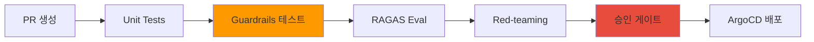
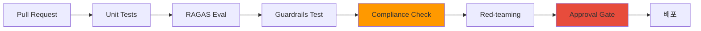

AI 플랫폼을 엔터프라이즈 환경에서 운영할 때 반드시 준수해야 하는 컴플라이언스 프레임워크와 실전 매핑 가이드를 제공합니다.

## 왜 AI 컴플라이언스가 필요한가

### 기존 IT 컴플라이언스 vs AI 운영 컴플라이언스

:::info 핵심 차이점
기존 IT 컴플라이언스는 **정적인 시스템**을 다루지만, AI 컴플라이언스는 **비결정적이고 학습하는 시스템**을 다룹니다.
:::

**표 1. 기존 IT 컴플라이언스와 AI 운영 컴플라이언스 비교**

| 영역 | 기존 IT 컴플라이언스 | AI 운영 컴플라이언스 |
|------|---------------------|---------------------|
| **예측 가능성** | 코드 → 동일 입력 = 동일 출력 | 모델 → 동일 입력도 출력 변동 가능 |
| **접근 제어** | DB/API 수준 | 모델 API + 프롬프트 + 출력 필터링 |
| **감사 추적** | 트랜잭션 로그 | 추론 트레이스 + 토큰 사용량 |
| **변경 관리** | 코드 배포 | 모델 버전 + LoRA 어댑터 + Playbook |
| **인시던트 대응** | 롤백 + Hotfix | 모델 스왑 + Guardrails 강화 |

### AI 고유 리스크

:::caution AI 특유의 컴플라이언스 리스크
- **환각(Hallucination)**: 모델이 사실이 아닌 정보를 생성
- **프롬프트 인젝션**: 악의적 입력으로 모델 동작 조작
- **PII 노출**: 학습 데이터에 포함된 개인정보 유출
- **모델 편향**: 특정 집단에 대한 차별적 출력
- **토큰 남용**: 비용 폭증 및 리소스 고갈
:::

이러한 리스크를 기존 컴플라이언스 프레임워크에 매핑하여 **실행 가능한 통제 방안**을 수립해야 합니다.

---

## SOC2 Trust Criteria ↔ AI 운영 매핑

SOC2(Service Organization Control 2)는 클라우드 서비스의 보안, 가용성, 기밀성을 검증하는 글로벌 표준입니다.

### SOC2 통제 매핑 테이블

**표 2. SOC2 통제별 AI 운영 구현과 기술 스택 매핑**

| SOC2 통제 | Trust Criteria | AI 운영 구현 | 기술 스택 |
|-----------|----------------|-------------|----------|
| **CC6.1-6.8** | 논리적·물리적 접근 제어 | 모델 API 인증 + 데이터 접근 통제 | **Pod Identity + RBAC + API Key** |
| **CC7.1-7.4** | 시스템 모니터링 | 추론 요청 추적 + GPU 리소스 모니터링 | **LLM Tracing + AMP/AMG + DCGM** |
| **CC7.3** | 이상 탐지 및 인시던트 대응 | 자동 알림 + Playbook rollback | **PagerDuty + ArgoCD** |
| **CC8.1** | 변경 관리 | Playbook 버전 관리 + 승인 게이트 | **GitOps + Approval Gate** |

### CC6: 접근 제어 구현 예시

아래 예시는 ServiceAccount에 `eks.amazonaws.com/role-arn` 애너테이션을 붙이는 IRSA(IAM Roles for Service Accounts) 방식으로 Pod에 IAM 역할을 연결합니다. EKS Pod Identity는 이 애너테이션 대신 `pod-identity-agent` 애드온과 Pod Identity 연결(association)을 사용하므로, 아래 애너테이션을 쓰는 경우 Pod Identity가 아니라 IRSA입니다. 또한 아래 Kubernetes RBAC Role/RoleBinding은 KServe `inferenceservices` 리소스의 `get`/`list` 조회만 허가하는 Kubernetes 리소스 수준 인가이며, 모델 엔드포인트 호출(추론 요청) 자체를 인증·인가하지는 않습니다. 모델 엔드포인트 접근 제어는 아래 RBAC와 별도로 게이트웨이 API Key 또는 토큰 검증 같은 호출 경로 인증·인가를 구성해야 합니다.

```yaml
# IRSA(IAM Roles for Service Accounts) + Kubernetes RBAC: 리소스 수준 인가 예시
apiVersion: v1
kind: ServiceAccount
metadata:
  name: model-api-sa
  annotations:
    eks.amazonaws.com/role-arn: arn:aws:iam::123456789012:role/ModelAPIAccessRole
---
apiVersion: rbac.authorization.k8s.io/v1
kind: Role
metadata:
  name: model-reader
rules:
- apiGroups: ["serving.kserve.io"]
  resources: ["inferenceservices"]
  verbs: ["get", "list"]
---
apiVersion: rbac.authorization.k8s.io/v1
kind: RoleBinding
metadata:
  name: model-reader-binding
subjects:
- kind: ServiceAccount
  name: model-api-sa
roleRef:
  kind: Role
  name: model-reader
  apiGroup: rbac.authorization.k8s.io
```

:::tip CC7.1-7.4 구현: LLM 트레이싱
모든 추론 요청을 감사 가능한 트레이스로 기록합니다. 구현 방법은 [Agent 모니터링](../observability/agent-monitoring.md) 및 [LLM 트레이싱 배포](../../reference-architecture/integrations/monitoring-observability-setup.md)를 참조하세요.
:::

---

## ISO27001 Annex A ↔ AI 운영 매핑

ISO27001은 정보보안경영시스템(ISMS)의 국제 표준입니다. 현행 ISO/IEC 27001:2022 Annex A는 93개 통제를 4개 테마로 재편했습니다 (2013판 114개 통제는 2025-10-31 전환 기한으로 만료).

### ISO27001:2022 통제 매핑 테이블

**표 3. ISO27001:2022 Annex A 통제별 AI 운영 구현과 기술 스택 매핑**

| Annex A | 통제 영역 (2022판) | AI 운영 구현 | 기술 스택 |
|---------|----------|-------------|----------|
| **A.5.9, A.8.1** | 자산 관리 (조직적·기술적 통제) | 모델 레지스트리 + LoRA 어댑터 관리 | **ECR + MLflow Model Registry** |
| **A.5.15-5.18, A.8.2-8.5** | 접근 통제 (조직적·기술적 통제) | API Key 관리 + RBAC + 멀티테넌트 격리 | **kgateway + Pod Identity** |
| **A.8.15-8.16** | 운영 보안 로깅 (기술적 통제) | 로깅 + 모니터링 + 백업 | **CloudTrail + AMP/AMG + S3** |
| **A.8.25-8.31** | 개발 보안 (기술적 통제) | Playbook CI/CD + 코드 리뷰 자동화 | **ArgoCD + Guardrails API** |
| **A.5.24-5.28** | 인시던트 관리 (조직적 통제) | 자동 감지 + 자동 대응 | **알림 + Playbook rollback** |
| **A.5.29-5.30, A.8.14** | 업무 연속성 (조직적·기술적 통제) | 멀티 AZ 배포 + 오토스케일링 | **EKS + Karpenter** |

### A.14 구현: Playbook CI/CD 파이프라인

**그림 1. Playbook CI/CD 파이프라인 (ISO27001 A.14)**



:::warning A.16 인시던트 관리: 자동 롤백 예시
```yaml
apiVersion: argoproj.io/v1alpha1
kind: Rollout
metadata:
  name: inference-api
spec:
  strategy:
    canary:
      analysis:
        templates:
        - templateName: hallucination-check
        args:
        - name: threshold
          value: "0.05"  # 환각률 5% 초과 시 자동 롤백
```
:::

---

## 금융 규제 매핑

### 전자금융감독규정 매핑

**표 4. 전자금융감독규정 조항별 AI 운영 매핑과 구현**

| 조항 | 내용 | AI 운영 매핑 | 구현 |
|------|------|-------------|------|
| **제15조** | 접근통제 및 권한 관리 | 모델 API 인증 + 감사 로그 | **API Key + CloudTrail** |
| **제17조** | 전자금융거래 정보 암호화 | 데이터 암호화 + TLS | **KMS + ALB TLS** |
| **제34조** | 거래한도 및 이체한도 설정 | 토큰 사용량 제한 + Rate Limiting | **kgateway rate-limit** |

#### 제34조 구현: 토큰 사용량 제한

```yaml
apiVersion: gateway.solo.io/v1
kind: RateLimitConfig
metadata:
  name: token-limit
spec:
  rateLimits:
  - actions:
    - genericKey:
        descriptorValue: "token-usage"
    limit:
      requestsPerUnit: 100000  # 10만 토큰/시간
      unit: HOUR
```

### ISMS-P (개인정보보호 인증) 매핑

**표 5. ISMS-P 항목별 AI 운영 매핑과 구현**

| 항목 | 요구사항 | AI 운영 매핑 | 구현 |
|------|---------|-------------|------|
| **2.6** | 접근통제 | API Key + RBAC + 다단계 인증 | **Pod Identity + MFA** |
| **2.9** | 시스템 및 서비스 개발보안 | Playbook 버전 관리 + Guardrails | **Git + [Guardrails 스택](./ai-gateway-guardrails.md)** |
| **2.11** | 정보보안 사고 관리 | 자동 인시던트 탐지 및 대응 | **알림 + 자동 롤백** |

:::caution ISMS-P 관련 항목: PII 탐지 및 차단
Guardrails를 통한 PII 탐지/차단은 ISMS-P 개인정보 처리·접근통제 요건을 만족시키는 기술적 통제입니다.

**기술 구현은 [AI Gateway Guardrails](./ai-gateway-guardrails.md)를 참조하세요** — Microsoft Presidio 한국어 recognizer, Bedrock Guardrails ApplyGuardrail API, Guardrails AI `DetectPII` validator 등 구현 패턴과 kgateway/Bifrost 통합 예시를 제공합니다.
:::

---

## 자동 검증 CI/CD 파이프라인

**그림 2. 컴플라이언스 자동 검증 CI/CD 파이프라인**



### 파이프라인 단계별 설명

**표 6. CI/CD 파이프라인 단계별 목적·도구·실패 시 조치**

| 단계 | 목적 | 도구 | 실패 시 조치 |
|------|------|------|-------------|
| **Unit Tests** | 기능 정합성 검증 | pytest | PR 블록 |
| **RAGAS Eval** | RAG 정확도 검증 | RAGAS | 임계값 미달 시 PR 블록 |
| **Guardrails Test** | PII, 환각, 편향 검증 | Guardrails AI | 즉시 실패 |
| **Compliance Check** | SOC2/ISO27001 통제 확인 | 커스텀 스크립트 | 감사팀 알림 |
| **Red-teaming** | 적대적 프롬프트 테스트 | Garak | 보안팀 에스컬레이션 |
| **Approval Gate** | 수동 승인 | GitHub Actions | 승인 대기 |

:::tip Compliance Check 자동화 예시
```python
def check_compliance(playbook_path):
    """SOC2 CC8.1: 변경 관리 통제"""
    # 1. 승인자 확인
    approvers = get_pr_approvers()
    if len(approvers) < 2:
        raise Exception("최소 2명의 승인자 필요 (SOC2 CC8.1)")
    
    # 2. 변경 영향도 분석
    affected_models = analyze_affected_models(playbook_path)
    if "production" in affected_models:
        notify_audit_team(playbook_path)
    
    # 3. 감사 로그 기록
    log_to_cloudtrail(playbook_path, approvers)
```
:::

---

## 감사 데이터 보관 정책

### 데이터 분류별 보관 기준

아래 표의 보관 기간은 조직 내부 보관 정책의 예시입니다. 마지막 열은 로그·변경 이력 관리를 요구하는 관련 통제 항목을 참고로 적은 것이며, 해당 기간을 법령이나 표준이 의무로 정했다는 뜻이 아닙니다. 어떤 보관 기간을 법적 의무로 표시하려면 적용 법령·표준의 판(edition)과 조항, 대상 데이터 분류, 조직에 대한 적용 여부를 먼저 확인해야 하며, 이 표의 조항 매핑과 기간은 그 확인을 거치지 않았습니다(2026-10-29 기준 미확인).

**표 7. 감사 데이터 분류별 보관 위치·기간(조직 정책 예시)·접근 권한·관련 통제 항목**

| 데이터 | 보관 위치 | 보관 기간(조직 정책 예시) | 접근 권한 | 관련 통제 항목(참고) |
|--------|----------|----------|----------|----------|
| **추론 트레이스** | LLM Tracing + S3 | 3년 | 감사팀, DevOps | ISO27001 A.12.4 |
| **API 호출 로그** | CloudTrail + S3 | 5년 | 보안팀, 감사팀 | 전자금융감독규정 제19조 |
| **모델 변경 이력** | Git + ECR | 영구 | DevOps, ML팀 | SOC2 CC8.1 |
| **GPU 메트릭** | AMP + S3 | 1년 | 운영팀 | 내부 정책 |
| **PII 탐지 로그** | CloudWatch + S3 | 3년 | 보안팀, 컴플라이언스팀 | ISMS-P 2.11 |

### S3 Lifecycle 정책 예시

아래 규칙은 `Filter`에 `inference-traces/` 접두사를 지정하여 전환·만료가 추론 트레이스 객체에만 적용되도록 범위를 한정합니다. `Filter` 없이 적용하면 만료 규칙이 버킷 전체에 적용되어 5년 보관으로 정한 API 호출 로그 등 다른 데이터 분류까지 1095일(3년) 후 삭제될 수 있으므로, 데이터 분류별로 접두사를 분리하고 각 분류의 보관 기간에 맞는 별도 규칙을 둡니다. 또한 이 규칙을 적용하기 전에 대상 버킷의 버저닝과 Object Lock 설정을 확인하여, 만료가 보존해야 하는 버전·객체를 삭제하지 않는지 검증합니다.

```json
{
  "Rules": [
    {
      "Id": "inference-trace-lifecycle",
      "Status": "Enabled",
      "Filter": {
        "Prefix": "inference-traces/"
      },
      "Transitions": [
        {
          "Days": 90,
          "StorageClass": "STANDARD_IA"
        },
        {
          "Days": 365,
          "StorageClass": "GLACIER"
        }
      ],
      "Expiration": {
        "Days": 1095
      }
    }
  ]
}
```

:::warning 감사 데이터 무결성 보장
- **S3 Object Lock**: 삭제 방지 (WORM 모드)
- **CloudTrail 검증**: `aws cloudtrail validate-logs`로 변조 검증
- **운영 텔레메트리와 감사 증적 구분**: Langfuse 같은 LLM 트레이싱 시스템의 트레이스는 수정·삭제가 가능한 운영 텔레메트리이며 그 자체로는 변경 불가(WORM) 감사 증적이 아닙니다. 감사 증적으로 쓰려면 트레이스를 S3 Object Lock 버킷으로 내보내거나 CloudTrail 다이제스트로 무결성을 보장하는 등, 보존 기간과 변조 방지가 적용된 별도 저장소로 내보내 보관해야 합니다.
:::

---

## 실전 체크리스트

### SOC2 감사 대비

- [ ] CC6.1-6.8: Pod Identity + RBAC 설정 완료
- [ ] CC7.1-7.4: LLM 트레이싱 + AMP/AMG 모니터링 구축
- [ ] CC7.3: PagerDuty 알림 + 자동 롤백 설정
- [ ] CC8.1: GitOps + Approval Gate 적용

### ISO27001 인증 대비

- [ ] A.8: MLflow Model Registry 구축
- [ ] A.9: kgateway + API Key 관리 체계
- [ ] A.12: CloudTrail + S3 감사 로그 보관
- [ ] A.14: CI/CD 파이프라인 자동 검증
- [ ] A.16: 인시던트 대응 Playbook 작성
- [ ] A.17: 멀티 AZ + Karpenter 오토스케일링

### 금융 규제 준수

- [ ] 전자금융감독규정 제15조: API 접근 제어
- [ ] 전자금융감독규정 제17조: TLS + KMS 암호화
- [ ] 전자금융감독규정 제34조: Rate Limiting
- [ ] ISMS-P 2.6: MFA 적용
- [ ] ISMS-P 2.9: Guardrails API 통합
- [ ] ISMS-P 2.11: 자동 인시던트 대응

---

## 참고 자료

- [SOC2 Trust Services Criteria](https://www.aicpa-cima.com/resources/landing/trust-services-criteria)
- [ISO/IEC 27001:2022](https://www.iso.org/standard/82875.html)
- [전자금융감독규정 (금융위원회)](https://www.law.go.kr/)
- [ISMS-P 인증기준 (KISA)](https://isms.kisa.or.kr/)
- [Agent 모니터링 아키텍처](../observability/agent-monitoring.md)
- [LLMOps Observability 비교](../observability/llmops-observability.md)
- [AI Gateway Guardrails](./ai-gateway-guardrails.md) — 기술 구현 상세 (PII, Injection 방어, 도구 비교)
- [Guardrails AI Trust Center](https://trust.guardrailsai.com/)
