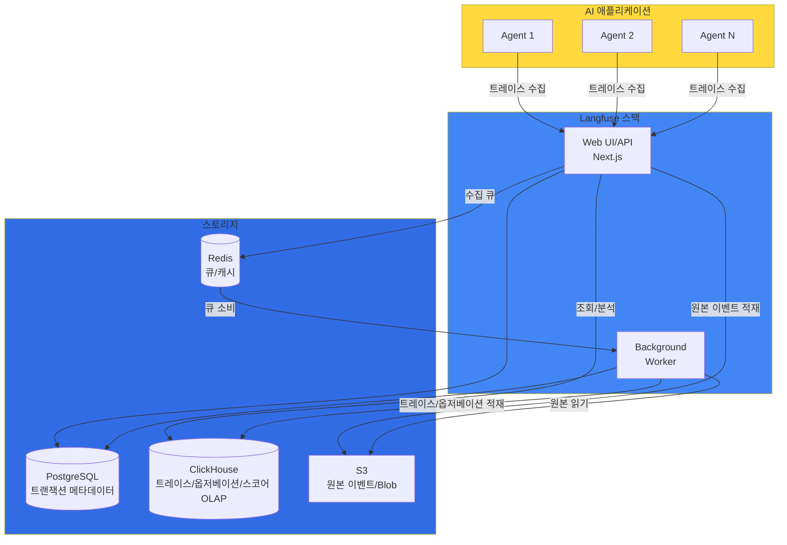
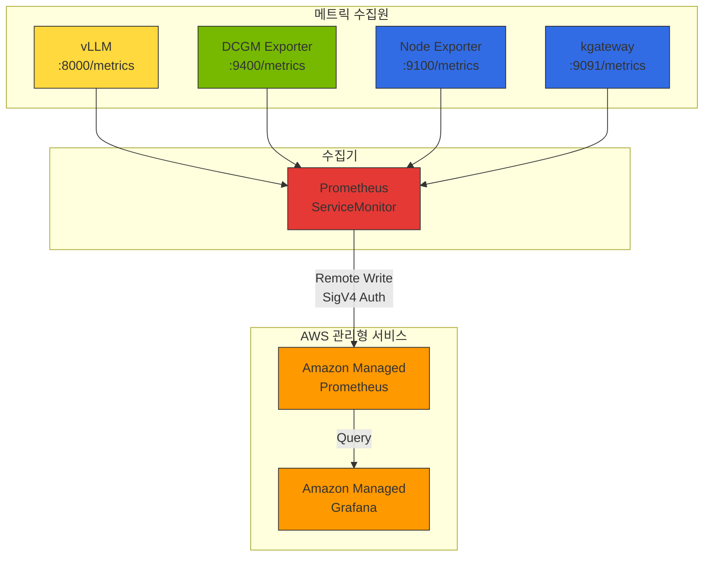
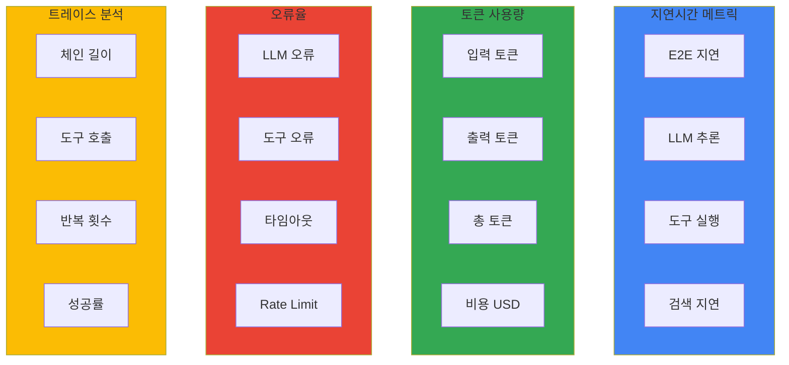
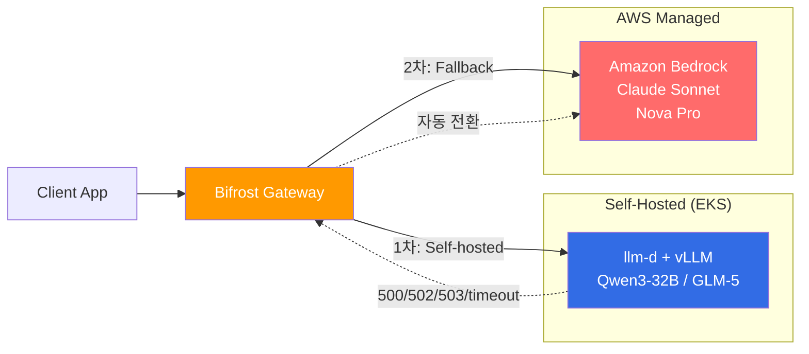

import {
  LatencyMetricsTable,
  TokenUsageMetricsTable,
  ErrorRateMetricsTable,
  DailyChecksTable,
  WeeklyChecksTable,
  MaturityModelTable
} from '@site/src/components/AgentMonitoringTables';

이 문서에서는 Agentic AI 애플리케이션의 모니터링 아키텍처, 핵심 메트릭 설계, 알림 전략을 개념 수준에서 다룹니다.

:::info 실전 배포 가이드
Langfuse Helm 배포, AMP/AMG 구성, ServiceMonitor YAML, Grafana 대시보드 JSON 등 실전 구성은 [모니터링 스택 구성 가이드](../../reference-architecture/integrations/monitoring-observability-setup.md)를 참조하세요.
:::

## 1. 개요

Agentic AI 애플리케이션은 복잡한 추론 체인과 다양한 도구 호출을 수행하기 때문에, 전통적인 APM(Application Performance Monitoring) 도구만으로는 충분한 가시성을 확보하기 어렵습니다. LLM 특화 관측성 도구인 Langfuse와 LangSmith는 다음과 같은 핵심 기능을 제공합니다:

- **트레이스 추적**: LLM 호출, 도구 실행, 에이전트 추론 과정의 전체 흐름 추적
- **토큰 사용량 분석**: 입력/출력 토큰 수 및 비용 계산
- **품질 평가**: 응답 품질 점수화 및 피드백 수집
- **디버깅**: 프롬프트 및 응답 내용 검토를 통한 문제 진단

:::info 대상 독자
이 문서는 플랫폼 운영자, MLOps 엔지니어, AI 개발자를 대상으로 합니다. Kubernetes와 Python에 대한 기본적인 이해가 필요합니다.
:::

---

## 2. 모니터링 아키텍처

### Langfuse 아키텍처 개요

Langfuse v3(2024-12 stable 이후)는 다음 컴포넌트로 구성됩니다. v3는 Postgres(트랜잭션 데이터)·ClickHouse(트레이스/옵저베이션/스코어 OLAP)·Redis(큐/캐시)·S3(원본 이벤트 업로드) 아키텍처로, v2 대비 셀프호스팅 복잡도가 증가했습니다:

**그림 1. Langfuse v3 스택과 스토리지 구성**



### AMP/AMG 통합 데이터 흐름

**그림 2. 메트릭 수집원에서 AMP·AMG로 이어지는 데이터 흐름**



### 모니터링 데이터 계층

**표 1. 모니터링 데이터 계층별 수집 도구와 확인 항목**

| 계층 | 수집 도구 | 메트릭 패턴 | 확인 가능 항목 |
|------|----------|-----------|--------------|
| **LLM 추론** | Langfuse | trace, generation | 토큰 사용량, 비용, TTFT, 사용자별 패턴 |
| **모델 서버** | vLLM Prometheus | `vllm_*` | 요청 수, 배치 크기, KV cache 사용률, TPS |
| **GPU** | DCGM Exporter | `DCGM_FI_DEV_*` | GPU 활용도, 온도, 전력, 메모리 사용량 |
| **인프라** | Node Exporter | `node_*` | CPU, 메모리, 네트워크, 디스크 I/O |
| **게이트웨이** | kgateway | `envoy_*` | 요청 수, 지연 시간, 에러율, 업스트림 상태 |

---

## 3. 핵심 모니터링 메트릭

Agentic AI 애플리케이션에서 추적해야 할 핵심 메트릭을 정의합니다.

### 메트릭 카테고리

**그림 3. 핵심 모니터링 메트릭 카테고리(지연·토큰·오류·트레이스)**



### Latency 메트릭

<LatencyMetricsTable />

### Token Usage 메트릭

<TokenUsageMetricsTable />

### Error Rate 메트릭

<ErrorRateMetricsTable />

---

## 4. PromQL 쿼리 레퍼런스

### GPU 메트릭

```prometheus
# 전체 GPU 평균 활용도
avg(DCGM_FI_DEV_GPU_UTIL)

# 노드별 GPU 활용도
avg(DCGM_FI_DEV_GPU_UTIL) by (Hostname)

# GPU 메모리 사용률 (%) — 분모를 used+free로 두어 0~100% 범위를 보장
# FB_USED/FB_FREE는 free가 0에 가까워지면 100%를 초과하므로 사용하지 않습니다.
# gpu(또는 MIG 사용 시 GPU_I_ID) 레이블로 디바이스별 집계하며, 예약 메모리는 used에 포함됩니다.
avg(
  DCGM_FI_DEV_FB_USED
  / (DCGM_FI_DEV_FB_USED + DCGM_FI_DEV_FB_FREE)
  * 100
) by (gpu)
```

### vLLM 메트릭

```prometheus
# vLLM v1 엔진 메트릭은 모두 vllm: 접두사와 model_name 레이블을 사용합니다.
# 아래 쿼리는 인스턴스별 값을 합산한 플릿(fleet) 집계이며,
# 인스턴스별로 보려면 by (model_name) 대신 by (model_name, instance)로 묶습니다.

# 전체 TPS (초당 생성 토큰, 플릿 합산)
sum(rate(vllm:generation_tokens_total[5m]))

# 모델별 TPS
sum(rate(vllm:generation_tokens_total[5m])) by (model_name)

# TTFT P99 (Time to First Token, 플릿 집계)
histogram_quantile(0.99, sum(rate(vllm:time_to_first_token_seconds_bucket[5m])) by (le))

# TTFT P95
histogram_quantile(0.95, sum(rate(vllm:time_to_first_token_seconds_bucket[5m])) by (le))

# E2E 지연 P99
histogram_quantile(0.99, sum(rate(vllm:e2e_request_latency_seconds_bucket[5m])) by (le))

# 배치 크기 평균 (실행 중 요청 수, 인스턴스별 게이지의 평균)
avg(vllm:num_requests_running)
```

### Gateway 메트릭

```prometheus
# 5xx 에러율 (%) — 분자와 분모를 같은 다운스트림 요청 모집단으로 맞춥니다.
sum(rate(envoy_http_downstream_rq_xx{envoy_response_code_class="5"}[5m]))
/
sum(rate(envoy_http_downstream_rq_xx[5m])) * 100

# 업스트림 커넥션 실패 건수(rate) — 신규 연결 수립 실패 카운터이며,
# 액티브 헬스 체크 실패와는 다른 지표입니다(헬스 체크는 envoy_cluster_health_check_failure 계열).
sum(rate(envoy_cluster_upstream_cx_connect_fail[5m])) by (envoy_cluster_name)
```

### 비용 메트릭

```prometheus
# 일별 총 비용
sum(increase(llm_cost_dollars_total[24h]))

# 테넌트별 일별 비용
sum(increase(llm_cost_dollars_total[24h])) by (tenant_id)

# 모델별 비용 비율
sum(increase(llm_cost_dollars_total[24h])) by (model)
/ ignoring(model) group_left
sum(increase(llm_cost_dollars_total[24h]))

# 예산 대비 사용률 (월간)
sum(increase(llm_cost_dollars_total[30d])) by (tenant_id)
/ on(tenant_id) group_left
tenant_monthly_budget_usd
```

---

## 5. 알림 전략

### 알림 임계값 설계

**표 2. 알림별 조건·심각도·지속 시간**

| 알림 | 조건 | 심각도 | 지속 시간 |
|------|------|--------|----------|
| **Agent High Latency** | P99 지연 > 10초 | Warning | 5분 |
| **Agent High Error Rate** | 에러율 > 5% | Critical | 5분 |
| **LLM Rate Limit** | Rate limit 에러 > 10건/5분 | Warning | 2분 |
| **Daily Cost Budget** | 일일 비용 > $100 | Warning | 즉시 |
| **GPU High Temperature** | GPU 온도 > 85도 | Warning | 5분 |
| **GPU Memory Full** | GPU 메모리 > 95% | Critical | 3분 |
| **vLLM High Latency** | P99 E2E 지연 > 30초 | Warning | 5분 |

### 알림 계층 구조

1. **인프라 계층**: GPU 온도, 메모리, 전력 이상
2. **모델 서버 계층**: vLLM 지연 증가, KV cache 부족
3. **애플리케이션 계층**: Agent 에러율, Rate limit
4. **비즈니스 계층**: 비용 초과, SLA 위반

:::tip 모니터링 베스트 프랙티스

1. **계층별 메트릭 연결**: LLM 요청이 늘면 GPU 활용도가 오르고 인프라 부하가 커지는 상관관계를 분석
2. **이상 탐지**: P99 지연이 갑자기 증가하면 GPU 온도나 메모리 사용량 동시 확인
3. **용량 계획**: 평균 GPU 활용도가 70% 이상이면 추가 GPU 노드 프로비저닝 고려
4. **비용 최적화**: TTFT가 낮은 모델을 우선 사용하여 사용자 경험 개선 + 처리량 증가
:::

---

## 6. Cascade Fallback 전략

Self-hosted 모델(vLLM/llm-d)이 과부하이거나 장애일 때, Amazon Bedrock의 관리형 모델로 자동 폴백하는 Cascade Routing을 구성하면 GPU 장애·Spot 중단 때 실패하는 요청을 줄일 수 있습니다. 다만 이 구성은 무중단을 보장하지 않습니다. 폴백은 기본 프로바이더의 재시도가 소진된 뒤 오류 종류와 무관하게 동작하지만, 클라이언트가 요청을 취소했거나 요청 자체의 deadline이 만료되었거나 플러그인이 폴백을 차단한 경우에는 실행되지 않습니다. 스트리밍 응답이 클라이언트에 전달되기 시작한 뒤의 오류는 다른 프로바이더의 응답으로 이어 붙일 수 없고, Bedrock 쪽 할당량(quota)이나 스로틀링에 걸리면 폴백 요청도 실패합니다. Bifrost(또는 LiteLLM)가 Gateway 역할을 하며, 응답 실패·타임아웃 시 Bedrock으로 요청을 전환합니다.

**그림 4. Self-hosted 장애 시 Bedrock으로 전환하는 Cascade 폴백 흐름**



### Fallback 조건 설정

Bifrost는 요청 본문의 `fallbacks` 배열과 governance `routing_rules`(CEL 표현식 + weighted targets)로 폴백을 구성합니다. 폴백 트리거는 기본 프로바이더의 재시도와 키 교체 뒤에도 남은 모든 실패(5xx·네트워크 오류, 계속되는 429, 거부된 자격 증명, 접근할 수 없거나 퇴역한 모델, 프로바이더 타임아웃)이며, 클라이언트가 취소한 요청, 만료된 요청 deadline, 플러그인이 폴백을 차단한 오류만 예외입니다. 지연 기준으로는 스트리밍 요청의 첫 토큰 대기 한도(`ttft_timeout_ms`)를 규칙에 둘 수 있고, 한도 안에 첫 토큰이 오지 않으면 다음 폴백으로 넘어갑니다(2026-10-29 기준). 임의의 status code·error-rate 조건으로 폴백을 거는 설정은 2026-05 기준 feature request(issue #3261)였습니다.

아래 예시의 `targets` 가중치는 요청마다 대상을 확률적으로 고르는 분할입니다. 따라서 0.8/0.2 설정에서는 Self-hosted에 여유가 있는 평시에도 요청의 약 20%가 Bedrock으로 갑니다. 피크 때만 Bedrock으로 넘기려면 가중치 분할 대신, 용량 지표(`request`, `tokens_used`, `budget_used`: 설정한 rate limit·예산 대비 사용률)를 조건으로 쓰는 별도 규칙이나 폴백을 사용합니다.

```yaml
# Bifrost config의 governance.routing_rules 구조를 YAML로 옮긴 예시
governance:
  routing_rules:
    - name: cost-optimized-cascade
      enabled: true
      cel_expression: "model == 'qwen3-32b'"
      targets:
        - provider: "self-hosted"
          model: "qwen3-32b"
          weight: 0.8  # 요청마다 확률적으로 선택, 가중치 합계는 1
        - provider: "bedrock"
          model: "claude-sonnet"
          weight: 0.2
      fallbacks:
        - "bedrock/claude-sonnet"  # 순서대로 시도
      scope: "global"
      priority: 10
```

### 가용성·비용 관점 비교

**표 3. Self-hosted 단독과 Cascade 구성의 가용성·비용 비교**

| 관점 | Self-hosted 단독 | Cascade (Self-hosted + Bedrock) |
|------|----------------|-------------------------------|
| **가용성** | GPU 장애 시 서비스 중단 | 재시도 가능한 실패·타임아웃 시 Bedrock 폴백 (deadline·Bedrock 할당량 범위 안) |
| **비용** | GPU 고정 비용 | Self-hosted GPU 고정 비용 + Bedrock으로 간 요청의 종량제 비용 |
| **용량 계획** | 피크 트래픽 기준 GPU 확보 | 기본 트래픽만 GPU, 초과분은 용량 조건 규칙·폴백으로 Bedrock |
| **Cold Start** | Spot 중단 시 수 분 지연 | Spot 중단 동안 폴백된 요청을 Bedrock이 처리 (Bedrock 응답 지연·할당량 적용) |

:::tip 비용 최적화 패턴
기본 트래픽은 Self-hosted로 처리하고 용량 조건 규칙으로 피크 초과분만 Bedrock으로 넘기는 하이브리드 패턴은 GPU를 피크 기준으로 프로비저닝할 필요를 줄입니다. 위 예시의 0.8/0.2 가중치 분할은 피크와 무관하게 항상 약 20%를 Bedrock으로 보내므로, 피크 오프로드와는 다른 비용 구조입니다. 실제 절감률은 트래픽 패턴에 따라 크게 달라지며(제3자 추정 30-70%), 일반화는 어렵습니다.
:::

온프레미스 GPU 팜까지 포함한 3-Tier Cascade(On-Prem → Cloud → Bedrock) 구성은 [하이브리드 GPU 워크로드와 SR-IOV 네트워킹](/docs/eks-hybrid-nodes/compute-gpu/gpu-sriov-networking), Gateway 레벨 라우팅 튜닝은 [Cascade 라우팅 튜닝](../../model-serving/inference-routing/cascade-routing-tuning.md)을 참조하세요.

---

## 7. 비용 추적

### 비용 추적 개념

본 섹션은 비용의 **관측(Observation)** — 메트릭 수집·PromQL 쿼리·대시보드 — 을 다룹니다. 관측된 비용을 테넌트에 **배부(showback/chargeback)** 하는 방법론과 예산 정책 설계는 [LLM FinOps — Chargeback 및 비용 배부](../governance/llm-finops-chargeback.md)를 참조하고, 게이트웨이 레벨 예산 강제는 [AI Gateway 멀티테넌시](../governance/ai-gateway-multi-tenancy.md)를 참조하세요.

LLM 사용 비용을 다음 기준으로 추적합니다:

- **모델별**: 모델별 총 비용 및 요청 수, 가장 비용이 높은 모델 식별
- **테넌트별**: 테넌트/팀별 일일 토큰 사용량 및 예산 대비 사용률
- **시간별**: 피크 시간대 분석, 비용 추세

### 모델별 비용 참조 (2026-10 기준 공개 단가 스냅샷)[^1] {#모델별-비용-참조-2026-04-기준1}

아래 표는 각 공급자 공개 pricing 페이지의 표준(비배치) 단가를 2026-10 시점에 정리한 참조 스냅샷입니다. 단가는 수시로 바뀌므로 실제 산정 전에 각주의 공식 페이지에서 다시 확인하세요. 과거 특정일(예: 2026-04-17)의 값이 필요하면 당시 스냅샷을 별도로 확보해야 하며, 현재 값으로 과거 값을 대체하지 않습니다.

**표 4. 티어별 모델의 입력·출력 단가와 특징**

| Tier | 모델 | 입력 ($/1M tok) | 출력 ($/1M tok) | 특징 |
|------|------|----------------|----------------|------|
| **Frontier** | Claude Opus 4.7 | $5 | $25 | 최고 품질 추론 |
| **Frontier** | GPT-4.1 | $2 | $8 | 복잡한 reasoning (OpenAI 표준 단가) |
| **Frontier** | o3 | 공식 페이지 확인 | 공식 페이지 확인 | 추론 전용 모델, GPT-5 계열로 승계(단가는 공식 페이지 확인) |
| **Frontier** | Gemini 2.5 Pro | $1.25 | $5 | 멀티모달 강화 |
| **Balanced** | Claude Sonnet 4.6 | $3 | $15 | 품질-비용 균형 |
| **Balanced** | GPT-4.1 mini | $0.40 | $1.60 | 빠른 추론 |
| **Balanced** | Gemini 2.5 Flash | $0.10 | $0.40 | 높은 처리량 |
| **Fast/Cheap** | Claude Haiku 4.5 | $0.80 | $4 | 간단한 작업 |
| **Fast/Cheap** | GPT-4.1 nano | $0.10 | $0.40 | 초저비용 |
| **Fast/Cheap** | Gemini 2.5 Flash-Lite | $0.05 | $0.20 | 최소 지연 |
| **Open-weight** | DeepSeek V3.1 | Self-hosted | Self-hosted | 오픈 라이선스 |
| **Open-weight** | Llama 4 Scout | Self-hosted | Self-hosted | Meta 공식 |
| **Open-weight** | Qwen3-32B | Self-hosted | Self-hosted | Alibaba Cloud (Qwen3 최대 dense 모델) |

[^1]: 각 공급자 공식 pricing 페이지에서 최신 단가를 확인하세요: [OpenAI Pricing](https://openai.com/api/pricing/), [Anthropic Pricing](https://www.anthropic.com/pricing), [Google AI Pricing](https://ai.google.dev/pricing)

:::tip 비용 최적화 팁

1. **모델 선택 최적화**: 간단한 작업에는 저렴한 모델(GPT-4.1 nano, Haiku 4.5, Gemini 2.5 Flash-Lite) 사용
2. **프롬프트 최적화**: 불필요한 컨텍스트 제거로 입력 토큰 절감
3. **캐싱 활용**: 반복 쿼리의 결과를 재사용합니다. Prompt Caching은 동일 프리픽스의 입력 토큰 재처리 비용을 줄이는 재사용이고, Semantic Caching은 유사 질의에 저장된 응답을 그대로 반환해 모델 호출 자체를 생략하는 방식으로, 둘은 비용 절감 메커니즘이 다릅니다.
4. **Cascade Routing**: 저비용 모델을 먼저 시도하고 실패 시 고성능 모델로 Fallback합니다. 절감률은 두 모델의 단가 차이와 저비용 모델이 처리하는 비율(처리 성공률)에 따라 달라집니다. 예를 들어 쿼리의 70%를 입력·출력 단가가 1/10인 저비용 모델이 처리하면 전체 비용은 단일 고성능 모델 대비 약 37%(= 0.7×0.1 + 0.3×1.0)로, 약 63% 절감하는 계산 예시가 됩니다. 실제 절감률은 트래픽 구성과 성공률에 따라 달라지므로 측정값이 아닌 예시입니다.
5. **Open-weight 모델**: 자체 호스팅 시 DeepSeek V3.1, Llama 4, Qwen3로 고정 비용 전환
:::

---

## 8. 운영 체크리스트

### 일일 점검 항목

<DailyChecksTable />

### 주간 점검 항목

<WeeklyChecksTable />

---

## 9. 모니터링 성숙도 모델

<MaturityModelTable />

---

## 10. 다음 단계

- [모니터링 스택 구성 가이드](../../reference-architecture/integrations/monitoring-observability-setup.md) - AMP/AMG 배포, Langfuse Helm 설치, ServiceMonitor, Grafana 대시보드 실전 구성
- [LLMOps Observability 비교 가이드](./llmops-observability.md) - Langfuse vs LangSmith vs Helicone 심층 비교
- [Agentic AI Platform 아키텍처](../../design-architecture/foundations/agentic-platform-architecture.md) - 전체 플랫폼 설계
- [RAG 평가 프레임워크](../governance/ragas-evaluation.md) - Ragas를 활용한 품질 평가

## 참고 자료

- [Langfuse Documentation](https://langfuse.com/docs)
- [LangSmith Documentation](https://docs.smith.langchain.com/)
- [CloudWatch Generative AI Observability](https://aws.amazon.com/blogs/mt/launching-amazon-cloudwatch-generative-ai-observability-preview/)
- [OpenTelemetry Documentation](https://opentelemetry.io/docs/)
- [Prometheus Monitoring](https://prometheus.io/docs/)
