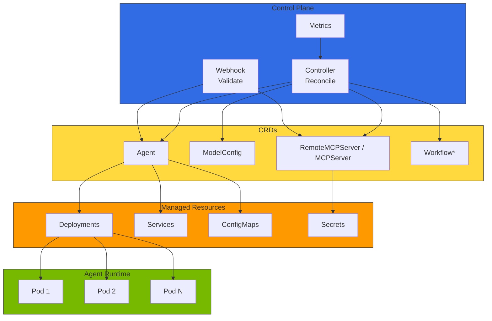
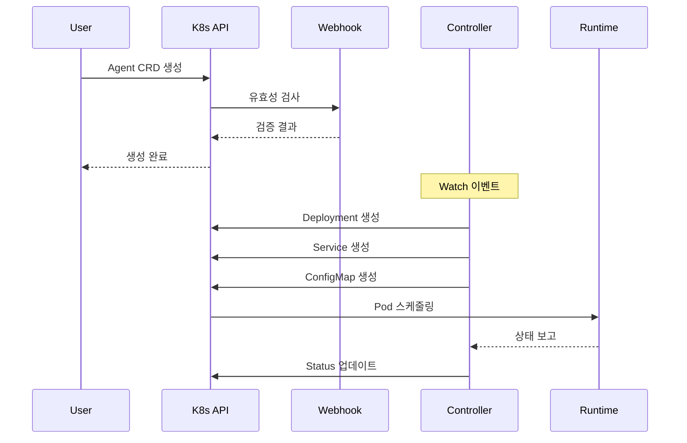
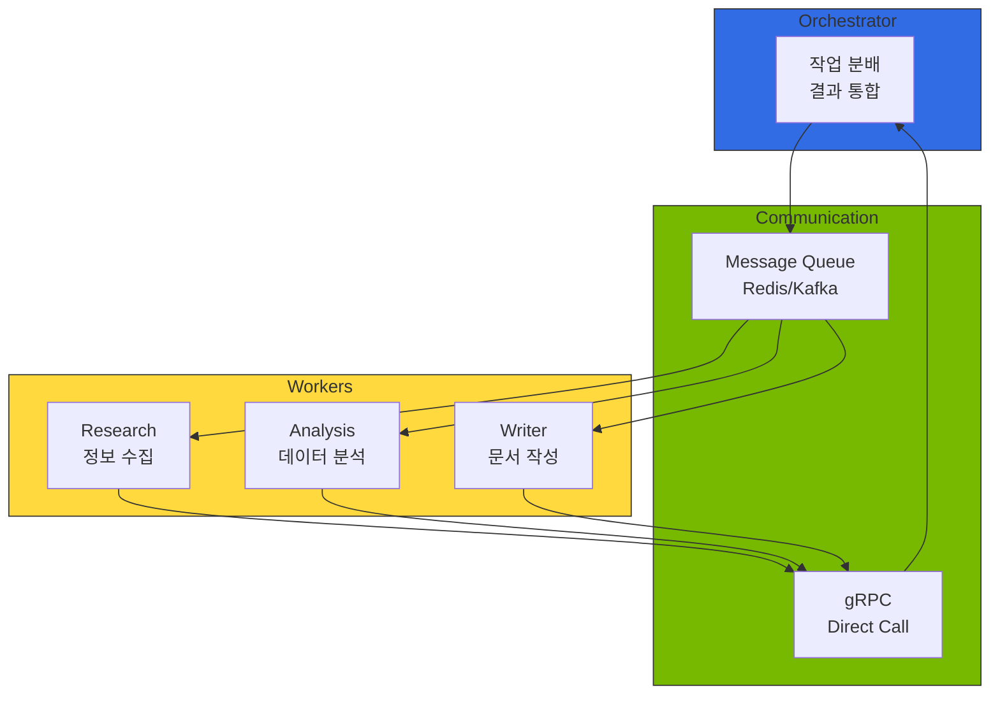
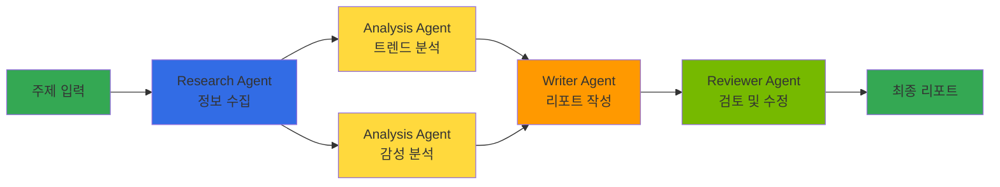

다중 모델 생태계에서 AI 에이전트는 여러 LLM/SLM을 호출하고, MCP/A2A 프로토콜로 도구와 다른 에이전트에 연결되며, 트래픽에 따라 동적으로 스케일링되어야 합니다. Kubernetes의 **Operator 패턴**은 이러한 에이전트를 CRD로 선언적으로 정의하고 자동으로 라이프사이클을 관리하는 가장 자연스러운 방식입니다. Kagent는 이 패턴을 AI 에이전트에 적용한 참조 아키텍처입니다.

## 1. 개요

Kagent는 Custom Resource Definition(CRD)을 통해 에이전트, 도구, 워크플로우를 선언적으로 정의하고, Operator가 이를 자동으로 배포 및 관리합니다. Deployment, Service, ConfigMap을 직접 작성하는 대신 `Agent` CRD 하나로 모델 연결, 도구 바인딩, 스케일링 정책을 통합 관리할 수 있습니다.

:::warning Kagent 프로젝트 상태와 이 문서의 범위
Kagent는 Solo.io가 만든 CNCF Sandbox 오픈소스 프로젝트로, 2026-10-15 기준 최신 릴리스는 `v1.0.0-alpha13`(Apache-2.0)입니다. 즉 공개된 프로젝트이지만 아직 알파 단계이므로, API와 설치 방식이 릴리스마다 바뀔 수 있습니다. 본 문서에서 §3의 Agent/Tool/Memory 스펙은 공식 `kagent.dev/v1alpha2` API를 따르며, §2의 Operator 아키텍처 그림과 §4의 멀티 에이전트 오케스트레이션 패턴은 공식 API가 정의하지 않은 설계 제안(design proposal)으로, 구현 시 별도 컨트롤러·CRD가 필요합니다. 프로덕션 환경에서는 **Bedrock AgentCore**, **KubeAI**, **LangGraph Platform** 등 대안도 함께 검토하세요.

설치·배포 가이드와 최신 API는 [Kagent 공식 문서](https://kagent.dev/docs/)와 [GitHub 저장소](https://github.com/kagent-dev/kagent)를 참조하세요.
:::

### 대안 솔루션 비교

import { SolutionsComparisonTable } from '@site/src/components/KagentTables';

<SolutionsComparisonTable />

오픈소스 자가개선 에이전트 런타임으로 **hermes-agent**(NousResearch, MIT)도 있습니다. MCP·40+ 도구·서브에이전트 생성(spawn)을 지원하며 모델에 무관하게 동작합니다 — 모델 프로바이더로 [LLM API 게이트웨이](../../model-serving/inference-routing/tiered-gateway-architecture.md)(Tier 2 ②)의 OpenRouter 등을 사용할 수 있어, **Layer 4(에이전트 런타임) → Layer 5(게이트웨이)** 흐름을 그대로 구성합니다. Kubernetes 네이티브 선언적 관리가 필요하면 Kagent를, 단독 실행형 자가개선 에이전트가 필요하면 hermes-agent를 검토하세요.

### 주요 기능

- **선언적 에이전트 관리**: YAML 기반 에이전트 정의 및 배포
- **도구 레지스트리**: 에이전트가 사용할 도구를 CRD로 중앙 관리
- **자동 스케일링 연계**: 별도로 설치한 HPA 또는 KEDA ScaledObject를 컨트롤러가 만든 Deployment에 연결해 동적 확장(§5 참조)
- **멀티 에이전트 오케스트레이션**: 복잡한 워크플로우를 위한 에이전트 간 협업(설계 제안)
- **관측성 통합**: Langfuse/LangSmith, OpenTelemetry와의 네이티브 연동

:::info 대상 독자
이 문서는 Kubernetes 관리자, 플랫폼 엔지니어, MLOps 엔지니어를 대상으로 합니다. Kubernetes 기본 개념(Pod, Deployment, CRD)에 대한 이해가 필요합니다.
:::

:::tip re:Invent 2025 관련 세션

**CNS421: Streamline Amazon EKS Operations with Agentic AI** — Kagent와 같은 AI 에이전트를 활용한 EKS 클러스터 자동 관리, 실시간 이슈 진단, 자동 복구 방법을 다루는 코드 토크 세션입니다.

**주요 내용:**
- **Model Context Protocol (MCP)**: AI 에이전트가 AWS 서비스와 통합하기 위한 표준 프로토콜
- **자동화된 인시던트 대응**: Pod 장애, 리소스 부족, 네트워크 문제 자동 진단 및 복구
- **AWS 서비스 통합**: CloudWatch, Systems Manager, EKS API와의 네이티브 연동

[세션 영상 보기](https://www.youtube.com/watch?v=4s-a0jY4kSE)
:::

---

## 2. Kagent 아키텍처

Kagent는 Kubernetes Operator 패턴을 따르며, Controller, CRD, Webhook으로 구성됩니다.

**그림 1. Kagent Operator 아키텍처(Control Plane·CRD·관리 리소스·런타임)**



Agent, ModelConfig, RemoteMCPServer/MCPServer는 공식 `kagent.dev/v1alpha2` API가 정의하는 CRD입니다. 도구(Tool)와 메모리(Memory)는 별도 CRD가 아니라 Agent 스펙에 포함되므로 그림에서 독립 CRD로 그리지 않았습니다. `Workflow*`의 별표는 멀티 에이전트 오케스트레이션이 공식 API에 포함되지 않은 설계 제안이며 구현 시 별도 CRD·컨트롤러가 필요함을 뜻합니다(§4 참조).

### 컴포넌트 설명

import { ComponentsTable } from '@site/src/components/KagentTables';

<ComponentsTable />

### 컴포넌트 상호작용

**그림 2. Agent CRD 생성부터 Pod 스케줄링까지의 컴포넌트 상호작용**



### 사전 요구사항

- Kubernetes 클러스터 (지원 중인 버전 v1.34+ 권장 — v1.33은 2026-06-28 EOL)
- kubectl CLI 도구
- Helm v3 (Helm 설치 시)
- cert-manager (Webhook TLS 인증서 관리)

---

## 3. CRD 구조

### Agent CRD

Agent CRD는 AI 에이전트의 설정을 선언적으로 정의합니다. 아래는 kagent `v1alpha2` API의 Declarative Agent 핵심 스펙입니다. 모델은 인라인으로 적지 않고 별도 `ModelConfig` 리소스를 `modelConfig`로 참조하며, 도구는 `type: McpServer`로 MCP 서버의 도구를 바인딩합니다:

```yaml
apiVersion: kagent.dev/v1alpha2
kind: Agent
metadata:
  name: customer-support-agent
  namespace: kagent
spec:
  description: "고객 문의에 응답하고 티켓을 생성하는 AI 에이전트"
  type: Declarative
  declarative:
    # 모델은 별도 ModelConfig 리소스를 참조합니다 (인라인 지정 아님)
    modelConfig: default-model-config

    # 시스템 프롬프트
    systemMessage: |
      당신은 친절하고 전문적인 고객 지원 에이전트입니다.

    # 사용할 도구 목록 (MCP 서버의 도구를 바인딩)
    tools:
      - type: McpServer
        mcpServer:
          name: kagent-tool-server
          kind: RemoteMCPServer
          apiGroup: kagent.dev
          toolNames:
            - search-knowledge-base
            - create-ticket
          # 파괴적 도구는 실행 전 사용자 승인을 받습니다
          requireApproval:
            - create-ticket

    # 메모리 (Google ADK 기반 내장 구현, pgvector 저장)
    memory:
      modelConfig: default-model-config   # 임베딩 ModelConfig 참조
      ttlDays: 30                         # 기본값 15일
```

참조하는 `ModelConfig` 리소스는 모델 공급자와 모델 ID를 정의합니다. 예를 들어 Amazon Bedrock Titan 임베딩 모델을 쓰는 경우:

```yaml
apiVersion: kagent.dev/v1alpha2
kind: ModelConfig
metadata:
  name: default-model-config
  namespace: kagent
spec:
  provider: Bedrock
  model: amazon.titan-embed-text-v2:0
  bedrock:
    region: us-east-1
```

### Tool (Agent spec 중첩 타입)

Tool은 독립 CRD가 아니라 Agent spec의 `tools: []Tool` 배열로 정의됩니다. 도구 유형은 `McpServer` 또는 `Agent` 두 가지입니다 (kagent v1alpha2 API).

**표 1. Tool 유형별 주요 필드와 예시**

| 필드 | 설명 | 예시 |
|------|------|------|
| `type` | 도구 유형 | `McpServer`, `Agent` |
| `mcpServer` | MCP 서버 참조 (type이 McpServer일 때) | RemoteMCPServer 또는 MCPServer 이름 |
| `agent` | 다른 Agent 참조 (type이 Agent일 때) | Agent 이름 |

### Memory (Agent spec 필드)

Memory는 v1alpha2에서 독립 CRD가 아닌 Agent spec의 `memory: MemorySpec` 필드로 통합되었습니다.

**표 2. Memory(Agent spec 필드)의 주요 기능**

| 기능 | 설명 |
|------|------|
| **임베딩 모델 참조** | `modelConfig` 필드로 ModelConfig 리소스 참조 |
| **TTL 설정** | `ttlDays` 필드로 메모리 보존 기간 설정 |
| **저장소** | Google ADK 기반 내장 구현, pgvector 저장 (redis/in-memory 선택 불가) |

### Workflow CRD

Workflow CRD를 사용하여 멀티 에이전트 워크플로우를 정의합니다.

**표 3. Workflow CRD의 핵심 스펙 필드**

| 필드 | 설명 |
|------|------|
| `spec.input` | 워크플로우 입력 파라미터 정의 |
| `spec.steps` | 단계별 에이전트 실행 정의 (순차/병렬) |
| `spec.steps[].dependsOn` | 의존 단계 지정 (DAG 구성) |
| `spec.steps[].parallel` | 병렬 실행 여부 |
| `spec.output` | 워크플로우 최종 출력 매핑 |
| `spec.errorHandling` | 단계/워크플로우 실패 시 동작 |
| `spec.timeout` | 전체 워크플로우 타임아웃 |
| `spec.concurrency` | 동시 실행 제한 (queue/reject/replace) |

---

## 4. 멀티 에이전트 오케스트레이션

복잡한 작업을 여러 에이전트가 협업하여 처리하는 워크플로우를 정의합니다.

### 에이전트 간 통신 패턴

**그림 3. Orchestrator·Worker·Communication 계층의 에이전트 간 통신**



### 오케스트레이션 패턴

**표 4. 멀티 에이전트 오케스트레이션 패턴과 적합한 경우**

| 패턴 | 설명 | 적합한 경우 |
|------|------|-----------|
| **순차 파이프라인** | 단계별 순차 실행, 이전 단계 출력이 다음 입력 | 데이터 처리, ETL |
| **병렬 팬아웃** | 동일 입력을 여러 에이전트에 병렬 전달 | 다각도 분석, A/B 비교 |
| **DAG 워크플로우** | 의존성 기반 유향 비순환 그래프 실행 | 복잡한 리서치, 보고서 생성 |
| **루프** | 조건 충족까지 반복 실행 | 검토-수정 사이클, 품질 검증 |
| **라우팅** | 입력 내용에 따라 다른 에이전트로 분기 | 문의 분류, 전문 영역 분배 |

### 워크플로우 예시: 리서치 리포트

**그림 4. 리서치 리포트 생성 워크플로우의 에이전트 단계**



워크플로우 실행 상태는 `WorkflowRun` CRD를 통해 추적합니다:

**표 5. WorkflowRun 실행 상태와 의미**

| 상태 | 설명 |
|------|------|
| `Pending` | 실행 대기 중 |
| `Running` | 하나 이상의 단계가 실행 중 |
| `Succeeded` | 모든 단계 성공 완료 |
| `Failed` | 하나 이상의 단계 실패 (재시도 소진) |

---

## 5. Agent 라이프사이클 관리

### Operator가 관리하는 리소스

Agent CRD를 생성하면 Controller가 다음 리소스를 생성/관리합니다:

```
Agent CRD 생성
  ├── Deployment (에이전트 Pod 관리)
  ├── Service (네트워크 접근)
  ├── ConfigMap (에이전트 설정)
  └── Secret 참조 (API 키, 인증 정보)
```

자동 스케일링(HPA 또는 KEDA ScaledObject)은 kagent 컨트롤러가 자동으로 생성하지 않습니다. HorizontalPodAutoscaler는 metrics-server를, KEDA ScaledObject는 KEDA 오퍼레이터를 각각 별도로 설치한 뒤, 컨트롤러가 만든 Deployment를 대상으로 직접 작성해야 합니다. 아래 스케일링 전략 표는 이렇게 별도 구성한 오토스케일러에 적용할 설계 목표(design target)이며, kagent API가 제공하는 필드가 아닙니다.

### 업데이트 전략

**표 6. Agent 업데이트 전략과 권장 시나리오**

| 전략 | 설명 | 권장 시나리오 |
|------|------|-------------|
| **롤링 업데이트** | 기본 전략. Pod를 점진적으로 교체 | 일반적인 설정 변경 |
| **카나리 배포** | 별도 Agent CRD로 새 버전 테스트 | 모델 변경, 프롬프트 대규모 수정 |
| **블루-그린** | 두 버전을 동시 운영 후 트래픽 전환 | 무중단 마이그레이션 |

### 스케일링 전략

**표 7. 스케일링 메트릭과 임계값 예시**

| 메트릭 | 설명 | 임계값 예시 |
|--------|------|-----------|
| CPU 사용률 | 기본 리소스 기반 스케일링 | 70% |
| 메모리 사용률 | 메모리 압박 시 스케일 아웃 | 80% |
| 활성 세션 수 | KEDA + Prometheus 커스텀 메트릭 | 50 세션/Pod |
| 요청 처리량 | 초당 요청 수 기반 | 100 RPS/Pod |

---

## 6. 관측성 통합

Agent 실행 트레이스는 Langfuse, LangSmith, CloudWatch Generative AI Observability 중 하나로 전송합니다. 각 도구의 비교는 [LLMOps Observability 비교](llmops-observability.md)를 참조하세요.

배포 가이드:
- **Langfuse**: [아키텍처](agent-monitoring.md), [Helm 배포](../../reference-architecture/integrations/monitoring-observability-setup.md)
- **LangSmith**: [LangSmith 공식 문서](https://docs.smith.langchain.com/)
- **CloudWatch**: [AWS Generative AI Observability](https://docs.aws.amazon.com/cloudwatch/)

### 핵심 알림 규칙

**표 8. Agent 핵심 알림 규칙과 조건·심각도**

| 알림 | 조건 | 심각도 |
|------|------|--------|
| 에이전트 오류율 증가 | 오류율 > 5% (5분 지속) | Critical |
| 에이전트 응답 지연 | P99 > 30초 (5분 지속) | Warning |
| Pod 가용성 저하 | Ready Pod < 50% (5분 지속) | Critical |

---

## 7. 결론

Kagent를 활용하면 Kubernetes 환경에서 AI 에이전트를 선언적으로 관리할 수 있습니다. 주요 이점은 다음과 같습니다:

- **선언적 관리**: YAML 기반 에이전트 정의로 GitOps 워크플로우 지원
- **자동화된 운영**: Operator 패턴을 통한 자동 복구 및 스케일링
- **표준화**: CRD를 통한 에이전트 정의 표준화
- **확장성**: Kubernetes 네이티브 스케일링 메커니즘 활용
- **관측성**: 통합 모니터링 및 추적 지원

:::tip 다음 단계

- [Agentic AI Platform 아키텍처](../../design-architecture/foundations/agentic-platform-architecture.md) - 전체 플랫폼 설계
- [Agent 모니터링](agent-monitoring.md) - Langfuse/LangSmith 통합 가이드
- [GPU 리소스 관리](../../model-serving/gpu-infrastructure/gpu-resource-management.md) - 동적 리소스 할당

:::

---

## 참고 자료

### 공식 문서
- [Kagent 개념 및 디자인 패턴](https://github.com/kagent-dev/kagent)
- [KubeAI - Kubernetes AI Platform](https://github.com/kubeai-project/kubeai)
- [Bedrock AgentCore](https://docs.aws.amazon.com/bedrock-agentcore/latest/devguide/what-is-bedrock-agentcore.html)
- [LangGraph Platform](https://langchain-ai.github.io/langgraph/)
- [Kubernetes Operator Pattern](https://kubernetes.io/docs/concepts/extend-kubernetes/operator/)
- [KEDA Documentation](https://keda.sh/docs/)
- [re:Invent 2025 CNS421 - Streamline EKS Operations with Agentic AI](https://www.youtube.com/watch?v=4s-a0jY4kSE)

### 관련 문서
- [Agentic AI Platform 아키텍처](../../design-architecture/foundations/agentic-platform-architecture.md)
- [Agent 모니터링](./agent-monitoring.md)
- [GPU 리소스 관리](../../model-serving/gpu-infrastructure/gpu-resource-management.md)
