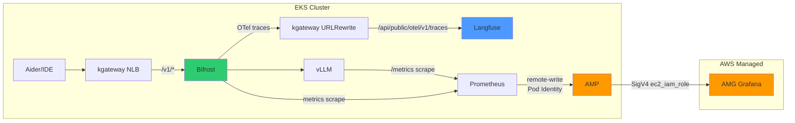

이 문서는 Prometheus → AMP, AMG, Langfuse, Bifrost OTel 통합 모니터링의 **실전 배포 절차**를 다룹니다. 아키텍처 개념과 설계 원칙은 [Agent 모니터링](../../operations-mlops/observability/agent-monitoring.md) 및 [LLMOps Observability](../../operations-mlops/observability/llmops-observability.md)를 참조하세요.

---

## 모니터링 아키텍처 개요

**그림 1. 통합 모니터링 데이터 흐름 아키텍처**



**표 1. 데이터 종류별 수집 경로와 용도**

| 데이터 | 경로 | 용도 |
|--------|------|------|
| 인프라 메트릭 | vLLM/DCGM/kgateway → Prometheus → AMP → AMG | GPU 활용도, TPS, 지연시간, 에러율 |
| LLM Trace | Bifrost → OTel → Langfuse | 토큰 사용량, 비용, 프롬프트 품질 |
| 게이트웨이 메트릭 | kgateway → Prometheus → AMP | 요청 수, 5xx 에러, 업스트림 상태 |

---

## Prometheus + AMP 구성

### 2.1 AMP 워크스페이스 생성

```bash
# AMP 워크스페이스 생성
aws amp create-workspace \
  --alias "vllm-inference-metrics" \
  --region ap-northeast-2

# 워크스페이스 ID 확인
export AMP_WORKSPACE_ID=$(aws amp list-workspaces \
  --region ap-northeast-2 \
  --query 'workspaces[?alias==`vllm-inference-metrics`].workspaceId' \
  --output text)

echo "AMP Workspace ID: $AMP_WORKSPACE_ID"
```

### 2.2 IAM Role 생성 (Pod Identity용)

```bash
# IAM Role 생성
aws iam create-role \
  --role-name prometheus-amp-remote-write \
  --assume-role-policy-document '{
    "Version": "2012-10-17",
    "Statement": [{
      "Effect": "Allow",
      "Principal": {"Service": "pods.eks.amazonaws.com"},
      "Action": ["sts:AssumeRole", "sts:TagSession"]
    }]
  }'

# AMP RemoteWrite 권한 부여
aws iam attach-role-policy \
  --role-name prometheus-amp-remote-write \
  --policy-arn arn:aws:iam::aws:policy/AmazonPrometheusRemoteWriteAccess
```

### 2.3 Pod Identity Association 생성

```bash
aws eks create-pod-identity-association \
  --cluster-name <CLUSTER_NAME> \
  --namespace monitoring \
  --service-account prometheus-kube-prometheus-prometheus \
  --role-arn arn:aws:iam::<ACCOUNT_ID>:role/prometheus-amp-remote-write
```

:::tip Pod Identity vs IRSA
위 명령은 앞 단계에서 준비한 IAM Role과 클러스터·namespace·ServiceAccount 사이의 연결을 등록합니다. Pod Identity는 IRSA용 OIDC Provider 설정을 사용하지 않지만, IAM Role의 신뢰 정책과 권한 정책은 준비해야 합니다. 실제 Pod가 자격 증명을 받으려면 노드의 Pod Identity 지원, EKS Auth 접근, 애플리케이션의 지원 SDK와 기본 자격 증명 체인도 확인해야 합니다([설정 조건](https://docs.aws.amazon.com/eks/latest/userguide/pod-identities.html)). 이 문서의 EKS 1.33+는 예시 환경이며, 적용할 클러스터의 지원 조건은 별도로 확인합니다.
:::

### 2.4 Prometheus Helm values 핵심 설정

`additionalScrapeConfigs`는 kube-prometheus-stack 차트에서 최상위 키가 아니라 `prometheus.prometheusSpec` 아래의 필드입니다. 최상위에 두면 차트가 무시하므로 아래처럼 `prometheusSpec` 안에 중첩합니다. remoteWrite URL의 `${AMP_WORKSPACE_ID}`는 Helm이 파일을 읽기 전에 실제 워크스페이스 엔드포인트로 치환해야 합니다. 아래 명령으로 2.1에서 확인한 `$AMP_WORKSPACE_ID`를 치환한 뒤 적용합니다.

```bash
# 2.1에서 확인한 $AMP_WORKSPACE_ID를 values 파일에 치환
envsubst '${AMP_WORKSPACE_ID}' < values-eks.yaml.tpl > values-eks.yaml

# 치환 결과 확인 (remote_write URL에 실제 워크스페이스 ID가 들어갔는지)
grep remote_write values-eks.yaml
```

```yaml
# values-eks.yaml
prometheus:
  prometheusSpec:
    remoteWrite:
      - url: "https://aps-workspaces.ap-northeast-2.amazonaws.com/workspaces/${AMP_WORKSPACE_ID}/api/v1/remote_write"
        queueConfig:
          maxSamplesPerSend: 1000
          maxShards: 200
          capacity: 2500
        sigv4:
          region: ap-northeast-2

    serviceMonitorSelector: {}
    serviceMonitorNamespaceSelector: {}

    # scrape 대상 (prometheusSpec 하위 필드)
    additionalScrapeConfigs:
      # vLLM 메트릭
      - job_name: 'vllm'
        kubernetes_sd_configs:
          - role: pod
            namespaces:
              names: [ai-inference]
        relabel_configs:
          - source_labels: [__meta_kubernetes_pod_label_app]
            regex: vllm
            action: keep
        metrics_path: /metrics

      # DCGM Exporter (GPU 메트릭)
      - job_name: 'dcgm-exporter'
        kubernetes_sd_configs:
          - role: pod
            namespaces:
              names: [monitoring]
        relabel_configs:
          - source_labels: [__meta_kubernetes_pod_label_app]
            regex: dcgm-exporter
            action: keep

      # kgateway 메트릭
      - job_name: 'kgateway'
        kubernetes_sd_configs:
          - role: pod
            namespaces:
              names: [kgateway-system]
        relabel_configs:
          - source_labels: [__meta_kubernetes_pod_label_app]
            regex: kgateway
            action: keep
        metrics_path: /metrics

      # Bifrost 메트릭 (아키텍처 다이어그램의 BF -> Prometheus 경로)
      # 실제 Bifrost 배포의 메트릭 리스너 포트, Pod 라벨, 인증/TLS 요구사항을
      # 확인해 아래 값을 맞춥니다(포트와 metrics_path는 환경에 따라 다릅니다).
      - job_name: 'bifrost'
        kubernetes_sd_configs:
          - role: pod
            namespaces:
              names: [ai-gateway]
        relabel_configs:
          - source_labels: [__meta_kubernetes_pod_label_app]
            regex: bifrost
            action: keep

  serviceAccount:
    name: prometheus-kube-prometheus-prometheus
    # Pod Identity 사용 시 annotations 불필요 (IRSA와 달리)
```

Helm 적용 후 렌더링된 설정에 scrape job이 실제로 들어갔는지 확인합니다.

```bash
# 렌더링된 Prometheus 설정에서 scrape job 확인
kubectl get secret -n monitoring prometheus-kube-prometheus-prometheus \
  -o jsonpath='{.data.prometheus\.yaml\.gz}' | base64 -d | gunzip | grep -A2 'job_name'
```

### 2.5 Prometheus Helm 설치

```bash
helm repo add prometheus-community https://prometheus-community.github.io/helm-charts
helm repo update

helm install prometheus prometheus-community/kube-prometheus-stack \
  --namespace monitoring \
  --create-namespace \
  -f values-eks.yaml
```

---

## AMG (Grafana) 구성

### 3.1 AMG 워크스페이스 생성

```bash
aws grafana create-workspace \
  --account-access-type CURRENT_ACCOUNT \
  --authentication-providers AWS_SSO \
  --permission-type SERVICE_MANAGED \
  --workspace-name "vllm-monitoring" \
  --region ap-northeast-2

export AMG_WORKSPACE_ID=$(aws grafana list-workspaces \
  --region ap-northeast-2 \
  --query 'workspaces[?name==`vllm-monitoring`].id' \
  --output text)
```

### 3.2 Service Account + Token 생성

AMG API를 통해 데이터 소스를 추가하려면 Service Account Token이 필요합니다.

```bash
# Grafana Service Account 생성 (AMG 콘솔 또는 API)
# AMG 웹 콘솔 → Configuration → Service Accounts → Add Service Account
# Role: Admin
# Token 생성 후 저장

export GRAFANA_TOKEN="<생성된 Token>"
export GRAFANA_ENDPOINT="<AMG 워크스페이스 URL>"
```

### 3.3 AMP 데이터 소스 추가

```bash
curl -X POST "https://${GRAFANA_ENDPOINT}/api/datasources" \
  -H "Authorization: Bearer ${GRAFANA_TOKEN}" \
  -H "Content-Type: application/json" \
  -d '{
    "name": "Amazon Managed Prometheus",
    "type": "prometheus",
    "url": "https://aps-workspaces.ap-northeast-2.amazonaws.com/workspaces/'${AMP_WORKSPACE_ID}'/",
    "access": "proxy",
    "isDefault": true,
    "jsonData": {
      "httpMethod": "POST",
      "sigV4Auth": true,
      "sigV4AuthType": "ec2_iam_role",
      "sigV4Region": "ap-northeast-2"
    }
  }'
```

:::danger workspace-iam-role 금지
`sigV4AuthType`을 반드시 **`ec2_iam_role`**로 설정하세요. `workspace-iam-role`은 유효하지 않은 값으로 **502 에러**를 반환합니다. AMG workspace IAM Role에 `AmazonPrometheusQueryAccess` 정책이 연결되어 있어야 합니다.
:::

### 3.4 IAM Identity Center 사용자 권한 부여

`aws grafana update-permissions`는 플랫 플래그(`--user-id`, `--user-type`, `--permissions-type`)를 받지 않습니다. `action`(ADD/REVOKE), `role`(ADMIN/EDITOR/VIEWER), `users`(id/type) 필드를 담은 `--update-instruction-batch`와 `--workspace-id`를 사용합니다.

```bash
aws grafana update-permissions \
  --workspace-id $AMG_WORKSPACE_ID \
  --update-instruction-batch '[
    {
      "action": "ADD",
      "role": "ADMIN",
      "users": [
        {"id": "<IAM Identity Center user-id>", "type": "SSO_USER"}
      ]
    }
  ]' \
  --region ap-northeast-2
```

---

## Langfuse EKS 배포

### 4.1 Helm 설치

Langfuse 커뮤니티 Helm 차트는 버전에 따라 값 구조가 다릅니다. 차트 v2.0.0은 Langfuse v4를 기본으로 설치하며, Bitnami 서브차트를 OSS 대안으로 교체했습니다. 재현 가능한 배포를 위해 `--version`으로 차트 버전을 고정하고, v2 차트의 값 키(`langfuse.deployment.replicas`, `langfuse.ingress.enabled`, 데이터스토어의 `*.deploy` 토글)를 사용합니다. v1.x(Bitnami 기반) 차트는 `postgresql.enabled` 등 다른 키를 쓰므로, 설치 전 적용할 차트 버전의 값 스키마를 확인합니다.

```bash
# Langfuse Helm 저장소 추가
helm repo add langfuse https://langfuse.github.io/langfuse-helm
helm repo update

# 네임스페이스 생성
kubectl create namespace langfuse

# Langfuse 설치 (차트 버전 고정, PostgreSQL + ClickHouse + Redis 포함)
helm install langfuse langfuse/langfuse \
  --namespace langfuse \
  --version 2.0.0 \
  --set postgres.deploy=true \
  --set clickhouse.deploy=true \
  --set redis.deploy=true \
  --set langfuse.ingress.enabled=false \
  --set langfuse.deployment.replicas=2
```

v4를 위한 데이터스토어 최소 버전은 차트 README가 ClickHouse 25.12 이상(26.4 권장), PostgreSQL 16 권장, Redis 7.2 권장으로 명시합니다. 다른 Langfuse 릴리스를 쓰려면 `langfuse.image.tag`로 명시적으로 재정의합니다.

:::info EBS CSI Driver 필수
Langfuse의 PostgreSQL과 ClickHouse는 영구 스토리지가 필요합니다.

```bash
# EBS CSI Driver 설치 확인
kubectl get csidriver ebs.csi.aws.com

# default StorageClass 확인
kubectl get storageclass
```
:::

### 4.2 Redis 패스워드 구성 (Worker CrashLoopBackOff 방지) {#42-redis-패스워드-주입-worker-crashloopbackoff-방지}

Langfuse Helm 차트가 Worker의 Redis 연결 문자열에 패스워드를 자동 포함하지 않아 `langfuse-worker` Pod가 CrashLoopBackOff에 빠질 수 있습니다. 이때는 임시로 `kubectl set env`를 실행해 시크릿을 복사하지 말고(차트를 다시 적용하면 설정이 사라집니다), 차트 값에서 Redis 연결과 인증을 선언해 Redis가 생성한 시크릿을 참조하도록 구성합니다. 사용하는 차트 버전의 Redis/연결 값 키를 README에서 확인한 뒤, 패스워드는 평문이 아니라 기존 시크릿의 키를 가리키는 `secretKeyRef`로 주입합니다.

```yaml
# values 파일에서 Redis 연결을 선언 (키 이름은 차트 버전 문서로 확인)
# 패스워드는 Redis 차트가 생성한 시크릿을 secretKeyRef로 참조
redis:
  deploy: true
  auth:
    existingSecret: langfuse-redis
    existingSecretPasswordKey: valkey-password
```

구성 후에도 Worker가 CrashLoopBackOff라면 패스워드 누락이라고 단정하지 말고 실제 원인을 먼저 진단합니다.

```bash
# Worker 로그에서 실제 오류 확인
kubectl logs -n langfuse -l app.kubernetes.io/component=worker --tail=50
```

### 4.3 MinIO → S3 + KMS 전환 가이드 (권장)

Langfuse Helm 차트는 기본적으로 MinIO를 내장 S3로 설치하지만, 프로덕션에서는 AWS S3 + KMS를 권장합니다. 아래 절차는 신규 배포에서 event-upload 스토어를 S3로 구성하는 예시이며, 운영 중인 MinIO 데이터를 옮기는 완전한 마이그레이션 절차(스토어별 설정, 데이터 복사·검증, 롤백 점검)는 포함하지 않습니다.

**표 2. MinIO와 AWS S3 + KMS의 내구성·가용성·암호화·인증·백업 비교**

| 항목 | MinIO (기본) | AWS S3 + KMS (권장) |
|---|---|---|
| **내구성** | 단일 Pod (복제 없음) | 99.999999999%(11 nines) 내구성 |
| **가용성** | 단일 Pod | 다중 AZ 기반 S3 가용성 (S3 표준 스토리지 SLA 참조) |
| **암호화** | 아래 예시는 미설정 | SSE-KMS (예시에서 기본 암호화로 설정) |
| **인증** | Access Key (환경변수) | Pod Identity (키 불필요) |
| **백업·복구** | 수동 | 예시에서 S3 버전 관리 활성화 (Lifecycle은 별도 구성) |

11 nines는 S3의 내구성 수치이며 가용성과는 다릅니다. 위 표의 암호화·버전 관리 항목은 아래 "S3 + KMS 구성 절차" 예시가 실제로 설정하는 내용을 가리키며, Lifecycle 정책은 예시에 포함되어 있지 않으므로 필요 시 별도로 구성합니다.

#### S3 + KMS 구성 절차

```bash
# 1. S3 버킷 + KMS 키 생성
aws s3api create-bucket --bucket langfuse-traces-<ACCOUNT_ID> --region <REGION> \
  --create-bucket-configuration LocationConstraint=<REGION>

KMS_KEY=$(aws kms create-key --description "Langfuse trace encryption" \
  --query 'KeyMetadata.KeyId' --output text)

# 2. S3 기본 암호화 (KMS)
aws s3api put-bucket-encryption --bucket langfuse-traces-<ACCOUNT_ID> \
  --server-side-encryption-configuration \
  '{"Rules": [{"ApplyServerSideEncryptionByDefault": {"SSEAlgorithm": "aws:kms", "KMSMasterKeyID": "'$KMS_KEY'"}, "BucketKeyEnabled": true}]}'

# 3. IAM Role + Pod Identity (Access Key 불필요)
aws iam create-role --role-name langfuse-s3-access \
  --assume-role-policy-document '{
    "Version": "2012-10-17",
    "Statement": [{
      "Effect": "Allow",
      "Principal": {"Service": "pods.eks.amazonaws.com"},
      "Action": ["sts:AssumeRole", "sts:TagSession"]
    }]
  }'

aws iam put-role-policy --role-name langfuse-s3-access --policy-name s3-kms \
  --policy-document '{
    "Version": "2012-10-17",
    "Statement": [
      {
        "Effect": "Allow",
        "Action": ["s3:PutObject", "s3:GetObject", "s3:DeleteObject", "s3:ListBucket"],
        "Resource": [
          "arn:aws:s3:::langfuse-traces-<ACCOUNT_ID>",
          "arn:aws:s3:::langfuse-traces-<ACCOUNT_ID>/*"
        ]
      },
      {
        "Effect": "Allow",
        "Action": ["kms:GenerateDataKey", "kms:Decrypt"],
        "Resource": "arn:aws:kms:<REGION>:<ACCOUNT_ID>:key/'$KMS_KEY'"
      }
    ]
  }'

aws eks create-pod-identity-association \
  --cluster-name <CLUSTER> --namespace langfuse \
  --service-account langfuse \
  --role-arn arn:aws:iam::<ACCOUNT_ID>:role/langfuse-s3-access

# 4. Langfuse 이벤트 업로드 대상을 S3로 설정 (신규 구성 기준)
# 아래는 event-upload 스토어 한정 설정입니다. media-upload·batch-export 등
# 다른 스토어는 각각 별도로 구성해야 하며, 이미 MinIO에 적재된 데이터의
# 복사·검증·롤백은 포함하지 않습니다. 아래 kubectl set env는 임시 적용이므로
# 영구 설정은 차트 values 파일에 두고 재적용합니다.
kubectl set env deploy/langfuse-web deploy/langfuse-worker -n langfuse \
  LANGFUSE_S3_EVENT_UPLOAD_BUCKET="langfuse-traces-<ACCOUNT_ID>" \
  LANGFUSE_S3_EVENT_UPLOAD_REGION="<REGION>" \
  LANGFUSE_S3_EVENT_UPLOAD_ENDPOINT- \
  LANGFUSE_S3_EVENT_UPLOAD_ACCESS_KEY_ID- \
  LANGFUSE_S3_EVENT_UPLOAD_SECRET_ACCESS_KEY- \
  LANGFUSE_S3_EVENT_UPLOAD_FORCE_PATH_STYLE-
```

:::tip MinIO를 유지하는 경우
MinIO를 사용할 경우, Helm 차트가 S3 Secret Key를 환경변수에 자동 주입하지 않습니다. 누락 시 OTel trace 수신에서 500 에러가 발생합니다.

```bash
MINIO_PW=$(kubectl get secret langfuse-s3 -n langfuse \
  -o jsonpath='{.data.root-password}' | base64 -d)

kubectl set env deploy/langfuse-web deploy/langfuse-worker -n langfuse \
  LANGFUSE_S3_EVENT_UPLOAD_SECRET_ACCESS_KEY="$MINIO_PW" \
  LANGFUSE_S3_BATCH_EXPORT_SECRET_ACCESS_KEY="$MINIO_PW" \
  LANGFUSE_S3_MEDIA_UPLOAD_SECRET_ACCESS_KEY="$MINIO_PW"
```
:::

### 4.4 NEXTAUTH_URL 설정

`NEXTAUTH_URL`을 실제 접근 가능한 URL로 설정해야 합니다. `localhost:3000`(기본값)으로 두면 로그인 시 무한 리다이렉트가 발생합니다. 프로덕션에서는 전용 HTTPS 호스트(예: `https://langfuse.example.com`)를 권장합니다. 서브 경로(`/langfuse`) 뒤에 두려면 Next.js 커스텀 base path를 지원하도록 빌드·인증·헬스체크 경로를 함께 맞춰야 하며, 그렇지 않으면 정적 자산·인증 콜백이 깨지기 쉽습니다. 아래 평문 HTTP 서브 경로 예시는 격리된 로컬 테스트 용도로만 사용합니다.

```bash
# 권장: 전용 도메인에서 HTTPS로 접근
kubectl set env deploy/langfuse-web -n langfuse \
  NEXTAUTH_URL="https://langfuse.example.com"

# 로컬 테스트 한정: kgateway sub-path를 통한 평문 HTTP 접근
kubectl set env deploy/langfuse-web -n langfuse \
  NEXTAUTH_URL="http://<NLB_ENDPOINT>/langfuse"
```

### 4.5 kgateway Sub-path 라우팅

Langfuse를 kgateway 통합 NLB의 `/langfuse` 경로로 서빙하는 설정입니다. 상세한 HTTPRoute YAML은 [추론 게이트웨이 배포: 기본 배포](../inference-gateway/setup/basic-deployment#langfuse-sub-path-라우팅-urlrewrite)를 참조하세요.

필요한 라우팅 규칙:

1. `/langfuse/*` → URLRewrite `/` + Langfuse 백엔드
2. `/_next/*` → Langfuse (Next.js Static Assets)
3. `/api/auth/*` → Langfuse (인증 API)
4. `/api/public/*` → Langfuse (Public API + OTel)

---

## 5. Bifrost OTel → Langfuse 연동

### 5.1 Bifrost OTel 플러그인 설정

Bifrost config.json의 OTel 플러그인 설정입니다.

```json
{
  "plugins": [{
    "enabled": true,
    "name": "otel",
    "config": {
      "service_name": "bifrost",
      "trace_type": "genai_extension",
      "protocol": "http",
      "collector_url": "http://langfuse-web.langfuse.svc.cluster.local:3000/api/public/otel/v1/traces",
      "headers": {
        "Authorization": "Basic <BASE64(public_key:secret_key)>",
        "x-langfuse-ingestion-version": "4"
      }
    }
  }]
}
```

**표 3. OTel 설정 항목별 올바른 값과 잘못된 값**

| 설정 항목 | 올바른 값 | 잘못된 값 |
|----------|----------|----------|
| `trace_type` | `"genai_extension"` | `"otel"` |
| `collector_url` | 전체 OTLP 경로 포함 | base URL만 |
| Authorization | `Basic <BASE64(pk:sk)>` | Bearer 토큰 |

### 5.2 kgateway URLRewrite (외부 경유 시)

Bifrost가 kgateway를 경유하여 Langfuse에 OTel trace를 전송하는 경우, URLRewrite가 필요합니다. `langfuse-web` 백엔드가 섹션 4에서 `langfuse` 네임스페이스에 배포되므로, HTTPRoute도 같은 `langfuse` 네임스페이스에 두어야 backendRef가 네임스페이스를 넘지 않습니다. 다른 네임스페이스에 두어야 한다면 백엔드(`langfuse`) 네임스페이스에 ReferenceGrant를 생성해 교차 참조를 명시적으로 허용합니다. 또한 Gateway의 `allowedRoutes`가 이 HTTPRoute의 네임스페이스를 허용하는지는 별도로 확인해야 하는 사안입니다.

```yaml
apiVersion: gateway.networking.k8s.io/v1
kind: HTTPRoute
metadata:
  name: langfuse-otel-route
  namespace: langfuse
spec:
  parentRefs:
    - name: unified-gateway
      namespace: ai-gateway
  hostnames:
    - "api.example.com"
  rules:
    - matches:
        - path:
            type: PathPrefix
            value: /api/public/otel
      filters:
        - type: URLRewrite
          urlRewrite:
            path:
              type: ReplacePrefixMatch
              replacePrefixMatch: /api/public/otel/v1/traces
      backendRefs:
        - name: langfuse-web
          port: 3000
```

이 경우 Bifrost config의 `collector_url`은 kgateway 엔드포인트를 사용합니다:

```text
"collector_url": "http://api.example.com/api/public/otel"
```

kgateway가 `/api/public/otel` → `/api/public/otel/v1/traces`로 리라이트합니다.

:::tip 클러스터 내부 직접 전송 vs kgateway 경유

**표 4. 전송 방식별 collector_url과 URLRewrite 필요 여부**

| 방식 | collector_url | URLRewrite 필요 |
|------|---------------|----------------|
| 내부 직접 | `http://langfuse-web.langfuse.svc:3000/api/public/otel/v1/traces` | 불필요 |
| kgateway 경유 | `http://api.example.com/api/public/otel` | 필요 |

클러스터 내부 직접 전송이 더 단순하고 지연이 적습니다. kgateway 경유는 외부 네트워크에서 OTel을 전송하는 경우에 사용합니다.
:::

### 5.3 OTLP 엔드포인트 정확한 경로

Langfuse의 OTLP 수신 엔드포인트는 다음과 같습니다:

```
POST /api/public/otel/v1/traces
```

**잘못된 경로** (동작하지 않음):
```
/api/public/otel              (suffix 누락)
/v1/traces                    (prefix 누락)
/api/public/otel/traces       (v1 누락)
```

---

## 6. 추천 PromQL 쿼리 테이블

**표 5. 메트릭별 추천 PromQL 쿼리와 용도**

| 메트릭 | PromQL | 용도 |
|--------|--------|------|
| GPU 사용률 | `avg(DCGM_FI_DEV_GPU_UTIL)` | GPU 활성도 |
| GPU 메모리 사용률 | `avg(DCGM_FI_DEV_FB_USED / (DCGM_FI_DEV_FB_USED + DCGM_FI_DEV_FB_FREE) * 100) by (gpu)` | VRAM 사용률 |
| GPU 온도 | `DCGM_FI_DEV_GPU_TEMP` | 과열 모니터링 |
| vLLM 요청 처리율 | `rate(vllm:request_success_total[5m])` | 초당 완료 요청 수 (requests/s) |
| vLLM 출력 토큰 처리량 | `rate(vllm:generation_tokens_total[5m])` | 초당 생성 토큰 수 (tokens/s) |
| vLLM TTFT p99 | `histogram_quantile(0.99, rate(vllm:time_to_first_token_seconds_bucket[5m]))` | 첫 토큰 지연 |
| vLLM E2E p99 | `histogram_quantile(0.99, rate(vllm_e2e_request_latency_seconds_bucket[5m]))` | 전체 요청 지연 |
| vLLM 배치 크기 | `avg(vllm_num_requests_running)` | 동시 추론 수 |
| kgateway RPS | `sum(rate(envoy_cluster_upstream_rq_total[5m])) by (envoy_cluster_name)` | 업스트림 클러스터별 초당 요청 수 |
| kgateway 5xx 에러율 | `sum(rate(envoy_cluster_upstream_rq_xx{envoy_response_code_class="5"}[5m])) / sum(rate(envoy_cluster_upstream_rq_total[5m])) * 100` | 업스트림 에러율 (%) |
| kgateway 업스트림 p99 지연 | `histogram_quantile(0.99, sum(rate(envoy_cluster_upstream_rq_time_bucket[5m])) by (le, envoy_cluster_name))` | 업스트림 응답 지연 (ms, 게이트웨이 전체 지연과 구분) |
| Bifrost 요청률 | `rate(bifrost_requests_total[5m])` | 게이트웨이 요청률 |
| 활성 연결 수 | `sum(envoy_cluster_upstream_cx_active) by (upstream_cluster)` | 백엔드별 활성 연결 |

### 알림 규칙 예시

kube-prometheus-stack의 기본 `ruleSelector`는 Helm 릴리스 라벨(`release: <릴리스 이름>`)이 붙은 PrometheusRule만 선택합니다. 아래 예시는 2.5에서 릴리스 이름을 `prometheus`로 설치한 것을 전제로 `release: prometheus` 라벨을 붙입니다. 다른 릴리스 이름을 쓰면 그 값으로 바꾸거나, values에서 `prometheus.prometheusSpec.ruleSelector`/`ruleSelectorNilUsesHelmValues`를 의도적으로 설정합니다. 적용 후 규칙이 실제로 선택됐는지 확인합니다.

```yaml
apiVersion: monitoring.coreos.com/v1
kind: PrometheusRule
metadata:
  name: vllm-gpu-alerts
  namespace: monitoring
  labels:
    release: prometheus
spec:
  groups:
    - name: gpu-alerts
      interval: 30s
      rules:
        - alert: HighGPUTemperature
          expr: DCGM_FI_DEV_GPU_TEMP > 85
          for: 5m
          labels:
            severity: warning
          annotations:
            summary: "GPU {{ $labels.gpu }} temperature is high"
            description: "GPU temperature: {{ $value }} C"

        - alert: GPUMemoryFull
          expr: (DCGM_FI_DEV_FB_USED / (DCGM_FI_DEV_FB_USED + DCGM_FI_DEV_FB_FREE) * 100) > 95
          for: 3m
          labels:
            severity: critical
          annotations:
            summary: "GPU {{ $labels.gpu }} memory is nearly full"

        - alert: HighVLLMLatency
          expr: histogram_quantile(0.99, rate(vllm_e2e_request_latency_seconds_bucket[5m])) > 30
          for: 5m
          labels:
            severity: warning
          annotations:
            summary: "vLLM P99 latency is above 30s"

        - alert: HighGatewayErrorRate
          expr: |
            sum(rate(envoy_cluster_upstream_rq_xx{envoy_response_code_class="5"}[5m])) /
            sum(rate(envoy_cluster_upstream_rq_total[5m])) > 0.05
          for: 5m
          labels:
            severity: critical
          annotations:
            summary: "Inference Gateway 오류율 5% 초과"
```

---

## 7. 트러블슈팅

### 7.1 AMP 403 (Pod Identity 누락)

**증상**: Prometheus 로그에 `403 Forbidden` remote write 에러

**진단**:
```bash
# Pod Identity Association 확인
aws eks list-pod-identity-associations \
  --cluster-name <CLUSTER_NAME> \
  --namespace monitoring

# Prometheus ServiceAccount 확인
kubectl get sa prometheus-kube-prometheus-prometheus -n monitoring -o yaml
```

**해결**:
```bash
# Pod Identity Association 생성
aws eks create-pod-identity-association \
  --cluster-name <CLUSTER_NAME> \
  --namespace monitoring \
  --service-account prometheus-kube-prometheus-prometheus \
  --role-arn arn:aws:iam::<ACCOUNT_ID>:role/prometheus-amp-remote-write

# Prometheus Pod 재시작 (Pod Identity 적용)
kubectl rollout restart statefulset prometheus-kube-prometheus-prometheus -n monitoring
```

### 7.2 AMG 502 (SigV4 auth type 오류)

**증상**: AMG에서 AMP 데이터 소스 Test 시 502 Bad Gateway

**원인**: `sigV4AuthType`이 `workspace-iam-role`로 설정됨

**해결**:
1. AMG 콘솔 → Data Sources → AMP 데이터 소스 편집
2. SigV4 Auth Details → Auth Type을 **`ec2_iam_role`**로 변경
3. Save & Test

또는 API로 수정합니다. 데이터 소스 PUT은 전체 설정을 교체하므로, 부분 바디만 보내면 `name`·`type`·`url`·`access`·`secureJsonData` 등 필수 필드가 사라집니다. 기존 설정을 먼저 읽어 `sigV4AuthType`만 바꾼 완전한 바디로 PUT합니다. 아래는 UID 기반 엔드포인트(`/api/datasources/uid/<UID>`)를 사용하며, AMG는 Grafana 9 계열 호환 API를 제공합니다(사용 중 워크스페이스의 Grafana 버전은 콘솔에서 확인).

```bash
# 1. 기존 데이터 소스를 UID로 조회해 저장
DS=$(curl -s "https://${GRAFANA_ENDPOINT}/api/datasources/uid/<DS_UID>" \
  -H "Authorization: Bearer ${GRAFANA_TOKEN}")

# 2. jsonData.sigV4AuthType만 ec2_iam_role로 바꾼 완전한 바디 생성 (나머지 필드 보존)
BODY=$(echo "$DS" | jq '.jsonData.sigV4Auth = true
  | .jsonData.sigV4AuthType = "ec2_iam_role"
  | .jsonData.sigV4Region = "ap-northeast-2"')

# 3. 전체 바디로 PUT
curl -X PUT "https://${GRAFANA_ENDPOINT}/api/datasources/uid/<DS_UID>" \
  -H "Authorization: Bearer ${GRAFANA_TOKEN}" \
  -H "Content-Type: application/json" \
  -d "$BODY"
```

### 7.3 Langfuse Worker CrashLoopBackOff (Redis)

**증상**: `langfuse-worker` Pod가 CrashLoopBackOff 상태

**진단**:
```bash
# Worker 로그 확인
kubectl logs -n langfuse -l app.kubernetes.io/component=worker --tail=30

# Redis 연결 테스트
kubectl run -it --rm redis-test --image=redis:7 --restart=Never -n langfuse -- \
  redis-cli -h langfuse-redis-primary -a $(kubectl get secret langfuse-redis -n langfuse -o jsonpath='{.data.valkey-password}' | base64 -d) ping
```

**해결**: 섹션 4.2처럼 차트 값에서 Redis 연결과 인증(`secretKeyRef`)을 선언하고 차트를 다시 적용합니다. `kubectl set env`로 시크릿을 직접 복사하는 방식은 차트 재적용 시 사라지므로 임시 확인 용도로만 사용하고, 영구 설정은 values 파일에 둡니다.

### 7.4 Langfuse S3 500 (MinIO Secret 누락)

**증상**: OTel trace 수신 시 Langfuse가 500 에러 반환, 로그에 S3 관련 오류

**원인**: Langfuse Helm 차트가 MinIO S3 secret key를 환경변수에 자동 주입하지 않음

**해결**:
```bash
MINIO_PW=$(kubectl get secret langfuse-s3 -n langfuse \
  -o jsonpath='{.data.root-password}' | base64 -d)

kubectl set env deploy/langfuse-web deploy/langfuse-worker -n langfuse \
  LANGFUSE_S3_EVENT_UPLOAD_SECRET_ACCESS_KEY="$MINIO_PW" \
  LANGFUSE_S3_BATCH_EXPORT_SECRET_ACCESS_KEY="$MINIO_PW" \
  LANGFUSE_S3_MEDIA_UPLOAD_SECRET_ACCESS_KEY="$MINIO_PW"
```

:::tip 근본 해결: S3 + KMS 전환
MinIO 관련 이슈를 근본적으로 해결하려면 섹션 4.3의 S3 + KMS 전환을 권장합니다. Pod Identity 기반이므로 Access Key 관리가 불필요하고, 가용성과 암호화가 보장됩니다.
:::

### 7.5 Langfuse 404 (Sub-path Routing)

**증상**: `/langfuse/` 접속 시 페이지는 로드되지만 CSS/JS가 깨지거나 404

**원인**: Next.js 정적 자산 경로(`/_next/*`)와 인증 API(`/api/auth/*`)가 Langfuse로 라우팅되지 않음

**해결**: kgateway HTTPRoute에 추가 경로 규칙 필요:

```yaml
# 추가 필요한 경로들
/_next/*        → langfuse-web:3000  (Static Assets)
/api/auth/*     → langfuse-web:3000  (NextAuth)
/api/public/*   → langfuse-web:3000  (Public API + OTel)
/icon.svg       → langfuse-web:3000  (Favicon)
```

상세 HTTPRoute YAML은 [추론 게이트웨이 배포: 기본 배포](../inference-gateway/setup/basic-deployment#langfuse-sub-path-라우팅-urlrewrite)를 참조하세요.

### 7.6 Langfuse 무한 리다이렉트 (NEXTAUTH_URL)

**증상**: Langfuse UI 로그인 시 무한 리다이렉트 루프

**원인**: `NEXTAUTH_URL`이 기본값 `localhost:3000`으로 설정됨

**해결**:
```bash
kubectl set env deploy/langfuse-web -n langfuse \
  NEXTAUTH_URL="http://<NLB_ENDPOINT>/langfuse"
```

---

## 참고 자료

- [Agent 모니터링](../../operations-mlops/observability/agent-monitoring.md) - 모니터링 아키텍처 및 메트릭 설계 상세
- [LLMOps Observability](../../operations-mlops/observability/llmops-observability.md) - Langfuse/LangSmith/Helicone 비교 및 평가 파이프라인
- [Amazon Managed Prometheus](https://docs.aws.amazon.com/prometheus/)
- [Amazon Managed Grafana](https://docs.aws.amazon.com/grafana/)
- [Langfuse Helm Chart](https://github.com/langfuse/langfuse-k8s)
