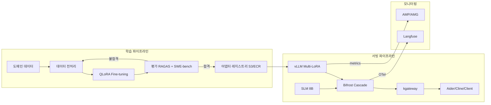
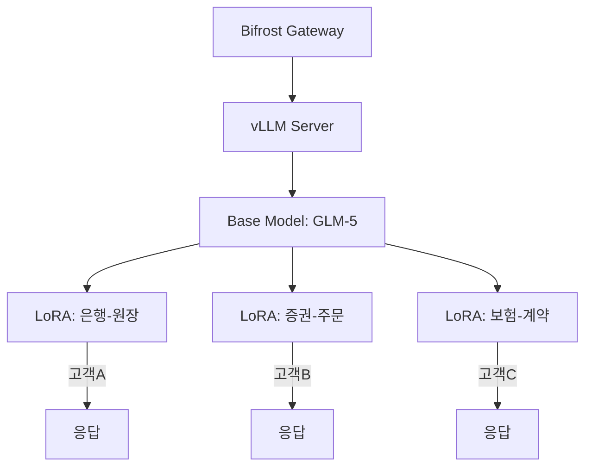
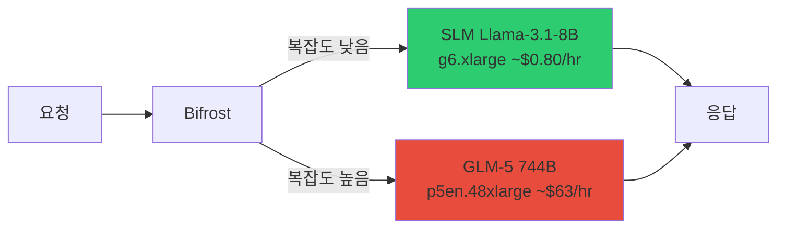
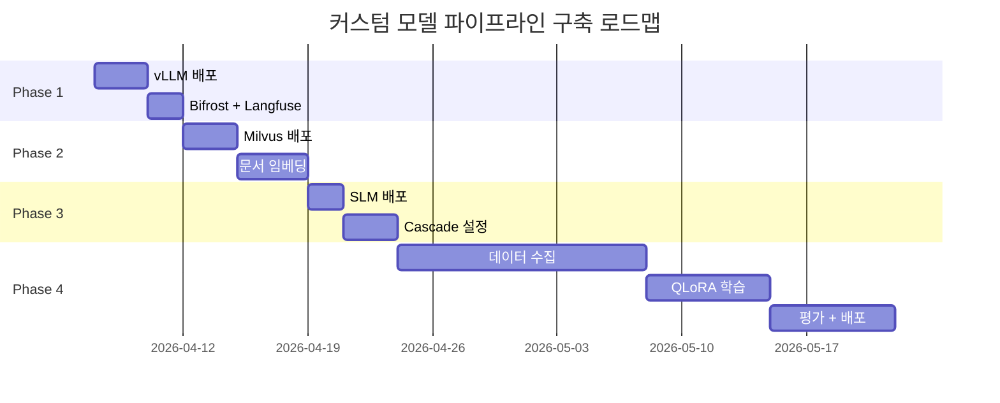

## 개요

### 왜 커스텀 모델 파이프라인이 필요한가

SaaS 기반 AI 코딩 도구(예: Kiro, GitHub Copilot)는 빠르게 시작할 수 있지만, 엔터프라이즈 환경에서는 근본적인 한계에 부딪힙니다.

**표 1. SaaS와 자체 호스팅 파이프라인의 제약 비교**

| 제약 | SaaS (Kiro 등) | 자체 호스팅 파이프라인 |
|------|----------------|---------------------|
| **LoRA Fine-tuning** | 불가능 | 도메인별 어댑터 학습 가능 |
| **데이터 주권** | 코드가 외부 전송 | VPC 내부에서 완결 |
| **모델 선택** | 제공 모델만 사용 | 오픈소스 모델 자유 선택 |
| **비용 제어** | 토큰 단가 고정 | 요청 분포·라우팅 품질·모델별 비용을 측정해 Cascade 효과 산정 |
| **고객별 최적화** | 범용 모델 공유 | Multi-LoRA로 고객별 특화 |

:::info 기본 전략
**Base Model + LoRA 어댑터** 패턴으로 하나의 GPU 위에 여러 도메인 전문 모델을 동시에 서빙합니다. 기본 모델 가중치를 공유하므로 GPU 메모리 효율이 극대화됩니다.
:::

### 파이프라인 전체 흐름

**그림 1. 학습·서빙·모니터링 파이프라인 전체 흐름**



학습 파이프라인에서 도메인 데이터를 QLoRA로 학습하고, 평가를 통과한 어댑터만 레지스트리에 등록합니다. 서빙 파이프라인에서는 vLLM Multi-LoRA로 여러 어댑터를 동시에 로드하고, Bifrost Cascade를 통해 SLM/LLM 간 비용 최적화 라우팅을 수행합니다.

:::tip 관련 문서
- [운영 & 거버넌스](../../operations-mlops/index.md) - 전체 운영 아키텍처
- [커스텀 모델 배포 가이드](./custom-model-deployment.md) - Kiro vs 자체 호스팅 비교 포함
:::

---

## LoRA 학습·배포 파이프라인 (도메인 특화)

이 섹션은 도메인 특화 전략에서 LoRA Fine-tuning과 Multi-LoRA 핫스왑 배포를 실제로 구현하는 방법을 다룹니다. 도메인 특화의 전략적 배경과 의사결정 기준은 [도메인 특화 (LoRA + RAG)](../../operations-mlops/governance/domain-customization.md)를 참조하세요.

---

### LoRA Fine-tuning 파이프라인

#### QLoRA GPU 절감

**QLoRA**(Quantized LoRA)는 기본 모델을 INT4로 양자화한 상태에서 LoRA 어댑터만 학습하는 기법입니다. Full Fine-tuning 대비 GPU 요구사항을 극적으로 줄여줍니다.

**표 2. 학습 방식별 GPU·VRAM·학습 시간·비용 비교**

| 모델 | Full Fine-tuning | LoRA (FP16) | QLoRA (INT4) |
|------|-----------------|------|-------|
| **Llama-3.3-70B** | H100x16+ (비현실적) | H100x2~4 | **H100x1** |
| **VRAM** | ~840 GB (BF16+AdamW) | ~142-180 GB | **~40 GB** |
| **학습 시간** | - | 5일 | **2-3일** |
| **비용** | - | $8,000 | **$2,000** |

:::warning INT4 양자화 정밀도
QLoRA는 학습 중 기본 모델 가중치를 INT4로 유지하므로, 극히 정밀한 수치 연산이 필요한 태스크(예: 금융 계산)에서는 LoRA(FP16) 대비 미세한 정확도 차이가 발생할 수 있습니다. 도메인 평가 단계에서 반드시 검증하세요.
:::

#### 학습 데이터 형식

학습 데이터는 JSONL 형식의 입력-출력 쌍으로 준비합니다.

```json
{
  "input": "COBOL: PERFORM CALC-INTEREST USING WS-PRINCIPAL WS-RATE.",
  "output": "Java: @Transactional public BigDecimal calcInterest(BigDecimal principal, BigDecimal rate) { return principal.multiply(rate).setScale(2, RoundingMode.HALF_UP); }"
}
```

**표 3. 학습 데이터 소스별 변환 방법과 예상 데이터량**

| 소스 | 변환 방법 | 예상 데이터량 |
|------|----------|-------------|
| 레거시 COBOL 코드 | COBOL → Java 변환 쌍 생성 | 10,000+ 모듈 |
| 사내 프레임워크 | 프레임워크 패턴 → 코드 쌍 | 5,000+ 패턴 |
| 코드 리뷰 히스토리 | 수정 전 → 수정 후 쌍 | 20,000+ 커밋 |
| 기술 문서 | 문서 → 구현 코드 쌍 | 3,000+ 페이지 |

:::tip 데이터 품질이 모델 품질을 결정합니다
데이터 양보다 **품질**이 중요합니다. 시니어 개발자가 검수한 1,000개의 고품질 쌍이, 자동 생성된 10,000개보다 효과적입니다. 최소 500개의 검수된 쌍에서 시작하세요.
:::

#### 학습 프레임워크

#### NeMo Framework (NVIDIA)

대규모 모델 학습에 최적화된 NVIDIA의 공식 프레임워크입니다. Multi-GPU, Multi-Node 분산 학습을 네이티브로 지원합니다.

```bash
python train_lora.py \
  --config-path=conf \
  --config-name=llama3_70b_lora \
  model.data.train_ds.file_path=cobol_to_java.jsonl \
  model.peft.lora_tuning.adapter_dim=16
```

:::info NeMo 설정 핵심 파라미터
- `adapter_dim` (rank): 16이 일반적. 복잡한 도메인은 32~64까지 증가 가능
- `adapter_dropout`: 0.05 권장 (과적합 방지)
- `target_modules`: attention layer (`q_proj`, `k_proj`, `v_proj`, `o_proj`)
:::

#### Unsloth (최대 2배 빠른 학습)

단일 노드에서 LoRA/QLoRA 학습 속도를 최대 2배 높이고 VRAM 사용량을 최대 70%까지 절감하는 오픈소스 라이브러리입니다 (Unsloth 자사 벤치마크 기준).

아래 코드는 모델 로딩과 어댑터 구성만 보여주는 발췌 조각입니다. 실제로 실행하려면 `trl`에서 `SFTTrainer`를 import하고, JSONL 데이터셋을 로드해 `train_dataset`을 준비하며, 데이터 포맷팅 함수와 `SFTConfig`(배치 크기, 학습률, 스텝 수 등)를 추가로 정의해야 합니다. 사용하는 unsloth와 trl 버전은 재현성을 위해 고정하세요.

```python
from unsloth import FastLanguageModel

model, tokenizer = FastLanguageModel.from_pretrained(
    model_name="meta-llama/Llama-3.3-70B-Instruct",
    max_seq_length=4096,
    load_in_4bit=True,  # QLoRA: INT4 양자화
)

model = FastLanguageModel.get_peft_model(
    model,
    r=16,                # LoRA rank
    lora_alpha=32,       # LoRA scaling factor
    target_modules=["q_proj", "k_proj", "v_proj"],
)

trainer = SFTTrainer(
    model=model,
    train_dataset=dataset,
    max_seq_length=4096,
)
trainer.train()
```

**표 4. NeMo와 Unsloth 학습 프레임워크의 장점과 적합한 경우**

| 프레임워크 | 장점 | 적합한 경우 |
|-----------|------|-----------|
| **NeMo** | Multi-Node 분산 학습, NVIDIA 공식 지원 | H100 클러스터 보유 시, 대규모 학습 |
| **Unsloth** | 2배 빠른 학습, 메모리 절감, 간편한 API | 단일 노드, 빠른 프로토타이핑 |

#### 체크포인트 관리

학습된 LoRA 어댑터는 S3에 저장하고, MLflow로 버전을 관리합니다.

```bash
# 어댑터 저장 구조 (버전별 디렉터리)
s3://model-registry/
  └── lora-adapters/
      ├── bank-ledger/
      │   ├── v1.0/
      │   │   ├── adapter_model.safetensors
      │   │   ├── adapter_config.json   # base_model_name_or_path, r, lora_alpha 등
      │   │   └── metadata.json         # 호환 기본 모델 revision, 학습 커밋
      │   └── v1.1/
      │       ├── adapter_model.safetensors
      │       ├── adapter_config.json
      │       └── metadata.json
      ├── stock-order/
      │   └── v1.0/adapter_model.safetensors
      └── insurance-contract/
          └── v1.0/adapter_model.safetensors
```

S3에는 심볼릭 링크가 없으므로, 어떤 버전이 `latest`인지는 애플리케이션이나 MLflow 레지스트리가 관리하는 포인터(예: `latest.json`에 기록한 버전 태그 또는 MLflow의 `latest` 스테이지)로 표현합니다. 서빙 측은 이 포인터를 조회해 해당 버전 디렉터리를 로드하며, `adapter_config.json`과 `metadata.json`으로 기본 모델 revision과의 호환성을 확인합니다.

:::tip MLflow 연동
MLflow에 학습 메트릭(loss, accuracy)과 어댑터 경로를 함께 기록하면, 어떤 데이터셋과 하이퍼파라미터 조합이 최적인지 추적할 수 있습니다.
:::

- 참조: [NeMo Framework 체크포인트 관리](../../model-serving/inference-frameworks/nemo-framework.md)

---

### Multi-LoRA 핫스왑 배포

#### 아키텍처

vLLM의 Multi-LoRA 기능을 활용하면, 하나의 기본 모델 위에 여러 LoRA 어댑터를 동시에 로드하여 고객별 맞춤 서빙이 가능합니다.

**그림 2. 하나의 기본 모델 위 Multi-LoRA 어댑터 서빙 아키텍처**



:::info Multi-LoRA 메모리 효율
기본 모델(예: 70B)은 한 번만 GPU 메모리에 로드됩니다. 각 LoRA 어댑터는 rank 16 기준 약 **100-200MB** 수준으로, 10개의 어댑터를 동시에 로드해도 추가 메모리는 2GB 미만입니다.
:::

#### vLLM Multi-LoRA 설정

```bash
vllm serve meta-llama/Llama-3.3-70B-Instruct \
  --enable-lora \
  --lora-modules \
    bank-ledger=/models/lora/bank \
    stock-order=/models/lora/stock \
    insurance-contract=/models/lora/insurance \
  --max-lora-rank 16
```

**표 5. vLLM Multi-LoRA 주요 옵션과 기본값**

| 옵션 | 설명 | 기본값 |
|------|------|--------|
| `--enable-lora` | Multi-LoRA 활성화 | `false` |
| `--lora-modules` | `이름=경로` 형태로 어댑터 등록 | - |
| `--max-lora-rank` | 최대 LoRA rank | 16 |
| `--max-loras` | 한 배치에서 GPU에 동시 적재하는 최대 어댑터 수 | 1 |
| `--max-cpu-loras` | CPU 메모리에 캐시할 어댑터 수(GPU 적재 대기분) | - |

:::caution 핫스왑 주의사항
`--max-loras`는 한 배치에서 GPU에 동시에 올릴 수 있는 어댑터 수이고, `--max-cpu-loras`는 CPU 메모리에 캐시해 두는 어댑터 수입니다. 요청된 어댑터가 GPU에 올라와 있지 않으면 CPU 캐시나 저장소에서 교체(swap)해야 하므로 추가 지연이 발생합니다. 교체 지연의 크기는 어댑터 rank와 크기, 저장 위치에 따라 달라지며 측정값이 아니므로, 실제 워크로드에서 측정해 자주 쓰는 어댑터 수에 맞게 `--max-loras`를 설정하세요.
:::

#### 요청 시 어댑터 지정

OpenAI 호환 API로 요청하며, `--lora-modules`로 등록한 어댑터 이름을 `model`에 지정합니다. vLLM의 OpenAI 호환 Multi-LoRA는 `model` 값으로 어댑터를 선택하므로, 기본 모델 ID를 넣으면 어댑터가 아닌 기본 모델이 응답합니다.

```python
response = client.chat.completions.create(
    model="bank-ledger",  # --lora-modules로 등록한 어댑터 이름
    messages=[{"role": "user", "content": "COBOL 원장 코드를 Java로 변환해줘"}],
)

# 응답이 의도한 어댑터로 처리됐는지 model 필드로 확인합니다.
assert response.model == "bank-ledger"
```

#### 고객별 라우팅 (Bifrost + X-Customer-Domain 헤더)

kgateway의 HTTPRoute를 사용하여 HTTP 헤더 기반으로 고객별 백엔드 라우팅을 구성합니다. 아래 예시는 `X-Customer-Domain: bank` 헤더가 있는 요청을 `vllm-svc`로 보내는 라우팅 규칙만 보여줍니다.

```yaml
# kgateway HTTPRoute - 고객별 LoRA 라우팅
apiVersion: gateway.networking.k8s.io/v1
kind: HTTPRoute
metadata:
  name: lora-routing
spec:
  parentRefs:
  - name: agentic-gateway   # 이 라우트를 연결할 Gateway (별도 정의 필요)
  rules:
  - matches:
    - headers:
      - name: X-Customer-Domain
        value: bank
    backendRefs:
    - name: vllm-svc
      port: 8000
```

:::caution 헤더 매칭만으로는 어댑터가 선택되지 않습니다
위 HTTPRoute는 요청을 `vllm-svc`로 보내기만 할 뿐, `X-Customer-Domain` 헤더를 `model=bank-ledger`(등록된 어댑터 이름)로 변환하지 않습니다. 고객별 어댑터 선택을 완성하려면 세 가지가 추가로 필요합니다. 첫째, 이 라우트를 `parentRefs`로 실제 Gateway에 연결해야 합니다. 둘째, Bifrost 또는 백엔드에서 헤더 값을 등록된 어댑터 이름(`model`)으로 매핑하는 규칙을 명시적으로 작성해야 합니다(CPIPE-005의 `model=어댑터이름` 규칙). 셋째, 요청자의 신뢰할 수 있는 신원을 해당 고객 도메인에 매핑하는 인가가 있어야 임의의 클라이언트가 다른 고객의 어댑터를 지정하지 못합니다.
:::

#### 고객별 추론 추적 및 비용 청구

각 고객의 추론 요청을 LLM 트레이싱 시스템으로 추적하여 LoRA 어댑터별 성능을 모니터링하고 월별 비용을 청구합니다.

```python
# langfuse>=3.0 (OpenTelemetry 기반 SDK). 레거시 langfuse.trace()는 제거됨
from langfuse import observe, get_client

langfuse = get_client()

@observe(name="inference")
def run_inference(prompt: str):
    response = client.chat.completions.create(
        model="bank-ledger",
        messages=[{"role": "user", "content": prompt}],
    )
    # 측정된 토큰 사용량과 추적 속성을 현재 observation에 기록합니다.
    langfuse.update_current_trace(
        user_id="customer-bank-A",
        metadata={"lora": "bank-ledger", "model": "glm-5", "domain": "ledger"},
    )
    langfuse.update_current_generation(usage_details=response.usage)
    return response
```

**표 6. 고객별 월별 요청·토큰·GPU 시간·비용 배분 예시**

| 고객 | 요청 수 | 토큰 수 | GPU 시간 | 비용(배분 예시) |
|------|---------|---------|----------|------|
| **A은행** | 100,000 | 500M | 50시간 | $2,500 |
| **B증권** | 50,000 | 250M | 25시간 | $1,250 |
| **C보험** | 30,000 | 150M | 15시간 | $750 |

위 표의 비용은 측정된 실제 청구액이 아니라 배분 방식을 보여주는 예시입니다. 고객별 GPU 시간을 측정한 뒤 조직이 정한 GPU 시간당 단가를 곱해 비용을 배분하며, 그 단가와 측정 기간을 함께 기록해야 실제 청구와 대조할 수 있습니다.

구현 방법은 [Agent 모니터링](../../operations-mlops/observability/agent-monitoring.md) 및 [LLM 트레이싱 배포](../integrations/monitoring-observability-setup.md)를 참조하세요.

---

## SLM Cascade Routing (비용 최적화)

### Cascade 아키텍처

아래 예시는 요청의 70%가 품질 기준을 충족한 상태로 소형 모델(SLM)에 라우팅된다고 가정합니다. 이 비율은 측정값이 아니며, 실제 적용 전에는 요청 복잡도 분포와 SLM 응답 품질을 평가해야 합니다.

**그림 3. 복잡도 기반 SLM/LLM Cascade 라우팅 아키텍처**



### 가정 기반 비용 계산 예시

이 표는 월 비용이 처리 요청 비율에 선형 비례한다고 단순화한 예시입니다. SLM 월 비용을 $500, LLM 월 비용을 $8,900으로 가정하면 Cascade 비용은 `0.7 × $500 + 0.3 × $8,900 = $3,020`입니다. 자체 호스팅에서는 유휴 GPU와 최소 용량 때문에 비용이 선형으로 줄지 않을 수 있으며, 정확도는 요청별 평가로 별도 측정해야 합니다.

| | SLM 단독 | LLM 단독 | **Cascade (70:30 가정)** |
|---|---|---|---|
| **가정한 월 비용** | $500 | $8,900 | **$3,020** |
| **품질** | 워크로드에서 측정 | 워크로드에서 측정 | 라우팅 후 다시 측정 |
| **계산상 차이** | - | - | **LLM 단독 대비 $5,880/월(약 66%)** |

:::tip 적용 전 확인
약 66%는 위 입력값과 선형 비용 모델에서 나온 계산 결과이며 실측 절감률이 아닙니다. 도입 판단에는 실제 요청 분포, 라우팅 오분류, 품질 게이트, 최소 GPU 용량, 유휴 시간, 운영 인력과 관측 비용을 포함하세요.
:::

### Bifrost Cascade Config

```json
{
  "providers": {
    "openai": {
      "keys": [
        {
          "name": "slm",
          "value": "dummy",
          "weight": 0.7,
          "models": ["llama-8b"]
        },
        {
          "name": "llm",
          "value": "dummy",
          "weight": 0.3,
          "models": ["glm5"]
        }
      ],
      "network_config": {
        "base_url": "http://glm5-serving:8000"
      }
    }
  }
}
```

:::info Bifrost Complexity Router (2026-06 지원)
Bifrost는 2026-06-12 출시된 governance plugin v1.5.19부터 Complexity Router를 지원합니다. 요청을 SIMPLE/MEDIUM/COMPLEX/REASONING 티어로 자동 분류하고 `complexity_tier` CEL 변수로 라우팅 규칙에 사용할 수 있습니다. 다만 티어 분류만 자동이며 라우팅 규칙은 사용자가 명시적으로 작성해야 합니다. 상세 가이드: [Bifrost Complexity Router](https://docs.getbifrost.ai/features/governance/complexity-router)
:::

### SLM 배포 YAML

```yaml
apiVersion: apps/v1
kind: Deployment
metadata:
  name: vllm-slm
  namespace: agentic-serving
spec:
  replicas: 1
  selector:
    matchLabels:
      app: vllm-slm
  template:
    metadata:
      labels:
        app: vllm-slm
    spec:
      nodeSelector:
        node.kubernetes.io/instance-type: g6.xlarge
      containers:
      - name: vllm
        image: vllm/vllm-openai:v0.23.0  # 태그 고정(:latest 사용 금지)
        command: ["vllm", "serve"]
        args:
          - "meta-llama/Llama-3.1-8B-Instruct"
          - "--served-model-name=llama-8b"
          - "--tensor-parallel-size=1"
          - "--max-model-len=32768"
          - "--host=0.0.0.0"
          - "--port=8000"
        resources:
          limits:
            nvidia.com/gpu: 1
        ports:
        - containerPort: 8000
          name: http
      tolerations:
      - key: nvidia.com/gpu
        operator: Exists
        effect: NoSchedule
---
apiVersion: v1
kind: Service
metadata:
  name: vllm-slm-svc
  namespace: agentic-serving
spec:
  selector:
    app: vllm-slm
  ports:
  - port: 8000
    targetPort: 8000
    protocol: TCP
```

:::info g6.xlarge 인스턴스 스펙과 사전 조건
- GPU: NVIDIA L4 1개 (24GB VRAM)
- 비용: ~$0.805/hr (On-Demand), ~$0.19-0.49/hr (Spot, 지역별). AWS 공식 가격 페이지에서 배포 리전 기준으로 확인하세요.
- 8B 모델 서빙에 충분한 사양
- `meta-llama/Llama-3.1-8B-Instruct`는 접근 승인이 필요한 게이트 모델이므로, HuggingFace 토큰(`HF_TOKEN` 환경 변수나 시크릿)과 모델 사용 승인이 선행되어야 합니다.
- 반복 재시작 시 다운로드를 피하려면 모델 캐시용 영구 볼륨(PVC)을 `/root/.cache/huggingface`에 마운트하는 것이 좋습니다.
- 24GB VRAM 안에서 KV 캐시와 동시 요청 수를 맞추려면 `--max-model-len`과 `--gpu-memory-utilization`을 워크로드에 맞게 조정하세요. 위 32768 토큰 설정은 동시 처리량에 따라 더 낮춰야 할 수 있습니다.
:::

- 참조: [비용 Threshold 분석](../integrations/coding-tools-cost-analysis.md#비용-threshold-분석-bedrock-vs-kiro-vs-자체-호스팅)

---

## 평가 파이프라인

### LoRA 어댑터 평가 매트릭스

학습된 어댑터는 배포 전 반드시 다중 평가를 통과해야 합니다.

**표 8. LoRA 어댑터 평가 방법·목적·도구·자동화 여부**

| 평가 방법 | 목적 | 도구 | 자동화 |
|----------|------|------|--------|
| **RAGAS** | RAG 정확도 (faithfulness, relevancy) | ragas | CI/CD 통합 |
| **SWE-bench** | 코딩 퀄리티 (실제 이슈 해결력) | swe-bench | CI/CD 통합 |
| **도메인 전문가 리뷰** | 비즈니스 정합성 검증 | Langfuse Annotation | 수동 |
| **Red-teaming** | 보안/안전성 (prompt injection 등) | Garak | CI/CD 통합 |

:::warning 평가 기준선 (Threshold)
어댑터 배포를 위한 최소 기준:
- RAGAS Faithfulness: >= 0.85
- SWE-bench Resolved: >= 30%
- 도메인 전문가 승인: 3명 중 2명 이상
- Garak 보안 테스트: 0 critical findings
:::

### LoRA A/B 테스트

새로운 어댑터 버전을 배포하기 전, LLM 트레이싱 시스템의 태그 기능을 활용한 A/B 테스트로 성능을 비교합니다. 요청 메타데이터에 `lora` 버전을 태그로 기록하면 대시보드에서 어댑터별 성능을 비교할 수 있습니다. 비교가 유효하려면 두 버전에 같은 분포의 요청을 할당하고(또는 같은 요청을 양쪽에 보내고) 같은 평가 기준으로 품질을 측정해야 하며, 그렇지 않으면 워크로드 차이가 지표 차이로 잘못 해석됩니다.

구현 예시는 [Agent 모니터링 - A/B 테스트](../../operations-mlops/observability/agent-monitoring.md)를 참조하세요.

**표 9. LoRA A/B 테스트 비교 항목과 측정 방법**

| 메트릭 | 측정 방법 | 의미 |
|--------|----------|------|
| 정확도 | SWE-bench / 도메인 테스트 | 코드 변환 정확성 |
| 지연 시간 | LLM 트레이싱 p50/p95 | 응답 속도 |
| 출력/입력 길이 비 | output_tokens / input_tokens | 출력 대비 입력 길이 비율(단독으로는 효율이 아님) |
| 사용자 만족도 | Annotation Score | 실제 사용자 평가 |

- 참조: [RAGAS 평가 프레임워크](../../operations-mlops/governance/ragas-evaluation.md)
- 참조: [LLMOps Observability 평가 파이프라인](../../operations-mlops/observability/llmops-observability.md)

---

## Phase별 구축 로드맵

**표 10. Phase별 구성·기간·비용·주요 액션**

| Phase | 기간 | 구성 | 비용 (USD) | 주요 액션 |
|-------|------|------|-----------|----------|
| **1** | 즉시 | Base Model + Steering | $8,900/월 (GPU) | vLLM 배포, Bifrost + Langfuse 연동 |
| **2** | 1-2주 | + VectorRAG | +인프라 | Milvus 배포, 내부 문서 임베딩 |
| **3** | 2-4주 | + SLM Cascade | +$500/월 | SLM 배포, Bifrost cascade 설정 |
| **4** | 1-2개월 | + LoRA Fine-tuning | +$2K (1회) | 학습 데이터 수집 → QLoRA → 평가 → Multi-LoRA 배포 |

**그림 4. 커스텀 모델 파이프라인 구축 로드맵 Gantt 차트**



:::tip 가정 기반 효과 계산
아래 값은 측정 결과가 아니라 계산 방법을 설명하기 위한 입력 예시입니다.
- **COBOL→Java 전환**: 모듈 10,000개 × 모듈당 1.5시간 × 시간당 $50 = **$750,000 상당의 시간**
- **LoRA 학습 비용**: **$2,000**(1회 가정)
- **Cascade 비용 차이**: 앞의 선형 비용 모델에서 **월 $5,880**

`$750,000 ÷ $2,000 = 375`는 학습 비용만 분모로 사용한 비율이므로 전체 투자수익률(ROI)이 아닙니다. 실제 ROI에는 데이터 준비, 평가, GPU 유휴 용량, 운영 인력, 장애 대응 비용을 포함하고, 전환 시간 절감과 Cascade 비용 차이를 각각 측정해야 합니다.
:::

---

## 참고 자료

### 공식 문서

**표 11. 공식 문서 참고 자료와 링크**

| 자료 | 링크 |
|------|------|
| LoRA Paper (Hu et al., 2021) | [arxiv.org/abs/2106.09685](https://arxiv.org/abs/2106.09685) |
| QLoRA Paper (Dettmers et al., 2023) | [arxiv.org/abs/2305.14314](https://arxiv.org/abs/2305.14314) |
| vLLM Multi-LoRA | [docs.vllm.ai/en/latest/features/lora/](https://docs.vllm.ai/en/latest/features/lora/) |
| Unsloth Fast Training | [github.com/unslothai/unsloth](https://github.com/unslothai/unsloth) |
| NeMo Framework | [docs.nvidia.com/nemo-framework](https://docs.nvidia.com/nemo-framework/user-guide/latest/) |
| RAGAS Evaluation | [docs.ragas.io](https://docs.ragas.io/) |
| Bifrost AI Gateway | [docs.getbifrost.ai](https://docs.getbifrost.ai/) |
| Agent 모니터링 | [agent-monitoring.md](../../operations-mlops/observability/agent-monitoring.md) |
| LLM 트레이싱 배포 | [monitoring-observability-setup.md](../integrations/monitoring-observability-setup.md) |
| 커스텀 모델 배포 가이드 | [custom-model-deployment.md](./custom-model-deployment.md) |
| MLOps 파이프라인 (Kubeflow·MLflow·ArgoCD) | [mlops-pipeline-eks.md](./mlops-pipeline-eks.md) |
| Continuous Training Pipeline | [continuous-training/index.md](./continuous-training/index.md) |
