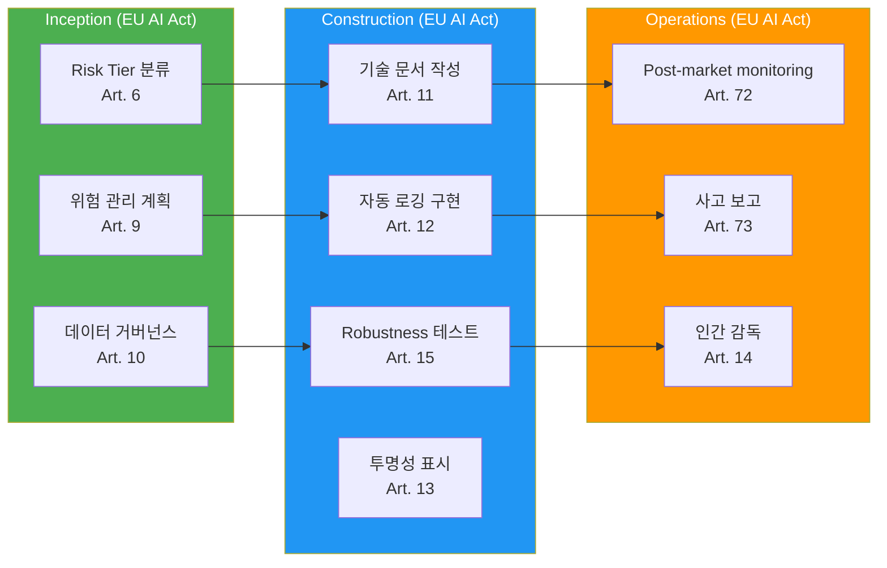

## 개요

**EU AI Act**는 2024년 5월 채택되어 **2026년부터 단계적으로 적용**되는 세계 최초의 포괄적 AI 규제입니다.

**시행 타임라인:**
- **2025년 2월**: 금지된 AI 시스템 적용 (Prohibited AI, Art. 5)
- **2025년 8월**: 범용 AI (GPAI) 제공자 의무 적용 (Art. 53-55)
- **2026년 8월**: 규정 일반 적용 및 Annex III 고위험 AI 시스템 의무 적용
- **2027년 8월**: Annex I(제품 안전 규제 대상에 내장된) 고위험 AI 시스템 의무 적용

---

## Risk Tier 분류

EU AI Act는 AI 시스템을 **4단계 위험도**로 분류합니다:

| Risk Tier | 정의 | 예시 | 규제 수준 |
|-----------|------|------|----------|
| **Prohibited** | 용인 불가능한 위험 | 사회적 신용 점수, 공공장소 실시간 원격 생체인식(법 집행 목적의 좁은 승인 예외만 허용) | **금지** |
| **High-risk** | 높은 위험 | 채용 도구, 신용 평가, 중요 인프라 관리 | **엄격한 의무사항** |
| **Limited risk** | 제한적 위험 | 챗봇, 감정 인식(일부 용도) | **투명성 의무** |
| **Minimal risk** | 최소 위험 | 스팸 필터, AI 게임 | **자율 규제** |

위 표의 생체인식 행은 요약입니다. Art. 5의 실시간 원격 생체인식 금지는 전면 예외가 아니라, 법 집행 목적의 좁고 사전 승인된 예외만 둔 금지입니다. 감정 인식도 용도에 따라 규제 수준이 달라집니다. 직장과 교육기관에서의 감정 인식은 Art. 5에 따라 원칙적으로 금지되며, 그 밖의 용도만 투명성 의무가 적용되는 Limited risk에 해당합니다.

**코드 생성 AI (AIDLC 대상) 분류:**
- **Limited risk**: 개발자가 AI 생성 코드임을 인지 → 투명성 의무
- **High-risk** (조건부): 중요 인프라 (의료, 금융, 전력) 코드 자동 생성 시

---

## High-risk AI 의무사항

**Article 9-15 핵심 요구사항:**

### 1. 위험 관리 시스템 (Art. 9)
- 전체 생명주기 위험 평가
- 식별·분석·완화·모니터링

### 2. 데이터 거버넌스 (Art. 10)
- 학습 데이터 품질 보증
- 편향(bias) 최소화

### 3. 기술 문서 (Art. 11)
- 시스템 설계·개발·테스트 문서화
- 감사 기관 제출 가능해야 함

### 4. 자동 로깅 (Art. 12, Art. 19) {#4-자동-로깅-art-12}
- Art. 12: 운영 기간 전체에 걸쳐 이벤트(로그)를 자동 기록하여 추적성 확보
- Art. 19: 자동 생성된 로그를 제공자 통제하에 최소 6개월 보존(다른 법에 더 긴 기간이 정해지지 않은 경우)

### 5. 투명성 (Art. 13)
- 배포자(deployer)에게 시스템 사용·해석에 필요한 정보 제공
- 설명 가능한 출력

### 6. 인간 감독 (HITL) (Art. 14)
- Art. 14는 사람이 시스템을 이해·감시하고 필요 시 개입·중단·무효화(override)할 수 있도록 효과적인 인간 감독 수단을 갖출 것을 요구합니다. 모든 중요 결정에 대한 사전 최종 승인을 조문이 일률적으로 요구하지는 않습니다.
- 이 가이드는 그보다 강한 내부 규칙으로, 중요 결정은 사람이 최종 승인하도록 정합니다.
- Override 권한 보장

### 7. 정확성·견고성·사이버보안 (Art. 15)
- 성능 메트릭 정의
- Adversarial attack 방어

---

## GPAI (General Purpose AI) 제공자 의무

**Article 53-55**: Claude, GPT-4 등 범용 모델(GPAI) 제공자 의무 (Art. 51은 systemic risk 분류 기준, Art. 52는 그 분류 절차를 규정)

- **모든 GPAI 제공자 (Art. 53)**: 모델의 기술 문서를 작성해 요청 시 AI Office와 국가 관할 당국에 제공하고, 모델을 자신의 시스템에 통합하는 다운스트림 제공자에게는 통합에 필요한 정보·문서를 제공하며, 저작권 준수 정책을 두고 학습 데이터에 관한 충분히 상세한 요약을 공개
- **Systemic risk GPAI 제공자 (Art. 55, 10^25 FLOP 초과 등)**: 위 의무에 더해 모델 평가·적대적 테스트, 시스템 수준 위험 평가·완화, 중대 사고 추적·보고, 사이버보안 보호 의무를 추가로 부담

---

## 위반 과태료

| 위반 유형 | 과태료 |
|----------|--------|
| 금지된 AI 사용 | **35M€** 또는 **전 세계 매출의 7%** (더 큰 금액) |
| High-risk AI 의무 위반 | **15M€** 또는 **매출의 3%** |
| 부정확한 정보 제공 | **7.5M€** 또는 **매출의 1%** |

---

## AIDLC 매핑

### Inception 단계 체크리스트

- [ ] Risk Tier 분류 (Limited/High-risk 판정)
- [ ] 위험 관리 계획 수립 (위험 식별·완화 전략)
- [ ] 데이터 거버넌스 정책 정의 (학습 데이터 출처, 편향 완화)

### Construction 단계 체크리스트

- [ ] 기술 문서 자동 생성 (설계·개발·테스트 문서)
- [ ] 감사 로그 구현 (모든 AI 의사결정 기록)
- [ ] Robustness 테스트 (Adversarial attack, 경계 케이스)
- [ ] AI 생성 코드에 출처(provenance) 주석 기록 (`# AI-GENERATED: ...`)

소스 코드 상단의 `# AI-GENERATED` 주석은 코드의 생성 출처를 추적하기 위한 메타데이터일 뿐, 그 자체로 EU AI Act의 투명성 의무를 충족하지는 않습니다. Art. 13(배포자 정보 제공)과 Art. 50(사용자 대상 투명성)의 규제상 투명성은 사용자가 AI와 상호작용하거나 AI 생성 결과물을 접한다는 사실을 사용자에게 고지하는 것으로 충족되며, 코드 내부 주석으로 대체되지 않습니다.

### Operations 단계 체크리스트

- [ ] Post-market monitoring (프로덕션 성능 지속 추적)
- [ ] 고위험 AI 시스템 제공자의 중대 사고 보고 (Art. 73): 인지 후 지체 없이, 일반적으로 15일 이내 / 광범위한 침해나 Art. 3(49)(b)의 중대 사고는 2일 이내 / 사망 관련은 10일 이내
- [ ] 인간 감독 프로세스 운영 (중요 결정 승인)

---

## 참고 자료

**공식 문서:**
- [Regulation (EU) 2024/1689 (Official Text)](https://eur-lex.europa.eu/legal-content/EN/TXT/?uri=CELEX:32024R1689)
- [EU AI Act Timeline (European Commission)](https://digital-strategy.ec.europa.eu/en/policies/regulatory-framework-ai)

**관련 문서:**
- [규제 컴플라이언스 개요](../index.md)
- [거버넌스 프레임워크](../../governance-framework.md)
- [하네스 엔지니어링](../../../methodology/harness-engineering.md)
