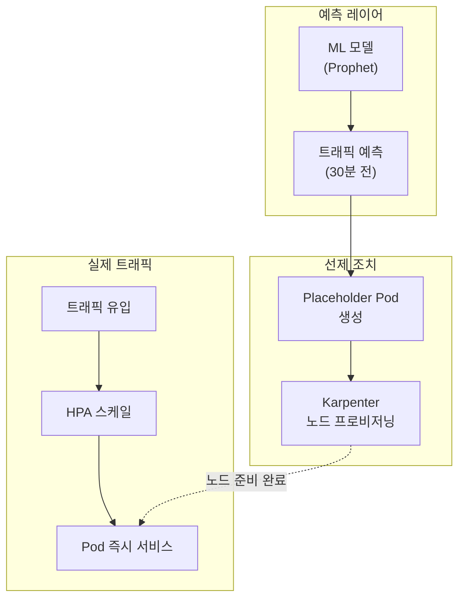
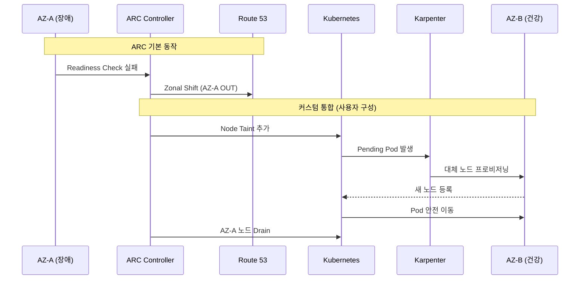
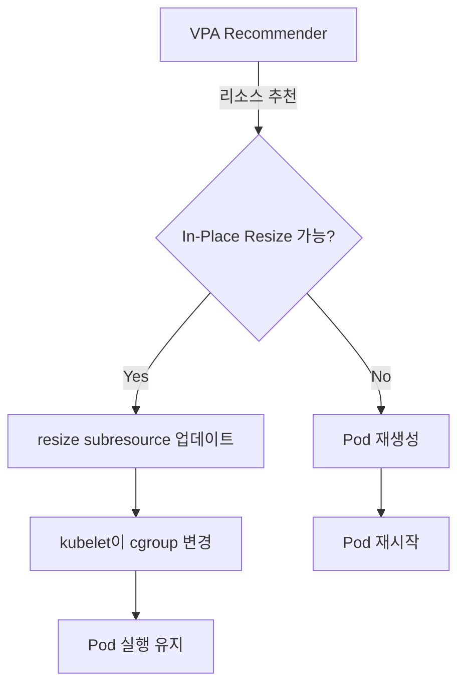

import { ScalingComparison, MLModelComparison, MaturityTable } from '@site/src/components/PredictiveOpsTables';

> **핵심**: 반응형 운영에서 예측형 운영으로 — ML 기반 예측 스케일링, 이상 감지, 자동 최적화

---

## 1. 개요

### 반응형에서 예측형으로

전통적인 EKS 운영은 **반응형**입니다. HPA는 CPU/메모리가 임계값을 초과한 **후** 스케일링을 시작하므로, 트래픽 급증 시 사용자에게 이미 영향이 발생합니다.

**예측 운영**은 ML 모델을 통해 트래픽 패턴을 학습하고, **증가 전에 미리 스케일아웃**하여 서비스 품질을 유지합니다.

```
반응형 스케일링의 문제:
  HPA 임계값 초과 → 스케일아웃 시작 → Pod 시작 30초-2분
  Karpenter 노드 프로비저닝 → 1-3분 추가 지연
  → 성능 저하 구간 발생 → 사용자 영향

예측 스케일링의 해결:
  ML 예측 (30분 전) → 사전 스케일아웃 → 실제 트래픽 도착
  → 노드/Pod 준비 완료 → 성능 저하 없음
```

### 핵심 가치

- **사용자 영향 최소화**: Cold Start 지연 제거
- **비용 효율**: 과도한 여유 리소스 확보 불필요, 필요한 시점에만 확장
- **복합 장애 대응**: 단일 메트릭이 아닌 다차원 이상 감지
- **자동 최적화**: VPA + AI로 리소스 Right-Sizing 자동화

---

## 2. ML 기반 예측 스케일링

### 2.1 HPA의 한계

HPA(Horizontal Pod Autoscaler)는 **현재 메트릭**에만 반응하므로 구조적 한계가 있습니다.

<ScalingComparison />

```
[HPA 반응형]
트래픽 ████████████████████████░░░░░░░░░
                      ↑ 임계값 초과
Pod 수  ██████████░░░░████████████████████
                  ↑ 스케일아웃 시작 (지연)
사용자   ✓✓✓✓✓✓✓✓✗✗✗✓✓✓✓✓✓✓✓✓✓✓✓✓✓✓
경험              ↑ 성능 저하 구간

[ML 예측형]
트래픽 ████████████████████████░░░░░░░░░
             ↑ 예측 시점 (30분 전)
Pod 수  ██████████████████████████████████
             ↑ 사전 스케일아웃
사용자   ✓✓✓✓✓✓✓✓✓✓✓✓✓✓✓✓✓✓✓✓✓✓✓✓✓✓
경험     (성능 저하 없음)
```

### 2.2 시계열 예측 모델

EKS 워크로드의 트래픽 패턴을 예측하는 대표적 ML 모델:

<MLModelComparison />

**모델 선택 가이드**:
- **주기성이 강한 워크로드** (일일/주간 패턴): Prophet
- **트렌드 중심**: ARIMA
- **복잡한 비선형 패턴**: LSTM

여기서 다루는 Prophet/ARIMA/LSTM은 미래 부하 값을 예측해 사전 스케일링의 입력으로 쓰는 모델입니다. 4절에서 설명하는 CloudWatch Anomaly Detection의 이상 탐지 밴드와는 목적이 다릅니다. 이상 탐지 밴드는 메트릭의 정상 범위를 학습해 현재 값이 그 범위를 벗어나는지 판정할 뿐 미래 값을 예측하지 않으므로, 이상 알림에는 밴드를, 선제 스케일링에는 예측 모델을 사용하고 두 용도를 분리합니다.

### 2.3 구현 패턴

```python
# Prophet 기반 트래픽 예측 예시
from prophet import Prophet
import pandas as pd

def predict_scaling(metrics_df, forecast_hours=2):
    """Prophet으로 향후 트래픽 예측"""
    df = metrics_df.rename(columns={'timestamp': 'ds', 'value': 'y'})

    model = Prophet(
        changepoint_prior_scale=0.05,
        seasonality_mode='multiplicative',
        daily_seasonality=True,
        weekly_seasonality=True
    )
    model.fit(df)

    future = model.make_future_dataframe(periods=forecast_hours * 12, freq='5min')
    forecast = model.predict(future)

    # make_future_dataframe는 학습 구간까지 포함하므로, 마지막 학습 시점
    # 이후의 미래 구간만 선택해 사전 스케일링 입력으로 사용합니다.
    last_train_ts = df['ds'].max()
    future_forecast = forecast[forecast['ds'] > last_train_ts]
    return future_forecast[['ds', 'yhat', 'yhat_upper', 'yhat_lower']]

def calculate_required_pods(forecast_df, pod_capacity_rps=100):
    """검증된 미래 예측의 상한값(yhat_upper)으로 필요 Pod 수 계산"""
    # 대상 구간의 상한값(yhat_upper) 최대치를 사용해 안전 마진 확보
    predicted_rps = forecast_df['yhat_upper'].max()
    required = int(predicted_rps / pod_capacity_rps) + 1
    return max(required, 2)
```

> **전제**: 위 계산은 모델이 홀드아웃 구간에서 검증(예: MAPE 등 오차 지표 확인)을 통과한 뒤에만 신뢰할 수 있습니다. 검증되지 않은 예측을 그대로 스케일링에 연결하면 과소/과대 프로비저닝이 발생할 수 있습니다.

**자동화 패턴**:
- CronJob으로 15분마다 예측 실행
- AMP에서 최근 7일 메트릭 수집
- 예측 결과를 Prometheus Custom Metric으로 노출
- HPA 또는 KEDA가 Custom Metric 기반 스케일링

---

## 3. Karpenter + AI 예측

### 3.1 Karpenter 기본 동작

Karpenter는 Pending Pod를 감지하여 **Just-in-Time** 노드 프로비저닝을 수행합니다. 그러나 노드 시작까지 1-3분 소요됩니다.

### 3.2 AI 예측 기반 선제 프로비저닝

ML 예측과 결합하면 **노드를 미리 준비**할 수 있습니다.



**선제 프로비저닝 패턴**:

```yaml
# Placeholder Pod로 노드 선제 확보
apiVersion: apps/v1
kind: Deployment
metadata:
  name: capacity-reservation
  namespace: scaling
spec:
  replicas: 0  # 예측 스케일러가 동적 조정
  selector:
    matchLabels:
      app: capacity-reservation
  template:
    metadata:
      labels:
        app: capacity-reservation
    spec:
      priorityClassName: capacity-reservation  # 낮은 우선순위
      terminationGracePeriodSeconds: 0
      containers:
        - name: pause
          image: registry.k8s.io/pause:3.9
          resources:
            requests:
              cpu: "1"
              memory: 2Gi
---
apiVersion: scheduling.k8s.io/v1
kind: PriorityClass
metadata:
  name: capacity-reservation
value: -10  # 실제 워크로드에 의해 축출됨
globalDefault: false
description: "Karpenter 노드 선제 프로비저닝용"
```

**동작 원리**:
1. ML 모델이 30분 후 트래픽 증가를 예측
2. Placeholder Pod의 replicas를 늘림
3. Karpenter가 Pending Pod를 감지하여 노드 프로비저닝
4. 실제 트래픽 도착 시 HPA가 실제 Pod 생성
5. Placeholder Pod는 낮은 우선순위로 축출되고, 비워진 노드에 실제 Pod가 스케줄링
6. 노드가 미리 준비되어 있어 노드 프로비저닝 지연은 사라지지만, 컨테이너 이미지 풀, 애플리케이션 기동, readiness probe 통과에 걸리는 시간은 그대로 남습니다. 따라서 실제 트래픽을 받기 전에 애플리케이션 워밍업(캐시 예열, 커넥션 풀 초기화 등)이 완료되어야 합니다.

이 패턴을 운영에 적용하려면 다음을 함께 정의해야 합니다. 첫째, 예측된 트래픽이 지나간 뒤 예약 Pod(replicas)를 언제 다시 줄일지에 대한 축소 조건을 정해, 불필요한 예약 용량이 계속 비용을 발생시키지 않도록 합니다. 둘째, Karpenter NodePool의 `limits`(CPU/메모리 상한)로 선제 프로비저닝이 확보할 수 있는 최대 노드 용량을 제한해, 예측 오류가 무한 노드 증설로 이어지지 않도록 합니다. 셋째, Placeholder Pod의 리소스 요청값을 실제 워크로드와 맞춰, 확보한 노드가 실제 Pod를 담을 수 있게 합니다.

### 3.3 ARC + Karpenter 통합 (AZ 장애 자동 대피)

**ARC(Application Recovery Controller)**는 AZ 장애를 자동 감지하고 트래픽을 건강한 AZ로 이동시킵니다. Karpenter와 통합하면 **노드 레벨 자동 복구**까지 가능합니다.

아래 흐름에서 ARC가 문서화된 기능으로 직접 수행하는 단계는 Route 53 Zonal Shift(장애 AZ를 DNS 응답에서 제외)까지입니다. 그 뒤의 노드 Taint 추가, Pending Pod 발생, Karpenter 대체 노드 프로비저닝, AZ-A 노드 Drain은 ARC의 기본 동작이 아니라, Zonal Shift 신호를 받아 사용자가 직접 구성해야 하는 커스텀 통합(예: 이벤트 기반 컨트롤러나 자동화 스크립트)입니다. 두 영역을 구분해서 봐야 합니다.



---

## 4. CloudWatch Anomaly Detection

### 4.1 이상 탐지 밴드

CloudWatch Anomaly Detection은 ML을 사용하여 메트릭의 **정상 범위 밴드**를 자동 학습하고, 밴드를 벗어나는 이상을 탐지합니다.

```bash
# Anomaly Detection 모델 생성
aws cloudwatch put-anomaly-detector \
  --namespace "ContainerInsights" \
  --metric-name "pod_cpu_utilization" \
  --dimensions Name=ClusterName,Value=my-cluster \
  --stat "Average"
```

### 4.2 EKS 적용 패턴

**핵심 메트릭** (CloudWatch `ContainerInsights` 네임스페이스):
- `pod_cpu_utilization`: Pod CPU 사용률(%), 노드 CPU 용량 대비 비율(`pod_cpu_usage_total / node_cpu_limit`). 정상 패턴을 벗어나는 스파이크 감지
- `pod_memory_utilization`: Pod 메모리 사용률(%), 노드 메모리 용량 대비 비율(`pod_memory_working_set / node_memory_limit`). 메모리 누수 조기 감지
- `pod_network_rx_bytes`: Pod가 네트워크로 수신하는 초당 바이트 수. 이상 트래픽 감지
- `pod_number_of_container_restarts`: Pod 내 컨테이너 재시작 누적 횟수. 재시작 패턴 이상 감지
- `node_cpu_utilization`: 노드 CPU 사용률(%), `node_cpu_usage_total / node_cpu_limit`. 노드 레벨 병목 감지

### 4.3 Anomaly Detection 기반 알람

```bash
# Anomaly Detection 기반 CloudWatch Alarm
aws cloudwatch put-metric-alarm \
  --alarm-name "EKS-CPU-Anomaly" \
  --comparison-operator GreaterThanUpperThreshold \
  --threshold-metric-id ad1 \
  --evaluation-periods 3 \
  --metrics '[
    {
      "Id": "m1",
      "MetricStat": {
        "Metric": {
          "Namespace": "ContainerInsights",
          "MetricName": "pod_cpu_utilization",
          "Dimensions": [{"Name": "ClusterName", "Value": "my-cluster"}]
        },
        "Period": 300,
        "Stat": "Average"
      }
    },
    {
      "Id": "ad1",
      "Expression": "ANOMALY_DETECTION_BAND(m1, 2)"
    }
  ]' \
  --alarm-actions "arn:aws:sns:ap-northeast-2:ACCOUNT_ID:ops-alerts"
```

**특성**:
- 고정 임계값과 달리 학습된 정상 범위 밴드를 기준으로 삼으므로, 주기성이 있는 워크로드에서는 오탐(False Positive)이 줄어드는 경향이 있습니다. 감소 폭은 워크로드 패턴과 밴드 폭(표준편차 배수)에 따라 달라지며 보장된 수치가 아닙니다.
- 일일/주간 등 주기 패턴과 계절성 변화를 학습해 밴드에 반영합니다.

위 예시 알람은 `Period` 300초 데이터 포인트를 `evaluation-periods` 3회 연속 초과할 때 발동합니다(약 15분). 또한 이 알람은 이상을 **감지해 알리는 역할만** 하며, SNS 액션으로 알림을 전달할 뿐 스케일링이나 재시작 같은 조치를 직접 수행하지 않습니다. 자동 조치가 필요하면 알림을 받는 별도의 자동화(Lambda, EventBridge 등)를 구성해야 합니다.

---

## 5. AI Right-Sizing

### 5.1 Container Insights 기반 추천

CloudWatch Container Insights는 Pod의 실제 리소스 사용 패턴을 분석하여 적정 크기를 추천합니다.

```promql
# 실제 CPU 사용량 vs requests 비교 (Pod 단위로 집계 모집단 일치)
sum(rate(container_cpu_usage_seconds_total{namespace="payment"}[1h]))
  by (pod)
/ sum(kube_pod_container_resource_requests{resource="cpu", namespace="payment"})
  by (pod)
* 100

# 실제 Memory 사용량 vs requests 비교 (Pod 단위로 집계 모집단 일치)
sum(container_memory_working_set_bytes{namespace="payment"})
  by (pod)
/ sum(kube_pod_container_resource_requests{resource="memory", namespace="payment"})
  by (pod)
* 100
```

분자(실제 사용량)는 Pod 단위, 분모(requests)는 컨테이너 단위이므로, 두 벡터를 모두 `sum ... by (pod)`로 Pod 단위 합계로 집계해 모집단을 맞춥니다. 컨테이너별 비율이 필요하면 양쪽을 `by (pod, container)`로 집계합니다. `avg`로 묶으면 다중 컨테이너 Pod에서 컨테이너 수에 따라 비율이 왜곡되므로 `sum`을 사용합니다.

### 5.2 VPA + ML 기반 자동 Right-Sizing

```yaml
# VPA (Vertical Pod Autoscaler) 설정
apiVersion: autoscaling.k8s.io/v1
kind: VerticalPodAutoscaler
metadata:
  name: payment-service-vpa
  namespace: payment
spec:
  targetRef:
    apiVersion: apps/v1
    kind: Deployment
    name: payment-service
  updatePolicy:
    updateMode: "Auto"  # Off, Initial, Auto
  resourcePolicy:
    containerPolicies:
      - containerName: app
        minAllowed:
          cpu: 100m
          memory: 128Mi
        maxAllowed:
          cpu: "2"
          memory: 4Gi
        controlledResources: ["cpu", "memory"]
```

### 5.3 In-Place Pod Vertical Scaling (K8s 1.33+)

Kubernetes 1.33부터 **In-Place Pod Vertical Scaling**이 Beta로 진입하면서, VPA의 가장 큰 단점이었던 **Pod 재시작 문제**가 해결되었습니다.

**기존 VPA 문제**:
- Pod 리소스 변경 시 반드시 재시작 필요
- StatefulSet, DB, 캐시 등 상태 유지 워크로드에서 사용 어려움
- 재시작 중 서비스 중단 가능성

**In-Place Resize 해결**:
- 실행 중인 Pod의 리소스를 Pod 재생성 없이 동적으로 조정
- cgroup 제한을 실시간으로 변경
- 많은 경우 컨테이너 재시작 없이 리소스를 조정하지만, 변경 종류와 컨테이너의 `resizePolicy`에 따라 컨테이너 재시작이 필요할 수 있습니다(예: 메모리 축소). 이때도 Pod 자체는 재생성되지 않고 동일한 Pod 안에서 컨테이너만 재시작됩니다.
- 즉 "Pod 재생성 회피"와 "컨테이너 재시작 회피"는 별개입니다. In-Place Resize는 전자를 항상 보장하지만 후자는 조건부입니다.

다음 표는 In-Place Pod Vertical Scaling(Feature Gate `InPlacePodVerticalScaling`)의 Kubernetes 업스트림 성숙도 단계입니다. 1.35 이후의 "Stable" 행과 아래 EKS 날짜는 2026-10-15 기준 공개 로드맵에 근거한 예상치이며 확정 일정이 아닙니다. 실제 지원 여부는 Kubernetes KEP-1287과 EKS 릴리스 노트로 확인합니다.

| Kubernetes 버전 | 상태 | Feature Gate | 비고 |
|----------------|------|--------------|------|
| 1.27 | Alpha | `InPlacePodVerticalScaling` | 실험적 |
| 1.33 | Beta | 기본 활성화 | 프로덕션 테스트 권장 |
| 1.35+ | Stable (예상) | 기본 활성화 | 업스트림 로드맵 기준 예상 |

**EKS 지원** (2026-10-15 기준 예상, 확정 아님):
- **EKS 1.33** (2026년 4월경 예상): Beta 활성화 가능
- **EKS 1.35** (2026년 11월경 예상): Stable 지원 예상

**VPA 자동 In-Place Resize**:

```yaml
apiVersion: autoscaling.k8s.io/v1
kind: VerticalPodAutoscaler
metadata:
  name: payment-service-vpa
  namespace: payment
spec:
  targetRef:
    apiVersion: apps/v1
    kind: Deployment
    name: payment-service
  updatePolicy:
    updateMode: "Auto"  # In-Place Resize 지원 시 재시작 없이 조정
  resourcePolicy:
    containerPolicies:
      - containerName: app
        minAllowed:
          cpu: 100m
          memory: 128Mi
        maxAllowed:
          cpu: "4"
          memory: 8Gi
        controlledResources: ["cpu", "memory"]
        mode: Auto  # 이 컨테이너의 오토스케일링 활성화 (Auto 또는 Off)
```

**동작 흐름**:



**제약사항**:
- CPU는 자유롭게 resize 가능
- Memory는 증가뿐 아니라 축소도 가능하지만, 컨테이너의 `resizePolicy`에 따라 메모리 축소 시 컨테이너 재시작이 필요할 수 있습니다
- Pod의 QoS Class(Guaranteed/Burstable/BestEffort)는 생성 시점에 고정되어 변경할 수 없습니다. In-Place Resize가 QoS Class를 바꾸게 되는 요청은 거부되며, QoS Class를 바꾸려면 컨테이너 재시작이 아니라 Pod를 새로 생성해 교체해야 합니다

:::warning VPA 주의사항 (K8s 1.34 이하)
K8s 1.34 이하에서 VPA `Auto` 모드는 Pod를 재시작하여 리소스를 조정합니다. StatefulSet이나 재시작에 민감한 워크로드에는 `Off` 모드로 추천값만 확인하고 수동 적용을 권장합니다. VPA와 HPA를 동일 메트릭(CPU/Memory)으로 동시 사용하면 충돌이 발생할 수 있습니다.
:::

### 5.4 Right-Sizing 효과

**예상 비용 절감**:
- Over-provisioning 40-60% → 20-30%로 감소
- 연간 클러스터 비용 30-50% 절감
- 노드 Consolidation 효율 증가

---

## 6. 성숙도 모델

<MaturityTable />

**Level 0: 반응형**
- HPA/VPA 기본 설정
- 고정 임계값 기반 알람
- 수동 스케일링

**Level 1: 예측 준비**
- Container Insights 활성화
- Anomaly Detection 도입
- 메트릭 수집 7일+ 이력

**Level 2: 예측 스케일링**
- Prophet/ARIMA 기반 트래픽 예측
- Karpenter 선제 프로비저닝
- CronJob 기반 자동화

**Level 3: 자동 최적화**
- VPA Auto 모드 적용
- In-Place Resize 활용 (K8s 1.33+)
- CloudWatch Anomaly Detection 기반 자동 조치

**Level 4: 자율 운영**
- AI Agent 기반 자동 인시던트 대응
- Chaos Engineering + AI 피드백 루프
- 자율 학습 및 개선

---

## 7. 참고 자료

**관련 문서**:
- [관찰성 스택](./observability-stack.md) — 메트릭 수집 및 분석 기반
- [자율 대응](./autonomous-response.md) — AI Agent 기반 인시던트 대응
- [EKS 선언적 자동화](../toolchain/eks-declarative-automation.md) — GitOps 기반 자동화

**AWS 공식 문서**:
- [CloudWatch Anomaly Detection](https://docs.aws.amazon.com/AmazonCloudWatch/latest/monitoring/CloudWatch_Anomaly_Detection.html)
- [Karpenter Best Practices](https://aws.github.io/aws-eks-best-practices/karpenter/)
- [Container Insights](https://docs.aws.amazon.com/AmazonCloudWatch/latest/monitoring/ContainerInsights.html)
- [Application Recovery Controller](https://docs.aws.amazon.com/r53recovery/latest/dg/what-is-route53-recovery.html)

**Kubernetes 공식 문서**:
- [In-Place Pod Vertical Scaling (KEP-1287)](https://github.com/kubernetes/enhancements/tree/master/keps/sig-node/1287-in-place-update-pod-resources)
- [VPA](https://github.com/kubernetes/autoscaler/tree/master/vertical-pod-autoscaler)
