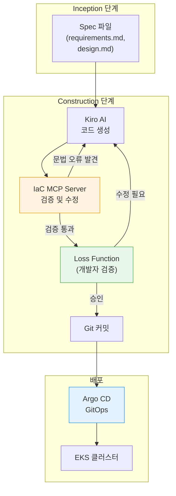

import { EksCapabilities, AidlcPipeline } from '@site/src/components/AidlcTables';

EKS Capabilities(2025-11)는 인기 있는 오픈소스 도구를 AWS 관리형으로 제공하여, AIDLC Construction 단계의 산출물을 선언적으로 배포하고 Operations 단계에서 지속적으로 관리하는 핵심 인프라입니다.

<EksCapabilities />

## 1. EKS Capabilities 개관

이 문서는 다음 5가지 구성 요소를 하나의 파이프라인으로 묶어 설명합니다. 이 가운데 AWS가 EKS 관리형 기능으로 제공하는 것과, 사용자가 클러스터에 직접 설치·운영하는 커뮤니티 컨트롤러를 구분해 두면 책임 범위가 분명해집니다.

AWS가 EKS 관리형 기능(EKS managed capability)으로 제공하는 구성 요소는 다음 3가지입니다:

1. **Managed Argo CD** — GitOps 기반 지속적 배포
2. **ACK (AWS Controllers for Kubernetes)** — AWS 리소스를 K8s CRD로 관리
3. **KRO (Kubernetes Resource Orchestrator)** — 복합 리소스를 단일 배포 단위로 오케스트레이션

다음 2가지는 사용자가 클러스터에 설치해 운영하는 오픈소스/애드온 컨트롤러이며, EKS 관리형 서비스로 제공되는 구성 요소가 아닙니다:

4. **Gateway API (AWS Load Balancer Controller)** — L4/L7 트래픽 라우팅 및 고급 네트워킹
5. **Node Readiness Controller** — 선언적 노드 준비 상태 관리

이들 도구를 결합하면 Kiro가 생성한 코드를 Git에 푸시하고 GitOps 컨트롤러가 EKS에 동기화하며, Operations 단계에서 AI Agent가 모니터링하고 변경을 제안하는 파이프라인을 구성할 수 있습니다.

---

## 2. Managed Argo CD — GitOps 패턴

Managed Argo CD는 GitOps를 AWS 인프라에서 관리형으로 운영합니다. Kiro가 생성한 코드를 Git에 푸시하면 자동으로 EKS에 배포됩니다.

### 핵심 개념

- **Application CRD**: 단일 환경(예: production) 배포 선언
- **ApplicationSet**: 멀티 환경(dev/staging/production) 자동 생성
- **Self-healing**: Git 상태와 클러스터 상태 불일치 시 자동 동기화
- **Progressive Delivery**: 카나리/블루-그린 배포 자동화

### AIDLC 통합

| 단계 | 역할 |
|------|------|
| **Construction** | Kiro가 생성한 Helm chart/Kustomize를 Git 커밋 → Argo CD 자동 배포 |
| **Operations** | 승격·롤아웃·롤백은 Git에 반영된 상태를 Argo CD가 동기화하여 수행합니다. AI Agent는 배포 상태와 SLO를 모니터링하고 롤백이 필요하면 되돌릴 상태를 Git에 커밋(또는 PR)으로 제안하며, 라이브 리소스를 직접 변경하지 않습니다 |

### 참고 자료

- [EKS User Guide: Managed Argo CD](https://docs.aws.amazon.com/eks/latest/userguide/argocd.html)
- [Argo CD Best Practices](https://argo-cd.readthedocs.io/en/stable/operator-manual/declarative-setup/)

---

## 3. ACK — AWS 리소스 CRD 관리

ACK는 2025년 11월 기준 50개 이상의 AWS 서비스를 K8s CRD로 선언적으로 관리합니다(지원 서비스 수는 계속 늘어나므로 최신 목록은 ACK 문서를 확인해야 합니다). Kiro가 생성한 Domain Design의 인프라 요소(DynamoDB, SQS, S3 등)를 `kubectl apply`로 배포하며, Argo CD의 GitOps 워크플로우에 자연스럽게 통합됩니다.

### 핵심 가치

ACK를 사용하면 **클러스터 외부의 AWS 리소스도 K8s 선언적 모델로 관리**할 수 있습니다. DynamoDB, SQS, S3, RDS 등을 K8s CRD로 생성/수정/삭제하며, 이것이 "K8s를 중심으로 모든 인프라를 선언적으로 관리"하는 전략입니다. 다만 CRD 삭제가 곧 AWS 리소스 삭제를 뜻하지는 않도록, ACK는 리소스별 삭제 정책을 지정하는 애너테이션을 제공합니다. 예를 들어 리소스에 `services.k8s.aws/deletion-policy: retain` 애너테이션을 지정하면 CRD를 삭제해도 실제 AWS 리소스는 보존됩니다.

### AIDLC 통합

- **Inception**: [DDD 통합](../methodology/ddd-integration.md)에서 도메인 경계 분석 → ACK 리소스 필요성 식별
- **Construction**: Kiro가 ACK CRD manifest 자동 생성
- **Operations**: [관찰성 스택](../operations/observability-stack.md)에서 ACK 리소스 상태 모니터링

### 참고 자료

- [AWS Controllers for Kubernetes (ACK)](https://aws-controllers-k8s.github.io/community/)
- [EKS managed ACK capability](https://docs.aws.amazon.com/eks/latest/userguide/ack.html)

---

## 4. KRO — ResourceGraphDefinition 오케스트레이션 {#4-kro--resourcegroup-오케스트레이션}

KRO는 여러 K8s 리소스를 하나의 사용자 정의 API로 묶는 **ResourceGraphDefinition(RGD)**을 정의합니다. RGD는 API 스키마와 그 뒤에 생성될 리소스를 기술하며, KRO는 이를 CRD로 변환한 뒤 해당 API의 인스턴스를 감시하고 각 인스턴스에 대응하는 하위 리소스를 조정(reconcile)합니다. AIDLC의 Deployment Unit 개념과 직접 매핑되어, Deployment + Service + HPA + ACK 리소스를 하나의 인스턴스로 생성합니다.

### 핵심 개념

- **ResourceGraphDefinition**: 논리적 배포 단위를 하나의 API로 정의 (예: Payment Service = Deployment + Service + DynamoDB Table)
- **Dependencies**: CEL 표현식에서 추론한 리소스 간 종속성을 자동 관리 (예: Deployment는 DynamoDB Table 생성 후 시작)
- **Rollback**: KRO는 인스턴스 사양을 지속적으로 조정합니다. 전체 그래프를 한 번에 되돌리는 원자적 롤백은 보장하지 않으므로, 일부 리소스만 생성된 부분 실패 상태에서는 사양을 되돌리는 커밋으로 재조정을 유도해 복구합니다

### DDD Aggregate와의 매핑

아래 표는 DDD 개념을 KRO 리소스에 대응시키는 하나의 예시 관례이며, 반드시 따라야 하는 표준은 아닙니다. 도메인과 팀 상황에 맞게 다르게 매핑할 수 있습니다.

| DDD 개념 | KRO 구현 |
|----------|----------|
| Aggregate Root | ResourceGraphDefinition(RGD) |
| Entity | Deployment, StatefulSet |
| Value Object | ConfigMap, Secret |
| Repository | ACK DynamoDB/RDS CRD |

### 참고 자료

- [Kubernetes Resource Orchestrator (KRO)](https://github.com/awslabs/kro)
- [EKS managed kro capability](https://docs.aws.amazon.com/eks/latest/userguide/kro.html)

---

## 5. Gateway API — L4/L7 트래픽 라우팅

AWS Load Balancer Controller(LBC)는 Kubernetes Gateway API 지원을 일반 제공(GA)하며, NLB로 L4 라우팅을, ALB로 L7 라우팅을 수행합니다. 아래에서는 Gateway API 명세가 정의하는 기능과, 그 가운데 AWS LBC가 실제로 구현하는 범위를 구분해 설명합니다.

### Gateway API 설계 철학

Gateway API는 역할 지향적(role-oriented) 설계로 인프라 운영자, 클러스터 운영자, 애플리케이션 개발자가 각자의 책임 범위에서 트래픽을 관리할 수 있게 합니다.

| 리소스 | 소유자 | 책임 |
|--------|--------|------|
| **GatewayClass** | 인프라 운영자 | 로드밸런서 유형(ALB/NLB) 정의 |
| **Gateway** | 클러스터 운영자 | 리스너(포트, TLS) 정의, 네임스페이스 접근 제어 |
| **HTTPRoute/GRPCRoute** | 애플리케이션 개발자 | 경로 기반 라우팅, 카나리 배포, 헤더 변환 |

### LBC가 구현하는 Gateway API 라우팅 {#지원-기능-lbc-v214}

AWS LBC 문서 기준으로 LBC는 Gateway API v1.3.0을 대상으로 빌드되었으며, 다음 라우트를 조정(reconcile)합니다. 아래 버전은 LBC 릴리스 버전입니다.

1. **L4 Routes** (NLB, v2.13.3+)
   - TCPRoute, UDPRoute, TLSRoute
   - SNI 기반 TLS 라우팅. QUIC/HTTP3는 NLB의 UDP/TCP_UDP 리스너에서 지원

2. **L7 Routes** (ALB, v2.14.0+)
   - HTTPRoute: 경로/헤더/쿼리 기반 라우팅
   - GRPCRoute: gRPC 메서드 기반 라우팅
   - 가중치 기반 카나리 배포(HTTPRoute `backendRefs`의 `weight`), 헤더 변환(RequestHeaderModifier, ResponseHeaderModifier)은 Gateway API 명세가 정의하는 L7 기능입니다

JWT 검증은 Gateway API 명세의 Gateway 레벨 기능이 아니라, ALB가 리스너 규칙 수준에서 제공하는 별도 기능이며 LBC에서는 Ingress 수준 동작으로 제공됩니다. LBC의 Gateway API 구현에서 Gateway 레벨 JWT 검증을 보장하지는 않으므로, 최신 지원 범위는 LBC 릴리스 노트를 확인해야 합니다.

### YAML 예시 (3-resource 분리 패턴)

```yaml
# GatewayClass — 인프라 운영자가 정의
apiVersion: gateway.networking.k8s.io/v1
kind: GatewayClass
metadata:
  name: aws-alb
spec:
  controllerName: gateway.alb.aws.amazon.com/controller
---
# Gateway — 클러스터 운영자가 정의
apiVersion: gateway.networking.k8s.io/v1
kind: Gateway
metadata:
  name: payment-gateway
  namespace: production
spec:
  gatewayClassName: aws-alb
  listeners:
    - name: https
      protocol: HTTPS
      port: 443
      # HTTPS 리스너는 TLS 설정이 선행 조건입니다. certificateRefs가 가리키는
      # Secret(또는 ACM 인증서)이 미리 준비되어 있어야 합니다.
      tls:
        mode: Terminate
        certificateRefs:
          - kind: Secret
            name: payment-tls
---
# HTTPRoute — 애플리케이션 개발자가 정의
apiVersion: gateway.networking.k8s.io/v1
kind: HTTPRoute
metadata:
  name: payment-api-route
  namespace: production
spec:
  parentRefs:
    - name: payment-gateway
  rules:
    - matches:
        - path:
            type: PathPrefix
            value: /api/v1/payments
      backendRefs:
        - name: payment-service-v1
          port: 8080
          weight: 90  # 카나리 배포: v1 90%
        - name: payment-service-v2
          port: 8080
          weight: 10  # v2 10%
```

### AIDLC Construction 단계에서의 활용

1. **Kiro Spec에서 API 라우팅 요구사항 정의**
   - `requirements.md`에서 "카나리 배포로 10% 트래픽을 v2로 라우팅" 같은 요구사항 명시
   - Kiro가 HTTPRoute manifest를 자동 생성

2. **GitOps 워크플로우로 선언적 배포**
   - Git 커밋 한 번으로 Gateway, HTTPRoute를 배포
   - Argo CD가 변경 사항을 자동으로 EKS에 동기화
   - LBC가 ALB/NLB를 프로비저닝하고 라우팅 규칙 적용

3. **Operations 단계와의 통합**
   - CloudWatch Application Signals로 각 버전의 SLO 모니터링
   - HTTPRoute weight는 Git에 반영된 상태를 단일 진실 공급원으로 삼아 Argo CD가 동기화합니다. 따라서 AI Agent는 라이브 HTTPRoute를 직접 수정하지 않고, SLO 위반 시 weight를 되돌리는 변경을 Git 커밋(또는 PR)으로 제안합니다. 라이브 리소스와 Git이 각각 weight를 쓰면 드리프트가 생기므로, 쓰기 주체를 Git 하나로 유지합니다

### Gateway API vs Ingress

**Ingress**는 단일 리소스에 모든 라우팅 규칙을 정의하여, 인프라 운영자와 개발자의 책임이 혼재됩니다. **Gateway API**는 GatewayClass(인프라), Gateway(클러스터), HTTPRoute(애플리케이션)로 역할을 분리하여, 각 팀이 독립적으로 작업할 수 있습니다. AIDLC의 **Loss Function** 개념과 일치 — 각 레이어에서 검증하여 오류 전파를 방지합니다.

### 참고 자료

- [Kubernetes Gateway API v1.4 Release](https://kubernetes.io/blog/2025/11/06/gateway-api-v1-4/) (2025-11-06)
- [AWS Load Balancer Controller — Gateway API Docs](https://kubernetes-sigs.github.io/aws-load-balancer-controller/latest/guide/gateway/gateway/)
- [Kubernetes Gateway API in Action (AWS Blog)](https://aws.amazon.com/blogs/containers/kubernetes-gateway-api-in-action/)

---

## 6. Node Readiness Controller — 선언적 노드 준비 관리

**Node Readiness Controller(NRC)**는 Kubernetes 노드가 워크로드를 수용하기 전에 충족해야 할 조건을 선언적으로 정의하는 컨트롤러입니다. 이는 AIDLC Construction 단계에서 인프라 요구사항을 코드로 표현하고, GitOps를 통해 자동으로 적용하는 핵심 도구입니다.

### 핵심 개념

NRC는 `NodeReadinessRule` CRD로 노드가 추가로 만족해야 할 준비 조건을 선언하고, 그 조건이 충족될 때까지 노드에 taint를 자동으로 관리하여 스케줄링을 막는 컨트롤러입니다(Kubernetes 향상 제안 NodeReadinessGates/KEP 5233을 클러스터 외부 구현으로 제공). 전통적으로 노드 준비 상태는 kubelet의 단일 "Ready" 조건으로 결정됐지만, NRC를 사용하면 **애플리케이션별 요구사항을 노드 condition과 taint로 인프라 레이어에 선언적으로 주입**할 수 있습니다.

동작 방식은 다음과 같습니다. 규칙은 하나 이상의 노드 condition(예: `type: example.com/CNIReady`, `requiredStatus: "True"`)을 지정하고, 조건이 충족되지 않는 동안 적용할 taint(예: `effect: NoSchedule`)를 선언합니다. NPD 같은 문제 탐지기나 사용자 데몬이 해당 condition을 보고하면, NRC가 조건 충족 여부에 따라 taint를 붙이거나 제거합니다. 여러 조건은 `allOf` 또는 `anyOf` 정책으로 묶을 수 있고, 적용 시점은 enforcement mode로 선택합니다. `bootstrap-only`는 노드 부트스트랩이 끝나면 재평가를 멈추고, 지속(continuous) 모드는 런타임 내내 조건을 강제합니다.

- **선언적 정책**: `NodeReadinessRule`로 노드 준비 조건과 taint를 YAML로 정의
- **GitOps 호환**: Argo CD를 통해 노드 readiness 정책을 버전 관리하고 자동 배포
- **워크로드 보호**: 필수 구성 요소(CNI, CSI, 보안 에이전트 등)의 condition이 준비될 때까지 taint로 스케줄링 차단

### AIDLC 각 단계에서의 활용

| 단계 | NRC 역할 | 예시 |
|------|----------|------|
| **Inception** | AI가 워크로드 요구사항 분석 → 필요한 NodeReadinessRule 자동 정의 | "GPU 워크로드는 NVIDIA device plugin이 준비된 후에만 스케줄링" |
| **Construction** | NRC 규칙을 Helm chart에 포함해 배포합니다. Terraform EKS Blueprints 애드온 등 어떤 경로로 배포할지는 환경에 맞춰 선택하는 예시입니다 | Kiro가 `NodeReadinessRule` manifest 자동 생성 |
| **Operations** | NRC가 런타임에 노드 readiness를 자동 관리, AI가 규칙 효과 분석 | 예: 노드 준비 지연 시간을 측정해 모니터링(지표 수집 방식은 환경에 맞게 구성) |

### Infrastructure as Code 관점

NRC는 AIDLC의 "인프라를 코드로, 인프라도 테스트" 원칙을 노드 수준까지 확장합니다.

1. **GitOps 기반 정책 관리**
   - `NodeReadinessRule` CRD를 Git 리포지토리에 저장
   - Argo CD가 자동으로 EKS 클러스터에 동기화
   - 정책 변경 시 Git 커밋 한 번으로 전체 클러스터에 적용

2. **Kiro + MCP 자동화**
   - Kiro가 Inception 단계의 `design.md`에서 워크로드 요구사항 파싱
   - [AI 코딩 에이전트](./ai-coding-agents.md)가 현재 클러스터의 데몬셋 상태 확인
   - 필요한 `NodeReadinessRule`을 자동 생성하여 IaC 리포지토리에 추가

### YAML 예시: GPU 워크로드용 NodeReadinessRule

```yaml
apiVersion: readiness.node.x-k8s.io/v1alpha1
kind: NodeReadinessRule
metadata:
  name: gpu-node-readiness
spec:
  # GPU 노드에만 적용
  nodeSelector:
    matchLabels:
      node.kubernetes.io/instance-type: p4d.24xlarge
  # 아래 condition이 "True"가 될 때까지 taint를 유지하여 스케줄링을 차단합니다.
  # condition은 device plugin이나 NPD 같은 리포터가 노드에 기록해야 합니다.
  conditions:
    - type: "example.com/NvidiaDevicePluginReady"
      requiredStatus: "True"
    - type: "example.com/DcgmExporterReady"
      requiredStatus: "True"
  taint:
    key: "readiness.k8s.io/GpuReady"
    effect: "NoSchedule"
    value: "pending"
  # bootstrap-only: 노드 부트스트랩이 끝나면 재평가를 멈춥니다.
  enforcementMode: "bootstrap-only"
```

### 실전 사용 사례

아래 표는 NRC로 표현할 수 있는 준비 조건의 예시 시나리오이며, 각 행은 해당 구성 요소의 준비를 조건으로 삼는 하나의 적용 예입니다. 실제 조건 이름과 taint는 환경에서 사용하는 리포터와 애드온에 맞춰 정의해야 합니다.

| 시나리오 | NRC 규칙 | 효과 |
|----------|----------|------|
| **Cilium CNI 클러스터** | Cilium agent가 Ready일 때까지 대기 | 네트워크 초기화 전 Pod 스케줄링 방지 |
| **GPU 클러스터** | NVIDIA device plugin + DCGM exporter 준비 대기 | GPU 리소스 노출 전 워크로드 스케줄링 차단 |
| **보안 강화 환경** | Falco, OPA Gatekeeper 준비 대기 | 보안 정책 적용 전 워크로드 실행 방지 |
| **스토리지 워크로드** | EBS CSI driver + snapshot controller 준비 대기 | 볼륨 마운트 실패 방지 |

### 참고 자료

- [Kubernetes Blog: Introducing Node Readiness Controller](https://kubernetes.io/blog/2026/02/03/introducing-node-readiness-controller/) (2026-02-03)
- [Node Readiness Controller GitHub Repository](https://github.com/kubernetes-sigs/node-readiness-controller)

---

## 7. MCP 기반 IaC 자동화

AWS는 2025년 11월 28일 **AWS Infrastructure as Code (IaC) MCP Server**를 발표했습니다. 이는 Kiro CLI와 같은 AI 도구에서 CloudFormation 및 CDK 문서를 검색하고, 템플릿을 자동 검증하며, 배포 트러블슈팅을 AI가 지원하는 프로그래머틱 인터페이스입니다.

### AWS IaC MCP Server 개요

AWS IaC MCP Server는 Model Context Protocol을 통해 다음 기능을 제공합니다:

- **문서 검색**: CloudFormation 리소스 타입, CDK 구문, 모범 사례를 실시간으로 검색
- **템플릿 검증**: IaC 템플릿의 문법 오류를 자동으로 탐지하고 수정 제안
- **배포 트러블슈팅**: 스택 배포 실패 시 근본 원인을 분석하고 해결 방법 제시
- **프로그래머틱 접근**: Kiro, Amazon Q Developer 등 AI 도구와 네이티브 통합

### AIDLC Construction 단계 통합

1. **Kiro Spec → IaC 코드 생성 검증**
   - Inception 단계에서 생성된 `design.md`를 기반으로 Kiro가 CDK/CloudFormation 등 IaC 코드를 생성
   - IaC MCP Server는 CloudFormation 템플릿을 cfn-lint로 문법·스키마 검증하고, CloudFormation/CDK 문서 검색과 CDK 모범 사례를 제공합니다. 검증 대상은 CloudFormation과 CDK이며, Terraform/Helm 등 다른 도구나 임의 코드의 보안 정책 준수까지 검증하지는 않습니다
   - CloudFormation 템플릿의 경우 리소스 타입 오타, 잘못된 속성 등 cfn-lint가 탐지하는 오류를 배포 전에 사전 감지

2. **배포 트러블슈팅과 문서 참조**
   - 스택 배포 실패 시 근본 원인 분석과 해결 방법을 제시하는 트러블슈팅 도구를 제공합니다
   - EKS MCP Server, Cost Analysis MCP 등 다른 MCP 서버와 함께 사용하면 클러스터 상태나 비용을 별도로 조회할 수 있으나, 이는 각 서버가 수행하는 작업이며 IaC MCP Server 단독 기능이 아닙니다

3. **Loss Function으로서의 역할**
   - 검증을 통과한 코드만 배포 단계로 넘겨, 템플릿 수준의 오류가 프로덕션에 배포되기 전에 차단
   - [DDD 통합](../methodology/ddd-integration.md)에서 정의한 도메인 경계와 인프라 요구사항의 일치는 사람이 수행하는 검토 단계이며, MCP 서버가 자동으로 보장하지 않습니다

### 참고 자료

- [AWS DevOps Blog: Introducing the AWS IaC MCP Server](https://aws.amazon.com/blogs/devops/introducing-the-aws-infrastructure-as-code-mcp-server-ai-powered-cdk-and-cloudformation-assistance/) (2025-11-28)

---

## 8. AIDLC 파이프라인 통합

EKS Capabilities가 결합되면, Kiro가 Spec에서 생성한 산출물을 **Git Push 한 번으로 전체 스택에 배포**할 수 있습니다. 다만 이 "한 번의 Push"는 그 앞에 Loss Function 검토(IaC MCP 검증과 개발자 승인)를 거쳐 승인된 변경만 Git에 반영된다는 전제를 포함합니다. 즉 검토·승인·근거 기록 단계가 생략되는 것이 아니라, 승인 이후의 배포가 Push 한 번으로 이뤄진다는 뜻입니다. 이것이 Construction → Operations 전환의 핵심입니다.

<AidlcPipeline />

### 통합 흐름



### 핵심 원칙

1. **선언적**: 모든 인프라·애플리케이션·네트워킹 설정을 YAML/HCL로 정의
2. **GitOps**: Git을 단일 진실 공급원(Single Source of Truth)으로 사용
3. **자동화**: Kiro + MCP + Argo CD로 수동 개입 최소화
4. **검증**: Loss Function이 각 단계에서 오류 조기 포착

---

## 요약

EKS Capabilities는 AIDLC의 Construction/Operations 단계를 선언적으로 자동화하는 핵심 인프라입니다. 아래 구성 요소와 검증 게이트는 이 가이드가 선택한 예시 스택이며, 반드시 따라야 하는 요구사항은 아닙니다. 예를 들어 GitOps 컨트롤러는 Argo CD 대신 Flux를, 리소스 조합은 KRO 대신 Helm/Kustomize를, 트래픽 라우팅은 Gateway API 대신 Ingress를 사용할 수도 있습니다.

- **Managed Argo CD**: GitOps 기반 지속적 배포
- **ACK**: AWS 리소스를 K8s CRD로 관리
- **KRO**: 복합 리소스를 단일 배포 단위로 오케스트레이션
- **Gateway API**: 역할 분리 기반 트래픽 라우팅, AIDLC Loss Function과 일치
- **Node Readiness Controller**: 선언적 노드 준비 상태 관리
- **IaC MCP Server**: AI 기반 IaC 코드 검증 및 트러블슈팅

이들 도구는 Kiro가 생성한 코드를 Git Push 한 번으로 전체 스택 배포하고, AI Agent가 Operations 단계에서 자동으로 모니터링·대응하는 전체 파이프라인을 구성합니다.
