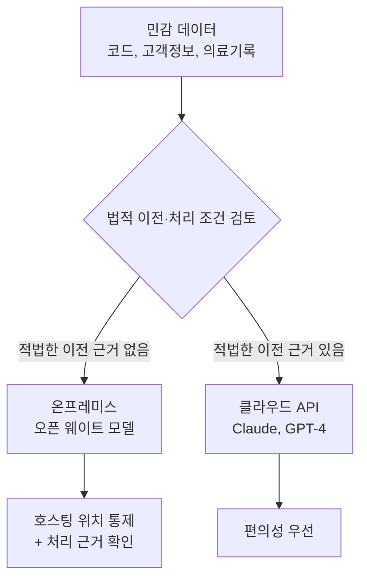
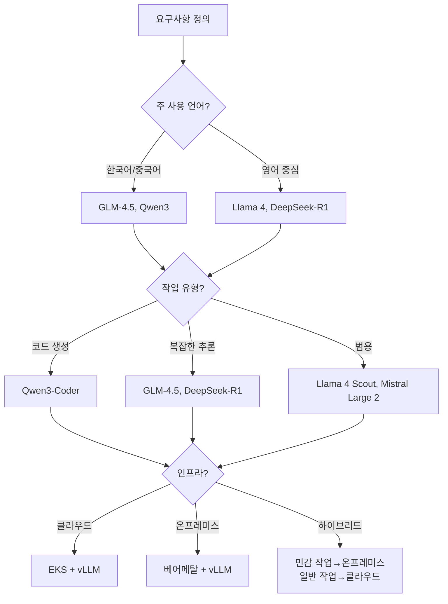
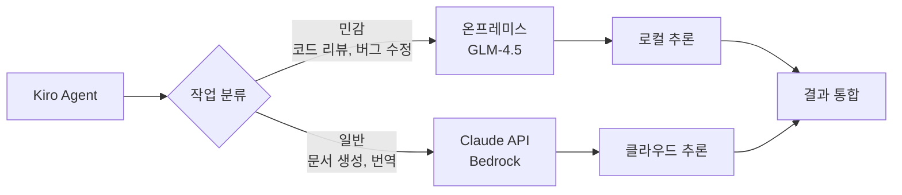
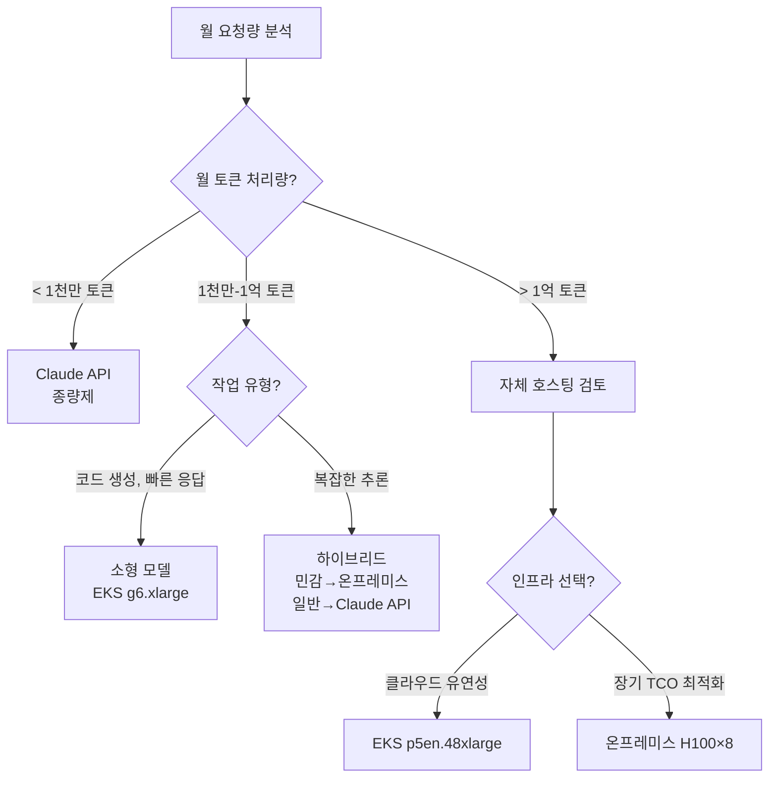

오픈 웨이트 모델을 직접 호스팅하면 추론을 실행할 위치와 모델을 조정하는 방식을 선택할 수 있습니다. 엔터프라이즈 AIDLC에서 클라우드 API(Claude, GPT-4)와 비교할 때는 **데이터가 저장·처리되는 위치**, **총소유비용(TCO)**, **업무에 필요한 모델 동작**을 평가하세요. 직접 호스팅은 인프라 운영 주체와 비용이 발생하는 방식을 바꾸며, 요구 충족 여부는 실제 배포·운영 계획에 따라 결정됩니다.

## 왜 오픈 웨이트 모델인가

### 세 가지 핵심 동인

#### 1. 데이터 레지던시 요구사항

금융, 의료, 공공 부문에서는 민감 데이터의 처리와 국외 이전이 규제로 제한됩니다. 규제가 다루는 것은 "데이터를 적법하게 이전·처리할 수 있는가"라는 법적 조건이며, 이는 "온프레미스에 둘 것인가 클라우드에 둘 것인가"라는 호스팅 위치 선택과 별개입니다. 온프레미스 배포만으로 컴플라이언스가 성립하는 것은 아니며, 처리 근거·동의·계약·이전 메커니즘이 함께 충족되어야 합니다.

- **컴플라이언스 의무**: GDPR, HIPAA, 금융권 개인정보보호법은 데이터의 적법한 처리 근거와 국외 이전 조건을 규정하며, 이는 물리적 저장 위치만으로 충족되지 않음
- **내부 코드베이스 보호**: 소스 코드를 외부 API로 전송하지 않고 온프레미스에서 처리
- **주권 AI(Sovereign AI)**: 국가/기업이 AI 추론 인프라를 직접 통제



#### 2. 비용 최적화

월 수백만 토큰 이상 처리 시, 자체 호스팅 오픈 모델이 클라우드 API보다 저렴할 수 있습니다.

- **종량제 탈피**: API 호출당 과금 없이 고정 인프라 비용으로 전환
- **GPU 활용도 극대화**: 24시간 운영 환경에서 유휴 시간 최소화
- **손익 분기점**: 월 1억 토큰 이상 처리 시 자체 호스팅이 유리(GPU 타입에 따라 변동)

#### 3. 도메인 커스터마이징

오픈 웨이트 모델은 파인튜닝, 프롬프트 엔지니어링, 온톨로지 주입을 통해 특정 도메인에 최적화할 수 있습니다.

- **전문 용어 정확도 향상**: 의료, 법률, 금융 용어 처리 강화
- **출력 형식 제어**: JSON 스키마, 코드 스타일 가이드 준수
- **온톨로지 통합**: [온톨로지 엔지니어링](../methodology/ontology-engineering.md)과 결합하여 도메인 지식 주입

## 모델 랜드스케이프 (2026년 4월 기준)

| 모델 | 제공사 | 파라미터 | 주요 특징 | 라이선스 | 권장 배포 |
|------|--------|---------|----------|---------|----------|
| **GLM-4.5** | Zhipu AI (Z.ai) | 355B 총, 32B 활성 (MoE) | 다국어(한/중/영) 강점, 수학/추론 성능 우수 | MIT | p5en.48xlarge (H200×8) |
| **Qwen3-Coder** | Alibaba | 480B 총, 35B 활성 (MoE) / 30B 총, 3B 활성 변형 | 코딩 특화, 에이전트 작업 | Apache 2.0 | p5.48xlarge (H100×8) / g6e.xlarge (L40S×1) |
| **Qwen3-235B** | Alibaba | 235B 총, 22B 활성 (MoE) | MoE 아키텍처, 텍스트 전용 | Apache 2.0 | p5.48xlarge (H100×8) |
| **DeepSeek-R1** | DeepSeek | 671B 총, 37B 활성 (MoE) | CoT 추론 특화, RL 기반 학습 | MIT | p5en.48xlarge (H200×8) |
| **Llama 4 Scout / Maverick** | Meta | Scout 109B 총·17B 활성 (16 전문가) / Maverick 400B 총·17B 활성 (128 전문가) | 넓은 생태계, 네이티브 멀티모달 | Llama 4 Community License | p5.48xlarge (H100×8) |
| **Mistral Large 2** | Mistral | 123B | 유럽 데이터 주권 고려 설계 | Mistral License | p4d.24xlarge (A100×8) |

"권장 배포" 열은 예시 산정입니다. FP16 가중치(파라미터 수 × 2바이트)가 표기된 GPU 메모리를 넘는 행은 제공사가 공개한 8비트 체크포인트를 전제로 합니다. Qwen3-Coder 480B-A35B의 H100×8과 30B-A3B의 단일 L40S(48GB)는 Qwen이 공개한 `-FP8` 체크포인트를 전제로 하며, Llama 4 Maverick 행은 "단일 H100 호스트에서 실행 가능"하다는 Meta의 설명을 따른 것입니다. FP16으로 서빙하려면 약 2배의 메모리가 필요하며, 아래 "인프라 요구사항"을 참고하세요.

### 선택 기준



## 배포 패턴

### 패턴 1: EKS + vLLM 서빙 (클라우드)

클라우드 환경에서 오픈 모델을 서빙하여 데이터 레지던시는 유지하되 인프라 관리는 AWS에 위임합니다.

```yaml
# GLM-4.5 배포 예시 (EKS Standard Mode, 예시 매니페스트)
apiVersion: apps/v1
kind: Deployment
metadata:
  name: glm45-vllm
spec:
  replicas: 1
  template:
    spec:
      nodeSelector:
        node.kubernetes.io/instance-type: p5en.48xlarge
      containers:
      - name: vllm
        image: vllm/vllm-openai:v0.18.2
        args:
        - --model
        - zai-org/GLM-4.5
        - --served-model-name
        - glm45
        - --tensor-parallel-size
        - "8"
        - --max-model-len
        - "8192"
        - --trust-remote-code
        resources:
          limits:
            nvidia.com/gpu: "8"
```

**장점**:
- Auto Scaling, Spot 인스턴스 활용으로 비용 절감
- Karpenter를 통한 동적 노드 프로비저닝
- CloudWatch, Prometheus 통합 모니터링

**단점**:
- GPU 인스턴스 시간당 비용 발생 (p5en.48xlarge: ~$98/h)
- 데이터는 VPC 내부에 머물지만 인프라는 클라우드 의존

### 패턴 2: 온프레미스 베어메탈 + vLLM

완전한 데이터 주권이 필요하거나 클라우드 송신이 금지된 환경에서 사용합니다.

```bash
# NVIDIA H100×8 서버에 vLLM 배포 (예시)
# 포트는 내부 주소에만 바인딩하고, 외부 노출은 인증을 적용한 리버스 프록시로 처리합니다.
docker run --gpus all \
  -p 127.0.0.1:8000:8000 \
  -v /data/models:/models \
  vllm/vllm-openai:v0.18.2 \
  --model /models/GLM-4.5 \
  --served-model-name glm45 \
  --tensor-parallel-size 8 \
  --max-model-len 8192 \
  --api-key "$VLLM_API_KEY" \
  --trust-remote-code
```

**인프라 요구사항**:
- GLM-4.5 (355B 총, 32B 활성): H100 8장 또는 H200 8장. FP16 가중치는 약 710GB(355B × 2바이트)이며, KV 캐시·활성화 메모리까지 고려하면 H200×8(약 1,128GB)가 여유 있습니다.
- Qwen3-Coder 30B-A3B(30B 총): FP16 가중치 약 60GB로 L40S×2 또는 H100×1에서 서빙 가능하며, 단일 L40S(48GB)에서는 가중치가 약 30GB(30B × 1바이트)인 FP8 체크포인트가 필요합니다. 위 숫자는 가중치 하한이며 실제 요구량은 배치 크기와 컨텍스트 길이에 따라 커집니다.
- 네트워크: 추론 엔드포인트를 내부망에만 바인딩하고(위 `127.0.0.1` 바인딩 또는 전용 서브넷), 아웃바운드는 보안 그룹·방화벽으로 모델 레지스트리 등 필요한 목적지로만 제한합니다. `--trust-remote-code`는 모델 저장소의 코드를 실행하므로, 서명·체크섬으로 아티팩트 출처를 검증한 모델에만 사용합니다.

**장점**:
- 절대적 데이터 통제
- 네트워크 지연 시간 최소화 (사내 10G 네트워크)
- 장기적으로 클라우드 비용 절감

**단점**:
- CapEx 부담 (H100 서버 ~$300K)
- 운영 인력 필요 (GPU 관리, 모델 업데이트)
- 유휴 시간에도 전력 소비

### 패턴 3: 하이브리드 구성

작업 민감도에 따라 온프레미스와 클라우드 API를 혼용합니다.



**구현 예시 (LiteLLM 라우팅)**:

```yaml
# litellm-config.yaml
model_list:
  - model_name: sensitive-tasks
    litellm_params:
      model: openai/glm45  # 온프레미스 vLLM이 served-model-name으로 노출한 이름
      api_base: http://on-prem-vllm.internal:8000/v1
      api_key: os.environ/VLLM_API_KEY
  - model_name: general-tasks
    litellm_params:
      model: bedrock/anthropic.claude-sonnet-4-20250514
      aws_region_name: us-east-1

router_settings:
  routing_strategy: simple-shuffle
  fallbacks:
    - sensitive-tasks: []  # 폴백 비활성화. 단, 빈 목록은 "폴백 없음"일 뿐 외부 전송 자체를 막지 않습니다.
    - general-tasks: [openai/gpt-4o]
# 외부 전송 금지는 설정 주석이 아니라 강제 통제로 구현해야 합니다.
# 예: sensitive-tasks를 내부 엔드포인트 전용 LiteLLM 인스턴스로 분리하거나,
#     외부 공급자(openai/bedrock)로의 아웃바운드를 보안 그룹·egress 정책으로 차단합니다.
```

## TCO 비교 프레임워크

### 비용 항목

아래 수치는 공개 가격(Bedrock 토큰 단가, EC2 온디맨드 요금)을 바탕으로 한 **예시 산정값**이며, 측정된 실적이 아닙니다. 토큰 처리량, 인스턴스 유형, 가동률, 운영 인력 비중 등 가정이 바뀌면 결과도 달라집니다. 각 표의 비고와 아래 가정을 확인한 뒤 조직 수치로 다시 계산하세요.

#### 클라우드 API (Claude, GPT-4)

| 항목 | Claude Sonnet 4.5 | 비고 |
|------|-------------------|------|
| 입력 토큰 | $3/1M tokens | Bedrock 기준 |
| 출력 토큰 | $15/1M tokens | 출력이 입력보다 5배 비쌈 |
| 운영 인력 | $0 | 관리 불필요 |
| 초기 투자 | $0 | 종량제 |

**월 비용 계산 예시**:
- 월 5천만 입력 토큰, 1천만 출력 토큰 처리
- 입력: 50M × $3/1M = $150
- 출력: 10M × $15/1M = $150
- 합계: **$300/월**

#### 자체 호스팅 오픈 모델 (EKS + vLLM)

아래는 소형 모델(단일 소형 GPU)과 대형 모델(멀티 GPU)의 월 비용 **예시**입니다. 인스턴스 단가는 변동하므로 실제 리전·약정 요금으로 다시 계산하세요.

| 항목 | 소형 모델 (g6.xlarge, L4×1) | GLM-4.5 (p5en.48xlarge) |
|------|---------------------------|----------------------------|
| GPU 인스턴스 | $1.01/h × 730h = $737/월 | $98/h × 730h = $71,540/월 |
| 스토리지 (모델) | ~$5/월 | ~$355/월 (710GB) |
| 네트워크 송신 | 내부 트래픽 무료 | 내부 트래픽 무료 |
| 운영 인력 | 0.2 FTE (~$2,000/월) | 0.5 FTE (~$5,000/월) |
| 합계 | **~$2,742/월** | **~$76,895/월** |

**온프레미스 베어메탈 (3년 상각)**:

| 항목 | H100×8 서버 | 비고 |
|------|------------|------|
| 하드웨어 | $300,000 / 36개월 = $8,333/월 | 초기 CapEx |
| 전력 | 10.2kW × $0.12/kWh × 730h = $893/월 | 지역별 전기료 변동 |
| 데이터센터 | ~$1,000/월 | 냉각, 공간 |
| 운영 인력 | 1 FTE (~$10,000/월) | 24/7 대응 |
| 합계 | **~$20,226/월** | 3년 후 하드웨어 비용 제외 시 ~$11,893/월 |

### 손익 분기점 가이드

아래 분기점은 위 비용 **예시**를 바탕으로 한 개략적 기준이며, 비교 대상(클라우드 토큰 과금 vs 자체 호스팅 고정 인프라)의 가정이 다르므로 그대로 적용하지 말고 조직의 토큰 처리량·가동률로 재검증하세요.



**의사결정 기준**:

1. **월 1천만 토큰 미만**: Claude API 또는 GPT-4 사용 (관리 오버헤드 없음)
2. **월 1천만-1억 토큰**: 작업 유형과 민감도에 따라 하이브리드 구성
3. **월 1억 토큰 이상**: 자체 호스팅 검토 (EKS 또는 온프레미스)
4. **CapEx 투자 가능 + 3년 이상 운영 예정**: 온프레미스 베어메탈이 가장 저렴

## AIDLC 통합

### Kiro + 오픈 웨이트 모델

[AI 코딩 에이전트 Kiro](./ai-coding-agents.md)는 오픈 웨이트 모델을 백엔드로 사용하여 Spec-Driven 개발을 수행할 수 있습니다.

아래 `kiro-config.ts`는 문서화된 Kiro 기능이 아니라 **제안 형태의 예시 구성**입니다. 실제 설정 스키마는 Kiro 문서를 확인하세요.

```typescript
// kiro-config.ts (예시 — 제안 구성)
export const kiroConfig = {
  models: {
    sensitive: {
      provider: 'vllm',
      endpoint: 'http://on-prem-vllm.internal:8000/v1',
      model: 'glm45',
      use_cases: ['code-review', 'security-audit', 'refactoring']
    },
    general: {
      provider: 'bedrock',
      model: 'anthropic.claude-sonnet-4-20250514',
      region: 'us-east-1',
      use_cases: ['documentation', 'translation', 'test-generation']
    }
  },
  routing: {
    strategy: 'by-file-path',
    rules: [
      { pattern: 'src/core/**', model: 'sensitive' },
      { pattern: 'docs/**', model: 'general' }
    ]
  }
};
```

### 스티어링 파일: 모델별 프롬프트 최적화

오픈 웨이트 모델은 훈련 데이터와 아키텍처가 다르므로, 동일한 프롬프트에도 다른 반응을 보일 수 있습니다. 아래 예시는 **[Aider](https://aider.chat)** CLI의 설정 파일(`.aider.conf.yml`) 형식입니다. Aider는 시스템 프롬프트를 설정 키로 직접 받지 않으므로, 코딩 규칙은 `read`로 지정한 규칙 파일(예: `CONVENTIONS.md`)에 담아 모델 컨텍스트로 읽힙니다.

**GLM-4.5용 스티어링 파일**:

```yaml
# .aider.conf.yml (GLM-4.5용 프로파일)
model: openai/glm45
edit-format: diff
auto-commits: false
stream: true
# 코딩 규칙은 아래 파일에 작성합니다(지원되지 않는 prompts.system 대신).
read:
  - CONVENTIONS.glm45.md
```

규칙 파일 `CONVENTIONS.glm45.md` 예시:

```markdown
당신은 전문 소프트웨어 엔지니어입니다.
코드 수정 시 반드시 unified diff 형식으로 응답하세요.
변경 사항에 대한 설명은 한국어로 작성하되, 기술 용어는 영문 유지.
```

**Qwen3-Coder용 스티어링 파일**:

```yaml
# .aider.conf.yml (Qwen3-Coder용 프로파일)
model: openai/qwen3-coder
edit-format: whole
# Qwen3-Coder는 전체 파일 교체 방식이 더 안정적
read:
  - CONVENTIONS.qwen3.md
```

규칙 파일 `CONVENTIONS.qwen3.md` 예시:

```markdown
You are a coding assistant specialized in Python and TypeScript.
Always return the complete modified file.
Use type hints and follow PEP 8 style guide.
```

### 온톨로지 주입

[온톨로지 엔지니어링](../methodology/ontology-engineering.md)에서 구축한 도메인 온톨로지를 오픈 모델의 컨텍스트에 주입하여 정확도를 높입니다.

```python
# ontology_injection.py
import json
from pathlib import Path
from typing import Dict

class OntologyInjector:
    def __init__(self, ontology_path: str):
        self.ontology = self.load_ontology(ontology_path)

    def inject_context(self, prompt: str, domain: str) -> str:
        """도메인 온톨로지를 프롬프트에 추가"""
        domain_terms = self.ontology.get(domain, {})

        context = "# Domain Knowledge\n"
        for term, definition in domain_terms.items():
            context += f"- {term}: {definition}\n"

        return f"{context}\n# Task\n{prompt}"

    def load_ontology(self, path: str) -> Dict[str, Dict[str, str]]:
        """JSON/YAML 형식의 온톨로지 파일 로드.
        YAML을 쓰려면 PyYAML을 설치하고 yaml.safe_load를 사용합니다."""
        text = Path(path).read_text(encoding="utf-8")
        if path.endswith((".yaml", ".yml")):
            import yaml  # PyYAML 필요
            return yaml.safe_load(text)
        return json.loads(text)

# 사용 예시
injector = OntologyInjector("/data/ontology/finance.json")
prompt = injector.inject_context(
    "다음 거래 기록을 분석하여 이상 패턴을 찾아주세요.",
    domain="finance"
)
```

**기대 효과(검증 대상 가설)**: 아래 항목은 확인된 결과가 아니라, 도입 후 측정으로 검증해야 할 기대 효과입니다.
- 금융 용어(예: 차익거래, 공매도) 해석 정확도 향상 여부를 평가셋으로 측정
- 도메인 특화 규칙(예: KYC, AML) 준수 강화 여부를 규칙 위반율로 측정
- Few-shot 예시 대신 온톨로지로 대체했을 때의 토큰 사용량 변화를 측정

## 보안 및 컴플라이언스

### 모델 라이선스 검토

오픈 웨이트 모델이라도 라이선스에 따라 상업적 사용이 제한될 수 있습니다.

| 라이선스 | 상업적 사용 | 파생 모델 배포 | 주의사항 |
|---------|-----------|--------------|---------|
| **Apache 2.0** | ✅ 허용 | ✅ 허용 | 특허 보호 조항 포함 |
| **MIT** | ✅ 허용 | ✅ 허용 | 면책 고지 필수 |
| **Llama 4 Community License** | ✅ 허용 (조건부) | ⚠️ 제한적 | 월간 활성 사용자 7억 초과 시 Meta에 별도 라이선스 요청 필요, 산출물에 "Built with Llama" 표기 등 라이선스 조건 준수 |
| **Mistral (모델별 상이)** | ⚠️ 모델별 확인 | ⚠️ 제한적 | Mistral Large 2는 Mistral Research License(비상업)로 공개되어 상업적 사용 시 별도 상업 라이선스 필요. 모델마다 라이선스가 다르므로 해당 모델 카드 확인 |

**권장 프로세스**:
1. 법무팀과 라이선스 리뷰 (특히 Llama, Mistral)
2. 모델 출처 추적 (Hugging Face Model Card 확인)
3. 파인튜닝 시 데이터셋 라이선스도 함께 검토

### 출력 감사

오픈 모델은 훈련 데이터에 민감 정보가 포함되었을 가능성이 있으므로 출력 필터링이 필요합니다.

```python
# output_filter.py
import re
from typing import List

class OutputFilter:
    def __init__(self):
        # 아래 정규식은 best-effort 예시이며, 완전한 PII 레다크션이 아닙니다.
        # 포맷이 다른 식별자(예: 한국 주민등록번호 6-7자리)는 별도 패턴이 필요합니다.
        self.patterns = [
            (r'\b\d{3}-\d{2}-\d{4}\b', '[SSN-REDACTED]'),  # 미국 SSN 형식(한국 주민번호 아님)
            (r'\b[\w\.-]+@[\w\.-]+\.\w+\b', '[EMAIL-REDACTED]'),  # 이메일(단순 패턴)
            (r'\b\d{4}-\d{4}-\d{4}-\d{4}\b', '[CARD-REDACTED]')  # 카드번호 형식(검증 없음)
        ]

    def filter(self, text: str) -> str:
        """민감 정보 자동 제거"""
        for pattern, replacement in self.patterns:
            text = re.sub(pattern, replacement, text)
        return text

    def audit_log(self, text: str, redacted_count: int) -> None:
        """필터링 이력 기록"""
        # CloudWatch Logs 또는 S3로 전송
        pass
```

### AI 기본법 대응

유럽 AI Act와 한국 AI 기본법은 모든 AI에 같은 의무를 부과하지 않고, 시스템의 위험 등급과 공급자(provider)·배포자(deployer) 역할에 따라 요구사항을 달리합니다. 아래 항목은 의료·금융·채용처럼 해당 규제가 고위험으로 분류하는 용도에 적용되며, 각 조직은 자신의 용도와 역할이 고위험에 해당하는지 먼저 확인해야 합니다. 자신이 범용 모델을 서비스에 통합하는 배포자인지, 모델을 공급하는 공급자인지에 따라 적용 조항이 달라집니다.

고위험 용도에 해당할 경우 일반적으로 다음이 요구됩니다:

1. **설명 가능성**: 모델 결정 근거 제공 (attention weights, RAG 출처)
2. **인간 감독**: 최종 의사결정은 사람이 수행
3. **편향 모니터링**: 인종, 성별, 연령별 출력 공정성 측정
4. **사고 대응 절차**: 모델 오작동 시 롤백 프로세스

위 목록은 요건의 요약이며, 적용 범위·시점·구체 조문은 해당 법령 원문과 법무 검토로 확정해야 합니다.

**AIDLC 적용**:
- [거버넌스 프레임워크](../enterprise/governance-framework.md)에서 모델 거버넌스 정책 수립
- Langfuse를 통해 모든 추론 요청/응답 로깅
- 매 분기 편향 감사 수행 (예: [RAGAS](../../agentic-ai-platform/operations-mlops/governance/ragas-evaluation.md) 평가)

## 참고 자료

### 내부 문서
- [거버넌스 프레임워크](../enterprise/governance-framework.md) — 데이터 주권 정책
- [비용 효과](../enterprise/cost-estimation.md) — TCO 계산 상세
- [AI 코딩 에이전트](./ai-coding-agents.md) — Kiro 통합 가이드
- [온톨로지 엔지니어링](../methodology/ontology-engineering.md) — 온톨로지 주입 패턴

### 모델 공식 문서
- [GLM-4.5 GitHub](https://github.com/zai-org/GLM-4.5) — MIT 라이선스
- [Qwen3 Model Card](https://huggingface.co/Qwen/Qwen3-235B-A22B) — MoE 아키텍처 상세
- [DeepSeek-R1 Paper](https://arxiv.org/abs/2501.12948) — RL 훈련 방법론
- [vLLM Documentation](https://docs.vllm.ai/en/v0.18.2/) — 서빙 최적화

### 비용 분석 도구
- [AWS Pricing Calculator](https://calculator.aws/) — EKS GPU 인스턴스 비용
- [Hugging Face LLM Leaderboard](https://huggingface.co/spaces/open-llm-leaderboard/open_llm_leaderboard) — 모델 성능 비교

## 다음 단계

1. **Pilot 프로젝트**: 소규모 프로젝트에 소형 코딩 모델(예: Qwen3-Coder 30B-A3B) 배포
2. **비용 추적**: 2개월간 클라우드 API vs 자체 호스팅 TCO 비교
3. **민감도 분류**: 코드베이스를 민감/일반으로 분류하여 하이브리드 구성 설계
4. **거버넌스 정책**: [거버넌스 프레임워크](../enterprise/governance-framework.md)에 오픈 모델 사용 규칙 명시
5. **스케일 업**: Pilot 성공 시 GLM-4.5 또는 DeepSeek-R1로 확장
