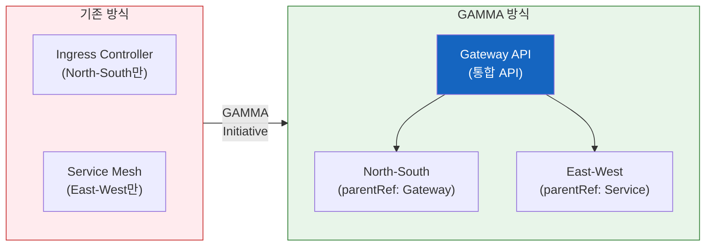

import {
  GammaInfographic,
  GammaSupportTable,
} from '@site/src/components/GatewayApiTables';

## GAMMA란?

**GAMMA (Gateway API for Mesh Management and Administration)**는 [Gateway API](../gateway-api-adoption-guide/index.md)를 서비스 메시 영역으로 확장한 이니셔티브입니다.

- **GA 달성**: Gateway API v1.1.0 (2024년 5월, 서비스 메시 지원 GA)
- **통합 범위**: North-South (인그레스) + East-West (서비스 메시) 트래픽
- **핵심 개념**: 기존에는 인그레스 컨트롤러와 서비스 메시가 완전히 별개의 설정 체계였으나, GAMMA는 이를 단일 API로 통합
- **역할 기반 구성**: Gateway API의 역할 분리 원칙을 메시 트래픽에도 동일하게 적용

GAMMA의 등장으로 클러스터 운영자는 더 이상 두 가지 서로 다른 API를 학습하고 관리할 필요가 없습니다. 인그레스와 메시 모두 동일한 Gateway API 리소스로 관리할 수 있게 되었습니다.



## 핵심 목표 & 메시 구성 패턴

<GammaInfographic />

## GAMMA 지원 현황

다음은 주요 서비스 메시 구현체의 GAMMA 지원 현황입니다. 구현체별 아키텍처·기능·운영 비교는 [서비스 메시 비교 가이드](./index.md)를 참조합니다.

<GammaSupportTable />

:::tip AWS 환경에서의 GAMMA
AWS 환경에서는 **AWS Gateway API Controller**가 VPC Lattice를 Gateway API로 노출합니다(ACK는 AWS 리소스를 관리하는 별도 컨트롤러이며 Gateway API 컨트롤러가 아닙니다). 다만 이는 Gateway를 parent로 하는 HTTPRoute 통합이며, Service를 parent로 하는 GAMMA 메시 프로파일 적합성(conformance)과는 다릅니다. VPC Lattice를 GAMMA GA로 분류하려면 고정 버전의 메시 적합성 리포트를 먼저 확인해야 합니다.

VPC Lattice는 TLS와 IAM/SigV4 기반 요청 인증, CloudWatch/X-Ray 관측성, AWS FIS 장애 주입을 제공합니다. IAM/SigV4는 요청 인증이며 인증서 기반 상호 TLS(mTLS)와는 다릅니다.
:::

## GAMMA의 장점

### 1. 학습 곡선 단축

팀은 하나의 API(Gateway API)만 학습하면 인그레스와 메시 모두 관리할 수 있습니다.

### 2. 설정 일관성

동일한 YAML 구조와 패턴으로 North-South/East-West 트래픽을 모두 관리합니다.

```yaml
# 인그레스 (North-South)
spec:
  parentRefs:
    - kind: Gateway
      name: external-gateway

---
# 메시 (East-West)
spec:
  parentRefs:
    - group: ""          # 코어 Service API 그룹 (생략 시 gateway.networking.k8s.io로 기본 설정됨)
      kind: Service
      name: backend-service
```

### 3. 역할 기반 분리

인프라 팀은 Gateway를, 개발 팀은 HTTPRoute를 관리하는 명확한 책임 분리가 메시 트래픽에도 동일하게 적용됩니다.

### 4. 벤더 중립성

여러 메시 구현체를 동일한 API로 관리할 수 있어 벤더 종속을 방지합니다.

## 참고 자료

### 공식 문서
- [GAMMA Initiative](https://gateway-api.sigs.k8s.io/docs/mesh/gamma/) — Gateway API 공식 GAMMA 사양·목표·구성 패턴
- [Gateway API for Service Mesh](https://gateway-api.sigs.k8s.io/docs/mesh/mesh-overview/) — 메시 트래픽에 Gateway API를 적용하는 공식 가이드

### 관련 문서 (내부)
- [서비스 메시 비교 가이드](./index.md) — Istio·Cilium·Linkerd·VPC Lattice 아키텍처·기능·운영 비교
- [Gateway API 도입 가이드](../gateway-api-adoption-guide/index.md) — North-South 트래픽 관리, 구현체 비교, 마이그레이션 전략
- [East-West 트래픽 최적화](../east-west-traffic-best-practice.md) — 도입 후 지연·크로스-AZ 비용 최적화 전략
