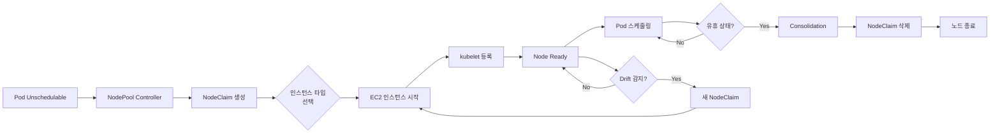
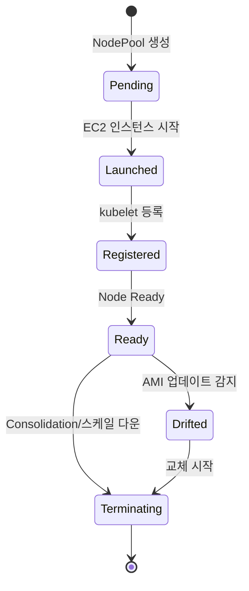

EKS Auto Mode는 노드 프로비저닝, 네트워킹, 스토리지를 AWS가 완전 관리하는 운영 모델입니다. 편리하지만, 관리 영역이 줄어든 만큼 디버깅 접근 방식도 달라집니다.

## Auto Mode vs Standard Mode 차이점

**표 1. Standard Mode와 Auto Mode의 항목별 차이와 디버깅 영향**

| 항목 | Standard Mode | Auto Mode | 디버깅 영향 |
|------|---------------|-----------|------------|
| **노드 관리** | 사용자 (MNG/Karpenter) | AWS 관리 (NodePool) | NodePool CRD로 상태 확인, EC2 API 제한적 |
| **VPC CNI** | 수동 설정/업그레이드 | 자동 관리 | Custom CNI 설정 불가, ENI 디버깅 간소화 |
| **GPU Driver** | GPU Operator 설치 | AWS 관리 (NVIDIA/Neuron) | NodePool로 GPU 인스턴스 허용, GPU Operator 중복 설치 주의 |
| **스토리지** | EBS CSI 별도 설치 | EBS CSI 컨트롤러 관리, StorageClass 직접 생성 | `ebs.csi.eks.amazonaws.com` 참조, EFS는 별도 설치 |
| **CoreDNS** | Add-on 관리 | 자동 관리 | Custom CoreDNS 설정 제한 |
| **노드 SSH** | 가능 (MNG/Karpenter) | SSH·SSM 직접 접근 불가 | `kubectl debug node`/NodeDiagnostic 사용 |
| **Auto Scaling** | Karpenter/CA | NodePool auto-scaling | Spot 중단 처리 자동화 |
| **네트워크 정책** | Calico/Cilium 설치 가능 | VPC CNI Network Policy | 기능 제약 존재 |

## NodePool 아키텍처

Auto Mode의 노드 라이프사이클:

**그림 1. Auto Mode 노드 라이프사이클 흐름**



## NodePool 디버깅

### NodePool 상태 확인

```bash
# NodePool 목록
kubectl get nodepools

# 출력 예시
# NAME              READY   AGE
# default           True    7d
# gpu-nodepool      True    2d

# NodePool 상세 정보
kubectl describe nodepool default

# 주요 확인 항목:
# - Conditions: Ready, CapacityAvailable
# - Instance Types: 허용된 인스턴스 타입
# - Constraints: 레이블, 테인트, 가용 영역
```

### NodeClaim 라이프사이클

```bash
# NodeClaim 목록 (실제 노드 요청)
kubectl get nodeclaims

# 출력 예시
# NAME                      TYPE           CAPACITY    READY   AGE
# default-abc123            t3.xlarge      4           True    2d
# default-def456            t3.xlarge      4           True    1d
# gpu-nodepool-xyz789       g5.2xlarge     8           True    6h

# NodeClaim 상세 정보
kubectl describe nodeclaim <nodeclaim-name>

# 주요 필드:
# - status.conditions: Launched, Registered, Initialized, Ready
#   (및 Drifted 등 disruption 관련 condition)
# - status.nodeName: 대응되는 Kubernetes 노드 이름
# - status.providerID: EC2 인스턴스를 가리키는 provider ID
```

### NodeClaim 상태 전이

아래 다이어그램은 NodeClaim이 정상적으로 초기화될 때의 프로비저닝과 종료 흐름을 개념적으로 보여줍니다. 단일 `status` 필드의 enum이 아니라 `status.conditions`(Launched, Registered, Initialized, Ready)와 Drifted 같은 disruption condition의 조합으로 표현됩니다.

**그림 2. NodeClaim 상태 전이 다이어그램(개념도)**



### 인스턴스 타입 선택 실패

**증상:** Pod가 Pending 상태로 멈춤, NodeClaim이 생성되지 않음

```bash
# Pod 이벤트 확인
kubectl describe pod <pod-name>

# 에러 예시:
# Warning  FailedScheduling  No nodes available to schedule pod

# NodePool 제약 확인
kubectl get nodepool <nodepool-name> -o yaml | grep -A 10 requirements

# 일반적인 원인:
# 1. Pod 리소스 요청이 NodePool의 모든 인스턴스 타입을 초과
# 2. 가용 영역 제약 (특정 AZ에만 용량 부족)
# 3. Spot 용량 부족 (capacityType: spot)
```

**해결 방법:**

내장 `general-purpose`/`system` NodePool은 수정할 수 없으므로, 더 큰 인스턴스 타입이 필요하면 커스텀 NodePool을 추가합니다. Auto Mode NodePool은 `karpenter.sh/v1` 그룹을 사용하며, `spec.template.spec.nodeClassRef`로 NodeClass(`eks.amazonaws.com` 그룹)를 참조합니다.

```yaml
# 커스텀 NodePool: 더 큰 인스턴스 타입 허용
apiVersion: karpenter.sh/v1
kind: NodePool
metadata:
  name: custom
spec:
  template:
    spec:
      nodeClassRef:
        group: eks.amazonaws.com
        kind: NodeClass
        name: default  # 기존의 유효한 NodeClass 참조
      requirements:
        - key: node.kubernetes.io/instance-type
          operator: In
          values:
            - t3.large
            - t3.xlarge
            - t3.2xlarge  # ← 추가
        - key: karpenter.sh/capacity-type
          operator: In
          values:
            - spot
            - on-demand  # ← Spot 부족 시 On-Demand 폴백
```

## 스토리지 디버깅

### Auto Mode 스토리지 제약

Auto Mode는 EBS CSI 컨트롤러를 관리하지만 StorageClass를 자동 생성하지는 않으므로, `ebs.csi.eks.amazonaws.com` 프로비저너를 참조하는 StorageClass를 직접 만들어야 합니다. 볼륨 타입(`type`), 암호화(`encrypted`, `kmsKeyId`), IOPS/처리량은 StorageClass의 `parameters`로 지정합니다. 커스텀 KMS 키를 쓰려면 `parameters.kmsKeyId`에 키 ARN을 넣고 EKS 클러스터 역할에 해당 KMS 키 사용 권한을 부여해야 합니다.

**표 2. 스토리지 타입별 Standard Mode와 Auto Mode 지원 차이**

| 스토리지 타입 | Standard Mode | Auto Mode | 제약 사항 |
|--------------|---------------|-----------|----------|
| **gp3** | EBS CSI 설치 필요 | `ebs.csi.eks.amazonaws.com` StorageClass 직접 생성 | `type: gp3`가 기본값 |
| **gp2** | 지원 | `type: gp2`로 지원 | gp3가 기본값, 필요 시 gp2 지정 |
| **io2** | 지원 | `type: io2`로 지원 | io2 Block Express(`sbp1`/`sbg1`)는 별도 타입 |
| **EFS** | EFS CSI 설치 | EFS CSI 별도 설치 필요 | 자동 지원 안 됨 |
| **FSx for Lustre** | FSx CSI 설치 | FSx CSI 별도 설치 필요 | 자동 지원 안 됨 |
| **EBS 암호화** | KMS 키 지정 가능 | `encrypted: "true"`로 활성화 | 미지정 시 암호화 안 됨, 커스텀 키는 `kmsKeyId` + IAM 권한 |

### PVC Pending 디버깅

```bash
# PVC 상태 확인
kubectl get pvc

# 출력 예시 (문제 발생)
# NAME      STATUS    VOLUME   CAPACITY   ACCESS MODES   STORAGECLASS   AGE
# my-pvc    Pending                                      gp3            5m

# PVC 이벤트 확인
kubectl describe pvc my-pvc

# 일반적인 에러:
# 1. "waiting for a volume to be created" → 스토리지 드라이버 확인
# 2. "failed to provision volume" → IAM 권한 확인
# 3. "io2-block-express is not supported" → gp3로 변경
```

### StorageClass 확인

Auto Mode는 StorageClass를 자동으로 생성하지 않습니다. EBS 스토리지를 사용하려면 `ebs.csi.eks.amazonaws.com` 프로비저너를 참조하는 StorageClass를 직접 만들어야 합니다. `allowedTopologies`로 `eks.amazonaws.com/compute-type: auto` 노드에 바인딩하도록 지정하면, Auto Mode가 아닌 노드에는 볼륨이 프로비저닝되지 않습니다.

```bash
# 현재 StorageClass 목록 확인
kubectl get storageclass
```

```yaml
# Auto Mode EBS StorageClass 생성
apiVersion: storage.k8s.io/v1
kind: StorageClass
metadata:
  name: auto-ebs-sc
  annotations:
    storageclass.kubernetes.io/is-default-class: "true"
allowedTopologies:
  - matchLabelExpressions:
      - key: eks.amazonaws.com/compute-type
        values:
          - auto
provisioner: ebs.csi.eks.amazonaws.com
volumeBindingMode: WaitForFirstConsumer
parameters:
  type: gp3
  encrypted: "true"  # 선택 사항, 기본 aws/ebs 키 사용
```

## 네트워킹 디버깅

### VPC CNI 자동 관리

Auto Mode는 Pod 네트워킹을 관리 컴포넌트로 제공하므로, VPC CNI를 애드온으로 설치하거나 `aws-node` DaemonSet·ConfigMap을 직접 수정하는 방식은 사용하지 않습니다. 네트워킹 동작은 NodeClass와 클러스터 네트워킹 설정으로 조정합니다.

```bash
# 노드 네트워킹 설정은 NodeClass에서 확인
kubectl get nodeclass
kubectl describe nodeclass <nodeclass-name>

# 노드/네트워킹 관련 이벤트 확인
kubectl get events --field-selector involvedObject.kind=Node
```

**제약 사항:**

- 지원: Pod IP 자동 할당(ENI), Pod 네트워크 정책, IPv4/IPv6, 보조 CIDR 블록
- 직접 설정 불가: `aws-node` ConfigMap을 통한 VPC CNI 수동 튜닝, Prefix Delegation 수동 비활성화, ENI 수동 관리

Pod가 사용할 서브넷의 보안 그룹 설정과, 노드가 할당할 수 있는 IP(ENI) 용량은 서로 다른 문제입니다. 전자는 네트워킹 구성, 후자는 인스턴스 타입이 결정합니다.

### Pod 네트워크 문제

```bash
# Pod IP 할당 확인
kubectl get pods -o wide

# ENI 할당 상태 확인 (노드 레벨)
kubectl describe node <node-name> | grep -A 5 "Allocatable"

# 출력 예시:
# Allocatable:
#   vpc.amazonaws.com/pod-eni: 38  # ← ENI 기반 IP 수
```

### CoreDNS 디버깅

Auto Mode는 클러스터 DNS를 관리 컴포넌트로 제공합니다. 따라서 CoreDNS Deployment를 직접 수정하는 대신, Pod 상태와 로그로 해석 실패 원인을 확인합니다. CoreDNS Pod 로그는 아래처럼 레이블로 수집하며, 노드 수준 로그가 필요하면 Auto Mode 노드는 NodeDiagnostic으로 수집합니다. Auto Mode 노드와 비(非) Auto 노드(MNG 등)가 섞인 혼합 클러스터에서는, 비 Auto 노드에서만 동작을 바꾸려면 CoreDNS Deployment에만 적용되는 설정 분기를 두어야 합니다.

```bash
# CoreDNS Pod 상태
kubectl get pods -n kube-system -l k8s-app=kube-dns

# CoreDNS 로그 확인
kubectl logs -n kube-system -l k8s-app=kube-dns --tail=100

# DNS 해석 테스트
kubectl run -it --rm debug --image=busybox -- nslookup kubernetes.default

# 일반적인 문제:
# 1. CoreDNS Pod가 Running이 아님 → 노드 리소스 부족
# 2. DNS 쿼리 타임아웃 → Security Group에서 UDP 53 허용 확인
```

## GPU 워크로드와 Auto Mode

Auto Mode는 NVIDIA·Neuron GPU 드라이버와 디바이스 플러그인을 관리 컴포넌트로 제공합니다. 따라서 GPU 워크로드는 먼저 Auto Mode에서 GPU 인스턴스를 허용하는 커스텀 NodePool로 실행하는 것을 기본 방식으로 삼습니다. 이때 GPU Operator를 별도로 설치하면 Auto Mode가 이미 제공하는 드라이버·디바이스 플러그인과 중복되어 충돌할 수 있으므로 설치하지 않습니다.

```yaml
# GPU 인스턴스를 허용하는 커스텀 NodePool
apiVersion: karpenter.sh/v1
kind: NodePool
metadata:
  name: gpu
spec:
  template:
    spec:
      nodeClassRef:
        group: eks.amazonaws.com
        kind: NodeClass
        name: default
      requirements:
        - key: eks.amazonaws.com/instance-family
          operator: In
          values:
            - g5
            - g6
        - key: karpenter.sh/capacity-type
          operator: In
          values:
            - on-demand
  limits:
    nvidia.com/gpu: "8"
```

GPU Pod는 `limits.nvidia.com/gpu`로 GPU 수를 요청하면 Auto Mode가 적합한 인스턴스를 프로비저닝합니다. 별도의 Taint/Toleration이나 디바이스 플러그인 설치는 필요하지 않습니다.

### MNG 하이브리드가 필요한 경우 {#하이브리드-구성-권장}

Auto Mode의 관리형 GPU 스택으로 충족되지 않는 구체적인 요구가 있을 때만 MNG(Managed Node Group)를 추가하는 하이브리드를 고려합니다. 예를 들어 특정 GPU Operator 버전·DCGM 설정이 필요하거나, Auto Mode가 지원하지 않는 가속기 인스턴스를 써야 하는 경우입니다. 하이브리드에서는 어떤 컴포넌트를 어느 노드 그룹이 제공하는지 명확히 구분해, 같은 컴포넌트를 두 곳에서 중복 설치하지 않도록 합니다.

**그림 3. Auto Mode와 MNG 하이브리드 구성과 스케줄링 경로**

```mermaid
flowchart TB
    subgraph "EKS Cluster (Hybrid)"
        subgraph "Auto Mode NodePool"
            A[일반 워크로드]
            B[웹 서버]
            C[배치 작업]
        end

        subgraph "Managed Node Group (GPU)"
            D[GPU Operator<br/>MNG 노드 전용]
            E[vLLM Pod]
            F[학습 Job]
        end
    end

    G[Scheduler] --> A
    G --> B
    G --> C
    G -.Taint: nvidia.com/gpu.-> E
    G -.Taint: nvidia.com/gpu.-> F
```

### GPU MNG 설정

이 설정은 위의 MNG 하이브리드가 필요한 경우에만 적용합니다. MNG의 가속 AMI와 GPU Operator 버전 조합을 고정하고, 각 노드 클래스가 이미 제공하는 컴포넌트가 무엇인지 확인한 뒤, 그 컴포넌트만 비활성화합니다. GPU Operator의 피연산자(operand)는 `nodeSelector`로 MNG 노드에만 적용되도록 범위를 한정하고, 설정 후 MNG 노드가 여전히 `nvidia.com/gpu` 리소스를 광고하는지 확인합니다.

```yaml
# ClusterPolicy: MNG 노드에만 적용, AMI가 제공하는 컴포넌트만 비활성화
apiVersion: nvidia.com/v1
kind: ClusterPolicy
metadata:
  name: gpu-cluster-policy
spec:
  operator:
    defaultRuntime: containerd
  # 피연산자를 GPU MNG 노드로 한정 (Auto Mode 노드에 설치되지 않도록)
  daemonsets:
    tolerations:
      - key: nvidia.com/gpu
        operator: Exists
        effect: NoSchedule
  driver:
    enabled: true   # MNG AMI가 드라이버를 포함하면 false로 설정
  devicePlugin:
    enabled: true   # MNG AMI가 디바이스 플러그인을 제공하면 false로 설정
  dcgm:
    enabled: true
  gfd:
    enabled: true
  nodeStatusExporter:
    enabled: true
```

```yaml
# MNG 노드에 Taint 추가 (GPU 워크로드 전용)
apiVersion: v1
kind: Node
metadata:
  name: gpu-node-1
spec:
  taints:
    - key: nvidia.com/gpu
      value: "true"
      effect: NoSchedule
```

```yaml
# GPU Pod: GPU 수를 단일 노드의 가용 GPU에 맞추고, nodeSelector로 배치 지정
# 아래 nvidia.com/gpu: 4는 g5.12xlarge처럼 GPU 4개를 가진 단일 노드를 전제로 합니다.
# 프레임워크 병렬화(TP/world-size)는 스케줄링과 별개로 애플리케이션에서 설정합니다.
apiVersion: v1
kind: Pod
metadata:
  name: vllm-server
spec:
  nodeSelector:
    workload: gpu  # GPU MNG 노드 레이블
  tolerations:
    - key: nvidia.com/gpu
      operator: Equal
      value: "true"
      effect: NoSchedule
  containers:
    - name: vllm
      image: vllm/vllm-openai:latest
      resources:
        limits:
          nvidia.com/gpu: 4  # 단일 노드의 GPU 수와 일치
```

자세한 GPU 디버깅은 [GPU/AI 워크로드 디버깅](./gpu-ai-workload.md)을 참조하세요.

## Auto Mode 제약 요약

### 지원되는 기능

- NodePool 기반 오토스케일링
- Spot/On-Demand 자동 폴백
- gp3 StorageClass 직접 생성(EBS CSI 컨트롤러 관리)
- VPC CNI 자동 관리 (Pod 네트워크 정책 포함)
- Karpenter와 유사한 Consolidation
- Drift 감지 및 자동 교체
- NVIDIA/Neuron GPU 드라이버·디바이스 플러그인 관리, DCGM/GFD 메트릭

### 제약 사항

- Custom VPC CNI 설정 불가
- GPU Operator 중복 설치 시 충돌 (Auto Mode가 드라이버·디바이스 플러그인 제공)
- io2 Block Express(`sbp1`/`sbg1`)는 별도 볼륨 타입
- EFS/FSx CSI는 별도 설치 필요
- Custom CoreDNS 설정 제한
- 노드 SSH·SSM 직접 접근 불가 (NodeDiagnostic/EC2 콘솔 출력/`kubectl debug node` 사용)
- EC2 인스턴스 직접 관리 불가

## 하이브리드 구성 (Auto Mode + MNG)

### 언제 하이브리드가 필요한가?

**표 3. 시나리오별 Auto Mode 단독 적합성과 하이브리드 필요 여부**

| 시나리오 | Auto Mode 단독 | 하이브리드 (Auto Mode + MNG) |
|---------|---------------|----------------------------|
| 일반 웹/API 서버 | 충분 | 불필요 |
| GPU 추론/학습 | NodePool로 지원 | 특정 Operator 버전/미지원 가속기에 한해 |
| 고성능 스토리지 (io2 BE) | 미지원 | MNG에서 가능 |
| Custom VPC CNI | 미지원 | MNG에서 가능 |
| 특정 AMI 사용 | 제한적 | MNG Launch Template |

### 하이브리드 구성 예시

아래는 전체 명령이 아니라 순서를 보여주는 개요입니다. 실제 적용에는 각 단계의 사전 조건(클러스터 역할·서브넷·보안 그룹), 리전/프로파일 플래그, 생성 완료 대기(`aws eks wait`)가 추가로 필요합니다. GPU 드라이버·디바이스 플러그인을 어느 쪽이 제공하는지(Auto Mode 관리 스택 또는 MNG의 가속 AMI/GPU Operator)를 먼저 정하고, 중복 설치를 피합니다.

```bash
# 1. Auto Mode 클러스터 생성 (개요)
aws eks create-cluster \
  --name hybrid-cluster \
  --compute-config enabled=true
# → aws eks wait cluster-active --name hybrid-cluster

# 2. GPU MNG 추가 (개요)
# AMI 타입은 지원되는 가속 AMI를 선택합니다 (예: AL2023_x86_64_NVIDIA).
# EC2 Taint의 effect는 대문자 enum(NO_SCHEDULE)을 사용합니다.
aws eks create-nodegroup \
  --cluster-name hybrid-cluster \
  --nodegroup-name gpu-nodes \
  --node-role <node-role-arn> \
  --subnets <subnet-ids> \
  --ami-type AL2023_x86_64_NVIDIA \
  --instance-types g5.2xlarge \
  --scaling-config minSize=0,maxSize=10,desiredSize=2 \
  --labels workload=gpu \
  --taints 'key=nvidia.com/gpu,value=true,effect=NO_SCHEDULE'
# → aws eks wait nodegroup-active --cluster-name hybrid-cluster --nodegroup-name gpu-nodes

# 3. GPU Operator 설치 (MNG 노드 대상, AMI가 제공하지 않는 컴포넌트만)
# driver/devicePlugin은 선택한 AMI가 이미 제공하면 비활성화합니다.
helm install gpu-operator nvidia/gpu-operator \
  --namespace gpu-operator --create-namespace \
  --set operator.defaultRuntime=containerd
```

## 진단 명령어 모음

```bash
# === NodePool ===
# NodePool 상태
kubectl get nodepools -o wide
kubectl describe nodepool <nodepool-name>

# NodeClaim 상태
kubectl get nodeclaims -o wide
kubectl describe nodeclaim <nodeclaim-name>

# NodeClaim과 Node 매핑
kubectl get nodeclaims -o json | jq -r '.items[] | "\(.metadata.name) → \(.status.nodeName)"'

# === 스토리지 ===
# PVC 상태
kubectl get pvc -A
kubectl describe pvc <pvc-name>

# StorageClass 확인
kubectl get storageclass

# EBS 볼륨 확인 (AWS CLI)
# Auto Mode 볼륨은 eks:eks-cluster-name 태그가 붙습니다.
# 레거시 kubernetes.io/cluster/<name> 필터는 결과가 비어도 "볼륨 없음"의 근거가 아닙니다(불확실).
# 관리형 리소스가 콘솔/API에서 숨겨져 있으면 관리형 리소스 표시 설정을 켜야 보입니다.
aws ec2 describe-volumes --filters "Name=tag:eks:eks-cluster-name,Values=<cluster-name>"

# === 네트워킹 ===
# 노드 네트워킹 설정 (NodeClass)
kubectl get nodeclass
kubectl describe nodeclass <nodeclass-name>

# Pod IP 할당
kubectl get pods -A -o wide

# CoreDNS 상태
kubectl get pods -n kube-system -l k8s-app=kube-dns
kubectl logs -n kube-system -l k8s-app=kube-dns --tail=50

# DNS 테스트
kubectl run -it --rm debug --image=busybox -- nslookup kubernetes.default

# === GPU (하이브리드 구성) ===
# GPU Operator 상태 (MNG 노드에서만)
kubectl get clusterpolicy -A
kubectl get pods -n gpu-operator

# GPU 리소스 확인
kubectl get nodes -o json | jq -r '.items[] | select(.status.allocatable."nvidia.com/gpu" != null) | "\(.metadata.name): \(.status.allocatable."nvidia.com/gpu") GPUs"'

# === 노드 디버깅 ===
# Auto Mode 노드는 관리형 인스턴스로, SSH·SSM 직접 접속이 허용되지 않습니다.
# 노드 로그는 NodeDiagnostic 리소스(노드 모니터링 에이전트)로 수집합니다.
# 부팅/커널 수준 문제는 EC2 콘솔 출력으로 확인합니다.
aws ec2 get-console-output --instance-id <instance-id> --latest --output text

# 권한 있는 프로파일로 노드에 디버그 Pod 실행 (호스트 네임스페이스 접근)
# sysadmin 프로파일 사용에는 적절한 RBAC가 필요하며, 디버그 Pod는 사용 후 정리합니다.
kubectl debug node/<node-name> -it --profile=sysadmin --image=public.ecr.aws/amazonlinux/amazonlinux:2023
```

## 문제별 체크리스트

### Pod가 Pending 상태 (NodeClaim 생성 안 됨)

- [ ] NodePool의 인스턴스 타입이 Pod 리소스 요청을 만족하는가?
- [ ] NodePool의 가용 영역 제약이 있는가?
- [ ] Spot 용량 부족? (On-Demand 폴백 추가)
- [ ] NodePool 레이블/테인트가 Pod과 매칭되는가?

### PVC가 Pending 상태

- [ ] StorageClass가 gp3인가? (io2 Block Express는 미지원)
- [ ] PVC 용량이 허용 범위 내인가?
- [ ] IAM 권한이 올바른가? (EBS 생성 권한)
- [ ] 가용 영역에 EBS 용량이 충분한가?

### GPU 워크로드 스케줄링 실패

- [ ] GPU 인스턴스를 허용하는 NodePool이 있는가? (Auto Mode는 GPU를 기본 지원)
- [ ] Pod의 `nvidia.com/gpu` 요청이 단일 가용 노드의 GPU 수와 일치하는가?
- [ ] MNG 하이브리드라면 노드 Taint와 Pod Toleration이 매칭되는가?
- [ ] MNG 하이브리드라면 노드가 `nvidia.com/gpu` 리소스를 광고하는가?

### VPC CNI 설정 불가

- [ ] Auto Mode는 VPC CNI를 자동 관리합니다 (`aws-node` ConfigMap 수동 튜닝 불가)
- [ ] 특정 CNI 설정이 필요하면 MNG 추가 필요
- [ ] Pod 네트워크 정책은 지원됨

## 참고 자료

- [GPU/AI 워크로드 디버깅](./gpu-ai-workload.md) - GPU Operator와 Auto Mode 통합
- [Karpenter 디버깅](./karpenter.md) - NodePool과 유사한 개념
- [노드 디버깅](./node.md) - 노드 수준 진단
- [AWS EKS Auto Mode 공식 문서](https://docs.aws.amazon.com/eks/latest/userguide/automode.html)
