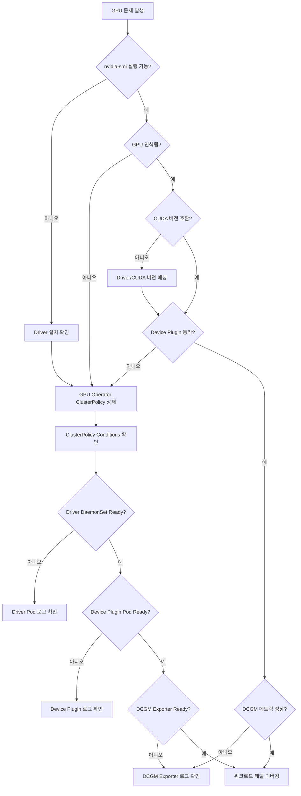

EKS에서 GPU 기반 AI 워크로드를 운영할 때 발생하는 일반적인 문제와 해결 방법을 다룹니다.

## GPU 노드 진단 워크플로우

GPU 문제 발생 시 다음 순서로 진단합니다:

**그림 1. GPU 문제 진단 순서 흐름도**



## GPU 노드 기본 진단

### nvidia-smi 확인

```bash
# GPU 노드에 디버그 Pod를 띄워 확인합니다. `kubectl debug node/...`가 만드는 Pod는
# 호스트 네임스페이스(PID/네트워크)와 호스트 파일시스템(`/host`)에 접근하지만, 컨테이너가
# GPU 디바이스를 보려면 노드에 NVIDIA 런타임/드라이버가 설정되어 있어야 합니다.
# (관리자 권한이 필요하므로 사전에 승인된 작업으로만 실행합니다.)
kubectl debug node/<gpu-node-name> -it --image=nvidia/cuda:12.2.0-base-ubuntu22.04

# 컨테이너 내부에서: 먼저 GPU 디바이스 접근을 확인한 뒤 nvidia-smi 실행
ls -l /host/dev/nvidia*        # 호스트의 GPU 디바이스 노드 확인
nvidia-smi                     # 접근 가능하면 아래와 같은 출력

# 출력 예시 (정상)
+-----------------------------------------------------------------------------+
| NVIDIA-SMI 535.104.05   Driver Version: 535.104.05   CUDA Version: 12.2   |
|-------------------------------+----------------------+----------------------+
| GPU  Name        Persistence-M| Bus-Id        Disp.A | Volatile Uncorr. ECC |
| Fan  Temp  Perf  Pwr:Usage/Cap|         Memory-Usage | GPU-Util  Compute M. |
|===============================+======================+======================|
|   0  NVIDIA H100 80G...  On   | 00000000:10:1C.0 Off |                    0 |
| N/A   32C    P0    68W / 700W |      0MiB / 81559MiB |      0%      Default |
+-------------------------------+----------------------+----------------------+

# nvidia-smi가 실행되지 않거나 디바이스가 없다고 나오면, 이 명령 하나만으로
# 드라이버 장애로 단정하지 말고 노드의 드라이버·런타임 설정을 함께 점검합니다.
# 작업 후 디버그 Pod는 반드시 정리합니다.
kubectl delete pod -n default node-debugger-<gpu-node-name>-<suffix>
```

### GPU 리소스 확인

```bash
# 노드에 할당 가능한 GPU 수 확인
kubectl describe node <gpu-node-name> | grep nvidia.com/gpu
# 출력 예시
#  nvidia.com/gpu:     8
#  nvidia.com/gpu:     8

# Pod에 할당된 GPU 확인
kubectl get pods -A -o json | jq '.items[] | select(.spec.containers[].resources.limits."nvidia.com/gpu" != null) | {name: .metadata.name, namespace: .metadata.namespace, gpu: .spec.containers[].resources.limits."nvidia.com/gpu"}'
```

## CUDA/NCCL 에러 패턴

GPU 워크로드에서 발생하는 일반적인 CUDA XID 에러의 의미와 1차 분류입니다. XID의 정확한 의미와 심각도는 드라이버·펌웨어 버전에 따라 달라질 수 있으므로, 실제 조치 전에 사용 중인 드라이버 버전과 [NVIDIA XID Errors 문서](https://docs.nvidia.com/deploy/xid-errors/index.html)로 해당 XID의 의미를 확인하십시오. 아래 "조치 분류"는 바로 실행할 명령이 아니라 뒤의 단계적 복구 절차 중 어디에 해당하는지를 가리킵니다.

**표 1. 주요 CUDA XID 에러 코드의 의미와 1차 조치 분류**

| XID | 의미 | 원인(일반) | 조치 분류 |
|-----|------|------|------|
| 13 | Graphics Engine Exception | 커널 실행 오류 | 애플리케이션 레벨(드라이버/CUDA 버전 확인 후 재시도) |
| 31 | GPU memory page fault | 잘못된 메모리 접근 | 애플리케이션 레벨(메모리 접근 코드·버전 점검) |
| 43 | GPU stopped responding | GPU 응답 없음 | 노드 레벨(승인된 drain 후 reset/재부팅) |
| 45 | Preemptive cleanup | 컨텍스트 전환 오류 | 애플리케이션 레벨 |
| 48 | Double bit ECC error | 하드웨어 메모리 결함 | 하드웨어 에스컬레이션(영구 결함 가능) |
| 62 | Internal micro-controller error | 펌웨어 오류 | 노드 레벨(드라이버/펌웨어 점검 후 reset) |
| 74 | NVLink error | GPU 간 통신 실패 | 노드 레벨 → 지속 시 하드웨어 에스컬레이션 |
| 79 | GPU has fallen off the bus | PCIe 통신 단절 | 하드웨어 에스컬레이션(하드웨어 결함 가능) |
| 94 | Contained/Uncontained error | 메모리 무결성 오류 | 노드 레벨 → 반복 시 하드웨어 에스컬레이션 |

**단계적 복구 절차 (조치 분류 → 실제 조치):**

1. **증거 보존**: 조치 전에 `dmesg`/`nvidia-smi -q`/XID 로그와 발생 시각·노드·GPU 식별자를 수집해 둡니다. 노드를 교체하면 증거가 사라집니다.
2. **애플리케이션 레벨**: 워크로드(또는 Pod)만 재시작하고 드라이버/CUDA 버전 일치를 확인합니다. 노드 전체를 건드리지 않습니다.
3. **노드 레벨(승인 필요)**: 재발하면 노드를 cordon·drain한 뒤 승인된 절차로 GPU reset(`nvidia-smi --gpu-reset`) 또는 노드 재부팅을 수행합니다. 운영 정책상 승인이 필요한 작업입니다.
4. **하드웨어 에스컬레이션**: ECC/PCIe/NVLink 영구 결함이 의심되면 노드를 임의로 교체하기 전에 소유 모델을 따릅니다. 관리형 노드(EKS 관리 AMI/인스턴스)는 AWS가 하드웨어·AMI를 소유하므로, 셀프 관리 교체가 아니라 인스턴스 상태 점검/교체와 지원 경로를 통해 처리합니다.

클라우드/AMI 소유 모델: 노드가 관리형(EKS 최적화 AMI, Auto Mode 등)이면 드라이버·AMI·하드웨어 교체의 책임 주체가 사용자와 다를 수 있습니다. "노드 교체"를 하기 전에 누가 그 구성 요소를 소유하는지 확인하고 해당 경로로 처리합니다.

### XID 에러 확인 방법

```bash
# 커널 로그에서 XID 에러 검색
kubectl debug node/<gpu-node-name> -it --image=ubuntu
# 컨테이너 내부에서
dmesg | grep -i "xid"

# 출력 예시 (문제 발생 시)
# [  123.456789] NVRM: Xid (PCI:0000:10:1c): 79, pid=12345, GPU has fallen off the bus.
```

### NCCL 에러 디버깅

멀티 GPU 또는 멀티 노드 분산 학습 시 NCCL 타임아웃 발생:

```bash
# NCCL 디버그 로그 활성화
env:
  - name: NCCL_DEBUG
    value: "INFO"
  - name: NCCL_DEBUG_SUBSYS
    value: "ALL"
  - name: NCCL_SOCKET_IFNAME
    value: "eth0"  # VPC CNI 기본 인터페이스
  - name: NCCL_IB_DISABLE
    value: "1"     # InfiniBand 비활성화 (EKS에서 미사용)
```

**일반적인 NCCL 실패 원인:**

1. **네트워크 연결 문제**
   - NCCL 워커 간에는 TCP 부트스트랩(rendezvous)과 데이터 전송이 모두 가능해야 합니다. 노드/Pod가 같은 Security Group에 속한다면, 그 SG에 **자기 자신(self-reference)을 소스로 하는 ingress/egress**를 두되, 포트 범위는 전부 열지 말고 NCCL과 EFA가 실제로 쓰는 포트로 한정합니다.
   - 통신 확인은 임의 포트가 아니라 **실제로 리스닝 중인 포트와 알려진 경로**로 합니다. 예: 마스터가 `MASTER_PORT`에서 리스닝 중일 때 `kubectl exec -it <pod> -- nc -zv <master-pod-ip> <MASTER_PORT>`로 부트스트랩 경로를 확인합니다(리스너가 없는 임의 포트 `12345`로는 의미 있는 결과를 얻지 못합니다).

2. **EFA 설정 오류** (p4d, p5 인스턴스)
   - EFA Device Plugin 설치 및 `vpc.amazonaws.com/efa` 리소스 요청을 확인합니다.
   - 리소스 요청만으로 EFA가 실제로 쓰이는지는 알 수 없으므로, EFA/NCCL 테스트(예: `fi_info -p efa`로 provider 확인, NCCL 로그의 `NET/OFI ... EFA` 선택 메시지, nccl-tests)로 EFA 경로가 선택되는지 검증합니다.

3. **GPU 수와 병렬화 설정 불일치** (아래는 단일 노드에서 Tensor Parallel만 쓰거나, GPU당 프로세스 1개로 DDP를 돌리는 구성을 가정)
   - vLLM: `--tensor-parallel-size`는 **해당 Pod에 할당된 로컬 GPU 수**와 일치해야 합니다. 멀티 노드에서 Pipeline/Data Parallel을 함께 쓰면 TP는 노드 내 GPU 수, 전체 병렬도는 TP×PP×DP로 구분해 계산합니다.
   - PyTorch DDP: `WORLD_SIZE`는 **전체(global) 워커 수**이고, 로컬 랭크 수는 노드당 GPU 수입니다. 둘을 혼동하면 rendezvous가 실패합니다.
   - 모델 제약: Tensor Parallel 크기는 모델의 attention head 수를 나눌 수 있어야 하며(예: head 64개면 TP는 2/4/8/16/32/64), 모델이 지원하는 병렬 레이아웃인지도 확인합니다.

## vLLM 디버깅

### Out of Memory (OOM) vs KV Cache 부족

vLLM에서 메모리 부족은 두 가지 원인이 있습니다:

```python
# vLLM 시작 로그 형태의 가상 계산 예시 (실측값이 아님)
# GPU memory utilization: 0.90
# Total GPU memory: 80.00 GiB
# → vLLM이 사용할 수 있는 예산: 0.90 × 80.00 = 72.00 GiB
# Reserved for model weights: 45.23 GiB
# Reserved for activation: 8.00 GiB
# → KV cache에 남는 양: 72.00 - 45.23 - 8.00 = 18.77 GiB (CUDA graph 등 런타임 오버헤드는 별도)
#   이 값이 너무 적으면 긴 컨텍스트 요청을 처리하지 못합니다.
```

**표 2. vLLM 메모리 부족 증상별 원인과 조치**

| 증상 | 원인 | 조치 |
|------|------|------|
| 모델 로드 시 OOM | 모델이 GPU 메모리보다 큼 | 더 큰 GPU 사용, Quantization (AWQ, GPTQ) |
| 추론 중 "No available blocks" | KV cache 공간 부족 | `gpu_memory_utilization` 증가 (0.9→0.95) |
| 짧은 요청만 성공, 긴 요청 실패 | KV cache 부족 | `max_model_len` 감소, `max_num_batched_tokens` 감소 |
| 랜덤 OOM, 재현 어려움 | Fragmentation | 서버 재시작, `gpu_memory_utilization` 하향 조정으로 여유 확보 |

### vLLM 파라미터 튜닝

아래 예시는 vLLM **0.6.x(V0 엔진)** 기준입니다. `swap_space`는 V0에서 KV 블록을 CPU로 스왑하는 설정이며, V1 엔진에서는 동작·의미가 달라졌으므로 사용하는 vLLM 릴리스의 문서로 해당 플래그의 유효 여부를 확인하십시오. V1에서는 모델 가중치·KV·activation·CUDA graph 메모리를 각각 독립적으로 진단합니다.

```yaml
args:
  - --model=/models/llama-3.1-70b
  - --tensor-parallel-size=4        # GPU 수와 일치
  - --gpu-memory-utilization=0.85   # 기본값 0.9, OOM 시 감소, 낭비 시 증가
  - --max-model-len=8192           # 최대 컨텍스트 길이, KV cache 크기 결정
  - --max-num-batched-tokens=8192  # 배치 처리 토큰 수, 처리량/지연 균형
  - --max-num-seqs=256            # 동시 처리 시퀀스 수
  - --swap-space=4                # (V0 전용) CPU 메모리 스왑 공간 (GiB)
```

**튜닝 가이드:**

1. **OOM 발생 시:**
   - `gpu_memory_utilization` 0.9 → 0.85 → 0.8 단계적 감소
   - `max_model_len` 감소 (16k → 8k → 4k)
   - `max_num_seqs` 감소

2. **성능 최적화:**
   - GPU 활용률 낮으면 `max_num_batched_tokens` 증가
   - 긴 컨텍스트 필요 시 `max_model_len` 증가 (KV cache 충분한지 확인)

3. **Tensor Parallel 설정:**
   - H100 80GB × 8: `--tensor-parallel-size=8` (70B 모델)
   - A100 80GB × 4: `--tensor-parallel-size=4` (70B 모델, Quantized)
   - **주의:** TP 수는 모델 hidden dimension의 약수여야 최적 (2, 4, 8)

## GPU Operator 디버깅

### ClusterPolicy 상태 확인

```bash
# ClusterPolicy 상태
kubectl get clusterpolicy -A

# 상세 상태 확인
kubectl describe clusterpolicy gpu-cluster-policy

# 각 컴포넌트 상태 확인
kubectl get pods -n gpu-operator

# 출력 예시 (정상)
# NAME                                       READY   STATUS    RESTARTS   AGE
# gpu-operator-1234567890-abcde              1/1     Running   0          7d
# gpu-feature-discovery-xxxxx                1/1     Running   0          7d
# nvidia-container-toolkit-daemonset-xxxxx   1/1     Running   0          7d
# nvidia-cuda-validator-xxxxx                0/1     Completed 0          7d
# nvidia-dcgm-exporter-xxxxx                 1/1     Running   0          7d
# nvidia-device-plugin-daemonset-xxxxx       1/1     Running   0          7d
# nvidia-driver-daemonset-xxxxx              1/1     Running   0          7d
# nvidia-operator-validator-xxxxx            1/1     Running   0          7d
```

### Driver Pod 로그 확인

```bash
# Driver 설치 실패 시
kubectl logs -n gpu-operator nvidia-driver-daemonset-<pod-id>

# 일반적인 에러:
# 1. "Kernel headers not found" → 노드 AMI에 kernel-devel 패키지 필요
# 2. "Driver compilation failed" → 커널 버전과 드라이버 호환성 확인
# 3. "nouveau driver is loaded" → nouveau 드라이버 블랙리스트 필요 (AMI 빌드 시)
```

### Device Plugin 로그 확인

```bash
# Device Plugin이 GPU를 감지하지 못할 때
kubectl logs -n gpu-operator nvidia-device-plugin-daemonset-<pod-id>

# 정상 로그:
# "Detected NVIDIA devices: 8"
# "Device: 0, Name: NVIDIA H100 80GB HBM3, UUID: GPU-xxxxx"

# 에러 로그:
# "No NVIDIA devices found" → nvidia-smi 확인, Driver 설치 확인
```

## EKS Auto Mode에서의 GPU

:::info Auto Mode의 GPU 지원
EKS Auto Mode는 NVIDIA·Neuron용 커널 드라이버와 디바이스 플러그인을 **내장 구성 요소로 직접 관리**합니다([EKS Auto Mode 문서](https://docs.aws.amazon.com/eks/latest/userguide/automode.html)에서 확인). 따라서 Auto Mode 노드에는 **NVIDIA GPU Operator를 설치하지 않습니다.** Operator를 설치하면 Auto Mode가 관리하는 드라이버·디바이스 플러그인과 충돌합니다. GPU 워크로드는 `nvidia.com/gpu` 리소스를 요청하면 Auto Mode가 적절한 GPU 인스턴스를 프로비저닝합니다.
:::

### 언제 MNG + GPU Operator를 쓰는가

Auto Mode의 기본 GPU 지원으로 충족되지 않는 **구체적인 요구사항**이 있을 때만 별도의 관리형 노드 그룹(MNG)에 GPU Operator를 설치합니다. 예를 들어 Auto Mode가 제공하지 않는 특정 드라이버/CUDA 버전 조합, DCGM 기반 세밀한 메트릭, 커스텀 Operator 설정이 필요한 경우입니다. 단순히 "GPU가 필요하다"는 이유로는 Auto Mode만으로 충분합니다.

MNG 하이브리드를 구성할 때는 다음을 지킵니다.

- MNG 노드의 AMI와 설치할 GPU Operator 버전을 명시적으로 고정해 호환성을 확보합니다(검증한 조합을 사용).
- 각 컴포넌트(드라이버, 디바이스 플러그인)는 **한 주체만** 관리합니다. Auto Mode 노드와 MNG 노드를 Taint/레이블로 분리하고, GPU Operator의 ClusterPolicy 오퍼랜드가 Auto Mode 노드에는 스케줄되지 않도록 nodeSelector/affinity로 범위를 한정합니다.
- Auto Mode가 이미 드라이버를 관리하므로, MNG에 설치하는 Operator에서도 Auto Mode 노드와 겹치는 디바이스 플러그인은 비활성화합니다.

### Auto Mode + MNG 하이브리드 설정 예시 {#auto-mode-gpu-설정}

```yaml
# MNG 전용 GPU Operator ClusterPolicy (Auto Mode 노드에는 적용되지 않도록 범위 한정)
# 아래 nodeSelector는 MNG 노드에만 붙이는 레이블로 오퍼랜드를 제한한다는 뜻의 예시입니다.
apiVersion: nvidia.com/v1
kind: ClusterPolicy
metadata:
  name: gpu-cluster-policy
spec:
  operator:
    defaultRuntime: containerd
  driver:
    enabled: true
  devicePlugin:
    enabled: false  # ← Auto Mode가 관리하는 디바이스 플러그인과 충돌 방지
  dcgm:
    enabled: true
  gfd:
    enabled: true
  nodeStatusExporter:
    enabled: true
```

**Auto Mode + GPU 워크로드 패턴:**

1. **Auto Mode 기본 사용 (권장)**
   - `nvidia.com/gpu` 요청만으로 Auto Mode가 GPU 노드를 프로비저닝하고 드라이버·플러그인을 관리합니다.
   - 별도 Operator 설치가 없어 운영 부담이 가장 작습니다.

2. **하이브리드 (Auto Mode + MNG)** — 위의 "언제 MNG를 쓰는가" 조건을 충족할 때만
   - Auto Mode: 일반 워크로드와 기본 GPU 워크로드
   - MNG (GPU): Auto Mode로 충족되지 않는 특정 요구가 있는 GPU 워크로드 전용
   - AMI/Operator 버전 고정, Taint로 분리: `nvidia.com/gpu=true:NoSchedule`

자세한 내용은 [Auto Mode 디버깅](./auto-mode.md)을 참조하세요.

## 진단 명령어 모음

```bash
# === GPU 노드 확인 ===
# nvidia-smi (노드 디버그 Pod에서)
kubectl debug node/<gpu-node-name> -it --image=nvidia/cuda:12.2.0-base-ubuntu22.04
# 컨테이너 내부에서
nvidia-smi
nvidia-smi -q  # 상세 정보

# GPU 리소스 할당
kubectl describe node <gpu-node-name> | grep -A 10 "Allocated resources"

# === GPU Operator ===
# ClusterPolicy 상태
kubectl get clusterpolicy -A -o wide
kubectl describe clusterpolicy gpu-cluster-policy

# GPU Operator Pod 상태
kubectl get pods -n gpu-operator -o wide

# Driver Pod 로그
kubectl logs -n gpu-operator -l app=nvidia-driver-daemonset --tail=100

# Device Plugin 로그
kubectl logs -n gpu-operator -l app=nvidia-device-plugin-daemonset --tail=100

# DCGM Exporter 로그 (메트릭 문제 시)
kubectl logs -n gpu-operator -l app=nvidia-dcgm-exporter --tail=100

# === vLLM Pod 디버깅 ===
# vLLM 시작 로그 (메모리 할당 확인)
kubectl logs <vllm-pod-name> | head -50

# NCCL 디버그 로그
kubectl logs <vllm-pod-name> | grep NCCL

# GPU 메모리 사용량 (Pod 내부에서)
kubectl exec -it <vllm-pod-name> -- nvidia-smi

# === 네트워크 디버깅 (멀티노드 학습) ===
# Pod 간 통신 테스트
kubectl run -it --rm debug --image=nicolaka/netshoot -- bash
# 컨테이너 내부에서
nc -zv <target-pod-ip> 12345

# Security Group 확인 (노드 수준)
aws ec2 describe-security-groups --group-ids <sg-id>

# === NCCL 테스트 ===
# 실행 중인 학습 Pod에 붙지 말고, 별도의 진단 Job으로 격리해 실행합니다.
# 각 프로세스가 1 GPU를 담당하고(단일 노드 N GPU: torchrun --nproc_per_node=N),
# all_reduce(SUM) 결과는 참가 프로세스 수(world size)와 같아야 정상입니다.
# 멀티 노드는 각 노드에서 torchrun을 실행하고 --nnodes / --node_rank / --master_addr를 지정합니다.
cat > /tmp/nccl_check.py <<'PY'
import os, datetime, torch, torch.distributed as dist
# rendezvous/ranks는 torchrun이 LOCAL_RANK/RANK/WORLD_SIZE/MASTER_ADDR로 주입
dist.init_process_group(backend="nccl",
                        timeout=datetime.timedelta(seconds=60))  # 교착 방지용 상한
local_rank = int(os.environ["LOCAL_RANK"])
torch.cuda.set_device(local_rank)                                # 프로세스↔GPU 매핑
t = torch.ones(1, device=f"cuda:{local_rank}")
dist.all_reduce(t, op=dist.ReduceOp.SUM)
world = dist.get_world_size()
assert int(t.item()) == world, f"expected {world}, got {t.item()}"
if dist.get_rank() == 0:
    print(f"OK: all_reduce sum = {int(t.item())} (= world size {world})")
dist.destroy_process_group()                                     # 정리(teardown)
PY
# 단일 노드 예시 (GPU 수 N을 nproc_per_node에 지정)
kubectl exec -it <diagnostic-pod> -- torchrun --nproc_per_node=<N> /tmp/nccl_check.py
```

## 문제별 체크리스트

### "GPU not found" (nvidia-smi 실패)

- [ ] Driver가 설치되었는가? (`lsmod | grep nvidia`)
- [ ] GPU Operator ClusterPolicy가 Ready인가?
- [ ] Driver DaemonSet Pod가 Running인가?
- [ ] 노드에 `nvidia.com/gpu.present=true` 레이블이 있는가?

### "Insufficient nvidia.com/gpu" (스케줄링 실패)

- [ ] Device Plugin Pod가 Running인가?
- [ ] `kubectl describe node`에서 `nvidia.com/gpu` 리소스가 보이는가?
- [ ] Auto Mode에서 `devicePlugin=false` 설정했는가?
- [ ] Pod의 GPU 요청이 노드의 GPU 수를 초과하지 않는가?

### vLLM OOM

- [ ] `gpu_memory_utilization` 값이 적절한가? (기본 0.9)
- [ ] `max_model_len`이 과도하게 크지 않은가?
- [ ] `tensor-parallel-size`가 GPU 수와 일치하는가?
- [ ] 모델 크기가 GPU 메모리에 맞는가?

### NCCL Timeout (멀티노드)

- [ ] Security Group에서 모든 노드 간 통신이 허용되는가?
- [ ] EFA가 필요한 경우 EFA Device Plugin이 설치되었는가?
- [ ] `NCCL_SOCKET_IFNAME`이 올바른 네트워크 인터페이스를 가리키는가?
- [ ] `WORLD_SIZE`, `RANK` 환경변수가 올바르게 설정되었는가?

## 참고 자료

- [Auto Mode 디버깅](./auto-mode.md) - Auto Mode 환경에서의 GPU 제약 및 해결 방법
- [노드 디버깅](./node.md) - 노드 수준 문제 진단
- [NVIDIA GPU Operator 공식 문서](https://docs.nvidia.com/datacenter/cloud-native/gpu-operator/latest/)
- [vLLM 공식 문서](https://docs.vllm.ai/)
