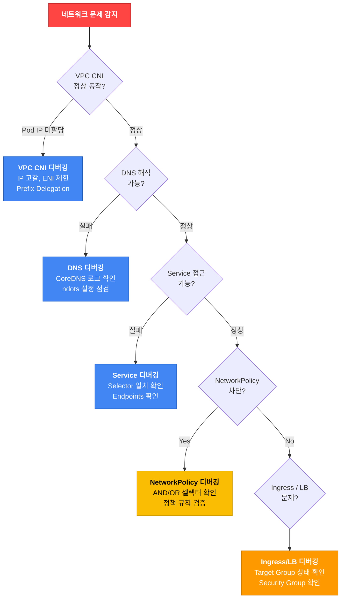

## 네트워킹 디버깅 워크플로우

**그림 1. 네트워킹 디버깅 워크플로우**



## VPC CNI 디버깅

### 기본 점검

```bash
# VPC CNI Pod 상태 확인
kubectl get pods -n kube-system -l k8s-app=aws-node

# VPC CNI 로그 확인
kubectl logs -n kube-system -l k8s-app=aws-node --tail=50

# 현재 VPC CNI 버전 확인
kubectl describe daemonset aws-node -n kube-system | grep Image
```

### IP 고갈 문제 해결

```bash
# 서브넷별 사용 가능 IP 확인
aws ec2 describe-subnets --subnet-ids <subnet-id> \
  --query 'Subnets[].{ID:SubnetId,AZ:AvailabilityZone,Available:AvailableIpAddressCount}'

# Prefix Delegation 활성화 (IP 용량 16배 확대)
kubectl set env daemonset aws-node -n kube-system ENABLE_PREFIX_DELEGATION=true

# Prefix Delegation 활성화 확인
kubectl get daemonset aws-node -n kube-system -o yaml | grep ENABLE_PREFIX_DELEGATION
```

:::tip Prefix Delegation이란?
기본 모드에서는 ENI당 개별 Secondary IP를 할당합니다. Prefix Delegation을 활성화하면 ENI에 /28 prefix (16개 IP)를 할당하여 ENI 하나가 수용할 수 있는 Pod IP 수를 늘립니다.

ENI와 IP가 공급하는 주소 용량과 kubelet이 노드에 허용하는 `maxPods` 상한은 서로 다른 값입니다. 기본 AMI는 ENI 기반으로 `maxPods`를 `(ENI 수 × (ENI당 IP 수 − 1)) + 2`로 계산합니다. 끝의 `+ 2`는 Pod IP를 쓰지 않는 VPC CNI와 kube-proxy 몫입니다([maxPods 결정 방식](https://docs.aws.amazon.com/eks/latest/userguide/choosing-instance-type.html#determine-max-pods)).

**예**: c5.xlarge 인스턴스(ENI 4개, ENI당 IP 15개 기준)
- 기본 모드의 ENI 기반 `maxPods` = (4 × (15 − 1)) + 2 = 58
- Prefix Delegation을 켜면 ENI 하나가 /28 prefix 여러 개로 더 많은 Pod IP를 공급하므로 주소 용량은 크게 늘어납니다. 다만 커스텀 AMI 없이 쓰는 관리형 노드 그룹에서는 EKS가 `maxPods`를 vCPU 30개 미만 인스턴스는 110, 30개 초과 인스턴스는 250으로 강제하므로, 실제 노드가 수용하는 Pod 수는 이 상한을 넘지 않습니다.
:::

:::caution 임시 조치와 영구 설정
`kubectl set env`로 바꾼 VPC CNI 값의 업데이트 결과는 충돌 처리 방식에 따라 달라집니다. `PRESERVE`로 보존할 수 있지만 `OVERWRITE`는 관리되는 필드를 덮어쓸 수 있습니다. 진단 후 설정을 add-on API로 이관할 때는 현재 configurationValues 전체에 변경을 병합합니다. 새 `--configuration-values`에 빠진 기존 고급 설정은 기본값으로 돌아갈 수 있습니다. `NetworkAddressUsageLimitExceeded`가 보이면 VPC NAU를, `InsufficientFreeAddressesInSubnet`이 보이면 실제 선택된 AZ·서브넷의 여유를 확인합니다. 다른 서브넷의 여유가 선택된 서브넷의 용량을 보장하지는 않습니다. [IP 용량 계획과 Karpenter 노드 사이징](../../networking-performance/ip-capacity-planning-karpenter.md)을 함께 참조합니다.
:::

### ENI 제한 및 IP 한도

각 EC2 인스턴스 타입에 따라 연결 가능한 ENI 수와 ENI당 IP 수가 제한됩니다.

```bash
# 인스턴스 타입별 ENI 한도 조회
aws ec2 describe-instance-types \
  --instance-types c5.xlarge c5.2xlarge m5.xlarge \
  --query 'InstanceTypes[].[InstanceType,NetworkInfo.MaximumNetworkInterfaces,NetworkInfo.Ipv4AddressesPerInterface]' \
  --output table

# 노드의 현재 ENI 사용량 확인
kubectl get nodes -o json | jq -r '.items[] | {
  name: .metadata.name,
  allocatable_pods: .status.allocatable.pods,
  max_pods: .status.capacity.pods
}'
```

## DNS 트러블슈팅

### CoreDNS 기본 점검

```bash
# CoreDNS Pod 상태 확인
kubectl get pods -n kube-system -l k8s-app=kube-dns

# CoreDNS 로그 확인
kubectl logs -n kube-system -l k8s-app=kube-dns --tail=50

# DNS 해석 테스트
kubectl run -it --rm debug --image=busybox --restart=Never -- nslookup kubernetes.default

# CoreDNS 설정 확인
kubectl get configmap coredns -n kube-system -o yaml

# CoreDNS 재시작
kubectl rollout restart deployment coredns -n kube-system
```

### CoreDNS OOM 문제

CoreDNS Pod 하나가 OOMKilled되면 그 Pod가 처리하던 쿼리만 영향을 받고, 다른 정상 복제본이 남아 있으면 해석은 부분적으로 계속됩니다. 모든 복제본이 반복 OOMKilled될 때에야 DNS 해석이 사실상 전면 실패합니다. 메모리를 올리기 전에 먼저 정상 엔드포인트 수, 재시작·OOM 이력, 쿼리 부하와 캐시 동작을 측정해 부분 장애인지 전면 장애인지, 리소스 부족이 실제 원인인지 판단합니다.

```bash
# 정상 CoreDNS 엔드포인트와 복제본 상태 확인
kubectl get endpoints kube-dns -n kube-system
kubectl get pods -n kube-system -l k8s-app=kube-dns -o wide

# 재시작/OOM 이력 확인
kubectl describe pods -n kube-system -l k8s-app=kube-dns | grep -iE 'restart|oomkilled|last state'

# 메모리 사용량과 쿼리 부하 확인
kubectl top pods -n kube-system -l k8s-app=kube-dns
# CoreDNS 메트릭(coredns_dns_requests_total, 캐시 적중률 등)으로 쿼리량과 캐시 동작 확인
```

측정 결과 메모리가 실제 병목일 때에만 limits를 조정합니다. 단, EKS의 CoreDNS는 관리형 애드온이 소유하므로 Deployment에 직접 가한 변경은 애드온 조정 과정에서 되돌아갈 수 있습니다. 영구 반영은 애드온의 configuration values로 적용하고, 쿼리 부하가 원인이면 복제본 수 조정이나 NodeLocal DNSCache로 캐시를 분산합니다.

```bash
# 측정 결과 메모리가 병목일 때, CoreDNS 메모리 limits 조정(값은 측정 기반 예시)
kubectl set resources deployment coredns -n kube-system \
  --limits=memory=300Mi --requests=memory=100Mi
```

:::warning CoreDNS OOM 원인
- 대규모 클러스터 (5,000+ Pod)에서 쿼리 급증
- DNS 캐싱 미설정으로 반복 쿼리
- 악의적인 DNS Amplification 공격

**해결**: 측정으로 원인을 확인한 뒤 메모리 조정, 복제본 조정, NodeLocal DNSCache 중 해당하는 조치를 선택
:::

### ndots:5 문제 및 해결

Kubernetes의 기본 `resolv.conf` 설정에서 `ndots:5`는 외부 도메인 접근 시 불필요한 DNS 쿼리를 발생시킵니다.

```bash
# Pod 내부의 resolv.conf 확인
kubectl exec <pod-name> -- cat /etc/resolv.conf
# nameserver 10.100.0.10
# search default.svc.cluster.local svc.cluster.local cluster.local
# options ndots:5

# ndots:5이면 점이 5개 미만인 이름은 먼저 search 목록을 붙여 조회합니다.
# 위 search 목록(3개)을 기준으로 api.example.com(점 2개)의 조회 순서 예시:
# 1. api.example.com.default.svc.cluster.local (실패)
# 2. api.example.com.svc.cluster.local (실패)
# 3. api.example.com.cluster.local (실패)
# 4. api.example.com (성공)
# 리졸버 구현, A/AAAA 동시 조회, 캐시 상태에 따라 실제 패킷 수는 달라지므로
# 조회 횟수는 고정된 보장값이 아니라 search 목록에서 유도한 예시입니다.
```

#### 해결 방법 1: ndots 값 조정

```yaml
apiVersion: v1
kind: Pod
metadata:
  name: app
spec:
  dnsConfig:
    options:
    - name: ndots
      value: "2"  # 기본 5 → 2로 감소
  containers:
  - name: app
    image: my-app:latest
```

#### 해결 방법 2: FQDN에 trailing dot 추가

```bash
# 애플리케이션 코드에서 외부 도메인 호출 시
curl https://api.example.com.  # ← trailing dot으로 즉시 외부 DNS 조회
```

#### 해결 방법 3: NodeLocal DNSCache 사용

NodeLocal DNSCache는 각 노드에서 DNS 캐싱을 제공하여 CoreDNS 부하를 줄입니다. 업스트림 매니페스트는 `__PILLAR__DNS__DOMAIN__`, `__PILLAR__DNS__SERVER__`, `__PILLAR__LOCAL__DNS__` 같은 플레이스홀더를 포함하므로, 그대로 적용하지 말고 클러스터 도메인(기본 `cluster.local`), kube-dns 서비스 ClusterIP, 노드가 수신할 로컬 주소를 치환한 뒤 적용합니다. kube-proxy 모드(iptables/ipvs)에 따라 치환 값과 kubelet의 `--cluster-dns` 설정이 달라지므로 [Kubernetes NodeLocal DNSCache 문서](https://kubernetes.io/docs/tasks/administer-cluster/nodelocaldns/)의 절차를 따릅니다.

```bash
# master 대신 고정된 릴리스 태그의 매니페스트를 내려받아 플레이스홀더를 치환한 뒤 검토
curl -fsSL -o nodelocaldns.yaml \
  https://raw.githubusercontent.com/kubernetes/kubernetes/v1.31.0/cluster/addons/dns/nodelocaldns/nodelocaldns.yaml
# <cluster-domain>, <kube-dns-cluster-ip>, <node-local-address>를 환경 값으로 치환
sed -i "s/__PILLAR__DNS__DOMAIN__/cluster.local/g; s/__PILLAR__DNS__SERVER__/<kube-dns-cluster-ip>/g; s/__PILLAR__LOCAL__DNS__/<node-local-address>/g" nodelocaldns.yaml

# 치환된 매니페스트 적용
kubectl apply -f nodelocaldns.yaml

# 설치 확인
kubectl get pods -n kube-system -l k8s-app=node-local-dns
```

적용 전에 노드가 DaemonSet을 수용하는 리눅스 노드인지, kube-dns 서비스 ClusterIP와 로컬 리스닝 주소가 노드 네트워크와 충돌하지 않는지 확인합니다. 되돌리려면 `kubectl delete -f nodelocaldns.yaml`로 DaemonSet을 제거하고, kubelet `--cluster-dns`나 NodeLocal 주소를 바꿨다면 원래 값으로 복원합니다.

:::info VPC DNS 스로틀링 한도
Amazon이 제공하는 Route 53 Resolver로 각 네트워크 인터페이스(ENI)가 보낼 수 있는 트래픽은 **네트워크 인터페이스당 초당 1,024 패킷**으로 제한됩니다([Amazon VPC 할당량](https://docs.aws.amazon.com/vpc/latest/userguide/amazon-vpc-limits.html#vpc-limits-dns)). 이 한도는 인터페이스별로 적용되며 그 인터페이스를 공유하는 모든 Pod의 조회를 합산합니다. 또한 한도의 단위는 DNS 쿼리 수가 아니라 패킷 수이므로, 재시도나 TCP fallback이 있으면 쿼리 하나가 여러 패킷을 소비할 수 있습니다. 인터페이스별 실제 트래픽과 노드 네트워킹 모드를 측정해 NodeLocal DNSCache 도입, 복제본 배치, 애플리케이션 조회 패턴을 조정합니다.
:::

## Service 디버깅

### Service 연결 불가 패턴

#### Pattern 1: Selector 라벨 불일치

```bash
# Service 상태 확인
kubectl get svc <service-name>

# Endpoints 확인 (백엔드 Pod이 연결되어 있는지)
kubectl get endpoints <service-name>
# NAME         ENDPOINTS
# web-service  <none>  ← 문제: Endpoints가 비어있음

# Service selector 확인
kubectl get svc <service-name> -o jsonpath='{.spec.selector}'
# {"app":"web","version":"v1"}

# Selector와 일치하는 Pod 확인
kubectl get pods -l app=web,version=v1
# No resources found  ← 문제: 일치하는 Pod 없음

# 실제 Pod의 라벨 확인
kubectl get pods --show-labels
# NAME        READY   STATUS    LABELS
# web-abc     1/1     Running   app=web,ver=v1  ← 라벨이 "ver"로 오타
```

**해결**: Pod의 오타 라벨(`ver`)을 의도한 `version` 키로 바로잡아 Service selector와 일치시킵니다. selector는 의도한 `version=v1`을 유지하고, 틀린 쪽은 Pod 라벨입니다.

```bash
# 방법 1: 컨트롤러(Deployment 등) Pod 템플릿의 라벨을 수정하고 롤아웃
# spec.template.metadata.labels의 ver를 version으로 바꾼 뒤 적용하면 새 Pod가 올바른 라벨로 생성됨
kubectl patch deployment web -p '{"spec":{"template":{"metadata":{"labels":{"version":"v1"}}}}}'
kubectl rollout status deployment web
# selector에 오타 키(ver)를 남기면 안 됨. 필요하면 selector를 의도한 값으로 되돌림:
kubectl patch svc web-service -p '{"spec":{"selector":{"app":"web","version":"v1"}}}'

# 방법 2: 임시로 특정 Pod의 라벨만 바꿔 즉시 확인(컨트롤러가 되돌리므로 영구 수정 아님)
kubectl label pod web-abc version=v1 --overwrite

# 변경 후 EndpointSlice에 Pod가 등록되는지 확인
kubectl get endpointslices -l kubernetes.io/service-name=web-service
```

#### Pattern 2: port vs targetPort 불일치

```yaml
# Service 설정
apiVersion: v1
kind: Service
metadata:
  name: web-service
spec:
  selector:
    app: web
  ports:
  - port: 80          # ← Service가 노출하는 포트
    targetPort: 8080  # ← Pod이 리스닝하는 포트 (여기가 틀리면 연결 실패)
```

```bash
# containerPort는 선언값일 뿐이므로, Pod이 실제로 리스닝하는 소켓을 직접 확인
kubectl exec <pod-name> -- ss -ltnp
# 또는 애플리케이션 설정/로그에서 실제 바인딩 포트를 확인
# 선언된 containerPort(참고용)
kubectl get pod <pod-name> -o jsonpath='{.spec.containers[*].ports[*].containerPort}'
# 예: 애플리케이션이 9090에서 리스닝하는데 Service targetPort는 8080으로 설정된 경우

# Service의 targetPort를 백엔드가 실제 리스닝하는 포트에 맞춤
# port는 클라이언트가 접근하는 Service 포트, targetPort는 백엔드 Pod이 받는 포트로 서로 다른 값
kubectl patch svc web-service -p '{"spec":{"ports":[{"port":80,"targetPort":9090}]}}'

# 로드밸런서를 쓰는 경우, health check 포트는 target 유형(instance/ip)과 설정에 따라
# Service NodePort 또는 Pod 포트가 되므로 targetPort와 별개로 맞춰야 함
```

#### Pattern 3: Endpoints 확인

```bash
# Endpoints 상세 확인
kubectl describe endpoints <service-name>

# Endpoints가 비어있으면:
# 1. Service selector와 Pod label 일치 확인
# 2. Pod이 Ready 상태인지 확인 (Not Ready Pod은 Endpoints에서 제외됨)
kubectl get pods -l app=web -o wide
```

### 일반적인 Service 문제

**표 1. 일반적인 Service 문제의 증상·확인 사항·해결**

| 증상 | 확인 사항 | 해결 |
|------|----------|------|
| Endpoints가 비어있음 | Service selector와 Pod label 불일치 | label 수정 |
| ClusterIP 접근 불가 | kube-proxy 정상 동작 여부 | `kubectl logs -n kube-system -l k8s-app=kube-proxy` |
| NodePort 접근 불가 | Security Group에서 30000-32767 허용 여부 | SG Inbound 규칙 추가 |
| LoadBalancer Pending | AWS Load Balancer Controller 설치 여부 | controller 설치 및 IAM 권한 확인 |

## NetworkPolicy 디버깅

### AND vs OR 셀렉터 혼동

NetworkPolicy에서 가장 흔한 실수는 **AND vs OR 셀렉터**의 혼동입니다.

```yaml
# AND 로직 (같은 from 항목 안에 두 셀렉터를 결합)
# "alice 네임스페이스의 client 역할 Pod" 만 허용
apiVersion: networking.k8s.io/v1
kind: NetworkPolicy
metadata:
  name: allow-alice-client-only
spec:
  podSelector:
    matchLabels:
      app: web
  ingress:
  - from:
    - namespaceSelector:
        matchLabels:
          user: alice
      podSelector:
        matchLabels:
          role: client
```

```yaml
# OR 로직 (별도의 from 항목으로 분리)
# "alice 네임스페이스의 모든 Pod" 또는 "이 정책과 같은 네임스페이스의 client 역할 Pod" 허용
apiVersion: networking.k8s.io/v1
kind: NetworkPolicy
metadata:
  name: allow-alice-or-client
spec:
  podSelector:
    matchLabels:
      app: web
  ingress:
  - from:
    - namespaceSelector:
        matchLabels:
          user: alice
    - podSelector:
        matchLabels:
          role: client
```

:::danger AND vs OR 주의
위 두 YAML은 indent 한 레벨 차이로 완전히 다른 보안 정책이 됩니다. AND 로직에서는 `namespaceSelector`와 `podSelector`가 **같은 `- from` 항목** 안에 있고, OR 로직에서는 **별도의 `- from` 항목**으로 분리됩니다. `namespaceSelector` 없이 `podSelector`만 둔 항목은 NetworkPolicy가 속한 네임스페이스의 Pod만 선택합니다. 모든 네임스페이스의 `role: client` Pod를 의도적으로 허용하려면 같은 항목에 `namespaceSelector: {}`를 함께 두어야 하며, 이렇게 하면 다른 팀의 네임스페이스에서도 해당 라벨만 붙이면 접근할 수 있게 되므로 허용 범위를 넓히는 보안상 이유를 정책 주석이나 리뷰 기록에 남깁니다.
:::

### NetworkPolicy 차단 디버깅

NetworkPolicy는 이를 집행하는 CNI가 있어야 효과가 있습니다. VPC CNI를 쓰는 EKS에서는 애드온의 NetworkPolicy 기능이 활성화되어 있어야 하며, 그렇지 않으면 정책이 선언만 되고 트래픽을 제어하지 않습니다. 먼저 집행 여부와 정책·네임스페이스 라벨이 의도대로 매칭되는지 확인한 뒤, 허용되어야 하는 흐름과 차단되어야 하는 흐름을 모두 테스트합니다.

```bash
# VPC CNI의 NetworkPolicy 집행이 켜져 있는지 확인
kubectl get daemonset aws-node -n kube-system \
  -o jsonpath='{.spec.template.spec.containers[*].args}' | tr ',' '\n' | grep -i network-policy

# 적용된 정책과 셀렉터가 매칭하는 네임스페이스/Pod 라벨 확인
kubectl get networkpolicy -n <namespace> -o yaml
kubectl get ns <namespace> --show-labels
kubectl get pods -n <namespace> --show-labels

# 허용 흐름 테스트: 정책이 허용하는 라벨을 가진 source 워크로드에서 접근
kubectl exec -n <namespace> deploy/<allowed-client> -- \
  curl -sS -m 5 http://<target-service>.<namespace>.svc.cluster.local:<port>/

# 차단 흐름 테스트: 정책이 허용하지 않는 source 워크로드에서 접근(실패해야 정상)
kubectl exec -n <namespace> deploy/<denied-client> -- \
  curl -sS -m 5 http://<target-service>.<namespace>.svc.cluster.local:<port>/
```

임시 디버그 Pod는 정책 셀렉터가 기대하는 라벨·방향·포트를 갖지 않을 수 있어 결과를 오해하기 쉽습니다. 가능하면 컨트롤러가 관리하는 실제 워크로드의 identity(라벨)로, 의도한 방향(ingress/egress)과 포트에 대해 테스트합니다.

#### Default Deny 후 Allow 누락

```yaml
# Default Deny (모든 ingress 차단)
apiVersion: networking.k8s.io/v1
kind: NetworkPolicy
metadata:
  name: default-deny-ingress
  namespace: production
spec:
  podSelector: {}
  policyTypes:
  - Ingress
  # ingress 규칙 없음 → 모든 ingress 차단
```

```yaml
# Allow 규칙 추가 (특정 트래픽 허용)
apiVersion: networking.k8s.io/v1
kind: NetworkPolicy
metadata:
  name: allow-from-frontend
  namespace: production
spec:
  podSelector:
    matchLabels:
      app: backend
  ingress:
  - from:
    - podSelector:
        matchLabels:
          app: frontend
    ports:
    - protocol: TCP
      port: 8080
```

:::warning Default Deny는 신중하게
위 `default-deny-ingress`는 `policyTypes`에 `Ingress`만 두므로 **ingress만 차단**하고 egress는 제한하지 않습니다. egress나 DNS까지 통제하려면 `Egress` 정책을 별도로 정의하고 테스트해야 하며, egress를 모두 막으면 kube-dns로 가는 DNS도 함께 막히므로 DNS 허용 규칙을 반드시 포함합니다. 또한 `allow-from-frontend`의 `podSelector: {app: frontend}`에는 `namespaceSelector`가 없으므로, 이 규칙은 **같은 `production` 네임스페이스 안의** frontend Pod만 가리킵니다. 다른 네임스페이스의 frontend를 허용하려면 `namespaceSelector`를 추가해야 합니다. 프로덕션에 적용하기 전에 필요한 Allow 규칙을 모두 작성하고 테스트 환경에서 ingress와 egress 흐름을 함께 검증하세요.
:::

## netshoot 활용법

[netshoot](https://github.com/nicolaka/netshoot)은 네트워크 디버깅에 필요한 모든 도구가 포함된 컨테이너 이미지입니다.

```bash
# 기존 Pod에 ephemeral container로 추가
kubectl debug <pod-name> -it --image=nicolaka/netshoot

# 독립 디버깅 Pod 실행
kubectl run tmp-shell --rm -i --tty --image nicolaka/netshoot

# 내부에서 사용할 수 있는 도구 예시:
# - curl, wget: HTTP 테스트
# - dig, nslookup: DNS 테스트
# - tcpdump: 패킷 캡처
# - iperf3: 대역폭 테스트
# - ss, netstat: 소켓 상태 확인
# - traceroute, mtr: 경로 추적
```

### 실전 디버깅 시나리오: Pod 간 통신 확인

```bash
# netshoot Pod에서 다른 Service로 연결 테스트
kubectl run tmp-shell --rm -i --tty --image nicolaka/netshoot -- bash

# DNS 해석 확인
dig <service-name>.<namespace>.svc.cluster.local

# TCP 연결 테스트
curl -v http://<service-name>.<namespace>.svc.cluster.local:<port>/health

# 패킷 캡처 (특정 Pod IP로의 트래픽)
tcpdump -i any host <pod-ip> -n

# 경로 추적
traceroute <pod-ip>

# 소켓 상태 확인
ss -tunap
```

## Ingress / LoadBalancer 디버깅

### AWS Load Balancer Controller 문제

```bash
# Controller 상태 확인
kubectl get pods -n kube-system -l app.kubernetes.io/name=aws-load-balancer-controller

# Controller 로그 확인
kubectl logs -n kube-system -l app.kubernetes.io/name=aws-load-balancer-controller --tail=100

# Ingress 상태 확인
kubectl describe ingress <ingress-name>
```

### Target Group Health Check 실패

AWS Load Balancer에서 Target Group의 Health Check가 실패하는 경우는 [Health Check 불일치 문서](./health-check-mismatch.md)를 참조하세요.

**일반적인 원인**:
- Health Check path가 Pod의 실제 endpoint와 불일치
- Health Check port가 Pod의 containerPort와 불일치
- Security Group에서 Health Check 포트 미허용
- readinessProbe 실패로 Pod이 NotReady 상태

```bash
# Target Group Health 확인
aws elbv2 describe-target-health \
  --target-group-arn <tg-arn>

# Security Group Inbound 규칙 확인
aws ec2 describe-security-groups \
  --group-ids <sg-id> \
  --query 'SecurityGroups[].IpPermissions'
```

## 네트워킹 문제 체크리스트

### Layer 3/4 (기본 연결성)

- [ ] Pod이 IP를 할당받았는가? (`kubectl get pod -o wide`)
- [ ] 서브넷에 사용 가능한 IP가 있는가?
- [ ] Security Group이 필요한 포트를 허용하는가?
- [ ] NetworkPolicy가 트래픽을 차단하지 않는가?

### Layer 7 (애플리케이션)

- [ ] Service selector와 Pod label이 일치하는가?
- [ ] Service port와 Pod containerPort가 일치하는가?
- [ ] DNS 해석이 정상인가? (`nslookup <service-name>`)
- [ ] Pod의 readinessProbe가 성공하는가?
- [ ] Ingress Health Check path가 올바른가?

### DNS 특화

- [ ] CoreDNS Pod이 Running 상태인가?
- [ ] CoreDNS가 OOMKilled되지 않았는가?
- [ ] ndots 설정이 적절한가? (외부 도메인 다수 호출 시 ndots:2 권장)
- [ ] NodeLocal DNSCache가 설치되어 있는가? (대규모 클러스터)

---

## 관련 문서

- [워크로드 디버깅](./workload.md) - Pod 상태별 문제 해결
- [스토리지 디버깅](./storage.md) - PVC 마운트 실패
- [Health Check 불일치](./health-check-mismatch.md) - ALB/NLB Target Group Health Check 문제
- [IP 용량 계획과 Karpenter 노드 사이징](../../networking-performance/ip-capacity-planning-karpenter.md) - 서브넷·NAU 예산과 크기 fallback 시 IP 소비
