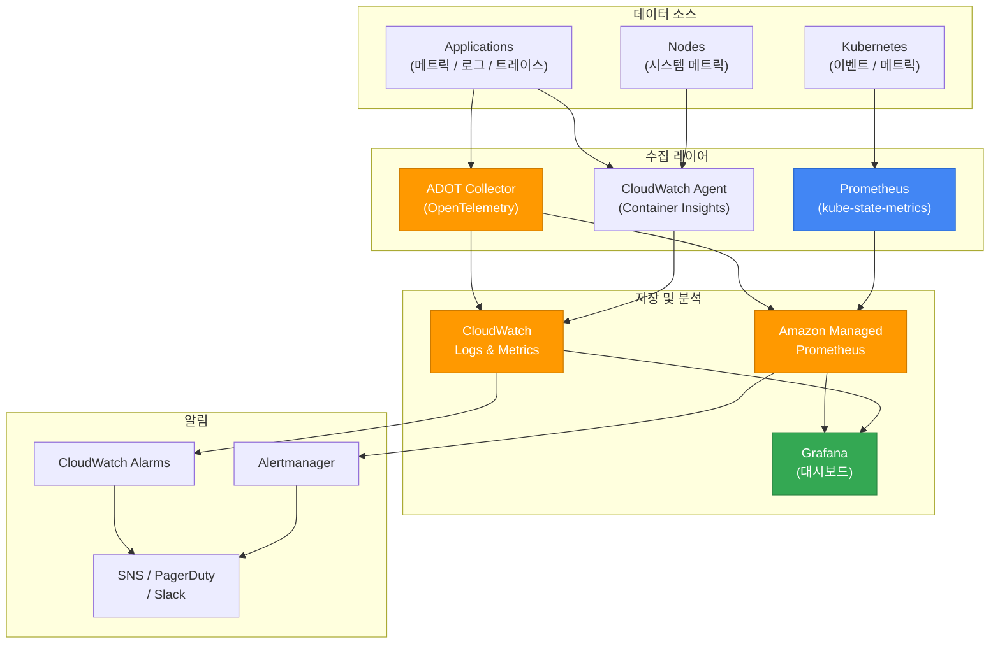
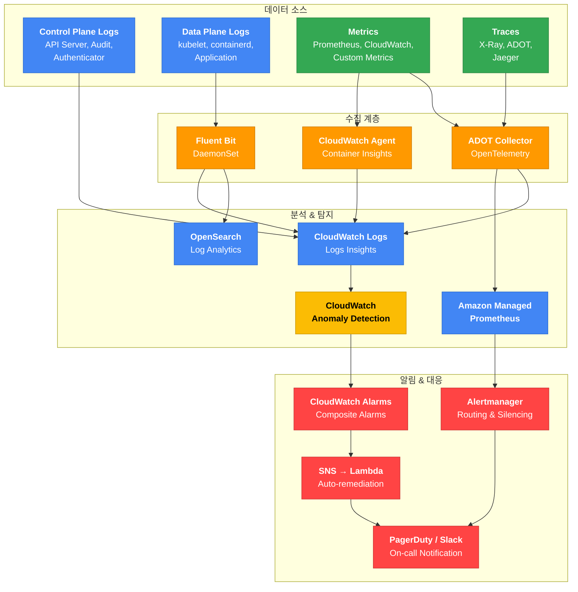

import { IncidentEscalationTable, ZonalShiftImpactTable } from '@site/src/components/EksDebugTables';

## 옵저버빌리티 스택 아키텍처

**그림 1. 옵저버빌리티 스택 아키텍처**



## Container Insights 설정

아래는 설치의 일부 단편입니다. `amazon-cloudwatch-observability` 애드온은 CloudWatch Agent와 Fluent Bit을 배포해 메트릭·로그를 수집하며, 이들 컴포넌트가 CloudWatch로 데이터를 보내려면 노드 또는 서비스 계정에 CloudWatch 쓰기 권한(`CloudWatchAgentServerPolicy` 등)이 연결된 IAM identity가 필요합니다. 애드온을 쓰기 전에 Pod Identity 또는 IRSA로 이 권한을 구성하고, 수집 범위(어떤 네임스페이스/노드의 메트릭·로그를 보낼지)를 애드온 configuration values로 정합니다. 기존에 별도 CloudWatch Agent나 Fluent Bit을 운영 중이면 중복 수집이 생기지 않도록 조정합니다.

```bash
# Container Insights Add-on 설치(사전 조건: CloudWatch 쓰기 권한을 가진 IAM identity 구성)
aws eks create-addon \
  --cluster-name <cluster-name> \
  --addon-name amazon-cloudwatch-observability

# 설치 확인: Pod 상태뿐 아니라 백엔드로 텔레메트리가 실제 도착하는지 함께 확인
kubectl get pods -n amazon-cloudwatch
# CloudWatch에 Container Insights 로그 그룹과 메트릭이 생성되는지 확인
aws logs describe-log-groups --log-group-name-prefix "/aws/containerinsights/<cluster-name>"
```

## 메트릭 디버깅: PromQL 쿼리

### CPU Throttling 감지

```promql
sum(rate(container_cpu_cfs_throttled_periods_total{namespace="production"}[5m]))
/ sum(rate(container_cpu_cfs_periods_total{namespace="production"}[5m])) > 0.25
```

:::info CPU Throttling 임계값
여기서 쓴 25%는 측정값이 아니라 조정을 시작할 때 참고하는 예시 임계값입니다. 실제 기준은 워크로드의 SLO와 컨테이너별 throttling·레이턴시 상관관계를 측정해 정합니다. CPU limits를 제거하면 throttling은 사라지지만 노드가 과구독될 때 특정 컨테이너가 CPU를 과점할 수 있으므로, 제거는 모든 경우에 권하는 조치가 아니라 격리성과 성능을 맞바꾸는 선택입니다. 많은 조직이 CPU limits 없이 requests만 설정하는 전략을 쓰지만, 이는 노드 사이징과 QoS 정책을 함께 고려한 결정입니다.
:::

### OOMKilled 감지

```promql
kube_pod_container_status_last_terminated_reason{reason="OOMKilled"} > 0
```

### Pod 재시작률

```promql
sum(rate(kube_pod_container_status_restarts_total[15m])) by (namespace, pod) > 0
```

### Node CPU 사용률 (80% 초과 경고)

```promql
100 - (avg by(instance)(rate(node_cpu_seconds_total{mode="idle"}[5m])) * 100) > 80
```

### Node 메모리 사용률 (85% 초과 경고)

```promql
(1 - node_memory_MemAvailable_bytes / node_memory_MemTotal_bytes) * 100 > 85
```

## 로그 디버깅: CloudWatch Logs Insights

### 에러 로그 분석

```sql
fields @timestamp, @message, kubernetes.container_name, kubernetes.pod_name
| filter @message like /ERROR|FATAL|Exception/
| sort @timestamp desc
| limit 50
```

### 레이턴시 분석

아래 쿼리는 로그 메시지에서 `latency=` 또는 `latency:` 뒤의 정수를 밀리초로 가정해 추출합니다. 애플리케이션이 초나 마이크로초로 기록하면 결과 단위가 섞이므로, 실제 로그 스키마에 맞게 정규식과 단위를 맞춰야 합니다.

```sql
fields @timestamp, @message
| filter @message like /latency|duration|elapsed/
| parse @message /latency[=:]\s*(?<latency_ms>\d+)/
| stats avg(latency_ms) as avg_ms, max(latency_ms) as max_ms, pct(latency_ms, 99) as p99_ms by bin(5m)
```

### 특정 Pod의 에러 패턴 분석

아래 `count()`는 고유 인시던트 수가 아니라 패턴에 매칭된 **로그 라인 수**입니다. 한 인시던트가 여러 줄을 남길 수 있습니다.

```sql
fields @timestamp, @message
| filter kubernetes.pod_name like /api-server/
| filter @message like /error|Error|ERROR/
| stats count() as error_log_lines by bin(1m)
| sort bin asc
```

### OOMKilled 이벤트 추적

```sql
fields @timestamp, @message
| filter @message like /OOMKilled|oom-kill|Out of memory/
| sort @timestamp desc
| limit 20
```

### 컨테이너 재시작 이벤트

아래 `count()`도 실제 재시작 횟수가 아니라 `Back-off restarting` 메시지가 로그에 나타난 **로그 라인 수**입니다. 정확한 재시작 횟수는 `kube_pod_container_status_restarts_total` 메트릭으로 확인합니다.

```sql
fields @timestamp, @message, kubernetes.pod_name
| filter @message like /Back-off restarting failed container|CrashLoopBackOff/
| stats count() as restart_log_lines by kubernetes.pod_name
| sort restart_log_lines desc
```

## 알림 규칙: PrometheusRule 예제

아래 `PrometheusRule`가 동작하려면 사전 조건이 있습니다. 규칙이 참조하는 `kube_pod_container_status_restarts_total` 같은 메트릭을 수집하는 익스포터(kube-state-metrics, node-exporter 등)와 스크랩 설정이 있어야 하고, `PrometheusRule` 커스텀 리소스를 평가하려면 Prometheus Operator가 설치되어 있어야 합니다. 또한 Operator의 `Prometheus` 리소스에 설정된 `ruleSelector`/`ruleNamespaceSelector`가 이 규칙의 라벨·네임스페이스와 매칭되어야 규칙이 로드됩니다. 반면 Amazon Managed Service for Prometheus(AMP)의 관리형 ruler를 쓰는 경우에는 `PrometheusRule` 리소스를 클러스터에 배포하는 대신 rule group을 AMP ruler에 업로드하므로 경로가 다릅니다. 적용 후에는 규칙이 로드되어 평가되는지, 알림이 Alertmanager/SNS로 라우팅되는지 확인합니다.

```yaml
apiVersion: monitoring.coreos.com/v1
kind: PrometheusRule
metadata:
  name: kubernetes-alerts
spec:
  groups:
  - name: kubernetes-pods
    rules:
    - alert: PodCrashLooping
      # 최근 15분 내 재시작이 발생했고 그 상태가 15분간 지속되면 알림(최근 재시작 이벤트 기준)
      expr: increase(kube_pod_container_status_restarts_total[15m]) > 0
      for: 15m
      labels:
        severity: warning
      annotations:
        summary: "Pod {{ $labels.namespace }}/{{ $labels.pod }} 컨테이너 {{ $labels.container }} crash looping"
        description: "컨테이너 {{ $labels.container }}(Pod {{ $labels.pod }})이 최근 15분 내 재시작했고 그 상태가 15분간 지속되었습니다."

    - alert: PodOOMKilled
      expr: kube_pod_container_status_last_terminated_reason{reason="OOMKilled"} > 0
      for: 0m
      labels:
        severity: critical
      annotations:
        summary: "Pod {{ $labels.namespace }}/{{ $labels.pod }} OOMKilled"
        description: "Pod {{ $labels.pod }}이 메모리 부족으로 종료되었습니다. 메모리 limits 조정이 필요합니다."

  - name: kubernetes-nodes
    rules:
    - alert: NodeNotReady
      expr: kube_node_status_condition{condition="Ready",status="true"} == 0
      for: 5m
      labels:
        severity: critical
      annotations:
        summary: "Node {{ $labels.node }} is NotReady"

    - alert: NodeHighCPU
      expr: 100 - (avg by(instance)(rate(node_cpu_seconds_total{mode="idle"}[5m])) * 100) > 80
      for: 10m
      labels:
        severity: warning
      annotations:
        summary: "Node {{ $labels.instance }} CPU usage above 80%"

    - alert: NodeHighMemory
      expr: (1 - node_memory_MemAvailable_bytes / node_memory_MemTotal_bytes) * 100 > 85
      for: 10m
      labels:
        severity: warning
      annotations:
        summary: "Node {{ $labels.instance }} memory usage above 85%"
```

## ADOT (AWS Distro for OpenTelemetry) 디버깅

ADOT는 AWS에서 관리하는 OpenTelemetry 배포판으로, 트레이스, 메트릭, 로그를 수집하여 다양한 AWS 서비스(X-Ray, CloudWatch, AMP 등)로 전송합니다.

```bash
# ADOT Add-on 상태 확인
aws eks describe-addon --cluster-name $CLUSTER \
  --addon-name adot --query 'addon.{status:status,version:addonVersion}'

# ADOT Collector Pod 확인
kubectl get pods -n opentelemetry-operator-system
kubectl logs -n opentelemetry-operator-system -l app.kubernetes.io/name=opentelemetry-operator --tail=50

# OpenTelemetryCollector CR 확인
kubectl get otelcol -A
kubectl describe otelcol -n $NAMESPACE $COLLECTOR_NAME
```

### ADOT 일반적인 문제

진단은 두 영역을 구분하는 것이 좋습니다. Operator 영역은 webhook 인증서와 admission/reconciliation 문제이고, Collector 영역은 파이프라인 구성과 실제 익스포트(백엔드 전송) 오류입니다. Operator가 뜨지 않으면 Collector CR이 적용되지 않고, Operator가 정상이어도 Collector의 익스포터 설정이나 IAM 권한이 틀리면 전송만 실패합니다.

**표 1. ADOT 일반적인 문제의 증상·원인·해결 방법**

| 증상 | 원인 | 해결 방법 |
|------|------|----------|
| Operator Pod `CrashLoopBackOff` 또는 webhook 오류 | webhook 인증서 미구성 | 먼저 Operator 로그와 이벤트로 실제 원인을 확인. ADOT operator는 webhook 인증서 관리에 cert-manager 등 호환되는 인증서 솔루션이 필요하며, 이미 설치되어 있으면 소유자/버전을 확인. 설치가 필요하면 클러스터 Kubernetes 버전과 호환되는 [cert-manager 릴리스](https://github.com/cert-manager/cert-manager/releases)의 고정된 패치 버전을 CRD·webhook 소유권과 업그레이드 범위를 확인한 뒤 설치 |
| Collector에서 AMP로 전송 실패 (prometheusremotewrite 익스포터) | IAM 권한 부족 | IRSA/Pod Identity에 `aps:RemoteWrite` 권한 추가 |
| X-Ray 트레이스 미수신 (awsxray 익스포터) | IAM 권한 부족 | IRSA/Pod Identity에 `xray:PutTraceSegments`, `xray:PutTelemetryRecords` 권한 추가 |
| CloudWatch 메트릭 미수신 (awsemf 익스포터) | IAM 권한 부족 | IRSA/Pod Identity에 `cloudwatch:PutMetricData` 권한 추가 |
| CloudWatch Logs 미수신 (awsemf/awscloudwatchlogs 익스포터) | IAM 권한 부족 | IRSA/Pod Identity에 `logs:PutLogEvents` 권한, 로그 그룹/스트림을 자동 생성하면 `logs:CreateLogGroup`, `logs:CreateLogStream` 권한 추가 |
| Collector Pod `OOMKilled` | 리소스 부족 | 대량 트레이스/메트릭 수집 시 Collector의 resources.limits.memory 증가 |

:::warning ADOT 권한 분리
구성한 익스포터마다 필요한 AWS API 권한이 다릅니다. AMP remote write, X-Ray, CloudWatch 메트릭, CloudWatch Logs는 각각 다른 권한을 요구하므로, Collector가 전송하는 모든 백엔드의 권한이 IAM Role에 포함되어 있는지 확인하세요.
:::

---

## 인시던트 디텍팅 메커니즘 및 로깅 아키텍처

### 인시던트 디텍팅 전략 개요

EKS 환경에서 인시던트를 신속하게 감지하려면 **데이터 소스 → 수집 → 분석 & 탐지 → 알림 & 대응**의 4계층 파이프라인을 체계적으로 구성해야 합니다. 각 계층이 유기적으로 연결되어야 MTTD(Mean Time To Detect)를 최소화할 수 있습니다.

신호마다 수집 경로가 다릅니다. EKS 컨트롤 플레인 로그(API Server, Audit, Authenticator 등)는 로그 유형을 활성화하면 EKS가 CloudWatch Logs로 **직접** 전송하므로 Fluent Bit을 거치지 않습니다. 이후 다운스트림 분석이 필요하면 CloudWatch Logs 구독 필터로 OpenSearch 등으로 전달합니다. 반면 노드/애플리케이션 로그는 Fluent Bit DaemonSet이, 메트릭은 CloudWatch Agent나 ADOT가, 트레이스는 ADOT가 각각 별도로 수집하도록 구성합니다. Kubernetes 이벤트 export는 또 다른 경로이며 아래 그림은 이 신호들을 구분해 보여줍니다.

**그림 2. 4계층 인시던트 탐지 파이프라인**



#### 4계층 아키텍처 설명

**표 2. 4계층 아키텍처의 계층별 역할과 핵심 구성 요소**

| 계층 | 역할 | 핵심 구성 요소 |
|---|---|---|
| **데이터 소스** | 클러스터의 모든 관찰 가능한 신호를 생성 | Control Plane Logs, Data Plane Logs, Metrics, Traces |
| **수집 계층** | 다양한 소스의 데이터를 표준화하여 중앙으로 전달 | Fluent Bit, CloudWatch Agent, ADOT Collector |
| **분석 & 탐지** | 수집된 데이터를 분석하고 이상을 탐지 | CloudWatch Logs Insights, AMP, OpenSearch, Anomaly Detection |
| **알림 & 대응** | 탐지된 인시던트를 적절한 채널로 통보하고 자동 복구 실행 | CloudWatch Alarms, Alertmanager, SNS → Lambda, PagerDuty/Slack |

### 추천 로깅 아키텍처

#### Option A: AWS 네이티브 스택 (소규모~중규모 클러스터)

AWS 관리형 서비스를 중심으로 구성하여 운영 부담을 최소화하는 아키텍처입니다.

**표 3. AWS 관리형 중심 구성(Option A)의 계층별 구성 요소와 용도**

| 계층 | 구성 요소 | 용도 |
|---|---|---|
| 수집 | Fluent Bit (DaemonSet) | 노드/컨테이너 로그 수집 |
| 전송 | CloudWatch Logs | 중앙 로그 저장소 |
| 분석 | CloudWatch Logs Insights | 쿼리 기반 분석 |
| 탐지 | CloudWatch Anomaly Detection | ML 기반 이상 탐지 |
| 알림 | CloudWatch Alarms → SNS | 임계값/이상 기반 알림 |

**Fluent Bit DaemonSet 배포 예제:**

아래 DaemonSet은 `serviceAccountName: fluent-bit`과 `fluent-bit-config` ConfigMap을 참조하지만, 이 예제에는 둘 다 정의되어 있지 않습니다. 실제로 배포하려면 다음을 함께 준비해야 합니다. (1) `amazon-cloudwatch` 네임스페이스와 `fluent-bit` ServiceAccount, 노드 로그를 읽고 전송하는 데 필요한 RBAC. (2) CloudWatch Logs 쓰기 권한(`logs:CreateLogGroup`, `logs:CreateLogStream`, `logs:PutLogEvents`)을 가진 IAM identity를 IRSA나 Pod Identity로 ServiceAccount에 연결. (3) 리전·클러스터 이름과 OUTPUT(cloudwatch_logs) 설정을 담은 `fluent-bit-config` ConfigMap. EKS가 제공하는 [CloudWatch용 Fluent Bit 설정](https://docs.aws.amazon.com/AmazonCloudWatch/latest/monitoring/Container-Insights-setup-logs-FluentBit.html)의 매니페스트를 기준으로 삼으면 ServiceAccount·RBAC·ConfigMap이 함께 제공됩니다. 배포 후에는 기대한 CloudWatch 로그 그룹(`/aws/containerinsights/<cluster-name>/application` 등)에 로그가 도착하는지 확인합니다. `amazon-cloudwatch-observability` 애드온을 이미 쓰고 있다면 애드온이 Fluent Bit을 관리하므로, 이 DaemonSet을 별도로 배포하면 중복 수집이 생깁니다. 둘 중 하나만 운영하도록 조정하세요.

```yaml
apiVersion: apps/v1
kind: DaemonSet
metadata:
  name: fluent-bit
  namespace: amazon-cloudwatch
  labels:
    app.kubernetes.io/name: fluent-bit
spec:
  selector:
    matchLabels:
      app.kubernetes.io/name: fluent-bit
  template:
    metadata:
      labels:
        app.kubernetes.io/name: fluent-bit
    spec:
      serviceAccountName: fluent-bit
      containers:
        - name: fluent-bit
          image: public.ecr.aws/aws-observability/aws-for-fluent-bit:2.32.0
          resources:
            limits:
              memory: 200Mi
            requests:
              cpu: 100m
              memory: 100Mi
          volumeMounts:
            - name: varlog
              mountPath: /var/log
              readOnly: true
            - name: varlogpods
              mountPath: /var/log/pods
              readOnly: true
            - name: fluent-bit-config
              mountPath: /fluent-bit/etc/
      volumes:
        - name: varlog
          hostPath:
            path: /var/log
        - name: varlogpods
          hostPath:
            path: /var/log/pods
        - name: fluent-bit-config
          configMap:
            name: fluent-bit-config
```

:::tip Fluent Bit vs Fluentd
Fluent Bit은 Fluentd보다 메모리 사용량이 10배 이상 적습니다 (~10MB vs ~100MB). EKS 환경에서는 Fluent Bit을 DaemonSet으로 배포하는 것이 표준 패턴입니다. `amazon-cloudwatch-observability` Add-on을 사용하면 Fluent Bit이 자동으로 설치됩니다.
:::

#### Option B: 오픈소스 기반 스택 (대규모 클러스터 / 멀티 클러스터)

오픈소스 도구와 AWS 관리형 서비스를 조합하여 대규모 환경에서의 확장성과 유연성을 확보하는 아키텍처입니다.

**표 4. 오픈소스와 AWS 관리형 혼합 구성(Option B)의 계층별 구성 요소와 용도**

| 계층 | 구성 요소 | 용도 |
|---|---|---|
| 수집 | Fluent Bit + ADOT Collector | 로그/메트릭/트레이스 통합 수집 |
| 메트릭 | Amazon Managed Prometheus (AMP) | 시계열 메트릭 저장 |
| 로그 | Amazon OpenSearch Service | 대규모 로그 분석 |
| 트레이스 | AWS X-Ray / Jaeger | 분산 추적 |
| 시각화 | Amazon Managed Grafana | 통합 대시보드 |
| 알림 | Alertmanager + PagerDuty/Slack | 고급 라우팅, 그룹핑, 사일런싱 |

:::info 멀티 클러스터 아키텍처
멀티 클러스터 환경에서는 각 클러스터의 ADOT Collector가 중앙 AMP 워크스페이스로 메트릭을 전송하는 허브-스포크 구조를 권장합니다. Grafana에서 단일 대시보드로 모든 클러스터를 모니터링할 수 있습니다.
:::

### 인시던트 디텍팅 패턴

#### Pattern 1: 임계값 기반 탐지 (Threshold-based)

가장 기본적인 탐지 방식입니다. 미리 정의한 임계값을 초과하면 알림을 발생시킵니다.

```yaml
# PrometheusRule - 임계값 기반 알림 예제
apiVersion: monitoring.coreos.com/v1
kind: PrometheusRule
metadata:
  name: eks-threshold-alerts
  namespace: monitoring
spec:
  groups:
    - name: eks-thresholds
      rules:
        - alert: HighPodRestartRate
          expr: increase(kube_pod_container_status_restarts_total[1h]) > 5
          for: 10m
          labels:
            severity: warning
          annotations:
            summary: "Pod {{ $labels.namespace }}/{{ $labels.pod }} 재시작 횟수 증가"
            description: "1시간 내 {{ $value }}회 재시작 발생"

        - alert: NodeMemoryPressure
          expr: (1 - node_memory_MemAvailable_bytes / node_memory_MemTotal_bytes) > 0.85
          for: 5m
          labels:
            severity: critical
          annotations:
            summary: "노드 {{ $labels.instance }} 메모리 사용률 85% 초과"

        - alert: PVCNearlyFull
          expr: kubelet_volume_stats_used_bytes / kubelet_volume_stats_capacity_bytes > 0.9
          for: 15m
          labels:
            severity: warning
          annotations:
            summary: "PVC {{ $labels.persistentvolumeclaim }} 용량 90% 초과"
```

#### Pattern 2: 이상 탐지 (Anomaly Detection)

ML 기반으로 정상 패턴을 학습하고 편차를 감지합니다. 임계값을 미리 정의하기 어려운 경우에 유용합니다.

```bash
# CloudWatch Anomaly Detection 설정
aws cloudwatch put-anomaly-detector \
  --single-metric-anomaly-detector '{
    "Namespace": "ContainerInsights",
    "MetricName": "pod_cpu_utilization",
    "Dimensions": [
      {"Name": "ClusterName", "Value": "'$CLUSTER'"},
      {"Name": "Namespace", "Value": "production"}
    ],
    "Stat": "Average"
  }'

# Anomaly Detection 기반 알람 생성
aws cloudwatch put-metric-alarm \
  --alarm-name "eks-cpu-anomaly" \
  --alarm-description "EKS CPU 사용률 이상 감지" \
  --evaluation-periods 3 \
  --comparison-operator LessThanLowerOrGreaterThanUpperThreshold \
  --threshold-metric-id ad1 \
  --metrics '[
    {
      "Id": "m1",
      "MetricStat": {
        "Metric": {
          "Namespace": "ContainerInsights",
          "MetricName": "pod_cpu_utilization",
          "Dimensions": [
            {"Name": "ClusterName", "Value": "'$CLUSTER'"},
            {"Name": "Namespace", "Value": "production"}
          ]
        },
        "Period": 300,
        "Stat": "Average"
      }
    },
    {
      "Id": "ad1",
      "Expression": "ANOMALY_DETECTION_BAND(m1, 2)"
    }
  ]' \
  --alarm-actions $SNS_TOPIC_ARN
```

:::info 디텍터와 알람의 차원 일치
위 예제는 디텍터와 알람의 메트릭 m1이 모두 `ClusterName`과 `Namespace=production` 차원과 `Average` 통계를 쓰도록 맞췄습니다. 이상 탐지 모델은 특정 메트릭과 통계·차원 조합에 종속되므로, 디텍터와 알람이 서로 다른 차원 집합을 가리키면 알람의 밴드(`ad1 = ANOMALY_DETECTION_BAND(m1, 2)`)가 학습된 모델과 다른 시계열을 감시하게 됩니다. 평가 기간(`evaluation-periods`)과 누락 데이터 처리(`--treat-missing-data`) 동작도 함께 정해야 합니다.
:::

:::warning Anomaly Detection 학습 기간
CloudWatch Anomaly Detection은 **최대 2주**의 과거 데이터로 모델을 학습하며, 2주 전체 데이터가 없어도 활성화해 사용할 수 있습니다. 즉 최소 2주가 필요한 것은 아니고, 데이터가 쌓이면서 모델이 지속적으로 재학습됩니다. 다만 데이터가 적은 배포 초기에는 밴드가 넓고 정확도가 낮을 수 있으므로, 운영상 선택으로 임계값 기반 알림을 함께 쓰는 것이 좋습니다.
:::

#### Pattern 3: 복합 알람 (Composite Alarms)

여러 개별 알람을 논리적으로 조합하여 노이즈를 줄이고 정확한 인시던트를 감지합니다.

```bash
# 개별 알람들을 AND/OR로 조합
aws cloudwatch put-composite-alarm \
  --alarm-name "eks-service-degradation" \
  --alarm-rule 'ALARM("high-error-rate") AND (ALARM("high-latency") OR ALARM("pod-restart-spike"))' \
  --alarm-actions $SNS_TOPIC_ARN \
  --alarm-description "서비스 성능 저하 감지: 에러율 증가 + 지연시간 증가 또는 Pod 재시작 급증"
```

:::tip Composite Alarm 활용 팁
개별 알람만으로는 False Positive가 많이 발생합니다. Composite Alarm으로 여러 시그널을 조합하면 실제 인시던트만 정확하게 감지할 수 있습니다. 예: "에러율 증가 AND 지연시간 증가"는 서비스 장애, "에러율 증가 AND Pod 재시작"은 애플리케이션 크래시를 의미합니다.
:::

#### Pattern 4: 로그 기반 메트릭 필터 (Log-based Metric Filters)

CloudWatch Logs에서 특정 패턴을 감지하여 메트릭으로 변환하고 알림을 설정합니다. 필터 패턴의 필드 경로는 실제 로그 스키마와 일치해야 합니다. `/aws/eks/<cluster>/cluster` 로그 그룹에는 컨트롤 플레인 로그만 들어가며, OOMKilled 같은 컨테이너 종료 사유는 이 그룹의 audit 로그 필드가 아니라 kubelet 로그나 Kubernetes 이벤트에 나타납니다. 따라서 OOMKilled는 해당 신호가 실제로 수집되는 로그 그룹(예: Container Insights의 애플리케이션/이벤트 로그 그룹)과 그 스키마의 필드로 필터링해야 합니다. 아래 audit 기반 필터는 audit 로그를 충분한 수준으로 활성화했을 때 `responseStatus.code`를 파싱하는 예시이며, 적용 전에 대표적인 매칭/비매칭 레코드로 검증합니다.

```bash
# OOMKilled 이벤트: 이 신호가 실제로 수집되는 로그 그룹과 스키마에 맞춰 필터링
# (예: Container Insights 애플리케이션/이벤트 로그 그룹. 컨트롤 플레인 로그 그룹에는 reason 필드가 없음)
aws logs put-metric-filter \
  --log-group-name "<oomkilled-signal-log-group>" \
  --filter-name "OOMKilledEvents" \
  --filter-pattern '{ $.reason = "OOMKilled" || $.reason = "OOMKilling" }' \
  --metric-transformations \
    metricName=OOMKilledCount,metricNamespace=EKS/Custom,metricValue=1,defaultValue=0

# 403 응답: 확정된 보안 사고가 아니라 검토 대상인 "거부된 요청" 수로 계측
# (audit 로그를 충분한 수준으로 활성화한 경우에만 responseStatus.code 필드가 존재)
aws logs put-metric-filter \
  --log-group-name "/aws/eks/$CLUSTER/cluster" \
  --filter-name "DeniedRequests" \
  --filter-pattern '{ $.responseStatus.code = 403 }' \
  --metric-transformations \
    metricName=DeniedRequestCount,metricNamespace=EKS/Security,metricValue=1,defaultValue=0
```

### 인시던트 디텍팅 성숙도 모델

조직의 인시던트 탐지 역량을 4단계로 구분하여, 현재 수준을 진단하고 다음 단계로 성장하기 위한 로드맵을 제시합니다.

**표 5. 인시던트 탐지 성숙도 레벨별 단계·탐지 방식·도구·목표 MTTD**

| 레벨 | 단계 | 탐지 방식 | 도구 | 목표 MTTD |
|---|---|---|---|---|
| Level 1 | 기본 | 수동 모니터링 + 기본 알람 | CloudWatch Alarms | < 30분 |
| Level 2 | 표준 | 임계값 + 로그 메트릭 필터 | CloudWatch + Prometheus | < 10분 |
| Level 3 | 고급 | 이상 탐지 + Composite Alarms | Anomaly Detection + AMP | < 5분 |
| Level 4 | 자동화 | 자동 감지 + 자동 복구 | Lambda + EventBridge + FIS | < 1분 |

:::info MTTD (Mean Time To Detect)
인시던트 발생부터 탐지까지의 평균 시간입니다. Level 1에서 Level 4로 성장하면서 MTTD를 지속적으로 단축하는 것이 목표입니다. 조직의 SLO에 맞는 적절한 레벨을 선택하세요.
:::

### 자동 복구 (Auto-Remediation) 패턴

EventBridge와 Lambda를 연계해 특정 인시던트가 감지되면 복구 작업을 실행하는 패턴입니다. 아래는 **이벤트 패턴을 매칭하는 EventBridge 규칙의 단편일 뿐**이며, 이 규칙만으로는 아무 복구도 일어나지 않습니다. 실제 복구가 이루어지려면 이 규칙에 (1) Lambda 함수 target, (2) EventBridge가 함수를 호출하도록 하는 리소스 정책, (3) 함수가 복구에 필요한 작업을 수행할 IAM 권한, (4) 애플리케이션에서 구현한 dry-run과 제한된 작업 범위, (5) 재시도·멱등성 처리와 검증 단계를 모두 연결해야 합니다.

```bash
# EventBridge 규칙(이벤트 패턴 단편): Pod OOMKilled 알람 상태 변화를 매칭
aws events put-rule \
  --name "eks-oom-auto-remediation" \
  --event-pattern '{
    "source": ["aws.cloudwatch"],
    "detail-type": ["CloudWatch Alarm State Change"],
    "detail": {
      "alarmName": ["eks-oom-killed-alarm"],
      "state": {"value": ["ALARM"]}
    }
  }'
# 이후 put-targets로 Lambda target과 권한을 연결해야 복구 로직이 실행됨
```

:::danger 자동 복구 주의사항
자동 복구는 충분한 테스트 후에 프로덕션에 적용하세요. 잘못된 자동 복구 로직은 인시던트를 악화시킬 수 있습니다. 먼저 `DRY_RUN` 모드로 알림만 받으면서 복구 로직을 검증한 후, 단계적으로 자동화 범위를 확장하세요.
:::

### 권장 알림 채널 매트릭스

아래는 조직이 정의하는 라우팅·응답 정책의 한 가지 예시입니다. 채널(PagerDuty, Slack 등)과 응답 SLA(15분 등)는 보편적 권고가 아니라 조직의 온콜 체계와 SLO에 맞춰 정하는 값이며, 표의 수치는 그대로 쓰는 기준이 아니라 조정의 출발점입니다. 심각도에 따라 알림 채널과 응답 SLA를 분리하면 Alert Fatigue를 줄이고 중요한 인시던트에 집중할 수 있습니다. 이 표는 문서 본문의 예시이며, 페이지 상단에서 import한 `IncidentEscalationTable` 컴포넌트와는 별개입니다.

**표 6. 인시던트 심각도별 알림 채널·응답 SLA·예시(조직 정의 예시)**

| 심각도 | 알림 채널 | 응답 SLA | 예시 |
|---|---|---|---|
| P1 (Critical) | PagerDuty + Phone Call | 15분 이내 | 서비스 전체 다운, 데이터 손실 위험 |
| P2 (High) | Slack DM + PagerDuty | 30분 이내 | 부분 서비스 장애, 성능 심각 저하 |
| P3 (Medium) | Slack 채널 | 4시간 이내 | Pod 재시작 증가, 리소스 사용률 경고 |
| P4 (Low) | Email / Jira 티켓 | 다음 영업일 | 디스크 사용량 증가, 인증서 만료 임박 |

:::warning Alert Fatigue 주의
알림이 너무 많으면 운영팀이 알림을 무시하게 됩니다 (Alert Fatigue). P3/P4 알림은 Slack 채널에만 전달하고, 진정한 인시던트(P1/P2)만 PagerDuty로 전송하세요. 주기적으로 알림 규칙을 리뷰하여 False Positive를 제거하는 것이 중요합니다.
:::

---

## 관련 문서

- [워크로드 디버깅](./workload.md) - Pod 상태별 문제 해결
- [네트워킹 디버깅](./networking.md) - Service, DNS 문제 해결
- [스토리지 디버깅](./storage.md) - PVC 마운트 실패
- [Kubernetes 이벤트 보존과 AI Agent 조회 아키텍처](../k8s-event-management.md) - 이벤트 export 파이프라인과 MCP 조회
