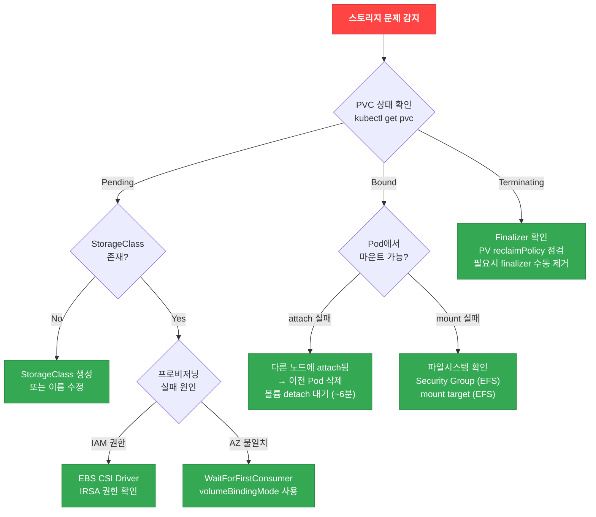

## 스토리지 디버깅 Decision Tree

**그림 1. 스토리지 디버깅 Decision Tree**



## EBS CSI Driver 디버깅

### 기본 점검

```bash
# EBS CSI Driver Pod 상태 확인
kubectl get pods -n kube-system -l app.kubernetes.io/name=aws-ebs-csi-driver

# Controller 로그 확인
kubectl logs -n kube-system -l app=ebs-csi-controller -c ebs-plugin --tail=100

# Node 로그 확인
kubectl logs -n kube-system -l app=ebs-csi-node -c ebs-plugin --tail=100

# Controller가 사용하는 자격 증명 경로 확인
# Pod Identity를 사용하는 경우: 연결(association) 확인
aws eks list-pod-identity-associations --cluster-name <cluster-name> \
  --query 'associations[?serviceAccount==`ebs-csi-controller-sa`]'
# IRSA를 사용하는 경우: ServiceAccount의 role-arn 어노테이션과 신뢰 정책 확인
kubectl describe sa ebs-csi-controller-sa -n kube-system
```

컨트롤러는 Pod Identity 연결 또는 IRSA 신뢰 정책 중 하나로 AWS 자격 증명을 받습니다. 권한 문제를 진단할 때는 둘 중 실제로 사용하는 경로를 먼저 확인한 뒤, 그 경로에 연결된 정책을 점검합니다.

### EBS CSI Driver 에러 패턴

**표 1. EBS CSI Driver 에러 메시지별 원인과 해결 방법**

| 에러 메시지 | 원인 | 해결 방법 |
|-------------|------|----------|
| `could not create volume` | 자격 증명 경로의 권한 부족 또는 서비스 한도 초과 | 메시지의 AWS 에러 코드(예: `UnauthorizedOperation`, `VolumeLimitExceeded`)를 확인하고, 컨트롤러가 사용하는 Pod Identity 연결 또는 IRSA 역할에 해당 작업 권한을 부여 |
| `volume is already attached to another node` | 이전 노드에서 미분리 | 이전 Pod/노드 정리, EBS 볼륨 detach 대기 (~6분) |
| `could not attach volume: already at max` | 인스턴스 EBS 볼륨 연결 한도 초과 | `MaximumEbsAttachments`/`AttachmentLimitType`가 더 큰 인스턴스 타입/크기로 변경하거나 PVC 워크로드를 재분산 (한도는 타입·크기별로 다름) |
| `failed to provision volume with StorageClass` | StorageClass 미존재 또는 설정 오류 | StorageClass 이름/파라미터 확인 |

### 인스턴스별 EBS 볼륨 제한 확인

```bash
# 인스턴스 타입의 EBS 연결 한도와 한도 유형 확인
aws ec2 describe-instance-types \
  --instance-types c5.xlarge m5.2xlarge \
  --query 'InstanceTypes[].{Type:InstanceType,MaxEBS:EbsInfo.MaximumEbsAttachments,LimitType:EbsInfo.AttachmentLimitType}' \
  --output table

# 노드의 현재 EBS 볼륨 사용량 확인
aws ec2 describe-volumes \
  --filters "Name=attachment.instance-id,Values=<instance-id>" \
  --query 'Volumes[].{VolumeId:VolumeId,State:Attachments[0].State}' \
  --output table
```

`AttachmentLimitType`이 `shared`인 대부분의 Nitro 인스턴스는 EBS 연결 한도를 네트워크 인터페이스, NVMe 인스턴스 스토어 볼륨과 공유하므로, 실제로 추가할 수 있는 EBS 볼륨 수는 `MaximumEbsAttachments`에서 이미 연결된 네트워크 인터페이스와 인스턴스 스토어 볼륨 수를 뺀 값입니다. `AttachmentLimitType`이 `dedicated`인 타입은 다른 장치와 무관하게 EBS 연결 한도까지 사용할 수 있습니다. 조회 결과가 비어 있거나 오류를 반환하면(예: 권한 부족, 지원되지 않는 리전) 한도를 추정하지 말고 자격 증명과 인스턴스 타입을 다시 확인합니다.

### 권장 StorageClass 설정

```yaml
apiVersion: storage.k8s.io/v1
kind: StorageClass
metadata:
  name: topology-aware-ebs
provisioner: ebs.csi.aws.com
parameters:
  type: gp3
  encrypted: "true"
  # gp3 성능 파라미터 (선택)
  iops: "3000"        # 기본 3,000 IOPS
  throughput: "125"   # 기본 125 MB/s
volumeBindingMode: WaitForFirstConsumer
allowVolumeExpansion: true
reclaimPolicy: Delete
```

:::tip WaitForFirstConsumer
`volumeBindingMode: WaitForFirstConsumer`를 사용하면 PVC가 Pod 스케줄링 시점에 바인딩됩니다. 이를 통해 **Pod이 스케줄링되는 AZ에 볼륨이 생성**되어 AZ 불일치 문제를 방지할 수 있습니다.
:::

## PVC 마운트 실패 패턴

### Pattern 1: AZ 불일치

EBS 볼륨은 단일 AZ에 존재하므로, Pod이 다른 AZ의 노드에 스케줄링되면 마운트가 실패합니다.

```bash
# 증상: Pod이 ContainerCreating 상태에서 멈춤
kubectl describe pod <pod-name>
# Events:
#   Warning  FailedAttachVolume  AttachVolume.Attach failed : ... volume is in a different availability zone

# PV의 AZ 확인
kubectl get pv <pv-name> -o jsonpath='{.metadata.labels.topology\.kubernetes\.io/zone}'

# PV에 고정된 노드 어피니티 확인 (스케줄러가 이 AZ로만 Pod을 배치함)
kubectl get pv <pv-name> -o jsonpath='{.spec.nodeAffinity}'

# Pod이 스케줄링된 노드의 AZ 확인
kubectl get node <node-name> -o jsonpath='{.metadata.labels.topology\.kubernetes\.io/zone}'
```

EBS 볼륨을 사용하는 PV는 `spec.nodeAffinity`에 볼륨이 존재하는 AZ가 고정됩니다. 스케줄러가 그 AZ에 가용 노드를 찾지 못하면 Pod이 다른 AZ로 가면서 연결이 실패합니다.

**해결 방법**: 새로 프로비저닝·바인딩하는 볼륨에는 `volumeBindingMode: WaitForFirstConsumer`를 사용합니다. 이 설정은 PVC 바인딩을 Pod 스케줄링 시점까지 지연시켜 볼륨이 Pod이 배치되는 AZ에 생성되도록 하며, 이미 다른 AZ에 생성된 기존 볼륨의 위치는 바꾸지 않습니다.

```yaml
apiVersion: storage.k8s.io/v1
kind: StorageClass
metadata:
  name: ebs-sc
provisioner: ebs.csi.aws.com
parameters:
  type: gp3
volumeBindingMode: WaitForFirstConsumer  # ← 신규 프로비저닝 시 AZ 불일치 방지
```

데이터가 이미 들어 있는 기존 볼륨이 다른 AZ에 묶여 있다면, 해당 볼륨의 AZ에 Pod을 스케줄링하거나(노드 어피니티·노드 셀렉터 사용), 의도적으로 스냅샷을 만들어 대상 AZ에 복원·복사하는 마이그레이션을 수행합니다.

### Pattern 2: EBS 볼륨 제한 초과

인스턴스 타입마다 연결 가능한 최대 EBS 볼륨 수가 제한되어 있습니다.

```bash
# 증상: Pod이 ContainerCreating 상태에서 멈춤
kubectl describe pod <pod-name>
# Events:
#   Warning  FailedAttachVolume  AttachVolume.Attach failed : ... maximum number of attachments

# 노드에 연결된 볼륨 수 확인
kubectl get node <node-name> -o json | jq '.status.volumesAttached | length'

# 인스턴스 타입의 EBS 연결 한도와 한도 유형 확인
aws ec2 describe-instance-types \
  --instance-types <instance-type> \
  --query 'InstanceTypes[0].EbsInfo.{Max:MaximumEbsAttachments,LimitType:AttachmentLimitType}'
```

**해결 방법**:
- `MaximumEbsAttachments`가 더 큰 인스턴스 타입/크기 사용 (연결 한도는 타입과 크기에 따라 다름)
- PVC를 사용하는 워크로드를 여러 노드에 재분산
- `AttachmentLimitType`이 `shared`인 경우, 루트 EBS 볼륨·네트워크 인터페이스·NVMe 인스턴스 스토어 볼륨이 같은 한도를 함께 소비하므로 실제 가용 EBS 수를 별도로 계산 (가용 EBS = `MaximumEbsAttachments` − 네트워크 인터페이스 − 인스턴스 스토어 볼륨)

### Pattern 3: ReadWriteOnce 제약

기본 gp3 파일시스템 PVC로 생성한 EBS 볼륨은 `ReadWriteOnce` (RWO)로 바인딩되어 한 번에 하나의 노드에서만 마운트할 수 있습니다.

```bash
# 증상: 두 번째 Pod이 ContainerCreating 상태에서 멈춤
kubectl describe pod <pod-name-2>
# Events:
#   Warning  FailedAttachVolume  Multi-Attach error for volume ... Volume is already exclusively attached

# PVC의 accessModes 확인
kubectl get pvc <pvc-name> -o jsonpath='{.spec.accessModes}'
# ["ReadWriteOnce"]
```

접근 모드는 요구 사항에 따라 구분합니다. `ReadWriteOnce`(RWO)는 하나의 노드에서 읽기·쓰기를 허용하고(그 노드의 여러 Pod은 가능), `ReadWriteOncePod`(RWOP)은 CSI 드라이버가 지원할 때 단일 Pod에만 접근을 제한하며, `ReadWriteMany`(RWX)는 여러 노드의 동시 접근을 허용합니다. EBS CSI의 일반 gp3 파일시스템 볼륨은 RWX를 제공하지 않으므로, 여러 노드의 동시 접근이 필요하면 EFS를 사용합니다. (EBS Multi-Attach는 io1/io2 볼륨과 클러스터 인식 애플리케이션을 전제로 하는 별도 기능으로, 이 일반 파일시스템 예시의 범위를 벗어납니다.)

**해결 방법**:
- 단일 Pod만 PVC를 사용하도록 설계 (StatefulSet 권장). 단일 Pod 접근을 강제하려면 PVC를 `ReadWriteOncePod`로 선언
- 여러 Pod이 동시 접근이 필요하면 EFS 사용 (ReadWriteMany 지원)

```yaml
# ReadWriteMany가 필요한 경우 EFS 사용
apiVersion: v1
kind: PersistentVolumeClaim
metadata:
  name: shared-data
spec:
  accessModes:
    - ReadWriteMany  # EFS만 지원
  storageClassName: efs-sc
  resources:
    requests:
      storage: 10Gi
```

```yaml
# ReadWriteMany가 필요한 경우 EFS 사용
apiVersion: v1
kind: PersistentVolumeClaim
metadata:
  name: shared-data
spec:
  accessModes:
    - ReadWriteMany  # EFS만 지원
  storageClassName: efs-sc
  resources:
    requests:
      storage: 10Gi
```

### Pattern 4: 볼륨 Detach 지연

이전 Pod이 삭제되어도 EBS 볼륨이 즉시 detach되지 않아 새 Pod 시작이 지연될 수 있습니다.

```bash
# 증상: 이전 Pod 삭제 후 새 Pod이 6분간 ContainerCreating
kubectl describe pod <pod-name>
# Events:
#   Warning  FailedAttachVolume  Volume is already attached to another node

# AWS 콘솔에서 볼륨 상태 확인
aws ec2 describe-volumes --volume-ids <volume-id> \
  --query 'Volumes[0].Attachments[0].State'
# "detaching" or "attached"

# CSI VolumeAttachment와 이전 노드 상태 확인
kubectl get volumeattachment | grep <volume-id>
kubectl get node <old-node-name>
```

**원인**: 이전 노드가 비정상 종료되어 Kubernetes가 볼륨을 안전하게 분리하지 못하면, 컨트롤러는 노드가 복구되거나 조건부 타임아웃(기본 약 6분)이 지날 때까지 강제 분리를 보류합니다.

**해결 방법**: 데이터 정합성을 지키는 순서로 진행합니다.

1. CSI `VolumeAttachment`와 이전 노드의 상태를 확인해 볼륨을 아직 쓰고 있는 쓰기 주체(Pod·노드)가 없는지 검증합니다.
2. 이전 Pod과 노드가 정상이면 Pod을 정상 삭제해 일반적인 unmount·detach가 완료되도록 합니다. 노드가 복구 불가 상태면 쓰기 주체를 차단(펜싱)하기 위해 해당 노드를 cordon·drain하거나 제거합니다.
3. 위 경로가 모두 막히고 볼륨이 특정 비정상 노드에 묶인 것이 확인된 경우에만, 마지막 수단으로 강제 detach를 사용합니다. 강제 detach는 쓰기가 완료되지 않은 상태에서 분리할 수 있어 파일시스템 손상 위험이 있으므로, 먼저 스냅샷을 만들고 분리 후 파일시스템 검사·복구(`fsck`)를 수행합니다.

```bash
# 마지막 수단: 강제 detach (파일시스템 손상 위험 — 사전 스냅샷 및 사후 fsck 필요)
aws ec2 create-snapshot --volume-id <volume-id> --description "pre-force-detach"
aws ec2 detach-volume --volume-id <volume-id> --force
```

StatefulSet에서 순차 종료가 필요한 작업에는 `podManagementPolicy: Parallel`을 사용하지 않아 Pod이 순서대로 종료·분리되도록 합니다.

## EFS CSI Driver 디버깅

### 기본 점검

```bash
# EFS CSI Driver Pod 상태 확인
kubectl get pods -n kube-system -l app.kubernetes.io/name=aws-efs-csi-driver

# Controller 로그 확인
kubectl logs -n kube-system -l app=efs-csi-controller -c efs-plugin --tail=100

# EFS 파일시스템 상태 확인
aws efs describe-file-systems --file-system-id <fs-id>

# Mount Target 확인 (각 AZ에 존재해야 함)
aws efs describe-mount-targets --file-system-id <fs-id>
```

### EFS 체크리스트

EFS 마운트는 노드가 자신과 같은 AZ의 Mount Target을 통해 파일시스템 DNS 이름에 접속하는 것을 전제로 합니다. 따라서 Pod이 실행될 수 있는 각 AZ에 Mount Target이 있어야 그 AZ의 노드가 로컬 Mount Target으로 접속합니다. One Zone 스토리지 클래스의 EFS는 단일 AZ에만 존재하므로, 다른 AZ의 노드는 교차 AZ로 접속해 그 AZ 장애 시 가용성이 떨어지고 교차 AZ 데이터 전송 비용이 발생합니다. 이 경우 Pod을 파일시스템이 있는 AZ로 스케줄링하는 것을 함께 검토합니다.

- [ ] Mount Target이 Pod이 실행되는 모든 AZ의 서브넷에 존재하는지 확인 (One Zone EFS는 교차 AZ 접속의 가용성·전송 비용을 함께 검토)
- [ ] Mount Target의 Security Group이 **TCP 2049 (NFS)** 포트를 허용하는지 확인
- [ ] 노드의 Security Group에서 EFS Mount Target으로의 아웃바운드 TCP 2049 허용 확인

```bash
# Mount Target 목록 확인 (각 Mount Target ID 수집)
aws efs describe-mount-targets --file-system-id <fs-id> \
  --query 'MountTargets[].{MountTargetId:MountTargetId,SubnetId:SubnetId,AZ:AvailabilityZoneName}' \
  --output table

# 각 Mount Target에 적용된 Security Group 확인
aws efs describe-mount-target-security-groups --mount-target-id <mount-target-id>

# 해당 Security Group의 인바운드 TCP 2049 규칙과 소스 확인
aws ec2 describe-security-groups --group-ids <sg-id> \
  --query 'SecurityGroups[0].IpPermissions[?FromPort==`2049`].{Protocol:IpProtocol,From:FromPort,To:ToPort,Sources:IpRanges[].CidrIp,SourceSGs:UserIdGroupPairs[].GroupId}'

# 노드 Security Group의 아웃바운드 TCP 2049 규칙 확인
aws ec2 describe-security-groups --group-ids <node-sg-id> \
  --query 'SecurityGroups[0].IpPermissionsEgress[?FromPort==`2049` || IpProtocol==`-1`]'
```

위 명령은 각 Mount Target의 Security Group, 프로토콜·포트 구간·소스, 노드의 아웃바운드 경로를 보여주는 진단 자료입니다. 규칙이 존재한다는 것이 종단 간 연결이 성립함을 증명하지는 않으므로, 서브넷 라우팅과 NACL 등 다른 경로 요소도 함께 확인합니다.

### EFS 마운트 실패 디버깅

```bash
# Pod 이벤트 확인
kubectl describe pod <pod-name>
# Events:
#   Warning  FailedMount  MountVolume.SetUp failed : ... connection timed out

# EFS Mount Target이 모든 AZ에 있는지 확인
aws efs describe-mount-targets --file-system-id <fs-id> \
  --query 'MountTargets[].{AZ:AvailabilityZoneName,State:LifeCycleState,IP:IpAddress}'

# Pod이 실행 중인 노드의 AZ 확인
kubectl get pod <pod-name> -o jsonpath='{.spec.nodeName}' | \
  xargs -I {} kubectl get node {} -o jsonpath='{.metadata.labels.topology\.kubernetes\.io/zone}'
```

### EFS StorageClass 예제

```yaml
apiVersion: storage.k8s.io/v1
kind: StorageClass
metadata:
  name: efs-sc
provisioner: efs.csi.aws.com
parameters:
  provisioningMode: efs-ap  # Access Point 자동 생성
  fileSystemId: fs-1234567890abcdef0
  directoryPerms: "700"
  gidRangeStart: "1000"
  gidRangeEnd: "2000"
  basePath: "/dynamic_provisioning"
```

## PV/PVC 상태 확인 및 stuck 해결

### PVC 상태별 조치

```bash
# PVC 상태 확인
kubectl get pvc -n <namespace>

# PV 상태 확인
kubectl get pv
```

**표 2. PVC 상태별 의미와 조치**

| PVC 상태 | 의미 | 조치 |
|----------|------|------|
| **Pending** | 볼륨 프로비저닝 대기 | StorageClass 확인, CSI Driver 로그 확인 |
| **Bound** | PV와 바인딩 완료 | 정상 |
| **Lost** | 바인딩된 PV가 사라져 바인딩이 끊김 | 잃어버린 바인딩과 백업 자산을 먼저 조사 (아래 참조) |
| **Terminating** | 삭제 중 (finalizer로 인해 멈춤) | 참조 Pod·컨트롤러를 먼저 진단 (아래 참조) |

### Terminating 상태에서 멈춘 PVC 해결

PVC가 Terminating에서 멈춘 것은 finalizer가 아직 끝나지 않은 정리 작업(연결된 Pod 종료, 볼륨 분리 등)을 기다린다는 뜻입니다. finalizer를 바로 지우기 전에 원인을 먼저 진단합니다.

```bash
# 1. PVC를 아직 참조하는 Pod이 있는지 확인
kubectl get pods -n <namespace> -o json \
  | jq -r '.items[] | select(.spec.volumes[]?.persistentVolumeClaim.claimName=="<pvc-name>") | .metadata.name'

# 2. PVC에 남아 있는 finalizer와 컨트롤러 동작 확인
kubectl get pvc <pvc-name> -n <namespace> -o jsonpath='{.metadata.finalizers}'
kubectl describe pvc <pvc-name> -n <namespace>
```

참조하는 Pod이 남아 있으면 먼저 해당 Pod을 정리하고, CSI 컨트롤러가 정상 동작하는지 로그로 확인합니다. 이 과정에서 finalizer가 자동으로 제거되는 것이 정상 경로입니다. finalizer가 지정하는 정리 작업을 명시적으로 완료(예: 볼륨 분리 확인, 백업)한 뒤에, 그 의미를 이해한 특정 finalizer만 선택적으로 제거합니다. 모든 finalizer를 한 번에 `null`로 지우지 않습니다.

```bash
# finalizer의 의무를 수행한 뒤, 이해한 특정 finalizer만 제거 (예시: kubernetes.io/pvc-protection)
kubectl patch pvc <pvc-name> -n <namespace> --type=json \
  -p='[{"op":"remove","path":"/metadata/finalizers/0"}]'
```

:::danger Finalizer 수동 제거 주의
Finalizer를 수동으로 제거하면 연결된 스토리지 리소스(EBS 볼륨 등)가 정리되지 않을 수 있습니다. 먼저 볼륨이 사용 중이지 않은지 확인하고, AWS 콘솔에서 고아(orphan) 볼륨이 생기지 않는지 확인하세요.
:::

### Lost 상태인 PVC 처리

PVC가 Lost인 것은 바인딩되어 있던 PV가 사라졌다는 뜻이므로, 재생성에 앞서 왜 바인딩이 끊겼는지와 백업 EBS 볼륨이 남아 있는지를 먼저 조사합니다.

```bash
# PVC가 가리키던 PV와 백업 볼륨 상태 확인
kubectl describe pvc <pvc-name> -n <namespace>
kubectl get pv -o json | jq -r '.items[] | select(.spec.claimRef.name=="<pvc-name>") | {name:.metadata.name, phase:.status.phase, policy:.spec.persistentVolumeReclaimPolicy}'
```

데이터를 의도적으로 재사용하려면, 먼저 사용 중인 워크로드를 정지(quiesce)하고 PV의 reclaimPolicy를 `Retain`으로 두어 삭제를 막습니다. 어떤 PVC가 소유자인지 기록한 뒤, 새 PVC를 해당 PV에 명시적으로 예약(prebind: PV의 `claimRef`를 새 PVC로 지정)하고, 마지막에 원하는 reclaimPolicy로 복원합니다. 기존 `claimRef`를 지워 재사용할 때는 그것이 의도된 정리인 경우에만 수행하며, 조사 없이 바로 `claimRef`를 비우지 않습니다.

```bash
# 재사용이 의도된 경우에만: 특정 PV를 특정 PVC에 예약 (prebind)
kubectl patch pv <pv-name> --type=merge \
  -p '{"spec":{"claimRef":{"namespace":"<namespace>","name":"<new-pvc-name>"}}}'
```

### 고아 EBS 볼륨 후보 조사 {#고아-ebs-볼륨-정리}

아래 명령은 더 이상 사용되지 않을 수 있는 EBS 볼륨 **후보**를 보여줍니다. `available` 상태이고 PVC 태그가 있다고 해서 바로 삭제해도 되는 볼륨은 아닙니다.

```bash
# Kubernetes가 생성했고 현재 available인 EBS 볼륨 후보 조회
aws ec2 describe-volumes \
  --filters "Name=tag:kubernetes.io/created-for/pvc/name,Values=*" \
  --query 'Volumes[?State==`available`].{VolumeId:VolumeId,PVC:Tags[?Key==`kubernetes.io/created-for/pvc/name`]|[0].Value,Size:Size,Created:CreateTime}' \
  --output table
```

삭제하기 전에 다음을 확인합니다. 먼저 볼륨이 어느 계정·리전·클러스터에 속하는지(`kubernetes.io/cluster/<name>` 태그 등)를 확인해 현재 운영 중인 클러스터 소유가 아닌지 판별합니다. 다음으로 그 볼륨을 참조하는 PV·PVC·VolumeAttachment가 정말 없는지, 보존(백업·스냅샷)이나 복구 요구가 없는지 확인합니다. 마지막으로 의도한 소유자의 삭제 결정을 받고, 복구 가능한 백업(스냅샷)을 확보한 뒤에, 폐기가 확인된 특정 볼륨만 삭제합니다.

```bash
# 위 조건이 모두 충족되고 폐기가 확인된 특정 볼륨만 삭제
aws ec2 create-snapshot --volume-id <volume-id> --description "pre-delete backup"
aws ec2 delete-volume --volume-id <volume-id>
```

## 스토리지 성능 최적화

### gp3 IOPS/처리량 조정

gp3 볼륨은 IOPS와 처리량을 독립적으로 조정할 수 있습니다.

```yaml
apiVersion: storage.k8s.io/v1
kind: StorageClass
metadata:
  name: fast-ebs
provisioner: ebs.csi.aws.com
parameters:
  type: gp3
  iops: "16000"      # 예시 값 (워크로드에 맞게 선택)
  throughput: "1000" # 예시 값 (워크로드에 맞게 선택)
volumeBindingMode: WaitForFirstConsumer
```

:::info gp3 제한
- 기본: 3,000 IOPS / 125 MiB/s (추가 비용 없음)
- 최대(일반 리전): 80,000 IOPS / 2,000 MiB/s. 최대 IOPS는 볼륨 크기 160 GiB 이상에서(500 IOPS/GiB), 최대 처리량은 8,000 IOPS 이상·16 GiB 이상에서 가능합니다.
- 최대(Outposts): 16,000 IOPS / 1,000 MiB/s
- 처리량 상한은 프로비저닝한 IOPS당 최대 0.25 MiB/s입니다(예: 16,000 IOPS → 최대 4,000 MiB/s까지 요청 가능하나 제품 상한 2,000 MiB/s에 묶임). 위 StorageClass의 `iops`/`throughput` 값은 선택 예시이며, 실제 값은 제품 상한과 이 비율 안에서 워크로드에 맞게 지정합니다.
:::

### 볼륨 확장

```bash
# PVC 크기 증가 (allowVolumeExpansion: true 필요)
kubectl patch pvc <pvc-name> -p '{"spec":{"resources":{"requests":{"storage":"50Gi"}}}}'

# 확장 진행 상황과 이벤트 확인
kubectl describe pvc <pvc-name>
# Conditions:
#   Type                      Status  LastTransitionTime                 Reason
#   ----                      ------  ------------------                 ------
#   FileSystemResizePending   True    ...                                Waiting for user to restart pod
```

먼저 `kubectl describe pvc`의 Conditions와 이벤트로 확장이 어디까지 진행됐는지 확인합니다. EBS CSI와 많은 파일시스템은 온라인 확장을 지원하므로, 이 경우 Pod을 재시작하지 않고도 컨트롤러가 블록 장치와 파일시스템을 확장합니다. `FileSystemResizePending` 조건이 남아 재시작이 필요한 경우에만, 해당 Pod을 소유한 컨트롤러(Deployment·StatefulSet 등)와 애플리케이션의 중단·가용성 절차를 먼저 확인한 뒤 Pod을 재생성합니다. 임의로 모든 Pod을 삭제하지 않습니다.

```bash
# 재시작이 필요한 경우에만: 소유 컨트롤러를 확인하고 가용성 절차에 따라 Pod 재생성
kubectl get pod <pod-name> -o jsonpath='{.metadata.ownerReferences}'
kubectl delete pod <pod-name>
```

:::warning 볼륨 축소 불가
Kubernetes와 EBS 모두 볼륨 축소를 지원하지 않습니다. 볼륨을 줄이려면 새 PVC를 생성하고 데이터를 마이그레이션해야 합니다.
:::

## 스토리지 문제 체크리스트

### PVC Pending

- [ ] StorageClass가 존재하는가?
- [ ] CSI Driver Pod이 Running 상태인가?
- [ ] CSI Driver의 IRSA 권한이 올바른가?
- [ ] 충분한 EBS 볼륨 쿼터가 있는가?

### PVC Bound but Pod ContainerCreating

- [ ] Pod과 PV가 같은 AZ에 있는가? (EBS)
- [ ] 노드의 EBS 볼륨 제한을 초과하지 않았는가?
- [ ] 다른 노드에 볼륨이 attach되어 있지 않은가?
- [ ] EFS Mount Target Security Group이 TCP 2049를 허용하는가? (EFS)

### PVC Terminating

- [ ] PVC를 사용하는 Pod이 모두 삭제되었는가?
- [ ] PV의 reclaimPolicy가 Delete로 설정되어 있는가?
- [ ] Finalizer가 PVC 삭제를 차단하고 있는가?

---

## 관련 문서

- [워크로드 디버깅](./workload.md) - Pod 상태별 문제 해결
- [네트워킹 디버깅](./networking.md) - Service, DNS 문제 해결
- [옵저버빌리티](./observability.md) - 스토리지 메트릭 모니터링
