> **📌 기준 환경**: EKS 1.33+, Karpenter v1.x, Kubernetes 1.30+

## 1. 개요

Kubernetes의 Pod 스케줄링은 서비스 가용성, 성능, 비용 효율성에 직접적인 영향을 미치는 핵심 메커니즘입니다. 올바른 스케줄링 전략을 적용하면 다음과 같은 이점을 얻을 수 있습니다:

- **고가용성**: 장애 도메인 분리를 통한 서비스 중단 최소화
- **성능 최적화**: 워크로드 특성에 맞는 노드 배치로 응답 시간 개선
- **리소스 효율**: 노드 리소스의 균형 있는 활용으로 비용 절감
- **안정적 운영**: 우선순위 기반 리소스 보장 및 Preemption 제어

본 문서는 Pod 스케줄링의 핵심 개념부터 고급 패턴까지 다루며, EKS 환경에서 실전 적용 가능한 YAML 예시와 의사결정 가이드를 제공합니다.

:::info 고가용성 아키텍처 참고
본 문서는 **Pod 수준**의 스케줄링 패턴에 초점을 맞춥니다. 클러스터 전체의 고가용성 아키텍처(Multi-AZ 전략, Topology Spread, Cell Architecture)는 [EKS 고가용성 아키텍처 가이드](/docs/eks-best-practices/operations-reliability/eks-resiliency-guide)를 참조하세요.
:::

### 스케줄링이 중요한 이유

| 시나리오 | 잘못된 스케줄링 | 올바른 스케줄링 |
|---------|----------------|----------------|
| **장애 격리** | 모든 replica가 같은 노드 → 해당 노드 장애에 함께 노출 | Anti-Affinity로 직접적인 동시 노출을 줄이며, 다른 의존성의 장애는 별도로 평가 |
| **리소스 경합** | CPU 집약적 Pod들이 한 노드에 집중 → 성능 저하 | Node Affinity로 워크로드 분리 → 안정적 성능 |
| **비용 최적화** | GPU 필요 없는 Pod가 GPU 노드에 배치 → 비용 낭비 | Taints/Tolerations로 전용 노드 격리 → 비용 절감 |
| **업그레이드 안전성** | 롤아웃 전략·Readiness 미설계, 노드 Drain 시 PDB 미설정 → 가용 replica 과다 감소 | 롤링 업데이트는 workload controller 설정으로 제어하고, Eviction API 기반 노드 Drain은 PDB로 제한 |
| **긴급 대응** | 우선순위 미설정 → 중요 워크로드 Pending | PriorityClass 설정 → 중요 Pod 우선 스케줄링 |

---

## 2. Kubernetes 스케줄링 기본 원리

### 2.1 스케줄링 프로세스

Kubernetes 스케줄러는 3단계 프로세스를 거쳐 Pod를 노드에 배치합니다:

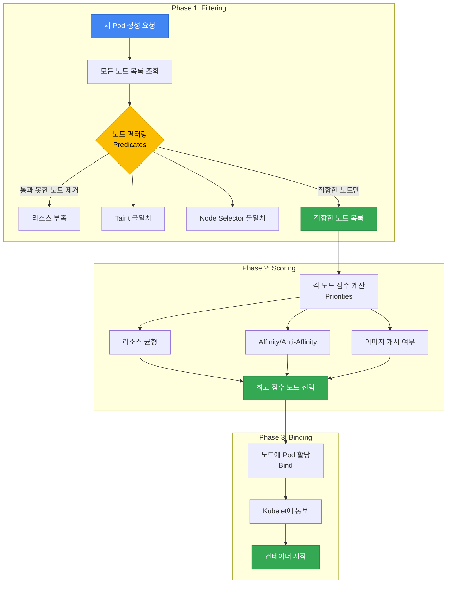

**1. Filtering (Predicates)**: 요구사항을 충족하지 못하는 노드를 제외
- 리소스 부족 (CPU, Memory)
- Taints/Tolerations 불일치
- Node Selector 조건 미충족
- Volume 토폴로지 제약 (EBS AZ-Pinning)
- Port 충돌

**2. Scoring (Priorities)**: 남은 노드들에 점수를 매겨 최적의 노드 선택
- 리소스 밸런스 (균등 사용)
- Pod Affinity/Anti-Affinity 만족도
- 이미지 캐시 존재 여부
- Topology Spread 균등도
- 노드 Preference (PreferredDuringScheduling)

**3. Binding**: 최고 점수 노드에 Pod를 할당하고 Kubelet에 통보

:::tip 스케줄링 실패 디버깅
Pod가 `Pending` 상태로 남아있다면, `kubectl describe pod <pod-name>`으로 Events 섹션을 확인하세요. `Insufficient cpu`, `No nodes available`, `Taint not tolerated` 등의 메시지로 실패 원인을 파악할 수 있습니다.
:::

### 2.2 스케줄링에 영향을 주는 요소

| 요소 | 타입 | 영향 단계 | 강제성 | 주요 사용 사례 |
|------|------|-----------|--------|---------------|
| **Node Selector** | Pod | Filtering | Hard | 특정 노드 타입 지정 (GPU, ARM) |
| **Node Affinity** | Pod | Filtering/Scoring | Hard/Soft | 세밀한 노드 선택 조건 |
| **Pod Affinity** | Pod | Filtering/Scoring | Hard/Soft | 필수 조건으로 후보를 거르고 선호 조건으로 점수 부여 |
| **Pod Anti-Affinity** | Pod | Filtering/Scoring | Hard/Soft | Pod를 서로 멀리 배치 |
| **Taints/Tolerations** | Node + Pod | Filtering/Scoring, NoExecute 퇴거 | Effect에 따라 다름 | 새 배치의 허용·회피와 기존 Pod 퇴거를 구분 |
| **Topology Spread** | Pod | Filtering/Scoring | Hard/Soft | 선택된 Pod의 도메인별 수를 비교 |
| **PriorityClass** | Pod | 대기열 순서, 허용된 Preemption | 다른 배치 조건을 우회하지 않음 | 높은 우선순위 Pod를 먼저 검토 |
| **Resource Requests** | Pod | Filtering | Hard | 노드 allocatable과 기존 요청량을 기준으로 배치 가능 여부 판단 |
| **PDB** | Pod Group | Eviction API | Hard | 중단 예산을 초과하는 Eviction 요청 제한 |

**Hard vs Soft 제약:**
- **Hard (Required)**: 조건을 충족하지 못하면 스케줄링 실패 → `Pending` 상태
- **Soft (Preferred)**: 조건을 충족하지 못해도 다른 Hard 조건을 만족하는 노드에 배치 가능

---

## 3. Node Affinity & Anti-Affinity

### 3.1 Node Selector (기본)

Node Selector는 가장 간단한 노드 선택 메커니즘으로, 레이블 기반 정확한 일치(exact match)만 지원합니다.

```yaml
apiVersion: apps/v1
kind: Deployment
metadata:
  name: gpu-workload
spec:
  replicas: 2
  selector:
    matchLabels:
      app: ml-training
  template:
    metadata:
      labels:
        app: ml-training
    spec:
      nodeSelector:
        node.kubernetes.io/instance-type: g5.2xlarge
        workload-type: gpu
      containers:
      - name: trainer
        image: ml/trainer:v2.0
        resources:
          requests:
            nvidia.com/gpu: 1
          limits:
            nvidia.com/gpu: 1
```

GPU 예제는 드라이버와 device plugin이 `nvidia.com/gpu`를 노드 자원으로 제공하는 환경을 전제로 합니다. 이미지 이름은 예시이므로 사용할 이미지와 node label을 확인해야 합니다. [GPU 자원 규칙](https://v1-34.docs.kubernetes.io/docs/tasks/manage-gpus/scheduling-gpus/)에 따라 GPU는 `limits`만 지정하거나, `requests`와 `limits`를 같은 값으로 지정합니다.

**제한사항**: Node Selector는 `AND` 조건만 지원하며, `OR`, `NOT`, 비교 연산자 등을 사용할 수 없습니다. 복잡한 조건이 필요하면 Node Affinity를 사용하세요.

### 3.2 Node Affinity 상세

Node Affinity는 Node Selector의 확장 버전으로, 복잡한 논리 조건과 선호도(preference)를 표현할 수 있습니다.

#### Required vs Preferred

| 타입 | 동작 | 사용 시기 |
|------|------|----------|
| `requiredDuringSchedulingIgnoredDuringExecution` | 조건 충족 필수 (Hard) | 반드시 특정 노드에 배치해야 할 때 |
| `preferredDuringSchedulingIgnoredDuringExecution` | 조건 선호 (Soft, 가중치 기반) | 선호하지만 대안 허용할 때 |

:::info IgnoredDuringExecution의 의미
`IgnoredDuringExecution`은 스케줄링 후 node label이 조건과 달라져도 이 affinity 규칙만으로 Pod를 퇴거하거나 재배치하지 않는다는 의미입니다. [Kubernetes 1.34의 Node Affinity API](https://v1-34.docs.kubernetes.io/docs/concepts/scheduling-eviction/assign-pod-node/#node-affinity)에는 실행 중 조건을 다시 강제하는 `RequiredDuringExecution` 필드가 없습니다.
:::

#### 연산자 종류

| 연산자 | 설명 | 예시 |
|--------|------|------|
| `In` | 값이 목록에 포함됨 | `values: ["t3.xlarge", "t3.2xlarge"]` |
| `NotIn` | 값이 목록에 없거나 해당 label이 없음 | `values: ["t2.micro", "t2.small"]`; label 존재가 필요하면 `Exists`도 지정 |
| `Exists` | 키가 존재함 (값 무관) | 레이블 존재 여부만 확인 |
| `DoesNotExist` | 키가 존재하지 않음 | 특정 레이블이 없는 노드 선택 |
| `Gt` | 값이 크다 (숫자) | `values: ["100"]` (CPU 코어 수 등) |
| `Lt` | 값이 작다 (숫자) | `values: ["10"]` |

#### 사용 사례별 YAML 예시

**예시 1: GPU 노드에 ML 워크로드 배치 (Hard)**

```yaml
apiVersion: apps/v1
kind: Deployment
metadata:
  name: ml-training
spec:
  replicas: 3
  selector:
    matchLabels:
      app: ml-training
  template:
    metadata:
      labels:
        app: ml-training
    spec:
      affinity:
        nodeAffinity:
          requiredDuringSchedulingIgnoredDuringExecution:
            nodeSelectorTerms:
            - matchExpressions:
              - key: node.kubernetes.io/instance-type
                operator: In
                values:
                - g5.2xlarge
                - g5.4xlarge
              - key: karpenter.sh/capacity-type
                operator: Exists
              - key: karpenter.sh/capacity-type
                operator: NotIn
                values:
                - spot  # GPU 워크로드는 Spot 제외
      containers:
      - name: trainer
        image: ml/trainer:v3.0
        resources:
          requests:
            nvidia.com/gpu: 1
            cpu: "4"
            memory: 16Gi
          limits:
            nvidia.com/gpu: 1
```

이 예제는 Karpenter의 capacity-type label이 있고 값이 `spot`이 아닌 노드를 선택합니다. CPU·메모리 요청은 시스템 예약량과 DaemonSet 요청량을 제외한 여유 자원에 들어가야 합니다.

**예시 2: 인스턴스 패밀리 선호 (Soft, 가중치)**

```yaml
apiVersion: apps/v1
kind: Deployment
metadata:
  name: api-server
spec:
  replicas: 6
  selector:
    matchLabels:
      app: api-server
  template:
    metadata:
      labels:
        app: api-server
    spec:
      affinity:
        nodeAffinity:
          # 필수: On-Demand 노드만 사용
          requiredDuringSchedulingIgnoredDuringExecution:
            nodeSelectorTerms:
            - matchExpressions:
              - key: karpenter.sh/capacity-type
                operator: In
                values:
                - on-demand
          # 선호: c7i > c6i > m6i 순서
          preferredDuringSchedulingIgnoredDuringExecution:
          - weight: 100
            preference:
              matchExpressions:
              - key: node.kubernetes.io/instance-type
                operator: In
                values:
                - c7i.xlarge
                - c7i.2xlarge
          - weight: 80
            preference:
              matchExpressions:
              - key: node.kubernetes.io/instance-type
                operator: In
                values:
                - c6i.xlarge
                - c6i.2xlarge
          - weight: 50
            preference:
              matchExpressions:
              - key: node.kubernetes.io/instance-type
                operator: In
                values:
                - m6i.xlarge
                - m6i.2xlarge
      containers:
      - name: api
        image: api-server:v2.5
        resources:
          requests:
            cpu: "1"
            memory: 2Gi
```

**예시 3: 정적 AZ 선호 (데이터베이스 클라이언트)**

이 예시는 현재 RDS writer가 있는 AZ를 새 Pod의 배치 위치로 선호합니다. `us-east-1a`와 `DB_ENDPOINT`를 실제 AZ와 RDS endpoint로 바꿉니다. 이 설정만으로 기존 Pod가 이동하거나 RDS failover 후의 writer AZ를 따라가지는 않습니다.

Multi-AZ DB instance에서 failover가 발생하면 endpoint의 DNS 대상이 바뀝니다. 클라이언트가 변경된 주소를 사용하도록 DNS 캐싱과 재연결 동작을 확인합니다. 같은 AZ 통신 여부와 비용 변화는 실제 요청 경로를 기준으로 평가합니다.

```yaml
apiVersion: apps/v1
kind: Deployment
metadata:
  name: db-client
spec:
  replicas: 4
  selector:
    matchLabels:
      app: db-client
  template:
    metadata:
      labels:
        app: db-client
    spec:
      affinity:
        nodeAffinity:
          # 정적 선호이며 writer AZ를 자동 추적하지 않음
          preferredDuringSchedulingIgnoredDuringExecution:
          - weight: 100
            preference:
              matchExpressions:
              - key: topology.kubernetes.io/zone
                operator: In
                values:
                - us-east-1a
      containers:
      - name: client
        image: db-client:v1.2
        env:
        - name: DB_ENDPOINT
          value: "REPLACE_WITH_RDS_ENDPOINT"
```

### 3.3 Node Anti-Affinity

Node Anti-Affinity는 명시적인 문법이 없지만, Node Affinity의 `NotIn`, `DoesNotExist` 연산자로 구현합니다.

```yaml
apiVersion: apps/v1
kind: Deployment
metadata:
  name: avoid-spot
spec:
  replicas: 3
  selector:
    matchLabels:
      app: critical-service
  template:
    metadata:
      labels:
        app: critical-service
    spec:
      affinity:
        nodeAffinity:
          requiredDuringSchedulingIgnoredDuringExecution:
            nodeSelectorTerms:
            - matchExpressions:
              # Label이 있는 노드 중 Spot 노드 회피
              - key: karpenter.sh/capacity-type
                operator: Exists
              - key: karpenter.sh/capacity-type
                operator: NotIn
                values:
                - spot
              # Label이 있는 노드 중 ARM 아키텍처 회피
              - key: kubernetes.io/arch
                operator: Exists
              - key: kubernetes.io/arch
                operator: NotIn
                values:
                - arm64
      containers:
      - name: app
        image: critical-service:v1.0
```

---

## 4. Pod Affinity & Anti-Affinity

Pod Affinity와 Anti-Affinity는 **Pod 간의 관계**를 기반으로 스케줄링 결정을 내립니다. 이를 통해 관련된 Pod들을 가까이 배치하거나(Affinity), 멀리 배치(Anti-Affinity)할 수 있습니다.

### 4.1 Pod Affinity

Pod Affinity는 특정 Pod가 있는 토폴로지 도메인(노드, AZ, 리전)을 배치 조건이나 선호로 사용합니다. Service나 프록시가 요청별로 선택하는 endpoint는 별도 라우팅 설정에 따릅니다.

**주요 사용 사례:**
- **Cache Locality**: 캐시 서버와 애플리케이션을 같은 노드에 배치하여 지연 시간 최소화
- **Data Locality**: 데이터 처리 워크로드를 데이터 소스와 가까이 배치
- **Communication Intensive**: 빈번하게 통신하는 마이크로서비스를 같은 AZ에 배치

```yaml
apiVersion: apps/v1
kind: Deployment
metadata:
  name: cache-client
spec:
  replicas: 3
  selector:
    matchLabels:
      app: cache-client
  template:
    metadata:
      labels:
        app: cache-client
    spec:
      affinity:
        podAffinity:
          # Hard: Redis Pod와 같은 노드에 배치 (초저지연 요구사항)
          requiredDuringSchedulingIgnoredDuringExecution:
          - labelSelector:
              matchExpressions:
              - key: app
                operator: In
                values:
                - redis
            topologyKey: kubernetes.io/hostname
      containers:
      - name: client
        image: cache-client:v1.0
```

**topologyKey 설명:**

| topologyKey | 범위 | 설명 |
|-------------|------|------|
| `kubernetes.io/hostname` | 노드 | 같은 노드에 배치 (가장 강력한 co-location) |
| `topology.kubernetes.io/zone` | AZ | 같은 AZ에 배치 |
| `topology.kubernetes.io/region` | 리전 | 같은 리전에 배치 |
| 커스텀 레이블 | 사용자 정의 | 예: `rack`, `datacenter` |

**Soft Affinity 예시 (선호, 대안 허용):**

```yaml
apiVersion: apps/v1
kind: Deployment
metadata:
  name: web-frontend
spec:
  replicas: 6
  selector:
    matchLabels:
      app: web-frontend
  template:
    metadata:
      labels:
        app: web-frontend
    spec:
      affinity:
        podAffinity:
          # Soft: API 서버와 같은 AZ 선호; 요청 라우팅은 별도 설정
          preferredDuringSchedulingIgnoredDuringExecution:
          - weight: 100
            podAffinityTerm:
              labelSelector:
                matchExpressions:
                - key: app
                  operator: In
                  values:
                  - api-server
              topologyKey: topology.kubernetes.io/zone
      containers:
      - name: frontend
        image: web-frontend:v2.0
```

### 4.2 Pod Anti-Affinity

Pod Anti-Affinity는 selector로 선택한 Pod들이 같은 노드나 AZ에 모이지 않도록 배치를 제한하거나 분산을 선호하게 합니다. 아래 그림은 세 도메인에 분산된 배치 예시입니다. 실제 배치는 후보 노드와 다른 제약에 따라 달라지며, 분산해도 공유 데이터베이스 같은 의존성의 장애는 남습니다. Hard AZ anti-affinity를 쓰려면 admission 설정이 해당 topology key를 허용해야 합니다.

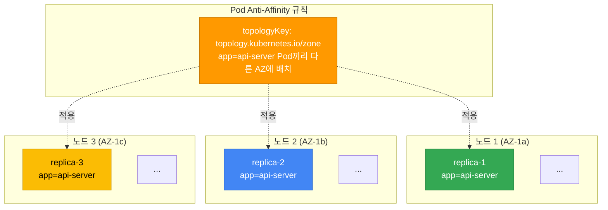

#### Hard Anti-Affinity (장애 도메인 격리)

```yaml
apiVersion: apps/v1
kind: Deployment
metadata:
  name: api-server
spec:
  replicas: 6
  selector:
    matchLabels:
      app: api-server
  template:
    metadata:
      labels:
        app: api-server
    spec:
      affinity:
        podAntiAffinity:
          # Hard: 각 노드에 최대 1개 replica만 배치 (노드 장애 격리)
          requiredDuringSchedulingIgnoredDuringExecution:
          - labelSelector:
              matchExpressions:
              - key: app
                operator: In
                values:
                - api-server
            topologyKey: kubernetes.io/hostname
      containers:
      - name: api
        image: api-server:v3.0
        resources:
          requests:
            cpu: "1"
            memory: 2Gi
```

:::warning Hard Anti-Affinity 주의사항
Hard hostname anti-affinity는 선택한 Pod를 적격 hostname마다 최대 한 개로 제한합니다. 예를 들어 다른 제약을 만족하는 노드가 3개이면 replica 5개 중 최소 2개가 Pending일 수 있습니다. 리소스·taint·볼륨·롤아웃 surge에 필요한 여유도 확인합니다. Soft로 바꾸면 이 분리 조건을 완화하지만 다른 원인의 Pending까지 없애지는 않습니다.
:::

#### Soft Anti-Affinity (권장 패턴)

```yaml
apiVersion: apps/v1
kind: Deployment
metadata:
  name: worker
spec:
  replicas: 10
  selector:
    matchLabels:
      app: worker
  template:
    metadata:
      labels:
        app: worker
    spec:
      affinity:
        podAntiAffinity:
          # Soft: 가능한 한 다른 노드에 분산 배치 (유연성 확보)
          preferredDuringSchedulingIgnoredDuringExecution:
          - weight: 100
            podAffinityTerm:
              labelSelector:
                matchExpressions:
                - key: app
                  operator: In
                  values:
                  - worker
              topologyKey: kubernetes.io/hostname
      containers:
      - name: worker
        image: worker:v2.1
        resources:
          requests:
            cpu: "500m"
            memory: 1Gi
```

#### Hard vs Soft 선택 기준

| 시나리오 | 권장 | 이유 |
|---------|------|------|
| 적격 hostname·용량이 충분함 | Hard 고려 | 선택한 Pod를 hostname마다 최대 한 개로 제한하며 rollout surge 여유도 필요 |
| 적격 hostname보다 replica가 많음 | 용량 확장 또는 Soft 검토 | Soft는 같은 노드 배치를 허용하며 장애 노출이 달라짐 |
| AZ별 장애 노출을 줄여야 함 | Topology Spread 또는 허용된 Hard AZ anti-affinity | Hard AZ 규칙은 적격 AZ마다 최대 한 개이며 admission 허용 여부 확인 |
| 일반 워크로드 | Soft 고려 | 다른 제약과 함께 분산 선호를 점수화 |
| 빠른 스케일링 필요 | 제약·용량 함께 검토 | Soft만으로 Pending 해소나 배치 성공을 보장하지 않음 |

### 4.3 Affinity/Anti-Affinity vs Topology Spread 비교

| 비교 항목 | Pod Anti-Affinity | Topology Spread Constraints |
|----------|-------------------|----------------------------|
| **목적** | 선택한 Pod와의 분리 | 선택한 Pod 집합의 도메인별 분산 |
| **세밀함** | Pod selector와 topology key | Pod selector와 도메인별 수 |
| **복잡성** | 규칙·selector 구성에 따름 | 규칙·도메인 구성에 따름 |
| **유연성** | Hard/Soft 선택 | Hard skew 제한 또는 Soft 분산 선호 |
| **주요 사용** | selector에 일치하는 replica 분리 | 같은 namespace에서 labelSelector에 일치하는 Pod 집합의 균형 |
| **AZ 분산** | 가능하며 Hard 규칙은 admission 확인 | 적격 도메인·maxSkew·minDomains의 의미를 함께 확인 |
| **노드 분산** | 가능 | hostname 기준 Hard 제한 또는 Soft 점수화 |
| **권장 조합** | Topology Spread (AZ) + Anti-Affinity (노드) | |

:::info Topology Spread Constraints 참고
Topology Spread Constraints는 Pod Anti-Affinity보다 더 정교한 분산 제어를 제공합니다. 자세한 내용과 YAML 예시는 [EKS 고가용성 아키텍처 가이드](/docs/eks-best-practices/operations-reliability/eks-resiliency-guide#pod-topology-spread-constraints)를 참조하세요.
:::

#### 4.3.1 Topology Spread Constraints 실전 패턴

Topology Spread는 같은 namespace에서 selector에 일치하는 Pod가 각 도메인에 몇 개 있는지 비교합니다. 도메인은 `topologyKey`가 가리키는 노드나 AZ이며, 계산에 포함할 도메인은 node selector/affinity, topology label과 `nodeAffinityPolicy`·`nodeTaintsPolicy`에 따라 정해집니다. CPU·메모리 여유나 cordon 여부만 세어서 이 수를 대신할 수는 없습니다.

아래 예시는 Kubernetes 1.34 기준입니다. `DoNotSchedule`은 Pod 수의 차이인 skew가 기준을 넘는 배치를 막고, `ScheduleAnyway`는 더 고르게 분산되는 후보를 선호합니다. `minDomains`가 skew 계산에 미치는 영향은 패턴 2에서 설명합니다. 리소스 부족 등 다른 스케줄링 조건은 두 방식 모두에서 배치를 막을 수 있습니다.

##### 패턴 1: Multi-AZ 균등 분배 (기본)

선택한 replica의 AZ별 수를 제한하는 Hard 패턴입니다. 세 적격 AZ와 충분한 용량을 가정한 배치를 보여줍니다.

```yaml
apiVersion: apps/v1
kind: Deployment
metadata:
  name: multi-az-app
  namespace: production
spec:
  replicas: 9
  selector:
    matchLabels:
      app: multi-az-app
  template:
    metadata:
      labels:
        app: multi-az-app
    spec:
      topologySpreadConstraints:
      - maxSkew: 1
        topologyKey: topology.kubernetes.io/zone
        whenUnsatisfiable: DoNotSchedule
        labelSelector:
          matchLabels:
            app: multi-az-app
      containers:
      - name: app
        image: myapp:v1.0
        resources:
          requests:
            cpu: 500m
            memory: 512Mi
```

**동작 방식:**
- `maxSkew: 1`: 새 Pod를 포함한 대상 AZ의 일치 Pod 수와 global minimum의 차이를 검사
- 세 적격 AZ에서 다른 제약도 만족하면 9개 replica의 3/3/3 배치가 가능
- `DoNotSchedule`: 해당 후보에서 skew 제한을 넘으면 배치하지 않음

**사용 시나리오:**
- 미션 크리티컬 서비스의 AZ 장애 대응
- 클라이언트 트래픽이 모든 AZ에서 균등하게 들어오는 경우
- 데이터센터 수준의 장애 격리가 필요한 경우

##### 패턴 2: minDomains 활용 (global minimum 계산) {#패턴-2-mindomains-활용-최소-az-보장}

`minDomains`는 필요한 AZ 수를 생성하거나 가용성을 보장하지 않습니다. 적격 도메인이 이 값보다 적으면 Hard skew 계산의 global minimum을 0으로 취급합니다. Kubernetes 1.30부터 GA이며, 이전 버전은 feature gate 상태를 확인해야 합니다.

```yaml
apiVersion: apps/v1
kind: Deployment
metadata:
  name: ha-critical-service
  namespace: production
spec:
  replicas: 6
  selector:
    matchLabels:
      app: ha-critical-service
      tier: critical
  template:
    metadata:
      labels:
        app: ha-critical-service
        tier: critical
    spec:
      topologySpreadConstraints:
      - maxSkew: 1
        minDomains: 3  # 적격 도메인이 3개 미만이면 global minimum은 0
        topologyKey: topology.kubernetes.io/zone
        whenUnsatisfiable: DoNotSchedule
        labelSelector:
          matchLabels:
            app: ha-critical-service
      containers:
      - name: service
        image: critical-service:v2.5
        resources:
          requests:
            cpu: "1"
            memory: 1Gi
          limits:
            cpu: "2"
            memory: 2Gi
```

**동작 방식:**
- 적격 AZ가 세 개 이상이면 가장 작은 일치 Pod 수가 global minimum입니다.
- 세 AZ의 조건·용량이 맞으면 6개 replica를 2/2/2로 배치할 수 있지만, AZ별 최소 두 개나 SLA를 보장하지 않습니다.
- 적격 AZ가 두 개이고 현재 수가 2/2이면 global minimum은 0입니다. 새 일치 Pod는 `3 - 0 > 1`이므로 두 후보 모두에서 이 제약을 통과하지 못합니다.

**사용 시나리오:**
- 세 도메인보다 적은 환경에서 skew가 커지는 배치를 의도적으로 제한할 때
- 도메인 감소 시 Pending을 허용할지, 다른 배치 정책을 택할지 미리 결정할 때

:::warning minDomains 설정 시 주의사항
도메인이 부족하다고 모든 Pod가 항상 Pending인 것은 아닙니다. 두 빈 도메인에서는 각각 첫 Pod가 `1 - 0 <= 1`을 만족할 수 있습니다. AZ 축소 시 복구 용량과 다른 필터를 확인하고, 배치를 우선하는 정책은 10.3절의 Soft AZ 예시와 비교하세요.
:::

##### 패턴 3: Anti-Affinity + Topology Spread 조합

선택한 replica를 hostname마다 최대 한 개로 제한하면서 AZ skew 조건도 함께 적용합니다. 두 제약을 모두 만족하는 후보와 충분한 용량이 있어야 합니다.

```yaml
apiVersion: apps/v1
kind: Deployment
metadata:
  name: combined-constraints-app
  namespace: production
spec:
  replicas: 12
  selector:
    matchLabels:
      app: combined-app
  template:
    metadata:
      labels:
        app: combined-app
        version: v3.0
    spec:
      # 1. Topology Spread: AZ 간 균등 분산 (Hard)
      topologySpreadConstraints:
      - maxSkew: 1
        minDomains: 3
        topologyKey: topology.kubernetes.io/zone
        whenUnsatisfiable: DoNotSchedule
        labelSelector:
          matchLabels:
            app: combined-app

      # 2. Anti-Affinity: 노드 간 분산 (Hard)
      affinity:
        podAntiAffinity:
          requiredDuringSchedulingIgnoredDuringExecution:
          - labelSelector:
              matchExpressions:
              - key: app
                operator: In
                values:
                - combined-app
            topologyKey: kubernetes.io/hostname

      containers:
      - name: app
        image: combined-app:v3.0
        resources:
          requests:
            cpu: "2"
            memory: 4Gi
```

**동작 방식:**
- 세 적격 AZ에 각각 네 개의 적격 hostname과 용량이 있으면 12개 replica의 4/4/4 배치가 가능
- hostname anti-affinity와 AZ skew 조건을 함께 만족해야 하며, rollout surge에도 추가 후보가 필요

**효과:**
- 위 배치가 이미 성립했다면 한 노드 장애에 직접 노출되는 선택 Pod는 최대 한 개
- 한 AZ 장애 바깥에 위치한 replica는 `12 - 4 = 8`개이며, 이는 건강한 endpoint 수나 처리 용량의 측정값이 아님
- 의존성·스토리지·네트워크와 잔여 AZ 용량을 별도로 확인해야 서비스 가용성을 평가할 수 있음

**사용 시나리오:**
- 노드·AZ 공동 장애 노출을 줄여야 하는 API 서버와 결제 게이트웨이
- AZ 감소 시 Hard 제약으로 생길 수 있는 Pending과 대체 용량을 사전에 평가할 때

##### 패턴 4: 다중 Topology Spread (Zone + Node)

하나의 Pod Spec에서 여러 토폴로지 레벨의 분산을 동시에 제어합니다.

```yaml
apiVersion: apps/v1
kind: Deployment
metadata:
  name: multi-level-spread
  namespace: production
spec:
  replicas: 18
  selector:
    matchLabels:
      app: multi-level-app
  template:
    metadata:
      labels:
        app: multi-level-app
    spec:
      topologySpreadConstraints:
      # 제약 1: AZ 레벨 분산 (Hard)
      - maxSkew: 1
        minDomains: 3
        topologyKey: topology.kubernetes.io/zone
        whenUnsatisfiable: DoNotSchedule
        labelSelector:
          matchLabels:
            app: multi-level-app

      # 제약 2: 노드 레벨 분산 (Soft)
      - maxSkew: 2
        topologyKey: kubernetes.io/hostname
        whenUnsatisfiable: ScheduleAnyway
        labelSelector:
          matchLabels:
            app: multi-level-app

      containers:
      - name: app
        image: multi-level-app:v1.5
        resources:
          requests:
            cpu: "1"
            memory: 2Gi
```

**동작 방식:**
- AZ Hard 제약과 hostname Soft 선호를 함께 평가하며, AZ 배치 후 노드별로 나누는 두 단계 알고리즘이 아님
- 세 적격 AZ에서 다른 조건도 만족하면 18개 replica의 6/6/6 배치가 가능
- hostname의 `ScheduleAnyway`는 skew를 줄이는 후보에 점수를 주며, 각 AZ 안의 노드별 Pod 수 차이를 최대 두 개로 제한하지 않음
- Soft hostname 선호를 만족하지 못해도 이 선호가 배치를 금지하지는 않지만, AZ Hard 제약 등 다른 필터는 Pending을 만들 수 있음

**사용 시나리오:**
- 대규모 replica(10개 이상) 배포
- 노드 수가 유동적인 환경 (Karpenter 오토스케일링)
- AZ 분산은 필수, 노드 분산은 선호하는 경우

##### 패턴 비교표

| 패턴 | maxSkew | minDomains | whenUnsatisfiable | 추가 제약 | 복잡도 | 권장 Replica 수 |
|------|---------|------------|-------------------|----------|--------|----------------|
| **패턴 1: 기본 Multi-AZ** | 1 | - | DoNotSchedule | 없음 | 낮음 | 3~12 |
| **패턴 2: minDomains** | 1 | 3 | DoNotSchedule | 없음 | 중간 | 6~20 |
| **패턴 3: Anti-Affinity 조합** | 1 | 3 | DoNotSchedule | Hard Anti-Affinity | 높음 | 12~50 |
| **패턴 4: 다중 Spread** | 1, 2 | 3 | Mixed | 동시 적용하는 AZ 제약·hostname 선호 | 높음 | 15+ |

##### 트러블슈팅: Topology Spread 실패 원인

| 증상 | 원인 | 해결 방법 |
|------|------|----------|
| Pod가 Pending 상태 | Hard skew 제한 또는 다른 필터를 만족하는 후보가 없음 | Events와 적격 도메인·일치 Pod 수·용량을 함께 확인 |
| 특정 AZ에만 Pod 집중 | Soft 선호, 적격 도메인 부족 등 | 실제 후보와 요구 가용성을 확인한 뒤 Hard 전환의 Pending 위험 평가 |
| 신규 AZ 추가 시 재배치 안됨 | 스케줄러는 기존 Pod를 자동 재배치하지 않음 | 별도 재배치·rollout의 대상과 disruption 영향을 검토 |
| `minDomains` 설정 후 Pending 증가 | 도메인 감소로 global minimum이 0이 되었을 수 있음 | 후보별 skew를 계산하며 AZ 개수만으로 원인을 단정하지 않음 |

:::tip Topology Spread 디버깅 명령어
같은 클러스터의 Pod·Node 스냅샷을 사용하고 수집 시각을 기록합니다. `spec.nodeSelector`는 입력 제약이며, 실제 AZ는 `spec.nodeName`으로 연결한 Node의 label에서 확인합니다. 두 목록은 원자적 스냅샷이 아닙니다.

```bash
: "${CONTEXT:?대상 Kubernetes context 지정}"
: "${NAMESPACE:?워크로드 namespace 지정}"
: "${SELECTOR:?워크로드 label selector 지정}"
kubectl --context "$CONTEXT" get pods -n "$NAMESPACE" -l "$SELECTOR" -o json > pods.json
kubectl --context "$CONTEXT" get nodes -o json > nodes.json
```

다음 오프라인 함수는 전달받은 JSON 객체를 연결합니다. 노드·AZ별 수를 집계할 때 미배치 Pod, 누락된 Node, 알 수 없는 AZ와 `Unknown` readiness를 별도로 유지합니다.

```python
def placement_report(pod_list, node_list):
    """Join supplied snapshots only; labels are observations, not ownership proof."""
    nodes = {n["metadata"]["name"]: n for n in node_list["items"]}
    result = []
    for pod in pod_list["items"]:
        name = pod.get("spec", {}).get("nodeName")
        node = nodes.get(name)
        labels = (node or {}).get("metadata", {}).get("labels", {})
        ready = next((c.get("status", "Unknown")
                      for c in (node or {}).get("status", {}).get("conditions", [])
                      if c.get("type") == "Ready"), "Unknown")
        result.append({
            "namespace": pod["metadata"].get("namespace", "default"),
            "pod": pod["metadata"]["name"],
            "node": name,
            "placement": ("unscheduled" if not name else
                          "node_missing" if node is None else "node_found"),
            "zone": labels.get("topology.kubernetes.io/zone"),
            "nodeReady": ready,
            "providerID": (node or {}).get("spec", {}).get("providerID"),
            "nodepoolLabel": labels.get("karpenter.sh/nodepool"),
            "nodegroupLabel": labels.get("eks.amazonaws.com/nodegroup"),
            "owners": pod["metadata"].get("ownerReferences", []),
        })
    return result
```
:::

**권장 조합 패턴:**

```yaml
apiVersion: apps/v1
kind: Deployment
metadata:
  name: best-practice-app
spec:
  replicas: 6
  selector:
    matchLabels:
      app: best-practice-app
  template:
    metadata:
      labels:
        app: best-practice-app
    spec:
      # Topology Spread: AZ 간 균등 분산 (Hard)
      topologySpreadConstraints:
      - maxSkew: 1
        topologyKey: topology.kubernetes.io/zone
        whenUnsatisfiable: DoNotSchedule
        labelSelector:
          matchLabels:
            app: best-practice-app
        minDomains: 3
      # Anti-Affinity: 노드 간 분산 (Soft)
      affinity:
        podAntiAffinity:
          preferredDuringSchedulingIgnoredDuringExecution:
          - weight: 100
            podAffinityTerm:
              labelSelector:
                matchExpressions:
                - key: app
                  operator: In
                  values:
                  - best-practice-app
              topologyKey: kubernetes.io/hostname
      containers:
      - name: app
        image: app:v1.0
```

---

## 5. Taints & Tolerations

Taint는 노드에, toleration은 Pod에 지정합니다. 스케줄러는 Pod가 tolerate하지 않는 taint의 effect에 따라 배치를 차단하거나 피합니다. Toleration이 있어도 그 노드로 배치가 보장되지는 않으며 affinity와 자원 조건도 만족해야 합니다.

**개념:**
- **Taint**: 노드에 적용 (예: "이 노드는 GPU 전용입니다")
- **Toleration**: Pod에 적용 (예: "나는 GPU 노드를 Tolerate합니다")

### 5.1 Taint 효과 (Effect)

| Effect | 동작 | 기존 Pod 영향 | 사용 시기 |
|--------|------|--------------|----------|
| `NoSchedule` | 새 Pod 스케줄링 차단 | 기존 Pod 유지 | 신규 전용 노드 생성 시 |
| `PreferNoSchedule` | 가능하면 스케줄링 차단 (Soft) | 기존 Pod 유지 | 선호 회피 (대안 허용) |
| `NoExecute` | 일치하는 toleration이 없는 Pod의 배치 차단 | Toleration이 없으면 퇴거; 있으면 `tolerationSeconds`에 따라 결정 | 노드 상태 변화에 따른 퇴거 정책 |

**Taint 적용 명령어:**

```bash
# NoSchedule: 신규 Pod 스케줄링 차단
kubectl taint nodes node1 workload-type=gpu:NoSchedule

# NoExecute: 신규 차단 + 기존 Pod Evict
kubectl taint nodes node1 maintenance=true:NoExecute

# Taint 제거 (마지막에 '-' 추가)
kubectl taint nodes node1 workload-type=gpu:NoSchedule-
```

### 5.2 일반적인 Taint 패턴

#### 패턴 1: 전용 노드 그룹 (GPU, High-Memory)

```yaml
# 노드에 Taint 적용 (kubectl 또는 Karpenter)
# kubectl taint nodes gpu-node-1 nvidia.com/gpu=present:NoSchedule

# GPU Pod가 Toleration 선언
apiVersion: v1
kind: Pod
metadata:
  name: gpu-job
spec:
  tolerations:
  - key: nvidia.com/gpu
    operator: Equal
    value: present
    effect: NoSchedule
  nodeSelector:
    node.kubernetes.io/instance-type: g5.2xlarge
  containers:
  - name: trainer
    image: ml/trainer:v1.0
    resources:
      limits:
        nvidia.com/gpu: 1
```

#### 패턴 2: 시스템 워크로드 격리

이 독립 실행형 Karpenter 예시는 `v1.14.1`의 NodePool/EC2NodeClass 규약을 기준으로 합니다. 참조하는 `default` EC2NodeClass에는 대상 AMI, 노드 역할, 서브넷, 보안 그룹이 미리 구성되어 있어야 합니다. 설치된 컨트롤러·CRD와 클러스터 버전의 호환성을 확인하며, 참조 자체가 이 의존 리소스를 생성하지는 않습니다.

```yaml
# 시스템 전용 NodePool
apiVersion: karpenter.sh/v1
kind: NodePool
metadata:
  name: system-pool
spec:
  template:
    spec:
      nodeClassRef:
        group: karpenter.k8s.aws
        kind: EC2NodeClass
        name: default
      requirements:
      - key: node.kubernetes.io/instance-type
        operator: In
        values: ["c6i.large", "c6i.xlarge"]
      taints:
      - key: workload-type
        value: system
        effect: NoSchedule
  limits:
    cpu: "20"
---
# 시스템 DaemonSet (모니터링 에이전트)
apiVersion: apps/v1
kind: DaemonSet
metadata:
  name: monitoring-agent
spec:
  selector:
    matchLabels:
      app: monitoring-agent
  template:
    metadata:
      labels:
        app: monitoring-agent
    spec:
      tolerations:
      - key: workload-type
        operator: Equal
        value: system
        effect: NoSchedule
      # 이 DaemonSet 기본 toleration이 모든 사용자 정의 taint 우회를 허용하는 것은 아님
      - key: node.kubernetes.io/not-ready
        operator: Exists
        effect: NoExecute
      - key: node.kubernetes.io/unreachable
        operator: Exists
        effect: NoExecute
      containers:
      - name: agent
        image: monitoring-agent:v2.0
```

#### 패턴 3: 노드 유지보수 (Drain 준비)

계획된 유지보수에서 PDB를 적용하려면 `kubectl drain`의 기본 Eviction API 경로를 사용합니다. 아래 `NoExecute` 예시는 Taint 기반 삭제 동작을 보여주며, PDB를 적용하는 Drain 절차를 대신하지 않습니다.

```bash
# Step 1: 노드에 NoExecute Taint 적용
kubectl taint nodes node-1 maintenance=true:NoExecute

# 결과: Toleration 없는 모든 Pod가 즉시 Evict되고 다른 노드로 이동
# NoExecute에 의한 삭제는 Eviction API를 거치지 않으므로 PDB로 제한되지 않음

# Step 2: 유지보수 완료 후 Taint 제거
kubectl taint nodes node-1 maintenance=true:NoExecute-
kubectl uncordon node-1
```

### 5.3 Toleration 설정

#### Operator: Equal vs Exists

```yaml
# Equal: 정확한 key=value 일치 필요
tolerations:
- key: workload-type
  operator: Equal
  value: gpu
  effect: NoSchedule

---
# Exists: key만 존재하면 됨 (value 무시)
tolerations:
- key: workload-type
  operator: Exists
  effect: NoSchedule

---
# Wildcard 문법: readiness·격리 guard를 포함한 모든 taint를 tolerate함
# DaemonSet의 기본 권장값으로 사용하지 않음
tolerations:
- operator: Exists
```

#### tolerationSeconds (NoExecute 전용)

`NoExecute` taint를 tolerate하지 않는 기존 Pod는 퇴거 대상이 됩니다. 일치하는 toleration에 `tolerationSeconds`가 있으면 그 시간 동안 유지하고, 시간을 생략하면 해당 taint로는 시간 제한 없이 유지합니다.

```yaml
apiVersion: v1
kind: Pod
metadata:
  name: resilient-app
spec:
  tolerations:
  # 노드가 NotReady 상태가 되어도 300초 동안 유지 (일시적 장애 대응)
  - key: node.kubernetes.io/not-ready
    operator: Exists
    effect: NoExecute
    tolerationSeconds: 300
  # 노드가 Unreachable 상태가 되어도 300초 동안 유지
  - key: node.kubernetes.io/unreachable
    operator: Exists
    effect: NoExecute
    tolerationSeconds: 300
  containers:
  - name: app
    image: app:v1.0
```

**자동으로 추가되는 toleration과 명시한 toleration은 다릅니다.** 기본 admission 설정에서는 일반 Pod에 `not-ready`·`unreachable` toleration이 없을 때 각각 300초의 toleration을 추가합니다. 직접 명시한 `NoExecute` toleration에서 시간을 생략하면 300초가 아닌 무기한 허용입니다. DaemonSet controller는 두 taint에 시간 제한이 없는 toleration을 추가합니다. 이 시간은 장애 감지부터 서비스 복구까지 걸리는 전체 시간을 보장하지 않습니다.

### 5.4 EKS 기본 Taints

아래는 EKS에서도 사용하는 Kubernetes의 노드 상태 taint와 기본 toleration 동작입니다. [공식 taint·toleration 설명](https://v1-34.docs.kubernetes.io/docs/concepts/scheduling-eviction/taint-and-toleration/)에서 스케줄링 차단과 퇴거를 구분해 확인할 수 있습니다.

| Taint | 적용 대상 | 효과 | 대응 방법 |
|-------|----------|------|----------|
| `node.kubernetes.io/not-ready` | Ready=False | NoExecute | 기본 admission은 일반 Pod에 300초, DaemonSet controller는 무기한 toleration 추가 |
| `node.kubernetes.io/unreachable` | Ready=Unknown | NoExecute | 기본 admission은 일반 Pod에 300초, DaemonSet controller는 무기한 toleration 추가 |
| `node.kubernetes.io/disk-pressure` | 디스크 부족 노드 | NoSchedule | DaemonSet에 자동 추가; 다른 Pod도 명시 가능 |
| `node.kubernetes.io/memory-pressure` | 메모리 부족 노드 | NoSchedule | BestEffort가 아닌 Pod와 DaemonSet에 자동 추가 |
| `node.kubernetes.io/pid-pressure` | PID 부족 노드 | NoSchedule | DaemonSet에 자동 추가; 다른 Pod도 명시 가능 |
| `node.kubernetes.io/network-unavailable` | 네트워크 미구성 노드 | NoSchedule | hostNetwork DaemonSet에는 자동 toleration; 일반 워크로드는 네트워크 준비 확인 |

Toleration은 부족한 자원이나 연결을 복구하지 않습니다. 스케줄링이 허용되어도 노드 압박에 따른 퇴거나 애플리케이션 실패가 발생할 수 있습니다.

### 5.5 Karpenter에서 Taint 관리

Karpenter는 NodePool에서 선언적으로 Taint를 관리합니다:

```yaml
apiVersion: karpenter.sh/v1
kind: NodePool
metadata:
  name: gpu-pool
spec:
  template:
    spec:
      requirements:
      - key: node.kubernetes.io/instance-type
        operator: In
        values: ["g5.xlarge", "g5.2xlarge"]
      - key: karpenter.sh/capacity-type
        operator: In
        values: ["on-demand"]
      # 노드 프로비저닝 시 자동으로 Taint 적용
      taints:
      - key: nvidia.com/gpu
        value: present
        effect: NoSchedule
      - key: workload-type
        value: ml
        effect: NoSchedule
      nodeClassRef:
        group: karpenter.k8s.aws
        kind: EC2NodeClass
        name: gpu-nodes
  limits:
    cpu: "100"
    memory: 500Gi
```

Karpenter가 프로비저닝하는 모든 노드에 자동으로 Taint가 적용되므로, 수동으로 `kubectl taint` 명령을 실행할 필요가 없습니다.

### 5.6 Cluster Autoscaler에서 Karpenter로 마이그레이션

Cluster Autoscaler는 기존 ASG의 크기를 조정하고, Karpenter는 Pod의 요구 조건에 맞춰 새 노드를 프로비저닝합니다. 마이그레이션할 때는 두 컨트롤러의 관리 범위와 Pod의 실제 배치를 함께 확인해야 합니다.

먼저 대상 AWS 계정, 역할/profile, 리전, Kubernetes context, 워크로드 namespace, ASG/관리형 노드 그룹과 NodePool을 확인합니다. NodePool 필드는 Karpenter `v1.14.1` 기준이며, 참조 EC2NodeClass에는 호환 AMI·IAM·네트워크 설정이 있어야 합니다. Cluster Autoscaler는 Kubernetes minor 버전과 맞춰야 합니다. 아래 설정 조각은 Kubernetes/CA `1.34`를 사용합니다.

롤백할 수 있도록 현재 CA 설치, launch template, 목표 용량과 워크로드 배치 설정을 보관합니다. 주차별 일정은 예시입니다. 실제로 다음 단계로 진행할지는 워크로드 상태, 용량과 데이터 검증 결과로 결정합니다.

#### 5.6.1 스케줄링 동작 차이

Cluster Autoscaler와 Karpenter의 핵심 차이는 **노드 프로비저닝 방식**과 **Pod 스케줄링과의 통합 수준**입니다.

##### 동작 비교

아래 표는 두 컨트롤러의 **메커니즘과 설정 제약**을 비교합니다. 프로비저닝 속도, 노드 준비 시간, 비용 절감률은 워크로드, AMI, 리전, 용량 상황에 따라 달라지므로 측정 없이 단정하지 않습니다. 측정값이 필요하면 동일 조건에서 트리거→용량 확보→노드 등록→Pod 바인딩→워크로드 준비 시간을 각각 측정해 비교하십시오.

| 비교 항목 | Cluster Autoscaler | Karpenter |
|----------|-------------------|-----------|
| **트리거 방식** | 스케줄링 불가 Pod를 감지하면 설정된 스캔 주기로 ASG `DesiredCapacity` 조정을 요청 | 스케줄링 불가 Pod를 감지하면 NodeClaim을 만들고 AWS provider가 EC2 인스턴스를 생성 |
| **확장 경로** | ASG(관리형 노드 그룹 포함)의 용량을 조정하고 Pod 적합성을 시뮬레이션. ASG MixedInstancePolicy 사용 시 모든 인스턴스 타입이 동일한 CPU/메모리/GPU 형태여야 함 | Pod 요구사항에 맞는 허용 인스턴스/용량 옵션 중에서 선택해 NodeClaim·노드를 생성 |
| **노드 선택 단위** | 미리 정의·발견된 ASG 그룹 단위 | NodePool `requirements`가 허용하는 인스턴스 타입 집합 중 Pod 요구사항 기반 선택 |
| **용량 타입 처리** | ASG별로 Spot/On-Demand를 분리 설정 | NodePool `requirements`에 허용 용량 타입을 선언. 검토한 AWS provider는 price-capacity-optimized 할당을 사용하며, "항상 최저가"로 단정할 수 없음 |
| **Bin Packing** | ASG 단위로 시뮬레이션 | Pod 요구사항을 인식해 노드 단위로 결정 |
| **Taints/Tolerations 인식** | ASG UserData로 노드에 적용(Pod 적합성 시뮬레이션에 반영) | NodePool `template.spec.taints`로 네이티브 선언 |
| **Topology Spread 인식** | 노드 그룹 라벨/스케줄링 속성 가정에 의존 | kube-scheduler의 Topology Spread 제약을 인식해 프로비저닝 |
| **통합 수준** | Kubernetes 외부 컨트롤러(AWS Cloud Provider 구현) | Kubernetes 네이티브 (CRD 기반) |

##### 확장 시나리오 예시

**시나리오: GPU를 요청하는 Pod 3개 생성**

**Cluster Autoscaler 동작:**
```text
1. GPU Pod 3개를 기존 노드에 배치할 수 없다.
2. CA가 설정된 스캔 주기로 스케줄링 불가 Pod를 평가한다.
3. 후보 노드 그룹을 시뮬레이션하고 적합한 GPU ASG의 용량 확장을 요청한다.
4. ASG가 인스턴스를 시작하고 노드가 등록되어 런타임·GPU 리소스를 초기화한다.
5. 제약을 충족하면 kube-scheduler가 Pod를 바인딩하고 kubelet이 컨테이너를 시작한다.
6. 트리거부터 용량 확보, 노드 등록, 바인딩, 워크로드 준비까지의 시간을 각각 측정한다.
```

**Karpenter 동작:**
```text
1. GPU Pod 3개를 기존 노드에 배치할 수 없다.
2. Karpenter가 Pod·NodePool 제약에 따라 프로비저닝 결정을 배치 처리한다.
3. Karpenter가 제약에 따라 NodeClaim을 생성하고 AWS provider가 적합한 인스턴스 offering을 선택한다.
4. provider v1.14.1의 인스턴스 생성 경로는 EC2 CreateFleet를 사용한다.
5. 노드 등록·리소스 초기화 후 kube-scheduler가 배치 가능한 Pod를 바인딩하고 kubelet이 시작한다.
6. 소요 시간은 용량, AMI, 네트워크, 드라이버, 워크로드 시작에 따라 달라진다. 실측 비교가 아닌 흐름 예시다.
```

##### 비용 최적화 차이

**Cluster Autoscaler:**
- ASG별로 Spot/On-Demand 분리 설정 필요
- 인스턴스 타입 변경 시 LaunchTemplate 수동 업데이트
- 과도한 프로비저닝(over-provisioning) 발생 가능

**Karpenter:**
- NodePool requirements에 허용할 capacity type을 선언하며, 배열 순서가 On-Demand 우선순위를 뜻하지 않습니다.
- 허용된 인스턴스/용량 옵션 중에서 Pod 요구사항에 맞는 노드를 선택합니다. 검토한 AWS provider는 price-capacity-optimized 할당을 사용하며, 항상 최저가 옵션만 고르는 것은 아닙니다.
- Pod 요구사항에 정확히 맞는 노드 프로비저닝

**단가 비교 예시 (검증되지 않은 예시 계산):**

아래는 비용 구조를 설명하기 위한 **예시 계산**이며 실측 데이터가 아닙니다. 가격은 리전·날짜·OS·테넌시·구매 옵션에 따라 달라지므로, 아래 시간당 가격은 1차 가격 스냅샷으로 확인하기 전에는 현재 값으로 가정하지 마십시오. 또한 2 vCPU 인스턴스라고 해서 2 vCPU 전체가 Pod에 할당 가능한 것은 아닙니다. 시스템·DaemonSet 예약분과 kubelet 예약분을 뺀 allocatable이 실제 배치 가능 용량입니다. 따라서 아래 단가 차이가 그대로 TCO 절감으로 이어지지 않으며, 실제 절감률은 동일 워크로드·SLO·노드 allocatable·사용률·기간을 측정해야 알 수 있습니다.

```yaml
# 아래 가격은 예시 값이며 실측이 아님. 1차 가격 소스로 확인 필요
# Cluster Autoscaler: 고정 ASG
# m5.2xlarge (8 vCPU, 32GB) → 예시 단가 $0.384/시간
# → ASG가 큰 노드만 제공하면 작은 Pod도 큰 노드에 배치될 수 있음

# Karpenter: 유연한 선택
# m5.large (2 vCPU, 8GB) → 예시 단가 $0.096/시간
# → Pod 요구사항에 맞춰 더 작은 노드 선택 가능

# 예시 단가만 쓰면 1 - 0.096 / 0.384 = 0.75 (단가 기준 75%)
# 단, 이는 단가 산술이며 노드 allocatable 오버헤드, 사용률, 기간을 반영한 실제 절감률이 아님
```

#### 5.6.2 마이그레이션 체크리스트

Cluster Autoscaler에서 Karpenter로의 안전한 전환을 위한 단계별 가이드입니다.

##### 1단계: NodePool 정의 (ASG → NodePool 매핑)

기존 ASG 설정을 Karpenter NodePool CRD로 변환합니다.

**기존 Cluster Autoscaler 설정:**
```yaml
# ASG: eks-general-purpose-asg
# - 인스턴스 타입: m5.xlarge, m5.2xlarge
# - 용량 타입: On-Demand
# - AZ: us-east-1a, us-east-1b, us-east-1c
```

**Karpenter NodePool 변환:**
```yaml
apiVersion: karpenter.sh/v1
kind: NodePool
metadata:
  name: general-purpose
spec:
  template:
    spec:
      expireAfter: 720h  # 노드 수명 30일 예시
      requirements:
      # 인스턴스 타입: ASG LaunchTemplate에서 가져옴
      - key: node.kubernetes.io/instance-type
        operator: In
        values: ["m5.xlarge", "m5.2xlarge", "m5a.xlarge", "m5a.2xlarge"]

      # 허용 capacity type 목록이며 배열 순서는 우선순위가 아님
      - key: karpenter.sh/capacity-type
        operator: In
        values: ["on-demand", "spot"]

      # AZ: 기존 ASG AZ 유지
      - key: topology.kubernetes.io/zone
        operator: In
        values: ["us-east-1a", "us-east-1b", "us-east-1c"]

      # 아키텍처: x86_64만 (ARM 제외)
      - key: kubernetes.io/arch
        operator: In
        values: ["amd64"]

      nodeClassRef:
        group: karpenter.k8s.aws
        kind: EC2NodeClass
        name: default

  # 리소스 제한: ASG Max Size 기반
  limits:
    cpu: "1000"
    memory: 1000Gi

  # 통합 정책: Consolidation 활성화
  disruption:
    consolidationPolicy: WhenEmptyOrUnderutilized
    consolidateAfter: 1m  # Pod 변경 후 대기 시간 예시
```

**변환 가이드:**

| ASG 설정 | NodePool 필드 | 비고 |
|---------|--------------|------|
| LaunchTemplate 인스턴스 타입 | `requirements[instance-type]` | 더 넓은 범위 권장 (비용 최적화) |
| Spot/On-Demand | `requirements[capacity-type]` | 허용 값이며 우선순위 배열이나 목표 비율이 아님 |
| Subnets (AZ) | `requirements[zone]` | SubnetSelector로도 가능 |
| Max Size | `limits.cpu`, `limits.memory` | vCPU/메모리 총합으로 환산 |
| Tags | `EC2NodeClass.tags` | 보안, 비용 추적용 태그 |

##### 2단계: Taints/Tolerations 호환성 확인

기존 ASG에 적용된 Taints를 NodePool에서도 동일하게 적용해야 합니다.

**기존 ASG Taint (UserData 스크립트):**
```bash
# /etc/eks/bootstrap.sh 옵션
--kubelet-extra-args '--register-with-taints=workload-type=batch:NoSchedule'
```

**Karpenter NodePool Taint:**
```yaml
apiVersion: karpenter.sh/v1
kind: NodePool
metadata:
  name: batch-workload
spec:
  template:
    spec:
      nodeClassRef:
        group: karpenter.k8s.aws
        kind: EC2NodeClass
        name: default
      requirements:
      - key: karpenter.sh/capacity-type
        operator: In
        values: ["spot"]  # Batch는 Spot 사용

      # Taint 적용: 기존 ASG와 동일하게
      taints:
      - key: workload-type
        value: batch
        effect: NoSchedule
```

**검증 명령어:**
```bash
# 기존 ASG 노드의 Taints 확인
kubectl get nodes -l eks.amazonaws.com/nodegroup=batch-asg \
  -o jsonpath='{.items[*].spec.taints}' | jq

# Karpenter 노드의 Taints 확인
kubectl get nodes -l karpenter.sh/nodepool=batch-workload \
  -o jsonpath='{.items[*].spec.taints}' | jq

# 일치 여부 확인
```

##### 3단계: PDB 검증 (마이그레이션 중 중단 최소화)

마이그레이션 중 Pod 중단을 최소화하려면 PodDisruptionBudget이 올바르게 설정되어 있어야 합니다.

**PDB 설정 확인:**
```bash
# 모든 PDB 조회
kubectl get pdb -A

# 특정 PDB 상세 확인
kubectl describe pdb api-server-pdb -n production
```

**권장 PDB 설정 (마이그레이션용):**
```yaml
apiVersion: policy/v1
kind: PodDisruptionBudget
metadata:
  name: critical-app-pdb
  namespace: production
spec:
  minAvailable: 2  # 마이그레이션 중 최소 2개 유지
  selector:
    matchLabels:
      app: critical-app
```

**검증 체크리스트:**
- [ ] 모든 프로덕션 워크로드에 PDB 설정 확인
- [ ] `minAvailable` 또는 `maxUnavailable` 적절히 설정
- [ ] StatefulSet은 추가 주의 (순차 종료 확인)

##### 4단계: Topology Spread 재검증

Karpenter는 Topology Spread Constraints를 네이티브 지원하지만, 기존 설정을 재검증해야 합니다.

**검증 포인트:**

| 항목 | 확인 사항 |
|------|----------|
| **maxSkew** | Karpenter가 새 노드를 어느 AZ에 생성할지 결정할 때 영향 |
| **minDomains** | 적격 도메인 수가 줄 때 global minimum과 Pending이 어떻게 달라지는지 확인 |
| **whenUnsatisfiable** | `DoNotSchedule` 사용 시 Karpenter가 노드를 생성해도 Pod가 Pending 가능 |

**예시: Topology Spread 문제 디버깅**
```bash
# Pod가 Pending인 이유 확인
kubectl describe pod my-app-xyz -n production

# Events 섹션에서 확인 가능한 메시지:
# "0/10 nodes are available: 3 node(s) didn't match pod topology spread constraints."

# 해결: maxSkew 완화 또는 replica 수 조정
```

##### 5단계: 모니터링 전환 (메트릭 변경)

Cluster Autoscaler와 Karpenter는 다른 메트릭을 제공합니다.

**Cluster Autoscaler 메트릭:**
```promql
# 기존 메트릭 예시
cluster_autoscaler_scaled_up_nodes_total
cluster_autoscaler_scaled_down_nodes_total
cluster_autoscaler_unschedulable_pods_count
```

**Karpenter 메트릭 (Prometheus):**

아래는 Karpenter `v1.14`/`v1.15` 메트릭 레퍼런스에서 확인한 이름입니다. 메트릭 이름과 안정성 수준은 버전에 민감하므로 설치한 버전의 레퍼런스로 다시 확인하십시오. 카운터는 `_total` 접미사를 가지며, 레퍼런스에서 확인한 정확한 이름을 사용해야 합니다.

```promql
# 노드 생성/종료 카운터 (Counter, STABLE)
karpenter_nodes_created_total
karpenter_nodes_terminated_total

# Pod 시작 소요 시간 (Summary, STABLE) — 분위수/합계/건수로 집계
karpenter_pods_startup_duration_seconds

# NodePool별 프로비저닝된 리소스 양 (Gauge, STABLE)
karpenter_nodepools_usage

# 스케줄 대기 중인 Pod 수 (Gauge, BETA)
# 베이스라인의 karpenter_disruption_queue_depth는 레퍼런스에 없는 이름이라 제거함.
# "중단(disruption) 큐"에 대응하는 문서화된 메트릭은 확인하지 못함.
karpenter_scheduler_queue_depth
```

**CloudWatch 대시보드 (선행 조건: Prometheus 수집 → CloudWatch 변환 설정):**

위 메트릭은 Karpenter가 Prometheus 형식으로 노출합니다. CloudWatch로 보내려면 CloudWatch 에이전트의 Prometheus 스크레이프와 임베디드 메트릭 변환을 먼저 구성해야 하며, 그때 CloudWatch 네임스페이스·차원이 결정됩니다. `AWS/Karpenter`처럼 자동으로 채워지는 네임스페이스는 없습니다. 또한 CloudWatch 에이전트는 Prometheus **Histogram 타입을 버리고**, Counter/Gauge/Summary만 지원합니다(Summary의 sum·count는 Counter처럼 처리). 따라서 아래 위젯은 변환 설정에서 쓰기로 한 네임스페이스·메트릭 이름에 맞춰 바꿔야 하는 예시입니다.

```yaml
# 예시 — CloudWatch 변환 설정에서 정의한 네임스페이스/메트릭 이름으로 교체 필요
# (아래 "ContainerInsights/Karpenter"와 메트릭 이름은 자리표시자이며 자동 생성되지 않음)
{
  "type": "metric",
  "properties": {
    "metrics": [
      [ "ContainerInsights/Karpenter", "karpenter_nodes_created_total", { "stat": "Sum" } ],
      [ ".", "karpenter_nodes_terminated_total", { "stat": "Sum" } ],
      [ ".", "karpenter_nodepools_usage", { "stat": "Average" } ]
    ],
    "period": 300,
    "stat": "Average",
    "region": "us-east-1",
    "title": "Karpenter 노드 오토스케일링 (변환 설정 선행 필요)"
  }
}
```

**알람 전환 체크리스트:**
- [ ] Cluster Autoscaler 알람 비활성화
- [ ] Karpenter 메트릭 기반 새 알람 생성 (아래는 Prometheus 측 알람 기준이며, CloudWatch로 보내려면 위의 변환 설정이 선행되어야 함)
- [ ] 노드 생성 실패 알람: `karpenter_nodeclaims_created_total`의 `reason`은 생성 사유(`provisioned` 등)이지 성공/실패 상태가 아니므로 `reason="failed"`로 실패를 셀 수 없음. 실패는 문서화된 오류 메트릭으로 측정 — 예: `increase(karpenter_cloudprovider_instance_launch_failures_total[15m]) > 0` 또는 `increase(karpenter_cloudprovider_errors_total{error="InsufficientCapacityError"}[15m]) > 0`
- [ ] Pending Pod 지속 알람: `karpenter_pods_state`에는 `state` 라벨이 없고 Pod 단계는 `phase` 라벨(`Pending`/`Running` 등)로 노출됨. 이 메트릭은 Pod `name`/`namespace`별로 series가 분리되므로 개수를 세려면 집계가 필요 — 예: `count(karpenter_pods_state{phase="Pending"}) > 5`. 지속 시간은 알람의 `for:` 구간으로, series 누락 처리 정책과 함께 명시

##### 6단계: 단계별 마이그레이션 전략

워크로드별로 순차적으로 전환하여 리스크를 최소화합니다.

**Phase 1: 비프로덕션 워크로드 (Week 1-2)**
선택한 Deployment에 배치 가능한 Karpenter NodePool selector를 지정하고 대체 용량과 rollout 전략을 확인합니다. 아래 재시작은 해당 Deployment만 대상으로 하며, 명령 자체가 Pod를 이동시키거나 PDB가 Deployment rollout을 제한하도록 만들지는 않습니다.

```bash
: "${CONTEXT:?대상 Kubernetes context 지정}"
: "${NAMESPACE:?개발 namespace 지정}"
: "${DEPLOYMENT:?검토한 Deployment 하나의 이름 지정}"
kubectl --context "$CONTEXT" -n "$NAMESPACE" rollout restart "deployment/$DEPLOYMENT"
kubectl --context "$CONTEXT" -n "$NAMESPACE" rollout status "deployment/$DEPLOYMENT" --timeout=5m
```

다른 워크로드로 진행하기 전에 앞의 Pod·Node 스냅샷 연결로 실제 배치와 서비스 준비 상태를 확인합니다. 검증 중에는 기존 ASG를 유지합니다.

**Phase 2: 프로덕션 워크로드 (Week 3-4)**
별도 replica 2개의 canary입니다. 기존 Deployment가 10개라면 합계 목표는 12개이며, 8+2를 목표로 하려면 기존 컨트롤러에 대한 별도 변경과 상태 확인이 필요합니다. Deployment selector가 겹치지 않는지, HPA 동작과 Service/트래픽 경로를 확인합니다. replica 비율이 트래픽 비율을 뜻하지는 않습니다.

```yaml
# 별도 canary 컨트롤러이며 트래픽 경로는 명시적으로 구성
apiVersion: apps/v1
kind: Deployment
metadata:
  name: api-server-karpenter
  namespace: production
spec:
  replicas: 2  # 추가 canary replica
  selector:
    matchLabels:
      app: api-server-canary
      migration: karpenter
  template:
    metadata:
      labels:
        app: api-server-canary
        migration: karpenter
    spec:
      nodeSelector:
        karpenter.sh/nodepool: general-purpose
      containers:
      - name: api
        image: api-server:v3.0
```

**Phase 3: 병행 운영 검증 (Week 5-6)**
- Cluster Autoscaler와 Karpenter가 동시에 실행
- 트래픽 패턴 모니터링
- 비용 비교 분석
- 스케일링 속도 비교

**Phase 4: 완전 전환 (Week 7-8)**
정리 절차는 노드의 소유 주체에 따라 다릅니다. nodegroup label이나 Pod 이름으로 ASG 소속을 증명할 수 없습니다. 같은 context에서 클러스터 전체 PodList·NodeList를 수집하고 `placement_report`로 각 Pod의 owner, Node 이름, provider ID와 관찰된 pool/group label을 유지합니다.

```bash
: "${CONTEXT:?대상 Kubernetes context 지정}"
kubectl --context "$CONTEXT" get pods -A -o json > migration-pods.json
kubectl --context "$CONTEXT" get nodes -o json > migration-nodes.json
```

| 정리 기록 | 필요한 내용과 판단 |
|---|---|
| 소유 관계 인벤토리 | Node provider ID를 수집 시각이 있는 EC2/ASG·EKS 관리형 노드 그룹 인벤토리와 연결합니다. 정확한 instance ID, ASG 이름, 관리형 노드 그룹 식별자와 남은 Pod owner를 기록하며, 연결이 불명확하면 정리를 진행하지 않습니다. |
| 워크로드 이전 | 선택한 노드별로 대체 서비스·데이터 상태, PDB eviction 여유, StatefulSet 볼륨, 로컬 저장소, bootstrap/system 에이전트를 확인합니다. 검증이 끝날 때까지 대체 용량과 기존 용량을 유지합니다. |
| 소유 주체별 정리 | EKS 관리형 노드 그룹은 EKS 관리 수명주기를, 자체 관리 ASG는 검토한 IaC/ASG 수명주기를 따릅니다. CA의 재조정을 고려한 제한된 drain/scale-in 절차를 사용합니다. |
| CA 정리와 복구 | CA가 계속 담당하는 모든 ASG의 잔여 용량 계획을 확인한 후 비활성화합니다. 설치본, IAM/discovery 설정과 이전 replica 수를 보관하고, 롤백 필요 기간이 지난 후에만 설치본을 삭제합니다. |

노드를 종료하기 전에 위 항목을 확인합니다. 실제 종료 명령과 순서는 수집한 인벤토리와 해당 노드 그룹의 관리 절차에 맞춰 작성해야 합니다. ASG `ForceDelete`는 연결된 인스턴스를 종료하므로, 워크로드 이전이 끝났는지 확인하는 절차를 대신할 수 없습니다.

#### 5.6.3 병행 운영 패턴 (Cluster Autoscaler + Karpenter)

마이그레이션 기간 동안 두 오토스케일러를 안전하게 병행 운영하는 방법입니다.

##### 충돌 방지 설정

**1. NodePool 조건과 ASG 소유권 구분**

NodePool requirements는 새로 프로비저닝할 노드의 제약이며, 기존 ASG 노드에 대한 소유권 필터가 아닙니다. Karpenter는 자신의 NodeClaim·인스턴스를 관리하고 CA는 discovery 대상 ASG에 작용합니다. 두 인벤토리와 IAM 범위를 분리합니다.

```yaml
apiVersion: karpenter.sh/v1
kind: NodePool
metadata:
  name: karpenter-only
spec:
  template:
    spec:
      nodeClassRef:
        group: karpenter.k8s.aws
        kind: EC2NodeClass
        name: default
      requirements:
      - key: karpenter.sh/capacity-type
        operator: In
        values: ["on-demand", "spot"]
```

**2. Cluster Autoscaler에 노드 제외 설정**

CA의 discovery tag와 범위를 제한한 IAM 권한이 변경 가능한 ASG를 정합니다. `skip-nodes-with-system-pods`와 `skip-nodes-with-local-storage`는 scale-down 보호 설정이며 Karpenter 소유권 필터가 아닙니다.

아래는 **Kubernetes 1.34의 기존 CA Deployment용 container 목록 조각**이며 완전한 설치 예제가 아닙니다. 이름이 일치하는 컨테이너에 병합하고 기존 ServiceAccount, RBAC, IAM 연결, 리소스와 스케줄링 설정을 유지합니다. discovery tag는 실제 클러스터에 맞춥니다.

```yaml
# 기존 Deployment.spec.template.spec.containers 항목
- name: cluster-autoscaler
  image: registry.k8s.io/autoscaling/cluster-autoscaler:v1.34.0
  command:
  - ./cluster-autoscaler
  - --v=4
  - --cloud-provider=aws
  - --skip-nodes-with-system-pods=true
  - --skip-nodes-with-local-storage=true
  - --balance-similar-node-groups
  - --node-group-auto-discovery=asg:tag=k8s.io/cluster-autoscaler/enabled,k8s.io/cluster-autoscaler/my-cluster
```

**3. Pod NodeSelector로 명시적 분리**

워크로드별 실제 노드 소유 그룹을 지정합니다. 아래는 서로 다른 Deployment의 `spec.template.spec`에 병합할 조각이며, 기존 컨테이너와 selector/template label을 유지합니다. `prod-managed-nodegroup`은 임의 ASG 이름이 아니라 실제 관찰된 EKS 관리형 노드 그룹 이름이어야 합니다. 자체 관리 ASG는 검증한 사용자 정의 노드 label을 사용하고 CA의 node-template discovery 메타데이터에도 반영합니다.

```yaml
# legacy-app: 기존 Deployment.spec.template.spec 조각
nodeSelector:
  eks.amazonaws.com/nodegroup: prod-managed-nodegroup
---
# new-app: 기존 Deployment.spec.template.spec 조각
nodeSelector:
  karpenter.sh/nodepool: general-purpose
```

##### 병행 운영 체크리스트

- [ ] NodeClaim/provider ID 소유 관계와 ASG·관리형 노드 그룹 소속을 구분해 확인
- [ ] CA discovery·IAM을 대상 ASG로 제한하고 scale-down 보호 설정 유지
- [ ] 워크로드별 NodeSelector 또는 NodeAffinity 설정
- [ ] 두 오토스케일러의 메트릭 동시 모니터링
- [ ] 비용 비교 대시보드 생성
- [ ] 롤백 계획 수립 (Karpenter 문제 시 ASG로 복귀)

:::warning 병행 운영 시 주의사항
Cluster Autoscaler와 Karpenter를 동시에 실행하면 다음 문제가 발생할 수 있습니다:
- 노드 프로비저닝 경쟁 (같은 워크로드를 두 오토스케일러가 동시에 처리)
- 비용 예측 어려움 (어느 오토스케일러가 노드를 생성했는지 추적 필요)
- 디버깅 복잡성 증가

**권장 접근:**
- 워크로드 검증과 롤백 용량 유지 조건에 따라 병행 기간을 정함
- 검증한 NodeSelector 또는 NodeAffinity 제약으로 대상 워크로드를 분리
- 단계별 전환 일정 수립
:::

##### 롤백 절차

Karpenter에서 Cluster Autoscaler와 ASG로 돌아가려면 **대체 용량과 워크로드 동작을 먼저 복구한 뒤** 기존 노드를 종료해야 합니다. [Karpenter의 삭제 동작](https://karpenter.sh/docs/concepts/disruption/#manual-methods)에 따르면 NodePool 삭제는 소유한 NodeClaim과 노드의 연쇄 삭제·인스턴스 종료로 이어집니다. `kubectl delete nodepool --all`을 노드 보존 절차로 사용하지 않습니다.

1. 대상 AWS 계정·역할·리전·클러스터, ASG와 NodePool을 식별합니다. 기존 launch template, IAM, 네트워크, CA 설치 및 워크로드 배치 설정을 복구할 수 있어야 합니다. 앞 단계에서 CA Deployment나 ASG를 삭제했다면 `scale` 명령으로 되살릴 수 없으므로 보관한 IaC·설치 설정으로 다시 생성해야 합니다.
2. 선택한 ASG에 필요한 용량을 준비하고 CA의 권한·노드 그룹 검색·확장 동작을 확인합니다. 새 노드가 Ready인 것뿐 아니라 필요한 AZ, 이미지 pull, 볼륨 연결과 네트워크 접근도 검증합니다.
3. 해당 워크로드의 nodeSelector·affinity·toleration을 실제 ASG 노드의 label과 맞춥니다. Karpenter 전용 selector가 남아 있으면 대체 용량이 있어도 배치되지 않습니다. 작은 워크로드부터 옮겨 서비스 오류율·지연과 데이터 상태를 확인합니다.
4. 이전이 확인된 범위에서 기존 노드를 하나씩 cordon하고 PDB를 존중하는 drain 절차를 적용합니다. 대체 Pod가 정상 서비스하지 못하면 추가 종료를 중단하고 아직 유지 중인 용량·배치 설정으로 복귀합니다. 전체 운영 namespace를 한 번에 재시작하지 않습니다.
5. 워크로드와 데이터 이전을 확인한 뒤 정확히 식별한 NodeClaim·노드만 해당 Karpenter 버전의 종료 절차로 정리합니다. 소유 리소스가 남은 NodePool을 삭제하면 그 리소스도 종료될 수 있습니다. finalizer를 제거하거나 리소스를 orphan 처리해 종료 과정을 우회하지 않습니다.

이 순서는 복구 설계의 조건입니다. 실제 용량과 PDB, 저장소, CA·Karpenter 버전이 정해지기 전에는 그대로 실행할 수 있는 일괄 롤백 스크립트가 아닙니다.


---

## 6. PodDisruptionBudget (PDB) 고급 패턴

PodDisruptionBudget은 **Eviction API를 통한 자발적 중단**에서 중단 예산을 초과하는 요청을 제한합니다. Deployment·StatefulSet의 롤링 업데이트나 Pod 직접 삭제는 PDB로 제한되지 않습니다. 롤아웃 중 비가용 Pod도 중단 예산에는 반영되지만, 업데이트 자체의 가용성은 해당 workload controller의 전략과 Readiness 설정으로 관리합니다. 자세한 범위는 [Kubernetes Pod disruption budgets](https://kubernetes.io/docs/concepts/workloads/pods/disruptions/#pod-disruption-budgets)를 참조하세요.

### 6.1 PDB 기본 복습

:::info 기본 PDB 개념
PDB의 기본 개념과 Karpenter와의 상호작용은 [EKS 고가용성 아키텍처 가이드](/docs/eks-best-practices/operations-reliability/eks-resiliency-guide#poddisruptionbudgets-pdb)에서 다룹니다. 본 섹션은 고급 패턴과 트러블슈팅에 초점을 맞춥니다.
:::

**자발적 vs 비자발적 중단:**

| 중단 유형 | 예시 | PDB 적용 | 대응 방법 |
|----------|------|---------|----------|
| **자발적: Eviction API 사용** | 기본 `kubectl drain`, Eviction API를 사용하는 노드 업그레이드·통합 | ✅ Eviction 요청 제한 | PDB 설정 |
| **자발적: controller 롤아웃·직접 삭제** | Deployment·StatefulSet 롤링 업데이트, Pod 직접 삭제 | ❌ 작업을 제한하지 않음; 비가용 Pod는 예산에 반영 | 롤아웃 전략·Readiness 설정, 직접 삭제 회피 |
| **비자발적** | 노드 크래시, OOM Kill, 하드웨어 장애, AZ 장애 | ❌ 중단을 막지 않음; 비가용 Pod는 예산에 반영 | Replica 증가, Anti-Affinity |

### 6.2 PDB 고급 전략

#### 전략 1: Rolling Update + PDB 조합

```yaml
apiVersion: apps/v1
kind: Deployment
metadata:
  name: api-server
spec:
  replicas: 10
  strategy:
    type: RollingUpdate
    rollingUpdate:
      maxSurge: 2         # 롤아웃 중 추가 replica 최대 2개 허용
      maxUnavailable: 0   # 롤아웃으로 가용 replica를 목표 수 아래로 줄이지 않음
  selector:
    matchLabels:
      app: api-server
  template:
    metadata:
      labels:
        app: api-server
    spec:
      containers:
      - name: api
        image: api-server:v3.0
---
apiVersion: policy/v1
kind: PodDisruptionBudget
metadata:
  name: api-server-pdb
spec:
  minAvailable: 8  # Eviction 허용 여부를 판단하는 최소 healthy Pod 수
  selector:
    matchLabels:
      app: api-server
```

**효과:**
- Rolling Update 중: Deployment의 `maxUnavailable: 0`과 `maxSurge: 2`가 교체 속도를 제어합니다. 새 Pod의 가용성은 Readiness와 `minReadySeconds`로 판단하며, PDB가 롤아웃을 제어하지는 않습니다. 예제의 컨테이너에는 Readiness Probe가 생략되어 있으므로 실제 서비스 준비 상태에 맞는 Probe를 추가해야 합니다.
- 노드 Drain 중: 정상 Pod가 10개이고 다른 중단이 없다면 `minAvailable: 8`은 2개 Pod의 추가 Eviction을 허용하는 예산을 만듭니다. 롤아웃이나 장애로 이미 비가용 Pod가 있으면 예산이 줄어듭니다. PDB는 장애나 직접 삭제에 의한 가용성 저하를 막지 못합니다.

롤아웃 설정의 의미는 [Kubernetes Deployment 전략](https://kubernetes.io/docs/concepts/workloads/controllers/deployment/#strategy)을 참조하세요.

#### 전략 2: StatefulSet + PDB (데이터베이스 클러스터)

```yaml
apiVersion: apps/v1
kind: StatefulSet
metadata:
  name: cassandra
spec:
  serviceName: cassandra
  replicas: 5
  selector:
    matchLabels:
      app: cassandra
  template:
    metadata:
      labels:
        app: cassandra
    spec:
      containers:
      - name: cassandra
        image: cassandra:4.1
        ports:
        - containerPort: 9042
          name: cql
---
apiVersion: policy/v1
kind: PodDisruptionBudget
metadata:
  name: cassandra-pdb
spec:
  maxUnavailable: 1  # 선택된 Pod 집합에서 비가용 Pod를 최대 1개로 제한
  selector:
    matchLabels:
      app: cassandra
```

이 예시는 PDB와 StatefulSet의 연결을 보여주며, 완전한 Cassandra 배포 설정이 아닙니다. Cassandra의 quorum은 전체 Pod 수가 아니라 keyspace의 replication factor, 일관성 수준과 데이터 배치에 따라 정해집니다. [Cassandra 복제·일관성 설명](https://cassandra.apache.org/doc/4.1/cassandra/architecture/dynamo.html)을 바탕으로 readiness, 데이터 복제 상태와 장애 영역을 따로 확인합니다.

PDB는 선택된 **Pod 집합**의 자발적 축출 예산을 제한합니다. 모든 Karpenter 노드가 한 번에 하나씩만 제거되도록 만드는 설정은 아닙니다. 자발적 consolidation·drift 등의 노드 중단 동시성은 NodePool disruption budget에서 별도로 다룹니다.

#### 전략 3: 비율 기반 PDB (대규모 Deployment)

```yaml
apiVersion: policy/v1
kind: PodDisruptionBudget
metadata:
  name: worker-pdb
spec:
  maxUnavailable: "25%"  # 동시에 최대 25% 중단 허용
  selector:
    matchLabels:
      app: worker
```

| Replica 수 | maxUnavailable: "25%" | 동시 Evict 가능 수 |
|-----------|---------------------|------------------|
| 4 | 1개 | 1 |
| 10 | 2.5 → 3개 (올림) | 3 |
| 100 | 25개 | 25 |

[Kubernetes는 PDB의 백분율을 올림합니다](https://v1-34.docs.kubernetes.io/docs/tasks/run-application/configure-pdb/#rounding-logic-when-specifying-percentages). 위 표는 대상 Pod가 모두 건강하고 다른 중단이 없을 때의 계산입니다. 실제 추가 Eviction 허용량은 이미 비가용하거나 축출 중인 Pod 등을 반영한 `status.disruptionsAllowed`로 확인합니다. 따라서 10개의 25% 설정이 3개의 중단을 허용할 수 있습니다.

**비율 기반의 장점:**
- 스케일링 시 자동으로 비율 조정
- Cluster Autoscaler / Karpenter와 자연스럽게 협업

### 6.3 PDB 트러블슈팅

#### 문제 1: Drain이 영구적으로 차단됨

**증상:**
```bash
$ kubectl drain node-1 --ignore-daemonsets
error: cannot delete Pods with local storage (use --delete-emptydir-data to override)
Cannot evict pod as it would violate the pod's disruption budget.
```

**원인:** PDB의 `minAvailable`이 현재 `replicas`와 동일하거나, 노드에 PDB 대상 Pod가 과도하게 집중됨

```yaml
# 잘못된 설정 예시
apiVersion: apps/v1
kind: Deployment
metadata:
  name: critical-app
spec:
  replicas: 3  # ⚠️ 문제: minAvailable과 같음
  # ...
---
apiVersion: policy/v1
kind: PodDisruptionBudget
metadata:
  name: critical-app-pdb
spec:
  minAvailable: 3  # ⚠️ 문제: replica 수와 같음
  selector:
    matchLabels:
      app: critical-app
```

**해결 방법:**

```yaml
# 올바른 설정 예시
apiVersion: policy/v1
kind: PodDisruptionBudget
metadata:
  name: critical-app-pdb
spec:
  minAvailable: 2  # ✅ replica 수(3)보다 작게 설정
  selector:
    matchLabels:
      app: critical-app
```

`minAvailable: "67%"`로 바꾸면 3 × 0.67 = 2.01을 올림하여 **3개**를 요구합니다. 이 예제처럼 3개 중 2개를 유지하려면 위의 정수 `minAvailable: 2`를 사용합니다. replica 수를 변경할 때는 애플리케이션의 가용성 요구와 예산을 다시 확인합니다.

:::warning PDB 설정 시 주의사항
`minAvailable`을 replica 수와 같게 두는 것은 해당 PDB가 선택한 건강한 Pod의 자발적 축출을 금지하려는 유효한 정책일 수 있습니다. 이 유지보수 예제에서는 축출 여유가 필요하지만, 모든 워크로드의 예산을 일괄 완화해서는 안 됩니다. 애플리케이션 담당자와 필요한 복제본·건강 상태·유지보수 조건을 확인합니다. 해당 Pod가 없는 다른 노드까지 모두 drain 불가라는 뜻은 아닙니다.
:::

#### 문제 2: PDB가 적용되지 않음

**증상:** 노드 Drain 시 PDB 무시되고 모든 Pod가 동시에 Evict됨

**원인:**
1. PDB의 `selector`가 Pod `labels`와 일치하지 않음
2. PDB가 다른 namespace에 생성됨
3. PDB의 `minAvailable: 0` 또는 `maxUnavailable: "100%"`

**확인 방법:**

```bash
# PDB 상태 확인
kubectl get pdb -A
kubectl describe pdb <pdb-name>

# PDB가 선택하는 Pod 수 확인
# ALLOWED DISRUPTIONS 컬럼이 0이면 Drain 차단, 1 이상이면 허용
```

#### 문제 3: Karpenter 통합과 PDB 충돌

**증상:** Karpenter가 노드를 제거하려 하지만 PDB 때문에 실패하고, 노드가 `cordoned` 상태로 남음

**원인:** `cordoned` 상태 하나만으로는 PDB와 NodePool disruption budget 중 무엇이 원인인지 단정할 수 없습니다. 다음을 함께 확인한 뒤 원인을 판단합니다.
- 해당 노드의 NodeClaim·Node 이벤트와 조건(교체 노드가 초기화 중인지 포함)
- 선택된 Pod가 참조하는 PDB의 `status.disruptionsAllowed`가 0인지, 그리고 선택된 Pod의 readiness 상태
- NodePool `spec.disruption.budgets`가 동시 노드 중단을 제한하고 있는지

PDB가 Pod 수준에서 축출을 막는 경우와 NodePool budget이 노드 수준에서 중단 동시성을 제한하는 경우는 서로 다른 조치가 필요하므로 분리해서 진단합니다.

**해결 방법:**

```yaml
# Karpenter NodePool에 Disruption budget 설정
apiVersion: karpenter.sh/v1
kind: NodePool
metadata:
  name: general-pool
spec:
  disruption:
    consolidationPolicy: WhenEmptyOrUnderutilized
    consolidateAfter: 5m
    # 동시에 최대 20% 노드 중단 허용
    budgets:
    - nodes: "20%"
  # ...
```

**균형 잡힌 PDB 예시:**

```yaml
# 애플리케이션 PDB: 최소 가용성 보장
apiVersion: policy/v1
kind: PodDisruptionBudget
metadata:
  name: app-pdb
spec:
  maxUnavailable: "33%"  # 동시에 33%까지 중단 허용
  selector:
    matchLabels:
      app: my-app
```

이렇게 설정하면 Karpenter가 노드를 통합할 때 PDB를 존중하면서도 유연하게 통합을 진행할 수 있습니다.

---

## 7. Priority & Preemption

PriorityClass는 Pod의 우선순위를 정의하며, 리소스 부족 시 낮은 우선순위 Pod를 Evict(Preemption)하여 높은 우선순위 Pod를 스케줄링합니다.

### 7.1 PriorityClass 정의

```yaml
apiVersion: scheduling.k8s.io/v1
kind: PriorityClass
metadata:
  name: high-priority
value: 100000  # 높을수록 우선순위 높음 (사용자 정의 최대 1,000,000,000)
globalDefault: false
description: "High priority for mission-critical services"
```

**주요 속성:**

| 속성 | 설명 | 권장값 |
|------|------|--------|
| `value` | 우선순위 값 (정수) | 0 ~ 1,000,000,000 |
| `globalDefault` | 기본 PriorityClass 여부 | `false` (명시적 지정 권장) |
| `preemptionPolicy` | Preemption 정책 | `PreemptLowerPriority` (기본) 또는 `Never` |
| `description` | 설명 | 사용 목적 명시 |

:::warning System PriorityClass 예약 범위와 예약 이름
사용자 정의 PriorityClass의 `value`는 **1,000,000,000(10억) 이하**까지 지정할 수 있으며, 이 값은 포함됩니다. 10억보다 큰 값은 시스템 중요 Pod를 위한 내장 PriorityClass용으로 예약되어 있습니다. 또한 PriorityClass 이름은 유효한 DNS 서브도메인이어야 하고 `system-` 접두사로 시작할 수 없습니다. 내장 클래스 `system-node-critical`·`system-cluster-critical`만 이 접두사를 사용합니다. 자세한 규칙은 [Kubernetes Pod Priority and Preemption](https://v1-34.docs.kubernetes.io/docs/concepts/scheduling-eviction/pod-priority-preemption/)을 참조하세요.
:::

### 7.2 프로덕션 5-Tier 우선순위 체계 {#72-프로덕션-4-tier-우선순위-체계}

**권장 우선순위 계층:**

```yaml
# Tier 1: Platform Critical (10억 이하 최고값)
apiVersion: scheduling.k8s.io/v1
kind: PriorityClass
metadata:
  name: platform-critical  # 'system-' 접두사는 예약되어 사용 불가
value: 999999000
globalDefault: false
description: "Critical system components (DNS, CNI, monitoring)"
---
# Tier 2: Business Critical (100만)
apiVersion: scheduling.k8s.io/v1
kind: PriorityClass
metadata:
  name: business-critical
value: 1000000
globalDefault: false
description: "Revenue-impacting services (payment, checkout, auth)"
---
# Tier 3: High Priority (10만)
apiVersion: scheduling.k8s.io/v1
kind: PriorityClass
metadata:
  name: high-priority
value: 100000
globalDefault: false
description: "Important services (API, web frontend)"
---
# Tier 4: Standard (1만, 기본값)
apiVersion: scheduling.k8s.io/v1
kind: PriorityClass
metadata:
  name: standard-priority
value: 10000
globalDefault: true  # PriorityClass 미지정 시 기본값
description: "Standard workloads"
---
# Tier 5: Low Priority (1천)
apiVersion: scheduling.k8s.io/v1
kind: PriorityClass
metadata:
  name: low-priority
value: 1000
globalDefault: false
preemptionPolicy: Never  # 다른 Pod를 Preempt하지 않음
description: "Batch jobs, non-critical background tasks"
```

이 다섯 개 클래스가 본 문서 6~7장에서 사용하는 **단일 기준 우선순위 체계**입니다. 아래 매핑을 이름·주석·표·워크로드 예시에 일관되게 적용합니다.

| 이름 | value | 역할 |
|------|-------|------|
| `platform-critical` | 999999000 | 플랫폼 핵심 컴포넌트(DNS, CNI, 모니터링) |
| `business-critical` | 1000000 | 매출 영향 서비스(결제, 체크아웃, 인증) |
| `high-priority` | 100000 | 중요 서비스(API, 웹 프론트엔드) |
| `standard-priority` | 10000 | 일반 워크로드 |
| `low-priority` | 1000 | 배치·비핵심 백그라운드 작업 |

`standard-priority`는 `globalDefault: true`이므로 `priorityClassName`을 지정하지 않은 Pod에 적용됩니다. `globalDefault: true` PriorityClass는 클러스터에 하나만 존재할 수 있습니다. `low-priority`는 `preemptionPolicy: Never`이므로 스케줄링 큐에서 낮은 우선순위 Pod보다 앞서지만 다른 Pod를 선점하지는 않습니다. 내장 클래스 `system-node-critical`·`system-cluster-critical`은 이 체계와 별개이며 그대로 유지합니다. 위 value는 Kubernetes가 강제하는 등급이 아니라 문서상의 정책 선택입니다. 서로 독립적으로 정의된 PriorityClass들을 하나의 설치본처럼 혼용하지 마세요.

**적용 예시:**

```yaml
apiVersion: apps/v1
kind: Deployment
metadata:
  name: payment-service
spec:
  replicas: 5
  selector:
    matchLabels:
      app: payment-service
  template:
    metadata:
      labels:
        app: payment-service
    spec:
      priorityClassName: business-critical  # 최우선 보장
      containers:
      - name: payment
        image: payment-service:v2.0
        resources:
          requests:
            cpu: "1"
            memory: 2Gi
---
apiVersion: batch/v1
kind: CronJob
metadata:
  name: data-cleanup
spec:
  schedule: "0 2 * * *"
  jobTemplate:
    spec:
      template:
        spec:
          priorityClassName: low-priority  # 배치 작업은 낮은 우선순위
          restartPolicy: Never  # Job Pod는 Never 또는 OnFailure만 허용(Deployment 기본값 Always 사용 불가)
          containers:
          - name: cleanup
            image: data-cleanup:v1.0
```

Job Pod는 `restartPolicy`로 `Never` 또는 `OnFailure`만 사용할 수 있습니다. Deployment의 기본값인 `Always`는 Job에서 거부됩니다. `Never`는 실패한 시도마다 새 Pod를 생성하고, `OnFailure`는 같은 Pod의 컨테이너를 재시작합니다. 재시도 횟수는 `spec.backoffLimit`로, 작업의 멱등성은 애플리케이션 로직으로 별도 보장합니다. 자세한 규칙은 [Kubernetes Jobs](https://v1-34.docs.kubernetes.io/docs/concepts/workloads/controllers/job/)를 참조하세요.

### 7.3 Preemption 동작 이해

Preemption은 높은 우선순위 Pod가 스케줄링되지 못할 때, 낮은 우선순위 Pod를 Evict하여 리소스를 확보하는 메커니즘입니다.

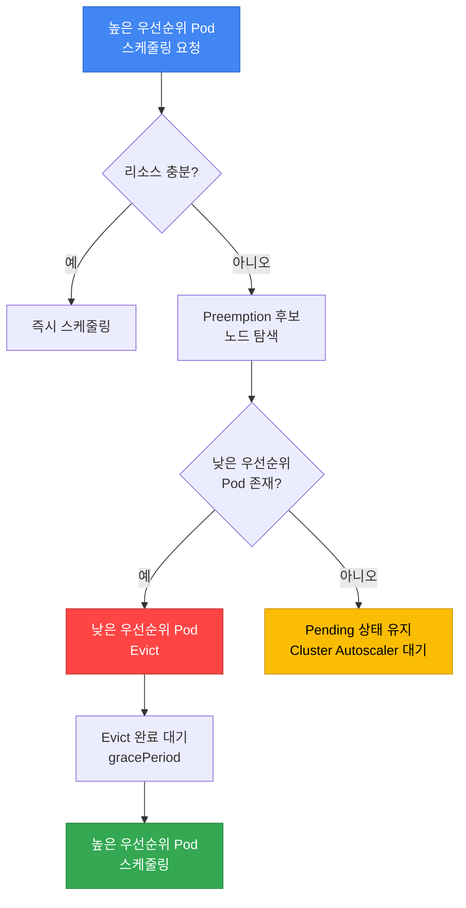

**Preemption 의사결정 과정:**

1. **높은 우선순위 Pod 스케줄링 실패**
2. **Preemption 후보 노드 탐색**: 낮은 우선순위 Pod를 제거하면 스케줄링 가능한 노드 찾기
3. **Victim Pod 선택**: 가장 낮은 우선순위부터 제거 대상 선정
4. **PDB 고려**: PDB 위반을 피하는 Victim 조합을 우선 탐색하되, 가능한 조합이 없으면 PDB를 위반하는 Preemption도 허용
5. **Graceful Eviction**: `terminationGracePeriodSeconds` 존중하며 Evict
6. **리소스 확보 후 스케줄링**: 높은 우선순위 Pod 배치

:::tip Preemption과 PDB의 관계
스케줄러의 Preemption은 PDB를 **best effort로 고려**합니다. PDB를 위반하지 않는 Victim을 찾지 못하면 낮은 우선순위 Pod를 제거하면서 PDB를 위반할 수 있습니다. Eviction API의 예산 강제와 같은 보장이 아닙니다. [Kubernetes Preemption의 PDB 지원 범위](https://kubernetes.io/docs/concepts/scheduling-eviction/pod-priority-preemption/#poddisruptionbudget-is-supported-but-not-guaranteed)를 참조하세요.
:::

**Preemption 예시 시나리오:**

```yaml
# 현재 클러스터 상태: 노드 리소스가 거의 가득 참
# Node-1: low-priority-pod (CPU: 2, Memory: 4Gi)
# Node-2: standard-priority-pod (CPU: 2, Memory: 4Gi)

# 높은 우선순위 Pod 생성 요청
apiVersion: v1
kind: Pod
metadata:
  name: critical-payment
spec:
  priorityClassName: business-critical  # 우선순위: 1000000
  containers:
  - name: payment
    image: payment:v1.0
    resources:
      requests:
        cpu: "2"
        memory: 4Gi

# 결과:
# 1. 스케줄러가 리소스 부족 감지
# 2. low-priority-pod (우선순위: 1000)를 Victim으로 선택
# 3. low-priority-pod Evict (graceful shutdown)
# 4. critical-payment Pod 스케줄링
```

### 7.4 PreemptionPolicy: Never

특정 워크로드가 다른 Pod를 Preempt하지 않도록 설정할 수 있습니다. 기준 체계의 `low-priority`가 이미 `preemptionPolicy: Never`로 정의되어 있으므로, 아래처럼 같은 클래스를 참조합니다. (7.2에서 `value: 1000`으로 정의한 것과 동일한 클래스입니다.)

```yaml
apiVersion: scheduling.k8s.io/v1
kind: PriorityClass
metadata:
  name: low-priority
value: 1000
globalDefault: false
preemptionPolicy: Never  # 다른 Pod를 Preempt하지 않음
description: "Batch jobs, non-critical background tasks"
```

**사용 사례:**
- **배치 작업**: 리소스가 생길 때까지 대기하는 것이 더 나은 경우
- **테스트/개발 워크로드**: 프로덕션 워크로드를 방해하지 않아야 할 때
- **낮은 긴급성**: 즉시 실행되지 않아도 괜찮은 작업

### 7.5 Priority + QoS Class 조합 고급 패턴

PriorityClass는 스케줄링·선점과 kubelet pressure eviction에 영향을 주며, QoS는 admission 후의 리소스 구성을 나타냅니다. 아래 예시는 Pod 수준 리소스 선언이 아닌 컨테이너별 CPU·메모리 설정을 사용하는 Linux Pod 기준입니다. 기본값과 주입된 컨테이너를 포함한 실제 Pod를 확인합니다. 이 설정만으로 즉시 배치, OOM 생존이나 실측 비용 등급이 보장되지는 않습니다.

#### QoS Class 복습

Kubernetes는 Pod의 리소스 요청(requests)과 제한(limits) 설정에 따라 자동으로 QoS Class를 할당합니다.

| QoS Class | admission 후 조건 | CPU 동작 | 메모리 pressure 판단 | 일반적 사용 |
|-----------|------|-------------|-------------------|------------|
| **Guaranteed** | 모든 컨테이너에 양수인 CPU·메모리 request와 limit이 있고 리소스별 두 값이 같음 | CPU limit에 도달하면 스로틀링 가능 | request가 순위에 영향을 주며 eviction·OOM은 여전히 가능 | 리소스를 신중히 산정한 중요 워크로드 |
| **Burstable** | Guaranteed가 아니며 하나 이상의 컨테이너에 양수인 CPU 또는 메모리 request나 limit이 있음 | 컨테이너의 limit과 경합에 따라 달라짐 | request 초과 사용 여부와 priority가 중요 | 일반 웹 앱, API |
| **BestEffort** | 모든 컨테이너에 양수인 CPU·메모리 request와 limit이 없음 | 이 구성에는 컨테이너 CPU limit이 없지만 경합은 발생 가능 | 메모리를 사용하면 request 0을 초과함 | 리소스 경합을 감수하도록 설계한 워크로드 |

**QoS Class 결정 규칙:**

```yaml
# Guaranteed: requests = limits (모든 컨테이너)
resources:
  requests:
    cpu: "1"
    memory: 2Gi
  limits:
    cpu: "1"      # requests와 동일
    memory: 2Gi   # requests와 동일

---
# Burstable 예시: Guaranteed 조건 미충족
resources:
  requests:
    cpu: "500m"
    memory: 1Gi
  limits:
    cpu: "2"      # requests보다 큼
    memory: 4Gi   # requests보다 큼

---
# BestEffort: 아무것도 설정 안함
resources: {}
```

**QoS Class 확인:**
```bash
# Pod의 QoS Class 확인
kubectl get pod my-pod -o jsonpath='{.status.qosClass}'

# 네임스페이스 전체 Pod의 QoS 분포
kubectl get pods -n production \
  -o custom-columns=NAME:.metadata.name,QOS:.status.qosClass
```

#### 권장 조합 매트릭스

아래 매트릭스는 워크로드 정책 예시이며, "Priority 정책" 열은 7.2 기준 체계의 PriorityClass 이름을 사용합니다. 표는 실측 생존율이나 비용 순위를 나타내지 않습니다.

| 조합 | Priority 정책(클래스) | QoS | 스케줄링 판단 | 메모리 pressure 판단 | 워크로드 예시 |
|------|----------|-----|-----------------|-------------|------|
| **Tier 1** | `business-critical` | Guaranteed | 높은 우선순위지만 배치 가능 조건 필요 | 양수인 request/limit이 일치해도 OOM·eviction 가능 | 결제 시스템, DB |
| **Tier 2** | `high-priority` | Guaranteed | business-critical보다 낮음 | 같은 QoS 분류에 다른 priority 적용 | API 게이트웨이 |
| **Tier 3** | `standard-priority` | Burstable | 일반 정책 | 실제 사용량과 request를 비교 | 프론트엔드, 백오피스 |
| **Tier 4** | `low-priority` | Burstable | 낮은 우선순위 정책 | 낮은 priority로 eviction·선점 가능성 증가 | 내부 도구 |
| **Tier 5** | `low-priority` (배치 재사용) | BestEffort | 이 예시에서 가장 낮은 정책 | 메모리 사용량이 request를 초과 | 재시도 가능한 배치, CI/CD |

Tier 4와 Tier 5는 같은 `low-priority` 클래스를 사용하되 QoS 구성(Burstable 대 BestEffort)으로 구분합니다.

**조합별 상세 설명:**

##### Tier 1: Guaranteed + business-critical (최고 보장) {#tier-1-guaranteed--critical-priority-최고-보장}

**특징:**
- 낮은 priority Pod를 제거해 배치가 가능해지는 경우 높은 priority가 선점에 사용될 수 있음
- 이 예시의 양수인 CPU·메모리 request/limit 일치로 Guaranteed QoS가 성립
- request와 priority는 kubelet pressure eviction에 영향을 주며 kernel OOM은 별도 메커니즘
- 메모리 limit, 노드 pressure와 다른 장애로 Pod가 종료될 수 있음

**실전 YAML:**
```yaml
apiVersion: apps/v1
kind: Deployment
metadata:
  name: payment-gateway
  namespace: production
spec:
  replicas: 6
  selector:
    matchLabels:
      app: payment-gateway
      tier: critical
  template:
    metadata:
      labels:
        app: payment-gateway
        tier: critical
    spec:
      priorityClassName: business-critical  # Priority: 1000000
      containers:
      - name: gateway
        image: payment-gateway:v3.5
        resources:
          requests:
            cpu: "2"
            memory: 4Gi
          limits:
            cpu: "2"       # requests와 동일 → Guaranteed
            memory: 4Gi    # requests와 동일 → Guaranteed
        livenessProbe:
          httpGet:
            path: /health
            port: 8080
          initialDelaySeconds: 30
          periodSeconds: 10
        readinessProbe:
          httpGet:
            path: /ready
            port: 8080
          initialDelaySeconds: 10
          periodSeconds: 5
---
apiVersion: policy/v1
kind: PodDisruptionBudget
metadata:
  name: payment-gateway-pdb
  namespace: production
spec:
  minAvailable: 4  # PDB를 존중하는 자발적 축출 시 healthy 선택 Pod를 최소 4개 요구; 비자발적 장애·직접 삭제는 막지 못함
  selector:
    matchLabels:
      app: payment-gateway
```

**사용 시나리오:**
- 금융 거래 시스템 (결제, 송금)
- 실시간 주문 처리
- 데이터베이스 (MySQL, PostgreSQL)
- 메시지 큐 (Kafka, RabbitMQ)

##### Tier 2: Guaranteed + high-priority (핵심 서비스)

**특징:**
- critical 다음 우선순위
- 예시 컨테이너의 CPU·메모리 request와 같은 limit으로 Guaranteed QoS 성립
- pressure eviction과 kernel OOM이 가능하며 QoS만으로 고정된 종료 순서는 없음
- 일반적인 프로덕션 서비스의 권장 설정

**실전 YAML:**
```yaml
apiVersion: apps/v1
kind: Deployment
metadata:
  name: api-server
  namespace: production
spec:
  replicas: 10
  selector:
    matchLabels:
      app: api-server
  template:
    metadata:
      labels:
        app: api-server
    spec:
      priorityClassName: high-priority  # Priority: 100000
      containers:
      - name: api
        image: api-server:v2.8
        resources:
          requests:
            cpu: "1"
            memory: 2Gi
          limits:
            cpu: "1"       # Guaranteed
            memory: 2Gi    # Guaranteed
        env:
        - name: MAX_CONNECTIONS
          value: "1000"
```

**사용 시나리오:**
- REST API 서버
- GraphQL 서버
- 인증/인가 서비스
- 세션 관리 서비스

##### Tier 3: Burstable + standard-priority (일반 웹 앱)

**특징:**
- request는 스케줄링 용량과 경합 시 CPU 배분에 사용되며 서비스 무중단을 보장하지 않음
- 유휴 시 추가 리소스 사용 가능 (limits > requests)
- 비용 효율적이면서 안정적
- 대부분의 웹 애플리케이션에 적합

**실전 YAML:**
```yaml
apiVersion: apps/v1
kind: Deployment
metadata:
  name: web-frontend
  namespace: production
spec:
  replicas: 8
  selector:
    matchLabels:
      app: web-frontend
  template:
    metadata:
      labels:
        app: web-frontend
    spec:
      priorityClassName: standard-priority  # Priority: 10000
      containers:
      - name: frontend
        image: web-frontend:v1.12
        resources:
          requests:
            cpu: "500m"    # 스케줄링·상대적 배분에 사용하는 CPU request
            memory: 1Gi    # 메모리 request이며 limit이 아님
          limits:
            cpu: "2"       # 최대 4배 버스트 허용
            memory: 4Gi    # 최대 4배 버스트 허용
        env:
        - name: NODE_ENV
          value: "production"
```

**사용 시나리오:**
- 웹 프론트엔드 (React, Vue, Angular)
- 백오피스 애플리케이션
- 내부 대시보드
- CMS (Content Management System)

##### Tier 4: Burstable + low-priority (내부 도구)

**특징:**
- 작은 리소스 request를 사용하며 실제 사용량을 기준으로 산정
- 리소스 부족 시 Preempt 대상
- 비용 최소화
- 서비스 중단 시 영향 제한적

**실전 YAML:**
```yaml
apiVersion: apps/v1
kind: Deployment
metadata:
  name: monitoring-agent
  namespace: monitoring
spec:
  replicas: 3
  selector:
    matchLabels:
      app: monitoring-agent
  template:
    metadata:
      labels:
        app: monitoring-agent
    spec:
      priorityClassName: low-priority  # Priority: 1000
      containers:
      - name: agent
        image: monitoring-agent:v2.1
        resources:
          requests:
            cpu: "100m"    # CPU request
            memory: 256Mi
          limits:
            cpu: "500m"
            memory: 1Gi
```

**사용 시나리오:**
- 모니터링 에이전트
- 로그 수집기 (Fluent Bit, Fluentd)
- 메트릭 Exporter
- 개발 도구

##### Tier 5: BestEffort + low-priority (배치 작업) {#tier-5-besteffort--batch-priority-배치-작업}

**특징:**
- 이 예시에는 CPU·메모리 request/limit이 없으며 리소스 경합이 발생할 수 있음
- 메모리를 사용하면 request를 초과하지만 pressure eviction 순위에는 priority도 작용
- 비용 최소화 (Spot 인스턴스 활용 가능)
- 재시도 가능한 작업에 적합

**실전 YAML:**
```yaml
apiVersion: batch/v1
kind: CronJob
metadata:
  name: data-pipeline
  namespace: batch
spec:
  schedule: "0 2 * * *"  # 매일 새벽 2시
  jobTemplate:
    spec:
      template:
        spec:
          priorityClassName: low-priority  # Priority: 1000
          restartPolicy: OnFailure
          containers:
          - name: etl
            image: data-pipeline:v1.8
            resources: {}  # BestEffort: requests/limits 없음
            env:
            - name: BATCH_SIZE
              value: "10000"
          # Spot 인스턴스에 배치
          nodeSelector:
            karpenter.sh/capacity-type: spot
          tolerations:
          - key: karpenter.sh/capacity-type
            operator: Equal
            value: spot
            effect: NoSchedule
```

**사용 시나리오:**
- ETL 파이프라인
- 데이터 분석 작업
- CI/CD 빌드
- 이미지/동영상 처리

#### Eviction 순서 (OOM 발생 시)

아래 다이어그램은 kubelet의 **메모리 pressure eviction**을 설명하며 kernel OOM killer나 컨테이너의 메모리 limit 초과를 나타내지 않습니다. kubelet은 먼저 노드 수준 리소스 회수를 시도하고, Pod eviction이 필요하면 부족한 리소스를 기준으로 후보를 정렬합니다.

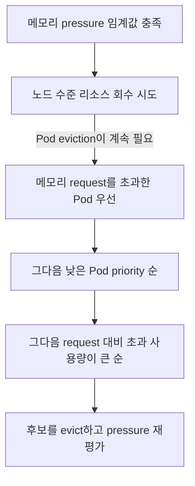

**Eviction 결정 요소:**

1. 부족한 리소스의 사용량이 request를 초과하는지 여부.
2. 해당 그룹 안에서 Pod priority.
3. priority가 같을 때 request 대비 사용량.

QoS는 일부 메모리 request 구성과 연관되지만 정렬 알고리즘 자체는 아닙니다. 디스크 pressure는 디스크 관련 신호를 사용하며, kernel OOM killer는 `oom_score_adj`와 프로세스 메모리 사용량을 사용합니다. 어느 쪽도 QoS만으로 무조건적인 생존 순서를 정하지 않습니다.

**예시 시나리오:**

```text
메모리 pressure 후보 예시(실측 이벤트 아님):
Pod 1: request 0, 사용량 4 GiB, priority 500       -> request 초과
Pod 2: request 2 GiB, 사용량 6 GiB, priority 1000 -> request 초과
Pod 3: request 4 GiB, 사용량 5 GiB, priority 5000 -> request 초과
Pod 4: request 8 GiB, 사용량 8 GiB, priority 10000 -> request 미초과
이 후보 사이의 순서는 1, 2, 3, 4다.
이는 request와 priority에 따른 결과이며 보편적인 QoS 순서가 아니다.
kubelet은 eviction 후 pressure를 다시 평가하므로 모든 후보를 evict할 필요는 없다.
```

#### Kubelet Eviction 설정

Karpenter `v1.14.1`과 호환 AL2023 EC2NodeClass에서는 지원되는 `spec.kubelet` 필드를 설정합니다. 해당 class의 검증된 AMI, role/instance profile, 서브넷·보안 그룹 selector를 유지합니다. 새로 프로비저닝할 노드의 설정 병합이며, user data로 실행 중인 kubelet 파일을 덮어쓰거나 서비스를 재시작하지 않습니다.

**Eviction 임계값 예시:**

실제로 적용되는 기본값은 AMI와 bootstrap 설정에 따라 다릅니다. 아래 JSON은 설정할 수 있는 값의 예시입니다. 해당 클러스터의 EKS 기본값을 측정한 결과는 아닙니다.

```json
{
  "evictionHard": {
    "memory.available": "100Mi",
    "nodefs.available": "10%",
    "imagefs.available": "15%"
  },
  "evictionSoft": {
    "memory.available": "500Mi",
    "nodefs.available": "15%"
  },
  "evictionSoftGracePeriod": {
    "memory.available": "1m30s",
    "nodefs.available": "2m"
  }
}
```

**커스터마이징 예시 (Karpenter EC2NodeClass):**

병합 후 적용될 전체 임계값을 검토한 뒤 아래 매핑을 `EC2NodeClass/custom-eviction.spec.kubelet`에 병합합니다. 설정한 모든 soft 신호에는 대응하는 soft grace period가 필요합니다.

```yaml
# EC2NodeClass.spec.kubelet 조각이며 값은 예시
evictionHard:
  memory.available: 200Mi
  nodefs.available: "10%"
  imagefs.available: "15%"
  nodefs.inodesFree: "5%"
  imagefs.inodesFree: "5%"
evictionSoft:
  memory.available: 1Gi
  nodefs.available: "15%"
evictionSoftGracePeriod:
  memory.available: 2m
  nodefs.available: 3m
evictionMaxPodGracePeriod: 60
```

**Eviction 임계값 설명:**

| 설정 | 의미 | 병합 예시 값 |
|------|------|--------|
| `evictionHard.memory.available` | soft grace period가 없는 hard 임계값 | 200Mi |
| `evictionSoft.memory.available` | grace period 동안 평가하는 soft 임계값 | 1Gi |
| `evictionSoftGracePeriod.memory.available` | soft 임계값 충족 상태가 지속되어야 하는 시간 | 2m |
| `evictionMaxPodGracePeriod` | soft eviction의 최대 종료 유예 시간 | 60초 |

:::warning Eviction 설정 시 주의사항
임계값에는 워크로드와 노드 메모리 근거가 필요합니다. 너무 낮으면 kubelet이 메모리를 회수하기 전에 kernel OOM이 발생할 수 있고, 높으면 가용 여유가 줄어듭니다. hard 임계값에 의한 eviction은 graceful termination을 제공하지 않습니다.

**권장 접근:**
- 값을 정하기 전에 노드 예약량, 최대 메모리, 이미지·디스크 사용과 회수 동작을 측정합니다.
- 기본값을 재정의할 때 필요한 hard 신호를 유지하고 최종 AMI/kubelet 설정을 확인합니다.
- pressure와 종료 결과를 관찰하며, 예시 값을 프로덕션 용량 산정 결과로 간주하지 않습니다.
:::

#### 실전 조합 패턴 검증

**패턴 1: Multi-Tier 아키텍처**

아래 매니페스트는 Priority + QoS 조합을 보여주는 예시입니다. `replicas: 3`이나 세 개의 Pod가 그 자체로 복제된 고가용성 데이터베이스를 구성하지는 않습니다. PostgreSQL 복제는 별도 operator·headless Service·스토리지·백업/장애조치 구성이 필요합니다. 아래 label·image 값은 일관성을 위해 제시한 작성 예시이며 실제 배포에서 발견한 값이 아닙니다. 기존 컨트롤러의 `selector`는 변경할 수 없으므로 Service·PDB selector를 선택한 label에 맞춰 조정합니다.

```yaml
# Tier 1: Database (Guaranteed + business-critical)
apiVersion: apps/v1
kind: StatefulSet
metadata:
  name: postgres
spec:
  serviceName: postgres
  replicas: 3
  selector:
    matchLabels:
      app: postgres
  template:
    metadata:
      labels:
        app: postgres
    spec:
      priorityClassName: business-critical
      containers:
      - name: postgres
        image: postgres:16
        resources:
          requests:
            cpu: "4"
            memory: 16Gi
          limits:
            cpu: "4"
            memory: 16Gi
---
# Tier 2: API Server (Guaranteed + high-priority)
apiVersion: apps/v1
kind: Deployment
metadata:
  name: api-server
spec:
  replicas: 10
  selector:
    matchLabels:
      app: api-server
  template:
    metadata:
      labels:
        app: api-server
    spec:
      priorityClassName: high-priority
      containers:
      - name: api
        image: api-server:v2.8
        resources:
          requests: { cpu: "1", memory: 2Gi }
          limits: { cpu: "1", memory: 2Gi }
---
# Tier 3: Frontend (Burstable + standard-priority)
apiVersion: apps/v1
kind: Deployment
metadata:
  name: frontend
spec:
  replicas: 8
  selector:
    matchLabels:
      app: frontend
  template:
    metadata:
      labels:
        app: frontend
    spec:
      priorityClassName: standard-priority
      containers:
      - name: frontend
        image: web-frontend:v1.12
        resources:
          requests: { cpu: "500m", memory: 1Gi }
          limits: { cpu: "2", memory: 4Gi }
---
# Tier 4: Monitoring (Burstable + low-priority)
apiVersion: apps/v1
kind: DaemonSet
metadata:
  name: node-exporter
spec:
  selector:
    matchLabels:
      app: node-exporter
  template:
    metadata:
      labels:
        app: node-exporter
    spec:
      priorityClassName: low-priority
      containers:
      - name: exporter
        image: node-exporter:v1.8
        resources:
          requests: { cpu: "100m", memory: 128Mi }
          limits: { cpu: "200m", memory: 256Mi }
```

**검증 명령어:**
```bash
# QoS + Priority 분포 확인
kubectl get pods -A -o custom-columns=\
NAME:.metadata.name,\
NAMESPACE:.metadata.namespace,\
QOS:.status.qosClass,\
PRIORITY:.spec.priorityClassName,\
CPU_REQ:.spec.containers[0].resources.requests.cpu,\
MEM_REQ:.spec.containers[0].resources.requests.memory

# 노드별 QoS 분포 확인
kubectl describe node <node-name> | grep -A 10 "Non-terminated Pods"
```

#### 트러블슈팅: QoS + Priority 조합 문제

| 증상 | 원인 | 해결 방법 |
|------|------|----------|
| Guaranteed Pod가 OOM Kill됨 | limits 설정이 너무 낮음 | 메모리 프로파일링 후 limits 상향 |
| Burstable Pod가 CPU 스로틀링 | CPU limit(CFS quota) 도달, 또는 노드 CPU 경합 | limit·quota와 스로틀링 메트릭을 확인해 적절한 limit·스케일링 정책을 선택(quota 원인). 노드 수요와 request/share 배분을 확인해 request 재산정·용량 추가(경합 원인). request만 올려도 변경하지 않은 CPU limit은 올라가지 않음 |
| Low-priority Pod가 계속 Pending | High-priority Pod가 리소스 독점 | 노드 추가 또는 Priority 재조정 |
| BestEffort Pod가 즉시 종료됨 | Eviction 임계값 도달 | Burstable로 전환, requests 설정 |

:::tip QoS + Priority 최적화 팁
1. **모니터링**: Prometheus의 `container_memory_working_set_bytes`, `container_cpu_usage_seconds_total` 메트릭으로 실제 사용량 추적
2. **Rightsizing**: VPA(Vertical Pod Autoscaler) 권장값 참고
3. **단계적 전환**: BestEffort → Burstable → Guaranteed 순으로 점진적 적용
4. **비용 균형**: 모든 Pod를 Guaranteed로 설정하면 비용 증가, 워크로드 중요도에 따라 차등 적용
:::

---

## 8. Descheduler

Descheduler는 이미 스케줄링된 Pod를 **재배치**하여 클러스터의 균형을 맞추는 도구입니다. Kubernetes 스케줄러는 초기 배치만 담당하므로, 시간이 지나면 노드 간 불균형이 발생할 수 있습니다.

### 8.1 Descheduler가 필요한 이유

**시나리오 1: 노드 추가 후 불균형**
- 기존 노드에 Pod가 몰려있고, 새로 추가된 노드는 비어있음
- Descheduler가 오래된 Pod를 Evict → 스케줄러가 새 노드에 재배치

**시나리오 2: Affinity/Anti-Affinity 위반**
- Pod 배치 후 노드 레이블이 변경되어 Affinity 조건 위반
- Descheduler가 위반 Pod를 Evict → 조건에 맞는 노드에 재배치

**시나리오 3: 리소스 파편화**
- 일부 노드는 CPU 과다 사용, 일부는 유휴 상태
- Descheduler가 불균형 해소

### 8.2 Descheduler 설치 (Helm)

```bash
# Descheduler Helm Chart 추가
helm repo add descheduler https://kubernetes-sigs.github.io/descheduler/
helm repo update

# 기본 설치
helm install descheduler descheduler/descheduler \
  --namespace kube-system \
  --set cronJobApiVersion="batch/v1" \
  --set schedule="*/15 * * * *"  # 15분마다 실행
```

**CronJob vs Deployment 모드:**

| 모드 | 실행 주기 | 리소스 사용 | 권장 환경 |
|------|----------|------------|----------|
| **CronJob** | 주기적 (예: 15분) | 실행 시만 리소스 사용 | 소~중규모 클러스터 (권장) |
| **Deployment** | 지속적 실행 | 항상 리소스 사용 | 대규모 클러스터 (1000+ 노드) |

### 8.3 주요 Descheduler 전략

#### 전략 1: RemoveDuplicates

**목적**: 같은 소유자(ReplicaSet, ReplicationController, StatefulSet, Job)에 속한 Pod가 한 노드에 2개 이상 배치된 경우, 중복 Pod를 Evict하여 분산시킵니다. (출처: descheduler v0.34.0 `RemoveDuplicates`)

Deployment는 ReplicaSet을 통해 Pod를 생성하므로, Deployment replica의 소유자 종류는 `ReplicaSet`입니다. descheduler 문서에 따르면 **`excludeOwnerKinds`에 나열된 종류를 소유자로 가진 Pod는 Evict 대상에서 제외**됩니다. 따라서 Deployment replica를 재분산하려면 `excludeOwnerKinds`에 `ReplicaSet`을 **포함하지 않아야** 합니다. 아래 예시는 StatefulSet Pod만 제외하여 Deployment/ReplicaSet Pod가 재분산 대상이 되도록 합니다.

```yaml
apiVersion: v1
kind: ConfigMap
metadata:
  name: descheduler-policy
  namespace: kube-system
data:
  policy.yaml: |
    apiVersion: "descheduler/v1alpha2"
    kind: "DeschedulerPolicy"
    profiles:
      - name: default
        pluginConfig:
        - name: RemoveDuplicates
          args:
            # 지정한 소유자 종류의 Pod는 Evict 대상에서 제외
            # (ReplicaSet을 넣으면 Deployment Pod가 제외되므로 넣지 않음)
            excludeOwnerKinds:
            - "StatefulSet"
        plugins:
          balance:
            enabled:
            - RemoveDuplicates
```

**효과**: 같은 Deployment(ReplicaSet)의 replica가 한 노드에 2개 이상 있으면 일부가 Evict 후보가 됩니다. 실제 Evict 여부는 DefaultEvictor 필터와 PDB가, 재배치 위치는 kube-scheduler가 결정하며, 이 플러그인은 교체 Pod를 특정 노드에 직접 바인딩하지 않습니다.

#### 전략 2: LowNodeUtilization

**목적**: 리소스 사용률이 낮은 노드와 높은 노드 간 균형 조정

```yaml
apiVersion: v1
kind: ConfigMap
metadata:
  name: descheduler-policy
  namespace: kube-system
data:
  policy.yaml: |
    apiVersion: "descheduler/v1alpha2"
    kind: "DeschedulerPolicy"
    profiles:
      - name: default
        pluginConfig:
        - name: LowNodeUtilization
          args:
            # 낮은 사용률 기준 (이 이하면 underutilized)
            thresholds:
              cpu: 20
              memory: 20
              pods: 20
            # 높은 사용률 기준 (이 이상이면 overutilized)
            targetThresholds:
              cpu: 50
              memory: 50
              pods: 50
        plugins:
          balance:
            enabled:
            - LowNodeUtilization
```

**동작:** (출처: descheduler v0.34.0 `LowNodeUtilization`)
1. 각 노드의 사용률을 계산합니다. 기본값은 **노드에 스케줄된 Pod의 리소스 요청량(requests) 합계 ÷ 노드 할당 가능(allocatable) 용량**이며, 관측된 실제 CPU/메모리 사용량이 아닙니다. 실제 사용량 기반으로 동작시키려면 `metricsUtilization.source`를 `KubernetesMetrics`로 설정하고 metrics 공급자를 별도로 구성해야 합니다.
2. 설정한 모든 차원(cpu, memory, pods 등)이 `thresholds` **미만**인 노드를 underutilized로 식별합니다.
3. 설정한 차원 중 **하나라도** `targetThresholds`를 **초과**하는 노드를 overutilized로 식별합니다. 두 기준 사이의 노드는 Evict 대상이 아닙니다.
4. underutilized 노드와 overutilized 노드가 모두 1개 이상일 때만 동작하며, overutilized 노드에서 Pod를 Evict합니다. overutilized 노드당 한 번에 최대 1개 Pod만 Evict됩니다.
5. Evict된 Pod는 kube-scheduler가 재스케줄링합니다. underutilized 노드로의 재배치는 기대 효과일 뿐 보장되지 않으며, 스케줄러가 가용한 노드를 독립적으로 선택합니다.

#### 전략 3: RemovePodsViolatingNodeAffinity

**목적**: Node Affinity 조건을 위반하는 Pod 제거 (노드 레이블 변경 후)

```yaml
apiVersion: v1
kind: ConfigMap
metadata:
  name: descheduler-policy
  namespace: kube-system
data:
  policy.yaml: |
    apiVersion: "descheduler/v1alpha2"
    kind: "DeschedulerPolicy"
    profiles:
      - name: default
        pluginConfig:
        - name: RemovePodsViolatingNodeAffinity
          args:
            nodeAffinityType:
            - requiredDuringSchedulingIgnoredDuringExecution
        plugins:
          deschedule:
            enabled:
            - RemovePodsViolatingNodeAffinity
```

**시나리오**: GPU 노드에서 `gpu=true` 레이블 제거 → GPU 요구 Pod가 레이블 없는 노드에 남음 → Descheduler가 Evict → GPU 노드에 재배치

#### 전략 4: RemovePodsViolatingInterPodAntiAffinity

**목적**: Pod Anti-Affinity 조건을 위반하는 Pod 제거

```yaml
apiVersion: v1
kind: ConfigMap
metadata:
  name: descheduler-policy
  namespace: kube-system
data:
  policy.yaml: |
    apiVersion: "descheduler/v1alpha2"
    kind: "DeschedulerPolicy"
    profiles:
      - name: default
        plugins:
          deschedule:
            enabled:
            - RemovePodsViolatingInterPodAntiAffinity
```

**시나리오**: `requiredDuringSchedulingIgnoredDuringExecution` Anti-Affinity는 스케줄링 시점에만 강제되고 실행 중에는 무시됩니다(`IgnoredDuringExecution`). 따라서 노드 축소만으로 새 Pod가 하드 Anti-Affinity를 위반하도록 배치될 수는 없습니다. 대신 실행 중 Pod 또는 노드의 레이블이 변경되면 이미 실행 중인 Pod가 현재의 Anti-Affinity 조건과 어긋난 상태가 될 수 있고, 이때 descheduler가 그 기존 위반 Pod를 Evict하여 조건에 맞는 재스케줄링을 유도합니다. (출처: descheduler v0.34.0 `RemovePodsViolatingInterPodAntiAffinity`; Kubernetes v1.34 Assigning Pods to Nodes)

#### 전략 5: RemovePodsHavingTooManyRestarts

**목적**: 과도하게 재시작되는 문제 있는 Pod 제거 (다른 노드에서 재시도)

```yaml
apiVersion: v1
kind: ConfigMap
metadata:
  name: descheduler-policy
  namespace: kube-system
data:
  policy.yaml: |
    apiVersion: "descheduler/v1alpha2"
    kind: "DeschedulerPolicy"
    profiles:
      - name: default
        pluginConfig:
        - name: RemovePodsHavingTooManyRestarts
          args:
            podRestartThreshold: 10  # 10회 이상 재시작 시 Evict
            includingInitContainers: true
        plugins:
          deschedule:
            enabled:
            - RemovePodsHavingTooManyRestarts
```

#### 전략 6: PodLifeTime

**목적**: 설정한 수명(`maxPodLifeTimeSeconds`)을 초과한 Pod를 Evict합니다. (출처: descheduler v0.34.0 `PodLifeTime`) Evict 후에는 소유 컨트롤러(Deployment, StatefulSet 등)가 **현재 Pod 템플릿**을 기준으로 Pod를 다시 생성합니다. 따라서 이것 자체는 이미지/설정 업데이트 수단이 아닙니다. 템플릿이 변경되지 않았다면 동일한 이미지/설정으로 재생성되고, 이미지 태그가 가변(mutable)이고 `imagePullPolicy: Always`인 경우에만 재생성 시 다른 이미지가 당겨질 수 있는데 이는 버전 롤아웃을 보장하는 신뢰할 수 있는 방법이 아닙니다. 실제 버전 교체는 Deployment 템플릿을 변경하는 명시적 롤아웃으로 수행해야 합니다.

```yaml
apiVersion: v1
kind: ConfigMap
metadata:
  name: descheduler-policy
  namespace: kube-system
data:
  policy.yaml: |
    apiVersion: "descheduler/v1alpha2"
    kind: "DeschedulerPolicy"
    profiles:
      - name: default
        pluginConfig:
        - name: PodLifeTime
          args:
            maxPodLifeTimeSeconds: 604800  # 7일 (7 * 24 * 3600)
            # 특정 상태의 Pod만 대상
            states:
            - Running
            # 특정 레이블의 Pod 제외
            labelSelector:
              matchExpressions:
              - key: app
                operator: NotIn
                values:
                - stateful-db
        plugins:
          deschedule:
            enabled:
            - PodLifeTime
```

### 8.4 Descheduler vs Karpenter Consolidation 비교

| 기능 | Descheduler | Karpenter Consolidation |
|------|------------|------------------------|
| **목적** | Pod 재배치 (균형) | 노드 제거 (비용 절감) |
| **범위** | Pod 레벨 | 노드 레벨 |
| **실행 주기** | CronJob (예: 15분) | 지속적 감시 (실시간) |
| **전략** | 다양한 전략 (6+개) | Empty / Underutilized 노드 |
| **PDB 존중** | ✅ 예 | ✅ 예 |
| **노드 추가/제거** | ❌ 아니오 | ✅ 예 |
| **Cluster Autoscaler 호환** | ✅ 예 | N/A (대체재) |
| **주요 사용 사례** | 불균형 해소, Affinity 위반 해결 | 비용 최적화, 노드 통합 |
| **함께 사용 가능** | ✅ Karpenter와 병행 가능 | ✅ Descheduler와 병행 가능 |

:::tip Descheduler + Karpenter 조합 권장
Descheduler는 Pod 재배치에 특화되고, Karpenter는 노드 관리에 특화되어 있습니다. 두 도구를 함께 사용하면 시너지가 발생합니다:
- Descheduler가 불균형 Pod를 Evict
- Kubernetes 스케줄러가 Pod를 다른 노드에 재배치
- Karpenter가 비어있는 노드를 제거하여 비용 절감
:::

**함께 사용하는 설정 예시:**

아래 두 매니페스트는 **이미 설치된** descheduler와 Karpenter가 있다고 가정한 설정 예시이며, 그대로 적용 가능한 완전한 설치 매니페스트가 아닙니다. descheduler CronJob이 동작하려면 다음이 추가로 필요합니다.

- 정책 파일을 담은 ConfigMap(`policy.yaml` 키)과 이를 컨테이너의 `--policy-config-file` 경로에 마운트하는 volume/volumeMount
- 같은 네임스페이스의 ServiceAccount와, 노드·Pod 조회 및 eviction 생성을 허용하는 RBAC(ClusterRole/ClusterRoleBinding)
- 사용하는 descheduler 이미지·차트·정책 스키마 버전을 하나로 맞춘 조합. 이 문서는 정책 스키마를 descheduler **v0.34.0** 기준으로 설명하므로, 이미지도 그와 호환되는 버전을 핀으로 고정해야 합니다. (아래 예시 이미지 태그는 플레이스홀더이며 실제 배포 시 사용 버전으로 교체하세요.)

Karpenter NodePool은 `template.spec.nodeClassRef`로 실제 EC2NodeClass를 참조해야 하며, 아래 조각은 disruption 설정만 보여 주는 부분 예시입니다.

```yaml
# Descheduler: 15분마다 균형 조정 (설치 예시가 아닌 설정 조각)
apiVersion: batch/v1
kind: CronJob
metadata:
  name: descheduler
  namespace: kube-system
spec:
  schedule: "*/15 * * * *"
  jobTemplate:
    spec:
      template:
        spec:
          serviceAccountName: descheduler  # 노드/Pod 조회·eviction 권한을 가진 SA
          restartPolicy: Never
          containers:
          - name: descheduler
            # 플레이스홀더 태그. 정책 스키마(v0.34.0)와 호환되는 버전으로 고정하세요.
            image: registry.k8s.io/descheduler/descheduler:v0.34.0
            command:
            - /bin/descheduler
            - --policy-config-file=/policy/policy.yaml
            volumeMounts:
            - name: policy
              mountPath: /policy
          volumes:
          - name: policy
            configMap:
              name: descheduler-policy  # policy.yaml 키 포함
---
# Karpenter v1: 지속적 노드 통합 (nodeClassRef 등 나머지 필드는 별도 구성 필요)
apiVersion: karpenter.sh/v1
kind: NodePool
metadata:
  name: general
spec:
  disruption:
    consolidationPolicy: WhenEmptyOrUnderutilized
    consolidateAfter: 5m  # 노드에 Pod가 추가/삭제된 후 5분 동안 안정되면 통합 후보
    budgets:
    - nodes: "20%"
  template:
    spec:
      nodeClassRef:
        group: karpenter.k8s.aws
        kind: EC2NodeClass
        name: default  # 사전에 생성된 EC2NodeClass 이름
      requirements:
      - key: kubernetes.io/arch
        operator: In
        values: ["amd64"]
```

#### 8.4.1 Descheduler + Karpenter 실전 조합 패턴

Descheduler와 Karpenter는 서로를 인지하지 않는 **독립적인 컨트롤러**입니다. 따라서 둘을 함께 쓴다고 자동으로 조율되지는 않습니다. 각자 자신의 정책(descheduler 정책, Karpenter disruption 설정)에 따라 독립적으로 동작하며, 제안하는 구성은 다음과 같습니다: descheduler가 조건에 맞는 Pod를 Evict하고, kube-scheduler가 재배치 위치를 결정하며, Karpenter가 그와 별개로 노드 프로비저닝·통합을 평가합니다. 타이밍이 맞지 않으면 Pod가 반복 이동(churn)하거나 통합이 실패할 수 있습니다. 효율성·비용 개선은 보장된 효과가 아니라 각 환경에서 측정해야 할 결과입니다.

**조합의 시너지 원리:**

1. **1단계 (Descheduler)**: 리소스 불균형 감지 및 Pod 재배치
   - `LowNodeUtilization` 전략으로 과도하게 사용되는 노드에서 Pod Evict
   - `RemoveDuplicates`, `RemovePodsViolatingNodeAffinity` 등으로 불필요한 Pod 재배치

2. **2단계 (Kubernetes Scheduler)**: Evict된 Pod를 최적의 노드에 재스케줄링
   - 리소스 여유가 있는 노드 선택
   - Affinity/Anti-Affinity, Topology Spread 조건 만족

3. **3단계 (Karpenter)**: 비어있거나 저활용 노드 제거
   - `consolidateAfter` 시간 경과 후 빈 노드 통합
   - 여러 저활용 노드의 Pod를 더 작은 수의 노드로 통합
   - 불필요한 노드 종료로 비용 절감

**타이밍 조율 예시:**

```yaml
# Descheduler: 15분 주기로 LowNodeUtilization 실행
apiVersion: v1
kind: ConfigMap
metadata:
  name: descheduler-policy
  namespace: kube-system
data:
  policy.yaml: |
    apiVersion: "descheduler/v1alpha2"
    kind: "DeschedulerPolicy"
    profiles:
      - name: default
        pluginConfig:
        - name: LowNodeUtilization
          args:
            thresholds:
              cpu: 20
              memory: 20
              pods: 20
            targetThresholds:
              cpu: 50
              memory: 50
              pods: 50
        plugins:
          balance:
            enabled:
            - LowNodeUtilization
---
# Karpenter: 5분 후 빈 노드 통합 (Descheduler 실행 후 충분한 시간 부여)
apiVersion: karpenter.sh/v1
kind: NodePool
metadata:
  name: general-pool
spec:
  disruption:
    consolidationPolicy: WhenEmptyOrUnderutilized
    consolidateAfter: 5m  # 노드에 Pod가 추가/삭제된 후 (원인과 무관하게) 타이머가 리셋되며, 5분간 변화가 없어야 통합 후보가 됨
    budgets:
    - nodes: "20%"  # 동시 중단 허용치 = ceil(전체 노드 수 × 0.20) − 삭제 중·NotReady 노드. 반올림(올림) 때문에 정확히 20%를 초과할 수 있음
  template:
    spec:
      requirements:
      - key: karpenter.sh/capacity-type
        operator: In
        values: ["on-demand", "spot"]
      - key: kubernetes.io/arch
        operator: In
        values: ["amd64"]
```

**실제 동작 시나리오:**

```
시간: 00:00 - Descheduler 실행 (15분 주기)
  └─ Node-A (CPU 80%, Memory 85%) → overutilized 감지
  └─ Node-B (CPU 15%, Memory 10%) → underutilized 감지
  └─ Node-A에서 Pod-1, Pod-2 Evict

시간: 00:01 - Kubernetes Scheduler 재배치
  └─ Pod-1 → Node-B로 스케줄링
  └─ Pod-2 → Node-C로 스케줄링
  └─ Node-A는 이제 CPU 50%, Memory 55% (예시 값)
     ※ `targetThresholds`를 50으로 둔 경우 Memory 55%는 여전히 기준 초과입니다.
       CPU 50%는 "초과(above)"가 아니라 경계값이므로 CPU만으로는 overutilized가 아닙니다.

시간: 00:06 - Karpenter 통합 (consolidateAfter 경과, 예시 이벤트)
  └─ Node-B: 저활용 상태이며 Pod 실행 중 → WhenEmptyOrUnderutilized 정책에서는
     비어 있지 않은 저활용 노드도 시뮬레이션·disruption 제약이 허용하면 통합 대상이 될 수 있음
  └─ Node-D: 빈 노드 감지 (이전에 Pod가 있었으나 이동) → 종료
  └─ 위 타임라인(00:01/00:06)과 비용 절감 효과는 측정값이 아닌 가상 예시이며,
     실제 동작은 사용률 입력·스케줄링 시뮬레이션·타이밍·과금에 따라 달라집니다
```

**PDB와의 상호작용:**

Descheduler와 Karpenter는 모두 PDB를 존중하므로, 안전한 조합이 가능합니다:

```yaml
# 애플리케이션 PDB 설정
apiVersion: policy/v1
kind: PodDisruptionBudget
metadata:
  name: api-server-pdb
spec:
  minAvailable: 2
  selector:
    matchLabels:
      app: api-server
---
# Descheduler와 Karpenter는 모두 이 PDB를 존중하며 동작
# - Descheduler: minAvailable을 위반하는 Eviction 차단
# - Karpenter: 노드 제거 시 minAvailable 보장
```

**주의사항: Pod Flapping 방지**

Descheduler와 Karpenter의 타이밍이 충돌하면 Pod가 반복적으로 이동하는 현상이 발생할 수 있습니다:

:::warning Pod Flapping 방지
Descheduler 실행 주기와 Karpenter `consolidateAfter` 간격을 적절히 조율하세요:
- **권장 패턴**: Descheduler 15분 주기 + Karpenter 5분 `consolidateAfter`
- **위험 패턴**: Descheduler 5분 주기 + Karpenter 1분 `consolidateAfter` (너무 빈번)
- **안전장치**: Karpenter `budgets`로 동시 통합 노드 수 제한
:::

**모니터링 및 검증:**

```bash
# 1. Descheduler 로그 확인
kubectl logs -n kube-system -l app=descheduler --tail=50

# 2. Karpenter 통합 이벤트 확인
kubectl logs -n karpenter -l app.kubernetes.io/name=karpenter --tail=50 | grep consolidation

# 3. 노드별 Pod 분포 확인
kubectl get pods -A -o wide | awk '{print $8}' | sort | uniq -c

# 4. 노드 리소스 사용률 확인
kubectl top nodes

# 5. PDB 상태 확인 (Eviction 차단 여부)
kubectl get pdb -A
```

**조합의 장점:**

| 장점 | 설명 |
|------|------|
| **자동 균형 조정** | Descheduler가 리소스 불균형 자동 해소 |
| **비용 최적화** | Karpenter가 불필요한 노드 제거 |
| **안전성 보장** | PDB와 disruption budget을 존중하는 **자발적(voluntary) eviction**을 제한합니다. 비자발적 장애(스팟 회수, 하드웨어 장애 등)나 모든 중단을 막지는 못합니다. |
| **운영 부담 감소** | 두 컨트롤러는 독립적이므로, 정책 조율·관측·튜닝이 여전히 필요합니다. |
| **확장성** | 용량·컨트롤러 한계와 동작은 대상 워크로드에서 검증해야 하며, 규모와 무관하게 보장되지 않습니다. |

---

## 9. EKS 스케줄링 종합 전략

### 9.1 워크로드 유형별 스케줄링 설정 매트릭스

아래 표는 다양한 워크로드 유형에 대한 권장 스케줄링 설정을 정리한 것입니다.

| 워크로드 유형 | Node Selector/Affinity | Pod Anti-Affinity | Topology Spread | Taints/Tolerations | PriorityClass | PDB | 추가 고려사항 |
|-------------|----------------------|-------------------|-----------------|-------------------|---------------|-----|-------------|
| **API 서버** | On-Demand 노드 | Soft (노드 분산) | Hard (AZ 분산) | - | `high-priority` | `minAvailable: "67%"` | Readiness Probe 필수 |
| **결제 서비스** | On-Demand, 특정 인스턴스 타입 | Hard (노드 분산) | Hard (AZ 분산, minDomains: 3) | - | `business-critical` | `minAvailable: 2` | PCI-DSS 준수 노드 |
| **ML 학습** | GPU 노드 (g5.xlarge+) | Soft (노드 분산) | - | GPU Taint Tolerate | `high-priority` | `maxUnavailable: 1` | Spot 가능 (checkpointing 있을 때) |
| **ML 추론** | GPU 노드 | Hard (AZ 분산) | Hard (AZ 분산) | GPU Taint Tolerate | `high-priority` | `minAvailable: 2` | On-Demand 권장 |
| **데이터베이스 (StatefulSet)** | EBS 가용 노드, WaitForFirstConsumer | Hard (노드 분산) | Hard (AZ 분산) | - | `business-critical` | `maxUnavailable: 1` | PVC 백업 필수 |
| **캐시 (Redis)** | Memory 최적화 노드 (r6i) | Hard (노드 분산) | Hard (AZ 분산) | - | `high-priority` | `minAvailable: 2` | Persistence 설정 |
| **배치 작업** | Spot 노드 허용 | - | - | Spot Tolerate | `low-priority`, `preemptionPolicy: Never` | - | 재시작 가능 설계 |
| **CI/CD Runner** | Spot 노드 선호 | - | - | Spot Tolerate | `low-priority` | - | Ephemeral 작업 |
| **로그 수집 (DaemonSet)** | 수집 대상 노드 | - | - | 노드·에이전트에 필요한 toleration만 | `platform-critical` | - | `hostPath` 사용 |
| **Ingress Controller** | On-Demand | Hard (노드 분산) | Hard (AZ 분산) | - | `high-priority` | `minAvailable: 2` | NodePort / LB 구성 |
| **모니터링 (Prometheus)** | 전용 모니터링 노드 | Soft (노드 분산) | Soft (AZ 분산) | 모니터링 Taint Tolerate | `high-priority` | `minAvailable: 1` | 대용량 스토리지 |
| **웹 프론트엔드** | ARM 노드 가능 | Soft (노드 분산) | Hard (AZ 분산) | - | `standard-priority` | `minAvailable: "50%"` | CDN 통합 |
| **백그라운드 워커** | Spot 노드 | - | Soft (AZ 분산) | Spot Tolerate | `standard-priority` | `maxUnavailable: "50%"` | 재시도 로직 필수 |
| **Serverless (Knative)** | Spot + On-Demand 혼합 | - | Soft (AZ 분산) | - | `standard-priority` | - | Scale-to-zero 설정 |
| **AI/ML 학습** | GPU 노드 (g5.xlarge+) | Soft (노드 분산) | Soft (AZ 분산) | GPU Taint Tolerate | `high-priority` | `maxUnavailable: 1` | Checkpointing, Spot 가능 |
| **AI/ML 추론** | GPU/Inferentia 노드 | Hard (노드 분산) | Hard (AZ 분산) | GPU Taint Tolerate | `high-priority` | `minAvailable: 2` | On-Demand 권장 |

### 9.2 AI/ML 워크로드 스케줄링 패턴

AI/ML 워크로드는 GPU, 대용량 메모리, 특수 가속기(Inferentia, Trainium) 등의 리소스를 필요로 하며, 학습과 추론의 요구사항이 크게 다릅니다.

#### 9.2.1 GPU 워크로드 스케줄링

GPU 워크로드는 전용 노드 격리, 리소스 요청, Node Affinity를 조합하여 효율적으로 스케줄링합니다.

**GPU 리소스 요청 패턴:**

```yaml
apiVersion: v1
kind: Pod
metadata:
  name: gpu-training-job
spec:
  containers:
  - name: trainer
    image: ml/trainer:v3.0
    resources:
      requests:
        nvidia.com/gpu: 1  # GPU 1개 요청
        cpu: "4"
        memory: 16Gi
      limits:
        nvidia.com/gpu: 1  # limits는 requests와 동일하게 설정
        cpu: "4"
        memory: 16Gi
```

:::info GPU 리소스 관리
`nvidia.com/gpu`는 정수 단위로만 요청 가능하며, limits는 requests와 동일해야 합니다. GPU는 오버커밋(overcommit)이 불가능하므로 fractional GPU가 필요하면 Multi-Instance GPU(MIG) 또는 Time-Slicing을 고려하세요.
:::

**GPU 전용 NodePool + 워크로드 배포:**

이 예시는 Karpenter `v1.14.1`을 기준으로 하며 Kubernetes 버전, 리전, GPU 계열에 맞는 EKS-optimized AL2023 x86_64 NVIDIA AMI를 검증해야 합니다. EKS는 2025년 11월 26일 AL2 optimized/accelerated AMI 게시를 중단했습니다. 아래 AMI ID는 자리표시자이므로 이를 교체하고 역할·네트워크 selector를 확인하기 전에는 구조 예시입니다. AMI의 드라이버·런타임 호환표와 필요한 allocatable GPU를 보고하는 NVIDIA device plugin을 확인하며, `amiFamily`만으로 이 기능의 설치나 동작이 증명되지는 않습니다.
```yaml
# Karpenter NodePool: GPU 전용 노드 그룹
apiVersion: karpenter.sh/v1
kind: NodePool
metadata:
  name: gpu-pool
spec:
  template:
    spec:
      requirements:
      - key: node.kubernetes.io/instance-type
        operator: In
        values:
        - g5.xlarge   # 1x NVIDIA A10G, 4 vCPU, 16 GiB
        - g5.2xlarge  # 1x NVIDIA A10G, 8 vCPU, 32 GiB
        - g5.4xlarge  # 1x NVIDIA A10G, 16 vCPU, 64 GiB
        - g5.12xlarge # 4x NVIDIA A10G, 48 vCPU, 192 GiB
      - key: karpenter.sh/capacity-type
        operator: In
        values:
        - on-demand  # 학습 워크로드는 On-Demand 권장
      # GPU 전용 노드 격리
      taints:
      - key: nvidia.com/gpu
        value: present
        effect: NoSchedule
      - key: workload-type
        value: ml-training
        effect: NoSchedule
      nodeClassRef:
        group: karpenter.k8s.aws
        kind: EC2NodeClass
        name: gpu-nodes
  limits:
    cpu: "200"
    memory: 800Gi
  disruption:
    consolidationPolicy: WhenEmpty
    consolidateAfter: 10m  # 빈 GPU 노드는 10분 후 제거 (비용 절감)
---
# EC2NodeClass: AL2023 NVIDIA AMI 선택의 구조 예시
apiVersion: karpenter.k8s.aws/v1
kind: EC2NodeClass
metadata:
  name: gpu-nodes
spec:
  amiFamily: AL2023
  amiSelectorTerms:
  - id: ami-0123456789abcdef0  # 자리표시자: 해당 리전에서 검증한 x86_64 NVIDIA AMI ID 필요
  role: KarpenterNodeRole
  subnetSelectorTerms:
  - tags:
      karpenter.sh/discovery: my-cluster
  securityGroupSelectorTerms:
  - tags:
      karpenter.sh/discovery: my-cluster
---
# ML 학습 워크로드: GPU 노드에 스케줄링
apiVersion: batch/v1
kind: Job
metadata:
  name: model-training
spec:
  parallelism: 4  # 4개 병렬 학습
  completions: 4
  template:
    metadata:
      labels:
        app: model-training
    spec:
      # GPU Taint Tolerate
      tolerations:
      - key: nvidia.com/gpu
        operator: Equal
        value: present
        effect: NoSchedule
      - key: workload-type
        operator: Equal
        value: ml-training
        effect: NoSchedule
      # GPU 노드 선택
      nodeSelector:
        node.kubernetes.io/instance-type: g5.2xlarge
      # Pod Anti-Affinity: 각 Job Pod를 다른 노드에 배치
      affinity:
        podAntiAffinity:
          preferredDuringSchedulingIgnoredDuringExecution:
          - weight: 100
            podAffinityTerm:
              labelSelector:
                matchExpressions:
                - key: app
                  operator: In
                  values:
                  - model-training
              topologyKey: kubernetes.io/hostname
      containers:
      - name: trainer
        image: ml/pytorch-trainer:v2.0
        resources:
          requests:
            nvidia.com/gpu: 1
            cpu: "7"
            memory: 28Gi
          limits:
            nvidia.com/gpu: 1
            cpu: "7"
            memory: 28Gi
        env:
        - name: NCCL_DEBUG
          value: "INFO"
        volumeMounts:
        - name: data
          mountPath: /data
        - name: checkpoints
          mountPath: /checkpoints
      volumes:
      - name: data
        persistentVolumeClaim:
          claimName: training-data
      - name: checkpoints
        persistentVolumeClaim:
          claimName: model-checkpoints
      restartPolicy: OnFailure
```

:::warning 공유 PVC는 다중 노드 접근을 보장하지 않습니다
위 예시에서 모든 Job Pod가 `training-data`·`model-checkpoints` PVC를 참조하지만, PVC 이름을 공유한다고 해서 여러 노드의 Pod가 같은 볼륨을 동시에 읽고 쓸 수 있는 것은 아닙니다. 동시 다중 노드 접근 가능 여부는 PVC/PV의 [접근 모드](https://kubernetes.io/docs/concepts/storage/persistent-volumes/#access-modes)와 CSI 드라이버의 지원 범위로 결정됩니다. `ReadWriteOnce`(RWO) 볼륨은 한 번에 하나의 노드에만 마운트되므로, 서로 다른 노드에 분산된 학습 Pod가 공유할 수 없습니다. 예시의 EBS 기반 StorageClass처럼 RWO만 지원하는 스토리지에서는 이 매니페스트가 그대로 동작하지 않습니다.

다중 노드 학습에서는 다음 두 가지를 분리해 설계하는 것이 안전합니다. 첫째, 학습 데이터는 읽기 전용 배포(예: `ReadOnlyMany`를 지원하는 공유 파일 시스템 또는 각 노드가 객체 스토리지에서 내려받는 방식)로 다룹니다. 둘째, 체크포인트 쓰기는 동시 쓰기 충돌을 피하도록 조정합니다. 구체적으로는 랭크 0 프로세스만 기록하거나, Pod·랭크별로 분리된 경로에 기록한 뒤 외부에서 병합하는 프로토콜이 필요합니다. 이 예시는 실제 스토리지 접근 모드·CSI 역량·가용 영역 배치·체크포인트 소유권과 원자성·복원 테스트 증거를 포함하지 않으므로, 다중 노드 공유 스토리지 설계로 검증된 것이 아니라 구조 예시로만 사용하십시오.
:::

**Multi-Instance GPU (MIG) 활용:**

NVIDIA A100, A30, H100 등 컴퓨트 능력(compute capability) 8.0 이상의 데이터센터 GPU는 MIG를 지원하여 하나의 GPU를 여러 독립적인 인스턴스로 분할할 수 있습니다. 반면 EC2 G5 인스턴스가 사용하는 NVIDIA A10G는 [MIG 지원 GPU 목록](https://docs.nvidia.com/datacenter/tesla/mig-user-guide/supported-gpus.html)에 포함되지 않으므로 MIG로 분할할 수 없습니다. 따라서 아래 예시와 프로파일 표는 앞 절의 G5/A10G NodePool 예시와는 별개의 GPU 계열(A100-40GB)에 해당합니다.

```yaml
# MIG 프로파일 요청 예시 (A100-40GB GPU)
apiVersion: v1
kind: Pod
metadata:
  name: mig-inference
spec:
  containers:
  - name: inference
    image: ml/inference:v1.0
    resources:
      requests:
        nvidia.com/mig-1g.5gb: 1  # A100-40GB 1개 instance (compute 1/7, 메모리 5GB)
      limits:
        nvidia.com/mig-1g.5gb: 1
```

**MIG 프로파일(A100-40GB 기준):**

아래 표의 `GPU Slice`는 해당 프로파일이 사용하는 컴퓨트(SM) 비율을 나타내며, 메모리 비율과는 다를 수 있습니다. 각 프로파일이 노출하는 리소스 이름(`nvidia.com/mig-<profile>`)과 실제 분할 결과는 GPU 모델, 드라이버 버전, device plugin의 MIG 전략 설정에 따라 달라집니다. 다른 GPU 모델(A100-80GB, A30, H100 등)은 메모리 용량과 사용 가능한 프로파일 집합이 다르므로 아래 값을 그대로 적용할 수 없습니다.

| MIG 프로파일 | 컴퓨트(SM) 비율 | 메모리 | 사용 사례 |
|-------------|-----------|--------|----------|
| `mig-1g.5gb` | 1/7 | 5GB | 소형 추론 |
| `mig-2g.10gb` | 2/7 | 10GB | 중형 추론 |
| `mig-3g.20gb` | 3/7 | 20GB | 대형 추론 |
| `mig-7g.40gb` | 7/7 | 40GB | 전체 GPU (학습) |

#### 9.2.2 DRA (Dynamic Resource Allocation) 소개

Kubernetes 1.34+에서는 Dynamic Resource Allocation(DRA)을 통해 GPU 등의 특수 리소스를 더 유연하게 할당할 수 있습니다.

**DRA의 장점:**

| 기존 방식 (Device Plugin) | DRA (K8s 1.34+) |
|-------------------------|----------------|
| 정적 리소스 이름 (`nvidia.com/gpu`) | 동적 리소스 클레임 |
| 노드 레벨 할당 | Pod 레벨 세밀한 제어 |
| 단순 카운팅 (1, 2, 3...) | 리소스 속성 기반 선택 |
| 제한적 공유 | 동적 공유/분할 |
| 노드 재시작 필요 | 런타임 재구성 |

**DRA DeviceClass 및 ResourceClaim 예시 (Kubernetes v1.34, `resource.k8s.io/v1`):**

Kubernetes v1.34에서 DRA 핵심 API(`DeviceClass`, `ResourceClaim`, `ResourceClaimTemplate`, `ResourceSlice`)는 모두 `resource.k8s.io/v1` 그룹에 속하며 GA 상태로 기본 활성화됩니다. 이전 설계에서 쓰이던 `ResourceClass`·`resource.k8s.io/v1alpha4`·`driverName`·`parametersRef` 같은 필드는 이 API에 존재하지 않습니다. 대신 다음과 같이 역할이 나뉩니다. `DeviceClass`는 선택 가능한 장치 범주를 정의하고 CEL 식으로 장치 속성을 거릅니다. `ResourceClaim`(또는 Pod별 생성용 `ResourceClaimTemplate`)은 그 DeviceClass에서 장치를 요청합니다. Pod는 `spec.resourceClaims`로 클레임을 참조하고, 컨테이너는 `resources.claims`로 그 클레임을 사용합니다.

:::warning 전제 조건과 검증 한계
DRA가 실제로 장치를 할당하려면 **DRA 호환 드라이버가 설치되어 ResourceSlice를 게시**해야 합니다. GPU의 경우 NVIDIA가 제공하는 것과 같은 DRA 드라이버가 필요합니다. 아래 예시의 `driver` 값(`gpu.example.com`)과 CEL 속성(`gpu.example.com/*`)은 **설명용 자리표시자**이며, 실제 드라이버가 게시하는 `driver` 이름·장치 속성·용량으로 교체하기 전에는 동작하지 않습니다. 사용 중인 EKS 버전의 DRA 지원 여부, 드라이버가 지원하는 GPU/AMI/런타임 조합은 별도로 확인해야 합니다. 이 매니페스트는 구조(API shape) 예시이며 특정 NVIDIA A100/MIG 지원이 검증된 것이 아닙니다.
:::

```yaml
# DeviceClass: 선택 가능한 GPU 장치 범주 정의 (클러스터 관리자 또는 드라이버가 생성)
apiVersion: resource.k8s.io/v1
kind: DeviceClass
metadata:
  name: nvidia-gpu
spec:
  # CEL 식으로 드라이버/속성을 거릅니다. 아래 값은 자리표시자이며
  # 실제 DRA 드라이버가 게시하는 driver 이름과 속성 키로 교체해야 합니다.
  selectors:
  - cel:
      expression: device.driver == "gpu.example.com"
---
# ResourceClaim: DeviceClass에서 장치 1개 요청
apiVersion: resource.k8s.io/v1
kind: ResourceClaim
metadata:
  name: ml-training-gpu
  namespace: ml-team
spec:
  devices:
    requests:
    - name: gpu
      exactly:
        deviceClassName: nvidia-gpu
        allocationMode: ExactCount
        count: 1
---
# Pod: ResourceClaim 참조 및 컨테이너에서 사용
apiVersion: v1
kind: Pod
metadata:
  name: dra-training-pod
  namespace: ml-team
spec:
  resourceClaims:
  - name: gpu-claim
    resourceClaimName: ml-training-gpu
  containers:
  - name: trainer
    image: ml/trainer:v3.0
    resources:
      claims:
      - name: gpu-claim
        request: gpu
```

:::info DRA 도입 시기
DRA 코어는 Kubernetes 1.34에서 GA되었습니다 (`resource.k8s.io/v1`, 기본 활성화). 프로덕션 사용 가능하며, 현재는 기존 Device Plugin 방식과 병행 사용 가능합니다. MIG 프로파일 지정이나 시간 분할 공유 같은 벤더별 설정은 DRA 코어 API가 아니라 설치한 DRA 드라이버가 노출하는 장치 속성·구성으로 표현되므로, 사용 중인 드라이버 문서를 확인하십시오.
:::

#### 9.2.3 AI 학습 vs 추론 스케줄링 전략

AI/ML 워크로드는 학습(Training)과 추론(Inference)의 요구사항이 크게 다르므로, 각각에 맞는 스케줄링 전략이 필요합니다.

**학습 vs 추론 비교:**

| 비교 항목 | 학습 (Training) | 추론 (Inference) |
|----------|----------------|-----------------|
| **GPU 요구** | 대규모 (4-8+ GPU) | 소규모 (1-2 GPU) 또는 Inferentia |
| **실행 시간** | 장시간 (수 시간~수 일) | 짧은 지연 (ms~초) |
| **워크로드 타입** | 배치 작업 (Job) | 상시 서비스 (Deployment) |
| **인스턴스 타입** | g5, p4d, p5 (NVIDIA) | g5 (소형), inf2 (Inferentia), c7g (Graviton) |
| **Spot 사용** | ✅ 가능 (Checkpointing 필수) | ⚠️ 신중 (고가용성 필요) |
| **PriorityClass** | `standard-priority` | `high-priority` |
| **PDB** | `maxUnavailable: 1` (재시작 허용) | `minAvailable: 2` (가용성 보장) |
| **스케줄링 전략** | Soft Anti-Affinity (분산 선호) | Hard Anti-Affinity (장애 격리) |
| **비용 최적화** | Spot + Reserved Instances | On-Demand + Savings Plans |

**학습 워크로드 스케줄링 예시:**

이 Job의 목표 병렬도는 8개 Pod이며, 각 Pod가 GPU 4개를 요청하므로 모두 실행될 때 총 32개 GPU를 할당합니다. [G5 사양](https://aws.amazon.com/ec2/instance-types/g5/)상 `g5.12xlarge`는 A10G GPU 4개를 제공하므로 GPU 공유를 구성하지 않은 경우 목표 병렬도에는 이 인스턴스 8대가 필요합니다. `parallelism`은 [Job의 Pod 병렬도](https://kubernetes.io/docs/concepts/workloads/controllers/job/#controlling-parallelism)이며 GPU 수 자체가 아닙니다. GPU의 `requests`와 `limits`는 [Kubernetes GPU 리소스 규칙](https://kubernetes.io/docs/tasks/manage-gpus/scheduling-gpus/#using-device-plugins)에 따라 같은 값으로 설정합니다.

```yaml
# 대규모 분산 학습: 32-GPU Job (8 Pod × Pod당 4 GPU)
apiVersion: batch/v1
kind: Job
metadata:
  name: distributed-training
spec:
  parallelism: 8
  completions: 8
  completionMode: Indexed  # 각 Pod에 0..7 완료 인덱스를 부여하여 노드 랭크로 사용
  template:
    metadata:
      labels:
        app: distributed-training
    spec:
      tolerations:
      - key: nvidia.com/gpu
        operator: Exists
        effect: NoSchedule
      - key: karpenter.sh/capacity-type
        operator: Equal
        value: spot
        effect: NoSchedule  # Spot 노드 허용
      nodeSelector:
        node.kubernetes.io/instance-type: g5.12xlarge  # 4x A10G per node
      affinity:
        # Soft Anti-Affinity: 가능하면 다른 노드에 분산
        podAntiAffinity:
          preferredDuringSchedulingIgnoredDuringExecution:
          - weight: 100
            podAffinityTerm:
              labelSelector:
                matchLabels:
                  app: distributed-training
              topologyKey: kubernetes.io/hostname
      containers:
      - name: trainer
        image: ml/pytorch-distributed:v2.0
        resources:
          requests:
            nvidia.com/gpu: 4  # Pod당 4 GPU
            cpu: "45"
            memory: 180Gi
          limits:
            nvidia.com/gpu: 4
        env:
        # torchrun이 랑데부(rendezvous)에 사용할 값. MASTER_ADDR는 모든 Pod에서
        # 동일하게 해석되는 헤드리스 Service DNS 이름이어야 합니다(아래 Service 참고).
        - name: MASTER_ADDR
          value: "distributed-training.ml-team.svc.cluster.local"
        - name: MASTER_PORT
          value: "29500"
        # 노드(=Pod) 랭크는 Indexed Job이 주입하는 완료 인덱스(0..7)에서 가져옵니다.
        - name: NODE_RANK
          valueFrom:
            fieldRef:
              fieldPath: metadata.annotations['batch.kubernetes.io/job-completion-index']
        command: ["torchrun"]
        # 8개 Pod × Pod당 4 프로세스(=GPU 1개당 1 프로세스) → 전역 프로세스 수(WORLD_SIZE) 32.
        # torchrun이 각 프로세스의 전역 RANK(0..31)와 LOCAL_RANK, WORLD_SIZE를 설정합니다.
        args:
        - "--nnodes=8"
        - "--nproc-per-node=4"
        - "--node-rank=$(NODE_RANK)"
        - "--master-addr=$(MASTER_ADDR)"
        - "--master-port=$(MASTER_PORT)"
        - "train.py"
        volumeMounts:
        - name: checkpoints
          mountPath: /checkpoints
      volumes:
      - name: checkpoints
        persistentVolumeClaim:
          claimName: training-checkpoints
      restartPolicy: OnFailure
```

:::warning 분산 학습 랑데부 계약은 명시적으로 지정해야 합니다
원래 예시는 각 프로세스의 `RANK`에 Pod 이름 문자열(`metadata.name`)을 주입했는데, PyTorch 분산(c10d)의 `RANK`는 `0`부터 `WORLD_SIZE-1`까지의 **정수**여야 하고 프로세스마다 고유해야 하므로 그대로는 동작하지 않습니다. 또한 `WORLD_SIZE`는 Pod 수가 아니라 **전체 프로세스 수**입니다. Pod 8개가 각각 GPU 4개를 1 프로세스씩 사용하면 프로세스는 32개이므로 `WORLD_SIZE=32`가 됩니다. 몇 개의 프로세스를 띄울지는 런처(launcher) 결정 사항입니다.

위 예시는 이 계약을 런처에 위임합니다. `completionMode: Indexed` Job을 전제로, 각 Pod는 완료 인덱스(`batch.kubernetes.io/job-completion-index`, 0–7)를 노드 랭크로 받고, `torchrun --nnodes=8 --nproc-per-node=4 --node-rank=<index>`가 프로세스별 전역 `RANK`·`LOCAL_RANK`·`WORLD_SIZE`를 설정합니다. `MASTER_ADDR`는 랑데부 종단점이 실제로 살아 있는 **헤드리스 Service**의 DNS 이름이어야 합니다. 이 매니페스트는 다음을 보장하지 않습니다. 즉, Job에 `completionMode: Indexed`가 설정되어 있어야 하고, `distributed-training` 헤드리스 Service와 그 종단점이 존재해야 하며, 컨테이너 이미지에 `torchrun`과 `train.py`가 포함되고 노드 간 네트워크 통신이 허용되어야 합니다. 이 예시는 실행 가능한 완성본이 아니라 랑데부 계약을 보여주는 구조 예시입니다.
:::

#### 9.2.4 Setu: Kueue + Karpenter 프로액티브 스케줄링

일부 분산 AI 학습 워크로드(예: PyTorch DDP, JAX)는 모든 워커가 함께 시작해야 의미가 있어 **Gang Scheduling**(모든 Pod를 전부 함께 스케줄링하거나 전혀 스케줄링하지 않는 방식)이 유용합니다. 다만 모든 분산 프레임워크나 모든 워크로드가 Gang Scheduling을 반드시 요구하는 것은 아니며, 재시작 허용 여부와 체크포인트 설계에 따라 다릅니다. 모든 GPU 노드가 준비되기 전에 일부만 준비되면 그 노드가 유휴 상태로 비용을 소모하거나 학습이 지연될 수 있습니다.

Karpenter의 동작은 비교 대상에 따라 다릅니다. 아래 표는 **동적 프로비저닝 NodePool**(Pod가 Pending 상태가 된 뒤에야 노드를 생성하는 반응형 동작)과 비교한 것입니다. Karpenter v1.14 문서는 `spec.replicas`로 노드 수를 고정하는 **정적(static) NodePool**도 설명하지만, 이는 사전 용량 확보일 뿐 Gang Scheduling은 아닙니다. 이 문서의 예시는 v1.0 API를 사용하므로 `spec.replicas` 필드를 추가하지 않습니다. 반응형 동적 프로비저닝과 Gang Scheduling 워크로드를 함께 사용할 때 다음과 같은 문제가 발생할 수 있습니다:

**반응형 동적 프로비저닝의 한계(Gang Scheduling 워크로드 기준):**

| 문제 | 설명 | 영향 |
|------|------|------|
| **부분 할당 리스크** | 4-GPU 노드 4대가 필요한데 2대만 프로비저닝 성공 | 2대는 유휴 상태 유지, 비용 낭비 |
| **스케줄링 지연** | Pod Pending → Karpenter 감지 → EC2 프로비저닝 (순차 프로세스) | 분산 학습 시작까지 수 분 소요 |
| **용량 확보 실패** | 일부 노드만 생성되고 나머지는 용량 부족으로 실패 | 워크로드가 대기 상태로 지연 |

**Setu 솔루션:**

Setu는 Kueue의 **AdmissionCheck**와 Karpenter의 **NodeClaim v1 API**를 브릿지하여, 워크로드 승인 전에 필요한 모든 노드를 **프로액티브하게** 프로비저닝합니다.

**동작 흐름:**

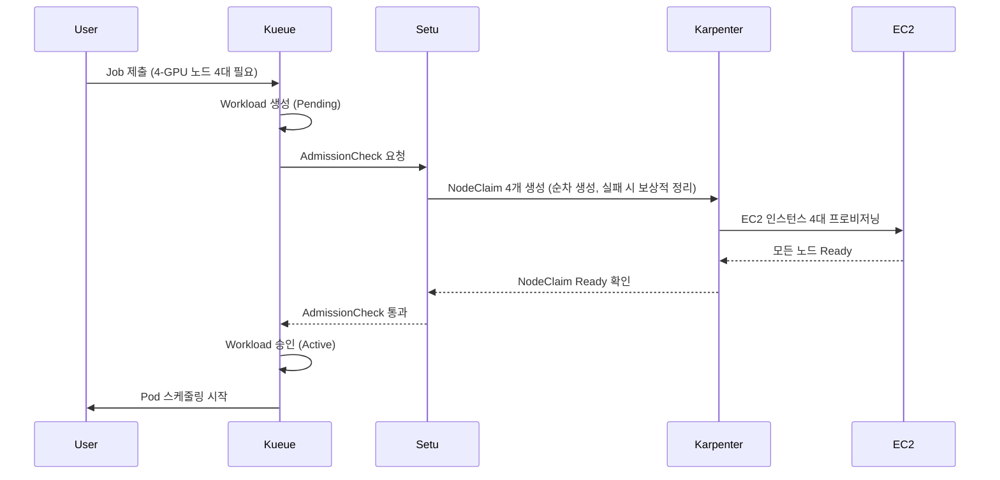

**사전 승인 readiness gate와 스케줄링 안전성:**

Setu의 핵심 동작은 **사전 승인(pre-admission) readiness gate**입니다. 필요한 NodeClaim이 모두 Ready 상태가 되기 전에는 Kueue 워크로드 승인을 보류합니다. 이는 분산 트랜잭션이나 Gang 스케줄러가 아니라, 승인 전에 노드 준비 상태를 확인하는 게이트입니다. NodeClaim은 순차적으로 생성되고, 일부가 실패하면 이미 만들어진 NodeClaim을 삭제하는 보상적 정리(compensating cleanup)를 수행하며, 재시도와 정리 과정에서 시간과 용량을 소모하거나 최종적으로 실패할 수 있습니다. Pod의 노드 배치(스케줄링)는 승인 이후의 별도 단계입니다.

| 시나리오 | 반응형 동적 프로비저닝 | Setu + Kueue |
|---------|---------------|-------------|
| **4-GPU 노드 4대 필요** | 2대만 생성 → 2대 유휴 → 비용 낭비 | 4대 모두 Ready 확인 후 승인 → 부분 할당으로 인한 유휴 감소 |
| **노드 프로비저닝 실패** | 일부 Pod만 Running, 나머지 지속 Pending | 생성된 NodeClaim 정리 + 지수 백오프 재시도 (5s-80s, 최대 5회), 재시도 소진 시 승인 거부 |
| **스케줄링 시작 시점** | 노드가 생성될 때마다 순차 스케줄링 | 모든 노드 Ready 확인 후 승인 → 이후 스케줄러가 Pod 배치 |

**실패 처리 및 재시도 로직:**

Setu는 노드 프로비저닝 실패 시 지능적으로 대응합니다:

```
실패 시나리오:
1. NodeClaim 4개 중 3개만 성공 (1개는 Spot 용량 부족)
2. Setu가 실패 감지 → 생성된 NodeClaim 삭제 (보상적 정리)
3. 지수 백오프 재시도:
   - 1회 재시도: 5초 후
   - 2회 재시도: 10초 후
   - 3회 재시도: 20초 후
   - 4회 재시도: 40초 후
   - 5회 재시도: 80초 후 (최종)
4. 5회 실패 시 AdmissionCheck 영구 실패 → Kueue가 Workload 거부
```

**Kueue 통합 아키텍처:**

Setu는 Kueue의 AdmissionCheck CRD를 사용하여 워크로드 승인 프로세스에 통합됩니다.

```yaml
# 1. AdmissionCheck 정의: Setu 컨트롤러 지정
apiVersion: kueue.x-k8s.io/v1beta2
kind: AdmissionCheck
metadata:
  name: karpenter-provision
spec:
  # Setu 컨트롤러 소스(커밋 7802a60)에 등록된 controllerName과 정확히 일치해야 합니다.
  # 이 값이 설치된 Setu 컨트롤러와 일치하지 않으면 AdmissionCheck가 Active 상태로 전환되지 않습니다.
  controllerName: setu.kueue.x-k8s.io/admission-check
---
# 2. ClusterQueue: AdmissionCheck 적용
apiVersion: kueue.x-k8s.io/v1beta2
kind: ClusterQueue
metadata:
  name: ml-training-queue
spec:
  namespaceSelector: {}
  resourceGroups:
  # coveredResources에 나열한 모든 리소스는 각 flavor가 동일한 순서로 nominalQuota를
  # 제공해야 합니다. 아래 flavor는 GPU 쿼터만 제공하므로 coveredResources도 GPU만 포함합니다.
  # Pod의 CPU/memory 요청은 쿼터로 제한하지 않습니다. CPU/memory도 쿼터로 관리하려면
  # 모든 flavor에 cpu/memory nominalQuota를 명시적으로 추가해야 합니다.
  - coveredResources: ["nvidia.com/gpu"]
    flavors:
    - name: gpu-flavor  # 동일 이름의 ResourceFlavor가 GPU 노드 라벨과 함께 사전 정의되어 있어야 합니다.
      resources:
      - name: nvidia.com/gpu
        nominalQuota: 32  # 총 32 GPU까지 허용
  # Setu AdmissionCheck 연결
  admissionChecks:
  - karpenter-provision
---
# 3. LocalQueue: 네임스페이스별 큐
apiVersion: kueue.x-k8s.io/v1beta2
kind: LocalQueue
metadata:
  name: training-jobs
  namespace: ml-team
spec:
  clusterQueue: ml-training-queue
---
# 4. Job: Kueue 라벨 추가
apiVersion: batch/v1
kind: Job
metadata:
  name: distributed-training
  namespace: ml-team
  labels:
    kueue.x-k8s.io/queue-name: training-jobs  # LocalQueue 지정
spec:
  parallelism: 4
  completions: 4
  template:
    spec:
      nodeSelector:
        node.kubernetes.io/instance-type: g5.2xlarge
      tolerations:
      - key: nvidia.com/gpu
        operator: Exists
        effect: NoSchedule
      containers:
      - name: trainer
        image: ml/pytorch-distributed:v2.0
        resources:
          # 확장 리소스(nvidia.com/gpu)는 limits에만 지정하거나, requests와 limits를
          # 같은 값으로 함께 지정해야 합니다. requests만 지정하면 Pod가 거부됩니다.
          requests:
            nvidia.com/gpu: 1
            cpu: "7"
            memory: 28Gi
          limits:
            nvidia.com/gpu: 1
      restartPolicy: OnFailure
```

**실행 흐름 상세:**

```
1. Job 제출 → Kueue Workload 생성 (Pending 상태)
2. Kueue가 리소스 쿼터 확인 (ClusterQueue: 32 GPU 중 4 GPU 사용 가능)
3. Kueue가 AdmissionCheck 실행 → Setu 컨트롤러 호출
4. Setu가 NodeClaim 4개 생성 (g5.2xlarge, 각 1 GPU)
5. Karpenter가 EC2 인스턴스 4대 프로비저닝
6. 모든 노드 Ready 확인 (kubelet 등록 + GPU 디바이스 플러그인 활성화)
7. Setu가 AdmissionCheck 승인 → Kueue가 Workload Active로 전환
8. Kueue가 Job의 suspend: false 설정 → Pod 4개 스케줄링 시작
9. 승인 이후 Scheduler가 Pod를 GPU 노드에 배치합니다. 노드는 이미 Ready 상태이므로 노드 생성 대기는 없지만, Pod는 여전히 스케줄링·바인딩·이미지 풀·컨테이너 시작 단계를 거칩니다. 전체 Pending/시작 시간은 워크로드에 따라 달라집니다.
```

**비교: 기존 Karpenter vs Setu + Kueue:**

| 단계 | 기존 Karpenter | Setu + Kueue |
|------|---------------|-------------|
| **Job 제출** | 즉시 Pod 생성 (Pending) | Kueue가 Workload로 관리 (승인 대기) |
| **노드 프로비저닝** | Pod Pending 감지 후 반응 | AdmissionCheck에서 사전 프로비저닝 |
| **부분 실패 처리** | 일부 Pod만 Running, 나머지 무한 대기 | 전체 롤백 + 재시도 (All-or-Nothing) |
| **스케줄링 시작** | 노드 생성 시마다 순차 | 모든 노드 Ready 확인 후 |
| **소요 시간** | 측정값 아님(워크로드·용량·이미지 크기에 따라 다름) | 측정값 아님(사전 프로비저닝으로 노드 생성 대기는 줄지만 Pod 시작 단계는 동일) |

**권장 사용 사례:**

| 워크로드 유형 | Setu 적합성 | 이유 |
|-------------|--------------|------|
| **대규모 분산 학습** (16+ GPU) | 검토 후 선택 | 사전 프로비저닝으로 부분 할당 유휴를 줄일 수 있으나, GPU 수가 많다는 이유만으로 Setu가 필수가 되는 것은 아닙니다. 호환성·워크로드 검증 후 아키텍처로 선택하세요. |
| **소규모 학습** (1-4 GPU) | ⚠️ 선택 | 오버헤드 대비 이득 제한적 |
| **단일 GPU 추론** | ❌ 불필요 | 반응형 Karpenter로 충분 |
| **배치 처리** (CPU 워크로드) | ⚠️ 선택 | 비용 효율성 목적이라면 유용 |

:::info Setu 성숙도 및 버전 요구사항
Setu는 Kueue 워크로드 큐잉과 Karpenter 노드 프로비저닝을 연결하는 **커뮤니티 프로젝트이며, 작성 시점 기준 상태는 Alpha**입니다(프로젝트 README가 "Alpha, AWS EKS에서 기능 및 E2E 테스트 완료, 먼저 비프로덕션 환경에서 사용"이라고 명시). 프로젝트가 보고한 호환성은 리뷰로 검증한 결과나 프로덕션 지원과 다릅니다.

검사한 Setu 커밋(`7802a60`)은 `kueue.x-k8s.io/v1beta2` API를 사용하며, 프로젝트는 Kueue v0.16+ 및 Karpenter v1+ 조합을 문서화합니다. 프로젝트가 보고한 E2E 조합은 EKS 1.35 / Karpenter 1.8.2 / Kueue 0.16이지만, 이 문서 작성 과정에서 직접 실행해 검증하지는 않았습니다. 이전 Kueue 버전과의 호환성은 해당 버전에 맞는 특정 릴리스 아티팩트가 있어야 합니다. 사용 전에 테스트된 전체 조합(Setu 릴리스/커밋, Kueue, Karpenter, CRD)을 핀하세요. Helm 차트 설치 및 상세 가이드는 [Setu GitHub 저장소](https://github.com/sanjeevrg89/Setu)를 참조하세요.
:::

:::warning 프로덕션 사용 시 고려사항
Setu는 커뮤니티 프로젝트로, 프로덕션 환경에서는 다음을 검증해야 합니다:
- Karpenter/Kueue 버전 호환성
- NodeClaim 생성 실패 시 알람 설정
- ClusterQueue 쿼터 모니터링 (리소스 고갈 방지)
:::

**추론 워크로드 스케줄링 예시:**

하나의 `podAntiAffinity` 아래에 노드별 필수 조건과 AZ별 선호 조건을 함께 둡니다. 4개 replica는 서로 다른 적격 노드 4대가 필요하지만, AZ는 선호 조건이므로 3개 AZ에서도 배치할 수 있습니다. AZ별 균등 분산을 보장하는 설정은 아닙니다. 필수 anti-affinity의 `topologyKey`를 `kubernetes.io/hostname`으로 제한하는 admission 설정도 고려한 구성입니다. [Kubernetes inter-pod affinity와 anti-affinity](https://kubernetes.io/docs/concepts/scheduling-eviction/assign-pod-node/#inter-pod-affinity-and-anti-affinity)를 참조하세요.

```yaml
# 고가용성 추론 서비스: On-Demand GPU 노드
apiVersion: apps/v1
kind: Deployment
metadata:
  name: ml-inference
spec:
  replicas: 4
  selector:
    matchLabels:
      app: ml-inference
  template:
    metadata:
      labels:
        app: ml-inference
    spec:
      tolerations:
      - key: nvidia.com/gpu
        operator: Exists
        effect: NoSchedule
      nodeSelector:
        karpenter.sh/capacity-type: on-demand  # On-Demand만 사용
      affinity:
        # Hard Anti-Affinity: 각 노드에 최대 1개 replica
        podAntiAffinity:
          requiredDuringSchedulingIgnoredDuringExecution:
          - labelSelector:
              matchLabels:
                app: ml-inference
            topologyKey: kubernetes.io/hostname
          # Soft Anti-Affinity: 가능하면 다른 AZ에 분산
          preferredDuringSchedulingIgnoredDuringExecution:
          - weight: 100
            podAffinityTerm:
              labelSelector:
                matchLabels:
                  app: ml-inference
              topologyKey: topology.kubernetes.io/zone
      priorityClassName: high-priority
      containers:
      - name: inference
        image: ml/triton-inference:v2.0
        resources:
          requests:
            nvidia.com/gpu: 1
            cpu: "3"
            memory: 12Gi
          limits:
            nvidia.com/gpu: 1
            cpu: "3"
            memory: 12Gi
        ports:
        - containerPort: 8000
          name: http
        - containerPort: 8001
          name: grpc
        livenessProbe:
          httpGet:
            path: /v2/health/live
            port: 8000
          initialDelaySeconds: 30
          periodSeconds: 10
        readinessProbe:
          httpGet:
            path: /v2/health/ready
            port: 8000
          initialDelaySeconds: 15
          periodSeconds: 5
---
# PDB: Eviction API 요청에 최소 2개 healthy Pod 기준 적용
apiVersion: policy/v1
kind: PodDisruptionBudget
metadata:
  name: ml-inference-pdb
spec:
  minAvailable: 2
  selector:
    matchLabels:
      app: ml-inference
```

**Inferentia/Graviton 추론 최적화:**

AWS Inferentia는 추론 전용 가속기입니다. AWS는 Inferentia2 기반 Inf2 인스턴스가 "다른 비교 가능한 Amazon EC2 인스턴스 대비 최대 40% 더 나은 가격 대비 성능(price performance)"을 제공한다고 밝힙니다([EC2 Inf2 인스턴스](https://aws.amazon.com/ec2/instance-types/inf2/), 비교 대상·워크로드는 AWS가 명시한 범위에 한함). 이는 모든 워크로드에 적용되는 보편적인 40% 비용 절감이 아니며, 실제 효과는 모델·정밀도·처리량/지연 목표에 따라 달라지므로 대상 워크로드로 직접 벤치마크해 확인하세요.

```yaml
# Inferentia 노드 스케줄링
apiVersion: apps/v1
kind: Deployment
metadata:
  name: inferentia-inference
spec:
  replicas: 6
  selector:
    matchLabels:
      app: inferentia-inference
  template:
    metadata:
      labels:
        app: inferentia-inference
    spec:
      nodeSelector:
        node.kubernetes.io/instance-type: inf2.xlarge  # AWS Inferentia2
      tolerations:
      - key: aws.amazon.com/neuron
        operator: Exists
        effect: NoSchedule
      containers:
      - name: inference
        image: ml/neuron-inference:v1.0
        resources:
          requests:
            aws.amazon.com/neuron: 1  # Neuron 디바이스 1개(코어 포함) 전체 할당. 코어 단위 할당이 필요하면 aws.amazon.com/neuroncore 리소스를 사용하세요.
            cpu: "3"
            memory: 8Gi
          limits:
            aws.amazon.com/neuron: 1
        env:
        - name: NEURON_RT_NUM_CORES
          value: "1"
```

**비용 최적화 전략 요약:**

| 워크로드 | 인스턴스 타입 | Spot 사용 | 권장 전략 |
|---------|-------------|----------|----------|
| **대규모 학습** | g5.12xlarge, p4d.24xlarge | ✅ 가능 | Spot + Checkpointing + Spot Interruption Handler |
| **소규모 학습** | g5.2xlarge, g5.4xlarge | ✅ 가능 | Spot 70% + On-Demand 30% 혼합 |
| **고성능 추론** | g5.xlarge, g5.2xlarge | ❌ 비권장 | On-Demand + Savings Plans |
| **경량 추론** | inf2.xlarge, c7g.xlarge | ❌ 비권장 | On-Demand 또는 Reserved Instances |
| **배치 추론** | g5.xlarge | ✅ 가능 | Spot + 재시도 로직 |

### 9.2 스케줄링 의사결정 플로우차트

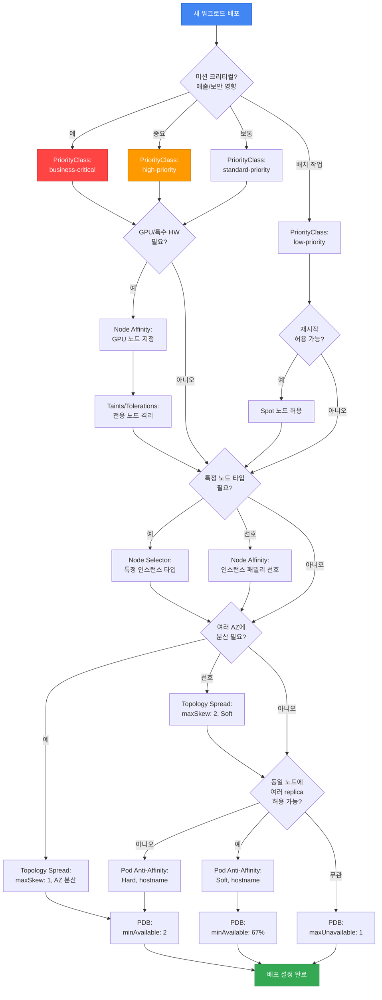

**의사결정 가이드:**

1. **비즈니스 영향도 평가** → PriorityClass 결정
2. **하드웨어 요구사항** → Node Affinity, Taints/Tolerations
3. **비용 최적화** → Spot 노드 허용 여부
4. **고가용성 요구사항** → Topology Spread, Anti-Affinity
5. **업그레이드 안전성** → 롤아웃 전략·Readiness 설정, Eviction API 기반 노드 Drain에는 PDB 설정

이 체크 항목들은 상호 배타적인 선택이 아니라 누적 적용됩니다. GPU·우선순위·Spot·affinity를 선택했더라도 Topology Spread, replica 분산, PDB 같은 독립 제약을 건너뛰지 않고 모두 평가해야 합니다.

---

## 10. 2025-2026 AWS 혁신과 스케줄링 전략

AWS re:Invent 2025에서 발표된 주요 혁신들은 EKS 스케줄링 전략에 큰 영향을 미치고 있습니다. 본 섹션에서는 Provisioned Control Plane, EKS Auto Mode, Karpenter + ARC 통합, Container Network Observability 등 최신 기능이 Pod 스케줄링과 가용성에 어떻게 적용되는지 다룹니다.

### 10.1 Provisioned Control Plane 스케줄링 성능

**개요:**

EKS는 컨트롤 플레인을 두 가지 모드로 운영합니다. 기본값은 **Standard 모드**로, 워크로드 수요에 따라 컨트롤 플레인이 자동으로 확장·축소됩니다. **Provisioned 모드**(EKS Provisioned Control Plane)는 관리자가 XL, 2XL, 4XL, 8XL 중 하나의 스케일링 티어를 선택해 컨트롤 플레인 용량을 미리 할당하는 선택적 모드이며, 명시적으로 opt-in 해야 합니다. "Standard"는 티어가 아니라 기본 모드의 이름입니다.

**티어별 용량 속성 (AWS 문서 2026-10-13 확인, Kubernetes v1.34 이상):**

각 Provisioned 티어는 다음 네 가지 컨트롤 플레인 속성으로 정의되며, 노드 수 상한을 지정하는 것은 아닙니다. 아래 수치는 Kubernetes 버전에 따라 달라집니다(v1.30–v1.33은 더 낮음). 반드시 현재 [EKS Provisioned Control Plane 문서](https://docs.aws.amazon.com/eks/latest/userguide/eks-provisioned-control-plane.html)에서 사용 중인 버전의 값을 확인하십시오.

| 티어 | API 요청 동시성(seats) | Pod 스케줄링 속도(pods/sec) | 클러스터 데이터베이스(etcd) 크기 | SLA(1분 간격) |
|------|-----------------------|----------------------------|-------------------------------|---------------|
| **XL** | 2,000 | 167 | 16 GB | 99.99% |
| **2XL** | 4,000 | 283 | 16 GB | 99.99% |
| **4XL** | 8,000 | 400 | 16 GB | 99.99% |
| **8XL** | 16,000 | 400 | 16 GB | 99.99% |

기본 Standard 모드는 99.95% SLA(5분 간격)와 최대 8 GB etcd를 제공합니다. 티어 간 자동 스케일링은 없으며, 선택한 티어에 고정됩니다. AWS 문서는 "티어 속성은 EKS가 적용하는 구성값이며, 실제로 얻는 성능은 워크로드 패턴·구성·Kubernetes 모범 사례 준수 여부에 따라 달라진다"고 명시합니다. 특히 Pod 스케줄링 속도는 스케줄러 QPS 상한이며, 실제 속도는 노드가 Ready·정상 상태인지 등에 따라 달라집니다.

**스케줄링 성능 향상:**

Provisioned Control Plane은 다음과 같은 방식으로 스케줄링 성능을 향상시킵니다:

1. **API 서버 동시 처리 능력**: 더 많은 스케줄링 요청을 동시에 처리
2. **etcd 용량 확장**: 더 많은 노드 및 Pod 메타데이터 저장
3. **스케줄러 처리량 증가**: 티어에 설정된 스케줄러 QPS 상한까지 초당 더 많은 Pod 스케줄링 시도 처리
4. **문서화된 컨트롤 플레인 용량 제공**: 티어의 용량 속성(API 동시성, 스케줄러 QPS, etcd 크기, 엔드포인트 SLA)을 보장합니다. 다만 이는 Kubernetes API 엔드포인트에 대한 SLA이며, 워크로드의 스케줄링·시작 지연은 제약 조건, 큐잉, 가용 노드 수, Pod 초기화 등에도 좌우되므로 티어가 일정한 end-to-end 지연을 보장하지는 않습니다.

**대규모 클러스터 스케줄링 전략:**

```yaml
# 예시: Provisioned Control Plane XL 티어에서 대규모 Deployment 배포
apiVersion: apps/v1
kind: Deployment
metadata:
  name: large-scale-app
spec:
  replicas: 1000  # 1000개 replica 동시 배포
  selector:
    matchLabels:
      app: large-scale-app
  template:
    metadata:
      labels:
        app: large-scale-app
    spec:
      # Topology Spread: 1000개 Pod를 균등 분산
      topologySpreadConstraints:
      - maxSkew: 10  # 대규모 배포에서는 maxSkew를 높여 유연성 확보
        topologyKey: topology.kubernetes.io/zone
        whenUnsatisfiable: DoNotSchedule
        labelSelector:
          matchLabels:
            app: large-scale-app
      - maxSkew: 50
        topologyKey: kubernetes.io/hostname
        whenUnsatisfiable: DoNotSchedule
        labelSelector:
          matchLabels:
            app: large-scale-app
      affinity:
        podAntiAffinity:
          preferredDuringSchedulingIgnoredDuringExecution:
          - weight: 100
            podAffinityTerm:
              labelSelector:
                matchLabels:
                  app: large-scale-app
              topologyKey: kubernetes.io/hostname
      containers:
      - name: app
        image: app:v1.0
        resources:
          requests:
            cpu: "500m"
            memory: 1Gi
```

**AI/ML 학습 워크로드 최적화 (수천 GPU Pod):**

Provisioned Control Plane은 AI/ML 학습 워크로드에서 수천 개의 GPU Pod를 동시에 스케줄링하는 시나리오에 최적화되어 있습니다.

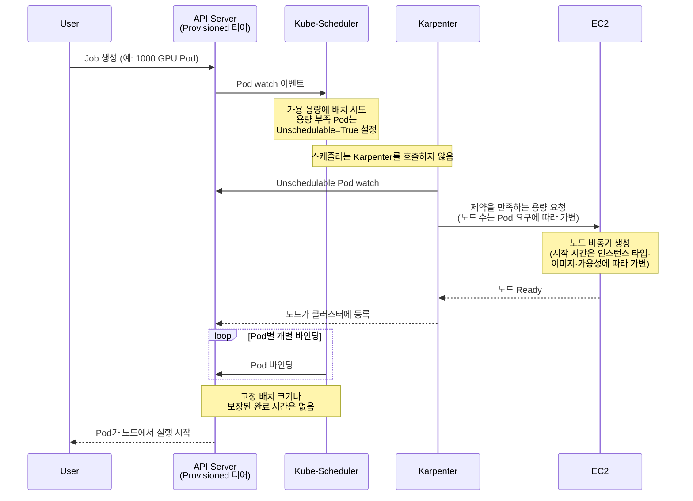

**사용 사례별 권장 모드·티어:**

아래는 워크로드 특성에 따른 일반적 출발점이며, 실제 티어는 [티어 활용률 메트릭](https://docs.aws.amazon.com/eks/latest/userguide/eks-provisioned-control-plane.html)으로 부하 테스트해 결정하십시오. 노드 수가 아니라 컨트롤 플레인 부하(API 동시성, 스케줄러 QPS, etcd 사용량)가 선택 기준입니다.

| 사용 사례 | 권장 모드·티어 | 이유 |
|----------|---------------|------|
| **일반 웹 애플리케이션** | Standard 모드(Provisioned 미사용) | 자동 스케일링으로 충분 |
| **대규모 배치 작업 (500+ Pod)** | XL 이상 | 높은 동시 스케줄링 부하 처리 |
| **분산 ML 학습 (1000+ GPU Pod)** | 2XL 이상 | 높은 스케줄러 QPS와 API 동시성 필요 |
| **HPC 클러스터 (대규모)** | 4XL/8XL | 최대 컨트롤 플레인 용량 |
| **미션 크리티컬 서비스** | Provisioned(XL 이상) | 99.99% 엔드포인트 SLA와 용량 변동 없는 운영 |

:::tip Provisioned Control Plane 선택 기준
- 선택 기준은 노드 수가 아니라 컨트롤 플레인 부하입니다. 최고 티어(8XL)로 부하 테스트한 뒤 티어 활용률 메트릭을 보고 적정 티어를 고르는 것이 AWS 권장 방법입니다.
- **빈번한 대규모 배포 (500+ Pod)**: Provisioned 티어 고려
- **GPU 워크로드 (100+ GPU)**: 2XL 이상 고려
- **용량 변동 없는 엔드포인트 SLA(99.99%) 필요**: 모든 규모에서 Provisioned 고려
:::

### 10.2 EKS Auto Mode 자동 노드 프로비저닝

**개요:**

EKS Auto Mode는 노드 프로비저닝과 유지보수를 관리합니다. 아래 코드는 두 구성을 비교하는 예시입니다. 독립 실행형 Karpenter에는 기존 `default` EC2NodeClass가 필요합니다. Auto Mode 구성에는 Auto Mode 활성화, Ready 상태인 NodeClass, 배치 가능한 NodePool, 호환 이미지, IAM과 네트워크 접근이 필요합니다.

기본 `general-purpose`는 On-Demand `amd64` 용량을 사용합니다. Spot에는 적합한 사용자 정의 pool이, ARM에는 배치 가능한 `arm64` pool과 호환 이미지가 필요합니다. 기본 `system` pool도 ARM을 지원하지만 중요 워크로드용 `CriticalAddonsOnly` taint가 있습니다.

독립 실행형 Karpenter는 `karpenter.k8s.aws/EC2NodeClass`, Auto Mode는 `eks.amazonaws.com/NodeClass`를 사용합니다. 예제를 적용할 때 각 NodePool이 올바른 종류의 NodeClass를 참조하는지 확인합니다.

**Auto Mode가 스케줄링에 미치는 영향:**

| 기능 | 기존 방식 (수동) | Auto Mode |
|------|---------------|----------|
| **노드 선택** | 호환 NodePool·Pod 제약 구성 | NodePool·Pod 제약 안에서 배치 가능한 offering 선택 |
| **동적 스케일링** | Cluster Autoscaler 또는 Karpenter 구성 | 설정한 용량·접근 범위 안에서 프로비저닝 관리 |
| **비용 최적화** | 허용 capacity type·아키텍처 구성 | Spot·Graviton에는 적합한 pool과 호환 워크로드 필요 |
| **AZ 배치** | 필요한 topology 정책 구성 | 애플리케이션 topology 정책과 적합한 서브넷이 계속 적용 |
| **노드 업그레이드** | AMI 수명주기 관리 | 지원되는 구성 안에서 노드 OS 수명주기 관리 |

**수동 NodeSelector/Affinity vs Auto Mode 비교:**

```yaml
# 기존 방식: 수동 NodeSelector + Karpenter NodePool
---
# Karpenter NodePool 생성
apiVersion: karpenter.sh/v1
kind: NodePool
metadata:
  name: general-pool
spec:
  template:
    spec:
      nodeClassRef:
        group: karpenter.k8s.aws
        kind: EC2NodeClass
        name: default
      requirements:
      - key: node.kubernetes.io/instance-type
        operator: In
        values: ["c6i.xlarge", "c6i.2xlarge", "c6a.xlarge"]
      - key: karpenter.sh/capacity-type
        operator: In
        values: ["on-demand", "spot"]
---
# Deployment: NodeSelector로 노드 지정
apiVersion: apps/v1
kind: Deployment
metadata:
  name: api-server
spec:
  replicas: 10
  selector:
    matchLabels:
      app: api-server
  template:
    metadata:
      labels:
        app: api-server
    spec:
      nodeSelector:
        karpenter.sh/nodepool: general-pool
      containers:
      - name: api
        image: api:v1.0
        resources:
          requests:
            cpu: "1"
            memory: 2Gi
```

```yaml
# Auto Mode 방식: 최소한의 설정
apiVersion: apps/v1
kind: Deployment
metadata:
  name: api-server
spec:
  replicas: 10
  selector:
    matchLabels:
      app: api-server
  template:
    metadata:
      labels:
        app: api-server
    spec:
      nodeSelector:
        eks.amazonaws.com/compute-type: auto
      containers:
      - name: api
        image: api:v1.0
        resources:
          requests:
            cpu: "1"
            memory: 2Gi
      # 배치 가능한 NodePool 제약과 애플리케이션 topology 정책은 계속 적용
```

**Auto Mode 환경에서 여전히 필요한 스케줄링 설정:**

Auto Mode는 노드 프로비저닝을 자동화하지만, 다음 스케줄링 설정은 **여전히 명시적으로 설정해야 합니다**:

| 설정 | Auto Mode 자동화 여부 | 설명 |
|------|---------------------|------|
| **Resource Requests/Limits** | ❌ 필수 설정 | 워크로드 리소스 요구사항 명시 필요 |
| **Topology Spread** | ⚠️ 애플리케이션 요구에 맞는 명시적 정책 | 기본 스케줄러 동작만으로 필요한 AZ 분산이 성립하지 않음 |
| **Pod Anti-Affinity** | ❌ 필수 설정 | 같은 앱 replica 분산은 명시 필요 |
| **PDB** | ❌ 필수 설정 | 최소 가용성 보장은 앱 담당 |
| **PriorityClass** | ❌ 필수 설정 | 우선순위는 앱 담당 |
| **Taints/Tolerations** | ⚠️ 특수 노드만 | GPU 등 특수 워크로드는 명시 필요 |

**Auto Mode 환경의 권장 스케줄링 패턴:**

```yaml
# Auto Mode에서 권장되는 최소한의 스케줄링 설정
apiVersion: apps/v1
kind: Deployment
metadata:
  name: production-app
spec:
  replicas: 6
  selector:
    matchLabels:
      app: production-app
  template:
    metadata:
      labels:
        app: production-app
    spec:
      # 1. Resource Requests (필수)
      containers:
      - name: app
        image: app:v1.0
        resources:
          requests:
            cpu: "1"
            memory: 2Gi
          limits:
            cpu: "2"
            memory: 4Gi

      # 2. Topology Spread (세밀한 AZ 분산 제어)
      topologySpreadConstraints:
      - maxSkew: 1
        topologyKey: topology.kubernetes.io/zone
        whenUnsatisfiable: DoNotSchedule
        labelSelector:
          matchLabels:
            app: production-app
        minDomains: 3

      # 3. Pod Anti-Affinity (노드 분산)
      affinity:
        podAntiAffinity:
          preferredDuringSchedulingIgnoredDuringExecution:
          - weight: 100
            podAffinityTerm:
              labelSelector:
                matchLabels:
                  app: production-app
              topologyKey: kubernetes.io/hostname

      # 4. PriorityClass (우선순위)
      priorityClassName: high-priority
---
# 5. PDB (가용성 보장)
apiVersion: policy/v1
kind: PodDisruptionBudget
metadata:
  name: production-app-pdb
spec:
  minAvailable: 4
  selector:
    matchLabels:
      app: production-app
```

**Auto Mode + PDB + Karpenter 상호작용:**

Auto Mode는 내부적으로 Karpenter와 유사한 자동 스케일링을 제공하며, PDB를 존중합니다.

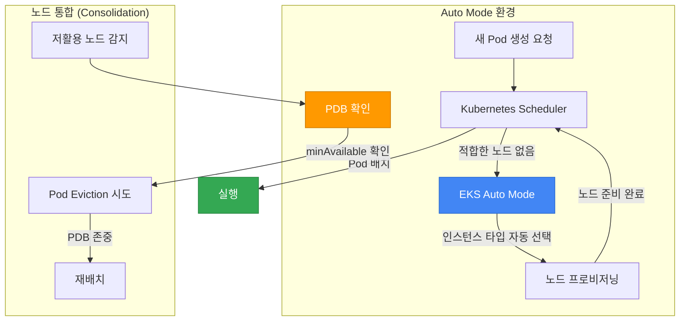

### 10.3 ARC Zonal Shift와 Karpenter {#103-arc--karpenter-통합-az-대피}

**개요:**

EKS의 ARC zonal shift는 손상 AZ로 향하는 지원 대상 트래픽을 줄이는 기능입니다. 해당 AZ의 노드를 cordon하고 Pod endpoint를 EndpointSlice에서 제외하지만, 기존 Pod를 퇴거시키거나 Deployment replica를 자동으로 다른 AZ에 다시 만들지는 않습니다.

- EKS 클러스터의 zonal shift를 활성화해야 합니다. self-managed Karpenter는 1.12.0 이상과 controller의 zonal-shift 설정이 필요합니다. 이 예시의 1.14.1 CLI 옵션은 `--enable-zonal-shift=true`이며, controller에는 대상 클러스터의 `arc-zonal-shift:GetManagedResource` 권한이 필요합니다. EKS Auto Mode의 활성화 경로는 별도입니다.
- AWS zonal autoshift는 AWS 내부 AZ telemetry를 사용합니다. 사용자 CloudWatch 알람은 운영자나 별도 구현된 자동화의 입력이며, 이 문서는 알람에서 shift를 시작하는 컨트롤러를 구현하지 않습니다.
- 시작 전에 남은 AZ의 replica·CoreDNS·용량·의존성으로 부하를 감당할 수 있어야 합니다. LB resource의 ARC 설정, target type과 endpoint 소비 경로도 확인합니다. 아래 NodePool은 기존 `default` EC2NodeClass와 해당 Region의 네트워크·이미지·권한을 전제로 하며, 리소스 이름만으로 ARC가 활성화되지 않습니다.

**지원되는 트래픽 전환과 독립적인 Karpenter 동작:**

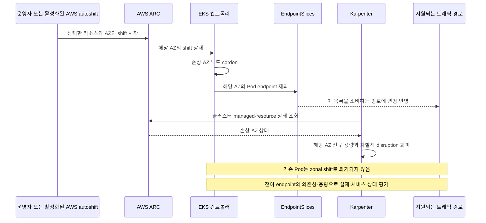

**ARC를 별도로 활성화한 클러스터의 워크로드 제약 예시:**

이 예시는 AZ spread를 Soft로 두고 `minDomains`를 생략합니다. AZ가 줄어들어도 이 spread 설정 자체가 새 Pod의 배치를 막지는 않습니다. 다만 node affinity·taint·볼륨·용량 등 다른 조건을 만족해야 하므로 균등 배치나 배치 성공을 보장하는 설정은 아닙니다.

실제 애플리케이션 이미지와 readiness 설정을 넣어 사용합니다. shift 후에도 기존 Pod가 살아 있으면 Deployment는 목표 replica 수가 유지된 것으로 판단하므로 자동으로 대체 replica를 만들지 않습니다.

```yaml
# NodePool 제약 예시; ARC 활성화는 별도
apiVersion: karpenter.sh/v1
kind: NodePool
metadata:
  name: arc-enabled-pool
spec:
  template:
    spec:
      nodeClassRef:
        group: karpenter.k8s.aws
        kind: EC2NodeClass
        name: default
      requirements:
      - key: topology.kubernetes.io/zone
        operator: In
        values:
        - us-east-1a
        - us-east-1b
        - us-east-1c
      - key: karpenter.sh/capacity-type
        operator: In
        values: ["on-demand"]  # 허용할 용량 유형의 예시이며 용량 예약이 아님
  disruption:
    consolidationPolicy: WhenEmptyOrUnderutilized
    consolidateAfter: 5m
    budgets:
    - nodes: "30%"  # 자발적 disruption 예산이며 예비 용량이 아님
---
# 애플리케이션: Topology Spread + PDB
apiVersion: apps/v1
kind: Deployment
metadata:
  name: resilient-app
spec:
  replicas: 9  # 목표 replica 수; 실제 AZ별 배치는 별도 확인
  selector:
    matchLabels:
      app: resilient-app
  template:
    metadata:
      labels:
        app: resilient-app
    spec:
      topologySpreadConstraints:
      - maxSkew: 1
        topologyKey: topology.kubernetes.io/zone
        whenUnsatisfiable: ScheduleAnyway
        labelSelector:
          matchLabels:
            app: resilient-app
      affinity:
        podAntiAffinity:
          preferredDuringSchedulingIgnoredDuringExecution:
          - weight: 100
            podAffinityTerm:
              labelSelector:
                matchLabels:
                  app: resilient-app
              topologyKey: kubernetes.io/hostname
      containers:
      - name: app
        image: app:v1.0
        resources:
          requests:
            cpu: "1"
            memory: 2Gi
---
# PDB: 선택한 Pod의 자발적 Eviction API 예산; AZ 장애 자체는 제한하지 않음
apiVersion: policy/v1
kind: PodDisruptionBudget
metadata:
  name: resilient-app-pdb
spec:
  minAvailable: 6
  selector:
    matchLabels:
      app: resilient-app
```

**Istio locality 라우팅 예시:**

아래는 기존 `default/resilient-app` Service와 HTTP 포트, 정상 endpoint, sidecar 기반 mesh 및 해당 CRD 필드를 지원하는 Istio 설치를 전제로 합니다. Istio의 locality·outlier detection은 mesh endpoint 선택을 제어합니다. ARC의 EKS EndpointSlice 경로와 같은 메커니즘은 아니며, 실제 mesh의 endpoint 발견 방식과 shift 중 동작은 따로 검증해야 합니다.

`failover.from/to`는 region 이름을 받으므로 AZ 순환 목록으로 사용하지 않습니다. 대신 region·zone metadata를 순서대로 비교하는 `failoverPriority`와 `consecutive5xxErrors`를 사용합니다. 이 우선순위는 고정된 AZ 순환이나 복구 시간을 보장하지 않습니다. `distribute`, `failover`, `failoverPriority` 중 하나만 지정하며, 기존 30초 값은 조정·검증할 예시입니다.

```yaml
# Istio DestinationRule: endpoint locality 우선순위
apiVersion: networking.istio.io/v1beta1
kind: DestinationRule
metadata:
  name: resilient-app-dr
spec:
  host: resilient-app.default.svc.cluster.local
  trafficPolicy:
    loadBalancer:
      localityLbSetting:
        enabled: true
        failoverPriority:
        - topology.kubernetes.io/region
        - topology.kubernetes.io/zone
    outlierDetection:
      consecutive5xxErrors: 5
      interval: 30s
      baseEjectionTime: 30s
      maxEjectionPercent: 50
---
# Service로 라우팅하며 정적 AZ subset 제외를 설정하지 않음
apiVersion: networking.istio.io/v1beta1
kind: VirtualService
metadata:
  name: resilient-app-vs
spec:
  hosts:
  - resilient-app.default.svc.cluster.local
  http:
  - route:
    - destination:
        host: resilient-app.default.svc.cluster.local
```

**Gray Failure 감지 패턴:**

Gray Failure는 완전히 중단되지는 않았지만 응답 지연 등으로 서비스 품질이 떨어진 상태입니다. 아래 ConfigMap은 특정 ALB와 AZ의 지연 알람 정의를 저장합니다. ConfigMap을 만드는 것만으로 CloudWatch 알람이 생기지는 않습니다.

실제 계정·Region에서 `LoadBalancer` suffix, AZ와 지연 기준을 확인하고 별도 IaC/API로 알람을 생성합니다. 예시는 actions를 끄고 결측을 `missing`으로 처리합니다. 알람을 받은 뒤의 조치는 운영자 runbook이나 별도 자동화로 연결해야 합니다. AWS zonal autoshift는 이 알람 대신 AWS 내부 telemetry를 사용합니다.

```yaml
# 알람 정의 데이터: ALB 식별자는 예시이며 실제 값으로 교체
apiVersion: v1
kind: ConfigMap
metadata:
  name: gray-failure-detection
data:
  alarm.json: |
    {
      "AlarmName": "EKS-AZ-1a-HighLatency",
      "ActionsEnabled": false,
      "MetricName": "TargetResponseTime",
      "Namespace": "AWS/ApplicationELB",
      "Statistic": "Average",
      "Unit": "Seconds",
      "Period": 60,
      "EvaluationPeriods": 3,
      "Threshold": 1.0,
      "ComparisonOperator": "GreaterThanThreshold",
      "Dimensions": [
        {
          "Name": "LoadBalancer",
          "Value": "app/resilient-app/0123456789abcdef"
        },
        {
          "Name": "AvailabilityZone",
          "Value": "us-east-1a"
        }
      ],
      "TreatMissingData": "missing"
    }
```

**AZ 장애 대응 시 확인할 경계:**

| 시나리오 | PDB 역할 | Topology Spread | 용량·제어 경로 | 검증할 결과 |
|---------|---------|----------------|---------------|----------|
| **완전 AZ 장애** | 자발적 Eviction만 제한 | Soft 예시와 잔여 Hard 제약 확인 | 잔여 AZ에 사전 확보한 replica·용량, 활성화된 ARC 경로 | endpoint 전환과 서비스 SLO를 실제 측정 |
| **Gray Failure** | 장애 감지나 shift 시작 기능이 아님 | 실제 적격 도메인과 부하 확인 | AWS autoshift 또는 운영자·별도 자동화의 판단 경로 | 알람 품질과 영향 범위를 검증 |
| **계획된 유지보수** | 선택 Pod의 Eviction 예산 평가 | 유지보수 중 필요한 배치 정책 검토 | 별도 drain·복구 계획; shift가 Pod를 퇴거시키지는 않음 | workload별 준비·복원 시간을 측정 |

### 10.4 Container Network Observability와 스케줄링

**개요:**

Container Network Observability는 세분화된 네트워크 메트릭을 제공하여 Pod 배치와 네트워크 성능의 상관관계를 분석하고, 스케줄링 전략을 최적화할 수 있게 합니다.

**Pod 배치와 네트워크 성능 상관관계:**

아래 표는 배치 패턴에 따른 상대적 경향만 나타냅니다. 절대 지연 값과 요금은 워크로드·프로토콜, 리전/AZ 경로, 측정 방법·백분위수, 그리고 적용 시점의 요금에 따라 달라지므로 여기에 고정 수치로 적지 않습니다. 실제 지연은 직접 측정하고, 데이터 전송 요금은 서비스·방향·리전 쌍·날짜·과금 구간과 적용 가능한 면제 조건을 명시한 최신 [AWS 데이터 전송 요금](https://aws.amazon.com/ec2/pricing/on-demand/)으로 확인하십시오.

| Pod 배치 패턴 | 상대적 네트워크 지연 | Cross-AZ 데이터 전송 요금 | 사용 사례 |
|-------------|------------------|------------------------|----------|
| **Same Node** | 가장 낮음 | Cross-AZ 전송 구간 없음(단, 서비스·처리 비용은 별도) | Cache 서버 + 애플리케이션 |
| **Same AZ** | 낮음 | Cross-AZ 전송 구간 없음(단, 서비스·처리 비용은 별도) | 빈번한 통신하는 마이크로서비스 |
| **Cross-AZ** | 중간(동일 리전 내) | 적용 가능한 리전별 AZ 간 전송 요금 발생 | 고가용성 필요 서비스 |
| **Cross-Region** | 가장 높음 | 적용 가능한 리전 간 전송 요금 발생 | 지역별 분산 서비스 |

> Same Node·Same AZ에 "Cross-AZ 전송 구간이 없다"는 것이 네트워크·서비스 처리 비용이 모두 $0이라는 뜻은 아닙니다.

**Cross-AZ 트래픽 경로와 배치 선호를 함께 평가하기:**

아래 Pod affinity는 배치 점수에만 영향을 줍니다. 이미 여러 AZ에 API Gateway Pod가 있으면 여러 AZ가 동시에 선호 조건을 만족할 수 있습니다. 요청별 Service·mesh endpoint 선택과 실제 바이트 경로를 확인해야 같은 AZ 통신이나 비용 변화를 평가할 수 있습니다.

```yaml
# 예시: API Gateway 분산과 Backend의 AZ 배치 선호
apiVersion: apps/v1
kind: Deployment
metadata:
  name: api-gateway
spec:
  replicas: 6
  selector:
    matchLabels:
      app: api-gateway
  template:
    metadata:
      labels:
        app: api-gateway
        network-locality: same-az  # 네트워크 관찰성 라벨
    spec:
      # Topology Spread: AZ 균등 분산
      topologySpreadConstraints:
      - maxSkew: 1
        topologyKey: topology.kubernetes.io/zone
        whenUnsatisfiable: DoNotSchedule
        labelSelector:
          matchLabels:
            app: api-gateway
      containers:
      - name: gateway
        image: api-gateway:v1.0
        resources:
          requests:
            cpu: "1"
            memory: 2Gi
---
# Backend Service: API Gateway와 같은 AZ 선호
apiVersion: apps/v1
kind: Deployment
metadata:
  name: backend-service
spec:
  replicas: 6
  selector:
    matchLabels:
      app: backend-service
  template:
    metadata:
      labels:
        app: backend-service
        network-locality: same-az
    spec:
      affinity:
        # Pod Affinity: API Gateway와 같은 AZ 선호; endpoint 라우팅은 별도
        podAffinity:
          preferredDuringSchedulingIgnoredDuringExecution:
          - weight: 100
            podAffinityTerm:
              labelSelector:
                matchExpressions:
                - key: app
                  operator: In
                  values:
                  - api-gateway
              topologyKey: topology.kubernetes.io/zone
      containers:
      - name: backend
        image: backend-service:v1.0
        resources:
          requests:
            cpu: "2"
            memory: 4Gi
```

**네트워크 관찰성 기반 Topology Spread 최적화:**

Container Network Observability 메트릭을 분석하여 스케줄링 전략을 조정합니다.

`pod_network_rx_bytes`는 Container Insights(enhanced observability)가 게시하는 Pod 네트워크 수신 메트릭으로, 집계 기간 동안의 **초당 평균 수신 바이트(rate)**이지 누적 바이트나 Cross-AZ 전용 바이트가 아닙니다. CloudWatch는 차원(dimension) 값에 와일드카드를 받지 않으므로, 아래 `PodName` 값은 특정 Pod 이름(예시)로 지정해야 하며 `api-gateway-*` 같은 패턴 매칭은 별도의 메트릭 검색·탐색 설계(예: `ListMetrics` 후 `GetMetricData`의 수식/검색 식)가 필요합니다. 실제 차원 집합과 수집 모드, 시간 범위, 누락 데이터 처리는 사용 중인 Container Insights 버전의 [게시 메트릭 참조](https://docs.aws.amazon.com/AmazonCloudWatch/latest/monitoring/Container-Insights-metrics-EKS.html)로 확인하십시오. 아래는 하나의 `GetMetricData` 쿼리 조각(illustrative)이며, 전체 요청에는 `MetricDataQueries`, `StartTime`, `EndTime`가 더 필요합니다.

```yaml
# 예시(illustrative): CloudWatch Container Insights 메트릭 쿼리 조각
apiVersion: v1
kind: ConfigMap
metadata:
  name: network-metrics-query
data:
  query.json: |
    {
      "MetricName": "pod_network_rx_bytes",
      "Namespace": "ContainerInsights",
      "Dimensions": [
        {"Name": "PodName", "Value": "api-gateway"},
        {"Name": "Namespace", "Value": "default"}
      ],
      "Period": 300,
      "Stat": "Average"
    }
```

**네트워크 관찰성 기반 최적화 패턴:**

1. **높은 Cross-AZ 트래픽 감지** → 실제 endpoint·바이트 경로와 locality 정책을 확인한 뒤 배치 선호 검토
2. **특정 AZ 네트워크 혼잡 감지** → 적격 도메인·용량과 배치 정책의 영향을 함께 평가
3. **Pod 간 통신 패턴 분석** → Service Mesh(Istio)의 라우팅·health 설정 검증
4. **네트워크 지연 급증 감지** → 운영자 또는 별도 자동화가 원인과 사전 준비를 확인한 뒤 지원 리소스의 ARC 트래픽 shift 판단

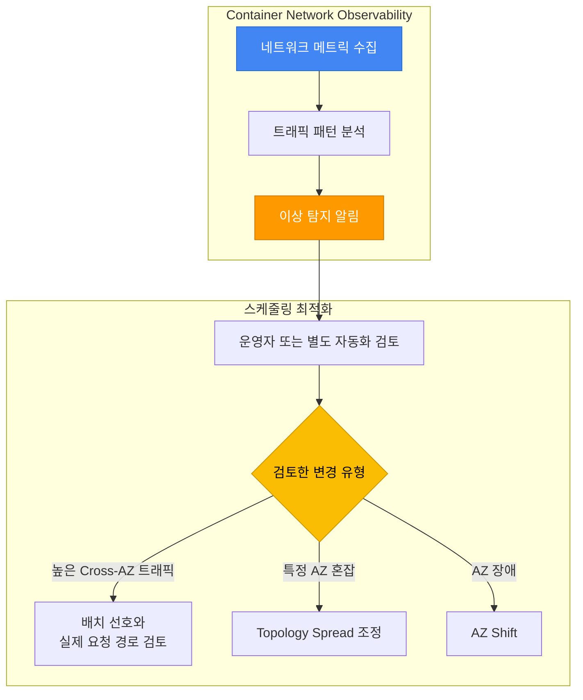

**실전 예시: ML 추론 서비스 네트워크 최적화:**

```yaml
# ML 추론 서비스: 낮은 지연 + 비용 최적화
apiVersion: apps/v1
kind: Deployment
metadata:
  name: ml-inference-optimized
spec:
  replicas: 9
  selector:
    matchLabels:
      app: ml-inference
  template:
    metadata:
      labels:
        app: ml-inference
    spec:
      # 1. Topology Spread: AZ 균등 분산 (고가용성)
      topologySpreadConstraints:
      - maxSkew: 1
        topologyKey: topology.kubernetes.io/zone
        whenUnsatisfiable: DoNotSchedule
        labelSelector:
          matchLabels:
            app: ml-inference
        minDomains: 3

      # 2. Pod Affinity: API Gateway와 같은 AZ 선호; 요청 지연은 별도 측정
      affinity:
        podAffinity:
          preferredDuringSchedulingIgnoredDuringExecution:
          - weight: 80
            podAffinityTerm:
              labelSelector:
                matchExpressions:
                - key: app
                  operator: In
                  values:
                  - api-gateway
              topologyKey: topology.kubernetes.io/zone

      containers:
      - name: inference
        image: ml-inference:v1.0
        resources:
          requests:
            cpu: "2"
            memory: 8Gi
```

**네트워크 관찰성 기반 비용 절감 효과(가상 예시):**

아래 표는 측정값이 아니라 가정에 따른 산술 예시입니다. 수치는 명시한 단위·요금 가정에서만 성립하며, Pod affinity가 원인이라는 측정 근거는 제시되지 않았습니다.

| 항목 | 최적화 전 | 최적화 후 | 가정에 따른 변화 |
|------|----------|----------|----------------|
| Cross-AZ 트래픽 | 1 TB/월 | 0.2 TB/월 | 선택한 단위 기준 80% 감소 |
| 전송 요금 | — | — | 0.8 TB가 800 과금 GB이고 해당 전송 구간 요금이 $0.01/GB일 때에만 월 약 $8 절감(요금·방향 미검증) |
| 평균 지연 | 3 ms | 0.5 ms | 지연이 1/6(약 83.3% 낮음); 처리량 6배를 의미하지 않음 |
| Pod Affinity | 미사용 | 적용 | 측정된 인과 효과는 별도 확인 필요 |

---

### 10.5 Node Readiness Controller — 스케줄링 안전성 강화

**개요:**

Node Readiness Controller(NRC)는 2026년 2월 3일 Kubernetes 블로그에서 소개한 별도 Kubernetes SIGs 컨트롤러입니다. 사용자 정의 Node Condition에 따라 readiness taint를 조정하며, Kubernetes 1.32 내장 feature gate가 아닙니다.

이 섹션은 NRC `v0.5.0` 컨트롤러·CRD와 Karpenter `v1.14.1` 스키마 기준입니다. 단독 rule과 통합 GPU 패턴은 대안 예시이며, 함께 구성할 때는 selector 중복과 taint 소유권을 확인합니다. 예시의 전제조건은 다음과 같습니다.

- 같은 릴리스의 컨트롤러·CRD를 사용하고, 컨트롤러가 자신의 readiness guard로 차단된 노드 밖에서도 실행될 수 있어야 합니다. admission webhook 패키지와 인증서 전제조건은 선택한 릴리스 설치 방식에 따릅니다.
- 대상 label과 일치하는 `NoSchedule` taint를 **노드 등록 시점부터** 설정합니다. Karpenter는 `startupTaints`로 초기 taint를 제공할 수 있으며, 나중에 비동기로 추가하면 배치 경합이 남습니다.
- 아래의 정확한 사용자 정의 condition을 보고할 별도 reporter 구현·권한이 필요합니다. CNI/NVIDIA device plugin이 이를 보고한다고 가정하지 않습니다. 검사 의미, Node status RBAC, 보고 주기, 실패·Unknown 처리와 오래된 신호 처리를 정해야 하며, NRC 자체는 상태 검사기나 freshness timeout이 아닙니다.
- bootstrap 에이전트에는 필요한 guard와 전용 노드 taint의 toleration만 부여합니다. 일반 워크로드는 readiness guard를 tolerate하지 않습니다. GPU 워크로드에는 9.2절의 호환 accelerated AMI·런타임·device plugin 조건도 필요합니다.

rule 객체는 API 규약을 보여줍니다. reporter와 노드 등록 설정을 제공하기 전에는 완전한 실행용 readiness 배포가 아닙니다.

**스케줄링 관점에서의 문제:**

스케줄러는 리소스, taint, affinity, topology 등 여러 제약을 평가합니다. `Ready=True`만으로 모든 워크로드 의존 구성 요소의 사용 가능성이 증명되지는 않습니다. 아래는 발생 가능한 초기화 공백의 예시이며 실측 장애 결과가 아닙니다.

| 시나리오 | 노드 상태 | 실제 상황 | 결과 |
|---------|---------|----------|------|
| **CNI 플러그인 미준비** | `Ready` | Calico/Cilium Pod 시작 중 | Pod 네트워크 연결 실패 |
| **CSI 드라이버 미준비** | `Ready` | EBS CSI Driver 초기화 중 | PVC 마운트 실패 |
| **GPU 드라이버 미준비** | `Ready` | NVIDIA Device Plugin 로딩 중 | GPU 워크로드 시작 실패 |
| **이미지 프리풀 진행 중** | `Ready` | 필요한 이미지 layer 다운로드 중 | 이미지 가용성까지 시작이 지연될 수 있으며 시간은 이미지·캐시·네트워크에 따라 다름 |

**Node Readiness Controller의 동작 원리:**

NRC는 `NodeReadinessRule` CRD(`readiness.node.x-k8s.io/v1alpha1`)를 사용하여 다음과 같이 동작합니다:

1. **조건 기반 taint 관리**: rule이 요구하는 Node Condition에 따라 해당 taint를 조정합니다.
2. **일반 스케줄링 차단**: `NoSchedule` guard는 일치하는 toleration이 없는 신규 Pod를 차단하며 기존 Pod를 evict하지 않습니다.
3. **조건부 taint 제거**: 해당 rule의 condition이 일치하면 그 taint를 제거합니다. 다른 guard와 스케줄러 제약도 배치를 허용해야 합니다.

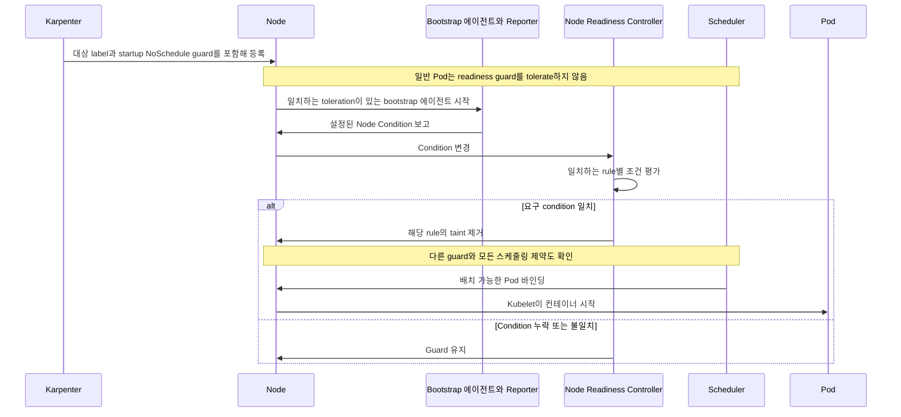

**두 가지 Enforcement 모드:**

NRC는 두 가지 모드로 동작하며, 각 모드는 스케줄링 안전성에 다른 영향을 미칩니다:

| 모드 | 동작 방식 | 스케줄링 영향 | 사용 사례 |
|------|---------|-------------|----------|
| **bootstrap-only** | condition이 처음 일치하면 taint를 제거하고 완료 표시 | 일회성 guard이며 이후 condition 실패로 이 rule을 재적용하지 않음 | 일회성 초기화·프리풀 |
| **continuous** | 보고된 condition 변경에 따라 taint 조정 | 조정 후 tolerate하지 않는 신규 Pod를 차단하며 기존 Pod를 evict하지 않음 | 지속적인 상태 보고가 필요한 의존 구성 요소 |

**실전 예시 1: CNI 플러그인 준비 확인 (Bootstrap-only)**

```yaml
apiVersion: readiness.node.x-k8s.io/v1alpha1
kind: NodeReadinessRule
metadata:
  name: network-readiness-rule
spec:
  # 사용자 정의 network reporter 필요; condition 누락 시 Unknown 유지
  conditions:
    - type: "example.com/NetworkReady"
      requiredStatus: "True"

  # 준비될 때까지 이 taint 적용
  taint:
    key: "readiness.k8s.io/network-unavailable"
    effect: "NoSchedule"
    value: "pending"

  # Bootstrap-only: 한번 준비되면 모니터링 중단
  enforcementMode: "bootstrap-only"

  # 노드 등록 시 제공한 label로 대상 지정
  nodeSelector:
    matchLabels:
      example.com/readiness-profile: network-bootstrap
```

**실전 예시 2: GPU 드라이버 지속 모니터링 (Continuous)**

```yaml
apiVersion: readiness.node.x-k8s.io/v1alpha1
kind: NodeReadinessRule
metadata:
  name: gpu-driver-readiness-rule
spec:
  # 사용자 정의 reporter가 device 등록과 드라이버 상태 검사
  conditions:
    - type: "example.com/GPUDevicePluginReady"
      requiredStatus: "True"
    - type: "example.com/GPUDriverReady"
      requiredStatus: "True"

  # GPU 준비될 때까지 이 taint 적용
  taint:
    key: "readiness.k8s.io/gpu-unavailable"
    effect: "NoSchedule"
    value: "pending"

  # Continuous: 보고된 condition이 실패하면 guard 재조정
  enforcementMode: "continuous"

  # GPU 노드 그룹에만 적용
  nodeSelector:
    matchLabels:
      example.com/readiness-profile: gpu-continuous
```

**Pod Scheduling Readiness(schedulingGates)와의 비교:**

Kubernetes는 Pod 수준과 노드 수준 양쪽에서 스케줄링 안전성을 제어할 수 있습니다:

| 비교 항목 | `schedulingGates` (Pod 수준) | `NodeReadinessRule` (노드 수준) |
|----------|------------------------------|--------------------------------|
| **제어 대상** | 특정 Pod의 스케줄링 | guard를 tolerate하지 않는 Pod에 대한 대상 노드의 배치 가능 여부 |
| **사용 사례** | 외부 조건 충족까지 Pod 보류 | 보고된 인프라 condition이 미충족인 동안 노드 보호 |
| **조건 위치** | Pod spec의 gate 이름이며 실제 준비 판단은 외부 컨트롤러 담당 | reporter가 제공하는 Node status의 condition |
| **제거 방법** | 외부 컨트롤러가 gate 제거 | rule이 일치하면 NRC가 해당 taint 제거 |
| **영향 범위** | 단일 Pod | 일치하는 toleration이 없는 신규 Pod이며 `NoSchedule`은 기존 Pod를 evict하지 않음 |

**조합 패턴:**

```yaml
# Pod 수준 + 노드 수준 스케줄링 안전성 조합
apiVersion: v1
kind: Pod
metadata:
  name: ml-training-job
spec:
  # Pod 수준: 데이터셋 준비까지 스케줄링 보류
  schedulingGates:
    - name: "example.com/dataset-ready"

  # 대상 pool은 readiness guard를 포함해 등록하며 이 guard를 tolerate하지 않음
  nodeSelector:
    karpenter.sh/nodepool: gpu-pool

  containers:
    - name: trainer
      image: ml-trainer:v1.0
      resources:
        limits:
          nvidia.com/gpu: 8
```

**Karpenter + NRC 연동 패턴:**

Karpenter로 동적 노드 프로비저닝을 사용하는 환경에서 NRC는 다음과 같은 워크플로우를 제공합니다:

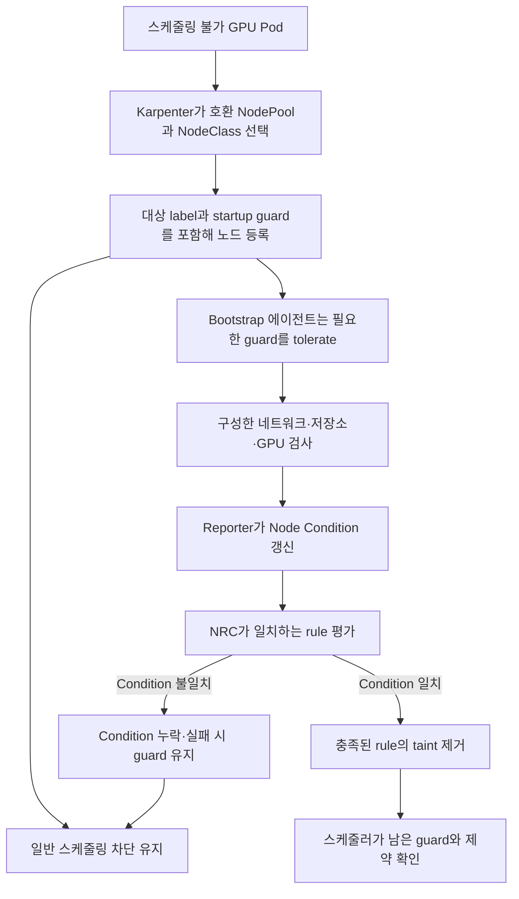

**GPU 노드 그룹 실전 예시:**

이 통합 패턴은 guard가 있는 `gpu-pool`과 사용자 정의 GPU reporter를 사용합니다. `gpu-nodeclass`에는 호환 accelerated AMI, IAM 역할과 네트워크가 미리 구성되어 있어야 합니다. Pod/Job 예시는 이 pool을 대상으로 하며 allocatable GPU 8개가 필요합니다. 앞의 단독 GPU rule과 대안 관계이며, reporter 구현과 실패·Unknown·오래된 신호 처리의 관찰 근거가 필요합니다.

```yaml
# Karpenter NodePool: GPU 노드 그룹
apiVersion: karpenter.sh/v1
kind: NodePool
metadata:
  name: gpu-pool
spec:
  template:
    spec:
      startupTaints:
        - key: readiness.k8s.io/gpu-unavailable
          value: pending
          effect: NoSchedule
      requirements:
        - key: node.kubernetes.io/instance-type
          operator: In
          values: ["p4d.24xlarge", "p5.48xlarge"]
        - key: karpenter.sh/capacity-type
          operator: In
          values: ["on-demand"]
      nodeClassRef:
        group: karpenter.k8s.aws
        kind: EC2NodeClass
        name: gpu-nodeclass
---
# NodeReadinessRule: GPU 드라이버 준비 확인
apiVersion: readiness.node.x-k8s.io/v1alpha1
kind: NodeReadinessRule
metadata:
  name: gpu-readiness-rule
spec:
  conditions:
    - type: "example.com/GPUDriverReady"
      requiredStatus: "True"
    - type: "example.com/GPUDevicePluginReady"
      requiredStatus: "True"
  taint:
    key: "readiness.k8s.io/gpu-unavailable"
    effect: "NoSchedule"
    value: "pending"
  enforcementMode: "continuous"
  nodeSelector:
    matchLabels:
      karpenter.sh/nodepool: gpu-pool
---
# AI 워크로드: guard가 있는 pool을 대상으로 하며 readiness guard는 tolerate하지 않음
apiVersion: batch/v1
kind: Job
metadata:
  name: ml-training
spec:
  template:
    spec:
      # Readiness guard를 tolerate하지 않음
      nodeSelector:
        karpenter.sh/nodepool: gpu-pool

      containers:
        - name: trainer
          image: ml-trainer:v1.0
          resources:
            limits:
              nvidia.com/gpu: 8

      restartPolicy: OnFailure
```

:::tip 스케줄링 안전성 최적화 권장사항
- **CNI 플러그인**: 명시적인 일회성 검사에는 `bootstrap-only`를 사용하며, 지속적인 네트워크 상태에는 continuous rule과 reporter가 필요합니다.
- **GPU/CSI 드라이버**: `continuous`에서는 보고된 실패에 따라 신규 Pod용 guard를 조정합니다. 기존 워크로드의 복구에는 별도 절차가 필요합니다.
- **이미지 프리풀**: 사용자 정의 reporter가 필요한 이미지의 존재를 확인한 후 bootstrap rule을 완료할 수 있습니다.
- **Karpenter 연동**: rule의 selector·taint를 등록 label·startup taint와 맞추고 bootstrap 에이전트가 실행될 수 있는지 확인합니다.
:::

:::warning Alpha 기능 사용 시 주의사항
참조한 외부 NRC 릴리스의 `NodeReadinessRule` API는 `v1alpha1`입니다. 활성화할 Kubernetes control plane의 `NodeReadiness=true` gate는 없습니다.

1. 컨트롤러·CRD·선택한 admission webhook을 같은 릴리스로 고정합니다. `v0.5.0`의 conditions, nodeSelector, enforcementMode와 taint 필드는 불변이므로 기존 rule에서 이를 바꾸려면 직접 수정 대신 계획한 교체 절차가 필요합니다.
2. Node status/reporting 권한, selector 중복과 taint 소유권을 검토합니다. 전체 webhook 패키지에는 문서에 명시된 인증서 구성이 필요합니다.
3. 초기 배치 경합, 누락·실패·오래된 condition, bootstrap 에이전트 배치, 컨트롤러 중단·복구를 별도 시험 계획으로 검증합니다.
4. init container는 Pod가 노드에 배정된 후 실행하므로 노드 스케줄링 guard를 대신하지 않습니다. guard가 있는 노드의 소유 주체별 복구 절차를 유지합니다.
:::

**참고 자료:**

- [Kubernetes Blog: Introducing Node Readiness Controller](https://kubernetes.io/blog/2026/02/03/introducing-node-readiness-controller/)
- [Node Readiness Controller GitHub](https://github.com/kubernetes-sigs/node-readiness-controller)

---

## 11. 종합 체크리스트 & 참고 자료

### 11.1 종합 체크리스트

프로덕션 배포 전 아래 체크리스트를 활용하여 스케줄링 설정을 검증하세요.

#### 기본 스케줄링 (모든 워크로드)

| 항목 | 설명 | 확인 |
|------|------|------|
| **Resource Requests 설정** | 모든 컨테이너에 CPU, Memory requests 명시 | [ ] |
| **PriorityClass 지정** | 워크로드 중요도에 맞는 PriorityClass 할당 | [ ] |
| **Liveness/Readiness Probe** | 헬스 체크 설정으로 Pod 안정성 보장 | [ ] |
| **Graceful Shutdown** | preStop Hook + terminationGracePeriodSeconds | [ ] |
| **Image Pull Policy** | 프로덕션: `IfNotPresent` 또는 `Always` | [ ] |

#### 고가용성 (Critical 워크로드)

| 항목 | 설명 | 확인 |
|------|------|------|
| **Replica 수 ≥ 3** | 장애 도메인 격리를 위한 최소 replica | [ ] |
| **Topology Spread Constraints** | 선택한 Pod·적격 도메인과 Hard/Soft skew 의미 확인 | [ ] |
| **Pod Anti-Affinity** | 노드 분산 (Soft 또는 Hard) | [ ] |
| **PDB 설정** | minAvailable 또는 maxUnavailable 명시 | [ ] |
| **PDB 검증** | `minAvailable < replicas` 확인 | [ ] |
| **Multi-AZ 배포 확인** | 앞의 스냅샷 방식으로 Pod `spec.nodeName`과 Node AZ label을 연결하며 누락·미배치 결과를 유지 | [ ] |

#### 리소스 최적화

| 항목 | 설명 | 확인 |
|------|------|------|
| **Spot 노드 활용** | 재시작 가능한 워크로드에 Spot 노드 허용 | [ ] |
| **Node Affinity 최적화** | 워크로드에 맞는 인스턴스 타입 선택 | [ ] |
| **Taints/Tolerations** | GPU, 고성능 노드 등 전용 노드 격리 | [ ] |
| **Descheduler 설정** | 노드 불균형 해소 (optional) | [ ] |
| **Karpenter 통합** | Disruption budget 설정 | [ ] |

#### 특수 워크로드

| 항목 | 설명 | 확인 |
|------|------|------|
| **GPU 워크로드** | GPU Taint Tolerate + GPU 리소스 요청 | [ ] |
| **StatefulSet** | WaitForFirstConsumer StorageClass 사용 | [ ] |
| **DaemonSet** | 해당 에이전트에 필요한 toleration만 추가하며 bootstrap 에이전트에는 특정 readiness guard가 필요할 수 있음 | [ ] |
| **배치 작업** | PriorityClass: low-priority, preemptionPolicy: Never | [ ] |

### Pod 스케줄링 검증 명령어

읽기 전용 명령 예시를 사용하기 전에 context와 개별 조회 대상을 지정합니다. 노드·AZ별 수는 두 스냅샷과 앞의 `placement_report`로 집계합니다. 빈 노드 이름을 조회하지 않고 알 수 없는 결과와 미배치 Pod를 유지합니다.

```bash
: "${CONTEXT:?대상 Kubernetes context 지정}"
: "${NAMESPACE:?워크로드 namespace 지정}"
: "${POD:?Pod 하나의 이름 지정}"
: "${PDB:?PDB 하나의 이름 지정}"
: "${NODE:?Node 하나의 이름 지정}"

# 1. Pod·노드 배정이며 wide 출력에는 실제 AZ label이 없음
kubectl --context "$CONTEXT" get pods -n "$NAMESPACE" -o wide

# 2. 선택한 Pod의 스케줄링 이벤트
kubectl --context "$CONTEXT" describe pod "$POD" -n "$NAMESPACE"

# 3. 선택한 namespace의 PDB 상태
kubectl --context "$CONTEXT" get pdb -n "$NAMESPACE"
kubectl --context "$CONTEXT" describe pdb "$PDB" -n "$NAMESPACE"

# 4. PriorityClass 목록
kubectl --context "$CONTEXT" get priorityclass

# 5. 선택한 Node의 taint
kubectl --context "$CONTEXT" get node "$NODE" -o jsonpath='{.spec.taints}'

# 6-7. placement_report의 노드·AZ 집계에 사용할 스냅샷
kubectl --context "$CONTEXT" get pods -n "$NAMESPACE" -o json > pods.json
kubectl --context "$CONTEXT" get nodes -o json > nodes.json

# 8. 선택한 namespace의 Warning 이벤트
kubectl --context "$CONTEXT" get events -n "$NAMESPACE" --field-selector type=Warning --sort-by='.lastTimestamp'

# 9. 해당 namespace·selector를 사용하는 Descheduler가 설치된 경우 로그 조회
kubectl --context "$CONTEXT" logs -n kube-system -l app=descheduler --tail=100
```

### 11.2 관련 문서

**내부 문서:**
- [EKS 고가용성 아키텍처 가이드](/docs/eks-best-practices/operations-reliability/eks-resiliency-guide) — Multi-AZ 전략, Topology Spread, Cell Architecture
- [Karpenter를 활용한 초고속 오토스케일링](/docs/eks-best-practices/resource-cost/karpenter-autoscaling) — Karpenter NodePool 심층 설정
- [EKS 리소스 최적화 가이드](/docs/eks-best-practices/resource-cost/eks-resource-optimization) — 리소스 Requests/Limits 최적화
- [EKS Pod 헬스체크 & 라이프사이클](/docs/eks-best-practices/operations-reliability/eks-pod-health-lifecycle) — Probe, Lifecycle Hooks

### 11.3 외부 참조

**공식 Kubernetes 문서:**
- [Kubernetes Scheduling Framework](https://kubernetes.io/docs/concepts/scheduling-eviction/scheduling-framework/)
- [Assigning Pods to Nodes](https://kubernetes.io/docs/concepts/scheduling-eviction/assign-pod-node/)
- [Pod Priority and Preemption](https://kubernetes.io/docs/concepts/scheduling-eviction/pod-priority-preemption/)
- [Taints and Tolerations](https://kubernetes.io/docs/concepts/scheduling-eviction/taint-and-toleration/)
- [Pod Topology Spread Constraints](https://kubernetes.io/docs/concepts/scheduling-eviction/topology-spread-constraints/)
- [PodDisruptionBudget](https://kubernetes.io/docs/concepts/workloads/pods/disruptions/)

**Descheduler:**
- [Descheduler GitHub](https://github.com/kubernetes-sigs/descheduler)
- [Descheduler Strategies](https://github.com/kubernetes-sigs/descheduler#policy-and-strategies)

**AWS EKS 공식 문서:**
- [EKS Best Practices — Reliability](https://docs.aws.amazon.com/eks/latest/best-practices/reliability.html)
- [Karpenter Scheduling](https://karpenter.sh/docs/concepts/scheduling/)
- [EKS Node Taints](https://docs.aws.amazon.com/eks/latest/userguide/node-taints-managed-node-groups.html)

**AWS 관련 아키텍처·기능 자료:**
- [Amazon EKS introduces Provisioned Control Plane](https://aws.amazon.com/blogs/containers/amazon-eks-introduces-provisioned-control-plane/) — XL/2XL/4XL 티어별 스케줄링 성능
- [Getting started with Amazon EKS Auto Mode](https://aws.amazon.com/blogs/containers/getting-started-with-amazon-eks-auto-mode) — 자동 노드 프로비저닝
- [ARC zonal shift support for EKS Auto Mode and Karpenter](https://aws.amazon.com/blogs/containers/arc-zonal-shift-support-for-eks-auto-mode-and-karpenter/) — 2026년 7월 공개된 트래픽 shift·용량 제어와 전제조건
- [Monitor network performance across EKS clusters](https://aws.amazon.com/blogs/aws/monitor-network-performance-and-traffic-across-your-eks-clusters-with-container-network-observability/) — Container Network Observability
- [Proactive EKS monitoring with CloudWatch Operator](https://aws.amazon.com/blogs/containers/proactive-amazon-eks-monitoring-with-amazon-cloudwatch-operator-and-aws-control-plane-metrics/) — Control Plane 메트릭

**Red Hat OpenShift 문서:**
- [Controlling Pod Placement with Taints and Tolerations](https://docs.openshift.com/container-platform/4.18/nodes/scheduling/nodes-scheduler-taints-tolerations.html) — Taints/Tolerations 운영
- [Placing Pods on Specific Nodes with Pod Affinity](https://docs.openshift.com/container-platform/4.18/nodes/scheduling/nodes-scheduler-pod-affinity.html) — Pod Affinity/Anti-Affinity 구성
- [Evicting Pods Using the Descheduler](https://docs.openshift.com/container-platform/4.18/nodes/scheduling/nodes-descheduler.html) — Descheduler 전략 및 설정
- [Managing Pods](https://docs.openshift.com/container-platform/4.18/nodes/pods/nodes-pods-configuring.html) — Pod 관리 및 스케줄링 기본

**커뮤니티:**
- [CNCF Scheduler SIG](https://github.com/kubernetes/community/tree/master/sig-scheduling)
- [Kubernetes Scheduling Deep Dive (KubeCon)](https://www.youtube.com/results?search_query=kubecon+scheduling)
- [AWS re:Invent 2025 — Amazon EKS Sessions](https://aws.amazon.com/blogs/containers/guide-to-amazon-eks-and-kubernetes-sessions-at-aws-reinvent-2025/)
