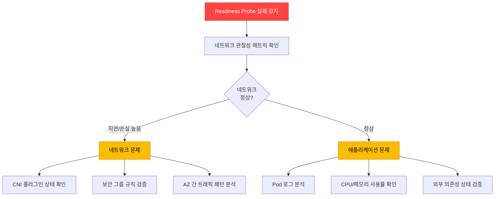
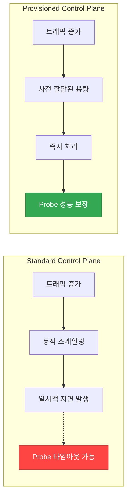
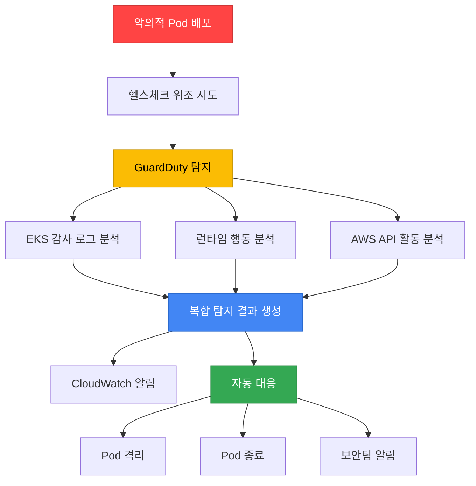

[Pod 라이프사이클 개요](../eks-pod-health-lifecycle.md) · [체크리스트와 참고 자료](./checklist-references.md)

## 2025-2026 EKS 신규 기능과 Probe 통합 {#27-2025-2026-eks-신규-기능과-probe-통합}

AWS re:Invent 2025에서 발표된 EKS의 새로운 관찰성 및 제어 기능은 Probe 기반 헬스체크를 더욱 강화합니다. 이 섹션에서는 최신 EKS 기능과 Probe를 통합하여 더 정확하고 선제적인 헬스 모니터링을 구현하는 방법을 다룹니다.

### Container Network Observability로 Probe 연결성 검증 {#271-container-network-observability로-probe-연결성-검증}

**개요:**

Container Network Observability(2025년 11월 발표)는 Pod 간 네트워크 통신 패턴, 지연 시간, 패킷 손실 등 세밀한 네트워크 메트릭을 제공합니다. Probe 실패가 네트워크 문제로 인한 것인지, 애플리케이션 자체 문제인지 명확히 구분할 수 있습니다.

**주요 기능:**
- Pod-to-Pod 통신 경로 시각화
- 네트워크 지연(latency), 패킷 손실(packet loss), 재전송률 모니터링
- 실시간 네트워크 트래픽 이상 탐지
- CloudWatch Container Insights와의 통합

**활성화 방법:**

Container Network Observability는 EKS 콘솔, AWS CLI, 또는 EKS API로 활성화합니다. 콘솔에서 활성화하면 Network Flow Monitor(NFM)의 Scope와 Monitor 리소스가 자동 생성되고, NFM Agent EKS 애드온 설치 과정을 안내받습니다. IaC(예: Terraform)로 구성하려면 NFM Scope, NFM Monitor, NFM용 EKS 애드온을 정의하고 Pod Identity 또는 IRSA로 애드온에 권한을 부여해야 합니다. 정확한 애드온 이름과 명령 옵션은 [EKS 네트워크 관찰성 문서](https://docs.aws.amazon.com/eks/latest/userguide/network-observability.html)를 참조하세요. VPC CNI의 환경 변수나 ConfigMap으로 활성화하는 설정 키는 공식 문서에 존재하지 않습니다.

**Probe 연결성 검증 예시:**

```yaml
apiVersion: apps/v1
kind: Deployment
metadata:
  name: api-gateway
  annotations:
    # 네트워크 관찰성 메트릭 수집 활성화
    network-observability.amazonaws.com/enabled: "true"
spec:
  selector:
    matchLabels:
      app: "api-gateway"
  replicas: 3
  template:
    metadata:
      labels:
        app: "api-gateway"
    spec:
      containers:
      - name: gateway
        image: myapp/gateway:v2
        ports:
        - containerPort: 8080
        # Readiness Probe: 외부 DB 연결 확인
        readinessProbe:
          httpGet:
            path: /ready
            port: 8080
          periodSeconds: 5
          failureThreshold: 2
          timeoutSeconds: 3
        livenessProbe:
          httpGet:
            path: /healthz
            port: 8080
          periodSeconds: 10
          failureThreshold: 3
```

**CloudWatch Insights 쿼리 - Probe 실패와 네트워크 지연 상관 분석:**

다음 쿼리는 예시이며, `probe_result`, `probe_type`, `network_latency_ms`, `packet_loss_percent` 필드가 하나의 로그 이벤트에 함께 기록되는 경우에만 동작합니다. 이 필드들은 기본 수집 항목이 아니므로, 애플리케이션이나 수집 파이프라인에서 Probe 결과와 네트워크 메트릭을 같은 이벤트로 내보내도록 먼저 구성해야 합니다.

```sql
-- Probe 실패 시점의 네트워크 지연 확인 (필드가 수집되는 경우)
fields @timestamp, pod_name, probe_type, network_latency_ms, packet_loss_percent
| filter namespace = "production"
| filter probe_result = "failed"
| filter network_latency_ms > 100 or packet_loss_percent > 1
| sort @timestamp desc
| limit 100
```

**알림 설정 예시:**

아래 ConfigMap은 알람 정의를 문자열로 담아둘 뿐이며, 이 ConfigMap을 적용해도 CloudWatch 알람은 생성되지 않습니다. 실제 알람은 ACK CloudWatch 컨트롤러의 `MetricAlarm` 리소스(`cloudwatch.services.k8s.aws/v1alpha1`), `aws cloudwatch put-metric-alarm`, 또는 IaC로 생성해야 합니다. 아래 JSON은 그렇게 생성할 때 사용할 파라미터의 참고 예시입니다.

```yaml
# 참고용 알람 파라미터 (ConfigMap 자체로는 알람이 생성되지 않음)
apiVersion: v1
kind: ConfigMap
metadata:
  name: probe-network-alert
  namespace: monitoring
data:
  alarm-config: |
    {
      "AlarmName": "ProbeFailureWithNetworkIssue",
      "MetricName": "ReadinessProbeFailure",
      "Namespace": "ContainerInsights",
      "Statistic": "Sum",
      "Period": 60,
      "EvaluationPeriods": 2,
      "Threshold": 3,
      "ComparisonOperator": "GreaterThanThreshold",
      "Dimensions": [
        {"Name": "ClusterName", "Value": "production-eks"},
        {"Name": "Namespace", "Value": "production"}
      ],
      "AlarmDescription": "Readiness Probe 실패 시 네트워크 지연 확인 필요"
    }
```

**그림 1. Readiness Probe 실패 시 네트워크·애플리케이션 원인 진단 워크플로우**



:::tip Pod-to-Pod 경로 시각화
Container Network Observability의 서비스 맵과 플로우 테이블은 Pod 간 통신에 대한 집계된 플로우 메트릭(재전송, 재전송 타임아웃, 전송 데이터량)을 보여줍니다. 개별 Probe 요청을 하나씩 추적하지는 않지만, Readiness Probe가 외부 데이터베이스를 확인하는 경로에서 어느 구간의 플로우 지표가 악화되는지로 병목 구간을 좁힐 수 있습니다.
:::

---

### CloudWatch Observability Operator + Control Plane 메트릭 {#272-cloudwatch-observability-operator--control-plane-메트릭}

**개요:**

CloudWatch Observability Operator는 EKS Control Plane 메트릭을 자동으로 수집하여, API Server 성능 저하가 Probe 응답에 미치는 영향을 사전에 감지합니다.

**설치:**

CloudWatch Observability는 EKS 애드온 `amazon-cloudwatch-observability`로 설치합니다. 이 애드온은 CloudWatch Agent와 Operator를 배포하며, Container Insights와 메트릭 수집을 담당합니다. 앞 예시에 있던 `aws-cloudwatch-observability-operator` 번들 매니페스트 URL과 `EKSControlPlaneMetrics` CRD는 공식 저장소에 존재하지 않으므로 사용하지 않습니다. 수집할 Control Plane 메트릭의 선택과 전송은 EKS 콘솔 또는 API의 Control Plane 모니터링 설정과 애드온 구성으로 지정합니다.

```bash
# CloudWatch Observability 애드온 설치 (EKS API)
aws eks create-addon \
  --cluster-name production-eks \
  --addon-name amazon-cloudwatch-observability
```

정확한 애드온 구성 옵션과 Control Plane 메트릭 활성화 방법은 [EKS 관찰성 대시보드 문서](https://docs.aws.amazon.com/eks/latest/userguide/observability-dashboard.html)를 참조하세요.

**표 1. 주요 Control Plane 메트릭과 Probe 연관성**

| 메트릭 | 설명 | Probe 연관성 | 임계값 예시 |
|--------|------|-------------|------------|
| `apiserver_request_duration_seconds` | API Server 요청 지연 시간 | Probe 요청 처리 속도 | p99 < 1초 |
| `apiserver_request_total` (code=5xx) | API Server 5xx 에러 수 | Probe 실패율 상승 | < 1% |
| `apiserver_storage_objects` | etcd 저장 오브젝트 수 | 클러스터 규모 한계 | < 150,000 |
| `etcd_request_duration_seconds` | etcd 읽기/쓰기 지연 | Pod 상태 업데이트 지연 | p99 < 100ms |
| `rest_client_requests_total` (code=429) | API Rate Limiting 발생 | kubelet-apiserver 통신 제한 | < 10/min |

**Probe 타임아웃 예측 알림:**

```yaml
# ACK CloudWatch 컨트롤러의 MetricAlarm 리소스
apiVersion: cloudwatch.services.k8s.aws/v1alpha1
kind: MetricAlarm
metadata:
  name: apiserver-slow-probe-risk
spec:
  name: "EKS-APIServer-SlowProbeRisk"
  namespace: AWS/EKS
  metricName: apiserver_request_duration_seconds
  dimensions:
    - name: ClusterName
      value: production-eks
    - name: verb
      value: GET
  period: 60
  extendedStatistic: p99
  evaluationPeriods: 2
  threshold: 0.5
  comparisonOperator: GreaterThanOrEqualToThreshold
  alarmDescription: "API Server 성능 저하로 인한 Probe 타임아웃 위험 (응답 지연 > 500ms)"
  alarmActions:
    - arn:aws:sns:ap-northeast-2:123456789012:eks-ops-alerts
```

**대규모 클러스터에서의 Probe 성능 보장:**

```yaml
# 1000+ 노드 클러스터의 Probe 설정 최적화
apiVersion: apps/v1
kind: Deployment
metadata:
  name: large-scale-api
spec:
  selector:
    matchLabels:
      app: "large-scale-api"
  replicas: 100
  template:
    metadata:
      labels:
        app: "large-scale-api"
    spec:
      containers:
      - name: api
        image: myapp/api:v1
        # Probe 타이밍 조정: API Server 부하 고려
        startupProbe:
          httpGet:
            path: /healthz
            port: 8080
          failureThreshold: 30
          periodSeconds: 5  # 초기 시작 시간 여유
        livenessProbe:
          httpGet:
            path: /healthz
            port: 8080
          periodSeconds: 15  # 대규모에서는 간격 증가
          failureThreshold: 3
          timeoutSeconds: 5
        readinessProbe:
          httpGet:
            path: /ready
            port: 8080
          periodSeconds: 10
          failureThreshold: 2
          timeoutSeconds: 3
```

**CloudWatch Dashboard - Control Plane & Probe 상관 분석:**

```json
{
  "widgets": [
    {
      "type": "metric",
      "properties": {
        "title": "API Server 지연 vs Probe 실패율",
        "metrics": [
          ["AWS/EKS", "apiserver_request_duration_seconds", {"stat": "p99", "label": "API Server p99 지연"}],
          ["ContainerInsights", "ReadinessProbeFailure", "ClusterName", "production-eks", {"stat": "Sum", "yAxis": "right"}]
        ],
        "period": 60,
        "region": "ap-northeast-2",
        "yAxis": {
          "left": {"label": "지연 시간 (초)", "min": 0},
          "right": {"label": "Probe 실패 수", "min": 0}
        }
      }
    }
  ]
}
```

`ReadinessProbeFailure`는 Container Insights가 기본으로 수집하는 지표가 아닙니다. Container Insights(향상된 관측성 포함)의 Pod 지표에는 `pod_status_ready`, `pod_container_status_waiting_reason_crash_loop_back_off` 같은 상태 지표가 있지만 Probe 실패 횟수 지표는 없습니다(2026-10-29 기준). 이 위젯과 앞의 알람 예시를 쓰려면 kubelet의 `prober_probe_total` 카운터(`/metrics/probes`) 등을 수집해 CloudWatch로 게시하는 파이프라인을 직접 구성해야 하며, 위젯에는 그 파이프라인이 게시할 때 지정한 네임스페이스, 지표 이름, 차원(예: `ClusterName`)을 그대로 적어야 합니다. CloudWatch는 네임스페이스, 지표 이름, 차원 조합이 정확히 일치하는 지표만 조회합니다.

:::warning 대규모 클러스터의 API Server 부하
kubelet의 HTTP/TCP/exec/gRPC Probe는 노드에서 대상 Pod을 직접 호출하며 API Server를 거치지 않으므로, Probe 자체가 API Server에 부하를 집중시키지는 않습니다. 다만 대규모 클러스터에서는 kubelet의 상태 보고와 watch, 그 밖의 API 호출이 API Server 부하를 높일 수 있고, 이때 Pod 상태 업데이트가 지연되면 Probe 결과 반영이 느려질 수 있습니다. API Server에 의존하는 호출 부하가 문제가 되면 해당 호출의 주기를 조정하세요. Provisioned Control Plane은 사전 할당된 제어 플레인 용량으로 이런 API Server 부하 상황을 완화할 수 있지만, kubelet이 로컬에서 수행하는 Probe 실행 경로를 바꾸지는 않습니다(Section 2.7.3).
:::

---

### Provisioned Control Plane에서 Probe 성능 보장 {#273-provisioned-control-plane에서-probe-성능-보장}

**개요:**

Provisioned Control Plane(2025년 11월 발표)은 AI Training, HPC, 대규모 배치 같은 워크로드에 사전 할당된 제어 플레인 용량을 제공합니다. kubelet Probe는 노드에서 실행하므로, 이 용량은 API 동시성과 스케줄링을 위한 것이며 Probe 지연 보장치가 아닙니다.

**표 2. Provisioned Control Plane 티어별 성능 특성과 적합 워크로드**

| 티어 | API 동시성, EKS 1.30–1.33 (seat) | API 동시성, EKS 1.34+ (seat) | Pod 스케줄링 (pods/sec) |
|------|--------------------------------|-----------------------------|------------------------|
| **XL** | 1,700 | 2,000 | 167 |
| **2XL** | 3,400 | 4,000 | 283 |
| **4XL** | 6,800 | 8,000 | 400 |
| **8XL** | 13,600 | 16,000 | 400 |

이 표는 2026년 10월 30일 [EKS Provisioned Control Plane 문서](https://docs.aws.amazon.com/eks/latest/userguide/eks-provisioned-control-plane.html)에서 확인한 티어 속성입니다. 모든 티어의 클러스터 데이터베이스는 16 GB이며, SLA는 1분 단위로 측정한 99.99%입니다. 최대 노드 수와 Probe 지연은 티어 보장치가 아니므로, 공식 근거가 없던 1,000/2,500/5,000개 노드 추정치는 제거했습니다. API 동시성과 스케줄러 처리량은 kubelet Probe 지연 측정값이 아닙니다. 클러스터의 Kubernetes 버전과 실제 사용률로 용량을 선택하고, 워크로드 패턴과 구성에 따른 지원 규모와 성능은 대상 환경에서 측정해야 합니다.

**그림 2. Standard와 Provisioned Control Plane의 부하 처리 비교**



**Provisioned Control Plane 생성:**

문서화된 `aws eks create-cluster` CLI에는 아래와 같은 Provisioned Control Plane 선택 플래그가 없습니다. 다음 예시는 표준 클러스터 생성 명령이며, Provisioned Control Plane 활성화 방법과 실제 옵션은 [EKS Provisioned Control Plane 문서](https://docs.aws.amazon.com/eks/latest/userguide/eks-provisioned-control-plane.html)에서 확인하세요.

```bash
# 클러스터 생성 (AWS CLI)
aws eks create-cluster \
  --name production-provisioned \
  --region ap-northeast-2 \
  --kubernetes-version 1.32 \
  --role-arn arn:aws:iam::123456789012:role/eks-cluster-role \
  --resources-vpc-config subnetIds=subnet-xxx,subnet-yyy,securityGroupIds=sg-zzz
```

**대규모 Probe 최적화 예시:**

Control Plane 티어는 클러스터 수준의 API 설정이며, Deployment 애너테이션으로 지정할 수 없습니다. 아래 예시는 Provisioned Control Plane 클러스터에서 짧은 Probe 간격을 사용하는 워크로드 설정이며, 애너테이션으로 티어를 바꾸는 부분은 효과가 없어 제거했습니다.

```yaml
# AI/ML Training 클러스터 (1000+ GPU 노드)
apiVersion: apps/v1
kind: Deployment
metadata:
  name: training-coordinator
spec:
  selector:
    matchLabels:
      app: "training-coordinator"
  replicas: 50
  template:
    metadata:
      labels:
        app: "training-coordinator"
    spec:
      containers:
      - name: coordinator
        image: ml-training/coordinator:v3
        resources:
          requests:
            cpu: 4
            memory: 16Gi
        # Provisioned Control Plane에서는 짧은 간격 설정 가능
        startupProbe:
          httpGet:
            path: /healthz
            port: 9090
          failureThreshold: 30
          periodSeconds: 3  # 빠른 감지
        livenessProbe:
          httpGet:
            path: /healthz
            port: 9090
          periodSeconds: 5  # Standard보다 짧게
          failureThreshold: 2
          timeoutSeconds: 2
        readinessProbe:
          httpGet:
            path: /ready
            port: 9090
          periodSeconds: 3
          failureThreshold: 1
          timeoutSeconds: 2
```

**사용 사례(가상 시나리오): AI/ML Training 클러스터**

- **문제**: 1,000개의 GPU 노드에서 동시에 수백 개의 Training Pod 시작 시, Standard Control Plane에서 API Server 응답 지연 발생
- **해결**: Provisioned Control Plane XL 티어 사용
- **기대 효과**:
  - Pod 스케줄링 시간 단축
  - Readiness Probe 타임아웃 감소
  - Training Job 시작 안정성 향상

이 사례는 측정한 사례가 아니라 가상의 시나리오이며, 위 효과는 관측된 결과가 아니라 검증해야 할 기대 효과입니다. kubelet Probe는 API Server를 거치지 않으므로, Readiness Probe 타임아웃이 줄어드는지는 Probe가 확인하는 의존성이 API Server 지연의 영향을 받는 경우에만 기대할 수 있습니다. 효과는 노드 수, 동시에 시작하는 Pod 수, 선택한 티어를 정해 Standard 모드와 비교 측정해 확인합니다.

**Cost vs Performance 고려사항:**

```yaml
# Provisioned Control Plane 비용 최적화 전략
# 1. 평상시: Standard Control Plane
# 2. Training 기간: Provisioned Control Plane XL 사용
# (티어는 클러스터 수준 설정이며, 변경 가능 여부와 절차는 EKS Provisioned Control Plane 문서에서 확인)
```

:::tip HPC 및 대규모 배치 워크로드
Provisioned Control Plane은 짧은 시간 내에 수천 개의 Pod을 동시에 시작하는 워크로드에 최적화되어 있습니다. AI/ML Training, 과학 시뮬레이션, 대규모 데이터 처리 등에서 Probe 성능을 보장하여 Job 시작 시간을 단축할 수 있습니다.
:::

---

### GuardDuty Extended Threat Detection 연계 {#274-guardduty-extended-threat-detection-연계}

**개요:**

GuardDuty Extended Threat Detection(EKS 지원: 2025년 6월)은 EKS 감사 로그, 컨테이너 런타임 행동, AWS API 활동에서 나온 신호와 기존 GuardDuty 탐지 결과를 상관 분석해, 여러 단계에 걸친 공격을 하나의 Critical 공격 시퀀스 탐지 결과(`AttackSequence:EKS/CompromisedCluster`)로 생성합니다. EKS에서 이 기능을 쓰려면 EKS Protection 또는 Runtime Monitoring(EKS 애드온) 중 하나 이상을 켜야 합니다. AWS 문서는 Probe 엔드포인트 접근 패턴이나 헬스체크 위조를 탐지 대상으로 설명하지 않으므로([Extended Threat Detection](https://docs.aws.amazon.com/guardduty/latest/ug/guardduty-extended-threat-detection.html), 2026-10-29 기준), 헬스체크로 정상처럼 보이는 악성 워크로드도 Probe 응답이 아니라 이러한 감사 로그·런타임·API 신호로 탐지됩니다.

**주요 기능:**
- EKS 감사 로그 + 런타임 행동 + 맬웨어 실행 + AWS API 활동 상관 분석
- AI/ML 기반 다단계 공격 시퀀스 탐지
- 크립토마이닝 등 악의적 워크로드 자동 탐지

**활성화:**

```bash
# GuardDuty Extended Threat Detection for EKS 활성화 (AWS CLI)
aws guardduty update-detector \
  --detector-id <detector-id> \
  --features '[
    {
      "Name": "EKS_AUDIT_LOGS",
      "Status": "ENABLED"
    },
    {
      "Name": "EKS_RUNTIME_MONITORING",
      "Status": "ENABLED",
      "AdditionalConfiguration": [
        {
          "Name": "EKS_ADDON_MANAGEMENT",
          "Status": "ENABLED"
        }
      ]
    }
  ]'
```

**Probe 엔드포인트 보안 패턴:**

`httpGet.httpHeaders`의 `value`는 정적 문자열이며 환경 변수나 Secret을 참조하지 못합니다. 따라서 아래 예시의 `value: "SECRET_TOKEN_FROM_ENV"`는 그 문자열 자체를 전송할 뿐 `secretKeyRef`로 주입한 토큰 값을 보내지 않습니다. 토큰 기반 검증이 필요하면 애플리케이션이 자체적으로 토큰을 읽어 확인하거나 사이드카로 처리하고, Probe는 그 결과를 반환하는 엔드포인트를 호출하도록 구성하세요.

```yaml
apiVersion: apps/v1
kind: Deployment
metadata:
  name: secure-api
spec:
  selector:
    matchLabels:
      app: "secure-api"
  replicas: 3
  template:
    metadata:
      labels:
        app: "secure-api"
    spec:
      containers:
      - name: api
        image: myapp/secure-api:v2
        ports:
        - containerPort: 8080
        # 헬스체크 엔드포인트
        livenessProbe:
          httpGet:
            path: /healthz
            port: 8080
            httpHeaders:
            - name: X-Health-Check-Token
              value: "SECRET_TOKEN_FROM_ENV"
          periodSeconds: 10
        readinessProbe:
          httpGet:
            path: /ready
            port: 8080
            httpHeaders:
            - name: X-Health-Check-Token
              value: "SECRET_TOKEN_FROM_ENV"
          periodSeconds: 5
        env:
        - name: HEALTH_CHECK_TOKEN
          valueFrom:
            secretKeyRef:
              name: api-secrets
              key: health-token
```

**그림 3. 악성 Pod 배포 이후 GuardDuty 복합 탐지와 자동 대응의 가상 시나리오**



**예시 시나리오 - Cryptomining:**

참고로 인용한 AWS 블로그의 크립토마이닝 캠페인은 탈취된 IAM 자격 증명으로 EC2와 ECS를 대상으로 한 사례이며, EKS Probe/헬스체크 우회 사례가 아닙니다. 아래는 헬스체크가 공격자에게 어떻게 우회될 수 있는지를 보여주는 가상의 예시 시나리오입니다.

1. 정상 컨테이너 이미지로 위장
2. startupProbe 성공 후 악성 바이너리 다운로드
3. livenessProbe는 정상 응답, 백그라운드에서 마이닝 실행
4. GuardDuty가 비정상적인 네트워크 트래픽 + CPU 사용 패턴 탐지

**탐지 후 자동 대응:**

아래 ConfigMap은 EventBridge 규칙 패턴과 Lambda 코드의 골격을 문자열로 담아 둔 참고 예시이며, 이 ConfigMap을 적용해도 어떤 대응도 실행되지 않습니다. 실제 자동 대응에는 GuardDuty Finding 이벤트를 매칭하는 EventBridge 규칙과 그 대상(target)으로 등록한 Lambda 함수를 배포해야 합니다. Lambda 함수에는 클러스터 접근 권한(예: EKS 액세스 엔트리)을 받은 IAM 역할과, 그 자격 증명으로 Kubernetes API를 호출해 NetworkPolicy를 만드는 클라이언트 코드가 필요합니다. 아래 `isolate_pod`는 kubectl 명령 문자열을 만들 뿐 실행하지 않습니다. 또한 규칙 패턴의 `"severity": [7, 8, 9]`는 정확히 그 값만 일치하므로, 7.5처럼 소수점이 있는 심각도의 탐지 결과는 매칭되지 않습니다(GuardDuty 문서의 예시 패턴은 소수 값까지 나열합니다, [EventBridge 규칙 생성](https://docs.aws.amazon.com/guardduty/latest/ug/guardduty_findings_eventbridge.html)).

```yaml
# EventBridge Rule: GuardDuty Finding → Lambda → Pod 격리
apiVersion: v1
kind: ConfigMap
metadata:
  name: guardduty-response
  namespace: security
data:
  # severity 7-8은 High, 9는 Critical에 해당합니다.
  eventbridge-rule: |
    {
      "source": ["aws.guardduty"],
      "detail-type": ["GuardDuty Finding"],
      "detail": {
        "service": {
          "serviceName": ["EKS"]
        },
        "severity": [7, 8, 9]
      }
    }
  lambda-action: |
    import boto3
    eks = boto3.client('eks')

    def isolate_pod(cluster_name, namespace, pod_name, app_label):
        # NetworkPolicy로 Pod 격리
        # podSelector는 대상 Pod에 실제로 존재하는 레이블과 일치해야 합니다.
        # 아래 secure-api Deployment의 Pod은 app=secure-api 레이블을 가지므로
        # 그 레이블로 선택합니다. (Pod 이름을 그대로 레이블로 쓰면 매칭되지 않습니다.)
        kubectl_command = f"""
        kubectl apply -f - <<EOF
        apiVersion: networking.k8s.io/v1
        kind: NetworkPolicy
        metadata:
          name: isolate-{pod_name}
          namespace: {namespace}
        spec:
          podSelector:
            matchLabels:
              app: {app_label}
          policyTypes:
          - Ingress
          - Egress
        EOF
        """
        # 실행 로직...
```

**보안 모니터링 대시보드:**

```yaml
# CloudWatch Dashboard: GuardDuty + Probe 상태
apiVersion: cloudwatch.amazonaws.com/v1alpha1
kind: Dashboard
metadata:
  name: security-probe-monitoring
spec:
  widgets:
    - type: metric
      title: "GuardDuty 탐지 vs Probe 실패"
      metrics:
        - namespace: AWS/GuardDuty
          metricName: FindingCount
          dimensions:
            - name: ClusterName
              value: production-eks
        - namespace: ContainerInsights
          metricName: ProbeFailure
          dimensions:
            - name: Namespace
              value: production
```

:::warning 헬스체크 엔드포인트 보안
Probe 엔드포인트(`/healthz`, `/ready`)는 인증 없이 공개되는 경우가 많아 공격 표면이 될 수 있습니다. GuardDuty Extended Threat Detection을 활성화하고, 가능하면 헬스체크 요청에 간단한 토큰 헤더를 추가하여 무단 접근을 제한하세요.
:::

**관련 문서:**
- [AWS Blog: GuardDuty Extended Threat Detection for EKS](https://aws.amazon.com/blogs/aws/amazon-guardduty-expands-extended-threat-detection-coverage-to-amazon-eks-clusters/)
- [AWS Blog: Cryptomining Campaign Detection](https://aws.amazon.com/blogs/security/cryptomining-campaign-targeting-amazon-ec2-and-amazon-ecs/)
- [EKS 보안 Best Practices](https://docs.aws.amazon.com/eks/latest/best-practices/security.html)

---
